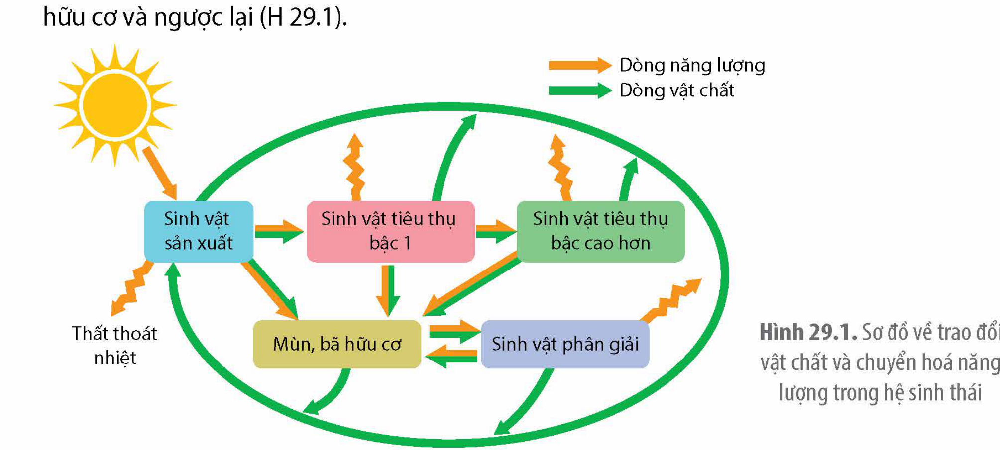
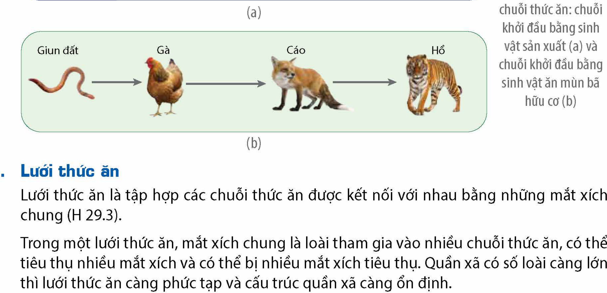
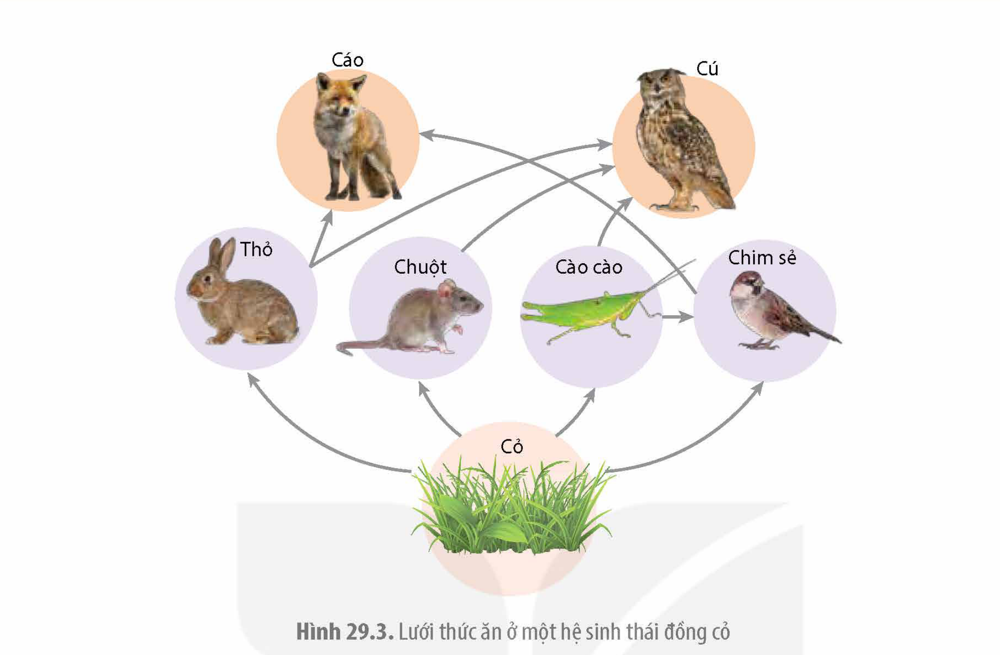
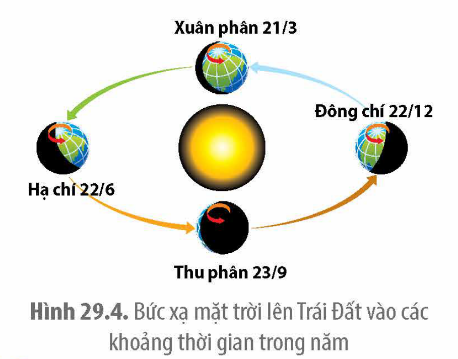
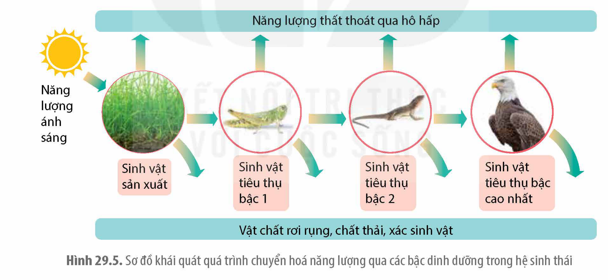
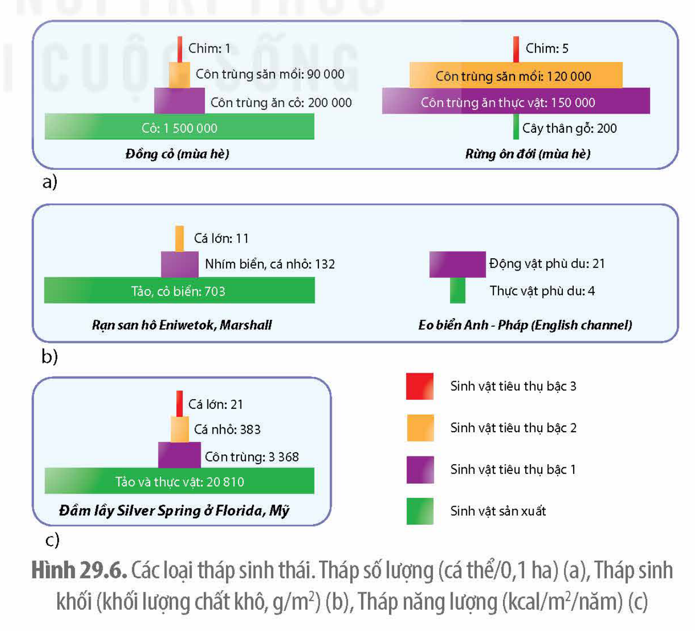

<!-- pdf:157 -->

# BÀI 29: TRAO ĐỔI VẬT CHẤT VÀ CHUYỂN HOÁ NĂNG LƯỢNG TRONG HỆ SINH THÁI

## 🎯 Yêu cầu cần đạt

Phân tích được quá trình trao đổi vật chất và chuyển hoá năng lượng trong hệ sinh thái, bao gồm:
- Trình bày được khái niệm chuỗi thức ăn, các loại chuỗi thức ăn, lưới thức ăn, bậc dinh dưỡng. Vẽ được sơ đồ chuỗi và lưới thức ăn trong quần xã.
- Trình bày được dòng năng lượng trong một hệ sinh thái (bao gồm: phân bố năng lượng trên Trái Đất, sơ đồ khái quát về dòng năng lượng trong hệ sinh thái, sơ đồ khái quát năng lượng chuyển qua các bậc dinh dưỡng trong hệ sinh thái).
- Nêu được khái niệm hiệu suất sinh thái (sản lượng sơ cấp, sản lượng thứ cấp); tháp sinh thái. Phân biệt được các dạng tháp sinh thái. Tính được hiệu suất sinh thái của một hệ sinh thái.
- Giải thích được ý nghĩa của nghiên cứu hiệu suất sinh thái và tháp sinh thái trong thực tiễn.

## 🔴 Mở đầu

Tại sao những vùng biển có chất vô cơ ở đáy cuộn lên bề mặt thường có tổng sinh khối lớn hơn tổng sinh khối ở những vùng biển lặng?

## I. KHÁI QUÁT TRAO ĐỔI VẬT CHẤT VÀ CHUYỂN HOÁ NĂNG LƯỢNG TRONG HỆ SINH THÁI

Năng lượng cung cấp cho toàn bộ sinh vật trên Trái Đất chủ yếu đến từ nguồn năng lượng ánh sáng mặt trời. Song song với quá trình chuyển hoá năng lượng là quá trình chuyển hoá vật chất. Sinh vật sản xuất (trừ vi khuẩn hoá tổng hợp) chuyển hoá quang năng thành hoá năng thông qua quá trình tổng hợp chất hữu cơ từ chất vô cơ. Đa số sinh vật sử dụng nguồn chất hữu cơ này để kiến tạo cơ thể và cung cấp năng lượng cho các hoạt động sống. Trong hệ sinh thái, năng lượng được chuyển hoá theo một chiều với đầu vào là quang năng và đầu ra là nhiệt năng còn vật chất được lưu chuyển tuần hoàn từ chất vô cơ thành hữu cơ và ngược lại (H 29.1).

Hình 29.1. Sơ đồ về trao đổi vật chất và chuyển hoá năng lượng trong hệ sinh thái

<!-- pdf:158 -->

## II. TRAO ĐỔI VẬT CHẤT TRONG HỆ SINH THÁI

Trao đổi vật chất trong hệ sinh thái gồm trao đổi vật chất giữa quần xã với sinh cảnh và trao đổi vật chất giữa các sinh vật trong quần xã.

Trao đổi vật chất trong quần xã là quá trình lưu chuyển vật chất giữa các loài trong quần xã, quá trình này phụ thuộc chủ yếu vào mối quan hệ sinh vật này ăn sinh vật khác, bản chất là mối quan hệ dinh dưỡng giữa các loài. Trao đổi vật chất trong quần xã được thể hiện qua cấu trúc của chuỗi thức ăn, lưới thức ăn và bậc dinh dưỡng.

### 1. Chuỗi thức ăn

<!-- term: Chuỗi thức ăn -->
Chuỗi thức ăn là một dãy các loài có mối quan hệ dinh dưỡng với nhau.

Các loài trong chuỗi thức ăn sắp xếp tương tự như một chuỗi xích, trong đó mỗi loài là một mắt xích. Mỗi mắt xích trong chuỗi thức ăn tiêu thụ mắt xích trước đó và bị mắt xích phía sau tiêu thụ. Có hai loại chuỗi thức ăn: loại khởi đầu bằng sinh vật sản xuất và loại khởi đầu bằng sinh vật ăn mùn bã hữu cơ (H 29.2).

Chuỗi thức ăn khởi đầu bằng sinh vật sản xuất có mắt xích thứ nhất là sinh vật tự dưỡng, mắt xích thứ hai là động vật ăn thực vật (sinh vật tiêu thụ bậc 1), mắt xích thứ ba là động vật ăn thịt (sinh vật tiêu thụ bậc 2),... trong khi, ở chuỗi thức ăn khởi đầu bằng sinh vật ăn mùn bã hữu cơ, mắt xích thứ nhất là sinh vật ăn mùn bã hữu cơ (giun đất, bọ đất, trai, sò,...), các mắt xích tiếp theo tuần tự là sinh vật tiêu thụ các cấp.

Chuỗi thức ăn khởi đầu bằng sinh vật sản xuất có vai trò chính trong chuyển hoá vật chất và năng lượng của quần xã. Chất hữu cơ thải ra từ chuỗi thức ăn này là nguồn cung cấp vật chất chủ yếu cho chuỗi thức ăn khởi đầu bằng sinh vật ăn mùn bã hữu cơ.

Hình 29.2. Các loại chuỗi thức ăn: chuỗi khởi đầu bằng sinh vật sản xuất (a) và chuỗi khởi đầu bằng sinh vật ăn mùn bã hữu cơ (b)

### 2. Lưới thức ăn

<!-- term: Lưới thức ăn -->
Lưới thức ăn là tập hợp các chuỗi thức ăn được kết nối với nhau bằng những mắt xích chung (H 29.3).

Trong một lưới thức ăn, mắt xích chung là loài tham gia vào nhiều chuỗi thức ăn, có thể tiêu thụ nhiều mắt xích và có thể bị nhiều mắt xích tiêu thụ. Quần xã có số loài càng lớn thì lưới thức ăn càng phức tạp và cấu trúc quần xã càng ổn định.

<!-- pdf:159 -->

Hình 29.3. Lưới thức ăn ở một hệ sinh thái đồng cỏ

### 3. Bậc dinh dưỡng

<!-- term: Bậc dinh dưỡng -->
Bậc dinh dưỡng của một loài là vị trí của loài đó trong chuỗi thức ăn. Bậc dinh dưỡng cấp 1 gồm các loài sinh vật sản xuất, bậc dinh dưỡng cấp 2 là các loài sinh vật tiêu thụ bậc 1, bậc dinh dưỡng cấp 3 gồm các loài sinh vật tiêu thụ bậc 2,...

Bậc dinh dưỡng của một loài cho biết mối tương quan về năng lượng của loài đó so với các loài khác trong toàn bộ chuỗi thức ăn. Trong một lưới thức ăn, có nhiều loài cùng bậc dinh dưỡng và một loài có thể nằm ở hai bậc dinh dưỡng khác nhau. Việc phân chia các loài trong lưới thức ăn thành các nhóm có cùng bậc dinh dưỡng nhằm mục đích định lượng quá trình chuyển hóa vật chất và năng lượng trong quần xã.

## ❓ Dừng lại và suy ngẫm

Quan sát Hình 29.3 và trả lời các câu hỏi sau:

1. Mỗi loài trong hình được xếp vào các bậc dinh dưỡng nào?
2. Vì một lí do nào đó mà chim cú bị loại bỏ khỏi hệ sinh thái thì có thể dẫn đến sự gia tăng số lượng của những loài nào?

## III. DÒNG NĂNG LƯỢNG TRONG HỆ SINH THÁI

### 1. Phân bố năng lượng trên Trái Đất

Do góc nghiêng trục quay và quỹ đạo quay của Trái Đất so với Mặt Trời nên cường độ bức xạ mặt trời tác động lên Trái Đất thay đổi theo vĩ độ và thời gian (H 29.4).

<!-- pdf:160 -->

Khoảng 50% bức xạ mặt trời chiếu vào Trái Đất bị hấp thụ, tán xạ hoặc phản xạ bởi mây và bụi trong khí quyển. Trong số bức xạ thuộc dải ánh sáng nhìn thấy chiếu xuống bề mặt trái đất, chỉ khoảng 1% cung cấp cho sinh vật sản xuất thực hiện quá trình quang hợp, tạo nên khoảng 150 tỉ tấn ($1,50 \times 10^{14}\text{ kg}$) chất hữu cơ trên Trái Đất mỗi năm (*).

Hình 29.4. Bức xạ mặt trời lên Trái Đất vào các khoảng thời gian trong năm

### 2. Chuyển hóa năng lượng trong hệ sinh thái

Trong hệ sinh thái, nguồn năng lượng ánh sáng mặt trời đi vào quần xã chủ yếu thông qua quá trình quang hợp ở sinh vật sản xuất, truyền qua các bậc dinh dưỡng và giải phóng ra môi trường dưới dạng nhiệt. Ở mỗi bậc dinh dưỡng, năng lượng được sử dụng chủ yếu để duy trì thân nhiệt và các hoạt động sống (hô hấp tế bào), một phần tích luỹ dưới dạng sinh khối, một phần thất thoát qua vật chất rơi rụng (cành lá rụng, lông rụng,...), chất thải. Giữa các bậc dinh dưỡng, một phần năng lượng từ bậc dinh dưỡng thấp được truyền tới bậc dinh dưỡng cao hơn dưới dạng sinh khối (thức ăn). Trong quá trình truyền năng lượng giữa các bậc dinh dưỡng, phần lớn năng lượng bị thất thoát, chỉ một phần nhỏ năng lượng được tích luỹ thành sinh khối ở bậc dinh dưỡng cao hơn (H 29.5).

Hình 29.5. Sơ đồ khái quát quá trình chuyển hoá năng lượng qua các bậc dinh dưỡng trong hệ sinh thái

### 3. Hiệu suất sinh thái và tháp sinh thái

**a) Hiệu suất sinh thái**

<!-- term: Hiệu suất sinh thái -->
Hiệu suất sinh thái là tỉ lệ phần trăm chuyển hoá năng lượng giữa các bậc dinh dưỡng. Hiệu suất sinh thái phản ánh hiệu quả sử dụng năng lượng ở mỗi bậc dinh dưỡng, từ đó thể hiện hiệu quả của cả hệ sinh thái. Hiệu suất sinh thái càng cao thì mức thất thoát năng lượng càng thấp. Theo lí thuyết, ở hai bậc dinh dưỡng kế tiếp nhau, hiệu suất sinh thái

<!-- pdf:161 -->

trung bình khoảng 10%. Trong thực tế, có nhiều yếu tố chi phối như đặc điểm loài, điều kiện môi trường,... do đó, hiệu suất sinh thái thực tế giữa hai bậc dinh dưỡng kế tiếp nhau dao động khoảng 5 – 20%.

Hiệu suất sinh thái giữa các bậc dinh dưỡng thường rất thấp, năng lượng thất thoát qua các bậc dinh dưỡng là rất lớn. Điều này giải thích tại sao trong hệ sinh thái chỉ có ít bậc dinh dưỡng và trong chăn nuôi, thuỷ sản người ta thường nuôi những loài sử dụng chủ yếu thức ăn từ thực vật hoặc ăn tạp như thỏ, trâu, bò, gà, cá trắm cỏ, lợn,...

**b) Tháp sinh thái**

<!-- term: Tháp sinh thái -->
Tháp sinh thái là biểu đồ hình tháp thể hiện số lượng sinh khối hoặc năng lượng có trong tất cả các sinh vật ở mỗi bậc dinh dưỡng.

Hình tháp sinh thái gồm nhiều hình chữ nhật xếp chồng lên nhau, mỗi hình chữ nhật đại diện cho một bậc dinh dưỡng với đáy tháp là bậc dinh dưỡng cấp 1. Các hình chữ nhật có chiều rộng bằng nhau, chiều dài khác nhau thể hiện cho độ lớn về số lượng hoặc sinh khối hoặc năng lượng ở bậc dinh dưỡng tương ứng. Tháp sinh thái điển hình có đáy rộng, phần trên luôn nhỏ hơn và hẹp lại rất nhanh, thể hiện hiệu quả truyền vật chất/năng lượng giữa các bậc dinh dưỡng.

Có ba loại tháp sinh thái là: Tháp số lượng (số lượng/diện tích hoặc thể tích), tháp sinh khối (khối lượng/diện tích hoặc thể tích) và tháp năng lượng (năng lượng/diện tích hoặc thể tích/thời gian) (H 29.6).

Tháp số lượng có dạng điển hình hoặc dạng tháp ngược (H 29.6a). Số liệu xây dựng lên tháp sinh khối được thu thập tại một thời điểm nhất định và có sự không đồng nhất về khối lượng giữa các cá thể.

Tháp sinh khối có dạng điển hình và dạng tháp ngược (H 29.6b). Số liệu xây dựng nên tháp sinh khối được thu thập tại một thời điểm nhất định. Khối lượng của các loại chất hữu cơ khác nhau (carbohydrate, lipid, protein,...) hình thành nên sinh khối có vai trò số liệu như nhau, trong khi tỉ lệ các loại chất hữu cơ này ở các bậc dinh dưỡng là khác nhau.

Tháp năng lượng luôn có dạng điển hình (H 29.6b), có đơn vị đo đồng nhất giữa các bậc dinh dưỡng và dữ liệu xây dựng hình tháp được thu thập trong một khoảng thời gian. Trong ba dạng tháp, tháp năng lượng là dạng tháp mô tả đầy đủ nhất mối quan hệ về vật chất/năng lượng giữa các bậc dinh dưỡng.

Hình 29.6. Các loại tháp sinh thái. Tháp số lượng (cá thể/0,1 ha) (a), Tháp sinh khối (khối lượng chất khô, g/m²) (b), Tháp năng lượng (kcal/m²/năm) (c)

<!-- pdf:162 -->

## ❓ Dừng lại và suy ngẫm

1. Phân biệt ba dạng tháp sinh thái.
2. Tại sao trong mối quan hệ giữa vật ăn thịt và con mồi, tổng sinh khối của vật ăn thịt luôn nhỏ hơn tổng sinh khối của con mồi?

## 📌 Kiến thức cốt lõi

- Trao đổi vật chất giữa các loài trong quần xã thể hiện qua chuỗi và lưới thức ăn. Chuỗi thức ăn là một dãy các loài có mối quan hệ dinh dưỡng với nhau. Có hai loại chuỗi thức ăn: chuỗi khởi đầu bằng sinh vật sản xuất và chuỗi khởi đầu bằng sinh vật ăn mùn bã hữu cơ. Mỗi vị trí trong chuỗi thức ăn là một bậc dinh dưỡng.
- Lưới thức ăn gồm nhiều chuỗi thức ăn có cùng mắt xích chung. Quần xã càng nhiều loài, lưới thức ăn càng phức tạp và ổn định.
- Năng lượng thất thoát qua mỗi bậc dinh dưỡng là rất lớn. Hiệu suất sinh thái thể hiện hiệu quả chuyển đổi năng lượng giữa các bậc dinh dưỡng và thường dao động từ 5 – 20%.
- Tháp sinh thái mô tả định lượng mối quan hệ dinh dưỡng giữa các bậc dinh dưỡng. Có ba loại tháp sinh thái là: tháp số lượng, tháp sinh khối và tháp năng lượng.

## ✏️ Luyện tập và vận dụng

1. Các loài sau đây có trong một quần xã ruộng lúa: lúa, cỏ lồng vực, cỏ gà, châu chấu, sâu cuốn lá, sâu đục thân, rầy nâu, ốc bươu vàng, nhái, cóc, nhện, rắn nước, chim sâu, cò, cú mèo.
a) Hãy lập lưới thức ăn có thể có trong quần xã trên. Từ lưới thức ăn đã lập, hãy chỉ ra các chuỗi thức ăn và các mắt xích chung giữa các chuỗi đó.
b) Xếp các loài có trong lưới thức ăn đã lập ở phần a) vào các bậc dinh dưỡng tương ứng.
2. Trong quá trình truyền năng lượng trong hệ sinh thái, năng lượng bị thất thoát dưới dạng nào? Tại sao hiệu suất sinh thái thường rất nhỏ?
3. Các chất độc như kim loại nặng (chì, thuỷ ngân,...) khi xâm nhập vào cơ thể sẽ không bị đào thải mà tích luỹ lại trong tế bào và gây độc. Dựa vào kiến thức về tháp sinh thái, hãy cho biết bậc dinh dưỡng nào tích tụ nhiều chất độc nhất. Giải thích.

## 📷 Danh sách hình trong bài

| Mã hình | Trang PDF | Vị trí | Chú thích gốc |
| :--- | :--- | :--- | :--- |
| H12-sinh-b29-01 | 157 | Nửa dưới | Hình 29.1. Sơ đồ về trao đổi vật chất và chuyển hoá năng lượng trong hệ sinh thái |
| H12-sinh-b29-02 | 158 | Nửa dưới | Hình 29.2. Các loại chuỗi thức ăn: chuỗi khởi đầu bằng sinh vật sản xuất (a) và chuỗi khởi đầu bằng sinh vật ăn mùn bã hữu cơ (b) |
| H12-sinh-b29-03 | 159 | Nửa trên | Hình 29.3. Lưới thức ăn ở một hệ sinh thái đồng cỏ |
| H12-sinh-b29-04 | 160 | Góc trên bên phải | Hình 29.4. Bức xạ mặt trời lên Trái Đất vào các khoảng thời gian trong năm |
| H12-sinh-b29-05 | 160 | Giữa trang | Hình 29.5. Sơ đồ khái quát quá trình chuyển hoá năng lượng qua các bậc dinh dưỡng trong hệ sinh thái |
| H12-sinh-b29-06 | 161 | Nửa dưới bên phải | Hình 29.6. Các loại tháp sinh thái. Tháp số lượng (cá thể/0,1 ha) (a), Tháp sinh khối (khối lượng chất khô, g/m²) (b), Tháp năng lượng (kcal/m²/năm) (c) |
