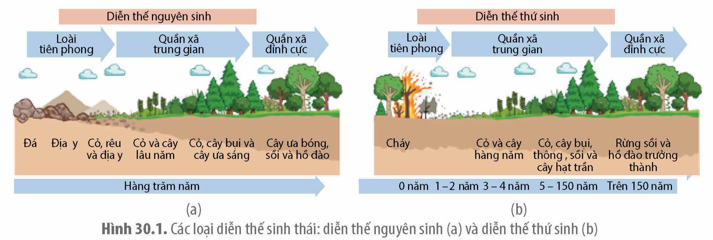

<!-- pdf:163 -->

# BÀI 30: DIỄN THẾ SINH THÁI

## 🎯 Yêu cầu cần đạt

Phân tích được sự biến động của hệ sinh thái, bao gồm:
- Nêu được khái niệm diễn thế sinh thái.
- Phân biệt được các dạng diễn thế sinh thái.
- Phân tích được nguyên nhân và tầm quan trọng của diễn thế sinh thái trong tự nhiên và trong thực tiễn.
- Phân tích được diễn thế sinh thái ở một hệ sinh thái tại địa phương. Đề xuất được một số biện pháp bảo tồn hệ sinh thái đó.
- Nêu được một số hiện tượng ảnh hưởng đến hệ sinh thái như: sự ấm lên toàn cầu; sự phì dưỡng; sa mạc hoá. Giải thích được vì sao các hiện tượng đó vừa tác động đến hệ sinh thái, vừa là nguyên nhân của sự mất cân bằng của hệ sinh thái.

## 🔴 Mở đầu

Quá trình tự tái sinh của một khu rừng bị cháy trụi sẽ diễn ra như thế nào?

## I. KHÁI NIỆM VÀ CÁC LOẠI DIỄN THẾ

### 1. Khái niệm

<!-- term: Diễn thế sinh thái -->
Diễn thế sinh thái là quá trình thay đổi dần thành phần loài của quần xã theo thời gian, tương ứng với sự biến đổi của môi trường.

Sự thay đổi thành phần loài theo thời gian dẫn đến sự thay thế tuần tự các dạng quần xã, từ quần xã tiên phong (giai đoạn đầu) biến đổi qua các dạng quần xã trung gian (giai đoạn giữa) và cuối cùng hình thành nên quần xã tương đối ổn định là quần xã đỉnh cực (giai đoạn cuối). Diễn thế sinh thái có tính quy luật và gắn liền với sự thay đổi của các nhân tố vô sinh (điều kiện chiếu sáng, thổ nhưỡng,...).

Ví dụ: Sau khi núi lửa phun trào trên đảo Krakatau, Indonesia vào năm 1883, toàn bộ hòn đảo bị bao phủ bởi lớp tro bụi núi lửa, nham thạch nguội và hoàn toàn không có sự sống. Các khảo sát ở những năm tiếp theo cho thấy: một số rất ít loài đầu tiên định cư trên đảo gồm vi khuẩn, địa y, tảo,...; năm 1897, quần xã gồm nhiều loài thân cỏ ưa sáng chiếm ưu thế, đất đã có nhiều mùn tích tụ; năm 1906, đã xuất hiện cây thân gỗ, cỏ ưa sáng bị thay thế bằng cỏ ưa bóng; năm 1919, trên đảo đã bắt đầu hình thành quần xã rừng nhiệt đới đặc trưng tương tự như các đảo bên cạnh.

### 2. Các loại diễn thế sinh thái

Dựa vào điều kiện môi trường khởi đầu, diễn thế sinh thái được chia thành hai loại là diễn thế nguyên sinh và diễn thế thứ sinh (H 30.1).

Hình 30.1. Các loại diễn thế sinh thái: diễn thế nguyên sinh (a) và diễn thế thứ sinh (b)

<!-- pdf:164 -->

**a) Diễn thế nguyên sinh**

<!-- term: Diễn thế nguyên sinh -->
Diễn thế nguyên sinh là diễn thế bắt đầu từ môi trường trống trơn, không có lớp đất mùn bề mặt và không có sinh vật sinh sống như vùng đá nham thạch nguội sau khi núi lửa phun, bề mặt đá sau khi tan băng vĩnh cửu,...

Diễn thế nguyên sinh diễn ra trong một thời gian dài. Những loài đầu tiên thích nghi với điều kiện nghèo dinh dưỡng như vi khuẩn, địa y, tảo, rêu,... hình thành nên quần xã tiên phong (giai đoạn mở đầu). Tiếp theo là giai đoạn các quần xã tuần tự thay thế nhau (giai đoạn giữa) cho đến khi hình thành quần xã đỉnh cực (giai đoạn cuối) (H 30.1a).

**b) Diễn thế thứ sinh**

<!-- term: Diễn thế thứ sinh -->
Diễn thế thứ sinh là diễn thế bắt đầu từ môi trường của một quần xã đã bị diệt vong, trong môi trường đó vẫn còn sinh vật tồn tại và được kế thừa lớp thổ nhưỡng của quần xã trước đó.

Giai đoạn mở đầu của diễn thế thứ sinh diễn ra trên nền thổ nhưỡng sẵn có và rất ít cạnh tranh giữa các loài. Môi trường này phù hợp với những loài có khả năng phát tán mạnh, sinh trưởng, sinh sản nhanh như các loài cỏ ưa sáng.

Trong điều kiện thuận lợi, giai đoạn giữa diễn ra theo xu hướng hình thành quần xã đỉnh cực. Do diễn thế trên nền đất đã có dinh dưỡng nên thời gian hình thành quần xã đỉnh cực của diễn thế thứ sinh thường ngắn hơn nhiều so với diễn thế nguyên sinh, ví dụ như diễn thế thứ sinh diễn ra sau cháy rừng (H 30.1b). Nếu điều kiện bất lợi, lớp đất mùn bề mặt giảm theo thời gian thì diễn thế thứ sinh diễn ra theo hướng suy giảm thành phần loài và môi trường dần bất lợi cho sinh vật, kết quả hình thành quần xã suy thoái.

## ❓ Dừng lại và suy ngẫm

1. Trong diễn thế nguyên sinh, tại sao những sinh vật đầu tiên của quần xã tiên phong thường là địa y, tảo, rêu?
2. Tại sao thời gian từ quần xã mở đầu đến hình thành quần xã đỉnh cực ở diễn thế nguyên sinh dài hơn so với diễn thế thứ sinh?

## II. NGUYÊN NHÂN VÀ TẦM QUAN TRỌNG CỦA NGHIÊN CỨU DIỄN THẾ

### 1. Nguyên nhân của diễn thế

Diễn thế sinh thái có thể xảy ra do các nguyên nhân sau:
- Nguyên nhân bên ngoài: Do tác động của các nhân tố vô sinh như núi lửa phun, cháy rừng, hạn hán, lũ lụt,... hoặc do hoạt động của con người như khai thác tài nguyên, xả thải,... gây chết hàng loạt cá thể, dẫn đến thay đổi sâu sắc cấu trúc của quần xã. Ví dụ: Diễn thế thứ sinh diễn ra sau cháy rừng U Minh Thượng năm 2002; diễn thế nguyên sinh diễn ra sau núi lửa phun ở đảo Krakatau năm 1883; diễn thế thứ sinh diễn ra ở những vùng khai thác mỏ than lộ thiên ở Quảng Ninh;...
- Nguyên nhân bên trong: Do mối quan hệ tương hỗ giữa quần xã với sinh cảnh và các mối quan hệ sinh thái giữa các loài trong quần xã, đặc biệt là cạnh tranh khác loài. Trong điều kiện môi trường nhất định, sự phát triển mạnh mẽ của loài ưu thế là một trong các

<!-- pdf:165 -->

yếu tố gây biến đổi điều kiện sống và có thể làm giảm khả năng thích nghi của loài đó. Điều kiện sống thay đổi cũng tạo môi trường phù hợp cho loài mới định cư, phát triển, dần cạnh tranh và thay thế loài ưu thế cũ để trở thành loài ưu thế mới. Quá trình này lặp lại cho đến khi hình thành quần xã đỉnh cực. Ví dụ: Trên nền đá nghèo dinh dưỡng, địa y là loài ưu thế, hoạt động sống và xác của địa y được tích tụ theo thời gian hình thành nên lớp đất mùn phù hợp cho rêu định cư. Rêu dần thích nghi, phát triển, tăng kích thước quần thể, cạnh tranh và dần loại bỏ địa y.

### 2. Tầm quan trọng của nghiên cứu diễn thế

Những hiểu biết về diễn thế giúp con người giải thích được sự biến đổi của các quần xã trong tự nhiên. Ngoài ra, dựa vào các nghiên cứu về quy luật diễn thế, từ quần xã hiện tại con người có thể biết được các quần xã từng tồn tại trước đó và dự đoán được sự biến đổi của quần xã trong tương lai, từ đó giúp con người giải quyết nhiều vấn đề trong thực tiễn, gồm:
- Đánh giá và dự đoán được hệ quả những tác động của con người lên hệ sinh thái, từ đó đưa ra các kế hoạch xây dựng, khai thác tài nguyên, cải tiến công nghệ,... giúp ngăn chặn diễn thế suy thoái và bảo vệ môi trường sống. Ví dụ: Đánh giá tác động môi trường trước và sau khi xây đập thuỷ điện, hồ chứa nước, khu công nghiệp,... để đưa ra các quyết định hoặc biện pháp ứng phó với các thay đổi bất lợi của hệ sinh thái; cải tiến các công nghệ như khai khoáng, tuyển quặng, kĩ thuật canh tác, xử lí chất thải,... để giảm thiểu tác động ô nhiễm, huỷ hoại quần xã; khai thác tài nguyên tái sinh như rừng, thuỷ sản,... đúng thời điểm, đúng định mức với kĩ thuật hợp lí nhằm duy trì nguồn lợi lâu dài.
- Giúp rút ngắn thời gian hình thành quần xã đỉnh cực trong tái sinh rừng, hồi phục quần xã suy thoái,... thông qua các tác động can thiệp thành phần loài, cải tạo sinh cảnh,... Ví dụ: Để tăng hiệu quả cải tạo đất ngập mặn ở miền Bắc Việt Nam, các loài trang (*Kandelia obovata*) hoặc bần (*Sonneratia* spp.) được lựa chọn là loài tiên phong do khả năng thích nghi với nền đất yếu, sinh trưởng nhanh, tỉ lệ sống cao, giữ phù sa tốt,... Sau khi nền đất được nâng cao, các loài đước (*Rhizophora apiculata*), vẹt (*Bruguiera* spp.) thích nghi hơn được trồng bổ sung.

## III. MỘT SỐ HIỆN TƯỢNG ẢNH HƯỞNG ĐẾN HỆ SINH THÁI

Loài người hiện tại và tương lai đang phải đối mặt với sự biến đổi bất lợi của môi trường sống như hiện tượng phì dưỡng, sự ấm lên toàn cầu và sa mạc hoá.

<!-- term: Phì dưỡng -->
Phì dưỡng (phú dưỡng) là hiện tượng môi trường nước thừa chất dinh dưỡng (nitrogen, phosphorus) dẫn đến sự phát triển quá mức của vi sinh vật (vi khuẩn lam, tảo,...) gây độc và suy giảm lượng oxygen trong nước, làm chết hàng loạt động vật thuỷ sinh (cá, tôm,...). Nguyên nhân chủ yếu gây ra hiện tượng này đến từ dòng nước chứa phân bón dư thừa, nước thải sinh hoạt, nước thải của các ngành chế biến nông, thuỷ sản và chất thải chăn nuôi chưa được xử lí.

<!-- term: Sự ấm lên toàn cầu -->
Sự ấm lên toàn cầu là hiện tượng tăng nhiệt độ trung bình của Trái Đất trong thời gian dài. Sự ấm lên của Trái Đất dẫn đến biến đổi khí hậu, thể hiện qua sự thất thường về thời tiết, chu kì mùa và gia tăng các hiện tượng thời tiết cực đoan như hạn hán, bão, lũ lụt, nước biển dâng,... gây mất cân bằng sinh thái trên quy mô toàn cầu. Nguyên nhân gây ra hiện tượng này là do hoạt động sống của con người như chặt phá rừng, phát thải quá nhiều khí nhà kính,... dẫn đến tăng hiệu ứng nhà kính làm tăng nhiệt độ của Trái Đất.

<!-- pdf:166 -->

<!-- term: Sa mạc hoá -->
Sa mạc hoá là quá trình thoái hoá đất ở những vùng khô hạn. Sa mạc hoá dẫn đến suy giảm diện tích rừng, giảm diện tích đất nông nghiệp, gây suy giảm đa dạng sinh vật, mất cân bằng sinh thái. Nguyên nhân gây ra hiện tượng này là do biến đổi khí hậu và hoạt động của con người như canh tác nông nghiệp lạc hậu, chăn thả gia súc mật độ cao, khai thác rừng quá mức,...

Như vậy, những hoạt động của con người là nguyên nhân chính gây ra các hiện tượng trên, làm phá vỡ sự ổn định của vòng tuần hoàn vật chất và dòng năng lượng, suy giảm đa dạng sinh vật, gây mất cân bằng hệ sinh thái và cuối cùng thường dẫn đến diễn thế theo hướng suy thoái, đe doạ sự tồn tại và phát triển của loài người và các quần xã sinh vật trên Trái Đất. Dựa vào những hiểu biết về diễn thế sinh thái, con người có thể đề xuất các biện pháp nhằm giảm nhẹ, ngăn chặn những hậu quả do các hiện tượng trên gây ra và đưa ra các biện pháp khắc phục hợp lí.

## ❓ Dừng lại và suy ngẫm

1. Tại sao nói nguyên nhân bên trong là cơ chế chính dẫn đến sự thay thế tuần tự các loài trong quần xã?
2. Tại sao trước khi xây dựng đập thuỷ điện người ta cần phải nghiên cứu đánh giá những tác động của công trình này tới sự thay đổi của hệ sinh thái?
3. Những hoạt động nào của con người là nguyên nhân gây ra hiện tượng phú dưỡng, tăng nhiệt độ trung bình của Trái Đất và sa mạc hóa?

## 📌 Kiến thức cốt lõi

- Diễn thế là quá trình biến đổi tuần tự và có quy luật về thành phần loài của quần xã. Diễn thế diễn ra theo ba giai đoạn: giai đoạn mở đầu, giai đoạn giữa và giai cuối. Có hai loại diễn thế là diễn thế nguyên sinh và diễn thế thứ sinh.
- Diễn thế nguyên sinh bắt đầu từ môi trường không có đất mùn, không có sinh vật sinh sống và kết thúc bằng quần xã đỉnh cực. Diễn thế thứ sinh bắt đầu từ môi trường của quần xã bị huỷ diệt và có thể diễn biến theo hai hướng, hình thành quần xã đỉnh cực hoặc suy thoái.
- Nguyên nhân dẫn đến diễn thế là do mối quan hệ sinh thái bên trong quần xã, giữa quần xã và sinh cảnh hoặc do tác động mạnh của nhân tố vô sinh (cháy rừng, bão lũ,...) hoặc do tác động của con người.
- Con người vận dụng kiến thức về diễn thế để bảo vệ môi trường, phục hồi hệ sinh thái, khai thác và bảo vệ tài nguyên thiên nhiên hợp lí.

## ✏️ Luyện tập và vận dụng

1. Phân biệt diễn thế nguyên sinh và diễn thế thứ sinh.
2. Để phủ xanh đất trống, đồi trọc, người ta thường trồng các loài cây họ Đậu để cải tạo đất như cây keo lá chàm, keo tai tượng, lạc dại,...
a) Hãy tìm hiểu và cho biết những loài cây này có các đặc điểm gì giúp chúng sống được trên đất trống, đồi núi trọc.
b) Tại sao việc trồng cây họ Đậu trong giai đoạn đầu tiên của quá trình cải tạo đất là lựa chọn phù hợp với quy luật diễn thế?
3. Hãy lấy một ví dụ về diễn thế ở địa phương em đang sinh sống (đồng ruộng, khu rừng, hồ nước, công viên, khu vực đổ rác thải,...). Nguyên nhân nào gây ra diễn thế ở quần xã đó? Quần xã đang tăng dần đa dạng sinh học hay đang suy thoái? Cần phải làm gì để chống suy thoái, bảo tồn và phát triển quần xã đó?

## 📷 Danh sách hình trong bài

| Mã hình | Trang PDF | Vị trí | Chú thích gốc |
| :--- | :--- | :--- | :--- |
| H12-sinh-b30-01 | 163 | Nửa dưới | Hình 30.1. Các loại diễn thế sinh thái: diễn thế nguyên sinh (a) và diễn thế thứ sinh (b) |
