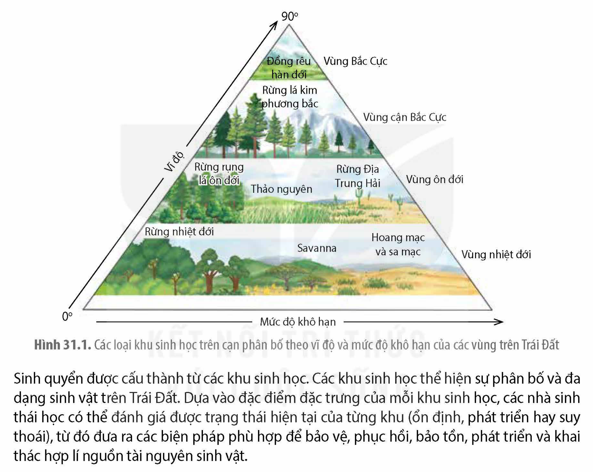
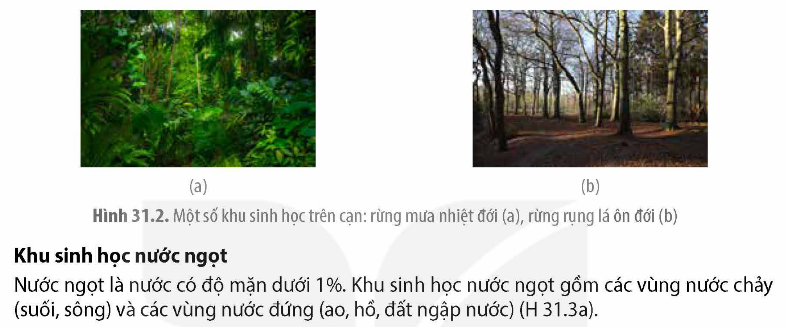
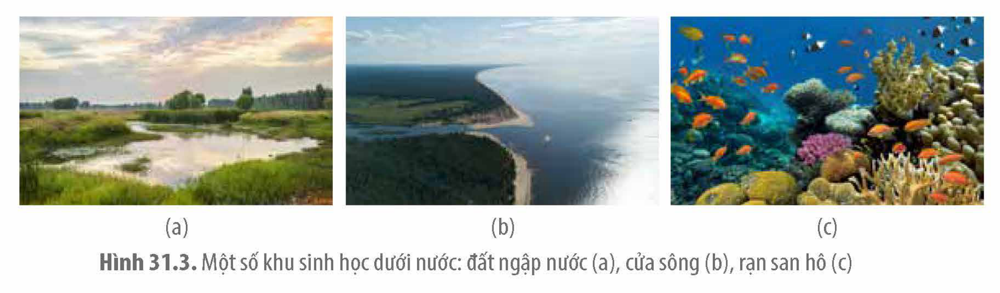
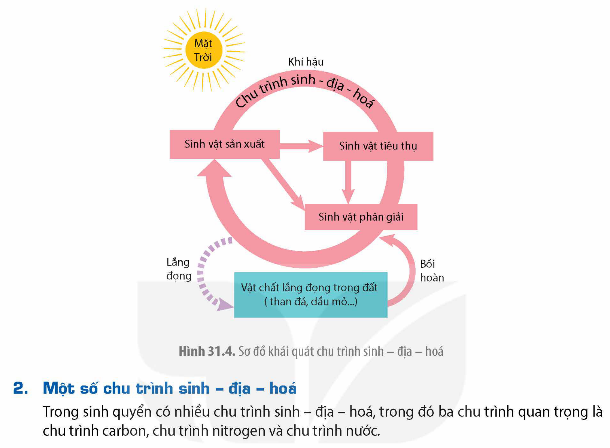
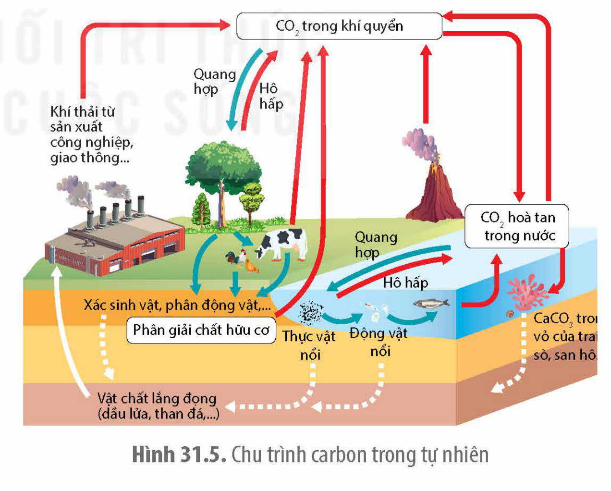
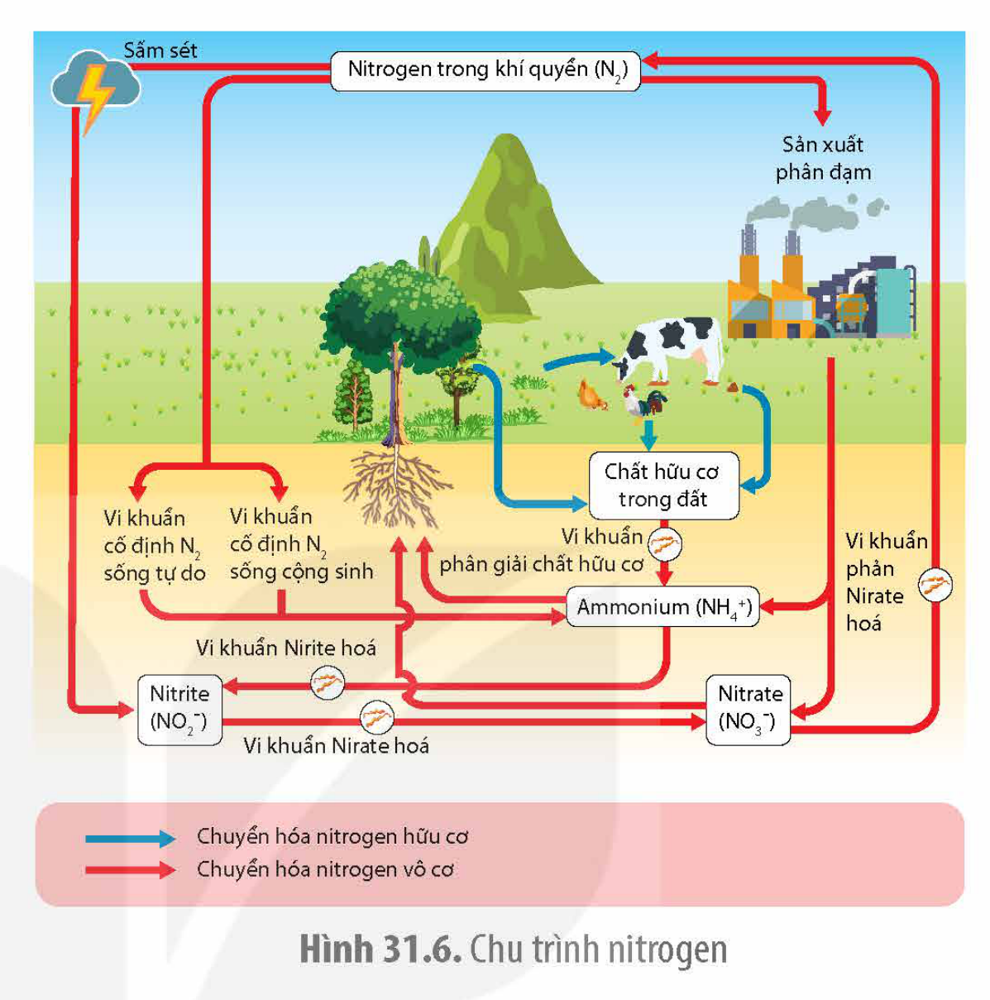
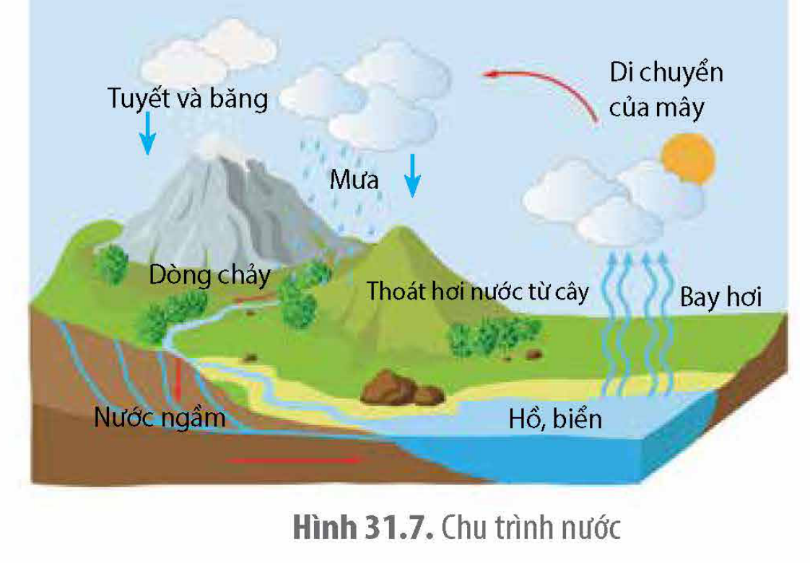

<!-- pdf:167 -->

# BÀI 31: SINH QUYỂN, KHU SINH HỌC VÀ CHU TRÌNH SINH – ĐỊA – HOÁ

## 🎯 Yêu cầu cần đạt

- Phát biểu được khái niệm sinh quyển; giải thích được sinh quyển là một cấp độ tổ chức sống lớn nhất hành tinh; trình bày được một số biện pháp bảo vệ sinh quyển.
- Phát biểu được khái niệm khu sinh học.
- Trình bày được đặc điểm của các khu sinh học trên cạn chủ yếu và các khu sinh học nước ngọt, khu sinh học nước mặn trên Trái Đất.
- Trình bày được các biện pháp bảo vệ tài nguyên sinh học của các khu sinh học đó.
- Phát biểu được khái niệm chu trình sinh – địa – hoá các chất.
- Vẽ được sơ đồ khái quát chu trình trao đổi chất trong tự nhiên.
- Trình bày được chu trình sinh – địa – hoá của một số chất: nước, carbon, nitrogen và ý nghĩa sinh học của các chu trình đó, đồng thời vận dụng kiến thức về các chu trình đó vào giải thích các vấn đề của thực tiễn.

## 🔴 Mở đầu

Tại sao việc sử dụng nhiên liệu hoá thạch ở mỗi quốc gia đều góp phần gây ra hiện tượng ấm lên toàn cầu?

## I. SINH QUYỂN VÀ KHU SINH HỌC

### 1. Khái niệm sinh quyển

<!-- term: Sinh quyển -->
Sinh quyển là cấp tổ chức sống lớn nhất bao gồm toàn bộ các hệ sinh thái trên Trái Đất. Mỗi hệ sinh thái được duy trì nhờ quá trình trao đổi vật chất và năng lượng giữa quần xã với môi trường. Các yếu tố khí hậu (nhiệt độ, lượng mưa,...) và sự lưu chuyển các chất trong không khí, đất và nước có tác động lên những khu vực địa lí rộng lớn trên quy mô toàn cầu, do đó tất cả các hệ sinh thái trên Trái Đất không tồn tại rời rạc mà được gắn kết chặt chẽ với nhau thông qua các nhân tố vô sinh hình thành nên một hệ sinh thái lớn nhất là sinh quyển.

Với vai trò là một hệ sinh thái, sinh quyển là một cấu trúc hoàn chỉnh có khả năng tự điều chỉnh, trong đó sinh vật và sinh cảnh tương tác hai chiều ở trạng thái cân bằng động. Do đó, thay đổi môi trường ở một địa điểm bất kì trên Trái Đất đều có thể tác động đến môi trường toàn cầu.

<!-- pdf:168 -->

### 2. Khái niệm khu sinh học và đặc điểm của một số khu sinh học

**a) Khái niệm khu sinh học**

<!-- term: Khu sinh học -->
Khu sinh học (biome) là một khu vực lớn trên Trái Đất có các đặc điểm tương tự về khí hậu và có cùng một loại thảm thực vật đặc trưng. Khu sinh học được chia thành hai nhóm lớn gồm khu sinh học trên cạn (rừng nhiệt đới, savanna, hoang mạc, sa mạc, rừng rụng lá ôn đới, thảo nguyên, rừng Địa Trung Hải, rừng lá kim phương bắc và đồng rêu hàn đới) (H 31.1) và khu sinh học dưới nước (khu sinh học nước ngọt, khu sinh học nước mặn) (H 31.3).

Hình 31.1. Các loại khu sinh học trên cạn phân bố theo vĩ độ và mức độ khô hạn của các vùng trên Trái Đất

Sinh quyển được cấu thành từ các khu sinh học. Các khu sinh học thể hiện sự phân bố và đa dạng sinh vật trên Trái Đất. Dựa vào đặc điểm đặc trưng của mỗi khu sinh học, các nhà sinh thái học có thể đánh giá được trạng thái hiện tại của từng khu (ổn định, phát triển hay suy thoái), từ đó đưa ra các biện pháp phù hợp để bảo vệ, phục hồi, bảo tồn, phát triển và khai thác hợp lí nguồn tài nguyên sinh vật.

**b) Đặc điểm của một số khu sinh học**

**Rừng nhiệt đới**

Rừng nhiệt đới (rừng mưa nhiệt đới và rừng cận nhiệt đới) có nhiệt độ trung bình năm từ $25 - 29\text{ }^\circ\text{C}$. Rừng mưa nhiệt đới không có sự phân hoá rõ rệt về mùa, lượng mưa trung bình hằng năm khoảng $2\text{ }000 - 4\text{ }000\text{ mm}$. Rừng mưa nhiệt đới có thảm thực vật phân làm nhiều tầng gồm chủ yếu là cây lá rộng thường xanh, mật độ cây mọc dày, có nhiều cây dây leo, cây khí sinh (H 31.2a). Rừng cận nhiệt đới có hai mùa rõ rệt là mùa khô (khoảng 6 – 7 tháng) và mùa mưa, lượng mưa trung bình hằng năm khoảng $1\text{ }500 - 2\text{ }000\text{ mm}$. Rừng cận nhiệt đới có thảm thực vật thưa, nhiều cây bụi gai, cây mọng nước, rất ít cây dây leo, cây khí sinh. Hệ động vật của rừng nhiệt đới rất đa dạng với hàng triệu loài từ thú lớn như gấu, báo, hổ,... đến các động vật không xương sống như côn trùng, vắt, giun đất,...

<!-- pdf:169 -->

**Rừng rụng lá ôn đới**

Rừng rụng lá ôn đới có nhiệt độ trung bình mùa đông khoảng $0\text{ }^\circ\text{C}$, nhiệt độ mùa hè có thể lên đến $35\text{ }^\circ\text{C}$, lượng mưa trung bình hằng năm khoảng $700 - 2\text{ }000\text{ mm}$. Thực vật chủ yếu gồm những loài lá rộng, rụng lá theo mùa (sồi, phong, bạch dương,...) và một số ít các loài thực vật lá kim. Hệ động vật đa dạng gồm sóc, nai, thỏ, gấu, chim,... thích nghi với sự thay đổi khí hậu theo mùa như giảm hoạt động, ngủ đông hoặc di cư vào thời điểm nhiệt độ hạ xuống thấp (H 31.2b).

Hình 31.2. Một số khu sinh học trên cạn: rừng mưa nhiệt đới (a), rừng rụng lá ôn đới (b)

**Khu sinh học nước ngọt**

Nước ngọt là nước có độ mặn dưới 1‰. Khu sinh học nước ngọt gồm các vùng nước chảy (suối, sông) và các vùng nước đứng (ao, hồ, đất ngập nước) (H 31.3a).

Sinh vật sản xuất ở vùng nước ngọt gồm vi khuẩn lam, tảo, thực vật thuỷ sinh (bèo hoa dâu, bèo lục bình, súng, sen, dừa nước,...). Sinh vật tiêu thụ đa dạng gồm động vật phù du, cá, giáp xác,... Khu sinh học nước ngọt còn là nơi kiếm ăn của nhiều loài động vật như bói cá, cò, rắn,... Một lượng lớn vật chất (muối vô cơ, mùn bã hữu cơ) của hệ sinh thái trên cạn theo dòng nước lắng đọng ở vùng nước đứng và một phần theo các dòng sông chảy ra biển.

**Khu sinh học nước mặn**

Khu sinh học nước mặn phân vùng rõ rệt theo chiều ngang (vùng ven bờ, vùng khơi) và theo chiều thẳng đứng (tầng nước mặt, tầng giữa và tầng đáy).

Vùng ven bờ gồm hệ sinh thái cửa sông, rừng ngập mặn, rạn san hô, thảm cỏ biển,... (H 31.3b, c). Sinh vật sản xuất gồm thực vật ngập mặn (sú, vẹt, đước,...), các loại tảo, rong biển và vi khuẩn quang hợp. Hệ động vật rất đa dạng như động vật nổi, tôm, sò, cá, cua, chim di cư, san hô, cá ngựa,...

Vùng khơi (đại dương) là vùng nước sâu, chiếm khoảng 70% diện tích bề mặt trái đất. Sinh vật sản xuất gồm tảo và vi khuẩn quang hợp, phân bố chủ yếu ở tầng nước mặt nghèo dinh dưỡng. Hệ động vật bao gồm động vật nổi, sứa, mực, rùa biển, cá voi,... các loài sống ở tầng đáy thường thuộc nhóm sinh vật phân giải sử dụng chất thải và xác sinh vật từ tầng nước phía trên.

Hình 31.3. Một số khu sinh học dưới nước: đất ngập nước (a), cửa sông (b), rạn san hô (c)

<!-- pdf:170 -->

### 3. Các biện pháp bảo vệ sinh quyển và khu sinh học

Sinh quyển (gồm các khu sinh học) là môi trường sống cho con người và mọi sinh vật trên Trái Đất. Sự phát triển của con người là một trong những nguyên nhân làm môi trường thay đổi theo hướng bất lợi. Do đó, bảo vệ sinh quyển và các khu sinh học là nhiệm vụ cấp thiết liên quan đến sự tồn tại và phát triển của con người hiện tại và tương lai. Để bảo vệ sinh quyển và khu sinh học, con người cần thực hiện song song hai nhóm biện pháp: giảm thiểu sự tác động có hại của con người đồng thời với các hoạt động bảo tồn, cải tạo sinh quyển, khu sinh học theo hướng phát triển bền vững.

Các biện pháp giảm thiểu sự tác động có hại lên sinh quyển và khu sinh học như: giảm tiêu thụ nguyên liệu (nước, gỗ, kim loại,...), tiết kiệm và tái chế nguyên liệu; sử dụng hiệu quả năng lượng, tăng cường sử dụng năng lượng tái tạo (điện gió, điện mặt trời,...); giảm phát thải khí nhà kính, phân loại và xử lí rác thải, giảm xả thải chất độc hại ra môi trường,... Bên cạnh đó, cần đẩy mạnh bảo tồn và cải tạo sinh quyển bằng các giải pháp như trồng rừng, bảo vệ đa dạng sinh vật, thành lập các khu dự trữ sinh quyển, phục hồi các hệ sinh thái tự nhiên,...

Để các biện pháp trên được thực hiện có hiệu quả cần: tuyên truyền nâng cao ý thức bảo vệ môi trường cho cá nhân và cộng đồng; nhà nước cần có các chính sách, pháp luật chặt chẽ và thực thi nghiêm túc các luật về bảo vệ đa dạng sinh vật, khai thác tài nguyên, kiểm soát xả thải,...; thúc đẩy hợp tác chặt chẽ giữa các quốc gia, các tổ chức quốc tế như UNESCO (Tổ chức Giáo dục, Khoa học và Văn hoá của Liên hợp quốc), WWF (Quỹ Quốc tế Bảo vệ Thiên nhiên),... nhằm trao đổi thông tin, nghiên cứu khoa học và kinh nghiệm về bảo tồn sinh vật, sử dụng hợp lí nguồn tài nguyên,... đồng thời cùng thực hiện các công ước, nghị định thư, chương trình bảo vệ môi trường trên toàn thế giới.

## ❓ Dừng lại và suy ngẫm

1. Tại sao nói sinh quyển là cấp độ tổ chức sống lớn nhất hành tinh?
2. Tại sao để bảo vệ sinh quyển hiệu quả thì cần có sự đồng thuận và thực hiện đồng thời ở tất cả các nước trên thế giới?

## II. CHU TRÌNH SINH – ĐỊA – HOÁ

### 1. Khái niệm

<!-- term: Chu trình sinh – địa – hoá -->
Chu trình sinh – địa – hoá là sự tuần hoàn vật chất qua các dạng khác nhau giữa sinh vật và môi trường (H 31.4). Chu trình sinh – địa – hoá mô tả sự luân chuyển của các nguyên tố liên quan đến sự sống, chủ yếu là các nguyên tố dinh dưỡng (C, N, P, Ca, S,...). Các chất dinh dưỡng trong chu trình có thể bị lắng đọng, kết tủa, chôn lấp,... tạo thành vật chất lắng đọng (than bùn, khoáng chất,...) và vật chất lắng đọng cũng có thể bồi hoàn trở lại chu trình thông qua quá trình phong hoá, đốt cháy,...

<!-- pdf:171 -->

Hình 31.4. Sơ đồ khái quát chu trình sinh – địa – hoá

### 2. Một số chu trình sinh – địa – hoá

Trong sinh quyển có nhiều chu trình sinh – địa – hoá, trong đó ba chu trình quan trọng là chu trình carbon, chu trình nitrogen và chu trình nước.

**a) Chu trình carbon**

Carbon hình thành nên bộ khung phân tử của tất cả các loại chất hữu cơ cấu tạo nên cơ thể sống. Carbon ở môi trường vô sinh đi vào quần xã dưới dạng carbon dioxide ($\text{CO}_2$). Các sinh vật sản xuất thực hiện quá trình quang hợp cố định $\text{CO}_2$ thành chất hữu cơ cung cấp cho toàn bộ quần xã. Quá trình hô hấp, phân huỷ chất thải và xác sinh vật giải phóng $\text{CO}_2$ vào khí quyển. Vỏ calcium carbonate ($\text{CaCO}_3$) của một số loài động vật và một phần xác sinh vật phân giải không hoàn toàn hình thành vật chất lắng đọng như than bùn, than đá, dầu mỏ,... di chuyển một phần carbon ra khỏi chu trình. Lượng $\text{CO}_2$ trong khí quyển có thể được bổ sung thông qua hoạt động của núi lửa. Con người đốt cháy nhiên liệu hoá thạch (dầu mỏ, than đá,...) cung cấp năng lượng cho hoạt động sản xuất, giao thông vận tải,... phát thải một lượng lớn $\text{CO}_2$.

Hình 31.5. Chu trình carbon trong tự nhiên

<!-- pdf:172 -->

Kết quả, lượng $\text{CO}_2$ chuyển từ vật chất lắng đọng vào chu trình lớn hơn lượng $\text{CO}_2$ chuyển thành sinh khối khiến lượng $\text{CO}_2$ trong khí quyển tăng lên làm gia tăng hiệu ứng nhà kính, dẫn đến tăng nhiệt độ trung bình trên Trái Đất.

**b) Chu trình nitrogen**

Nitrogen là thành phần cấu tạo của protein, acid nucleic. Nitrogen tồn tại chủ yếu trong khí quyển ở dạng khí nitrogen ($\text{N}_2$). Đa số các loài vi khuẩn, nấm và thực vật có khả năng chuyển hoá các ion $\text{NH}_4^+$, $\text{NO}_2^-$, $\text{NO}_3^-$ thành chất hữu cơ nhưng chỉ có một số ít loài vi sinh vật cố định đạm (sống tự do và cộng sinh) tổng hợp được $\text{NH}_4^+$ từ $\text{N}_2$. Quá trình phân giải chất thải, xác sinh vật chuyển hoá nitrogen hữu cơ thành $\text{NH}_4^+$ và hoạt động của một số nhóm vi khuẩn phản nitrate hoá chuyển đổi $\text{NO}_3^-$ thành $\text{N}_2$ trong điều kiện yếm khí. Trong hệ sinh thái tự nhiên, nguồn cung cấp $\text{NH}_4^+$ chủ yếu cho quần xã đến từ quá trình cố định đạm và một số ít $\text{NO}_2^-$ được hình thành nhờ sấm sét (H 31.6).

Hình 31.6. Chu trình nitrogen

Để tăng năng suất cây trồng, con người sản xuất một lượng lớn $\text{NH}_4^+$ (phân đạm) từ khí nitrogen. Việc sử dụng phân đạm quá mức, không hợp lí trong thời gian dài dẫn đến suy thoái đất nông nghiệp; lượng phân đạm dư thừa bị rửa trôi ra sông, hồ,... gây ra hiện tượng phú dưỡng và một phần $\text{NO}_3^-$ thấm xuống tầng đất sâu hơn gây ô nhiễm nguồn nước ngầm.

**c) Chu trình nước**

Nước dạng lỏng có nhiều nhất ở đại dương và một lượng lớn nước đóng băng ở hai cực của Trái Đất. Nước bốc hơi hình thành mây và gây mưa. Phần lớn nước mưa ở lục địa chảy theo chiều trọng lực đến các vùng trũng tạo ra ao, hồ và hình thành dòng chảy lớn (sông) đổ ra đại dương. Một phần nước mưa bốc hơi và một phần thấm xuống đất hình thành nước ngầm. Thực vật trên cạn hấp thụ nước từ đất và bốc hơi qua quá trình thoát hơi nước, mọi sinh vật đều hấp thụ và bài thải nước trong suốt quá trình sống. Thảm thực vật làm giảm tác động rửa trôi của nước, phân tán dòng chảy, tạo điều kiện cho nước thấm từ từ vào đất, tăng lượng nước lưu trữ trong đất và tăng lượng nước ngầm (H 31.7).

Hình 31.7. Chu trình nước

<!-- pdf:173 -->

Con người chặt phá rừng, sử dụng một lượng lớn nước cho hoạt động sinh hoạt và sản xuất, đồng thời xả thải nhiều chất thải độc hại vào môi trường nước. Hậu quả là làm tăng lượng nước bề mặt, suy giảm nước ngầm, ô nhiễm nguồn nước, lũ lụt, xói mòn đất, sa mạc hoá và suy giảm đa dạng sinh vật.

## ❓ Dừng lại và suy ngẫm

1. Em hãy lấy một số ví dụ về hoạt động của con người gây mất cân bằng chu trình sinh – địa – hoá.
2. Những quá trình nào trong chu trình carbon làm giảm lượng $\text{CO}_2$ trong khí quyển?

## 📌 Kiến thức cốt lõi

- Sinh quyển là hệ sinh thái lớn nhất, bao gồm tất cả các hệ sinh thái trên Trái Đất. Thông qua chu trình sinh – địa – hoá, các sinh vật trên Trái Đất gắn kết với nhau và với nhân tố vô sinh tạo thành một thể thống nhất – một hệ sinh thái có quy mô toàn cầu.
- Trên bề mặt Trái Đất, những khu vực rộng lớn với các đặc điểm khí hậu, địa lí và sinh vật tương tự nhau được gọi là khu sinh học.
- Chu trình sinh – địa – hoá là chu trình tuần hoàn của các nguyên tố trên Trái Đất, trong đó các chất vô cơ từ môi trường vô sinh đi vào quần xã, qua các bậc dinh dưỡng và quay trở lại môi trường vô sinh.

## ✏️ Luyện tập và vận dụng

1. Tại sao việc sử dụng quá nhiều nhiên liệu hoá thạch và giảm diện tích rừng lại là những nguyên nhân chính làm gia tăng hiệu ứng nhà kính gây biến đổi khí hậu toàn cầu? Con người cần làm gì để giảm lượng $\text{CO}_2$ trong khí quyển?
2. Rừng có tác động như thế nào đến sự lưu chuyển nước ở lục địa? Chặt phá rừng có tác động như thế nào đến chu trình nước và gây hại gì cho đời sống con người?
3. Nước trên Trái Đất không bị mất đi nhưng tại sao con người lại đang phải đối mặt với tình trạng thiếu nước, đặc biệt là nước sạch? Con người cần làm gì để bảo vệ và phát triển nguồn nước sạch?

## 📷 Danh sách hình trong bài

| Mã hình | Trang PDF | Vị trí | Chú thích gốc |
| :--- | :--- | :--- | :--- |
| H12-sinh-b31-01 | 168 | Giữa trang | Hình 31.1. Các loại khu sinh học trên cạn phân bố theo vĩ độ và mức độ khô hạn của các vùng trên Trái Đất |
| H12-sinh-b31-02 | 169 | Nửa trên | Hình 31.2. Một số khu sinh học trên cạn: rừng mưa nhiệt đới (a), rừng rụng lá ôn đới (b) |
| H12-sinh-b31-03 | 169 | Nửa dưới | Hình 31.3. Một số khu sinh học dưới nước: đất ngập nước (a), cửa sông (b), rạn san hô (c) |
| H12-sinh-b31-04 | 171 | Nửa trên | Hình 31.4. Sơ đồ khái quát chu trình sinh – địa – hoá |
| H12-sinh-b31-05 | 171 | Nửa dưới bên phải | Hình 31.5. Chu trình carbon trong tự nhiên |
| H12-sinh-b31-06 | 172 | Nửa trên bên phải | Hình 31.6. Chu trình nitrogen |
| H12-sinh-b31-07 | 172 | Nửa dưới bên phải | Hình 31.7. Chu trình nước |
