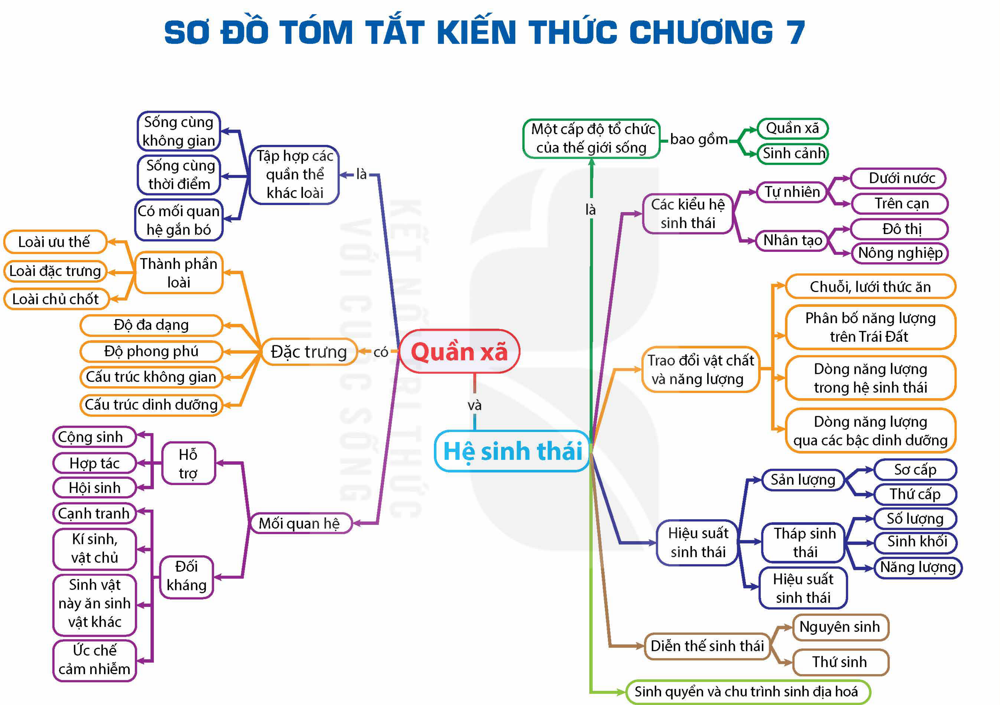

<!-- pdf:176 -->

# SƠ ĐỒ TÓM TẮT KIẾN THỨC CHƯƠNG 7

<!-- Dưới đây chép các nhánh của sơ đồ thành danh sách, giữ nguyên chữ trong các ô và trên các mũi tên. -->

- Quần xã:
  - là → Tập hợp các quần thể khác loài:
    - Sống cùng không gian
    - Sống cùng thời điểm
    - Có mối quan hệ gắn bó
  - có → Đặc trưng:
    - Thành phần loài:
      - Loài ưu thế
      - Loài đặc trưng
      - Loài chủ chốt
    - Độ đa dạng
    - Độ phong phú
    - Cấu trúc không gian
    - Cấu trúc dinh dưỡng
  - Mối quan hệ:
    - Hỗ trợ:
      - Cộng sinh
      - Hợp tác
      - Hội sinh
    - Đối kháng:
      - Cạnh tranh
      - Kí sinh, vật chủ
      - Sinh vật này ăn sinh vật khác
      - Ức chế cảm nhiễm
- và
- Hệ sinh thái:
  - là → Một cấp độ tổ chức của thế giới sống — bao gồm:
    - Quần xã
    - Sinh cảnh
  - Các kiểu hệ sinh thái:
    - Tự nhiên:
      - Dưới nước
      - Trên cạn
    - Nhân tạo:
      - Đô thị
      - Nông nghiệp
  - Trao đổi vật chất và năng lượng:
    - Chuỗi, lưới thức ăn
    - Phân bố năng lượng trên Trái Đất
    - Dòng năng lượng trong hệ sinh thái
    - Dòng năng lượng qua các bậc dinh dưỡng
  - Hiệu suất sinh thái:
    - Sản lượng:
      - Sơ cấp
      - Thứ cấp
    - Tháp sinh thái:
      - Số lượng
      - Sinh khối
      - Năng lượng
    - Hiệu suất sinh thái
  - Diễn thế sinh thái:
    - Nguyên sinh
    - Thứ sinh
  - Sinh quyển và chu trình sinh địa hoá
<!-- ocr-ok: chữ trong các ô sơ đồ, OCR đọc không theo thứ tự do trang in xoay ngang; đã đối chiếu ảnh PDF 176 phóng to -->

## 📷 Danh sách hình trong bài

| Mã hình | Trang PDF | Vị trí | Chú thích gốc |
|---|---|---|---|
| H12-sinh-so-do-tom-tat-c07-01 | 176 | Đầu bài | Sơ đồ tóm tắt kiến thức chương 7 |
