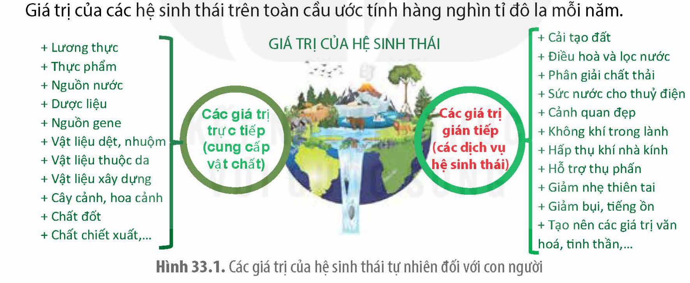
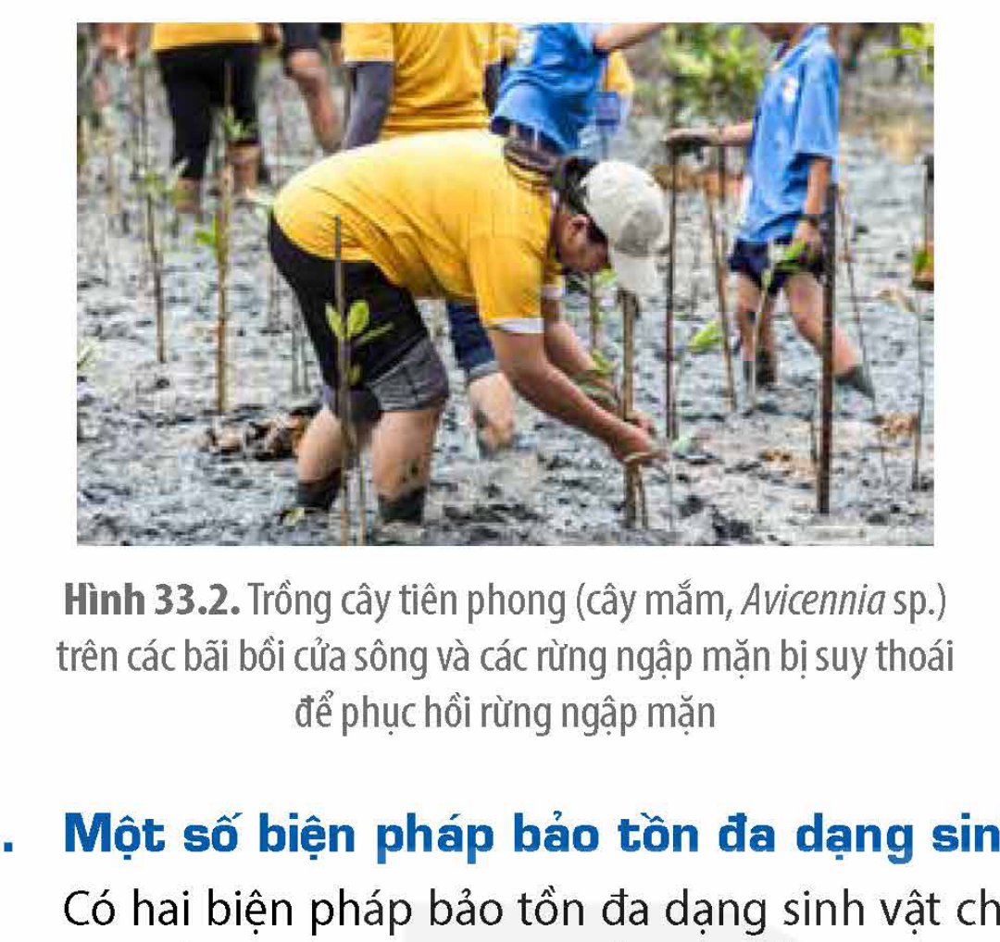
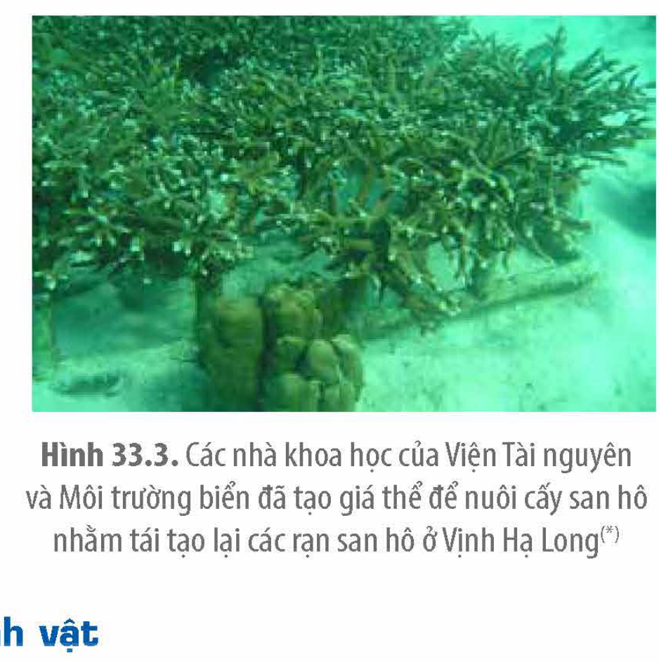
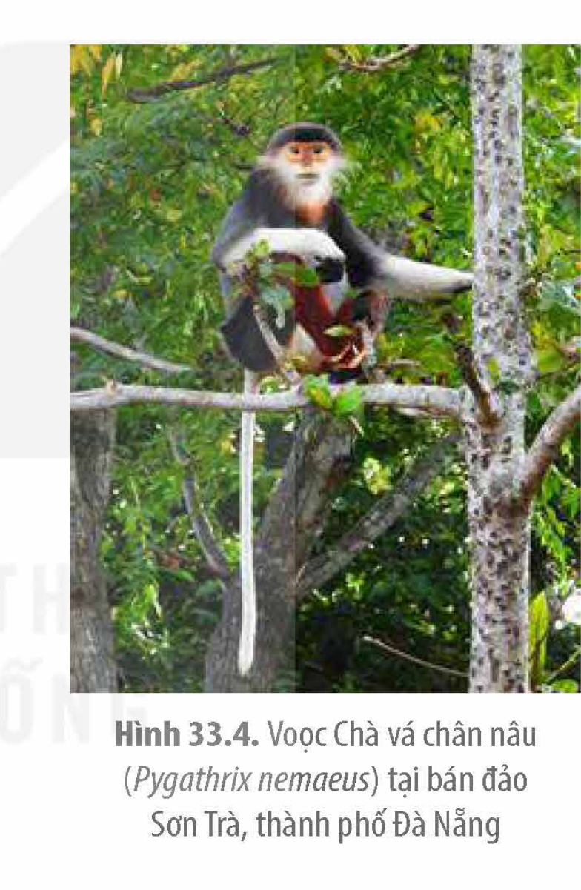

<!-- pdf:177 -->

# BÀI 33: SINH THÁI HỌC PHỤC HỒI VÀ BẢO TỒN ĐA DẠNG SINH VẬT

## 🎯 Yêu cầu cần đạt

- Nêu được khái niệm sinh thái học phục hồi và bảo tồn.
- Giải thích được tại sao cần bảo tồn và phục hồi các hệ sinh thái tự nhiên.
- Trình bày được một số phương pháp phục hồi hệ sinh thái và biện pháp bảo tồn đa dạng sinh vật.

## 🔴 Mở đầu

Hình dưới thể hiện các hoạt động nghiên cứu bảo tồn và trồng lại các rạn san hô. Em hãy giải thích tại sao con người cần phải bảo vệ các rạn san hô khỏi các tác động xấu từ môi trường và con người, đồng thời trồng lại nhiều rạn san hô đã bị chết hoặc suy thoái?

## I. KHÁI NIỆM SINH THÁI HỌC PHỤC HỒI VÀ BẢO TỒN

### 1. Khái niệm sinh thái học phục hồi

Sinh thái học phục hồi là khoa học ứng dụng nguyên lí của sinh thái học để đưa các hệ sinh thái đã bị suy thoái về trạng thái gần nhất với trạng thái tự nhiên của nó.

Phục hồi sinh thái là các hoạt động có chủ đích nhằm khởi xướng hoặc thúc đẩy sự khôi phục các hệ sinh thái, phục hồi sức khoẻ, tính toàn vẹn và tính bền vững của các hệ sinh thái đó. Thông thường, hệ sinh thái đòi hỏi phục hồi khi nó bị thay đổi, xâm hại, suy thoái hay bị phá huỷ.

Hệ sinh thái được phục hồi sẽ không nhất thiết phải khôi phục hoàn toàn trạng thái ban đầu của nó, vì đôi khi những điều kiện hiện thời có thể khiến nó phục hồi theo hướng khác. Việc hồi phục hoàn toàn một hệ sinh thái đã bị suy thoái là bất khả thi. Ví dụ: Không thể phục hồi lại rừng nguyên sinh sau khi nó đã bị phá huỷ.

<!-- pdf:178 -->

### 2. Khái niệm sinh thái học bảo tồn

Sinh thái học bảo tồn là một nhánh của sinh thái học và sinh học tiến hoá, với mục tiêu là tìm cách bảo tồn các loài, môi trường sống, cảnh quan và hệ sinh thái một cách nhanh chóng, hiệu quả và tiết kiệm nhất có thể.

<!-- term: Loài nguy cấp, quý, hiếm -->
Bảo tồn đa dạng sinh vật là việc bảo vệ và gìn giữ sự phong phú của các hệ sinh thái tự nhiên quan trọng, đặc thù hoặc đại diện; bảo vệ môi trường sống tự nhiên thường xuyên hoặc theo mùa của các loài hoang dã, các cảnh quan môi trường, nét đẹp độc đáo của tự nhiên; nuôi, trồng, chăm sóc các loài thuộc danh mục loài nguy cấp, quý, hiếm được ưu tiên bảo vệ; lưu giữ và bảo quản lâu dài các mẫu vật di truyền.

Nhiệm vụ của sinh thái bảo tồn là hạn chế các tác động xấu từ môi trường và con người đến các loài sinh vật hoang dã, bảo vệ và phục hồi môi trường sống cũng như sức khoẻ cho sinh vật, bảo vệ và duy trì ổn định quần thể các loài hoang dã ở các vườn quốc gia và khu bảo tồn thiên nhiên, giữ gìn và sử dụng hợp lí các nguồn tài nguyên sinh học và đảm bảo sự phân chia một cách công bằng lợi ích thu được từ các nguồn tài nguyên sinh học.

## II. LÍ DO CẦN BẢO TỒN VÀ PHỤC HỒI CÁC HỆ SINH THÁI TỰ NHIÊN

### 1. Giá trị của các hệ sinh thái tự nhiên là rất lớn

Các hệ sinh thái là tổ hợp của các loài sinh vật với môi trường sống của chúng, trong đó sinh vật tương tác với nhau và với môi trường để cùng tồn tại và phát triển. Các hệ sinh thái cung cấp cho con người rất nhiều sản phẩm vật chất (còn được gọi là giá trị trực tiếp) và các dịch vụ sinh thái (còn gọi là các giá trị gián tiếp), được thể hiện cụ thể trong Hình 33.1. Giá trị của các hệ sinh thái trên toàn cầu ước tính hàng nghìn tỉ đô la mỗi năm.

Hình 33.1. Các giá trị của hệ sinh thái tự nhiên đối với con người

### 2. Các hệ sinh thái tự nhiên đang bị suy thoái nhanh

Trong quá trình sống, do ưu tiên các hoạt động phát triển kinh tế, xã hội mà con người đã tác động xấu lên các hệ sinh thái tự nhiên ở các mức độ khác nhau, làm các hệ dần bị suy thoái, cụ thể như sau:

- Thu hẹp, chia cắt, thậm chí xoá sổ các hệ sinh thái tự nhiên, làm mất hoặc thu hẹp nơi ở, nơi kiếm ăn của các loài. Ví dụ: Đốt rừng làm rẫy đã làm thu hẹp hệ sinh thái rừng tự nhiên; làm đường cắt ngang qua Vườn Quốc gia Cúc Phương.
- Phá huỷ cấu trúc hoặc làm biến đổi thành phần của hệ sinh thái, gây hại cho hệ sinh thái. Ví dụ: Khai thác hải sản với các phương tiện đánh bắt huỷ diệt (giã cào, lưới rê đáy, thuốc nổ,...) hoặc thiên tai đã phá vỡ cấu trúc của các hệ sinh thái ven biển; Nước thải đổ ra sông gây ô nhiễm môi trường khiến các hệ sinh thái sông ngòi bị suy thoái, suy giảm nguồn thuỷ sản.

<!-- pdf:179 -->

- Khai thác cạn kiệt các loài bản địa quan trọng hoặc nhập nội các loài ngoại lai, gây đứt gãy các chuỗi thức ăn, làm gián đoạn chu trình vật chất của hệ. Ví dụ: Khai thác những cây gỗ lớn trong rừng tự nhiên khiến nhiều loài khác suy giảm; Nhập nội hoặc di giống các loài ngoại lai, khiến chúng lấn át các loài bản địa,...
- Các tác động trên khiến hệ sinh thái lâm vào tình trạng bị nhiễu loạn, hư hỏng, suy thoái và nặng nề nhất là bị phá huỷ. Ở quy mô toàn cầu, đã có 14 trong 18 dịch vụ sinh thái đang bị suy giảm. Ở quy mô nhỏ, sự suy giảm nguồn gene và suy giảm loài cũng đáng báo động, tốc độ tuyệt chủng của các loài hiện nay cao hơn từ 1 000 đến 10 000 lần so với tốc độ thông thường của tự nhiên. Mất môi trường sống là nguyên nhân hàng đầu dẫn đến sự tuyệt chủng của các loài và suy giảm nguồn gene. Vì thế, để bảo vệ các loài, rất cần bảo vệ môi trường sống và nguồn sống của chúng (thức ăn, nước uống, không khí,...) hay chính là bảo vệ cả hệ sinh thái. Ngoài ra, cần tuyên truyền, giáo dục bảo tồn đa dạng sinh vật để người tiêu dùng nói không với việc tiêu thụ các loài hoang dã và sản phẩm của chúng, đặc biệt là những loài quan trọng, chủ chốt trong các lưới thức ăn.

## ❓ Dừng lại và suy ngẫm

1. Mục đích của sinh thái học phục hồi là gì? Mục đích của bảo tồn đa dạng sinh vật là gì?
2. Tại sao con người cần phục hồi các hệ sinh thái và bảo tồn đa dạng sinh vật?

## III. MỘT SỐ BIỆN PHÁP PHỤC HỒI VÀ BẢO TỒN CÁC HỆ SINH THÁI TỰ NHIÊN

### 1. Một số phương pháp phục hồi sinh thái

Có hai nhóm phương pháp chính trong phục hồi sinh thái là cải tạo sinh học và gia tăng sinh học.

Cải tạo sinh học bao gồm các biện pháp loại bỏ các yếu tố gây hại cho hệ sinh thái như chất thải, hoá chất độc hại, kim loại nặng, đập ngăn nước, loài ngoại lai,... Ví dụ: Giảm thiểu và loại bỏ uranium trong đất nhiễm uranium bằng cách bổ sung loài vi sinh vật *Shewanella oneidensis*, loài này hấp thụ uranium, giúp hệ vi sinh vật đất phục hồi và cải thiện chất lượng đất; loại bỏ kim loại nặng và các chất độc khác trong ao bằng cách bổ sung bèo hoa dâu để chúng hấp thụ chất độc trong nước ao, đáy ao; phá bỏ cây mai dương trong các hệ sinh thái rừng để các loài bản địa phát triển.

Gia tăng sinh học bao gồm những phương pháp bổ sung các thành phần cần thiết (vật liệu hoặc sinh vật) cho hệ sinh thái để hệ sinh thái phục hồi như bổ sung các sinh vật/nhóm sinh vật cần thiết cho hệ (vi sinh vật cố định đạm, loài tiên phong, loài chủ chốt, loài bản địa, loài sống hợp tác,...); bổ sung các vật liệu cần thiết cho hệ (nguồn nước, chất dinh dưỡng, giá thể cho các loài bám,...). Ví dụ: dẫn nước sông ngòi vào các hệ sinh thái bị khô cạn; trồng cây họ Đậu trên đất nghèo đạm; trồng cây tiên phong trên các bãi bồi cửa sông để phục hồi rừng ngập mặn (H 33.2); trồng lại rừng trên các vùng đất trống, đồi trọc; tạo giá thể và trồng lại san hô để phát triển thành các rạn, tạo nơi ở, nơi kiếm ăn và sinh sản cho thuỷ sinh vật (H 33.3).

<!-- pdf:180 -->

Hình 33.2. Trồng cây tiên phong (cây mắm, *Avicennia* sp.) trên các bãi bồi cửa sông và các rừng ngập mặn bị suy thoái để phục hồi rừng ngập mặn

Hình 33.3. Các nhà khoa học của Viện Tài nguyên và Môi trường biển đã tạo giá thể để nuôi cấy san hô nhằm tái tạo lại các rạn san hô ở Vịnh Hạ Long(*)

### 2. Một số biện pháp bảo tồn đa dạng sinh vật

Có hai biện pháp bảo tồn đa dạng sinh vật chính là bảo tồn nguyên vị và bảo tồn chuyển vị.

Bảo tồn nguyên vị còn được gọi là bảo tồn nội vi, hay bảo tồn tại chỗ, đó là quá trình bảo tồn một loài nào đó tại nơi cư trú tự nhiên của nó, bao gồm việc bảo vệ khu vực sinh sống khỏi các tác động bên ngoài hoặc bảo vệ loài này khỏi các loài săn mồi. Bảo tồn nguyên vị tập trung bảo tồn các hệ sinh thái và các sinh cảnh tự nhiên để duy trì và khôi phục quần thể các loài trong môi trường tự nhiên của chúng. Cụ thể là việc thành lập các khu bảo tồn thiên nhiên, các hành lang đa dạng sinh vật kết nối và mở rộng các khu bảo tồn,... Ở Việt Nam, theo Bộ Tài nguyên và Môi trường, tính đến năm 2019, khoảng 17% diện tích vùng nước trên cạn và nội địa; 10% diện tích vùng ven biển và biển; 15% diện tích đất liền và 7,5% diện tích đại dương trên thế giới là những vùng có tính đa dạng sinh vật cao đã được khoanh vùng bảo vệ.

Hình 33.4. Voọc Chà vá chân nâu (*Pygathrix nemaeus*) tại bán đảo Sơn Trà, thành phố Đà Nẵng

Ví dụ: Loài voọc Chà vá chân nâu (*Pygathrix nemaeus*) là một loài linh trưởng đặc hữu của khu vực Đông Dương đang trong tình trạng nguy cấp (EN). Hiện nay loài này đang được bảo tồn nguyên vị tại các khu rừng nguyên sinh từ Nghệ An đến Kon Tum, nơi nó đang sinh sống tự nhiên. Nơi loài này có mật độ quần thể lớn nhất hiện nay là bán đảo Sơn Trà, Đà Nẵng (H 33.4).

Bảo tồn chuyển vị còn được gọi là bảo tồn ngoại vi hay bảo tồn chuyển chỗ, đây là quá trình bảo tồn ở bên ngoài nơi cư trú tự nhiên của loài. Bảo tồn chuyển vị bao gồm bảo quản giống, cứu hộ và chăm sóc các cá thể của loài, nuôi cấy mô, thu thập các giống, các cá thể giá trị để nuôi trồng nhằm duy trì vốn gene quý hiếm. Các hình thức bảo tồn chuyển vị gồm: xây dựng các vườn thú, vườn thực vật, ngân hàng gene, ngân hàng hạt giống, trung tâm nuôi cấy và nhân giống, trung tâm cứu hộ và chăm sóc động vật,...

(*) Nguồn: Nguyễn Đăng Ngãi, 2023. Viện TN&MT biển.

<!-- pdf:181 -->

Ví dụ: Trung tâm Cứu hộ Gấu Việt Nam xây dựng tại Vườn Quốc gia Tam Đảo chăm sóc 161 cá thể gấu (năm 2015) được giải cứu từ các trại nuôi lấy mật. Đến năm 2022, Trung tâm Cứu hộ Gấu Việt Nam II được xây dựng ở Vườn Quốc gia Bạch Mã. Theo kế hoạch, hai trung tâm sẽ cứu hộ được hơn 1 000 cá thể gấu còn lại và đóng cửa hơn 400 trại nuôi nhốt gấu ở nước ta.

Những biện pháp cụ thể này được triển khai thành những hành động cụ thể để bảo tồn đa dạng sinh vật sẽ được trình bày chi tiết hơn ở bài học sau.

## ❓ Dừng lại và suy ngẫm

1. Em hãy lấy hai ví dụ về cải tạo sinh học và gia tăng sinh học nhằm phục hồi sinh thái ở nước ta.
2. Giải thích tại sao nhiều loài không thể bảo tồn tại nơi nó đang sinh sống mà phải đưa vào các vườn thú, vườn thực vật hoặc trung tâm cứu hộ và chăm sóc động vật.

## 📌 Kiến thức cốt lõi

- Sinh thái học phục hồi là khoa học ứng dụng nguyên lí của sinh thái học để đưa các hệ sinh thái đã bị suy thoái về trạng thái gần nhất với trạng thái tự nhiên của nó. Sinh thái học bảo tồn là khoa học ứng dụng sinh thái và sinh học tiến hoá vì mục tiêu bảo tồn các loài, môi trường sống, cảnh quan và hệ sinh thái một cách nhanh chóng, hiệu quả và tiết kiệm.
- Các hệ sinh thái tự nhiên cung cấp cho con người các dịch vụ hệ sinh thái dưới dạng tài nguyên vật chất và giá trị sinh thái, được ước tính hàng nghìn tỉ đô la mỗi năm. Tuy nhiên, chúng đã và đang bị tác động xấu làm suy thoái ở các mức độ khác nhau.
- Phục hồi sinh thái là các hoạt động có chủ đích nhằm vào các hệ sinh thái tự nhiên quan trọng nhưng đã bị suy thoái ở các mức độ khác nhau để khôi phục giá trị vốn có của nó.
- Bảo tồn đa dạng sinh vật thường hướng đến những hệ sinh thái có tính đa dạng sinh vật cao, mục đích là bảo vệ nguồn gene quý, các loài có giá trị và các hệ sinh thái quan trọng.
- Có hai nhóm biện pháp chính trong phục hồi sinh thái là cải tạo sinh học và gia tăng sinh học.

## ✏️ Luyện tập và vận dụng

1. Em hãy tìm hiểu và giới thiệu một số loài sinh vật đang được bảo tồn chuyển vị ở nước ta và một số vườn quốc gia, khu bảo tồn thiên nhiên mà em biết.
2. Theo em, mỗi học sinh cần làm gì để góp phần bảo tồn và phục hồi sinh thái?

## 📷 Danh sách hình trong bài

| Mã hình | Trang PDF | Vị trí | Chú thích gốc |
|---|---|---|---|
| H12-sinh-b33-01 | 178 | Mục II.1 | Hình 33.1. Các giá trị của hệ sinh thái tự nhiên đối với con người |
| H12-sinh-b33-02 | 180 | Mục III.1 | Hình 33.2. Trồng cây tiên phong (cây mắm, Avicennia sp.) trên các bãi bồi cửa sông và các rừng ngập mặn bị suy thoái để phục hồi rừng ngập mặn |
| H12-sinh-b33-03 | 180 | Mục III.1 | Hình 33.3. Các nhà khoa học của Viện Tài nguyên và Môi trường biển đã tạo giá thể để nuôi cấy san hô nhằm tái tạo lại các rạn san hô ở Vịnh Hạ Long(*) |
| H12-sinh-b33-04 | 180 | Mục III.2 | Hình 33.4. Voọc Chà vá chân nâu (Pygathrix nemaeus) tại bán đảo Sơn Trà, thành phố Đà Nẵng |
