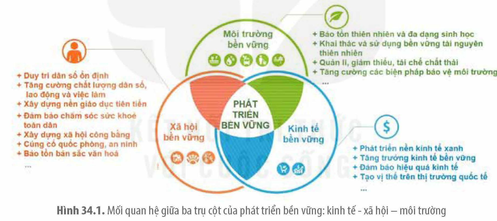
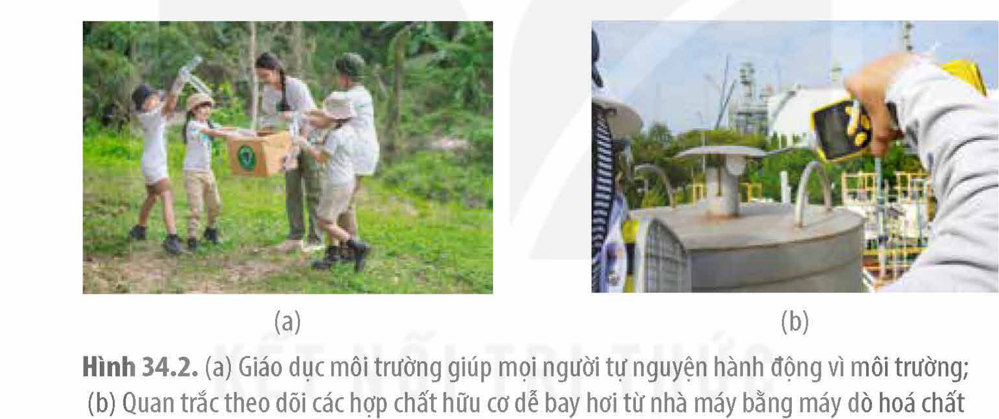
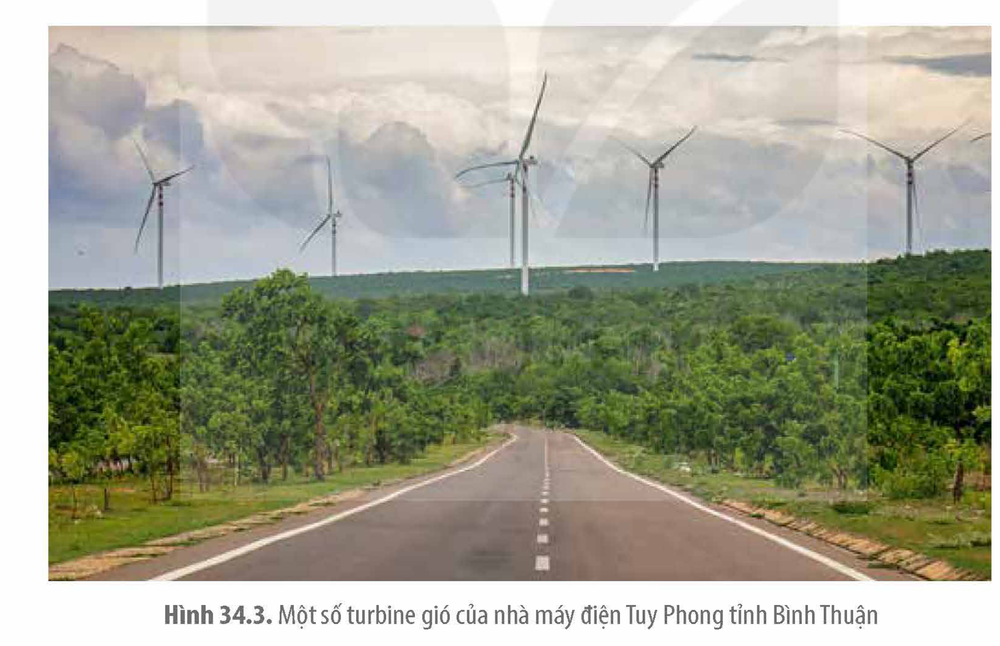
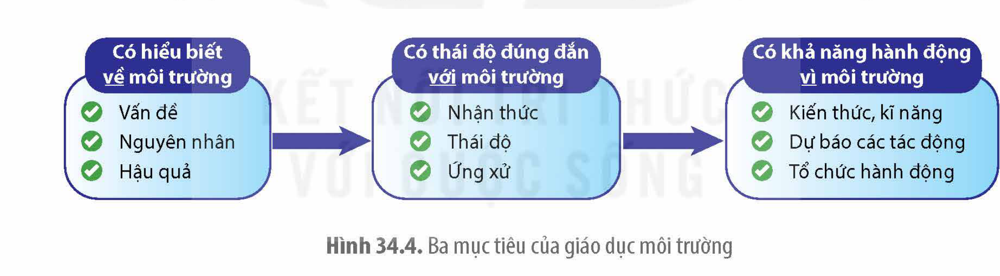

<!-- pdf:182 -->

# BÀI 34: PHÁT TRIỂN BỀN VỮNG

## 🎯 Yêu cầu cần đạt

- Trình bày được khái niệm phát triển bền vững. Phân tích được khái quát về tác động giữa kinh tế - xã hội - môi trường tự nhiên.
- Nêu được khái niệm và vai trò phát triển nông nghiệp bền vững.
- Phân tích được: vai trò và các biện pháp sử dụng hợp lí tài nguyên thiên nhiên (đất, nước, rừng, năng lượng); các biện pháp hạn chế ô nhiễm môi trường; các biện pháp bảo tồn đa dạng sinh học; vai trò của chính sách dân số, kế hoạch hoá gia đình trong phát triển bền vững; vai trò của giáo dục bảo vệ môi trường đối với phát triển bền vững đất nước.
- Đề xuất các hoạt động bản thân có thể làm được nhằm góp phần phát triển bền vững.

## 🔴 Mở đầu

Hình dưới đây minh hoạ các mục tiêu phát triển bền vững do Liên hợp quốc phát động cho giai đoạn 2015 – 2030. Em hiểu gì về các mục tiêu phát triển bền vững đó?

## I. KHÁI NIỆM PHÁT TRIỂN BỀN VỮNG VÀ MỐI TƯƠNG TÁC GIỮA KINH TẾ - XÃ HỘI - MÔI TRƯỜNG

### 1. Khái niệm và mục tiêu của phát triển bền vững

Có nhiều khái niệm phát triển bền vững, các khái niệm này được thay đổi cho phù hợp với tiến trình phát triển kinh tế - xã hội và bảo vệ môi trường của các quốc gia trên thế giới. Dưới đây là hai khái niệm thường được sử dụng nhất.

Theo Liên hợp quốc (1987), “phát triển bền vững là sự phát triển có thể đáp ứng được những nhu cầu hiện tại mà không ảnh hưởng hay tổn hại đến khả năng đáp ứng nhu cầu của các thế hệ tương lai”.

<!-- pdf:183 -->

Theo Hội nghị Thượng đỉnh Thế giới về phát triển bền vững năm 2002, “phát triển bền vững là sự bảo đảm tăng trưởng kinh tế ổn định đi cùng với thực hiện tiến bộ và công bằng xã hội; khai thác hợp lí, sử dụng tiết kiệm tài nguyên, bảo vệ và nâng cao chất lượng môi trường sống”.

Phát triển bền vững là một xu hướng tất yếu trên thế giới và ở mỗi quốc gia khi con người phải đối mặt với hàng loạt các vấn đề về môi trường, tài nguyên, kinh tế, xã hội và hệ thống khí hậu cần giải quyết. Phát triển bền vững là một chiến lược lâu dài, được xây dựng và thực hiện có kế hoạch, phù hợp cho mỗi quốc gia, nhằm từng bước đạt được 17 mục tiêu toàn cầu mà Liên hợp quốc đã phát động cho giai đoạn 2015 – 2030.

### 2. Mối tương tác giữa kinh tế - xã hội – môi trường trong quá trình phát triển

Mục tiêu chung của phát triển bền vững là đảm bảo cho mọi người dân được đáp ứng đầy đủ những nhu cầu thiết yếu về kinh tế, văn hoá xã hội và được sống trong môi trường an toàn.

Quan điểm xuyên suốt của phát triển bền vững là tập trung vào cả ba lĩnh vực mà sự phát triển muốn đạt được: kinh tế bền vững; xã hội bền vững; môi trường bền vững. Ngoài ra, phát triển bền vững còn đòi hỏi sự phát triển cân đối, hài hoà giữa ba lĩnh vực nói trên, nếu ưu tiên một lĩnh vực phát triển nhanh hơn thì cả hệ thống sẽ mất cân bằng và có thể sụp đổ. Các nội dung cần thực hiện để phát triển bền vững trong từng lĩnh vực được thể hiện trong Hình 34.1.

Hình 34.1. Mối quan hệ giữa ba trụ cột của phát triển bền vững: kinh tế - xã hội – môi trường

Giữa ba lĩnh vực này luôn có sự tương tác qua lại và phụ thuộc lẫn nhau, hỗ trợ nhau cùng phát triển. Khi kinh tế phát triển bền vững sẽ tạo ra việc làm và thu nhập cho con người, sẽ có nguồn lực để phát triển xã hội và bảo vệ môi trường; Khi xã hội phát triển sẽ tạo ra lao động có chất lượng và một xã hội ổn định cho kinh tế phát triển, con người trong xã hội đó có ý thức và hành động bảo vệ môi trường; Khi môi trường bền vững sẽ tạo ra các nguồn lực thiên nhiên (đất đai, nguồn nước, cảnh quan,...) dồi dào để phục vụ nền kinh tế và thúc đẩy xã hội phát triển.

## ❓ Dừng lại và suy ngẫm

1. Trình bày ngắn gọn 17 mục tiêu phát triển bền vững trên toàn cầu mà Liên hợp quốc đã phát động cho giai đoạn 2015 – 2030.
2. Phân tích mối tương tác giữa kinh tế – xã hội – môi trường trong quá trình phát triển.

<!-- pdf:184 -->

## II. PHÁT TRIỂN BỀN VỮNG TRONG MỘT SỐ LĨNH VỰC

Để phát triển bền vững, mỗi quốc gia cần có kế hoạch nghiên cứu, xây dựng và ban hành các chính sách phù hợp, hướng tới phát triển bền vững đối với tất cả các ngành nghề thuộc ba lĩnh vực kinh tế, xã hội và môi trường. Dưới đây là một số biện pháp cụ thể cần thực hiện ở một số ngành nghề trong ba lĩnh vực nhằm phát triển bền vững. Trong lĩnh vực kinh tế, cần ưu tiên phát triển nông nghiệp bền vững; Trong lĩnh vực môi trường, cần hạn chế ô nhiễm môi trường, sử dụng hợp lí tài nguyên thiên nhiên, bảo tồn đa dạng sinh vật và thực hiện giáo dục môi trường; Trong lĩnh vực xã hội, cần ưu tiên chính sách dân số và kế hoạch hoá gia đình phù hợp.

### 1. Khái niệm và vai trò của phát triển nông nghiệp bền vững

Nông nghiệp bền vững là phương thức canh tác nông nghiệp theo cách bền vững, để đáp ứng nhu cầu lương thực, thực phẩm và dệt may hiện tại của xã hội, mà không ảnh hưởng đến khả năng đáp ứng các nhu cầu đó của các thế hệ tương lai.

Nông nghiệp bền vững thường thoả mãn ba điều kiện sau:

- Tôn trọng môi trường, bảo tồn và quản lí hiệu quả tài nguyên thiên nhiên.
- Đảm bảo mức thu nhập công bằng và đầy đủ cho người nông dân.
- Không gây ảnh hưởng đến các thế hệ tiếp theo, đảm bảo người nông dân có được thu nhập công bằng và đầy đủ trong tương lai.

Vai trò của nông nghiệp bền vững:

- Đối với kinh tế: Nông nghiệp bền vững đảm bảo an ninh lương thực cho con người, nâng cao chất lượng nông sản, tạo việc làm và thu nhập, cung cấp nguyên liệu cho công nghiệp chế biến (chế biến thức ăn, bánh kẹo, nước giải khát, thực phẩm chức năng, hoá mĩ phẩm,...). Từ đó, nâng cao giá trị của nông sản và hướng đến xuất khẩu, nâng cao thu nhập cho các gia đình và quốc gia một cách an toàn và bền vững.
- Đối với xã hội: Phát triển nông nghiệp bền vững là sự đóng góp cụ thể của nông dân cho sự phát triển của xã hội, đảm bảo sự công bằng trong phát triển, nâng cao thu nhập cho người nông dân, đảm bảo sức khoẻ cho con người, cải thiện chất lượng cuộc sống, xoá đói giảm nghèo, đảm bảo gia đình phát triển bền vững, giảm khoảng cách giàu nghèo giữa các tầng lớp và nhóm xã hội,...
- Đối với môi trường: Nông nghiệp bền vững bảo vệ môi trường, khai thác hợp lí các nguồn tài nguyên thiên nhiên (nước, đất đai, đa dạng sinh vật, sinh khối, năng lượng tái tạo,...), bảo tồn đa dạng sinh vật và phục hồi các hệ sinh thái.

### 2. Các biện pháp hạn chế ô nhiễm môi trường

Để hạn chế ô nhiễm môi trường, có nhiều biện pháp được đưa ra, từ chính sách đến hành động. Có thể chia thành các nhóm biện pháp sau đây:

- Giáo dục và khuyến khích: Đây là nhóm biện pháp không bắt buộc, tập trung thúc đẩy, khuyến khích, nâng cao ý thức bảo vệ môi trường. Ví dụ: Nhà nước xây dựng và công nhận các tiêu chuẩn, danh hiệu, thương hiệu cho doanh nghiệp và sản phẩm của họ, như ISO, VietGAP, Green Star, Nhãn sinh thái,... để khuyến khích các doanh nghiệp

<!-- pdf:185 -->

giảm thiểu chất thải, ứng dụng công nghệ tiên tiến trong sản xuất sạch hơn, sử dụng năng lượng tái tạo, hạn chế sử dụng hoá chất độc hại, tăng cường tái sử dụng và tái chế, tiết kiệm tài nguyên thiên nhiên,... Bên cạnh đó, truyền thông, giáo dục môi trường nâng cao ý thức và trách nhiệm của cộng đồng để họ hạn chế sử dụng túi nylon, bỏ rác thải đúng nơi quy định, tiết kiệm điện, nước, ủng hộ hàng hoá và các sản phẩm “xanh”, sống thân thiện với môi trường,... (H 34.2a).

- Ngăn ngừa: Nhóm biện pháp này thường sử dụng Luật và các quy định (của quốc tế, quốc gia, tổ chức, cộng đồng,...) để ngăn ngừa tác động xấu lên môi trường. Ví dụ: Trong Luật Bảo vệ môi trường của nước ta có quy định những việc mà các doanh nghiệp, tổ chức, người dân phải làm để bảo vệ môi trường, nếu vi phạm sẽ bị pháp luật xử lí. Trong bộ Quy chuẩn Việt Nam đối với nước thải, khí thải, quản lí chất thải rắn, xử lí chất thải tại nơi sản xuất quy định chất thải của các nhà máy khi xả thải ra môi trường phải đạt các quy chuẩn đó. Ngoài ra, còn có các quy định về đánh giá tác động môi trường trước khi xây dựng dự án, nhà máy; quan trắc và giám sát môi trường định kì hoặc thường xuyên (do các cơ quan quản lí môi trường và cộng đồng thực hiện) để phát hiện và ngăn ngừa các hoạt động gây ô nhiễm môi trường (H 34.2b).

Hình 34.2. (a) Giáo dục môi trường giúp mọi người tự nguyện hành động vì môi trường; (b) Quan trắc theo dõi các hợp chất hữu cơ dễ bay hơi từ nhà máy bằng máy dò hoá chất

- Khắc phục và nâng cao khả năng chịu đựng: Bao gồm các biện pháp giảm nhẹ tác hại và nâng cao khả năng chịu đựng của môi trường. Ví dụ: khôi phục môi trường sau lũ lụt, bão, giông lốc; xử lí các khu vực đã bị ô nhiễm chất độc tồn dư của kho thuốc trừ sâu; rà phá bom mìn sau chiến tranh; tiêu huỷ và khử khuẩn vùng nuôi trồng sau khi nhiễm dịch bệnh; cải tạo đất bị thoái hoá,... Ngoài ra, cần xây dựng các hệ sinh thái mạnh khoẻ, đa dạng và bền vững để chúng đủ khả năng thanh lọc chất thải, hấp thụ và phân giải chất thải, giảm nhẹ tác động của ô nhiễm và các sự cố môi trường. Ví dụ: gia tăng diện tích cây xanh, mặt nước trong các khu đô thị; phục hồi và phát triển các khu rừng phòng hộ ở thượng nguồn để giảm lũ lụt; gia cố rừng ngập mặn và rừng phi lao ven biển để hạn chế tác động của thuỷ triều, bão, gió...

### 3. Vai trò và các biện pháp sử dụng hợp lí tài nguyên thiên nhiên

Tài nguyên thiên nhiên là nguồn lực quan trọng để phát triển kinh tế, xã hội. Có thể chia các loại tài nguyên thiên nhiên thành ba nhóm: tài nguyên có khả năng tái tạo, tài nguyên không có khả năng tái tạo và tài nguyên khí hậu. Tài nguyên thiên nhiên cần được khai thác hợp lí và bền vững để phục vụ cho sự phát triển lâu dài. Tuỳ thuộc vào từng nhóm tài nguyên mà con người sử dụng các biện pháp khai thác phù hợp. Cụ thể như sau:

<!-- pdf:186 -->

- Đối với nhóm tài nguyên có khả năng tái tạo như sinh vật, nguồn nước, đất đai,...: cần đánh giá được trữ lượng và khả năng tái tạo của chúng để đưa ra các biện pháp khai thác phù hợp với tốc độ tái tạo, tránh mùa sinh sản, tránh khai thác nhóm con non,... Đối với các loài quý, hiếm, đặc hữu cần có chính sách bảo tồn tiến tới gây trồng và phát triển. Ví dụ: nhân giống và trồng loài sâm Ngọc Linh (*Panax vietnamensis*) ở các vùng núi cao của tỉnh Kon Tum, Quảng Nam.
- Đối với nhóm tài nguyên không tái tạo như các loại khoáng sản: cần nghiên cứu đánh giá trữ lượng, khả năng và chi phí khai thác, lập kế hoạch khai thác có chiến lược, tiết kiệm và lâu dài. Để giảm khai thác dầu mỏ, hiện nay con người đã nghiên cứu khai thác các loại nhiên liệu tái tạo như hydrogen, gas, năng lượng mặt trời,...
- Nhóm tài nguyên khí hậu còn được xem là nguồn tài nguyên có sức tái tạo gần như “vô tận”. Nguồn tài nguyên này còn gọi là “dòng tài nguyên” vì chúng không tồn tại trong các mỏ mà luôn chuyển động và bất ổn định, như dòng chảy của nước, dòng không khí – gió, dòng bức xạ mặt trời, dòng hải lưu, thuỷ triều, sóng,... Nhóm tài nguyên này khó khai thác, cần nghiên cứu để có các biện pháp khai thác tối đa, đảm bảo an toàn và hiệu quả. Ví dụ: Trong Hình 34.3 là các turbine gió của nhà máy phong điện Tuy Phong, tỉnh Bình Thuận.

Hình 34.3. Một số turbine gió của nhà máy điện Tuy Phong tỉnh Bình Thuận

### 4. Vai trò của chính sách dân số đối với phát triển bền vững

Dân số tăng nhanh, nhất là ở các nước đang phát triển, đã ảnh hưởng xấu đến sự phát triển kinh tế, xã hội, bảo vệ môi trường và chất lượng cuộc sống. Dân số tăng nhanh tạo gánh nặng cho việc đảm bảo thu nhập, việc làm, nơi ở, lương thực, y tế, giáo dục, giao thông, điện, nước,... Dân số đông và tăng nhanh sẽ cản trở tiến trình phát triển bền vững. Tuy nhiên, nếu dân số có sự gia tăng phù hợp hoặc ổn định thì sẽ tạo nên một nguồn lao động dồi dào để phát triển kinh tế, đồng thời chủ động được kế hoạch phát triển kinh tế, xã hội và bảo vệ môi trường. Do vậy, mỗi quốc gia đều có chính sách và chương trình dân số phù hợp với tình trạng dân số, nhu cầu lao động và kế hoạch phát triển của quốc gia mình.

<!-- pdf:187 -->

Chính sách dân số được phân ra thành ba nhóm chính: Chính sách duy trì dân số ổn định ở các nước phát triển như Đan Mạch, Thuỵ Điển, Pháp,...; Chính sách gia tăng dân số ở các nước thiếu lao động như Anh, Đức, Nhật, Áo, Latvia,...; Chính sách hạn chế gia tăng dân số ở các nước đang phát triển như Trung Quốc, Ấn Độ, Việt Nam... Nói chung, chính sách dân số chung cho hầu hết các quốc gia là duy trì <!-- term: Tỉ lệ sinh thay thế --> tỉ lệ sinh thay thế, mỗi gia đình nên có trung bình hai con. Ví dụ: chính sách “Kế hoạch hoá gia đình” ở nước ta từ 1982 – 2015 là mỗi gia đình chỉ nên có 2 con và khoảng cách giữa 2 con là 5 năm. Gần đây, có sự thay đổi trong pháp lệnh dân số của nước ta: “Mỗi cặp vợ chồng và cá nhân có quyền quyết định thời gian sinh con, số con và khoảng cách giữa các lần sinh cho phù hợp với lứa tuổi, tình trạng sức khoẻ, điều kiện học tập, lao động, công tác, thu nhập,...”.

### 5. Vai trò của giáo dục môi trường đối với phát triển bền vững

Giáo dục môi trường có mục tiêu tạo ra những công dân có đủ nhận thức, ý thức và năng lực bảo vệ môi trường trong quá trình phát triển kinh tế, xã hội, hướng tới phát triển bền vững. Cụ thể:

- Có nhận thức về môi trường: hiểu biết về các vấn đề môi trường, phân tích được nguyên nhân và hậu quả của các vấn đề đó, từ đó đề xuất được các giải pháp bảo vệ môi trường.
- Có trách nhiệm và thái độ đúng đắn với môi trường: từ việc có nhận thức tốt về các vấn đề môi trường, con người sẽ có thái độ đúng mực và ứng xử vì môi trường.
- Có khả năng hành động vì môi trường: Con người có các kiến thức và ý thức bảo vệ môi trường là chưa đủ mà cần phải được trang bị các kĩ năng hành động vì môi trường, có khả năng dự báo các tác động, biết tổ chức hành động bảo vệ môi trường.

Hình 34.4. Ba mục tiêu của giáo dục môi trường

Các biện pháp giáo dục môi trường trên thế giới và ở nước ta thường được lựa chọn áp dụng phù hợp theo từng nhóm đối tượng và lứa tuổi. Cụ thể như sau:

- Giáo dục môi trường cho cộng đồng, còn gọi là nâng cao nhận thức về môi trường cho quần chúng, được thực hiện chủ yếu thông qua các phương tiện thông tin đại chúng, các hoạt động văn hoá, truyền thông, các sự kiện và các cuộc vận động quần chúng rộng rãi. Ví dụ, sự kiện tắt đèn nhân ngày Trái Đất; Ngày Chủ nhật xanh...
- Giáo dục môi trường cho trẻ nhỏ, học sinh, sinh viên trong hệ thống giáo dục và đào tạo ở các trường, từ trường mẫu giáo đến trường cao đẳng và đại học. Các nội dung giáo dục môi trường được lồng ghép vào các hoạt động dạy - học và hoạt động khác của các nhà trường.

<!-- pdf:188 -->

- Giáo dục môi trường cho nhà quản lí, cán bộ các cấp ra quyết định được thực hiện bằng nhiều biện pháp phù hợp để họ biết lồng ghép các mục tiêu bảo vệ môi trường trong các mục tiêu phát triển kinh tế - xã hội của địa phương. Ví dụ: tập huấn, học chuyên đề, làm báo cáo,...
- Đào tạo chuyên môn về môi trường cho công nhân lành nghề, kĩ thuật viên, kĩ sư, cán bộ nghiên cứu, giảng dạy về môi trường để họ trở thành người dẫn dắt cộng đồng và thực hiện hiệu quả các hoạt động bảo vệ môi trường. Ví dụ: đào tạo nhân lực ngành môi trường trong các trường đại học, các viện nghiên cứu,...

Để phát triển bền vững, con người cần được giáo dục để họ có đủ nhận thức, ý thức và năng lực thực hiện các hoạt động bảo vệ môi trường, lồng ghép các hoạt động bảo vệ môi trường trong các hoạt động phát triển kinh tế, xã hội.

### 6. Các hoạt động học sinh có thể làm để góp phần phát triển bền vững

- Trang bị kiến thức về môi trường và phát triển bền vững: tìm hiểu về vai trò và giá trị của môi trường, tài nguyên, các vấn đề môi trường, các giải pháp và các chính sách bảo vệ môi trường, tăng trưởng xanh và phát triển bền vững.
- Thể hiện chính kiến và thái độ đúng đắn với môi trường: thể hiện sự tôn trọng, ủng hộ và tình cảm tốt đẹp với các hành động, sản phẩm, dự án, chương trình “xanh”, thân thiện với môi trường; nói không hoặc phản đối các hoạt động gây hại đến môi trường.
- Tham gia các hoạt động bảo vệ môi trường và phát triển bền vững: giữ gìn đồ dùng cá nhân, trường lớp, công trình công cộng,... xanh, sạch và đẹp; tham gia các hoạt động tình nguyện vì cộng đồng và các hoạt động bảo vệ môi trường, như trồng cây xanh, đạp xe vì môi trường, tiết kiệm điện, phân loại rác thải, giảm sử dụng vỏ hộp và túi nhựa, quyên góp, thiện nguyện, chia sẻ khó khăn, dạy học miễn phí,...
- Tổ chức các hoạt động vì sự phát triển bền vững: tổ chức các nhóm, đội hoạt động bảo vệ môi trường, tiêu dùng xanh,... như giáo dục cộng đồng làm sạch các công viên, làm đồ tái chế, thực hiện các điều tra, giám sát, tố cáo các hành vi gây hại môi trường,...
- Trở thành các chuyên gia trong các lĩnh vực phát triển trong tương lai và luôn quan tâm đến phát triển bền vững trong lĩnh vực mà mình làm việc: như phát triển sản phẩm xanh, khai thác năng lượng tái tạo, phát triển công nghệ sản xuất sạch, nông nghiệp sinh thái,...

## ❓ Dừng lại và suy ngẫm

1. Phát triển nông nghiệp bền vững có vai trò gì đối với kinh tế, xã hội và môi trường?
2. Trình bày các nhóm biện pháp hạn chế ô nhiễm môi trường và vai trò của chúng đối với phát triển bền vững.
3. Phân loại các nhóm tài nguyên và trình bày các biện pháp sử dụng hợp lí từng loại tài nguyên đó.
4. Trình bày một số biện pháp giáo dục môi trường áp dụng phù hợp với học sinh.

<!-- pdf:189 -->

## 📌 Kiến thức cốt lõi

- “Phát triển bền vững là sự phát triển nhằm đáp ứng tốt những nhu cầu của thế hệ hiện tại mà không ảnh hưởng đến khả năng đáp ứng nhu cầu của các thế hệ tương lai”.
- Để phát triển bền vững, mỗi quốc gia cần có kế hoạch nghiên cứu, xây dựng và ban hành các chính sách phù hợp, hướng tới phát triển bền vững đối với tất cả các ngành nghề thuộc ba lĩnh vực kinh tế, xã hội và môi trường.
- Trong lĩnh vực kinh tế, cần ưu tiên phát triển nông nghiệp bền vững; Trong lĩnh vực môi trường, cần hạn chế ô nhiễm môi trường, sử dụng hợp lí tài nguyên thiên nhiên, bảo tồn đa dạng sinh vật và thực hiện giáo dục môi trường; Trong lĩnh vực xã hội, cần ưu tiên chính sách dân số và kế hoạch hoá gia đình.
- Nông nghiệp bền vững sử dụng các biện pháp canh tác vừa đáp ứng nhu cầu về nông sản hiện tại của xã hội và không ảnh hưởng đến khả năng đáp ứng các nhu cầu đó của các thế hệ tương lai, đồng thời bảo vệ môi trường và sức khoẻ của con người, sinh vật.
- Các quốc gia cần có chính sách dân số, kế hoạch hoá gia đình phù hợp để duy trì số dân phù hợp, đồng thời cung cấp đủ nguồn nhân lực cho sự phát triển bền vững của quốc gia.
- Để phát triển bền vững, cần quan tâm nhiều hơn đến bảo vệ môi trường như hạn chế ô nhiễm môi trường bằng cả các biện pháp ngăn ngừa và các biện pháp khuyến khích; khai thác và sử dụng hợp lí, bền vững các loại tài nguyên thiên nhiên theo khả năng tái tạo của chúng; bảo tồn thiên nhiên và đa dạng sinh vật; giáo dục môi trường liên tục và lâu dài cho tất cả các đối tượng và sử dụng các biện pháp phù hợp với từng nhóm.
- Học sinh có thể góp phần phát triển bền vững thông qua việc tìm hiểu các kiến thức, kĩ năng, có thái độ đúng đắn và biết hành động cho sự phát triển bền vững.

## ✏️ Luyện tập và vận dụng

1. Sơ đồ hoá các nội dung chính cần thực hiện để phát triển bền vững.
2. Là một học sinh trung học phổ thông, em có thể làm những gì để góp phần hạn chế ô nhiễm môi trường và sử dụng hợp lí tài nguyên thiên nhiên?
3. Trình bày những hiểu biết của em về nông nghiệp bền vững và vai trò của nông nghiệp bền vững đối với con người.
4. Tìm hiểu về các chương trình hành động bảo vệ môi trường hoặc phát triển bền vững của học sinh và thanh niên đang có ở nước ta. Hãy giới thiệu về các chương trình đó cho các bạn trong nhóm/lớp cùng được biết.
5. Phân tích vai trò của chính sách dân số, kế hoạch hoá gia đình trong phát triển bền vững.

## 📷 Danh sách hình trong bài

| Mã hình | Trang PDF | Vị trí | Chú thích gốc |
|---|---|---|---|
| H12-sinh-b34-01 | 183 | Mục I.2 | Hình 34.1. Mối quan hệ giữa ba trụ cột của phát triển bền vững: kinh tế - xã hội – môi trường |
| H12-sinh-b34-02 | 185 | Mục II.2 | Hình 34.2. (a) Giáo dục môi trường giúp mọi người tự nguyện hành động vì môi trường; (b) Quan trắc theo dõi các hợp chất hữu cơ dễ bay hơi từ nhà máy bằng máy dò hoá chất |
| H12-sinh-b34-03 | 186 | Mục II.3 | Hình 34.3. Một số turbine gió của nhà máy điện Tuy Phong tỉnh Bình Thuận |
| H12-sinh-b34-04 | 187 | Mục II.5 | Hình 34.4. Ba mục tiêu của giáo dục môi trường |
