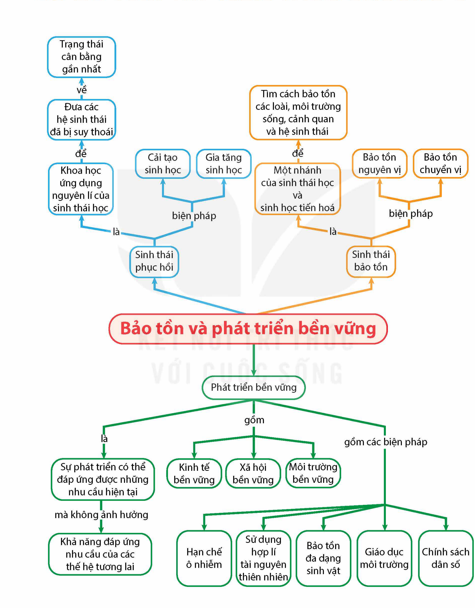

<!-- pdf:195 -->

# SƠ ĐỒ TÓM TẮT KIẾN THỨC CHƯƠNG 8

<!-- Dưới đây chép các nhánh của sơ đồ thành danh sách, giữ nguyên chữ trong các ô và trên các mũi tên. -->

- Bảo tồn và phát triển bền vững:
  - Sinh thái phục hồi:
    - là → Khoa học ứng dụng nguyên lí của sinh thái học → để → Đưa các hệ sinh thái đã bị suy thoái → về → Trạng thái cân bằng gần nhất
    - biện pháp:
      - Cải tạo sinh học
      - Gia tăng sinh học
  - Sinh thái bảo tồn:
    - là → Một nhánh của sinh thái học và sinh học tiến hoá → để → Tìm cách bảo tồn các loài, môi trường sống, cảnh quan và hệ sinh thái
    - biện pháp:
      - Bảo tồn nguyên vị
      - Bảo tồn chuyển vị
  - Phát triển bền vững:
    - là → Sự phát triển có thể đáp ứng được những nhu cầu hiện tại → mà không ảnh hưởng → Khả năng đáp ứng nhu cầu của các thế hệ tương lai
    - gồm:
      - Kinh tế bền vững
      - Xã hội bền vững
      - Môi trường bền vững
    - gồm các biện pháp:
      - Hạn chế ô nhiễm
      - Sử dụng hợp lí tài nguyên thiên nhiên
      - Bảo tồn đa dạng sinh vật
      - Giáo dục môi trường
      - Chính sách dân số
<!-- ocr-ok: chữ trong các ô sơ đồ đã đối chiếu ảnh PDF 195 phóng to -->

## 📷 Danh sách hình trong bài

| Mã hình | Trang PDF | Vị trí | Chú thích gốc |
|---|---|---|---|
| H12-sinh-so-do-tom-tat-c08-01 | 195 | Đầu bài | Sơ đồ tóm tắt kiến thức chương 8 |
