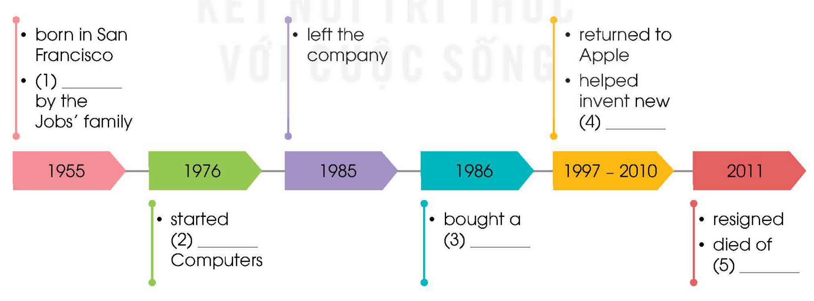
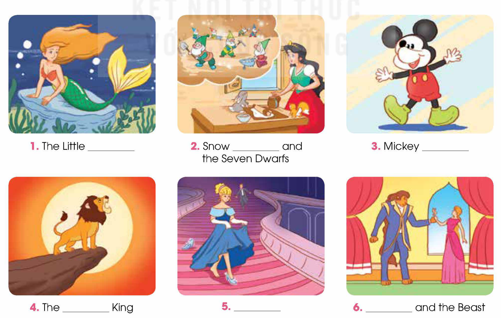

<!-- pdf:10 -->

# UNIT 1: LIFE STORIES WE ADMIRE

**This unit includes:**

- **LANGUAGE:**
  - **Pronunciation:** Diphthongs /eɪ/ and /əʊ/
  - **Vocabulary:** Phrases related to life stories
  - **Grammar:** Past simple vs. Past continuous
- **SKILLS:**
  - **Reading:** Reading for main ideas and specific information in an article about Steve Jobs' life and achievements
  - **Speaking:** Talking about the lives of two national heroes of Viet Nam
  - **Listening:** Listening for main ideas and specific information in a talk about the life of Walt Disney
  - **Writing:** Synthesising and summarising information to write a biography of Walt Disney
- **COMMUNICATION AND CULTURE / CLIL:**
  - **Everyday English:** Expressing pleasure and responding to it
  - **Culture / CLIL:** Famous queens in world history
- **PROJECT:**
  - Designing a visual story of a person's life

## I. GETTING STARTED

**The diary of Dang Thuy Tram**

**1. Listen and read.**

**Mark:** Hi, Nam. Your book must be very interesting. What are you reading?

**Nam:** I'm reading a really good book in English called *Last Night I Dreamed of Peace: The Diary of Dang Thuy Tram*.

**Mark:** Dang Thuy Tram? Who is she?

**Nam:** She was born in Hue in 1942. She studied medicine in Ha Noi, and volunteered to join the army at the age of 24, working as a surgeon during the **resistance war** against the US.

**Mark:** That's when she started her diary, isn't it?

**Nam:** Yes. She wrote her diary while she was working in a field hospital in Quang Ngai Province. The diary contains personal **accounts** of her experiences during the war, and shows her love for her family and country.

**Mark:** Wow! It sounds interesting. Is she still alive?
<!-- ocr-ok: đã đối chiếu ảnh trang gốc, OCR đọc nhầm It thành If và still thành sill -->

**Nam:** Unfortunately, she was killed by the **enemy** while she was doing her duty in the jungle in Quang Ngai Province. She was only 27 then.

<!-- pdf:11 -->

**Mark:** Oh, that's really sad. But how did people find her diary?

**Nam:** An American soldier found it and saved it from being burnt. Then more than 30 years after Tram's **death**, a copy was returned to her mother. The diary was published in Viet Nam in 2005. It has also been translated into several other languages.

**Mark:** That's amazing!

**Nam:** Now she is considered a national **hero** for **devoting** her **youth** and whole life to saving other people's lives in the war.

**Mark:** Can you lend me the book when you finish reading it? I'd like to read it myself.

**Nam:** Sure!

**2. Read the conversation again and circle the correct answer to complete each of the sentences.**

1. Dang Thuy Tram was born in *Ha Noi* / *Hue*.
2. Tram *wrote about* / *operated on* injured soldiers during the war.
3. She died when she was very *young* / *old*.
4. An American soldier kept her diary for *27 years* / *more than three decades* before returning a copy to her family.

**3. Find words and a phrase in 1 with the following meanings.**

| | Meaning |
| --- | --- |
| 1. a\_\_\_\_\_\_\_ | descriptions of things that have happened |
| 2. d\_\_\_\_\_\_\_ | the end of somebody's life |
| 3. d\_\_\_\_\_\_\_ t\_\_ | giving time, attention, etc. to something |
| 4. y\_\_\_\_\_\_\_ | the period of time when a person is young |
<!-- ocr-ok: đã đối chiếu ảnh trang gốc, OCR lỗi khung chữ cách điệu cột trái -->

**4. Complete the sentences based on the conversation.**

Dang Thuy Tram was a young surgeon. She (1) \_\_\_\_\_\_\_ her diary while she (2) \_\_\_\_\_\_\_ in a field hospital during the war. One day, she (3) \_\_\_\_\_\_\_ while she (4) \_\_\_\_\_\_\_ in the jungle. She was only 27 then. An American soldier (5) \_\_\_\_\_\_\_ her diary for many years before returning a copy to her family.

## II. LANGUAGE

### Pronunciation

**Diphthongs /eɪ/ and /əʊ/**

**1. Listen and repeat. Then practise saying the words.**

| /eɪ/ | /əʊ/ |
| --- | --- |
| age | soldier |
| saved | wrote |
| translated | hero |
| against | shows |

**2. Work in pairs. Underline the words that contain the /eɪ/ and /əʊ/ sounds. Listen and check. Then practise reading the whole text aloud.**

In the first year when *The Diary of Dang Thuy Tram* was published, more than 300,000 copies were sold. The book was also translated into more than 16 different languages. A film based on the diary was made in 2009. Its name is *Don't burn*.

<!-- pdf:12 -->

### Vocabulary

**Phrases related to life stories**
<!-- ocr-ok: đã đối chiếu ảnh trang gốc, tiêu đề màu cam bị OCR bỏ sót -->

**1. Match the words/phrases (1–5) with the words/preposition (a–e) to make phrases with the meanings below.**

| Words/phrases (1–5) | Words/preposition (a–e) | Meanings |
| --- | --- | --- |
| 1. (to) **attend** | a. **achievement** | something amazing a person does successfully |
| 2. (to) have a happy/difficult | b. for (something) | to be respected because of something |
| 3. (to be) **admired** | c. school/college | to go to school/college |
| 4. (to) have a long | d. **childhood** | to have a happy/difficult time when one is small |
| 5. impressive | e. **marriage** | to be married to someone for many years |
<!-- term: have a happy/difficult childhood -->
<!-- term: be admired for -->
<!-- term: have a long marriage -->
<!-- term: impressive achievement -->

**2. Complete the following sentences using the correct forms of the phrases in 1.**

1. My father \_\_\_\_\_\_\_ in Ha Noi between the age of 19 and 21.
2. Like so many people in their generation, my grandparents \_\_\_\_\_\_\_. They were together for 60 years.
3. My friend \_\_\_\_\_\_\_ because his mother died when he was very small.
4. Thomas Edison's \_\_\_\_\_\_\_ in science include the invention of the phonograph and development of the light bulb.
5. Uncle Ho was \_\_\_\_\_\_\_ his simple lifestyle.

### Grammar

**Past simple vs. Past continuous**
<!-- ocr-ok: đã đối chiếu ảnh trang gốc, tiêu đề màu cam bị OCR bỏ sót -->

**Remember!**

| **Past simple** | **Past continuous** |
| --- | --- |
| We use the past simple to describe: • a completed action in the past. *Example:* I *read* a good book last night. • main events in a story. *Example:* Mary *read* a few pages of her book and *went* to bed. | We use the past continuous to describe: • an action which was happening at a specific point of time in the past. *Example:* I *was reading* a good book at 10 p.m. last night. • the settings of a story. *Example:* It *was raining* heavily outside. Mary read a few pages of her book and went to bed. |

- When one action in the past happens in the middle of another, we use the past simple to talk about the shorter action, and the past continuous for the longer action.
  *Example:* I *was reading* a book when the phone *rang*.
- When two or more actions in the past are happening at the same time, we use the past continuous for both/all.
  *Example:* While I *was reading* a book, my mother *was watching* TV.

<!-- pdf:13 -->

**1. Circle the correct answer to complete each of the sentences.**

1. My dad *watched* / *was watching* a documentary about war heroes at 9 p.m. on 30th April.
2. It *snowed* / *was snowing* heavily, and icy winds *were blowing* / *blew* across the city. We lit a fire in the fireplace and sat next to it to keep warm.
3. She *finished* / *was finishing* school and *applied* / *was applying* to college at the age of 18.
4. My father *started* / *was starting* his own business in his youth and *became* / *was becoming* very successful.

2. Work in pairs. Tell the life stories of people you know and **admire**. Use the past simple and past continuous.

*Example:* My grandfather joined the army when he was 24. While he was fighting in the war, my grandmother was taking care of the whole family. ...

## III. READING

**A creative genius**

**1. Work in pairs. Discuss the questions.**

1. Who is the man in the photo?
2. What is he most famous for?

**2. Read the article. Choose the words or phrases with the closest meaning to the highlighted words or phrases in the text.**

**STEVE JOBS' LIFE AND ACHIEVEMENTS**

**A.**

Steven Paul Jobs was born on 24 February, 1955 in San Francisco, USA. His **biological** parents were not married and gave him up for adoption. He was **adopted** by Clara and Paul Jobs. In 1971, Jobs met Steve Wozniak, who was five years older than him, but they **bonded** over their love of electronics. After high school, Jobs attended Reed College in Oregon, but found the classes boring and **dropped out** after six months.

**B.**

When Jobs was 21, he and Wozniak started Apple Computers in Jobs' family garage with money they got by selling Jobs' van and Wozniak's scientific calculator. By making computers smaller, cheaper, and accessible to everyday users, their company became a huge success and sales quickly increased.

Although Jobs left Apple in 1985, he returned to his post in 1997 when the company needed new ideas. He helped invent new products such as the iMac, the iBook for students, the iPod music player, and iTunes music software. In 2007, he introduced the touch-screen iPhone which changed the way phones were used. Apple products were not only designed to be cutting-edge technology, but also to be stylish and easy to use.

In addition, Jobs contributed to computer animation. In 1986, he bought a small company, which later became Pixar Animation Studios. It produced the first full-length computer-animated film *Toy Story*, followed by other blockbusters.

**C.**

In 2003, Jobs was diagnosed with a rare form of **pancreatic** **cancer**. He fought the disease for several years, and stopped working in August, 2011. Two months later, he **passed away**. He had four children, three with his wife of 20 years and one from a previous relationship.

On an Apple web page, a statement reads, 'Apple has lost a visionary and creative **genius**, and the world has lost an amazing human being.'

<!-- pdf:14 -->

1. **adopted**
   - A. given birth to
   - B. taken by another family as their own child
2. **dropped out**
   - A. continued to study
   - B. left school/college before completing your studies
3. **cancer**
   - A. a serious disease
   - B. a dangerous animal
4. **passed away**
   - A. died
   - B. went past something
5. **genius**
   - A. a very intelligent person
   - B. an ordinary person

**3. Read the article again. Match each section (A–C) with a heading (1–5). There are TWO extra headings.**

1. Achievements
2. Early life and education
3. Marriage and family
4. Contribution to animation
5. Health issues and family

**4. Read the article again. Complete the diagram with information from the text. Use ONE word for each gap.**

- **1955:** born in San Francisco; (1) \_\_\_\_\_\_\_ by the Jobs' family
- **1976:** started (2) \_\_\_\_\_\_\_ Computers
- **1985:** left the company
- **1986:** bought a small company, which later became Pixar Animation (3) \_\_\_\_\_\_\_
- **1997–2010:** returned to Apple; helped invent new (4) \_\_\_\_\_\_\_
- **2011:** **resigned**; died of (5) \_\_\_\_\_\_\_
<!-- ocr-ok: đã đối chiếu ảnh trang gốc, văn bản nằm trong sơ đồ H12-tieng_anh-u01-01 -->

**5. Work in pairs. Discuss the following question.**

What do you admire the most about Steve Jobs?

<!-- pdf:15 -->

## IV. SPEAKING

**National heroes of Viet Nam**

**1. Work in pairs. One of you is A, the other is B. A reads the information card about General Vo Nguyen Giap. B reads the information card about Vo Thi Sau below. Use the glossary (page 147) to help you.**

**Student A's card**

- **General Vo Nguyen Giap:**
  - A **military** genius
  - 1911: born in Quang Binh Province
  - 1927: joined the **Communist Party of Viet Nam**
  - 1946–1975: led the army and won many important **battles** (e.g. Dien Bien Phu in 1954, the final Ho Chi Minh campaign in 1975)
  - 2013: passed away in Ha Noi
- **Vo Thi Sau:**
  - A national \_\_\_\_\_\_\_
  - 1933: \_\_\_\_\_\_\_
  - \_\_\_\_\_\_\_: **carried out** **attacks** against French soldiers
  - \_\_\_\_\_\_\_: caught and held in prison
  - 1952: \_\_\_\_\_\_\_

**Student B's card**

- **General Vo Nguyen Giap:**
  - A military \_\_\_\_\_\_\_
  - 1911: \_\_\_\_\_\_\_
  - \_\_\_\_\_\_\_: joined the Communist Party of Viet Nam
  - \_\_\_\_\_\_\_: led the army and won many important battles (e.g. Dien Bien Phu in \_\_\_\_\_\_\_, the final Ho Chi Minh campaign in \_\_\_\_\_\_\_)
  - 2013: \_\_\_\_\_\_\_
- **Vo Thi Sau:**
  - A national hero
  - 1933: born in Ba Ria Province
  - 1947: carried out attacks against French soldiers
  - 1949: caught and held in prison
  - 1952: killed at Con Son Prison, Con Dao Island
<!-- ocr-ok: đã đối chiếu ảnh trang gốc, Student B's card in ngược chiều trên trang sách -->

<!-- pdf:16 -->

**2. Work in pairs. A should ask B questions to complete his/her card about Vo Thi Sau. Then B should do the same to complete his/her card about General Vo Nguyen Giap. Then compare your notes.**

*Example questions:*
Who is/was ...? When did he/she ...? How old was he/she when ...? What happened in ...?

**3. Use your notes to tell the life story of General Vo Nguyen Giap or Vo Thi Sau to the class. Vote for the best-told story.**

## V. LISTENING

**The father of Mickey Mouse**

**1. Work in pairs. Solve the crossword to reveal the secret name. Share what you know about him or his films.**

**NAME THE STORY CHARACTERS!**

1. The Little \_\_\_\_\_\_\_
2. Snow \_\_\_\_\_\_\_ and the Seven Dwarfs
3. Mickey \_\_\_\_\_\_\_
4. The \_\_\_\_\_\_\_ King
5. \_\_\_\_\_\_\_
6. \_\_\_\_\_\_\_ and the Beast
<!-- ocr-ok: đã đối chiếu ảnh trang gốc, chú thích dưới 6 tranh nhân vật trong H12-tieng_anh-u01-03 -->

<!-- pdf:17 -->

**2. Listen to a talk about Walt Disney's life. Number the events in the order they are mentioned.**

- A. A difficult beginning \_\_\_
- B. An introduction to Walt Disney `1`
- C. Creating the world's most popular tourist attraction \_\_\_
- D. The birth of Mickey Mouse \_\_\_
- E. The success of *Snow White and the Seven Dwarfs* \_\_\_
- F. The continued success of The Walt Disney Studios \_\_\_

**3. Listen to the talk again. Choose the correct answer A, B, or C.**

1. Walt Disney moved to Hollywood because \_\_\_\_\_\_\_.
   - A. his parents moved to work there
   - B. he wanted to start his career again
   - C. his company became very successful
2. Which is true about Mickey Mouse?
   - A. It was based on a real pet.
   - B. It was first voiced by a famous actor.
   - C. It was not very popular.
3. What is NOT mentioned as an achievement of *Snow White and the Seven Dwarfs*?
   - A. It earned more than 400 million dollars.
   - B. It won several Oscars.
   - C. It was the best movie in the film industry.
4. What is true about Disney's achievements?
   - A. He created the first **animated** cartoon.
   - B. He holds the record for the most Oscars in history.
   - C. He designed all the Disneyland theme parks.
5. Why did he create Disneyland theme parks?
   - A. So that visitors can share their magical stories with Disney characters.
   - B. So that fans can see Disney characters live on stage and interact with them.
   - C. So that visitors can learn to make animated films.

**4. Work in pairs. Discuss the question.**

What do you think is most impressive about Walt Disney's life and achievements?

## VI. WRITING

**A biography of Walt Disney**

**1. Work in pairs. Answer these questions, using the information from Listening. Write NG (Not Given) if you cannot find the answer.**

1. When and where was Walt Disney born?
2. What schools did he attend?
3. What talent did he have?
4. What were his most impressive achievements in film-making?
5. What were his other achievements?
6. Was he married and how many children did he have?
7. When did he die?

**2. Read some facts about Walt Disney. Then work in pairs to answer all the questions in 1.**

**QUICK FACTS ABOUT WALT DISNEY**

- **Born:** 1901, in Chicago
- **Died:** 1966 (aged 65)
- **Cause of death:** cancer
- **Talent:** drawing and painting
- **Education:** attended Brenton Grammar School, but dropped out (aged 16)
- **Jobs:** artist, animator, film producer, businessman
- **Family and relatives:** three older brothers and a younger sister, wife Lillian Bounds (married for 41 years) and two daughters (one biological and one adopted)
- **Awards:** 26 Oscars, 3 Golden Globe Awards, 1 Emmy Award

<!-- pdf:18 -->

3. Write a **biography** (180 words) of Walt Disney for your school newspaper. Select and combine information from 1 and 2, and use the following outline and suggestions to help you.

**WALT DISNEY — THE FATHER OF MICKEY MOUSE**

Walt Disney is famous around the world for ...

**Childhood and education**

He was born in ...
He attended ...

**Achievements**

He was a very successful film-maker, who created ...
Apart from making films, he was also famous for ...

**Family**

He had ... brothers and sisters / ... children.

**Death and the continued success of The Walt Disney Studios**

He died in ...

## VII. COMMUNICATION AND CULTURE / CLIL

### Everyday English

**Expressing pleasure and responding to it**
<!-- ocr-ok: đã đối chiếu ảnh trang gốc, tiêu đề màu cam bị OCR bỏ sót -->

**1. Listen and complete the conversations with the expressions in the box. Then practise them in pairs.**

| A. It was such a pleasure | B. That's fantastic | C. I'm **on top of the world** | D. I'm so happy for you |
| --- | --- | --- | --- |

**1.**
**Mark:** (1) \_\_\_\_\_\_\_! I've just learnt that my **poem** about Viet Nam's national heroes has won the first prize in the **poetry** competition for teenagers.
**Nam:** (2) \_\_\_\_\_\_\_! It's a very inspiring poem.

**2.**
**Phong:** I took part in a public-speaking event and gave a talk about Steve Jobs' innovations in technology. (3) \_\_\_\_\_\_\_ to be among so many talented speakers. They invited me to give another presentation.
**Mai:** (4) \_\_\_\_\_\_\_! I've always thought you're a great speaker.

**2. Work in pairs. Use the models in 1 to make similar conversations for these situations. One of you is A, the other is B. Use the expressions on page 17 to help you.**

1. A has just watched a wonderful Walt Disney film, and expresses his/her pleasure to B. B responds to show his/her pleasure for A.
2. B's article about the life of Steve Jobs was published in the local newspaper. B expresses his/her pleasure to A. A responds to show his/her pleasure for B.

<!-- pdf:19 -->

| **Expressing pleasure** | **Responding** |
| --- | --- |
| • ... is/was amazing/wonderful/great. • That was a(n) amazing/wonderful/great ... • It is/was (such) a pleasure to ... • I was so pleased to ... • I'm **on top of the world** / **on cloud nine** / **over the moon**. | • Wow! • I'm so happy/excited for you. • Good for you! • That's fantastic/amazing/great! • I'm pleased to hear (that you like it). |

### Culture

**1. Read the following text and complete the comparison table on page 18.**

**Queens of the world**

It is said that women can **rule** kingdoms, and some of them actually did. Below are three of the most famous queens in world history.

**Cleopatra VII (69 BC–30 BC)**
The queen of ancient Egypt (ruling from 51 BC to 30 BC) was most famous for her determination and beauty. She was also very intelligent and well educated, and could speak nine languages. Under her rule, Egypt was a rich nation and remained independent from the expanding Roman Empire.

**Elizabeth I (1533–1603)**
Queen Elizabeth I ruled England for 45 years (1558–1603). She was admired for her strong determination and intelligence. Elizabeth could speak and write five languages, and even translated lengthy texts into French, Italian, and Latin. She is considered one of the most successful queens in British history. She **defeated** the powerful Spanish Navy in 1588 and encouraged the development of the arts. She refused to get married.

**Catherine II (1729–1796)**
Catherine II was a minor German princess who became known as Catherine the Great and ruled Russia from 1762 to 1796. She was intelligent, ambitious, and dedicated to her adopted country. She expanded the Russian Empire, adding an area of more than 500,000 square kilometres. She improved education for children and women, and opened the first school for girls in Russia. During her time there were also great developments in architecture, trade, and culture.

<!-- pdf:20 -->

| | **Cleopatra VII** | **Elizabeth I** | **Catherine II** |
| --- | --- | --- | --- |
| **Country** | Egypt | (1) \_\_\_\_\_\_\_ | (2) \_\_\_\_\_\_\_ |
| **Years of being queen** | (3) \_\_\_\_\_\_\_ | 45 | (4) \_\_\_\_\_\_\_ |
| **Characteristics** | determined, intelligent | determined, intelligent | intelligent, ambitious |
| **Achievements** | (5) \_\_\_\_\_\_\_ | (6) \_\_\_\_\_\_\_ | expanded the Russian Empire; improved education for children and women; encouraged great developments in architecture, trade, and culture |

**2. Work in groups. Discuss the questions.**

Do you know any female rulers or famous women in Vietnamese history? Share what you know about them.

## VIII. LOOKING BACK

### Pronunciation

**Underline the words that contain the /eɪ/ sound and circle the ones with the /əʊ/ sound in the sentences below. Then listen and check. Practise saying these sentences in pairs.**

1. Cleopatra VII, a queen of ancient Egypt, was famous for her beauty.
2. I love Disney animated films like *Snow White and the Seven Dwarfs* and *The Little Mermaid*.
3. Vo Thi Sau attacked some French soldiers when she was only 14.

### Vocabulary

**Replace the underlined words and phrases with the ones you have learnt in this unit.**
<!-- ocr-ok: đã đối chiếu ảnh trang gốc, dòng đề bài bị OCR bỏ sót -->

1. Uncle Ho *gave all* his love and energy *to* the country and people of Viet Nam.
2. Although Albert Einstein lost interest in school *as a child*, he became known as a *very intelligent person*.
3. Steve Jobs was *respected* for his *successes* in computer technology.
4. My grandfather regretted not *going to* college when he *was young*.

### Grammar

**Circle the mistake in each sentence. Then correct it.**

1. When I *was looking* (A) for some books in the library, I *was finding* (B) an *interesting* (C) biography *about* (D) General Vo Nguyen Giap.
2. At *the* (A) age of 16, Walt Disney *was dropping* (B) out of school because he *wanted* (C) to *join* (D) the army.
3. Vo Thi Sau *was caught* (A) *while* (B) she *tried* (C) to attack *some* (D) French soldiers.
4. *While* (A) the famous author *read* (B) from his biography, everyone *was listening* (C) and *taking* (D) notes.
<!-- ocr-ok: đã đối chiếu ảnh trang gốc, các nhãn A B C D in dưới chân cụm gạch chân -->

<!-- pdf:21 -->

## PROJECT

**VISUAL STORIES**

**Work in groups. Write a visual story of a person's life. This could be a historical figure or someone you know and admire. Do some research on their life or interview them.**

- You can draw pictures to illustrate key events in his/her life.
- You can do that on a poster, on presentation slides, or in a short comic book.

**Present your visual story to the class. Use these questions as cues.**

- Who is your story about?
- What are the key events in his/her life?
- What are his/her achievements?
- What do you think of his/her life and achievements?

**Steve Jobs' early life**

1. Steve Jobs was adopted shortly after his birth by Clara and Paul Jobs.
2. Jobs made friends with Steve Wozniak, who shared the same interest in electronics.
3. Wozniak sold his calculator and Jobs sold his van to get enough money to start their business.
4. Together, they started Apple Computers.

**Now I can ...**

- identify and pronounce the diphthongs /eɪ/ and /əʊ/ in words and sentences.
- understand and use phrases related to life stories.
- use the past simple and the past continuous correctly.
- read for main ideas and specific information in an article about Steve Jobs' life and achievements.
- talk about the lives of two national heroes of Viet Nam.
- listen for main ideas and specific information in a talk about the life of Walt Disney.
- synthesise and summarise information from different sources to write a biography of Walt Disney.
- express pleasure and respond to it.
- learn about the lives and achievements of three famous queens in world history.
- design a visual story of a person's life and present it to the class.

## 📷 Danh sách hình trong bài

| Mã hình | Trang PDF | Trang sách | Chú thích / Mô tả |
| --- | --- | --- | --- |
| H12-tieng_anh-u01-01 | 14 | 12 | Sơ đồ dòng thời gian các mốc sự kiện chính trong cuộc đời và sự nghiệp của Steve Jobs từ năm 1955 đến năm 2011 |
| H12-tieng_anh-u01-02 | 14 | 12 | Chân dung Steve Jobs mặc áo cổ lọ đen, đeo kính tròn, nhìn thẳng với biểu cảm suy tư |
| H12-tieng_anh-u01-03 | 16 | 14 | Sáu bức tranh minh hoạ các nhân vật hoạt hình kinh điển của Walt Disney (Nàng tiên cá Ariel, Bạch Tuyết và bảy chú lùn, Chuột Mickey, Vua sư tử Simba, Lọ Lem Cinderella, Người đẹp và Quái vật) trong trò chơi giải ô chữ |
