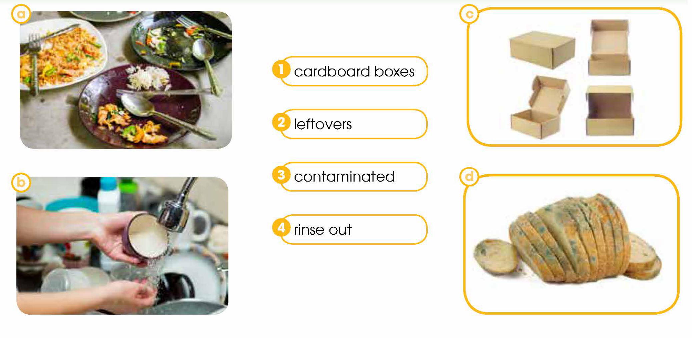
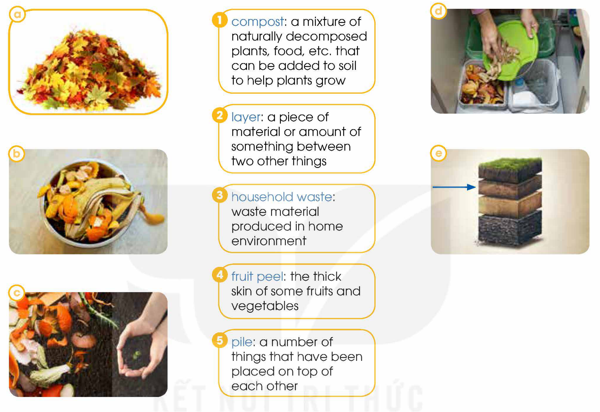
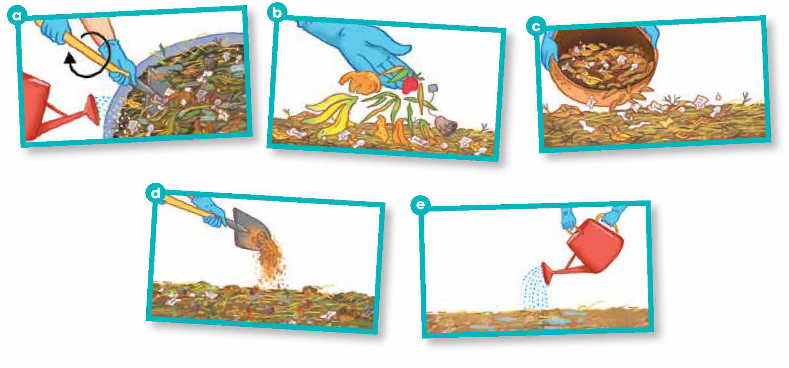
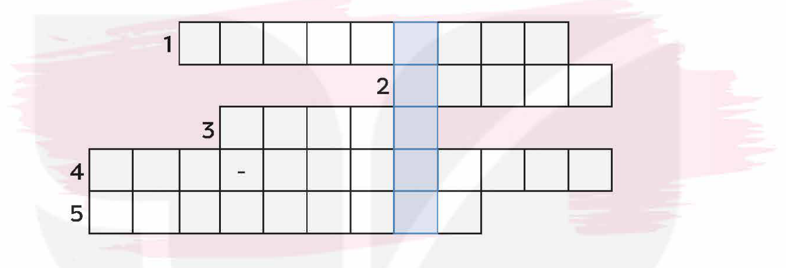

<!-- pdf:34 -->

# UNIT 3: GREEN LIVING

**This unit includes:**

- **LANGUAGE:**
  - **Pronunciation:** Diphthongs /ɪə/, /eə/, and /ʊə/
  - **Vocabulary:** Words and phrases related to green living
  - **Grammar:**
    - Verbs with prepositions
    - Relative clauses referring to a whole sentence
- **SKILLS:**
  - **Reading:** Reading for main ideas and specific information in emails about going green with plastics
  - **Speaking:** Discussing ways to reduce, reuse, and recycle paper and expressing opinions
  - **Listening:** Listening for main ideas, specific information, and instructions in a conversation about creating a compost pile
  - **Writing:** Writing a problem-solving report on green solutions
- **COMMUNICATION AND CULTURE / CLIL:**
  - **Everyday English:** Making predictions
  - **CLIL:** How green are our festival traditions?
- **PROJECT:**
  - Designing a leaflet promoting an eco-friendly habit

## I. GETTING STARTED

**Green Classroom Competition**

**1. Listen and read.**

**Nam:** Hey guys, look at this notice! Our school is holding a Green Classroom Competition. The greenest classroom will win an ecotour!

**Mark:** How exciting! But how will the classrooms be judged?

**Nam:** It says here that classrooms will be judged on the following: raising environmental awareness, reducing our **carbon footprint**, and using resources efficiently.

**Mai:** I guess we should start by **cleaning up** our classroom more frequently and having more plants in it.

**Nam:** Yes, this is the easiest thing to do, but we also need to change our classmates' behaviour so that we can develop **eco-friendly** habits in our class.

**Mark:** That sounds harder. I notice many of our classmates buy plastic water bottles every day and throw them away after a **single use**.

**Nam:** Plastic takes hundreds of years to **decompose**, which is certainly not good for the environment.

<!-- pdf:35 -->

**Mai:** Well, we can place a big jug full of drinking water in the classroom so that we can refill our **reusable** bottles.

**Mark:** Good idea! Now, to reduce our **carbon footprint**, we should also make sure we turn off the lights and air conditioners before leaving the classroom. Sometimes people rush out and leave them on, which is a **waste** of electricity.

**Mai:** Sure. Why don't we place some brightly coloured signs next to all doors to remind people?

**Nam:** So many good ideas already. Let's meet after school to discuss more. I hope our class wins the ecotour!

**Mark:** That'd be fantastic!

**Mai:** Yes. Let's do our best!

**2. Read the conversation again and tick (✓) the green ideas mentioned in 1.**

| | |
| --- | --- |
| 1. putting more plants in the classroom | |
| 2. asking students to bring **single-use** water bottles | |
| 3. placing a big water jug in the classroom | |
| 4. leaving lights and air conditioners on when leaving the classroom | |
| 5. placing reminders on saving electricity near doors | |

**3. Find words and phrases in 1 with the following meanings.**

| | |
| --- | --- |
| 1. c\_\_\_\_\_\_\_ u\_\_\_\_\_\_\_ | making a place completely clean and tidy |
| 2. e\_\_\_\_\_\_\_-f\_\_\_\_\_\_\_ | good for the environment |
| 3. d\_\_\_\_\_\_\_ | to be destroyed gradually and naturally |
| 4. c\_\_\_\_\_\_\_ f\_\_\_\_\_\_\_ | a measure of the amount of $CO_2$ produced |
<!-- ocr-ok: đã đối chiếu ảnh trang gốc, OCR lỗi khung chữ điền khuyết cột trái -->

**4. Complete the sentences with words from 1.**

1. Many students throw (1) \_\_\_\_\_\_\_ plastic water bottles after a single use, (2) \_\_\_\_\_\_\_ is not good for the environment.
2. We need to turn (3) \_\_\_\_\_\_\_ the lights and air conditioners before leaving the classroom.
3. Some students leave them (4) \_\_\_\_\_\_\_ when they rush out, (5) \_\_\_\_\_\_\_ is a waste of electricity.

## II. LANGUAGE

### Pronunciation

**Diphthongs /ɪə/, /eə/, and /ʊə/**
<!-- ocr-ok: đã đối chiếu ảnh trang gốc, OCR lỗi nhận diện kí hiệu phiên âm IPA -->

**1. Listen and repeat. Then practise saying the words.**

| **/ɪə/** | **/eə/** | **/ʊə/** |
| --- | --- | --- |
| idea | awareness | sure |
| years | air conditioners | ecotour |

**2. Work in pairs. Underline the words that contain the /ɪə/, /eə/, and /ʊə/ sounds. Listen and check. Then practise saying the sentences.**

1. There are many volunteers here to help **clean up** the beach.
2. Ecotourism encourages tourists to develop **eco-friendly** habits when travelling.
3. It is clear that not all people are aware of the negative impact of their daily habits on the environment.

<!-- pdf:36 -->

### Vocabulary

**Green living**

**1. Match each word (1–5) with its meaning (a–e).**

| | |
| --- | --- |
| 1. **waste** (n) | a. an area of land where waste materials are buried under the surface |
| 2. **landfill** (n) | b. materials used to wrap or protect things we buy from shops |
| 3. **reuse** (v) | c. something such as a box or bowl that you can use to keep things in |
| 4. **packaging** (n) | d. to use something again |
| 5. **container** (n) | e. the act of using something in a careless way, causing it to be lost or destroyed |

**2. Complete the following sentences using the correct forms of the words in 1.**

1. We should fix the leaking tap. It's a \_\_\_\_\_\_\_ of clean water!
2. Takeaway food includes a lot of unnecessary \_\_\_\_\_\_\_ such as **single-use** **containers** and plastic bags.
3. We always try to buy food packed in recyclable \_\_\_\_\_\_\_.
4. A creative way to \_\_\_\_\_\_\_ old greeting cards is to make gift tags and bookmarks.
5. The **waste** in open \_\_\_\_\_\_\_ sites can release harmful gases into the atmosphere.

### Grammar

**Verbs with prepositions**

**Remember!**

- Many verbs go with a preposition followed by an object. The meaning of these two words is usually very similar to the original meaning of the verb.
  *Example:*
  - verbs with *about*: *ask about, care about, talk about, think about, learn about*
  - verbs with *for*: *ask for, apply for, apologise for, wait for, prepare for*
  - verbs with *on*: *agree on, base on, depend on, rely on*
  - verbs with *to*: *introduce to, refer to, respond to, listen to, explain to*
- In some cases, a verb and a preposition are combined to make a (two-word) phrasal verb. The meaning of a phrasal verb is often very different from the original meaning of the main verb. Phrasal verbs use adverbs as well as prepositions.
  *Example:* *work out, carry out, turn on, turn off, look for, look after, look up*

<!-- pdf:37 -->

**1. Complete the sentences with the suitable prepositions.**

1. Many people have now started to care \_\_\_\_\_\_\_ the environment.
2. The future of our planet depends \_\_\_\_\_\_\_ how we deal with climate change.
3. We should work \_\_\_\_\_\_\_ some solutions to reducing plastic pollution.
4. My sister is responsible for looking \_\_\_\_\_\_\_ the plants at home.

**Relative clauses referring to a whole sentence**

**Remember!**

We can use a non-defining relative clause to refer to all the information in the previous clause(s). This type of clause is introduced with the relative pronoun *which*. We also add a comma before *which*.

*Example:* More and more people are interested in recycling nowadays, *which is good for the environment*. (*= The fact that more and more people are interested in recycling nowadays is good for the environment.*)
<!-- ocr-ok: đã đối chiếu ảnh trang gốc -->

**2. Combine the sentences using relative clauses.**

1. Plastic takes hundreds of years to **decompose** in the ground. This explains why it is harmful to the environment.
   → Plastic takes hundreds of years to decompose in the ground, \_\_\_\_\_\_\_.
2. Public transport does not pollute the air as much as private vehicles. That's why more people should consider using it.
   → Public transport does not pollute the air as much as private vehicles, \_\_\_\_\_\_\_.
3. All students work very hard to help **clean up** the school. The teacher encourages this.
   → All students work very hard to help clean up the school, \_\_\_\_\_\_\_.

**3. Work in pairs. Talk about green things and activities you and your family often do. Use verbs with prepositions or phrasal verbs, and relative clauses referring to the whole sentence.**

*Example:* *I always turn off the fans when I leave the room, which helps save energy.*

## III. READING

**Going green with plastics**

**1. Work in pairs to solve the quiz.**

1. It takes about \_\_\_\_\_\_\_ years for one plastic bottle to **decompose** in the ground.
   - A. 4.5
   - B. 45
   - C. 450
2. Around \_\_\_\_\_\_\_ plastic bottles are thrown away every year.
   - A. 13 thousand
   - B. 13 million
   - C. 13 billion
3. Plastic bags and other plastic **waste** kill around \_\_\_\_\_\_\_ sea animals every year.
   - A. 100 million
   - B. 10 million
   - C. 1 million
4. Nearly \_\_\_\_\_\_\_ of plastic ever made still exists today.
   - A. 100%
   - B. 50%
   - C. 10%

<!-- pdf:38 -->

**2. Read some extracts from the emails sent to the *Teen* magazine. Match the highlighted words and phrases (1–4) with the pictures (a–d).**

**GO GREEN WITH PLASTICS!**

Plastic has become very common in our daily life; however, most plastic items take up to 1,000 years to **decompose** in **landfills**. Can we enjoy the convenience of plastics and a greener world at the same time? Our readers have sent us many emails with useful tips this week.

... I try to use fewer plastic bags when shopping. The supermarket near my house even provides **cardboard boxes**, so I can pack my groceries and get rid of plastic **packaging**! When I must use plastic bags, I try to **reuse** them again and again instead of throwing them away after a **single use**. ...
*Hai, 18*

... I know how convenient it is to buy a bottle of water from a vending machine or a supermarket; however, I always bring my **reusable** water bottle. All I have to remember is to fill my bottle before going to school, and then use the water filling stations or drinking fountains at school. ...
*Phuong, 16*
<!-- term: vending machine -->
<!-- term: water filling station -->

... I always **reuse** plastic takeaway **containers**. I use them to store portions of cooked food and keep **leftovers** in the fridge, which is also better for the environment. ...
*Hoang, 15*

... I have learnt that most plastic **containers** have numbers at the bottom to show the type of plastic they're made of. So when you recycle a bottle, for instance, remove the cap because a bottle often has number 1 on it while the cap often has number 5. Numbers 1 and 2 are the most widely accepted plastics for recycling. ...
*Ha, 16*

... When I started recycling, I made the mistake of putting some plastic takeaway **containers** with some **leftover** food into the recycling bin. The next day, the whole bin was **contaminated**, so all the recyclables were taken to the **landfill** instead. So now I always **rinse out** **containers** before recycling them. ...
*Binh, 17*
<!-- ocr-ok: đã đối chiếu ảnh trang gốc, khung giấy ghi chú nghiêng bị OCR bỏ sót chữ bên phải -->

1. **cardboard boxes**
2. **leftovers**
3. **contaminated**
4. **rinse out**
<!-- ocr-ok: đã đối chiếu ảnh trang gốc, OCR đọc nhầm leftovers thành leffovers -->

<!-- pdf:39 -->

**3. Read the email extracts again. Complete the summary notes with information from the text. Use no more than TWO words for each gap.**

| **Single-use plastics can be:** | **Tips** |
| --- | --- |
| reduced | • use (1) \_\_\_\_\_\_\_ instead of plastic **packaging** • bring a (2) \_\_\_\_\_\_\_ water bottle |
| **reused** | • **reuse** (3) \_\_\_\_\_\_\_ many times • **reuse** **single-use** plastic **containers** |
| recycled | • avoid plastics with (4) \_\_\_\_\_\_\_ that are hard to recycle • (5) \_\_\_\_\_\_\_ **containers** before recycling |
<!-- ocr-ok: đã đối chiếu ảnh trang gốc, OCR lỗi nhận diện các số (1)-(5) trong bảng -->

**4. Read the email extracts again. Match the following information with the right names.**

| | |
| --- | --- |
| 1. This person has learnt from a past mistake how to recycle things properly. | a. Hai |
| 2. This person's green lifestyle is supported by a local business. | b. Phuong |
| 3. This person has learnt the recycling symbols to help the recycling process. | c. Hoang |
| 4. This person's green habit depends on local drinking water facilities. | d. Ha |
| 5. This person tries to **reuse** plastic takeaway **containers**. | e. Binh |

**5. Work in pairs. Discuss the following questions.**

Which of the green habits in 2 have also become your habits? Which one would you like to develop in the future?

## IV. SPEAKING

**Paper: Reduce, Reuse, and Recycle!**

**1. How can we save trees, energy, and water used to make paper? Sort these activities into Reduce, Reuse, or Recycle activities.**

| | |
| --- | --- |
| a. Choosing recycled paper for daily use | \_\_\_\_\_\_\_ |
| b. Sorting paper **waste** | \_\_\_\_\_\_\_ |
| c. Printing on both sides of the paper | \_\_\_\_\_\_\_ |
| d. Using old paper as **compost** | \_\_\_\_\_\_\_ |
| e. Using **reusable** **containers** rather than paper for **packaging** | \_\_\_\_\_\_\_ |
| f. Using smart devices to take notes instead of using paper | \_\_\_\_\_\_\_ |
| g. Using the blank side of a sheet to take notes | \_\_\_\_\_\_\_ |
| h. Avoiding printing things out as much as possible | \_\_\_\_\_\_\_ |
| i. Keeping paper **waste** as clean as possible | \_\_\_\_\_\_\_ |

**2. Work in pairs. Talk about how to reduce, reuse, and recycle paper. Use these questions to help you.**

1. Which of the activities (a–i) above are you doing?
2. Can you suggest more ideas? How will they help save the environment?

**3. Work in groups. Read the situations below and think of some possible responses to promote a greener lifestyle. Provide reasons for each answer.**

1. After a club meeting, you notice that there are a lot of leaflets left, and they are only printed on one side. Your friend is asking you to help throw them away.
   *Example:* *'Do not throw them away. We should **reuse** these leaflets by using the blank pages to take notes, which will save natural resources such as trees and water.'*
2. Your group is preparing for a presentation, and everyone has found a lot of useful online material. A group member is asking you to print out about 50 pages of information for the group to read.
3. Your club is organising a meeting, including a game in which people should write down something about themselves to share with others. The club president is asking you to buy a lot of Post-it notes for the game.

**4. Report your group's answers to the whole class. Vote for the most interesting responses.**

<!-- pdf:40 -->

## V. LISTENING

**Creating a compost pile**

**1. Match the words and phrases (1–5) with the pictures (a–e).**

1. **compost:** a mixture of naturally **decomposed** plants, food, etc. that can be added to soil to help plants grow
2. **layer:** a piece of material or amount of something between two other things
3. **household waste:** **waste** material produced in home environment
4. **fruit peel:** the thick skin of some fruits and vegetables
5. **pile:** a number of things that have been placed on top of each other

**2. Listen to a conversation about the main steps in creating a compost pile. Number the pictures in order.**

1. \_\_\_\_\_\_\_ | 2. \_\_\_\_\_\_\_ | 3. \_\_\_\_\_\_\_ | 4. *e* | 5. \_\_\_\_\_\_\_
<!-- ocr-ok: đã đối chiếu ảnh trang gốc, dòng điền thứ tự 1-5 bị OCR bỏ sót -->

<!-- pdf:41 -->

**3. Listen again. Decide whether the statements are true (T) or false (F).**

| | **T** | **F** |
| --- | --- | --- |
| 1. Use dry leaves as green materials. | | |
| 2. Use **fruit peels** as green materials. | | |
| 3. Add additional **layers** in the same order. | | |
| 4. Leave the **pile** dry for many days. | | |
| 5. Add chemical fertilisers. | | |

**4. Work in groups. Discuss these questions.**

How do you manage your household and garden **waste**? Is it environmentally friendly?

## VI. WRITING

**A problem-solving report on green solutions**

**1. Work in pairs. Complete the notes using the words in the box.**

| **compost** **piles** | automatic | public transport | recycle |
| --- | --- | --- | --- |
<!-- ocr-ok: đã đối chiếu ảnh trang gốc -->

| **Problems & consequences** | **Green solutions** |
| --- | --- |
| Many **single-use** plastic products are thrown in rubbish bins. They take many years to **decompose** in **landfills**. | Use them in arts and crafts projects (e.g. making plant pots) or (1) \_\_\_\_\_\_\_ them |
| People leave the lights on and the water running in restrooms. This is a **waste** of electricity and water. | Install (2) \_\_\_\_\_\_\_ lights and sensor taps that turn off when no one is around |
| Dry leaves are sometimes burnt in the schoolyard. This can cause air pollution and fires. | Create (3) \_\_\_\_\_\_\_ |
| Many parents drive their children to school and pick them up from school every day. This causes traffic jams, noise, and air pollution at the school gate. | Encourage more students to cycle or walk to school, or use (4) \_\_\_\_\_\_\_ to go to school (e.g. free bus tickets, cycle-to-school programme) |

**2. Read a problem-solving report and match the sections (A–D) with the correct headings (1–4).**

1. Conclusion
2. Problems
3. Introduction
4. Solutions
<!-- ocr-ok: đã đối chiếu ảnh trang gốc, OCR đọc nhầm Introduction thành Infroduction -->

**A. \_\_\_\_\_\_\_**

This report describes the problem of **single-use** plastics in our school and suggests three main solutions to the problem.

**B. \_\_\_\_\_\_\_**

Many students at our school buy bottled water or takeaway food. As a result, hundreds of water bottles and **single-use** plastic **containers** are thrown away every day. Besides, students often put **containers** with **leftovers** in them into the recycling bin, which can lead to **contaminating** the recyclable **waste**. This means our school produces a lot of plastic **waste** that goes to **landfills** and has a harmful effect on the environment.

**C. \_\_\_\_\_\_\_**

To solve this problem, we propose the following solutions. First, we suggest that the school should provide more recycling bins. Second, the Youth Union should hold regular sessions to teach students how to recycle properly. Third, we recommend that we make use of plastic **waste** in arts and crafts projects, for example, for making plant pots or bird feeders.

**D. \_\_\_\_\_\_\_**

**Reusing** and recycling **single-use** plastics will lead to a greener school environment and help promote a green lifestyle among young people. Therefore, we recommend you put the suggested solutions into practice as soon as possible.

**Tips**

A problem-solving report describes a problem and suggests solutions to the problem. It often includes:
- a brief introduction presenting the problem (and solutions)
- a paragraph analysing the problem and its negative effects
- a paragraph suggesting specific solutions
- a concluding paragraph summarising the report and emphasising the importance of the suggested solutions

<!-- pdf:42 -->

**3. Choose one of the problems in 1, and write a problem-solving report (180 words). Use the model in 2 and the outline with useful expressions below to help you.**

**Introduction**

*This report describes the problem of ... and suggests ... solutions to the problem.*

**Problems**

*... As a result / Therefore, ...*
*... can damage / have a harmful effect on ...*

**Solutions**

*To solve ..., we suggest/propose the following solutions.*
*First, we suggest/recommend that the students/the school should ...*
*Second, it is important for students to ...*

**Conclusion**

*... will lead to ... / will help promote a green lifestyle/green habits ...*
*Therefore, I recommend ...*

## VII. COMMUNICATION AND CULTURE / CLIL
<!-- ocr-ok: đã đối chiếu ảnh trang gốc, tiêu đề mục màu hồng bị OCR bỏ sót -->

### Everyday English

**Making predictions**

**1. Listen and complete the conversation with the expressions in the box. Then practise it in pairs.**

| A. will have a difficult decision | B. is going to impress |
| --- | --- |
| C. **in the long run** | D. It's hard to predict |

**Mark:** Tomorrow, we'll get the results of the Green Classroom Competition. Do you think we will win?
**Nam:** (1) \_\_\_\_\_\_\_ who'll win. Other classes also have very interesting projects.
**Mark:** I agree. The Cycling-to-school programme proposed by Class 12C (2) \_\_\_\_\_\_\_ the judges. Cycling to school will also lead to healthier lifestyles (3) \_\_\_\_\_\_\_.
**Nam:** True. There're so many great ideas. The judges (4) \_\_\_\_\_\_\_ to make.

**2. Work in pairs. Use the model in 1 to make similar conversations for these situations. One of you is A, the other is B. Use the expressions below to help you.**

1. A wonders whether the Youth Union will accept their group proposal to install automatic lights and sensor taps in the school. B, a member of the same group, makes predictions about the decision.
2. B asks A about the Green Day event at their school next week (e.g. the number of people attending, the activity people will like the most, the impact of the event). A makes predictions.

| **Useful expressions: Making predictions** | |
| --- | --- |
| • I guess/think/expect ... • (*very certain*) ... is going to ... • (*quite certain*) ... will ... • (*not certain*) ... may/might ... | • It's likely/unlikely that ... • It's hard to predict/say ... • **in the long/short/medium term** • **in the long run** |

<!-- pdf:43 -->

### CLIL

**1. Read the following text. What are the environmental problems of each tradition as mentioned in the text? Put a tick (✓) where relevant.**

**HOW GREEN ARE OUR FESTIVAL TRADITIONS?**
<!-- ocr-ok: đã đối chiếu ảnh trang gốc, tiêu đề màu xanh lá bị OCR bỏ sót -->

Festivals come with many traditions that bring happiness and joy. However, some of these customs may not be environmentally friendly, and may need to be changed for a sustainable future. Below are three of them.
<!-- term: sustainable future -->

**1. Balloons and sky lanterns**

In countries such as China, India, and Japan, releasing balloons or sky lanterns provides a spectacular sight. They are also flown for bringing good luck and sending wishes to the sky. However, the litter left behind the balloons and lanterns is hard to **decompose**. The frames of the lanterns can harm wild animals, and many animals mistake the balloons for food. Lanterns also caused wildfires in the past.

**2. Fireworks**

In Australia, the US, and many other countries, there are fascinating firework displays that people won't want to miss. However, fireworks actually release a lot of harmful chemicals into the air. Like sky lanterns, they can also cause fires.

**3. Christmas trees**

Real or fake Christmas trees are often displayed in almost every house, office, and shop during the festive season. When Christmas is over and the real trees go to **landfills**, they produce methane and carbon dioxide, which are two harmful greenhouse gases. Fake trees can be **reused** for many years, but during their production, harmful pollutants are released into the air. And when they end in **landfills**, they will take hundreds of years to **decompose**.
<!-- term: greenhouse gases -->

| | **Polluting the air** | **Causing fires** | **Harming animals** | **Ending up in landfills** |
| --- | --- | --- | --- | --- |
| Balloons and sky lanterns | | | | |
| Fireworks | | | | |
| Christmas trees | | | | |

**2. Work in pairs. Suggest some green solutions to replace one of the traditions.**

<!-- pdf:44 -->

## VIII. LOOKING BACK

### Pronunciation

**Read the words and choose the odd one out. Then listen and check.**

1. A. f*air* | B. h*air* | C. cont*ai*ner | D. p*air*
2. A. n*ear* | B. *ear* | C. f*ear* | D. p*ear*
3. A. s*ure* | B. fut*ure* | C. literat*ure* | D. cult*ure*
4. A. b*ear* | B. y*ear* | C. cl*ear* | D. h*ear*
<!-- ocr-ok: đã đối chiếu ảnh trang gốc, in nghiêng phần gạch chân trong từ làm tách token -->

### Vocabulary

**Solve the crossword with the words you've learnt in this unit. What is the hidden word?**

1. Many supermarkets try to reduce plastic \_\_\_\_\_\_\_.
2. Reduce, \_\_\_\_\_\_\_, and recycle **waste** whenever you can to protect and preserve the environment.
3. Household \_\_\_\_\_\_\_ is often taken to **landfills** and buried there.
4. We can reduce environmental pollution by choosing \_\_\_\_\_\_\_ products such as **reusable** shopping bags and bamboo straws.
5. We can reduce our carbon \_\_\_\_\_\_\_ by turning off lights and air conditioners when we leave the room.

### Grammar

**Circle the mistake in each sentence. Then correct it.**

1. Children should learn *to* (A) recycling from an early age so that they will be prepared *to* (B) deal *with* (C) plastic pollution *in* (D) the future.
2. Many students are taking part *in* (A) the Green Campaign this year, *that* (B) shows *that* (C) nowadays people care more *about* (D) the environment.
3. Many people neither believe *in* (A) climate change *nor* (B) want to understand what is happening *with* (C) the environment, *which* (D) is a big concern.
4. Instead *of* (A) throwing the plastic bottles *over* (B), why *don't* (C) you make some plant pots *from* (D) them?
<!-- ocr-ok: đã đối chiếu ảnh trang gốc, các nhãn A B C D đặt dưới chân cụm từ gạch chân -->

<!-- pdf:45 -->

## PROJECT

**Eco-friendly habits**

**Work in groups. Design a leaflet to give away on Green Day at your school. The leaflet should promote an eco-friendly habit (e.g. saving water, reusing paper, recycling plastic).**

**Present the leaflet to the class. Use these questions as cues for your leaflet.**

- What is the habit?
- How important is it for a greener lifestyle and the environment?
- What should we do to develop the habit?

**Zero Waste Tips**

- Bring your own bag
- **Reusable** cups
- Separate garbage
- Use green energy
- Cook at home
<!-- ocr-ok: đã đối chiếu ảnh trang gốc, chữ trong tờ rơi minh hoạ Zero Waste Tips bị OCR bỏ sót -->

**NO PLASTIC BAGS!**

- REDUCE, **REUSE**, RECYCLE
- BRING YOUR OWN CUP
- USE GLASS JARS
- COOK AT HOME
- RECYCLE IT
- METAL STRAWS
- GO GREEN
<!-- ocr-ok: đã đối chiếu ảnh trang gốc, chữ cách điệu trong tờ rơi NO PLASTIC BAGS! bị OCR nhận diện sai -->

**Now I can ...**

- identify and pronounce the diphthongs /ɪə/, /eə/, and /ʊə/ in words and sentences.
- understand and use words and phrases related to green living.
- use verbs with prepositions correctly.
- use relative clauses to refer to a whole sentence correctly.
- read for main ideas and specific information in emails about going green with plastics.
- discuss ways to reduce, reuse, and recycle paper and express opinions.
- listen for main ideas, specific information, and instructions in a conversation about creating a compost pile.
- write a problem-solving report to suggest green solutions.
- make predictions.
- learn about festival traditions that are not environmentally friendly and suggest solutions.
- design a leaflet promoting an eco-friendly habit and present it to the class.

## 📷 Danh sách hình trong bài

| Mã hình | Trang PDF | Trang sách | Chú thích / Mô tả |
| --- | --- | --- | --- |
| H12-tieng_anh-u03-01 | 38 | 36 | Bốn bức ảnh minh hoạ từ vựng về xử lí rác thải nhựa và thức ăn thừa: (a) thức ăn thừa trên đĩa, (b) tráng rửa hộp đựng dưới vòi nước, (c) các hộp bìa cứng, (d) ổ bánh mì bị mốc hỏng |
| H12-tieng_anh-u03-02 | 40 | 38 | Năm bức ảnh minh hoạ các thành phần và khái niệm liên quan đến việc ủ phân hữu cơ (compost, layer, household waste, fruit peel, pile) |
| H12-tieng_anh-u03-03 | 40 | 38 | Năm bức tranh minh hoạ các bước thực hiện ủ phân hữu cơ từ lá khô, vỏ trái cây, rác hữu cơ, đất và tưới nước |
| H12-tieng_anh-u03-04 | 44 | 42 | Khung trò chơi giải ô chữ từ vựng gồm 5 hàng ngang và 1 cột từ khoá ẩn màu xanh thuộc phần Looking Back |
