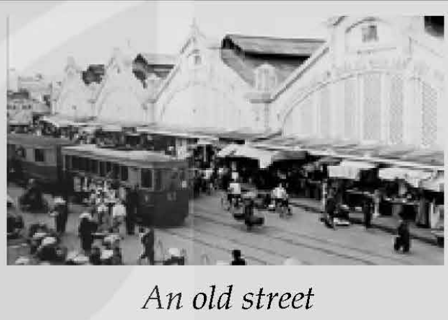
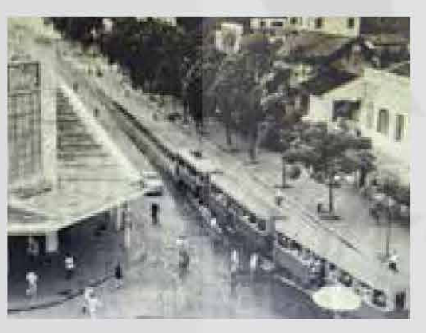
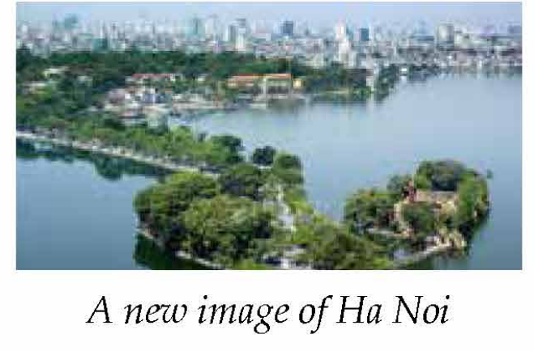
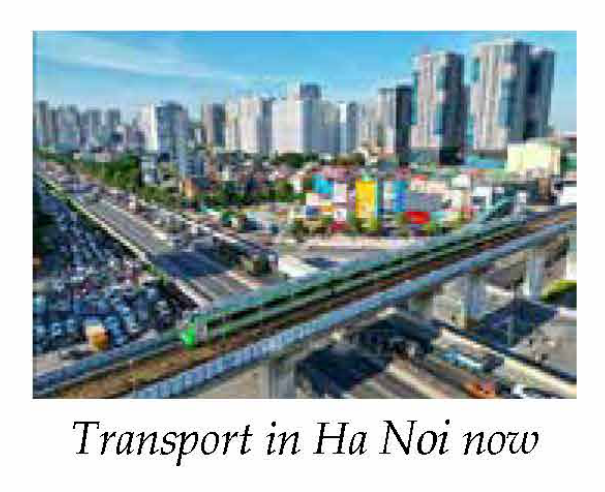
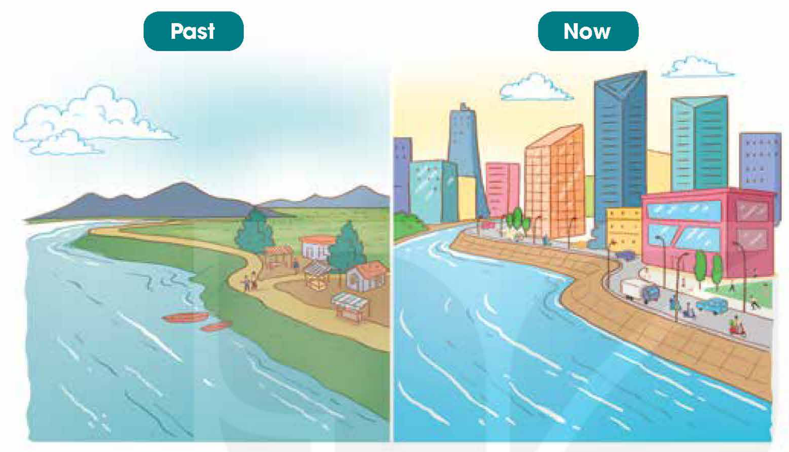
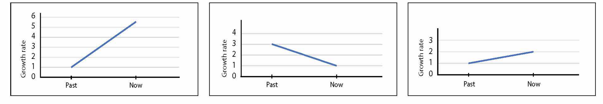
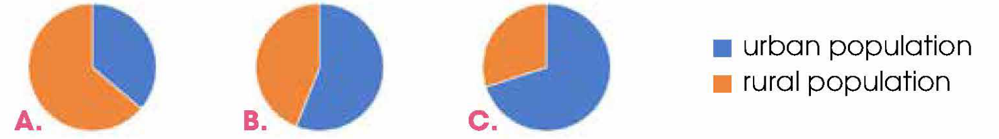
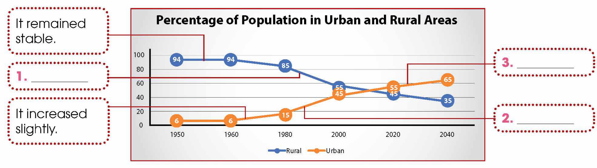
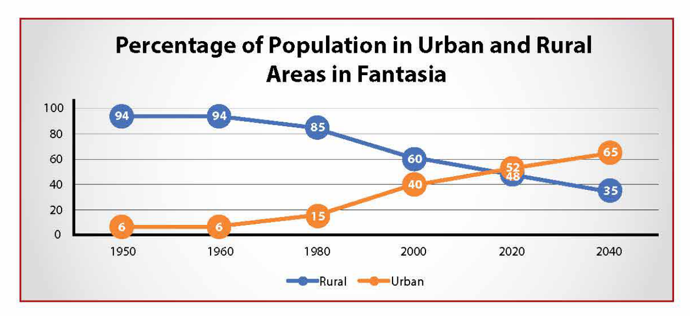
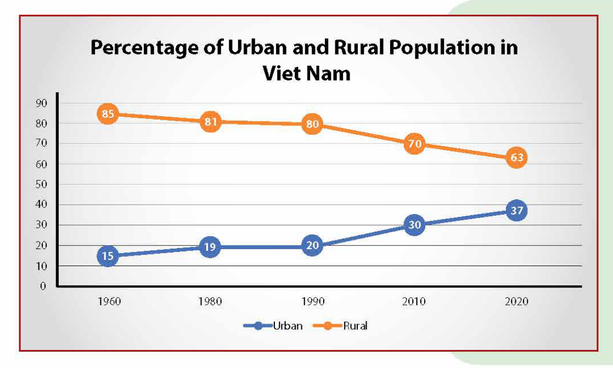

<!-- pdf:50 -->

# UNIT 4: URBANISATION

**This unit includes:**

- **LANGUAGE:**
  - **Pronunciation:** Unstressed words in connected speech
  - **Vocabulary:** Words related to urbanisation
  - **Grammar:**
    - Present perfect (review and extension)
    - Double comparatives to show change
- **SKILLS:**
  - **Reading:** Reading for main ideas and specific information in an article about the urbanisation of Ha Noi
  - **Speaking:** Talking about the changes in a living area
  - **Listening:** Listening for main ideas and specific information in a radio talk about urbanisation
  - **Writing:** Describing a line graph about trends in urbanisation
- **COMMUNICATION AND CULTURE / CLIL:**
  - **Everyday English:** Making complaints and responding to them
  - **Culture / CLIL:** Urbanisation in Malaysia and Australia
- **PROJECT:**
  - Doing research on an urban area in Viet Nam

## I. GETTING STARTED

**Urban development**

**1. Listen and read.**

**Nam:** Hi, Mark!

**Mark:** Hi, Nam! Sorry I'm late. I got lost because your neighbourhood has changed a lot.
<!-- ocr-ok: đã đối chiếu ảnh trang gốc, OCR đọc nhầm I thành | và lot thành loft -->

**Nam:** Yeah. It's been three years since your last visit. Anyway, do you want to go for a walk? I'll show you around.

**Mark:** Fresh air and a walk sound nice. Let's go!

...

**Mark:** Nam, there used to be a rice field opposite your house, right?

**Nam:** Exactly, Mark. But now they have built several high-rise buildings. The city is getting bigger and bigger.

**Mark:** Yes, more and more people want to live in **urban** areas nowadays. This is part of the process of urbanisation.

**Nam:** That's true. There are also new public parks and people can enjoy more **leisure** activities. In addition to the big shopping centre, there is a convenience store on every corner. And look at our new electric buses! Do you want to go for a ride?

**Mark:** Sure, Nam ... Wow! The bus is so quiet and comfortable! It's the first time I've been on an electric bus. Getting around is probably becoming more and more convenient for local **residents**.

<!-- pdf:51 -->

**Nam:** Not really. The more crowded the area becomes, the worse traffic jams get, especially during **rush hour**. The cost of living is also going up. These are the changes that I don't like.

**Mark:** That's true, Nam. I guess urbanisation can also cause problems.

...

**2. Read the conversation again. Decide whether the following statements are true (T) or false (F).**

| | T | F |
| --- | --- | --- |
| 1. The last time Mark visited Nam's place was three years ago. | | |
| 2. There used to be a park opposite Nam's house. | | |
| 3. There aren't any new leisure or shopping facilities in Nam's neighbourhood. | | |
| 4. Traffic jams and rising cost of living are the two problems that Nam mentioned. | | |
<!-- term: cost of living -->

**3. Match the words to make phrases mentioned in 1.**

| | |
| --- | --- |
| 1. **urban** | a. **residents** |
| 2. **leisure** | b. hour |
| 3. local | c. areas |
| 4. rush | d. activities |
<!-- ocr-ok: đã đối chiếu ảnh trang gốc, OCR lỗi khung chữ cách điệu cột trái -->

**4. Complete the sentences using phrases from 1.**

1. They \_\_\_\_\_\_\_ several high-rise buildings opposite Nam's house.
2. The city where Nam lives is getting \_\_\_\_\_\_\_.
3. \_\_\_\_\_\_\_ Mark has been on an electric bus.
4. \_\_\_\_\_\_\_ crowded the area becomes, \_\_\_\_\_\_\_ traffic jams get.

## II. LANGUAGE

### Pronunciation

**Unstressed words in connected speech**

**Remember!**

In connected speech, most grammatical words are not usually stressed. These words include:

- articles: *a*, *an*, *the*
- prepositions: *above*, *for*, *of*, *to*, *until*, etc.
<!-- ocr-ok: đã đối chiếu ảnh trang gốc, OCR đọc nhầm to thành fo -->
- personal pronouns: *I*, *you*, *we*, *they*, *he*, *she*, *it*
<!-- ocr-ok: đã đối chiếu ảnh trang gốc, OCR đọc nhầm I thành ý và it thành if -->
- possessive adjectives: *my*, *your*, *our*, *their*, *her*, *his*, *its*
<!-- ocr-ok: đã đối chiếu ảnh trang gốc, OCR đọc nhầm its thành ifs -->
- auxiliary verbs: *be*, *have*, *do*, etc.
- conjunctions: *and*, *but*, *or*, etc.
<!-- ocr-ok: đã đối chiếu ảnh trang gốc, OCR đọc nhầm but thành buf -->
- modal verbs: *can*, *will*, etc.
- the expressions: *there is*, *there are*, etc.

**1. Listen and repeat. Pay attention to the pronunciation of the unstressed words.**

1. *It's been* three years *since your* last visit.
2. Fresh air *and a* walk sound nice.
3. *It's the* first time *I've been on an* electric bus.
4. *I* guess urbanisation *can also* cause problems.

**2. Listen and identify the unstressed words in the following sentences. Then practise saying the sentences in pairs.**

1. A new convenience store has been opened near my house.
2. There are still a lot of problems in our cities today.
3. It is much more expensive to buy a house in a big city.
4. My father was offered a new job and his office will be in a high-rise building.

<!-- pdf:52 -->

### Vocabulary

**Urban life**
<!-- ocr-ok: đã đối chiếu ảnh trang gốc, tiêu đề màu xanh và cam bị OCR bỏ sót -->

**1. Match the words with their meanings.**

| | |
| --- | --- |
| 1. **afford** (v) | a. to become larger in size, number, or importance |
| 2. **housing** (n) | b. the number of people not having a job |
| 3. **expand** (v) | c. to have enough money to buy or do something |
| 4. **seek** (v) | d. houses, flats, etc. that people live in |
| 5. **unemployment** (n) | e. to look for something or somebody |
<!-- ocr-ok: đã đối chiếu ảnh trang gốc, các số 1-5 và chữ a-e nằm trong hình tròn màu vàng không được OCR nhận diện -->

**2. Complete the sentences using the correct forms of the words in 1.**

1. Higher \_\_\_\_\_\_\_ can result in increasing crime rates in big cities.
2. Not many young couples can \_\_\_\_\_\_\_ to buy their own house in big cities.
3. There is a shortage of affordable \_\_\_\_\_\_\_ in big cities.
4. Since they started using farmland for building houses, many towns have \_\_\_\_\_\_\_ into cities.
5. Many people are leaving the countryside in order to \_\_\_\_\_\_\_ better opportunities in big cities.

### Grammar

**Present perfect (review and extension)**
<!-- ocr-ok: đã đối chiếu ảnh trang gốc, tiêu đề màu xanh và cam bị OCR bỏ sót -->

**Remember!**

- We use the present perfect to describe something that started in the past and is still happening now, or something that was completed in the very recent past.
  *Example:*
  *A lot of young people have moved to big cities to work or study.*
<!-- ocr-ok: đã đối chiếu ảnh trang gốc, OCR đọc nhầm to thành fo -->
- We also use the present perfect to say how many times something has happened with the following structure:
  *It/This/That* + be + *the first/the second time* + Subject + *have/has (done)*...
  *Example:*
  *This is the second time I have visited this city.*
  *It is not the first time I have heard about urbanisation.*
- We often use the present perfect for a unique experience with the following structure:
  *It/This/That/Noun* or *Gerund phrase* + be + *the best/the worst/the only/the most beautiful/...* + Subject + *have/has (ever done)*...
  *Example:*
  *That is the worst meal I have ever had in this city.*
  *Moving to the city is the best decision my parents have ever made in their life.*
<!-- ocr-ok: đã đối chiếu ảnh trang gốc, OCR đọc nhầm to thành fo -->

<!-- pdf:53 -->

**1. Circle the underlined part that is incorrect in each of the following sentences. Then correct it.**

1. This is the *first* (A) time I *saw* (B) such *a* (C) tall building *in* (D) my life.
2. Mount Fuji *in* (A) Japan is the *most* (B) beautiful place we *had* (C) ever *visited* (D).
3. This *has been* (A) the second time my mother *has warned* (B) me not *to* (C) spend all my money *on* (D) clothes.
<!-- ocr-ok: đã đối chiếu ảnh trang gốc, các nhãn A B C D in dưới chân cụm gạch chân -->

**Double comparatives to show change**
<!-- ocr-ok: đã đối chiếu ảnh trang gốc, OCR đọc nhầm to thành lo -->

**Remember!**

- We use double comparatives to show change.
  *Example:*
  *Towns are getting bigger and bigger.*
  *The air is becoming more and more polluted.*
  *There are more and more high-rise buildings in the city.*
- We also use double comparatives to say that two things change together.
  *Example:*
  *The bigger the city gets, the more crowded it becomes.*
<!-- ocr-ok: đã đối chiếu ảnh trang gốc, OCR đọc nhầm gets thành gefs -->
  *The more we invest in rural areas, the more we can help people there.*

**2. Choose the best option to indicate the sentence that is closest in meaning to the sentence given.**

1. **Housing** is getting more and more expensive in big cities, so many local **residents** can't **afford** to buy their own place.
   - A. Many local residents in big cities can't buy their own place because housing is becoming more expensive every day.
   - B. More and more local residents can't afford their own place in big cities because housing is too expensive.
   - C. Housing is getting affordable enough for many local people to buy their own place.
   - D. Housing in big cities has become the most expensive these days, so many local residents can't afford their own place.
2. The more people move into big cities, the higher the **unemployment** is.
   - A. The higher the unemployment is, the more people move into big cities.
   - B. More people moving into big cities causes higher unemployment.
   - C. More people move into big cities despite the high rate of unemployment.
   - D. More people move into big cities because there are more employment opportunities there.
3. The more houses are built, the less space we have for plants and trees.
   - A. Although more houses are built, we still have some space for plants and trees.
   - B. The fewer houses we build, the less space we have for plants and trees.
   - C. We have less space for plants and trees because more houses are built.
   - D. Plants and trees are the reasons why more houses can't be built.
<!-- ocr-ok: đã đối chiếu ảnh trang gốc, OCR đọc nhầm trees thành frees -->

**3. Work in pairs. Make true sentences about urbanisation in an area that you know, using double comparatives and the present perfect.**

*Example:*
*Urbanisation has changed my home town a lot. The local authority has **expanded** the roads and improved the infrastructure. More high-rise buildings have been built. There are more and more people from the nearby villages. They have come to work in the local factories.*
<!-- ocr-ok: đã đối chiếu ảnh trang gốc, OCR đọc nhầm town thành fown và to thành fo -->

<!-- pdf:54 -->

## III. READING

**Urbanisation of Ha Noi**

**1. Work in pairs. Look at the pictures in the article in 2 below. Discuss the following questions.**

1. What can you see in each picture?
2. What do the pictures tell you about Ha Noi and people's life in the city?

**2. Read the article. Choose the correct meanings of the highlighted words.**

**Ha Noi | Then and Now**

'Ha Noi Then and Now' exhibition has attracted thousands of visitors this week. The pictures have brought back childhood memories to old **residents** while helping younger generations see how the city has changed over the years.

In the 'Then' hall, visitors can see pictures of 20th-century Ha Noi. Back in 1954, it was a small city with a population of about 530,000 **residents** in an area of about 152 sq km. The capital's famous Old Quarter or '36 old streets' dates back hundreds of years, with each street focusing on a different trade or craft.

*An old street*

*The way Hanoians got around*

'My parents couldn't **afford** a motorbike or car. Most residents used to get around by bicycle or on foot,' said an 80-year-old visitor. Trams, which began service in 1901, were a popular means of public transport until 1991. Buses were not very frequent then. People lived and worked in low-rise buildings. The city was a fascinating mixture of French **colonial** buildings and traditional Eastern architecture.
<!-- term: low-rise building -->

The 'Now' pictures show a modern city with a population of over 8 million people. Over the years, the **urban** area has **gradually** **expanded** to over 3,000 sq km including many of the surrounding villages. As rural residents move into Ha Noi, the government is providing more affordable **housing**. More high-rise buildings have also been built. Ha Noi has improved its transport infrastructure, building new roads and bridges. It is *modernising* bus services using more electric ones. The Ha Noi Metro opened to the public in 2021 and is expected to include more lines by 2030.

*A new image of Ha Noi*

*Transport in Ha Noi now*

However, urbanisation has created new problems. 'As more people come to **seek** better job opportunities, the city is getting more and more crowded. This has led to more traffic jams and higher **unemployment** rates,' said a 21-year-old student. Air pollution is also causing **concern** among city residents.

<!-- pdf:55 -->

1. **residents**
   - A. people who live in a particular place
   - B. buildings in a particular place
2. **colonial**
   - A. connected with the native country
   - B. connected with a country that controls another country
3. **gradually**
   - A. slowly, over a period of time
   - B. quickly, over a short time
4. *modernising*
   - A. making something attractive
<!-- ocr-ok: đã đối chiếu ảnh trang gốc, OCR đọc nhầm attractive thành aftractive -->
   - B. making use of the latest technology, design, etc.
<!-- term: modernise -->
5. **concern**
   - A. a feeling of satisfaction
   - B. a feeling of worry about something important

**3. Read the article again. Put the main ideas in the order they appear in the article.**

The correct order is: 1. \_\_\_\_\_\_\_ 2. \_\_\_\_\_\_\_ 3. \_\_\_\_\_\_\_ 4. \_\_\_\_\_\_\_
<!-- ocr-ok: đã đối chiếu ảnh trang gốc, OCR bỏ sót số 4. trên nền màu cam -->

- A. Ha Noi's modern infrastructure and architecture
- B. The challenges of urban growth
<!-- ocr-ok: đã đối chiếu ảnh trang gốc, OCR đọc nhầm B thành E -->
- C. Ha Noi as a small city with old streets selling different products
- D. 20th-century transport and architecture

**4. Read the article again and complete the table using no more than THREE words and/or a number for each gap.**

| Ha Noi | 20th century | Now |
| --- | --- | --- |
| **Area** | - about (1) \_\_\_\_\_\_\_ sq km (1954) | - over 3,000 sq km |
| **Population** | - about 530,000 people (1954) | - over (2) \_\_\_\_\_\_\_ people |
| **Public transport** | - (3) \_\_\_\_\_\_\_ and buses | - modern buses and (4) \_\_\_\_\_\_\_ |
| **Architecture** | - mainly (5) \_\_\_\_\_\_\_ | - more high-rise buildings |
<!-- ocr-ok: đã đối chiếu ảnh trang gốc, OCR đọc nhầm sq thành sg -->

**5. Work in pairs. Discuss the following questions.**

Which one do you prefer to live in: Ha Noi in the past or Ha Noi at present? Why?
<!-- ocr-ok: đã đối chiếu ảnh trang gốc, OCR đọc nhầm to thành fo -->

<!-- pdf:56 -->

## IV. SPEAKING

**Changes in a living area**

**1. The pictures show how River City has changed over time. Work in pairs. Read the words and phrases and decide which describe the city in the past (P) and which now (N).**

- old
- parks
- modern
- rice field
- empty roads
- wet markets
- busy streets
- convenience stores
- high-rise buildings
- low-rise buildings
- supermarkets

**2. Work in pairs. Talk about the changes in River City. Use the words and phrases in 1.**

*Example:*
*In the past, this place only had low-rise buildings. However, a lot of high-rise buildings have been built in the city.*
<!-- term: high-rise building -->

**3. Report your answers to the whole class. Vote for the best description.**

## V. LISTENING

**A radio talk about urbanisation**

**1. Choose the correct meanings of the underlined words.**

1. House prices in big cities are increasing ***rapidly*** because too many people want to buy their own house.
   - A. very quickly
   - B. very slowly
2. The rural population is ***decreasing*** because more and more people are moving from the countryside to cities.
   - A. going up
   - B. going down
3. The public transport is not very ***reliable***, so many people use their private vehicles.
   - A. can be trusted
   - B. can be expensive

**2. Listen to a radio talk about urbanisation. Choose the correct answer A, B, or C.**

1. What is the talk about?
   - A. Urban population.
   - B. Advantages of urbanisation.
   - C. The world's urbanisation.

<!-- pdf:57 -->

2. Which graph shows how the urban population has changed over the past few decades?
   - A. It has grown **rapidly**.
   - B. It has **decreased** **gradually**.
   - C. It has increased slightly.

3. Which chart shows the percentage of the world's urban population now?

   - A.
   - B.
   - C.

4. Which of the following is mentioned as an advantage of urbanisation?
   - A. City residents have better health.
   - B. City dwellers can afford expensive houses.
   - C. Buses and trains run more often.

5. What does the speaker say about the air quality in big cities?
   - A. City residents can develop health problems if exposed to air pollution over a long period.
   - B. Air quality is improving because the number of private cars has decreased.
   - C. Smog and higher carbon emissions in the air are making traffic conditions worse.

**3. Listen to the talk again and answer the questions. Use no more than THREE words and/or a number.**

1. What was the percentage of the world's urban population in 1950?
2. By which year is it expected that about 70% of the world's population will live in cities?
3. What are good schools and modern hospitals examples of?
4. Apart from **housing**, what is more expensive in cities?

**4. Work in groups. Discuss the following question.**

What do you think is the biggest advantage of urbanisation?

## VI. WRITING

**Description of a line graph**

**1. Work in pairs. Look at the line graph. Match the sentences with the information in the graph.**

- It remained stable.
- 1. \_\_\_\_\_\_\_
- It increased slightly.
- 2. \_\_\_\_\_\_\_
- 3. \_\_\_\_\_\_\_
<!-- ocr-ok: đã đối chiếu ảnh trang gốc, văn bản nằm trong các khung viền chấm đỏ quanh biểu đồ H12-tieng_anh-u04-08 -->

- a. It is expected to go up **gradually**.
- b. It fell steadily.
- c. It rose steadily.

<!-- pdf:58 -->

**2. Look at the line graph and put the paragraphs in the correct order.**

- **A:** By contrast, the **urban** population rose throughout the same period. In 1950, the percentage of urban population was just around 6 per cent. It increased slightly to 15 per cent in 1980. After that, the figure rose steadily and in 2000 it stood at 40 per cent. The upward trend continued and in 2020, more than half of its population lived in urban areas. In the next twenty years, the urban population is expected to reach 65 per cent of the total population.
- **B:** The line graph shows population trends in Fantasia's urban and rural areas over the 1950–2040 period. Overall, the urban population has increased and will continue to grow while the rural population has **decreased** and will continue to fall.
- **C:** In 1950, 94 per cent or most of Fantasia's population lived in rural areas. This figure remained stable until 1960. However, from 1960 to 1980, the percentage of rural population fell slightly to 85 per cent. This figure went down steadily to 48 per cent in 2020 and is expected to drop to 35 per cent in 2040.

**Tips**

To describe a line graph, you should:

- introduce and describe the most outstanding feature of the line graph.
<!-- ocr-ok: đã đối chiếu ảnh trang gốc, OCR đọc nhầm introduce thành infroduce -->
  *Example:*
  *The line graph shows information about/changes in/illustrates how/compares ... Overall, ...*
- describe trends.
  *Example:*
  - *The figure/**proportion**/percentage rose/increased/went up + slightly/slowly/**gradually**/**rapidly**.*
<!-- ocr-ok: đã đối chiếu ảnh trang gốc, OCR đọc nhầm proportion thành proporfion -->
  - *The figure/**proportion**/percentage fell/**decreased**/went down + slightly/slowly/**gradually**/**rapidly**.*
  - *... fell/rose to/by ...*
<!-- ocr-ok: đã đối chiếu ảnh trang gốc, OCR đọc nhầm to thành fo -->
  - *... remained the same/stable.*
- make comparisons.
  *Example:*
  *By contrast, ... / Compared to ... / In comparison with ...*

**3. The line graph below illustrates population trends in Viet Nam from 1960 to 2020. Write a description (120–150 words) of the graph. Use the expressions in 1, the model and tips in 2, and the suggestions below to help you.**

*The line graph shows population trends in Viet Nam from 1960 to 2020. Overall, the urban population ...*
*In 1960, most Vietnamese people ...*
*However, from 1960 to 1980, ... From 1990, ...*
*By contrast, the urban population rose throughout the same period. In 1960, ...*
*In 1980, ... From 1990, ...*
<!-- ocr-ok: đã đối chiếu ảnh trang gốc, OCR đọc nhầm trends thành frends, to thành fo, contrast thành confrast -->

<!-- pdf:59 -->

## VII. COMMUNICATION AND CULTURE / CLIL

### Everyday English

**Making complaints and responding to them**

**1. Listen and complete the conversations with the expressions in the box. Then practise them in pairs.**

| A. I promise | B. I want to complain about | C. I'm sorry to have to say this | D. there's nothing we can do about it |
| --- | --- | --- | --- |
<!-- ocr-ok: đã đối chiếu ảnh trang gốc, OCR đọc nhầm I thành | và to thành fo -->

**1.**
**Ms Lan:** Hi, Mai. (1) \_\_\_\_\_\_\_, but there is always loud music coming from your flat very late at night. I can't sleep because of the noise.
**Mai:** Oh, I'm so sorry, Ms Lan. (2) \_\_\_\_\_\_\_ this will never happen again.

**2.**
**Nam:** Excuse me, (3) \_\_\_\_\_\_\_ the bus services in the neighbourhood. Buses are always running late, especially during **rush hour**.
**Conductor:** I'm sorry, but (4) \_\_\_\_\_\_\_. There are so many vehicles on the roads now that traffic moves very slowly.

**2. Work in pairs. Use the models in 1 to make similar conversations for these situations. One of you is A, the other is B. Use the expressions to help you.**

1. A has recently moved to a busy urban area. He/She is attending a community meeting chaired by B, who is an urban planner. A is complaining to B about the frequent traffic jams in the area. B is giving a response.
2. B is attending a talk by A, a local government official, who is discussing problems in their city. B is complaining to A about the city's overcrowded living conditions. A is giving a response.

| **Useful expressions** |
| --- |
| **Making complaints** |
| • I'm afraid I have a complaint to make ... • Excuse me, I want to complain about ... • I'm afraid there's a problem with/about ... • I'm sorry to say this, but ... • I'm angry about ... |
| **Positive response to complaints** |
| • I'm so sorry, but this will never occur/happen again. • I'm sorry. We promise never to make the same mistake again. |
| **Negative response to complaints** |
| • Sorry, there is nothing we can do about it. • I'm afraid, there isn't much we can do about it. |

### Culture / CLIL

**1. Read the text and complete the table.**

**URBANISATION IN MALAYSIA AND AUSTRALIA**

Urbanisation in Malaysia started in the early 1970s. At that time, only around 26 per cent of the population lived in **urban** areas. After a period of rapid growth, the urban and rural populations were almost equal in the early 1990s. Since then, the urbanisation rate has continued to increase **gradually**. The urban population, for example, rose from 66 per cent in 2004 to 74 per cent in 2014.

At present, Malaysia is known as one of the most urbanised countries in East Asia. It is also one of the most **rapidly** urbanised regions around the world. According to the latest statistics, over 77 per cent of Malaysia's total population now live in urban areas and cities.

<!-- pdf:60 -->

Australia is an interesting example of early urbanisation, which started at the end of the 19th century. At that time, over 60 per cent of the population lived in urban areas. Since then, it has maintained a gradual growth. This was also due to the country's immigration policy, which encouraged people to settle in its coastal, urban areas.

Australia is now one of the most urbanised countries in the world, with almost 90 per cent of the population living in urban areas. The two largest cities of Australia, Sydney and Melbourne, are home to over 40 per cent of the country's population.

| | **Urbanisation in Malaysia** | **Urbanisation in Australia** |
| --- | --- | --- |
| **Started** | In the early 1970s | (1) \_\_\_\_\_\_\_ |
| **Urban population when urbanisation started** | (2) \_\_\_\_\_\_\_ | over 60 per cent |
| **Urban population growth** | Rapid growth | (3) \_\_\_\_\_\_\_ |
| **At present** | (4) \_\_\_\_\_\_\_ | One of the most urbanised countries in the world |
| **Current urban population** | Over 77 per cent | (5) \_\_\_\_\_\_\_ |
<!-- ocr-ok: đã đối chiếu ảnh trang gốc, OCR lỗi nhận diện bảng so sánh -->

**2. Work in groups. Compare urbanisation in Viet Nam with that in Malaysia and/or Australia. Use the information in Writing and Culture/CLIL and the questions below to help you.**

- Was the **proportion** of urban population in Viet Nam higher or lower than that in Malaysia/Australia in the 1970s?
- Which country has a faster urbanisation rate?
- Which one is more urbanised?
- What is the overall trend in urbanisation in each country?
<!-- ocr-ok: đã đối chiếu ảnh trang gốc, OCR đọc nhầm trend thành frend -->

## VIII. LOOKING BACK

### Pronunciation

**Listen and underline the unstressed words in the following sentences. Then practise saying the sentences in pairs.**
<!-- ocr-ok: đã đối chiếu ảnh trang gốc, tiêu đề màu xanh bị OCR bỏ sót -->

1. There are more than fifty new skyscrapers in the city.
2. People can get around easily by the new metro instead of getting stuck in traffic jams.
3. Many young people go to big cities looking for better job opportunities and higher salaries.
4. There have been a lot of changes in my home town, and most of them have been welcomed by **residents**.

### Vocabulary

**Complete the text, using the correct forms of the words in the box.**
<!-- ocr-ok: đã đối chiếu ảnh trang gốc, tiêu đề màu xanh bị OCR bỏ sót -->

| housing | afford | unemployment | expand | seek |
| --- | --- | --- | --- | --- |
<!-- ocr-ok: đã đối chiếu ảnh trang gốc, OCR đọc lệch thứ tự các từ trong khung hồng -->

Urbanisation brings a lot of changes. First, people living in rural areas move to cities to (1) \_\_\_\_\_\_\_ better jobs and improve their lives. As a result, urban areas are (2) \_\_\_\_\_\_\_. Second, more high-rise buildings are built to provide (3) \_\_\_\_\_\_\_ for the increasing number of urban residents. However, it is too expensive, so many people cannot (4) \_\_\_\_\_\_\_ to buy their own house. In addition, many people find it hard to find jobs in overcrowded cities, so (5) \_\_\_\_\_\_\_ rates there are rising.

<!-- pdf:61 -->

### Grammar

**Choose the correct answer A, B, C, or D.**
<!-- ocr-ok: đã đối chiếu ảnh trang gốc, tiêu đề màu xanh bị OCR bỏ sót -->

1. This is the best experience I \_\_\_\_\_\_\_ in this city.
   - A. have had
   - B. have
   - C. had
   - D. will have
2. That is the second house they \_\_\_\_\_\_\_ this year.
   - A. buy
   - B. have bought
   - C. bought
   - D. had bought
3. The more we use private vehicles, \_\_\_\_\_\_\_ polluted the air becomes.
   - A. less and less
   - B. the less
   - C. the more
   - D. more and more
4. Life in rural areas is becoming \_\_\_\_\_\_\_ difficult for farmers because of falling prices of vegetables and agricultural products.
<!-- ocr-ok: đã đối chiếu ảnh trang gốc, SGK in nhầm agricultural thành argricultural -->
   - A. less and less
   - B. fewer and fewer
   - C. more and less
   - D. more and more

## PROJECT

**AN URBAN AREA**

**Work in groups. Do some research on a newly-created urban area in Viet Nam. Present your findings to the class.**

**Use these questions as cues for your presentation:**

- Where is the place?
- What was it like in the past?
- How has it changed since urbanisation started?
- What are the positive and negative effects of urbanisation?

**Now I can ...**

- pronounce unstressed words in sentences correctly.
- understand and use words related to urbanisation.
- use the present perfect with *It/This/That is the first/best ...* structures and double comparatives to show change correctly.
<!-- ocr-ok: đã đối chiếu ảnh trang gốc, OCR đọc nhầm It/This/That thành /f/This/Thơf -->
- read for main ideas and specific information in an article about the urbanisation of Ha Noi.
- talk about the changes in a living area.
- listen for main ideas and specific information in a radio talk about urbanisation.
- describe a line graph about trends in urbanisation.
- make complaints and respond to them.
- understand the urbanisation in Malaysia and Australia.
- do research on an urban area in Viet Nam and give a group presentation about it.

## 📷 Danh sách hình trong bài

| Mã hình | Trang PDF | Trang sách | Chú thích / Mô tả |
| --- | --- | --- | --- |
| H12-tieng_anh-u04-01 | 54 | 52 | Bức ảnh đen trắng chụp một con phố cổ Hà Nội thế kỉ 20 với tàu điện và người dân đi lại (*An old street*) |
| H12-tieng_anh-u04-02 | 54 | 52 | Bức ảnh tư liệu chụp cảnh người dân Hà Nội xưa di chuyển bằng xe đạp và tàu điện trên phố (*The way Hanoians got around*) |
| H12-tieng_anh-u04-03 | 54 | 52 | Bức ảnh chụp toàn cảnh hồ Hoàn Kiếm xanh mát giữa lòng thủ đô Hà Nội hiện đại nhìn từ trên cao (*A new image of Ha Noi*) |
| H12-tieng_anh-u04-04 | 54 | 52 | Bức ảnh chụp tuyến tàu điện trên cao (Ha Noi Metro) và dòng phương tiện giao thông đông đúc giữa các toà nhà cao tầng ở Hà Nội hiện nay (*Transport in Ha Noi now*) |
| H12-tieng_anh-u04-05 | 56 | 54 | Hai bức tranh đối chiếu sự thay đổi của thành phố ven sông River City trong quá khứ (*Past* — nhà thấp tầng, cánh đồng lúa, đường vắng) và hiện tại (*Now* — các toà nhà cao tầng, siêu thị, đường phố nhộn nhịp) |
| H12-tieng_anh-u04-06 | 57 | 55 | Ba biểu đồ đường A, B, C minh hoạ xu hướng thay đổi tốc độ tăng trưởng dân số đô thị qua các thập kỉ trong bài tập nghe hiểu |
| H12-tieng_anh-u04-07 | 57 | 55 | Ba biểu đồ tròn A, B, C so sánh tỉ lệ dân số thành thị (*urban population*) và dân số nông thôn (*rural population*) trên thế giới hiện nay |
| H12-tieng_anh-u04-08 | 57 | 55 | Biểu đồ đường biểu diễn tỉ lệ phần trăm dân số thành thị và nông thôn giai đoạn 1950–2040 kèm các ô chú thích nhận xét xu hướng |
| H12-tieng_anh-u04-09 | 58 | 56 | Biểu đồ đường biểu diễn tỉ lệ phần trăm dân số sống ở khu vực thành thị và nông thôn tại Fantasia giai đoạn 1950–2040 |
| H12-tieng_anh-u04-10 | 58 | 56 | Biểu đồ đường minh hoạ xu hướng biến đổi tỉ lệ phần trăm dân số thành thị và nông thôn tại Việt Nam từ năm 1960 đến năm 2020 |
