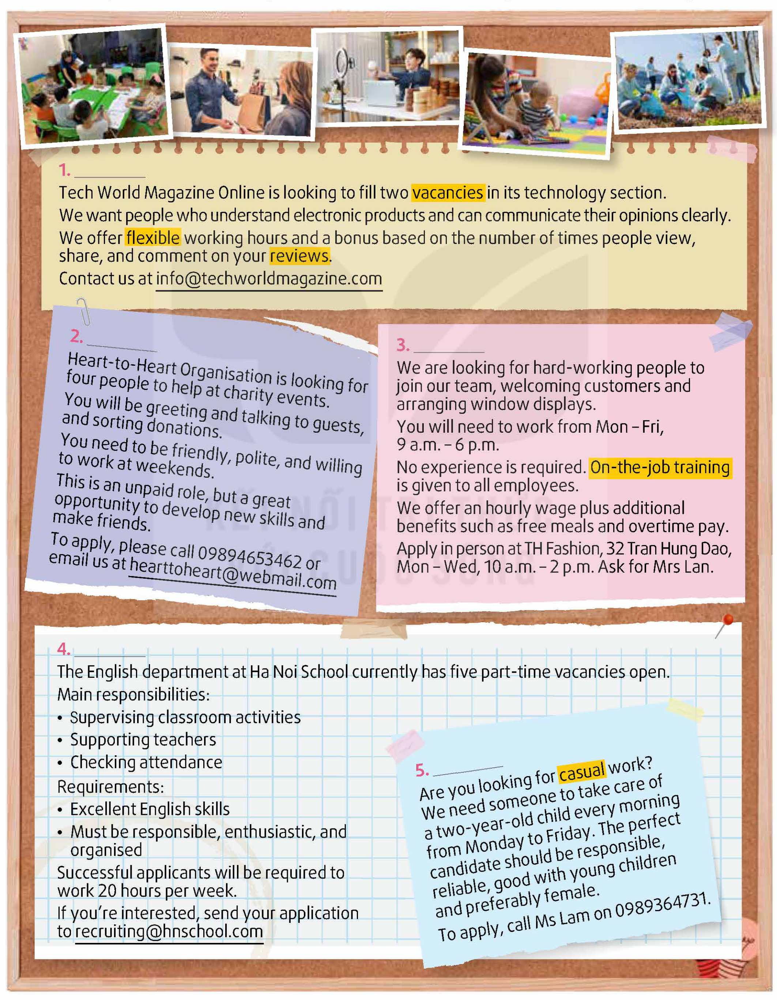
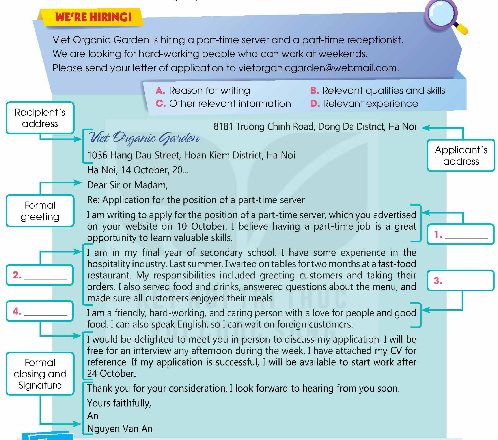

<!-- pdf:62 -->

# UNIT 5: THE WORLD OF WORK

**This unit includes:**

- **LANGUAGE:**
  - **Pronunciation:** Stressing auxiliary and modal verbs
  - **Vocabulary:** Words related to work
  - **Grammar:** Simple, compound, and complex sentences (review and extension)
- **SKILLS:**
  - **Reading:** Reading for main ideas and specific information in job advertisements
  - **Speaking:** Giving opinions about different jobs
  - **Listening:** Listening for main ideas and specific information in a phone conversation about a job vacancy
  - **Writing:** Writing a job application letter
- **COMMUNICATION AND CULTURE / CLIL:**
  - **Everyday English:** Expressing anxiety and responding to it
  - **Culture:** Unusual jobs around the world
- **PROJECT:**
  - Doing research on suitable part-time jobs for students

## I. GETTING STARTED

**Our parents' jobs**

**1. Listen and read.**

**Lan:** Come in, Mark. Did you find my place easily?

**Mark:** Yes, I actually met your dad in the street and he showed me the way. He said he was on his way to work.
<!-- ocr-ok: đã đối chiếu ảnh trang gốc, OCR đọc nhầm I thành | -->

**Lan:** That's right. My dad is a factory worker, so he works in **shifts**. Today he's on the night **shift**.

**Mark:** Working night shifts must be really hard. When does he sleep?

**Lan:** He goes to bed right after he comes home in the morning when there's no one at home. My mum's usually at work then. She teaches at a primary school.
<!-- ocr-ok: đã đối chiếu ảnh trang gốc, OCR đọc nhầm at thành af -->

**Mark:** Working with kids must be fun.

**Lan:** Yes, she loves her job though teaching can be tiring. Getting up in front of the class and putting up a performance every day seem so **stressful**.

**Mark:** I agree. My mum used to be a teacher, but she gave up her job to look after me and my brother.

**Lan:** How about your dad?

**Mark:** He has a **nine-to-five** job. He's an accountant at a bank.

**Lan:** Working with numbers must be difficult.

<!-- pdf:63 -->

**Mark:** Yes, but it's not just numbers. You need to learn so many regulations and build good working relationships with clients.

**Lan:** I guess he often goes on business trips.

**Mark:** Not really, but he works **overtime**. He sometimes comes back home when I'm already in bed.

**Lan:** You're good at maths, so you should follow in his **footsteps**.

**Mark:** Definitely not. Neither I nor my brother wants to become an accountant. I'm interested in computer programming because it opens up so many job opportunities. What about you, Lan?

**Lan:** Well, I love working with children, so I want to become a primary school teacher like my mum.

**Mark:** Didn't you say last year you wanted to become a scientist?

**Lan:** *(laughing)* Yeah ...

**2. Read the conversation again and put a tick (✓) in the appropriate column.**

| Who ... | Lan's dad | Mark's dad | Lan's mum |
| --- | --- | --- | --- |
| 1. is a factory worker? | | | |
| 2. is a bank accountant? | | | |
| 3. works in shifts? | | | |
| 4. is a primary school teacher? | | | |

**3. Match the words/phrases to make phrases mentioned in 1.**

| | |
| --- | --- |
| 1. work | a. business trips |
| 2. go on | b. job |
| 3. **nine-to-five** | c. **shift** |
| 4. night | d. **overtime** |
<!-- ocr-ok: đã đối chiếu ảnh trang gốc, các số 1-4 và chữ a-d nằm trong hình tròn màu vàng -->

**4. Complete the sentences with phrases or clauses in the box based on the conversation in 1.**

- a. because it opens up so many job opportunities
- b. so she wants to become a primary school teacher like her mum
- c. a difficult job
- d. though teaching can be tiring
<!-- ocr-ok: đã đối chiếu ảnh trang gốc, OCR đọc nhầm to thành fo -->

1. In Lan's opinion, being an accountant is \_\_\_\_\_\_\_.
2. Mark wants to study computer programming \_\_\_\_\_\_\_.
3. Lan likes to work with children, \_\_\_\_\_\_\_.
4. Lan's mum loves her job \_\_\_\_\_\_\_.

<!-- pdf:64 -->

## II. LANGUAGE

### Pronunciation

**Stressing auxiliary and modal verbs**
<!-- ocr-ok: đã đối chiếu ảnh trang gốc, tiêu đề màu xanh bị OCR bỏ sót -->

**Remember!**

Auxiliary and modal verbs are usually not stressed in connected speech; however, they have stress in the following situations:

- when they are not followed by the main verb in short responses.
  *Example:*
  *Can we walk to the cinema? – Yes, we can.*
<!-- ocr-ok: đã đối chiếu ảnh trang gốc, OCR đọc nhầm to thành fo -->
- when they are contracted with *not* in negative sentences.
  *Example:*
  *You haven't applied for the job yet.*
- when they are used to emphasise disagreement with the previous statement.
  *Example:*
  **A:** *Nam wasn't interested in that job.*
  **B:** *He was interested in the job.*
<!-- ocr-ok: đã đối chiếu ảnh trang gốc, OCR đọc nhầm interested thành inferesfed -->

**1. Listen and repeat. Pay attention to the stressed words.**
<!-- ocr-ok: đã đối chiếu ảnh trang gốc, OCR đọc nhầm stressed thành siressed -->

1. I *don't* like working with numbers, but my brother *does*.
2. I will help you with your maths homework if I *can*.
3. **A:** You *haven't* submitted your **application letter** for the job yet.
   **B:** I *have*.
4. My brother *couldn't* ride a bike two months ago, but he *can* now.

**2. Listen and underline the stressed auxiliary and modal verbs in the following sentences. Then practise saying the sentences in pairs.**

1. I would help you find a job if I could.
2. When he started his first job, he wasn't used to working in an office, but he is used to it now.
3. **A:** Are you ready for the interview?
   **B:** Yes, I am.
4. **A:** Is your father a teacher?
   **B:** He was, but he's retired now.

### Vocabulary

**Work**
<!-- ocr-ok: đã đối chiếu ảnh trang gốc, tiêu đề màu xanh và cam bị OCR bỏ sót -->

**1. Match the words with their meanings.**

| | |
| --- | --- |
| 1. **challenging** (adj) | a. worth doing, especially by making you feel satisfied that you have done something useful |
| 2. **relevant** (adj) | b. money added to somebody's salary as a reward for good work |
| 3. **bonus** (n) | c. difficult in an interesting way that tests your ability |
| 4. **employ** (v) | d. related to a subject or to something happening or being discussed |
| 5. **rewarding** (adj) | e. to have someone work or do a job for you and pay them for it |
<!-- ocr-ok: đã đối chiếu ảnh trang gốc, OCR đọc nhầm adj thành ad, n thành Nn, to thành †o -->

**2. Complete the sentences with the words in 1.**

1. The company has to \_\_\_\_\_\_\_ more workers to meet the production targets.
2. Peter wants to become a pilot although he knows it is a \_\_\_\_\_\_\_ job.
3. Workers will receive a generous \_\_\_\_\_\_\_ if they achieve their performance goals.
4. Consider completing your course before you apply for this job because it will require \_\_\_\_\_\_\_ qualifications.
5. Working as a babysitter could be a \_\_\_\_\_\_\_ experience if you enjoy working with children.

<!-- pdf:65 -->

### Grammar

**Simple, compound, and complex sentences (review and extension)**
<!-- ocr-ok: đã đối chiếu ảnh trang gốc, tiêu đề màu xanh bị OCR đọc lỗi -->

**Remember!**

- A simple sentence includes one independent clause.
  *Example:*
  *My brother didn't apply for the job.*
- A compound sentence includes two or more independent clauses joined by a coordinating conjunctive, e.g. *and*, *but*, *or*, *nor*, *yet*, *so*, a correlative conjunction, e.g. *not only ... but also*, or a conjunctive adverb, e.g. *as a result*, *moreover*, *in fact*, *on the other hand*.
<!-- ocr-ok: đã đối chiếu ảnh trang gốc, OCR đọc nhầm not thành nof, other thành ofher -->
  *Example:*
  *My brother didn't apply for the job, but he was offered an apprenticeship.*
  *Being a nurse is a very tiring job; moreover, you don't earn a high salary.*
<!-- ocr-ok: đã đối chiếu ảnh trang gốc, OCR đọc nhầm tiring thành firing, don't thành don -->
- A complex sentence includes one (or more) independent clause(s) and at least one dependent clause joined by a subordinating conjunction, e.g. *when*, *while*, *because*, *although*, *if*, *so that*.
  *Example:*
  *When I was younger, I wanted to become a driver.*
  *Because my brother is often late for work, he is never promoted.*
<!-- ocr-ok: đã đối chiếu ảnh trang gốc, OCR đọc nhầm wanted to thành wanfed fo, often late thành offen lafe -->

**1. Combine the following simple sentences, using the words in brackets.**

1. He left school with no academic qualifications. He found a **well-paid** job. *(although)*
<!-- ocr-ok: đã đối chiếu ảnh trang gốc, OCR đọc nhầm qualifications thành qudlifications -->
2. People learn English well. They will have a better chance of getting a job. *(if)*
3. This job requires good language skills. It also requires communication skills. *(not only ... but also)*
4. My dad attended a cooking course. He can open his own restaurant. *(so that)*

**2. Work in pairs. Add more clauses to the following sentences to make compound or complex sentences.**

- I want to become a doctor.
- I admire teachers.
- There are jobs that no longer exist.
- Some jobs will be done by robots in the future.

*Example:*
*I want to become a doctor because I want to help sick people.*
*Although my grades are not very good, I want to become a doctor.*
<!-- ocr-ok: đã đối chiếu ảnh trang gốc, OCR đọc nhầm to thành fo -->

<!-- pdf:66 -->

## III. READING

**Job advertisements**

**1. Work in pairs. Look at the pictures and discuss what you know about the jobs.**

**1. \_\_\_\_\_\_\_**
Tech World Magazine Online is looking to fill two **vacancies** in its technology section.
We want people who understand electronic products and can communicate their opinions clearly.
We offer **flexible** working hours and a **bonus** based on the number of times people view, share, and comment on your *reviews*.
Contact us at info@techworldmagazine.com

**2. \_\_\_\_\_\_\_**
Heart-to-Heart Organisation is looking for four people to help at charity events.
You will be greeting and talking to guests, and sorting donations.
You need to be friendly, polite, and willing to work at weekends.
This is an **unpaid** role, but a great opportunity to develop new skills and make friends.
To apply, please call 09894653462 or email us at hearttoheart@webmail.com
<!-- ocr-ok: đã đối chiếu ảnh trang gốc, văn bản trên mẩu giấy nghiêng bị OCR đọc chồng lấp với mẩu giấy 3 -->

**3. \_\_\_\_\_\_\_**
We are looking for hard-working people to join our team, welcoming customers and arranging window displays.
You will need to work from Mon – Fri, 9 a.m. – 6 p.m.
No experience is required. **On-the-job** training is given to all employees.
We offer an hourly **wage** plus additional benefits such as free meals and **overtime** pay.
Apply in person at TH Fashion, 32 Tran Hung Dao, Mon – Wed, 10 a.m. – 2 p.m. Ask for Mrs Lan.

**4. \_\_\_\_\_\_\_**
The English department at Ha Noi School currently has five **part-time** **vacancies** open.
Main responsibilities:
- Supervising classroom activities
- Supporting teachers
- Checking attendance
Requirements:
- Excellent English skills
- Must be responsible, enthusiastic, and organised
Successful applicants will be required to work 20 hours per week.
If you're interested, send your application to recruiting@hnschool.com
<!-- ocr-ok: đã đối chiếu ảnh trang gốc, dòng organised bị OCR đọc lỗi do mẩu giấy 5 nghiêng bên cạnh -->

**5. \_\_\_\_\_\_\_**
Are you looking for **casual** work? We need someone to take care of a two-year-old child every morning from Monday to Friday. The perfect candidate should be responsible, reliable, good with young children and preferably female.
To apply, call Ms Lam on 0989364731.
<!-- ocr-ok: đã đối chiếu ảnh trang gốc, văn bản trên mẩu giấy nghiêng bị OCR đọc thiếu chữ -->

<!-- pdf:67 -->

**2. Read the adverts and choose the correct meanings of the highlighted words and phrase.**

1. **vacancies**
   - A. jobs which are available for someone to do
   - B. all the jobs in a company
2. **flexible**
   - A. able to change quickly according to the situation
   - B. able to stick to the chosen job
3. *reviews*
   - A. articles expressing opinions about new products, books, films, etc.
   - B. the act of reading materials to prepare for an exam
<!-- ocr-ok: đã đối chiếu ảnh trang gốc, OCR đọc nhầm etc. thành efc. -->
<!-- term: review -->
4. **on-the-job** training
   - A. the work experience you need to get a job
   - B. teaching employees how to do a job at their workplace
5. **casual**
   - A. not regular; for a short period of time
   - B. permanent; long-term
<!-- ocr-ok: đã đối chiếu ảnh trang gốc, OCR đọc nhầm time thành fime -->

**3. Read the adverts again and choose the most suitable headline for each one.**

- A. Shop assistants wanted
- B. Volunteers needed
- C. Job **vacancies**: Teaching assistants
- D. Babysitter wanted
- E. Want to be a product reviewer?

**4. Read the adverts again and decide which job is most suitable for the following people. Write 1, 2, 3, 4, or 5.**

| | Job |
| --- | --- |
| a. A person without any knowledge or skills for the job. | |
| b. A woman who loves playing with kids and helping them grow. | |
| c. A person who is available to do **unpaid** work on Saturdays and Sundays. | |
| d. A person who speaks English extremely well. | |
| e. A person who is interested in technology and can express his/her opinions well. | |

**5. Work in pairs. Discuss the following questions.**

Which of the jobs in the adverts do you find the most interesting? Why?

<!-- pdf:68 -->

## IV. SPEAKING

**Giving opinions about different jobs**
<!-- ocr-ok: đã đối chiếu ảnh trang gốc, OCR đọc lỗi chữ SPEAKING -->

**1. Read the descriptions of the following jobs. What do you think about each job? Write the adjectives that describe the nature of the job in the table. Use the words in the box to help you.**

| boring | **challenging** | demanding | exciting | important |
| --- | --- | --- | --- | --- |
| lonely | **repetitive** | **rewarding** | **stressful** | tiring |
<!-- ocr-ok: đã đối chiếu ảnh trang gốc, OCR đọc nhầm tiring thành firing -->

| Jobs | Main responsibilities | Adjectives |
| --- | --- | --- |
| **Teaching assistant** | supervising classroom activities, supporting teachers, and checking attendance | **rewarding**, interesting, fun |
| **Event volunteer** | greeting and talking to guests, and sorting donations | |
| **Product reviewer** | testing products and writing reviews of them | |
| **Shop assistant** | welcoming customers, arranging window displays, and selling goods | |
| **Babysitter** | looking after children while parents are away, playing with them, keeping them safe, and feeding them | |
<!-- ocr-ok: đã đối chiếu ảnh trang gốc, OCR đọc nhầm interesting thành inferesfing -->

**2. Work in pairs. Talk about the jobs in 1 using the adjectives. Compare your answers and explain your opinions and feelings.**

*Example:*

**A:** I think working as a teaching assistant is a very **rewarding** job. I can help students who have questions or need encouragement during the lesson.
<!-- ocr-ok: đã đối chiếu ảnh trang gốc, OCR đọc nhầm teaching thành feaching -->

**B:** I agree, but it seems like a **challenging** job. You'll have to be patient and explain the same thing over and over again. It can get very **repetitive**. Personally, I'd rather be an event volunteer.
<!-- ocr-ok: đã đối chiếu ảnh trang gốc, OCR đọc nhầm to thành fo và It thành If -->

**A:** Why? You won't even get paid for that.

**B:** I know, but I'll meet interesting people and learn important skills like communication and time management. Besides, volunteer experience can help me find a better job later on.
<!-- ocr-ok: đã đối chiếu ảnh trang gốc, OCR đọc nhầm time thành fime -->

**A:** Oh, I get it.

**3. Work in groups. Compare your answers in 1 and 2, and report to the whole class. Use the questions below as cues.**

- Which is the most common adjective to describe each job in the table?
- Which job do most people in your group like/dislike?
- What are the most common reasons?

<!-- pdf:69 -->

## V. LISTENING

**Enquiry about a job vacancy**

**1. Choose the correct meanings of the underlined words and phrases.**

1. I hope the job will not *interfere with* my performance at school.
   - A. prevent something from succeeding
   - B. try to influence a situation
<!-- term: interfere with -->
2. The server was standing next to our table, ready to take our *order*.
   - A. the way in which things are arranged
   - B. a request for food or drinks in a restaurant
<!-- term: order -->
3. The man paid the *bill* and left the restaurant.
   - A. a piece of paper that tells you how much you must pay
   - B. a list of all the food and drinks you have had at a restaurant
<!-- term: bill -->
4. She ***waited on tables*** at the local café to support herself at university.
   - A. served food or drinks, especially to customers in a café or restaurant
   - B. cleaned the tables in a café or restaurant
<!-- ocr-ok: đã đối chiếu ảnh trang gốc, OCR đọc nhầm to thành fo -->

**2. Listen to a conversation between Mark and a restaurant manager, and decide whether the statements are true (T) or false (F).**

| | T | F |
| --- | --- | --- |
| 1. Mark is interested in working as a **part-time** server in a restaurant. | | |
| 2. The **part-time** servers will only work six hours a week. | | |
| 3. Mark will get training if he is accepted for this job. | | |
| 4. Mark doesn't need to interview for this job. | | |

**3. Listen to the conversation again and complete the notes. Use no more than TWO words for each gap.**

| **JOB ENQUIRY** | |
| --- | --- |
| **Vacancy** | **part-time** server |
| **Number of hours per week** | (1) \_\_\_\_\_\_\_ |
| **Duties** | • (2) \_\_\_\_\_\_\_ customers and show them to their tables • present and explain the menu • take customers' orders • serve food and drinks • collect (3) \_\_\_\_\_\_\_ |
| **Required qualities and skills** | • be able to (4) \_\_\_\_\_\_\_ customers • be friendly • good (5) \_\_\_\_\_\_\_ and a good memory |
| **Interview time** | (6) \_\_\_\_\_\_\_ |
<!-- ocr-ok: đã đối chiếu ảnh trang gốc, OCR đọc nhầm (1) thành a và to thành fo -->

**4. Work in pairs. Discuss the following questions.**

According to what you hear, what qualities and skills are required as a server? Are they useful for any other jobs?

<!-- pdf:70 -->

## VI. WRITING

**A job application letter**

**1. Read the job application letter for a part-time server below. Label the communicative functions (1–4) with the phrases in the box.**

**WE'RE HIRING!**

Viet Organic Garden is hiring a **part-time** server and a **part-time** receptionist.
We are looking for hard-working people who can work at weekends.
Please send your letter of application to vietorganicgarden@webmail.com.

| A. Reason for writing | B. Relevant qualities and skills |
| --- | --- |
| C. Other relevant information | D. Relevant experience |

- **Applicant's address:** 8181 Truong Chinh Road, Dong Da District, Ha Noi
- **Recipient's address:** *Viet Organic Garden*, 1036 Hang Dau Street, Hoan Kiem District, Ha Noi
- Ha Noi, 14 October, 20...
- **Formal greeting:**
  Dear Sir or Madam,
  Re: Application for the position of a **part-time** server
- **1. \_\_\_\_\_\_\_:**
  I am writing to apply for the position of a **part-time** server, which you advertised on your website on 10 October. I believe having a **part-time** job is a great opportunity to learn valuable skills.
- **2. \_\_\_\_\_\_\_:**
  I am in my final year of secondary school. I have some experience in the hospitality industry. Last summer, I **waited on tables** for two months at a fast-food restaurant. My responsibilities included greeting customers and taking their orders. I also served food and drinks, answered questions about the menu, and made sure all customers enjoyed their meals.
- **3. \_\_\_\_\_\_\_:**
  I am a friendly, hard-working, and caring person with a love for people and good food. I can also speak English, so I can wait on foreign customers.
- **4. \_\_\_\_\_\_\_:**
  I would be delighted to meet you in person to discuss my application. I will be free for an interview any afternoon during the week. I have attached my CV for reference. If my application is successful, I will be available to start work after 24 October.
- **Formal closing and Signature:**
  Thank you for your consideration. I look forward to hearing from you soon.
  Yours faithfully,
  *An*
  Nguyen Van An
<!-- ocr-ok: đã đối chiếu ảnh trang gốc, văn bản nằm trong sơ đồ bức thư xin việc H12-tieng_anh-u05-02 -->

**Tips**

The main purpose of writing an **application letter** is to introduce yourself in the most effective way and persuade the employer to give you an interview. You should:
<!-- ocr-ok: đã đối chiếu ảnh trang gốc, OCR đọc nhầm introduce thành iniroduce -->

- make sure your letter of application follows a standard format.
- start your letter by stating the position you apply for and explaining why you are interested in it.
- give some information about yourself and describe any relevant experience.
- highlight relevant qualities and skills.
- show your interest in the job.
- indicate when you will be available for an interview and when you can start work.
- use professional, formal, and polite language.
- end with a brief closing paragraph and your signature.

<!-- pdf:71 -->

**2. Write a letter (150–180 words) applying for the position of a part-time receptionist. Use the model and tips in 1, and the suggestions below to help you.**
<!-- ocr-ok: đã đối chiếu ảnh trang gốc, OCR đọc nhầm part-time thành pari-time -->

2222 Nguyen Trai Road, Thanh Xuan District, Ha Noi
1036 Hang Dau Street, Hoan Kiem District, Ha Noi
16 July, 20...

*Dear Sir or Madam,*
*I am writing to apply for ...*
*I am ... Last summer, ...*
*I consider myself ... / I am ...*
*I would be delighted to ...*
*I am available for an interview on ...*
*If my application is successful, I will be able to start work ...*
*I look forward to hearing from you soon.*
*Yours faithfully,*
<!-- ocr-ok: đã đối chiếu ảnh trang gốc, OCR đọc lỗi chữ nghiêng trong mẫu thư -->

## VII. COMMUNICATION AND CULTURE / CLIL

### Everyday English

**Expressing anxiety and responding to it**
<!-- ocr-ok: đã đối chiếu ảnh trang gốc, OCR đọc nhầm to thành 1o -->

**1. Listen and complete the conversations with the expressions in the box. Then practise them in pairs.**

| A. Don't worry. You'll be fine | B. I'm really nervous about it |
| --- | --- |
| C. stop worrying about it | D. I'm so worried about |
<!-- ocr-ok: đã đối chiếu ảnh trang gốc, OCR đọc nhầm it thành if -->

**1.**
**Minh:** I've got an interview for a **part-time** job tomorrow and (1) \_\_\_\_\_\_\_.
**Nam:** Oh, (2) \_\_\_\_\_\_\_. You'll be fine.

**2.**
**Mai:** (3) \_\_\_\_\_\_\_ the presentation on common **part-time** jobs for students. I haven't prepared enough.
**Mark:** (4) \_\_\_\_\_\_\_. I think you'll do it well.

**2. Work in pairs. Use the models in 1 to make similar conversations for these situations. One of you is A, the other is B. Use the expressions below to help you.**

1. A is worrying about his/her first day at work as a teaching assistant. B is comforting him/her.
2. B is a new **part-time** employee of a company. He/She is worrying about having sent the email to the wrong customer. A is his/her colleague. She is comforting him/her.

| **Useful expressions** | |
| --- | --- |
| **Expressing anxiety** | **Responding** |
| • I'm really worried/nervous about ... • I can't concentrate on anything. • I couldn't sleep last night. • I can't help/stop thinking about it. • I'm afraid that I'll make a mistake during ... | • Stop worrying/thinking about it. • You'll be fine. • You've got nothing to worry about. |
<!-- ocr-ok: đã đối chiếu ảnh trang gốc, OCR đọc nhầm I thành | và couldn't thành couldn † -->

<!-- pdf:72 -->

### Culture

**1. Read the texts and answer the questions.**
<!-- ocr-ok: đã đối chiếu ảnh trang gốc, tiêu đề Culture màu xanh bị OCR bỏ sót -->

**UNUSUAL JOBS**

Around the world, there are some jobs that may seem quite strange and surprising to you.

**Train pushers**

In Japan, the railway system is huge and everyone there uses trains. This makes them overcrowded most of the time. During rush hour, railway station attendants called 'pushers' or 'oshiya' do the strangest job in the world – they push passengers into trains. They have to do this because of the large number of commuters who wish to arrive at their desired locations on time. That's why they must endure the pain in squeezing themselves inside the train.

**Cleaners of the world's highest building**

Have you ever wondered how the world's tallest building, Burj Khalifa, in Dubai, is cleaned? It takes a team of 36 window cleaners a total of three months to clean the tower's reflective windows. Working from the height of more than 800 metres, the cleaners face huge challenges especially during bad weather. They must be the bravest cleaners in the world.

**Golf balls divers**

Every year in the UK, millions of golf balls get lost in the water around golf courses. This gave rise to the demand for golf ball divers whose job is to dive deep into the lakes and ponds around golf courses to find the lost balls. Most of them are professional scuba divers, but they spend long hours crawling around in mud and carrying heavy buckets. On average, they find 5,000 balls per lake. After cleaning them, they resell or recycle the balls. Sounds dangerous, doesn't it?

**Which job ...**

1. requires bravery and no fear of heights?
2. helps people to be on time?
3. requires good diving skills?

**2. Work in pairs. Discuss the following questions.**

Which job do you find most interesting and why? Do you know any other unusual jobs around the world?

## VIII. LOOKING BACK

### Pronunciation

**Read the conversations and underline the stressed auxiliary and modal verbs. Listen and check. Then practise saying the sentences in pairs.**
<!-- ocr-ok: đã đối chiếu ảnh trang gốc, tiêu đề LOOKING BACK và Pronunciation bị OCR bỏ sót -->

1. **A:** Have you started working for the new company?
   **B:** Yes, I have. I started last week.
2. **A:** Can people with no experience apply for this job?
   **B:** Yes, they can. We provide **on-the-job** training.
3. **A:** Do you like your job?
   **B:** Yes, I do. I wasn't interested in the job at first, but I'm quite interested in it now.
4. **A:** You haven't sent the email to the customer.
   **B:** I have sent it.

### Vocabulary

**Choose the correct words to complete these sentences.**
<!-- ocr-ok: đã đối chiếu ảnh trang gốc, tiêu đề Vocabulary màu xanh bị OCR bỏ sót -->

1. I have some ***flexible*** / *relevant* information for the job you're looking for.
2. You have to improve your communication skills if you want to be ***employed*** / *applied* in the hospitality industry.
3. The company will give you a ***bonus*** / ***wage*** for your good performance at work.
4. Physically ***challenging*** / *interesting* jobs can allow you to exercise while you work.

<!-- pdf:73 -->

### Grammar

**Circle the mistake in each sentence. Then correct it.**
<!-- ocr-ok: đã đối chiếu ảnh trang gốc, tiêu đề Grammar và dòng đề bài bị OCR bỏ sót -->

1. *Despite* (A) my grandfather has *retired* (B), he still *works as* (C) a volunteer teacher *in* (D) the local school.
2. I *quitted* (A) my previous *job* (B) *so* (C) it was so *tiring* (D).
3. I decided to *join* (A) the English club *such that* (B) I can *practise* (C) my English *more* (D) frequently.
4. *The* (A) job will give you *not only* (B) a good salary *but* (C) a good chance for *promotion* (D).
<!-- ocr-ok: đã đối chiếu ảnh trang gốc, các nhãn A B C D in dưới chân cụm gạch chân và OCR đọc nhầm quitted thành gquitted -->

## PROJECT

**Student part-time jobs**
<!-- ocr-ok: đã đối chiếu ảnh trang gốc, tiêu đề màu tím bị OCR bỏ sót -->

**Work in groups. Think of suitable and useful jobs that students can do while studying at school or university. Use these questions as cues for your presentation.**

- What is the job?
- What are the main responsibilities of the job?
- What qualities and skills do you need to do the job?
- What are the benefits of having this job?

**Now I can ...**

- identify and pronounce stressed auxiliary and modal verbs.
- understand and use words related to work.
- use simple, compound, and complex sentences correctly.
- read for main ideas and specific information in job advertisements.
- give opinions about different jobs.
- listen for main ideas and specific information in a phone conversation about a job vacancy.
- write a job application letter.
- express anxiety and respond to it.
- learn about some unusual jobs around the world.
- do research on suitable part-time jobs for students and present the information to the class.

## 📷 Danh sách hình trong bài

| Mã hình | Trang PDF | Trang sách | Chú thích / Mô tả |
| --- | --- | --- | --- |
| H12-tieng_anh-u05-01 | 66 | 64 | Bảng thông tin tuyển dụng gắn 5 bức ảnh minh hoạ công việc (trợ giảng, nhân viên bán hàng, người đánh giá sản phẩm, người trông trẻ, tình nguyện viên sự kiện) kèm 5 mẩu quảng cáo tìm việc tương ứng |
| H12-tieng_anh-u05-02 | 70 | 68 | Sơ đồ cấu trúc một bức thư xin việc (*job application letter*) ứng tuyển vị trí nhân viên phục vụ bán thời gian tại Viet Organic Garden với các ô chú thích chức năng giao tiếp (1–4) |
