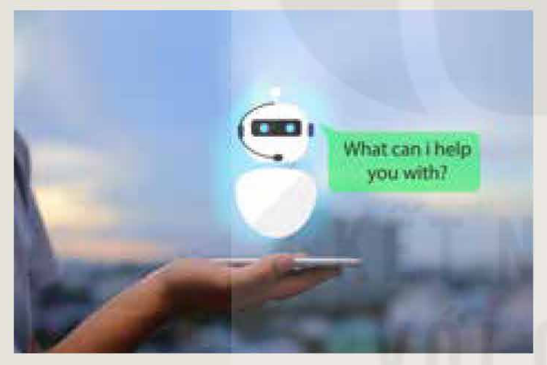
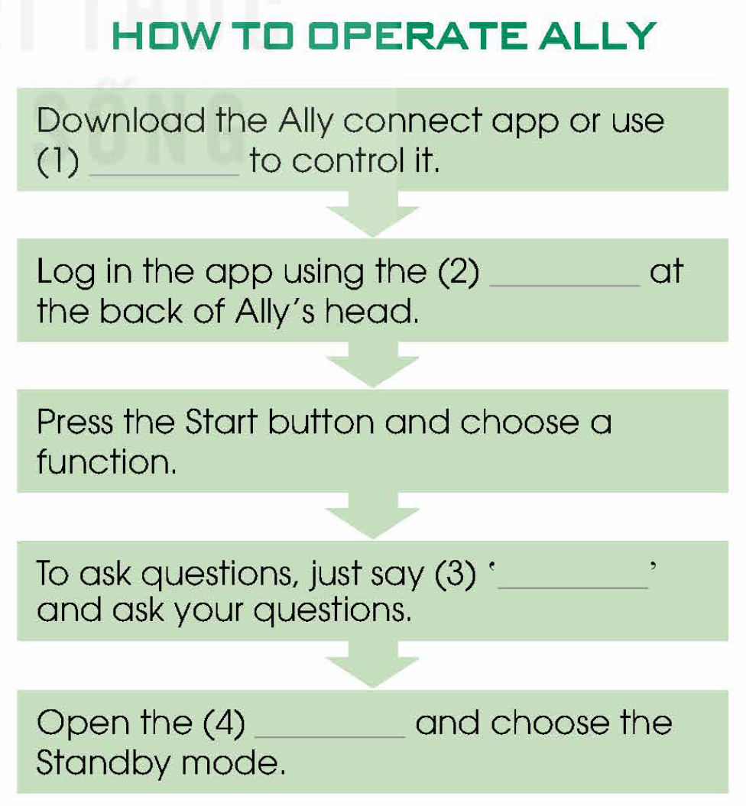
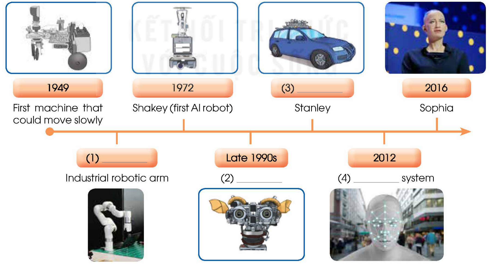

<!-- pdf:78 -->

# UNIT 6: ARTIFICIAL INTELLIGENCE

**This unit includes:**

- **LANGUAGE:**
  - **Pronunciation:** Homophones
  - **Vocabulary:** Words and phrases related to science and technology
  - **Grammar:** Active and passive causatives
- **SKILLS:**
  - **Reading:** Reading for specific information in an article about AI applications in education
  - **Speaking:** Discussing applications of AI in education
  - **Listening:** Listening for specific information and instructions for operating a home robot in a conversation with an AI expert
  - **Writing:** Writing an essay about the advantages and disadvantages of home robots
- **COMMUNICATION AND CULTURE / CLIL:**
  - **Everyday English:** Getting attention and interrupting
  - **CLIL:** The evolution of robots
- **PROJECT:**
  - Researching or designing a new AI application in our daily lives

## I. GETTING STARTED

**A visit to a high-tech centre**

**1. Listen and read.**

**Teacher:** Hello, class. Please meet Jessica. She's a **human-like** robot and will be your guide today.

**Jessica:** Good morning, everybody. Welcome to the New Tech Centre.

**Nam:** Hi, Jessica. I'm so excited as I've never met a talking robot before. Let's have a photo taken together!

**Jessica:** OK, I'll get someone to take a picture of us, but let's go first to the robot exhibition where you'll see a collection of **human-like** robots from around the world. Please follow me. ... OK, do you have any questions?

**Mai:** They look so real! Can we **interact** with them?

**Jessica:** Yes, you can. They're all **capable** of answering questions and translating from different languages. Let me get this robot **activated** so you can talk to him.

**Mai:** Hello, what's your name? What languages can you speak? Where do you live?

**Robby:** Hello, my name's Robby. I can speak English, Vietnamese, Chinese, and German. I live in the New Tech Centre.

<!-- pdf:79 -->

**Mai:** Wow! You're so smart, Robby.

**Nam:** Jessica, where shall we go next?

**Jessica:** Next, we'll visit the Research and Development area. Please follow me. Here scientists and engineers explore and create new **AI** technologies. **AI** has many practical **applications** such as **facial recognition** and virtual assistants.

**Mai:** I noticed a **facial recognition** screen at the entrance of the centre.

**Jessica:** That's right. We have all visitors' identity checked to improve the centre security. Now, what else would you like to see?
...

**2. Read the conversation again and answer the questions.**

1. Why is Nam excited?
2. What can **human-like** robots do?
3. What are some examples of **AI** **applications**?
4. Where did Mai see a **facial recognition** screen?

**3. Find words in 1 with the following meanings.**

| | Meaning |
| --- | --- |
| 1. c\_\_\_\_\_\_\_ | able to do things well |
| 2. a\_\_\_\_\_\_\_ | caused to work or act |
| 3. a\_\_\_\_\_\_\_ | the practical uses of something |
| 4. r\_\_\_\_\_\_\_ | the act of identifying what something is |
<!-- term: recognition -->

**4. Complete the sentences with words or a phrase from 1.**

1. Let's have a photo \_\_\_\_\_\_\_ together.
2. I'll get someone \_\_\_\_\_\_\_ a picture of us.
3. Let me get this robot \_\_\_\_\_\_\_, so you can talk to him.
4. We have all visitors' identity \_\_\_\_\_\_\_ to improve the centre security.

<!-- pdf:80 -->

## II. LANGUAGE

### Pronunciation

**Homophones**

**Remember!**

**Homophones** are words that have the same pronunciation but different spelling and meanings.
*Example:* I have *two* (/tuː/) books, *too* (/tuː/).

**1. Listen and repeat the following homophones.**

| | | | | | |
| --- | --- | --- | --- | --- | --- |
| **1.** | to | two | **2.** | there | their |
| **3.** | where | wear | **4.** | board | bored |
| **5.** | hour | our | **6.** | allowed | aloud |
| **7.** | know | no | **8.** | right | write |

**2. Choose the correct words to complete the sentences. Listen and repeat. Then practise saying the sentences in pairs.**

1. There are more than *two* / *to* types of robots.
2. We want to know *wear* / *where* **AI** technologies are used today.
3. *There* / *Their* have been some worries about **AI** taking over the world.
4. Robots can work for long *ours* / *hours* without feeling tired.
5. We have *no* / *know* idea about the future of **AI** in space exploration.

### Vocabulary

**Science and technology**

**1. Match the words with their meanings.**

| Words | Meanings |
| --- | --- |
| 1. **advanced** (adj) | a. a computer programme that can have a conversation with a human being, usually over the Internet |
| 2. **chatbot** (n) | b. to examine the nature or structure of something |
| 3. **artificial intelligence** (n) | c. modern and recently developed |
| 4. **programme** (v) | d. to tell a machine to operate in a specific way |
| 5. **analyse** (v) | e. the study and development of computer systems that can copy human behaviour |

<!-- pdf:81 -->

**2. Complete the sentences using the correct forms of the words from 1.**

1. \_\_\_\_\_\_\_ is now part of our everyday lives.
2. With its **human-like** appearance and ability to walk and talk, Sophia is considered the most \_\_\_\_\_\_\_ robot in the world.
3. Robots must be \_\_\_\_\_\_\_ to perform **human-like** activities.
4. This programme uses students' answers to \_\_\_\_\_\_\_ their language proficiency.
5. Many businesses use \_\_\_\_\_\_\_ to offer real-time customer support.

### Grammar

**Active and passive causatives**

**Remember!**

- The active causative is used when the subject causes the object to do something. The pattern means 'to cause someone to do something'.
  *have + someone + bare infinitive*
  *get + someone + to-infinitive*
  *Example:* The **AI** expert *had* his assistant **activate** the new robot.
  I will *get* more people *to join* the technology club.
- The passive causative is used when the thing is done for the subject by someone else. The pattern means 'to cause something to be done'.
  *have/get + something + past participle*
  *Example:* The **AI** expert *had/got* the new robot **activated**.

**1. Rewrite the sentences using active or passive causatives.**

1. A robot cleans my house every day.
   → I \_\_\_\_\_\_\_.
2. My dad arranged for someone to repair our robot vacuum cleaner.
   → My dad \_\_\_\_\_\_\_.
3. The shop arranged for a robot to put together our furniture in 10 minutes.
   → We \_\_\_\_\_\_\_.
4. They will **upgrade** his computer to improve its performance.
   → He \_\_\_\_\_\_\_.

**2. Work in pairs. Make predictions about applications of robots in the future, using causatives.**

*Examples:*
*People will have robots do all the delivery services for them.*
*People will have all dangerous jobs done by robots.*

<!-- pdf:82 -->

## III. READING

**AI applications in education**

**1. Work in groups. Discuss what the pictures in the article below show and where you might see them.**

**2. Read the article. Choose the correct meanings of the highlighted words.**

**TECH NEWS**

**Artificial Intelligence** (**AI**) has had a huge impact on education. Here are some examples from around the world.

**A. Digital portfolio**

To apply for a university or a job, secondary school students usually need to support their **applications** with a list of relevant qualifications and work experience. Thanks to **AI**, they can now effortlessly do that online. A team from two famous universities in Singapore has invented an **AI** **digital** **portfolio**. This app collects **data** from the learning and working experience that students upload onto the app. Then the **data** is sorted into sets of skills which students can use for their job or university **applications**.

**B. Educational chatbots**

**AI** **chatbots** are being used in many schools and universities around the world. They can help keep students engaged in their learning by providing a more interactive experience. These *virtual* tutors can explain concepts clearly, answer specific questions, and give feedback on homework. Students can seek support from **AI** **chatbots** during and after classes so that they can understand the lessons better. They can also create groups on **chatbots** to share ideas about projects and activities. Engaging with each other using conversational **AI** can help students create a better and friendlier learning environment.

**C. Virtual reality**

Schools in Hong Kong are bringing fascinating learning to the classroom through the power of **virtual reality** (VR). This new way of teaching helps students learn valuable skills, provides '**hands-on**' experiences when studying history or geography, and limits potential dangers of chemistry or physics experiments. Guided virtual tours transport students back in time to study the history of Hong Kong or take them to tropical forests to explore endangered species.

**D. Personalised learning**

Experts in Israel have created a technology **platform** to support **personalised** learning. It collects **data** from students about what they know and do not know, **analyses** performances using **AI**, then offers them suitable assignments. This app has served as the main distance-learning **platform** for many Israeli secondary school students who are preparing for **advanced** examinations in physics. There are also thousands of chemistry and biology students who benefit from this software.

<!-- pdf:83 -->

1. **portfolio**
   - A. collection of someone's prizes
   - B. collection of someone's work such as drawings or documents
   - C. collection of someone's learning and working experience
2. *virtual*
   - A. not made of natural things
   - B. made, done, or seen on the Internet or a computer rather than the real world
   - C. very similar to the real world but appearing in a different form
3. **hands-on**
   - A. doing something yourself rather than just talking about it
   - B. asking people to do something
   - C. doing something by hand
4. **platform**
   - A. a floor of a building
   - B. a kind of computer system or software
   - C. a working area
<!-- term: virtual -->

**3. Read the article again and choose the correct answer A, B, C, or D.**

1. What can students in Singapore upload on their **digital** **portfolio**?
   - A. Their curriculum vitae.
   - B. Their test results.
   - C. Their study and work experience.
   - D. Descriptions of their skills.
2. Which of the following can **AI** **chatbots** NOT do according to Paragraph B?
   - A. Explain lessons.
   - B. Provide physical support.
   - C. Answer questions.
   - D. Comment on homework.
3. Which is one benefit of using VR in Hong Kong schools?
   - A. Organising field trips that take place online.
   - B. Replacing real-life travel.
   - C. Reducing the costs of doing experiments.
   - D. Creating more ways of communication.
4. Which group of students do NOT benefit from **personalised** learning app?
   - A. Physics.
   - B. Language.
   - C. Biology.
   - D. Chemistry.
5. Which **AI** **applications** are useful for students who need additional tutoring?
   - A. **Digital** **portfolio** and **personalised** learning.
   - B. All the apps mentioned above.
   - C. Educational **chatbots** and **virtual reality**.
   - D. **Personalised** learning app and educational **chatbots**.

**4. Complete each of the following sentences with ONE word from the article.**

1. \_\_\_\_\_\_\_ at Singaporean secondary schools can benefit from the **digital** **portfolio**.
2. Learners create project groups on \_\_\_\_\_\_\_ so that they can engage with each other.
3. Students in Hong Kong can go on virtual trips to learn about the \_\_\_\_\_\_\_ of their city.
4. The **AI** **application** in Israel has been used as the primary distance-learning \_\_\_\_\_\_\_ by **advanced** physics students.

**5. Work in groups. Discuss the following question.**

Which of the **AI** **applications** do you think your school can adopt?

<!-- pdf:84 -->

## IV. SPEAKING

**Applications of AI in education**
<!-- ocr-ok: đã đối chiếu ảnh trang gốc, OCR đọc nhầm AI thành Al -->

**1. Work in pairs. Match each AI application (1–5) with its purpose in learning (a–f). There can be multiple correct answers.**

| AI applications | Purposes in learning |
| --- | --- |
| 1. speech recognition | a. support students with disabilities |
| 2. educational robots | b. develop problem-solving skills |
| 3. **virtual reality** | c. check pronunciation |
| 4. AI-powered games | d. develop programming skills |
| 5. **chatbots** | e. provide **personalised** support |
| | f. provide interactive forms of learning |
<!-- ocr-ok: đã đối chiếu ảnh trang gốc, OCR đọc trộn hai cột thẻ ghép nối -->
<!-- term: speech recognition -->

**2. Work in groups. Discuss the questions.**

1. How can each **application** in 1 be used in education?
2. What are the advantages and disadvantages of each **application**?

*Example:*

**A:** What do you think about **chatbots**?

**B:** I think a **chatbot** app is an effective **application** because it can help students understand difficult concepts and provide instant and **personalised** support throughout the course.

**C:** I agree. If available, we can use it during and after classes to clarify points and get feedback on homework.

**A:** Yes, but there are also disadvantages. **Chatbots** may not be able to answer complex questions that need making decisions.

**B:** In addition, if learners always wait for ready-made answers, they may become lazy and may not develop critical thinking skills.

**C:** That's a good point. **Chatbots** can't replace human interaction and lack personal connections.

**3. Prepare a summary of your discussion and report to the whole class.**

## V. LISTENING

**Operating a home robot**

**1. Work in pairs. Discuss the following questions.**

1. Would you like to have a robot to help you in your daily life?
2. What would you like it to do for you?

**2. Listen to the first part of a conversation between Nam and an AI expert. Decide whether the following statements are true (T) or false (F).**

| | T | F |
| --- | --- | --- |
| 1. They are talking about an educational robot. | | |
| 2. Ally is the most **advanced** robot using **AI** at the New Tech Centre. | | |
| 3. Ally can see, hear, speak, and even teach maths and science. | | |
| 4. This robot runs on batteries. | | |

**3. Listen to the second part of the conversation and complete each gap in the diagram with no more than TWO words.**

**HOW TO OPERATE ALLY**

- Download the Ally connect app or use (1) \_\_\_\_\_\_\_ to control it.
- Log in the app using the (2) \_\_\_\_\_\_\_ at the back of Ally's head.
- Press the Start button and choose a **function**.
- To ask questions, just say (3) '\_\_\_\_\_\_\_' and ask your questions.
- Open the (4) \_\_\_\_\_\_\_ and choose the Standby mode.

**4. Work in pairs. Discuss the following questions.**

Do you want to have the same type of robot? Why/Why not?

<!-- pdf:85 -->

## VI. WRITING

**An essay about the advantages and disadvantages of home robots**

**1. Work in pairs. Decide whether the following ideas (A–D) are advantages (+) or disadvantages (–) of home robots. Then complete the notes using the sentences (a–d) in the box.**

- a. They may lose their critical thinking skills.
- b. They can work without a break and provide 24/7 service.
- c. They can **interact** and play games with people.
- d. They need to be **programmed** to perform each task.

| Advantages / Disadvantages | Ideas |
| --- | --- |
| \_\_\_\_\_\_\_ | **A.** People will have more time for leisure activities and family bonding. • Robots can do repetitive and boring jobs. • (1) \_\_\_\_\_\_\_ |
| \_\_\_\_\_\_\_ | **B.** Humans can become dependent on **AI** technologies. • (2) \_\_\_\_\_\_\_ • They may become lazy. |
| \_\_\_\_\_\_\_ | **C.** The cost of development and maintenance of robots is high. • Robots need expensive spare parts. • (3) \_\_\_\_\_\_\_ |
| \_\_\_\_\_\_\_ | **D.** They can answer questions about many topics. • (4) \_\_\_\_\_\_\_ • They can provide information and entertainment. |

**2. Write an essay (180–200 words) about the advantages and disadvantages of home robots, using the ideas in 1 and the suggested outline below.**

**Introduction**

- People are beginning to use home robots.
- They have advantages and disadvantages.

**Body**

- *Advantages:* Using home robots has several advantages. ...
- *Disadvantages:* ...

**Conclusion**

- Home robots may make lives easier and happier, but there are certain problems as well.

<!-- pdf:86 -->

## VII. COMMUNICATION AND CULTURE / CLIL
<!-- ocr-ok: đã đối chiếu ảnh trang gốc, tiêu đề mục lớn trên băng hồng bị OCR bỏ sót -->

### Everyday English

**Getting attention and interrupting**

**1. Listen and complete the conversations with the expressions in the box. Then practise them in pairs.**

| A. I'm sorry for interrupting | B. Do you mind | C. Hey | D. May I have your attention |
| --- | --- | --- | --- |

**1.**
**Nam:** (1) \_\_\_\_\_\_\_, Nick!
**Nick:** Yes, Nam.
**Nam:** (2) \_\_\_\_\_\_\_ if I ask you a few questions about our project on robots?
**Nick:** Not at all. Go ahead.

**2.**
**Speaker:** (3) \_\_\_\_\_\_\_, please? Today, I'm going to talk about some **applications** of **AI** in education.
**Phong:** (4) \_\_\_\_\_\_\_, but could you please explain the topic of your talk?
**Speaker:** Sure, we're going to find out how **AI** can support teachers and students.
**Phong:** I understand now. Thanks.

**2. Work in pairs. Use the models in 1 to make similar conversations for these situations. One of you is A, the other is B. Use the expressions below to help you.**

1. A is at a museum or robot exhibition where he/she can see B in the crowd, A wants to get B's attention.
2. A is a scientist giving a talk on the use of **AI** at home. B is in the audience, and he/she wants to interrupt the scientist to ask a question.

**Useful expressions**

| **Getting attention** | **Interrupting** |
| --- | --- |
| **Formal** • May I have your attention, please? • Could I ask you a question? • Can I have a few seconds/a moment of your time? **Informal** • Look! / Listen! / Watch! • Excuse me! • Sorry to bother you. • Hey! | **Formal/Semiformal** • I'm sorry for interrupting/to interrupt, but I don't quite understand ... • Sorry for the interruption, but could you (repeat) ... • This will only take a minute. Would you mind (telling me) ... • I apologise for the interruption, but I have an important question about ... • Pardon me / Excuse me, I have ... **Informal** • Hold on! • Just a second. |
<!-- ocr-ok: đã đối chiếu ảnh trang gốc, OCR đọc trộn hai cột bảng Useful expressions -->

<!-- pdf:87 -->

### CLIL

**1. Read the text and complete the timeline showing the evolution of robots.**

**THE EVOLUTION OF ROBOTS**

The word 'robot' was first used in 1920. It comes from the Czech word 'robota', which means 'forced labour' used in a play by Karel Čapek to describe artificial people.

In 1949, the British inventor William Grey Walter introduced the first machine which could slowly move in response to light stimulus. Ten years later, the first industrial **robotic** arm was installed at a General Motors plant in the US. Such robots are mostly used in car and computer industries.

The first robot to use **Artificial Intelligence** was known as Shakey. It was developed at Stanford Research Institute between 1966 and 1972. Shakey could observe its surroundings, create a plan, and find its way across a room or push a box along the floor. Twenty years later, a walking robot called Dante, which was **capable** of climbing steep slopes, was built to go into active volcanoes.

The late 1990s marked a milestone in the history of robots when Kismet, a **robotic** head designed to provoke and react to emotions, was created.

Since the beginning of the 21st century, more robots have been created to improve our life. The first self-driving car was launched on 8 October 2005 when a Volkswagen Touareg named 'Stanley' won a racing competition across the desert. In 2012, the **AI** expert Geoffrey Hinton and his team created the first accurate visual recognition system.

In 2016, Sophia, a **human-like** robot was introduced. Sophia can imitate human gestures and facial expressions and is able to answer certain questions and to make simple conversations.

In the future, we may see more robots and **AI** **applications**. Whether we accept them or not, they will continue to play an important role in all aspects of our lives.

- **1949:** First machine that could move slowly
- **(1) \_\_\_\_\_\_\_:** Industrial **robotic** arm
- **1972:** Shakey (first **AI** robot)
- **Late 1990s:** (2) \_\_\_\_\_\_\_
- **(3) \_\_\_\_\_\_\_:** Stanley
- **2012:** (4) \_\_\_\_\_\_\_ system
- **2016:** Sophia
<!-- ocr-ok: đã đối chiếu ảnh trang gốc, văn bản nằm trong sơ đồ dòng thời gian H12-tieng_anh-u06-04 -->

**2. Work in pairs. Discuss the following questions.**

What types of **AI** are widely used in Viet Nam? How do you think robots and **AI** will develop in Viet Nam in the future?

<!-- pdf:88 -->

## VIII. LOOKING BACK

### Pronunciation

**Listen and underline the homophone of the word in bold in each sentence. Then practise saying the sentences in pairs.**

1. People are not allowed to talk *aloud* in the library.
2. Students felt very *bored* when their teacher kept writing on the board.
3. *Where* can I buy some new clothes to wear to the party?
4. Robots don't *know* how to say 'No'.

### Vocabulary

**Complete the sentences using the correct forms of the words in the box.**

| **activate** | **artificial intelligence** | **application** | virtual |
| --- | --- | --- | --- |

1. In the future, we might see more \_\_\_\_\_\_\_ of **AI** in every aspect of life.
2. Websites use \_\_\_\_\_\_\_ to learn about users' shopping preferences and recommend products or services.
3. It is quite simple to \_\_\_\_\_\_\_ this robot and ask it to perform some tasks.
4. Computer software is used by travel agents to create \_\_\_\_\_\_\_ tours of popular destinations.

### Grammar

**Choose the option A, B, C, or D that is closest in meaning to each of the given sentences.**

1. I am going to have my broken laptop fixed by the computer shop.
   - A. I am going to ask the computer shop to fix my broken laptop.
   - B. I am going to learn how to fix my broken laptop at the computer shop.
   - C. I am going to fix my laptop with the computer shop.
   - D. Someone advised me to fix my broken laptop at the computer shop.
2. When we were away, our home robot walked and fed our pets.
   - A. We had our pets walk and feed our home robots when we were away.
   - B. We bought a robot when we were away, which could walk and feed our pets.
   - C. We had our home robot walk and feed our pets when we were away.
   - D. Our pets walked and ate with our home robot when we were away.
3. A mechanic installed a smart lock on her front door yesterday.
   - A. A mechanic had her install a smart lock on her front door yesterday.
   - B. A mechanic had a smart lock installed on her front door yesterday.
   - C. She and a mechanic installed a smart lock on her front door yesterday.
   - D. She got a mechanic to install a smart lock on her front door yesterday.
4. We often use an app called Essy to check our essays.
   - A. An app called Essy often has us check our essays.
   - B. We often get our essays checked by an app called Essy.
   - C. An app called Essy often has our essay checked for us.
   - D. We often have an app called Essy checked by our essays.

<!-- pdf:89 -->

## PROJECT

**AI IN OUR DAILY LIVES**

**Your class is organising a Technology Fair. The theme is 'AI in our daily lives'. Work in groups. Think of a way of using AI in your daily life. This can be an existing or a new application. Use these questions as cues.**

- What is the **AI** **application**? (If it's a new **application**, give it a name.)
- What is its purpose?
- How does it work?
- How will it improve your life?

**Present your idea to the class in the form of an oral presentation, a poster, or a leaflet.**

**Now I can ...**

- identify and pronounce homophones in words and sentences.
- understand and use words and phrases related to science and technology.
- use active and passive causatives correctly.
- read for specific information in an article about **AI** **applications** in education.
- discuss **applications** of **AI** in education.
- listen for specific information and instructions for operating a home robot in a conversation with an **AI** expert.
- write an essay about the advantages and disadvantages of home robots.
- get attention and interrupt.
- understand the **evolution** of robots.
- research or design a new **AI** **application** in our daily lives and give a group presentation about it.

## 📷 Danh sách hình trong bài

| Mã hình | Trang PDF | Trang sách | Chú thích / Mô tả |
| --- | --- | --- | --- |
| H12-tieng_anh-u06-01 | 82 | 80 | Minh hoạ ứng dụng hộp trò chuyện giáo dục (Educational chatbots) hiển thị trên điện thoại thông minh với lời chào "What can I help you with?" |
| H12-tieng_anh-u06-02 | 82 | 80 | Học sinh đeo kính thực tế ảo (VR) tương tác với môi trường mô phỏng trong lớp học |
| H12-tieng_anh-u06-03 | 84 | 82 | Sơ đồ quy trình 5 bước hướng dẫn vận hành rô-bốt gia đình Ally (How to operate Ally) |
| H12-tieng_anh-u06-04 | 87 | 85 | Sơ đồ dòng thời gian lịch sử tiến hoá của rô-bốt từ năm 1949 đến năm 2016 (cỗ máy cảm ứng ánh sáng đầu tiên, cánh tay rô-bốt công nghiệp, Shakey, Kismet, xe tự hành Stanley, hệ thống nhận diện hình ảnh và rô-bốt Sophia) |
