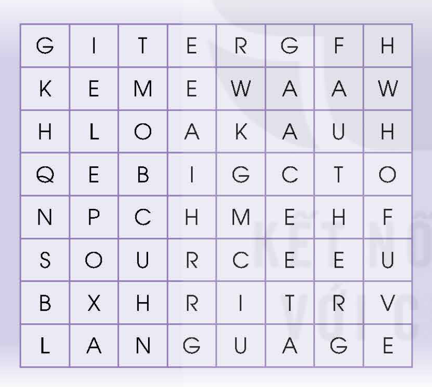
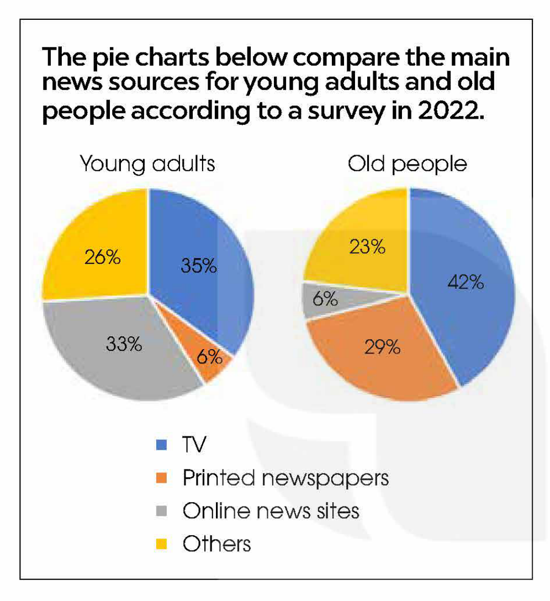
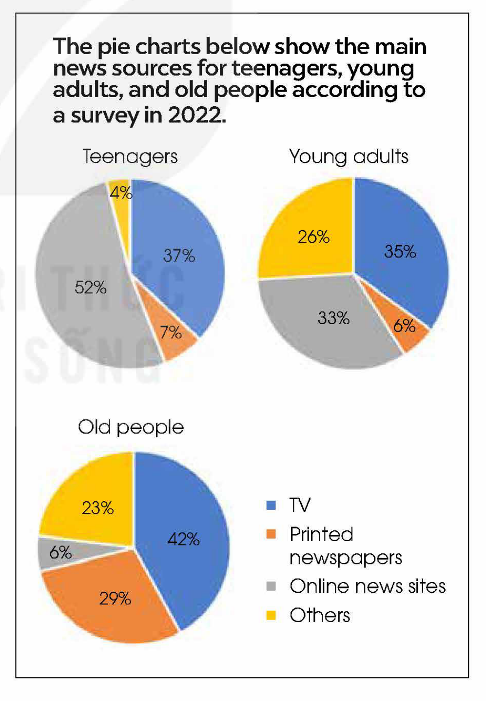
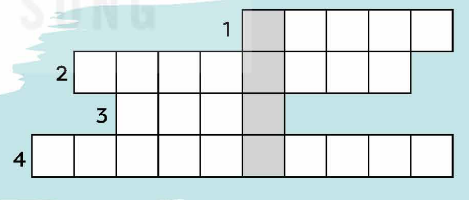

<!-- pdf:90 -->

# UNIT 7: THE WORLD OF MASS MEDIA

**This unit includes:**

- **LANGUAGE:**
  - **Pronunciation:** Linking /r/ between two vowels
  - **Vocabulary:** Words and phrases related to the mass media
  - **Grammar:** Adverbial clauses of manner and result
- **SKILLS:**
  - **Reading:** Reading for main ideas, specific information, and the writer's views in an article comparing digital media and traditional media
  - **Speaking:** Comparing different types of mass media
  - **Listening:** Listening for specific information and attitudes towards fake news on the Internet
  - **Writing:** Describing pie charts
- **COMMUNICATION AND CULTURE / CLIL:**
  - **Everyday English:** Making small talk
  - **Culture:** Mass media types around the world
- **PROJECT:**
  - Comparing two types of mass media

## I. GETTING STARTED

**Promoting a charity event**

**1. Listen and read.**

**Mark:** Hi, Mai. What's up? You look so worried!

**Mai:** I'm so stressed! The school charity club is planning a music show, and I'm in charge of the **publicity** for the event. But it's so difficult to think of ways to attract people's attention. There hasn't been much interest so far.

**Linda:** Why don't you **place** an **advert** in the local newspaper? Everybody reads it, and I'm sure an **advert** there can help draw attention to the event.

**Mai:** It'll be too expensive. I'm afraid we can't afford to promote the show as if it were a big **profit-making** event.

**Mark:** I see ... How about putting up posters in the area?

**Mai:** Well, they're not expensive, but there're so many of them that **viewers** may not pay enough attention to our poster.

**Mark:** How about the Internet?

**Mai:** You mean running commercials online? That will cost lots of money, too.

<!-- pdf:91 -->

**Mark:** Not necessarily. We can post information on social media sites, which is free and effective. In fact, they are such popular tools of communication nowadays that everybody uses them to advertise products and events, and connect with people.

**Mai:** I've thought of that, but I don't have a big social media **presence** like you do.
<!-- ocr-ok: đã đối chiếu ảnh trang gốc, OCR đọc nhầm have a big thành Sd bi -->

**Linda:** Well, perhaps you should consider all of our suggestions. First, I'll phone the local newspaper to see if they offer any **discounts** for charity advertising.

**Mark:** And I can help you promote the event on the Internet. Let's get together this afternoon to design some posters, too.
<!-- ocr-ok: đã đối chiếu ảnh trang gốc, OCR đọc nhầm together this afternoon to thành fogether this affernoon fo -->

**Mai:** Thanks so much! See you then.

**2. Read the conversation again and circle the correct answers.**

1. Advertising in the local newspaper is *cheap* / *expensive*, but it *will attract* / *won't attract* people's attention.
2. Posters are *expensive* / *not expensive*, but people *may* / *may not* notice them.
3. Posting information on social media sites is a very popular way of *promoting* / *selling* things.
4. *Linda* / *Mark* will help Mai with promoting the event on the Internet.

**3. Find words in 1 with the following meanings.**

| | Meaning |
| --- | --- |
| 1. p\_\_\_\_\_\_\_ | the activity of ensuring that somebody or something gets a lot of attention from lots of people |
| 2. v\_\_\_\_\_\_\_ | people who watch or look at something |
| 3. c\_\_\_\_\_\_\_ | advertisements on television, on the radio, or on a website |
| 4. p\_\_\_\_\_\_\_ | the ability to make a strong impression on other people |
<!-- ocr-ok: đã đối chiếu ảnh trang gốc, OCR lỗi khung chữ cách điệu cột trái và mục 4 -->
<!-- term: commercial -->

**4. Match the two clauses to make sentences used in 1.**

| Clauses (1–4) | Clauses (a–d) |
| --- | --- |
| 1. They can't afford to promote the show | a. that everybody uses them to advertise products and events, and connect with people. |
| 2. Mai doesn't have a big social media **presence** | b. as if it were a big **profit-making** event. |
| 3. There're so many posters | c. like Mark does. |
| 4. They are such popular tools of communication nowadays | d. that **viewers** may not pay enough attention to their poster. |
<!-- ocr-ok: đã đối chiếu ảnh trang gốc, OCR đọc trộn hai cột thẻ ghép nối -->

<!-- pdf:92 -->

## II. LANGUAGE

### Pronunciation

**Linking /r/ between two vowels**

**Remember!**

In natural and fast connected speech, a linking /r/ sound can appear between the vowel of one word ending in /ɑː/, /ɔː/, /ɜː/, /ə/, /ɪə/, /eə/, or /ʊə/ and the vowel of the next word.

**1. Listen and repeat. Pay attention to the linking /r/. Then practise saying the sentences in pairs.**

1. I'm sure‿an **advert** there can help draw‿attention to the event.
2. We can't afford to promote the show as if it were‿a big **profit-making** event.
3. Perhaps you should consider‿all of our suggestions.
4. I'll phone the local newspaper to see if they offer‿any **discounts** for charity advertising.

**2. Mark (‿) the places where the linking /r/ can appear. Listen and check. Then practise saying the sentences.**

1. I saw an interesting **advert** about the charity event.
2. Traditional **mass media**, for example, TV and newspapers, are still popular.
3. There are more **adverts** on TV nowadays.
4. There is a law against sharing private photos without permission.

### Vocabulary

**The mass media**

**1. Match each word (1–5) with its meaning (a–e).**

| Words (1–5) | Meanings (a–e) |
| --- | --- |
| 1. **reliable** (adj) | a. to add the most recent information to something |
| 2. **bias** (n) | b. newspapers and magazines |
| 3. **fake news** (n) | c. a strong feeling in favour of or against a group of people |
| 4. **the press** (n) | d. that is likely to be true or correct |
| 5. **update** (v) | e. reports or stories that are not true |
<!-- ocr-ok: đã đối chiếu ảnh trang gốc, OCR bỏ sót chữ nằm trên các thẻ hình ảnh minh hoạ -->

<!-- pdf:93 -->

**2. Complete the following text using the correct forms of the words in 1.**

Nowadays, information on the Internet is (1) \_\_\_\_\_\_\_ very quickly. The Internet has also changed (2) \_\_\_\_\_\_\_, and forced newspapers and magazines to move online. However, not all information on the Internet is (3) \_\_\_\_\_\_\_. Some information **sources** on the Internet may **spread** (4) \_\_\_\_\_\_\_, which confuses people. Others may contain strong (5) \_\_\_\_\_\_\_ against certain groups of people in society such as women or old people. Therefore, users should be careful when accessing information on the Internet.

### Grammar

**Adverbial clauses of manner and result**

**Remember!**

An adverbial clause is a dependent clause that functions as an adverb. There are different types of adverbial clauses.

- An adverbial clause of manner explains how something is done. It uses subordinating conjunctions such as *as*, *as if*, and *like*.
  *Example:* He's acting *as if he were my father*.
  *Note:* We use the subjunctive *were* with all pronouns after *as if*.
- An adverbial clause of result indicates the result of an action or a situation. It often uses subordinating conjunctions such as *so ... that* and *such ... that*.
  *Example:* The weather was *so* hot *that we couldn't sleep*.

**1. Combine the sentences using suitable adverbial clauses.**

1. My brother was looking at me nervously. I thought he was guilty of something.
   → My brother was looking at me nervously like \_\_\_\_\_\_\_.
2. There is so much information available online. People sometimes get confused.
   → There is so much information available online \_\_\_\_\_\_\_.
3. The injured reporter was talking in front of the camera. The pain didn't affect him at all.
   → The injured reporter was talking in front of the camera \_\_\_\_\_\_\_.
4. The Internet is a very powerful tool. As a result, it allows people to share information and ideas from around the world.
   → The Internet is such a powerful tool \_\_\_\_\_\_\_.

**2. Work in pairs. Talk about a type of mass media you use in your everyday life, using adverbial clauses of manner and result.**

*Example:*
*I like watching TV so much that I always have the TV on at home. There are so many interesting programmes to watch that it is sometimes impossible to watch them all. When I'm not home, I watch my favourite TV channels on my smartphone.*

<!-- pdf:94 -->

## III. READING

**Digital media vs. traditional media**

**1. Work in pairs. Read the first section of the article. Discuss the following questions.**

Do you think that digital media can replace traditional media? Why/Why not?

**2. Read the article. Match the highlighted words with their meanings.**

**DEBATE CORNER**

Digital media is any form of media that is created, viewed, and **distributed** via electronic devices. Examples of digital media include websites, social media, videos, video games, digital advertising, software, and electronic books. With the development of technology and smart devices in recent years, digital media saw a sharp rise. This raises the question of whether digital media will replace traditional media such as printed newspapers, **broadcast** TV, and radio. Below are two opinion pieces sent to our Debate Corner this week.
<!-- term: digital media -->

Nowadays, it is much easier and more convenient to access information via digital media. Most digital content is also freely **accessible**. All it takes is a few clicks, and you can read the latest news, watch videos, or see online **adverts**. In addition, digital media forms are more **interactive**. For example, customers can provide **instant** feedback, which can be used to solve any problems. In return, *almost every organisation can reach its target customers easily via digital media*. Furthermore, digital media is more flexible since information can be **updated** easily and frequently. **By contrast**, articles in printed newspapers or **adverts** on TV cannot be changed immediately. With more than 75 million social media users in Viet Nam and the number is increasing, it will not be long before traditional media becomes a thing of the past.

*Minh Quang*

Digital media is very convenient, but its strengths are also its own weaknesses. Since anyone with access to computers and the Internet can post or share information online, it raises the question of how **credible** it is. On the other hand, traditional media offers information from **reliable** **sources** that are **fact-checked**. Moreover, let us not forget that digital media relies on the Internet and smart devices to work well. There are still remote or disadvantaged areas in Viet Nam where access to technology is limited or too expensive. Many people also still struggle with technology. So although digital media is on the rise, traditional media such as printed newspapers, **broadcast** TV, and radio is **here to stay**.

*Pham Hoa*

| Words (1–4) | Meanings (a–d) |
| --- | --- |
| 1. **distributed** | a. that can be trusted or believed |
| 2. **accessible** | b. that allows information to be passed continuously and in both directions between different devices or users |
| 3. **interactive** | c. that can be reached, used, seen, etc. |
| 4. **credible** | d. given to a large number of people |
<!-- ocr-ok: đã đối chiếu ảnh trang gốc, OCR đọc trộn hai cột thẻ ghép nối -->

<!-- pdf:95 -->

**3. Read the article again. Write Q next to Quang's opinion, H next to Hoa's opinion, and N if it is not their opinion.**

1. Digital media will replace traditional media in our country soon. \_\_\_\_\_\_\_
2. Digital media will replace traditional media, but that won't be soon. \_\_\_\_\_\_\_
3. Traditional media will become more **accessible** in the future. \_\_\_\_\_\_\_
4. Both traditional and digital media will be in use in the future. \_\_\_\_\_\_\_
5. The future is uncertain for both traditional and digital media. \_\_\_\_\_\_\_

**4. Read the article again. Choose the correct answers.**

1. What are the three main reasons that Quang gives to support his view? *(Circle THREE correct choices)*
   - A. All digital media content is free to use.
   - B. Digital media can be accessed easily.
   - C. Information on digital media can be **updated** many times.
   - D. Users can interact with content and post opinions on digital media.
   - E. Customers are more flexible online.
2. Why does Quang mention the fact that many organisations can reach its customers via digital media?
   - A. To prove that advertisements on digital media are highly **accessible**.
   - B. To suggest that customers can interact well on digital media.
   - C. To show that digital media allows interaction between both sides.
   - D. To prove that digital media forms are easier to use than traditional ones.
3. What are the three main reasons that Hoa gives to support her view? *(Circle THREE correct choices)*
   - A. Information on digital media cannot always be trusted.
   - B. The government only supports the use of traditional media.
   - C. People in areas with limited access to technology still use traditional media.
   - D. Not everyone is comfortable with technology.
   - E. Traditional media forms are friendlier to users than digital ones.
4. Why does Hoa say '**here to stay**' in her opinion piece?
   - A. To show that digital media will only continue to be used in her country.
   - B. To confirm her opinion that traditional media has become a part of life and will continue to be popular.
   - C. To emphasise that printed newspapers can easily be sent to remote places.
   - D. To state her opinion that digital media is on the rise.

**5. Work in pairs. Discuss the following questions.**

After reading the article, who do you agree with, Hoa or Quang? Why?

<!-- pdf:96 -->

## IV. SPEAKING

**Types of mass media**

**1. Work in pairs. Discuss the different types of mass media. Make notes in the table below.**

| | **Cost of creating content and advertising on it** | **Presentation style** | **Audience and publicity** | **Reliable sources / credible content** |
| --- | --- | --- | --- | --- |
| **Television** | Very high | **Audio** and **visual** | Very large | Generally **reliable** / **credible** |
| **Printed newspapers** | | | | |
| **Leaflets and brochures** | | | | |
| **Emails** | | | | |
| **Social media** | | | | |

**2. Work in groups. Discuss the following situations and decide on the most suitable type of media to use in each situation. Provide reasons for your choice.**

1. Your school's music club is organising a small concert. You want to promote the event and expect an audience of 30–50 people.

*Example:*

**A:** I think we should write an event promotion email and send it to 100 people. I assume 30 per cent of them will show some interest.

**B:** Email is free of charge, but many people think email advertising or marketing is not **credible**. So I'm afraid they won't pay much attention to email messages.

**C:** How about promoting it on social media? We can choose several social networks and create an event page for each one.
...

2. Your school's social awareness club wants to raise awareness of cyberbullying among teenagers. You have some information and videos you want to share with as many students at your school as possible.
3. Your charity club is collecting books and winter clothes for children in disadvantaged areas. You want to inform as many people as possible about the activity.

**3. Report your answers to the whole class. Vote for the best idea for each situation.**

<!-- pdf:97 -->

## V. LISTENING

**Fake news on the Internet**

**1. Work in pairs. Find 3 words in the wordsearch to show things you should look at to decide whether a piece of news is fake or not.**

**2. Listen to three students talking about fake news. Match the speaker with his/her attitude towards fake news. There are TWO extra options.**

| Speakers | Attitudes |
| --- | --- |
| 1. Mai | A. He/She is worried about **fake news**. |
| 2. Nam | B. He/She is not worried about **fake news**. |
| 3. Mark | C. He/She doesn't care if it is **fake news**. |
| | D. He/She is ashamed of **spreading** **fake news**. |
| | E. He/She is annoyed by **fake news**. |

**3. Listen to the recording again and complete the notes below. Use no more than TWO words and/or numbers for each gap.**

**FAKE NEWS ON THE INTERNET**

**The rise of the Internet**

- Popular **source** of information around the world
- In Viet Nam (2022): more than (1) \_\_\_\_\_\_\_ Internet users or around (2) \_\_\_\_\_\_\_ of the population

**The problem with fake news on the Internet**

- Reason: easy to post any information on the Internet
- Problem: can promote ideas which can be harmful to people and can change their (3) \_\_\_\_\_\_\_

**Tips to avoid fake online news**

- Make sure that the websites are (4) \_\_\_\_\_\_\_
- Check if the story appears on other trusted sites
- Pay attention to the language, e.g. full of spelling and grammar mistakes and (5) \_\_\_\_\_\_\_

**4. Work in groups. Discuss these questions.**

How helpful do you find the tips in the talk? Have you used any of them?

## VI. WRITING

**Description of pie charts**

**1. Work in pairs. Study the pie charts on page 96 and choose the correct answer A or B.**

1. In general, which news **source** was very popular with both age groups?
   - A. Television.
   - B. Printed newspapers.
2. Which news **source** was least popular among young adults?
   - A. Printed newspapers.
   - B. Online news sites.
3. Which news **source** was least popular among old people?
   - A. Printed newspapers.
   - B. Online news sites.

<!-- pdf:98 -->

4. Printed newspapers were old people's \_\_\_\_\_\_\_ choice of news **source**.
   - A. top
   - B. second
5. Other **sources** of news were chosen by around \_\_\_\_\_\_\_ of the people in both age groups.
   - A. a quarter
   - B. half

**2. Complete the following descriptions of the charts in 1. Use the words and phrases in the box.**

| **as opposed to** | **meanwhile** | while | most popular |
| --- | --- | --- | --- |
<!-- ocr-ok: đã đối chiếu ảnh trang gốc, OCR đọc theo cột dọc của hộp từ -->

The pie charts compare the main news **sources** for young adults and old people according to a survey in 2022.

Overall, television was the (1) \_\_\_\_\_\_\_ **source** of news for both age groups. It was chosen by 42 per cent of old people, and more than one third of young adults. (2) \_\_\_\_\_\_\_, more young adults turned to the Internet for news. The figure was 33 per cent for young adults (3) \_\_\_\_\_\_\_ just 6 per cent for old people. **By contrast**, printed newspapers were the second choice of news **source** for old people with 29 per cent (4) \_\_\_\_\_\_\_ only 6 per cent of young adults reported getting their news from printed newspapers. In both age groups, around a quarter relied on other **sources** for news.

**Tips**

To describe pie charts, you should:

- introduce and describe the most outstanding feature of the pie charts, e.g.
  *The pie charts show information about / illustrate / compare ... Overall, ...*
- make comparisons, using comparatives and superlatives, e.g. *... was more ... than ... / was the most ...*
- compare data, using linking words at the beginning of the sentence, e.g. *similarly*, ***by contrast***, ***meanwhile***, at the beginning of a clause, e.g. *while*, *whereas*, or at the beginning of a noun phrase, e.g. *as compared with*, ***as opposed to***, *both*.

**3. Write a description (120–150 words) of the charts below. Use the model and tips in 2 to help you.**

<!-- pdf:99 -->

## VII. COMMUNICATION AND CULTURE / CLIL

### Everyday English

**Making small talk**

**1. Listen and complete the conversations with the expressions in the box. Then practise them in pairs.**

| A. How has your day been | B. It's a lovely day, isn't it | C. I like your shoes | D. I heard on the radio today that |
| --- | --- | --- | --- |

**1.**
**Julie:** \_\_\_\_\_\_\_ the flower festival is going to be held in our city.
**Mai:** Really? I love flowers. I went to a flower festival in Da Lat once. It was amazing!

**2.**
**Mai:** Hi, \_\_\_\_\_\_\_ so far?
**Mark:** I've been very busy! I'm working on promoting a charity event. It's a lot of work!
**Mai:** Sounds very stressful! Have you thought of inviting a famous celebrity?

**3.**
**Linda:** \_\_\_\_\_\_\_! They look very stylish. Where did you get them?
**Mai:** Thank you. I saw them advertised on a fashion website and bought them online. I'll send you the link.
**Linda:** That'd be great. Thanks.

**4.**
**Nam:** \_\_\_\_\_\_\_?
**Linda:** Yeah, it's so beautiful outside! Last week, the weather was awful.
**Nam:** I know, it was raining all the time. Have you got any plans for the weekend?

**2. Work in pairs. Use the models in 1 to make similar conversations for these situations. One of you is A, the other is B. Use the tips and expressions below to help you.**

1. A and B don't know each other. They are at a birthday party of a mutual friend. A starts a conversation with B. They make small talk and discover they are both interested in a career in the media industry.
2. A and B are both members of their school's Media Club. They are not close friends. They meet in the local park by chance. B starts a conversation with A. They make small talk and find out they are both in charge of promoting a school event.

**Remember!**

Small talk is an informal, polite conversation with strangers, classmates, or friends. People make small talk to get conversations started and get to know each other. Below are some good small talk topics:
<!-- term: small talk -->

- **The weather:**
  *What a beautiful day! Lovely day, don't you think? It's so hot today, isn't it? It looks like it's going to rain.*
- **Films, TV shows, popular music, and books:**
  *Have you watched ...? Have you heard (about) ...? Are you reading ...?*
- **Current events:**
  *Did you hear about ...? Did you catch the news today? I read in **the press** today that ... I heard on the radio today that ...*
- **The day or weekend:**
  *How was your day/weekend? Has anything exciting happened today? Are you doing anything fun after school/at the weekend?*
- **Observations:**
  *I like/love your (hat). Can I ask where you got it? Your (cakes) are delicious! Thanks for (making them for the party). Nice place, isn't it?*

<!-- pdf:100 -->

### Culture

**1. Read the following text and complete the table below.**

**MASS MEDIA AROUND THE WORLD**

There are different types of **mass media** and some work better than others in different situations. They could be as advanced as **digital billboards**, or as simple as public **loudspeakers**.

**Digital billboards**

Unlike a traditional billboard which can only show one printed image, a **digital billboard** can change between different messages. **Digital billboards** are also considered more attractive than traditional ones, and people are more likely to notice them. Moreover, they can also be **updated** in real time. Nowadays, **digital billboards** are common in many big cities around the world. It is hard to imagine places like Times Square in New York, Piccadilly Circus in London, or Shibuya in Tokyo without bright light **adverts**. Although they are growing in popularity, there have been concerns about their impact on the surrounding environment. Global light pollution is increasing each year. The constant light emitted by **digital billboards** often confuses birds, harms insects, and causes health problems in humans, too.

**Public loudspeakers**

In the past, public **loudspeakers** were used during the war to warn people of air attacks. Nowadays, they are still used in parts of Japan, the Philippines, and the US to alert people to natural disasters such as storms, earthquakes, and tornadoes. In Viet Nam, they are used to communicate important public announcements to residents. However, the noise from a city-wide **loudspeaker** system can be a problem to some people.

| | **Digital billboards** | **Public loudspeakers** |
| --- | --- | --- |
| **Uses and advantages** | | |
| **Problems** | | |
| **Countries where they are used** | | |
<!-- ocr-ok: đã đối chiếu ảnh trang gốc, OCR đọc trộn bảng với cột bên phải -->

**2. Work in pairs. Discuss the questions.**

How effective do you think these types of **mass media** are? Will they become more or less popular in the future? Why/Why not?

## VIII. LOOKING BACK

### Pronunciation

**Work in pairs and mark (‿) the places where the linking /r/ can appear. Listen and check. Then practise saying the sentences.**

1. Peter and I are discussing the news in the local press.
2. There is a huge poster on the wall advertising the public event.
3. The village is far away in the mountains, but the villagers have a fast Internet connection.
4. The singer is the focus of media attention.

### Vocabulary

**Solve the crossword with the words you've learnt in this unit. What is the hidden word?**

1. **Broadcast** TV, radio, and printed newspapers are typical examples of traditional mass \_\_\_\_\_\_\_.
2. We should only use information which comes from \_\_\_\_\_\_\_ **sources**.
3. The press report has strong \_\_\_\_\_\_\_ in favour of male consumers.
4. The Internet makes information easily \_\_\_\_\_\_\_ to everyone using a computer or a smart device.

<!-- pdf:101 -->

### Grammar

**Circle the mistake in each sentence. Then correct it.**

1. *The* (A) Internet has become *so* (B) a convenient tool *that* (C) people can't live *without it* (D).
2. My sister has never been *to* (A) Mexico, but she writes a blog *about* (B) it *on* (C) the Internet as *like* (D) she had spent a lot of time there.
3. There are *so* (A) many **adverts** (B) *in* (C) the local press *so* (D) I get really annoyed.
4. Today it *does* (A) not take much time for news to reach *people* (B) around the world *as if* (C) it *used to* (D) take in the past.

## PROJECT

**THE PROS AND CONS OF MASS MEDIA**

**Work in groups. Give a presentation to compare two types of mass media you are interested in. Use these questions as cues for your presentation.**
<!-- ocr-ok: đã đối chiếu ảnh trang gốc, OCR lỗi chữ trên nền màu cam -->

- What are the **mass media** types?
- How are they similar or different?
- What are the advantages and disadvantages of each type?
- Which of them do you think will be more popular in the future? Why?
<!-- ocr-ok: đã đối chiếu ảnh trang gốc, OCR bỏ sót chữ trên nền màu cam -->

**Now I can ...**

- identify and pronounce linking /r/ between two vowels.
- understand and use words and phrases related to the **mass media**.
- use adverbial clauses of manner and result correctly.
- read for main ideas, specific information, and the writer's views in an article comparing digital media and traditional media.
- compare different types of **mass media**.
- listen for specific information and attitudes towards **fake news**.
- describe pie charts.
- make small talk.
- learn about two types of **mass media** used around the world.
- prepare a comparison of two types of **mass media** and present it to the class.

## 📷 Danh sách hình trong bài

| Mã hình | Trang PDF | Trang sách | Chú thích / Mô tả |
| --- | --- | --- | --- |
| H12-tieng_anh-u07-01 | 97 | 95 | Bảng ô chữ tìm từ (wordsearch) gồm 8x8 chữ cái để tìm 3 từ chỉ yếu tố cần kiểm tra khi xác định tin giả |
| H12-tieng_anh-u07-02 | 98 | 96 | Hai biểu đồ tròn so sánh các nguồn tin tức chính của thanh niên (Young adults) và người cao tuổi (Old people) theo khảo sát năm 2022 |
| H12-tieng_anh-u07-03 | 98 | 96 | Ba biểu đồ tròn thể hiện các nguồn tin tức chính của thanh thiếu niên (Teenagers), thanh niên (Young adults) và người cao tuổi (Old people) theo khảo sát năm 2022 |
| H12-tieng_anh-u07-04 | 100 | 98 | Ô chữ gồm 4 hàng ngang và 1 cột dọc tô đậm tìm từ khoá ẩn về truyền thông đại chúng trong phần Looking Back |
