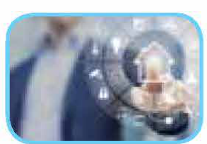
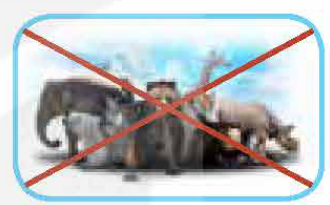

<!-- pdf:114 -->

# REVIEW 3

## I. LANGUAGE

### Pronunciation

**1. Mark the letter A, B, C, or D to indicate the word whose underlined part differs from the other three in pronunciation.**

1. - A. upd*a*te
   - B. reli*a*ble
   - C. activ*a*te
   - D. applic*a*tion
2. - A. mon*i*tor
   - B. recogn*i*tion
   - C. art*i*ficial
   - D. surv*i*ve
<!-- ocr-ok: đã đối chiếu ảnh trang gốc, OCR lỗi các chữ có dấu gạch chân trong câu 1 và 2 -->

**2. Mark the letter A, B, C, or D to indicate the word which differs from the other three in the position of the main stress.**

1. - A. rescue
   - B. release
   - C. survive
   - D. conserve
2. - A. robotic
   - B. suspicious
   - C. digital
   - D. endangered

**3. Listen and complete the sentences with the correct words. Then practise saying them in pairs.**

1. We often \_\_\_\_\_\_\_ some \_\_\_\_\_\_\_ turtles on the beach.
2. This is not the \_\_\_\_\_\_\_ way to \_\_\_\_\_\_\_ an email.
<!-- ocr-ok: đã đối chiếu ảnh trang gốc, câu 1 bị OCR đọc nhầm -->

**4. Mark (‿) the places where the linking /r/ can appear. Listen and check. Then practise saying the sentences in pairs.**

1. A number of nature reserves have been created to protect rare animals.
2. There is a new national park that I want to visit, but it is too far away from my city.

**5. Read the sentences and underline the parts where assimilation can occur. Focus on the highlighted parts. Listen and check. Then practise saying the sentences in pairs.**

1. My brother was *in Paris* to see an exhibition *on modern media*.
2. They *wrote many reports* on how *to protect pandas* in China.

### Vocabulary

**1. What are the missing letters? Complete the sentences using the pictures to help you.**
<!-- ocr-ok: đã đối chiếu ảnh trang gốc, dòng câu hỏi đầu tiên bị OCR bỏ sót -->

1. Interacting with a c\_\_\_\_\_\_\_ can be annoying as often it doesn't understand your questions.

2. The football match attracted a large number of TV vi\_\_\_\_\_\_\_.

3. In the last 50 years, the number of plant and animal species has decreased by more than a half, and more will become ex\_\_\_\_\_\_\_.

4. Fa\_\_\_\_\_\_\_ re\_\_\_\_\_\_\_ technology can quickly identify customers and improve banking security.
<!-- ocr-ok: đã đối chiếu ảnh trang gốc, OCR đọc nhầm Fa thành Fq và can thành cơn -->

**2. Mark the letter A, B, C, or D to indicate the word CLOSEST in meaning to the underlined word.**

1. With only around 70 individuals, the Javan rhino is one of the largest *endangered* mammals.
   - A. dangerous
   - B. threatened
   - C. risky
   - D. capable
2. The music festival has been widely reported in the local *press*.
   - A. social media
   - B. television sets
   - C. radio
   - D. newspapers

**3. Mark the letter A, B, C, or D to indicate the word OPPOSITE in meaning to the underlined word.**

1. Online articles published on government websites are *reliable* sources of information.
   - A. untrue
   - B. believable
   - C. useful
   - D. unlimited
2. Many people are unable to recognise *fake news* and share untrue information on social media.
   - A. dangerous stories
   - B. facts and figures
   - C. true stories
   - D. online reports

<!-- pdf:115 -->

**4. Mark the letter A, B, C, or D to indicate the correct answer.**

1. \_\_\_\_\_\_\_ sources are free from bias and based on strong evidence.
   - A. Credible
   - B. Popular
   - C. Accessible
   - D. Powerful
2. The saola, whose population is fewer than 250 mature individuals, is one of the world's \_\_\_\_\_\_\_ mammals and is only found in Viet Nam.
   - A. scariest
   - B. most natural
   - C. rarest
   - D. most threatening
3. The website is \_\_\_\_\_\_\_ with new information every day.
   - A. updated
   - B. protected
   - C. spread
   - D. interacted
4. AI-based \_\_\_\_\_\_\_ in education may pose a risk to students' privacy.
   - A. poaching
   - B. applications
   - C. chatbots
   - D. recognition
5. The new website for students will be good \_\_\_\_\_\_\_ for our school.
   - A. source
   - B. platform
   - C. function
   - D. publicity
6. Although some animal species are living in extreme weather conditions, they can still \_\_\_\_\_\_\_.
   - A. protect
   - B. survive
   - C. update
   - D. exploit
7. Robots are \_\_\_\_\_\_\_ to perform specific tasks such as cleaning rooms or moving heavy boxes.
   - A. conserved
   - B. threatened
   - C. rescued
   - D. programmed
8. Scientists \_\_\_\_\_\_\_ the data collected from their field trip to China.
   - A. carried out
   - B. analysed
   - C. preserved
   - D. protected

### Grammar

**1. Mark the letter A, B, C, or D to indicate the correct answer.**
<!-- ocr-ok: đã đối chiếu ảnh trang gốc, tiêu đề Grammar bị OCR bỏ sót -->

1. AI-based robots can do household chores \_\_\_\_\_\_\_ they were humans.
   - A. as if
   - B. although
   - C. because
   - D. than
2. What would you do \_\_\_\_\_\_\_ you suddenly became famous and received a lot of publicity?
   - A. if
   - B. like
   - C. so that
   - D. such that
3. To prepare for the graduation party, we had a technician \_\_\_\_\_\_\_ big screens on the walls.
   - A. installed
   - B. install
   - C. installing
   - D. installs
4. I'm writing a report on wildlife conservation and need to get all facts \_\_\_\_\_\_\_.
   - A. check
   - B. checking
   - C. to check
   - D. checked

**2. Mark the letter A, B, C, or D to indicate the sentence that best combines each pair of sentences.**

1. The computer technology has changed the world. No science has changed the world like that.
   - A. The computer technology has changed the world as if no science has done that.
   - B. No science has changed the world because the computer technology has done that.
   - C. The computer technology has changed the world so that no science has done that.
   - D. No science has changed the world like the computer technology has.
2. Poachers have killed so many tigers in the area. Therefore, the authorities are considering harsher punishments for illegal hunting.
   - A. Poachers have killed so many tigers in the area as the authorities are considering harsher punishments for illegal hunting.
   - B. Poachers have killed so many tigers in the area that the authorities are considering harsher punishments for illegal hunting.
   - C. Poachers have killed so many tigers, but the authorities are not considering harsher punishments for illegal hunting.
   - D. Although poachers have killed so many tigers, the authorities are not considering harsher punishments for illegal hunting.
3. The newspaper should have an online version. Otherwise, it won't attract many readers.
   - A. Unless the newspaper has an online version, it won't attract many readers.
   - B. If the newspaper should have an online version, it won't attract many readers.
   - C. The newspaper has an online version as if it won't attract many readers.
   - D. If the newspaper doesn't have an online version, it attracts many readers.
4. Alba is an advanced robot. She can talk and express emotions like humans.
   - A. Alba is an advanced robot, but she cannot talk and express emotions like humans.
   - B. Although Alba can talk and express emotions like humans, she is not an advanced robot.
   - C. Alba is such an advanced robot that she can talk and express emotions like humans.
   - D. Alba is so an advanced robot that she can talk and express emotions like humans.

<!-- pdf:116 -->

**3. Mark the letter A, B, C, or D to indicate the underlined part that needs correction in each of the following sentences.**

1. There are *enough* (A) many endangered *species* (B) in the region *that* (C) the local authority has decided *to* (D) create more protected areas.
2. The *cost* (A) of advertising on *the* (B) Internet is *equally* (C) low as *that* (D) of using printed brochures.
3. Visitors can safely *take* (A) photos *of* (B) wild animals in the park *unless* (C) they quietly *move* (D) around the area.
4. My manager *has* (A) decided *to have* (B) the company's computer software *update* (C) *at* (D) least once a month.
<!-- ocr-ok: đã đối chiếu ảnh trang gốc, các nhãn A B C D in dưới chân cụm gạch chân -->

## II. SKILLS

### Listening

**1. Listen and choose the factors that have affected the blue whale population. There is ONE extra option.**
<!-- ocr-ok: đã đối chiếu ảnh trang gốc, tiêu đề II SKILLS và Listening bị OCR đọc nhầm -->

- A. They were hunted for commercial purposes.
- B. They are hit by large ships.
- C. They are dangerous to humans.
- D. They eat pieces of plastic.
- E. They find it hard to find food in warming oceans.

**2. Listen again and choose the correct answer A, B, or C.**

1. How does Nam feel about the size of whales?
   - A. Impressed.
   - B. Concerned.
   - C. Annoyed.
2. Which of the following is NOT mentioned as the reason for the widespread whaling in the 1920s?
   - A. Advances in technology made whale hunting easier.
   - B. It became a profitable business.
   - C. It was impossible to build suitable habitats for blue whales.
3. According to the speaker, what is the current number of blue whales?
   - A. About 10,000.
   - B. No more than 25,000.
   - C. About 340,000.
4. Why are blue whales more likely to be hit by ships at night?
   - A. They can't see or hear well at night.
   - B. There is more plastic pollution at night.
   - C. They are looking for food near the water surface at night.

### Speaking

**1. Work in pairs. Match the threats facing blue whales with the solutions.**
<!-- ocr-ok: đã đối chiếu ảnh trang gốc, tiêu đề Speaking bị OCR bỏ sót -->

| **Threats** | **Solutions** |
| --- | --- |
| 1. Hunting whales for commercial purposes | a. Changing shipping routes away from their habitats |
| 2. Being hit by large ships | b. Imposing a total ban in all countries |
| 3. Plastic pollution | c. Slowing global warming down |
| 4. Climate change | d. Reducing plastic use |
<!-- ocr-ok: đã đối chiếu ảnh trang gốc, OCR gộp thứ tự cột trong bảng nối -->

**2. Work in groups. Discuss each solution above and think about what each individual can do to help save the blue whales. Then report to the class.**

<!-- pdf:117 -->

### Reading

**1. Read the article below. Match each section (A–C) with the heading (1–5). There are TWO extra headings.**
<!-- ocr-ok: đã đối chiếu ảnh trang gốc, tiêu đề Reading bị OCR bỏ sót -->

1. Writing articles automatically
2. Adding extra security to social media login
3. Changing the appearance of users
4. Suggesting more suitable programmes
5. AI in journalism
<!-- ocr-ok: đã đối chiếu ảnh trang gốc, các số thứ tự 1-5 bị OCR bỏ sót -->

**Artificial Intelligence in the mass media**

The mass media has undergone many changes over the last century. Artificial intelligence has also had an impact on the media. AI has become an important part of all forms of mass communication.

**A. \_\_\_\_\_\_\_\_\_\_\_\_\_\_\_**

Nowadays, people receive so much information from different sources that it is difficult to spot false stories. This is where AI can help. The advanced technology is able to classify types of information and recognise news that is not suitable for the public. Furthermore, AI can automatically change data into various forms such as online graphic organisers, images, and videos. This innovation is a breakthrough in journalism.

**B. \_\_\_\_\_\_\_\_\_\_\_\_\_\_\_**

Social media is popular all over the world, and more and more people are using platforms such as Facebook, Instagram, or Twitter. AI can make these platforms much safer and help the users avoid identity theft. A typical example is **facial recognition** software that allows us to increase the safety and security of our accounts. In many cases, social networking sites require personal information, which can be verified via facial recognition.

**C. \_\_\_\_\_\_\_\_\_\_\_\_\_\_\_**

Although television has been popular for a long time, it is now attracting larger audiences because of new features made possible by AI. TV viewers can watch programmes with higher picture quality and a lot of special effects. AI can also provide personalised recommendations to different users. The software can help TV viewers find channels or programmes based on their preferences, behaviour, and history.

**2. Read the article again. Choose the correct answer A, B, C, or D.**

1. The purpose of writing the article is \_\_\_\_\_\_\_ in the mass media.
   - A. to advertise AI
   - B. to introduce the benefits of AI
   - C. to help readers avoid using AI
   - D. to describe an AI robot
2. Which of the following benefits of AI in journalism is NOT mentioned?
   - A. AI can change data into various forms.
   - B. AI can help people avoid unsuitable information.
   - C. AI can help journalists express their opinions.
   - D. AI can identify whether the information is true or not.
3. Why does the author mention '**facial recognition**' in Section B?
   - A. To support an idea.
   - B. To illustrate a contrast.
   - C. To give a reason.
   - D. To give a description.
4. What can be inferred about television in Section C?
   - A. TV viewers can watch more live TV shows.
   - B. There are more special effects on live TV programmes.
   - C. It has not benefited from AI.
   - D. AI makes it easier for people to choose their favourite programmes.

### Writing

**Write an essay (180–200 words) about the benefits of using AI in creating content for the mass media and the problems caused by it. Select and combine information from Reading and the suggested ideas below.**
<!-- ocr-ok: đã đối chiếu ảnh trang gốc, tiêu đề Writing bị OCR bỏ sót -->

**Problems caused by AI in creating content for the mass media**

- Increasing costs of the mass media (high costs for developing, installing, and maintaining the software)
- Reducing people's creativity (automated content creation using AI tools)
- Replacing human's jobs in the mass media (AI's capability of reporting and writing)

## 📷 Danh sách hình trong bài

| Mã hình | Trang PDF | Trang sách | Chú thích / Mô tả |
| --- | --- | --- | --- |
| H12-tieng_anh-r03-01 | 114 | 112 | Hình minh hoạ người dùng đang tương tác với hộp trò chuyện tự động (chatbot) trên thiết bị thông minh |
| H12-tieng_anh-r03-02 | 114 | 112 | Hình minh hoạ những người xem truyền hình (TV viewers) đang theo dõi trận bóng đá trong phòng khách |
| H12-tieng_anh-r03-03 | 114 | 112 | Hình minh hoạ các loài động vật hoang dã có dấu gạch chéo đỏ thể hiện nguy cơ tuyệt chủng (extinct) |
| H12-tieng_anh-r03-04 | 114 | 112 | Hình minh hoạ công nghệ nhận diện khuôn mặt (facial recognition) quét gương mặt khách hàng trước thiết bị tự động |
