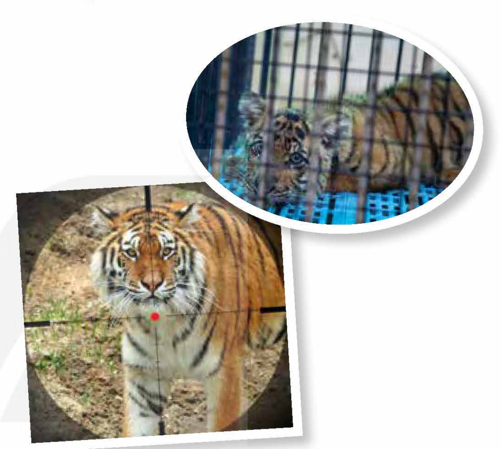
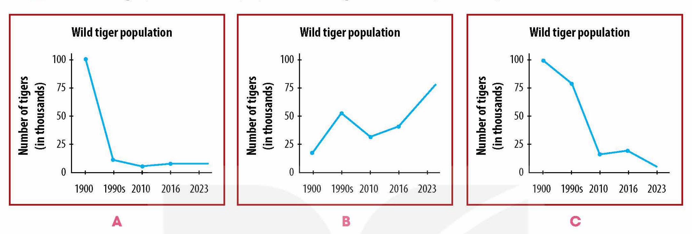

<!-- pdf:102 -->

# UNIT 8: WILDLIFE CONSERVATION

**This unit includes:**

- **LANGUAGE:**
  - **Pronunciation:** Assimilation
  - **Vocabulary:** Words related to **conserving** wildlife
  - **Grammar:** Adverbial clauses of condition and comparison
- **SKILLS:**
  - **Reading:** Reading for main ideas and specific information in news items about wildlife **conservation**
  - **Speaking:** Suggesting activities for a wildlife **conservation** event
  - **Listening:** Listening for main ideas and specific information in a talk about the threats facing tigers
  - **Writing:** Writing a problem-solving report on protecting tigers
- **COMMUNICATION AND CULTURE / CLIL:**
  - **Everyday English:** Expressing concern
  - **CLIL:** The International Union for Conservation of Nature (IUCN) Red List
- **PROJECT:**
  - Designing a poster about an **endangered** species

## I. GETTING STARTED

**At a rescue centre**

**1. Listen and read.**

**Ms Smith:** Welcome to the **Endangered** **Primate** Rescue Centre! If you have any questions during the tour, don't hesitate to ask me.

**Mark:** I've just seen a monkey in the **enclosure**. So are **primates** just monkeys, Ms Smith?

**Ms Smith:** No, **primates** are a group of **mammals** that includes not just monkeys, but also humans and apes.

**Mark:** What's the difference between apes and monkeys?

**Ms Smith:** Well, apes don't have tails and are larger than monkeys. Their brains are also larger. They're as good at using tools as they're at learning **sign language**.

**Mai:** So how many **primates** live here?

**Ms Smith:** The centre is home to more than 170 **primates** representing 14 species. They're **housed** in large **enclosures**.

**Mark:** I can hear some sounds. Is someone singing?

**Ms Smith:** We're close to the gibbons' **enclosure**, and the male and female gibbons are singing.

<!-- pdf:103 -->

Gibbons are the smallest of the apes, and all seven species are regarded as **threatened**. In fact, five of them are listed as **critically endangered**.

**Mai:** What is the main threat to gibbons?

**Ms Smith:** It's habitat loss due to deforestation and illegal hunting. Poachers make a big profit out of selling gibbons as pets and for making traditional medicine and food.

**Mai:** So we can help gibbons if we stop keeping them as pets.

**Ms Smith:** That's right. Now let me show you Derek, the gibbon we **rescued** last week. He was locked in a cage for two years as an illegal pet.

**Mai:** Oh no, he's so thin.

**Ms Smith:** Yes. Gibbons can become ill or weak unless they're fed the right type of food. After examining Derek, our veterinarian also found head injuries. So we'll give him a suitable diet and **monitor** him for several weeks before we **release** him into the national park.

**2. Read the conversation again and decide whether the statements are true (T) or false (F).**

| | T | F |
| --- | --- | --- |
| 1. Humans belong to the same group of **mammals** as apes and monkeys. | | |
| 2. Apes can learn **sign language** but can't use tools. | | |
| 3. Gibbons are **endangered** because they are the smallest of the apes. | | |
| 4. Derek's owner kept him in a cage and gave him the wrong type of food. | | |

**3. Match the words and phrases with their meanings.**

| Words and phrases | Meanings |
| --- | --- |
| 1. **threatened** species | a. to watch and check something carefully over a period of time |
| 2. **critically endangered** species | b. plants and animals that are in danger of disappearing |
| 3. **monitor** | c. to let someone go free after having kept them somewhere |
| 4. **release** | d. plants and animals that are likely to become endangered in the near future |
<!-- term: threatened species -->
<!-- term: critically endangered species -->

**4. Complete the following sentences using the information from 1.**

1. \_\_\_\_\_\_\_, don't hesitate to ask.
2. Apes are as good at using tools \_\_\_\_\_\_\_.
3. We can help gibbons \_\_\_\_\_\_\_.
4. \_\_\_\_\_\_\_ unless they're fed the right type of food.

<!-- pdf:104 -->

## II. LANGUAGE

### Pronunciation

**Assimilation**
<!-- ocr-ok: đã đối chiếu ảnh trang gốc, tiêu đề II LANGUAGE và Pronunciation bị OCR bỏ sót -->

**Remember!**

Assimilation is a process in which a sound is changed into another because of the influence of a neighbouring sound. Below are some typical cases of assimilation.

| **Sound ...** | **before ...** | **becomes ...** | **Examples** |
| --- | --- | --- | --- |
| /n/ | /p/, /b/, /m/ | /m/ | o*n p*urpose /ɒm ˈpɜːpəs/ i*n b*ed /ɪm ˈbed/ i*n M*ay /ɪm ˈmeɪ/ |
| /t/ | /p/, /b/, /m/ | /p/ | ho*t p*otato /ˈhɒp pəˈteɪtəʊ/ no*t b*ad /ˈnɒp ˈbæd/ tha*t m*an /ˈðæp ˈmæn/ |
| /d/ | /p/, /b/, /m/ | /b/ | ba*d p*enny /ˈbæb ˈpeni/ goo*d b*oy /ˈɡʊb ˈbɔɪ/ re*d m*eat /ˈreb ˈmiːt/ |
| /θ/ | /s/ | /s/ | ma*th s*olver /ˈmæs ˈsɒlvə/ |
<!-- ocr-ok: đã đối chiếu ảnh trang gốc, OCR lỗi kí hiệu phiên âm IPA trong bảng -->

**1. Listen and repeat the examples above. Pay attention to the highlighted sounds.**

**2. Listen and underline the parts where assimilation occurs. Then practise reading the sentences in pairs.**

1. Apes are larger than monkeys.
2. If fed properly, the bear will recover soon.
3. Both species benefit from living together.
4. Ten per cent of the world's population was infected by the virus.

### Vocabulary

**Conserving wildlife**

**1. Match the words with their meanings.**

| Words | Meanings |
| --- | --- |
| 1. **extinct** (adj) | a. to continue to live or exist, usually despite difficulty or danger |
| 2. **survive** (v) | b. the situation in which a person or animal is kept somewhere and is not allowed to leave |
| 3. **captivity** (n) | c. to protect the natural environment |
| 4. **conserve** (v) | d. when a particular type of plant or animal stops existing |
| 5. **rare** (adj) | e. not common or frequent; very unusual |

<!-- pdf:105 -->

**2. Complete the sentences using the words in 1.**

1. Wild animals need to live in their natural habitats in order to \_\_\_\_\_\_\_.
2. Many \_\_\_\_\_\_\_ animals are in urgent need of protection.
3. Scientists estimate that every day around 150 species become \_\_\_\_\_\_\_.
4. All the animals looked well after being **released** from \_\_\_\_\_\_\_.
5. A new law has been introduced to \_\_\_\_\_\_\_ wildlife in the area.

### Grammar

**Adverbial clauses of condition and comparison**
<!-- ocr-ok: đã đối chiếu ảnh trang gốc, tiêu đề Grammar và Remember! bị OCR bỏ sót -->

**Remember!**

- An adverbial clause of condition gives the potential outcome of a situation or condition, real or imagined. It uses subordinating conjunctions such as *if*, *provided that*, *until*, or *unless*.
  *Example:*
  What would you buy *if you won the lottery?*
  We can't **release** injured animals into the wild *unless they are treated and fully recovered.*
- An adverbial clause of comparison describes how something such as a skill, size, or amount compares to something else. It uses subordinating conjunctions such as *than*, *as ... as*, or *as*.
  *Example:*
  There are more **endangered** species today *than there were 50 years ago.*
  Gibbons are *as* famous for their beautiful singing *as they are for their swinging movements through the trees.*

**1. Combine the sentences using adverbial clauses of condition or comparison. Use the conjunctions in brackets and make any necessary changes.**

1. You must **release** the **sea turtle** into the sea. Otherwise, it will die soon. (if)
   → \_\_\_\_\_\_\_\_\_\_\_\_\_\_\_\_\_\_\_\_\_\_\_\_\_\_\_\_\_\_\_\_\_\_\_\_\_\_\_\_\_\_
2. Raising people's awareness is important to preserve wildlife. Imposing strict laws is also important. (as ... as)
   → \_\_\_\_\_\_\_\_\_\_\_\_\_\_\_\_\_\_\_\_\_\_\_\_\_\_\_\_\_\_\_\_\_\_\_\_\_\_\_\_\_\_
3. We must stop **poaching**. Otherwise, many **endangered** species will become **extinct**. (unless)
   → \_\_\_\_\_\_\_\_\_\_\_\_\_\_\_\_\_\_\_\_\_\_\_\_\_\_\_\_\_\_\_\_\_\_\_\_\_\_\_\_\_\_
4. A monkey is very intelligent. You may not think it is. (more ... than)
   → \_\_\_\_\_\_\_\_\_\_\_\_\_\_\_\_\_\_\_\_\_\_\_\_\_\_\_\_\_\_\_\_\_\_\_\_\_\_\_\_\_\_

**2. Work in pairs. Make sentences about endangered animals using adverbial clauses of condition or comparison.**

*Example:*
Punishment for hunting **endangered** animals is not *as* harsh *as it should be.*
*If we don't protect giant pandas,* they will soon become **extinct**.

<!-- pdf:106 -->

## III. READING

**Wildlife conservation news**

**1. Work in pairs. Discuss the following questions.**

Do you often read news stories about wildlife? If yes, what are they about?

**2. Read the news items and choose the most suitable headline for each one. There are TWO extra headlines.**

- A. Plans to help **coral** reefs recover
- B. **Sea turtle** protection efforts supported by hundreds of volunteers
- C. The effect of diving activities on **coral** reefs
- D. Wildlife art exhibition to raise public awareness and funds
- E. Young wildlife artists to hold exhibition of **vulnerable** species

**WILDLIFE CONSERVATION NEWS**
<!-- ocr-ok: đã đối chiếu ảnh trang gốc, chữ NEWS cách điệu bị OCR đọc nhầm thành BXMIAWVAS -->

**1. \_\_\_\_\_\_\_\_\_\_\_\_\_\_\_**

More than 600 volunteers participated in **sea turtle** **conservation** activities held on Con Dao Island last week. Volunteers made sure that their **spawning ground** is safe. They also **rescued** turtle eggs and buried them in the sand. **Sea turtles** are **threatened** with extinction worldwide, and their populations have decreased dramatically in many places. That is why **sea turtle** **conservation** programmes are organised annually around the world. They attract many volunteers and help raise public awareness about the threats to **sea turtle** species.

**2. \_\_\_\_\_\_\_\_\_\_\_\_\_\_\_**

Local authorities are taking measures to restore the **coral** reef ecosystem in Nha Trang Bay. They will organise regular clean-ups of the seabed and removal of **marine** **debris**. Diving clubs will also help by having their professional divers collect broken pieces of **coral**, re-grow them in underwater **nurseries**, and then re-attach them to reefs. **Coral** cover is expected to increase, which will help restore natural habitats and promote **marine** biodiversity in the bay. In addition, the bay's management board will also **monitor** the number of swimmers and divers to avoid putting too much stress on the ecosystem.

**3. \_\_\_\_\_\_\_\_\_\_\_\_\_\_\_**

An exhibition entitled 'Paint for wildlife' will be held in Ha Noi next week. It will include more than 30 paintings by secondary school students across the country. Visitors will also have the opportunity to meet the young artists and discuss the stories behind their beautiful paintings. All of them will be on sale to raise money for the protection of **endangered** and **vulnerable** species. The event organisers hope to raise public awareness of wildlife **conservation** through art and contribute to efforts to save **rare** and **endangered** animals.

<!-- pdf:107 -->

**3. Read the news items again and match the highlighted words and phrase with their meanings.**

| Words and phrase | Meanings |
| --- | --- |
| 1. **spawning ground** | a. easily harmed or hurt physically or mentally |
| 2. **debris** | b. places where young plants are grown for planting somewhere else |
| 3. **nurseries** | c. a place where **sea turtles** and other animals such as fish and frogs leave their eggs |
| 4. **marine** | d. related to the sea |
| 5. **vulnerable** | e. broken pieces of something larger |
<!-- ocr-ok: đã đối chiếu ảnh trang gốc, OCR đọc nhầm plants are thành plonss oi -->

**4. Read the news items again and choose the correct answer.**

1. Where is the **sea turtle** **spawning ground**?
   - A. Con Dao Island
   - B. Ha Noi
   - C. Khanh Hoa
   - D. Nha Trang
<!-- ocr-ok: đã đối chiếu ảnh trang gốc, OCR đọc nhầm spawning ground và Con Dao Island -->
2. Which of the following is NOT true about **sea turtles**?
   - A. Volunteers help **sea turtles** by burying them in the sand.
   - B. Their populations have gone down significantly.
   - C. They receive help from volunteers every year.
   - D. They are facing extinction all over the world.
3. Why did the management board of Nha Trang Bay have to **monitor** the number of divers and swimmers there?
   - A. To train more professional divers.
   - B. To restore the **coral** system.
   - C. To avoid putting pressure on the system.
   - D. To promote the natural habitat of the bay.
4. How many paintings will be on display in the wildlife exhibition?
   - A. Around 600.
   - B. Around 300.
   - C. Around 25.
   - D. Around 30.
5. What will happen to the paintings at the exhibition?
   - A. They will be donated to visitors.
   - B. They will be sold to raise money for wildlife **conservation**.
   - C. They will be shown in public places.
   - D. They will be given to different schools.

**5. Work in groups. Discuss the following questions.**

Which of the news items do you find most interesting or useful? Why?

## IV. SPEAKING

**Activities for conserving wildlife**

**1. Are the following activities good for conserving wildlife? Rank each activity in order of its importance to conserving wildlife.**

| **Activities** | **Ranking** |
| --- | --- |
| 1. Organising art or photography exhibitions of wildlife | |
| 2. Volunteering to help local wildlife | |
| 3. Avoiding activities, e.g. diving or swimming in the area that may harm the ecosystem | |
| 4. Inviting guest speakers to talk about wildlife **conservation** | |
| 5. Watching documentaries about wildlife | |
| 6. Raising funds for **endangered** species | |
| 7. Holding writing and speaking competitions about wildlife **conservation**, e.g. writing essays and debating | |
<!-- ocr-ok: đã đối chiếu ảnh trang gốc, OCR lỗi dòng 1 trong bảng -->

<!-- pdf:108 -->

**2. Work in groups. Read the notice. Then brainstorm a list of activities you want to organise for the event. Explain how the activities will help conserve wildlife. Use the list in 1 and the example below to help you.**

The school's Youth Union is celebrating the World Wildlife Day (3rd March) to raise young people's awareness of wildlife **conservation**. We are seeking ideas for interesting activities to be included in the event. Send us your ideas.

*Example:*

**A:** Today, we're discussing suitable activities for the World Wildlife Day. The aim is to raise students' awareness of wildlife **conservation**. Does anyone have any interesting ideas?

**B:** I think we should start the event with a wildlife painting competition.

**C:** I like your idea, but how will painting help **conserve** wildlife?

**B:** Well, ...

**3. Work in groups. Summarise your ideas and present the activities for the World Wildlife Day to the class. Vote for the best ideas.**

## V. LISTENING

**Endangered species**

**1. Work in pairs. Look at the pictures and discuss the following questions.**

What is happening to the tigers in the pictures? What can we do to protect the tigers?

**2. Choose the correct meanings of the underlined words and phrases.**

1. Natural habitats have been *degraded* (**degraded**) by human activity.
   - A. made worse in quality
   - B. made **endangered**
2. *Forest clearance* (**Forest clearance**) to meet other land needs can destroy the natural habitats of many species.
   - A. removing broken trees
   - B. cutting down trees and other plants
3. Reducing the *demand* for wild animal parts can help stop **poaching**.
   - A. the need or desire for particular goods
   - B. things that someone forces you to do
4. Animals *bred in captivity* (**captivity**) would probably not **survive** if they were **released** into the wild.
   - A. born while being kept in special facilities
   - B. born while living in the forest
<!-- term: demand -->
<!-- term: bred in captivity -->

<!-- pdf:109 -->

**3. Listen to a talk and choose the correct answer A, B, or C.**

1. What is the talk mainly about?
   - A. Threats facing tigers.
   - B. Ways to protect tigers.
   - C. The world's tiger population.
2. Which line graph shows the population of tigers over the past 100 years?

- **A:** Wild tiger population — Number of tigers (in thousands): 1900 (100) → 1990s (~10) → 2010 (~4) → 2016 (~5) → 2023 (~5)
- **B:** Wild tiger population — Number of tigers (in thousands): 1900 (~18) → 1990s (~52) → 2010 (~30) → 2016 (~40) → 2023 (~75)
- **C:** Wild tiger population — Number of tigers (in thousands): 1900 (100) → 1990s (~75) → 2010 (~18) → 2016 (~20) → 2023 (~4)
<!-- ocr-ok: đã đối chiếu ảnh trang gốc, văn bản nằm trong 3 biểu đồ đường H12-tieng_anh-u08-02 -->

3. As their habitats become smaller, tigers \_\_\_\_\_\_\_.
   - A. look for food in forests
   - B. enter farmers' houses
   - C. attack farm animals
4. What have the tiger breeding farms led to?
   - A. The creation of **conservation** centres.
   - B. An increase in **poaching**.
   - C. A decrease in the use of tiger parts.

**4. Listen to the talk again and complete the notes. Use ONE word or a number for each gap.**

| **TIGERS** | |
| --- | --- |
| **Estimated population in 2023** | There were about (1) \_\_\_\_\_\_\_ wild tigers left in the world. |
| **Threats facing tigers** | • Habitat loss: - Tigers' habitats have been (2) \_\_\_\_\_\_\_ or **degraded** by human activity. - Habitat loss forces tigers to (3) \_\_\_\_\_\_\_ in small, unnatural environments. • **Poaching** and illegal trade in tiger parts: - Tigers were **poached** for their (4) \_\_\_\_\_\_\_ used to make fur coats and home decorations. - Tigers are also **poached** for their bones, teeth, and other **body parts**, which are used to make traditional (5) \_\_\_\_\_\_\_. |

**5. Work in pairs. Discuss the following questions.**

Which threats are facing tigers in Viet Nam? Which one is the most serious?

<!-- pdf:110 -->

## VI. WRITING

**A problem-solving report on protecting tigers**
<!-- ocr-ok: đã đối chiếu ảnh trang gốc, tiêu đề WRITING bị OCR đọc nhầm thành Mi -->

**1. Work in pairs. Read the solutions and write the threats.**

| **Threats** | **Solutions** |
| --- | --- |
| 1. \_\_\_\_\_\_\_ | - Stopping deforestation - Restoring **degraded** habitats - Rebuilding or replacing habitats that have been lost |
| 2. \_\_\_\_\_\_\_ | Introducing stricter laws and harsher punishments to stop poachers from killing and selling tiger parts |
| 3. \_\_\_\_\_\_\_ | - Educating people about the importance of tiger **conservation** - Reducing demand for tiger parts |
<!-- ocr-ok: đã đối chiếu ảnh trang gốc, OCR đọc lỗi dòng Educating people about the importance of tiger conservation -->

**2. Read the announcement and write a problem-solving report. Use the ideas in 1 and the outline below to help you.**

The tiger is one of the most **endangered** animals in the world. The Wildlife Magazine is holding a writing competition to raise people's awareness about **conserving** tigers. Write a report (180–200 words) describing the threats facing tigers and suggesting possible solutions.

**To:** ...
**From:** ...
**Subject:** ...
**Date:** ...
**Introduction**
- *This report describes the threats ... and suggests some solutions to the problem.*
**Threats**
- *Research has shown that ...*
- *Another serious threat is ...*
**Solutions**
- *One solution is ...*
- *Second, it is important to ...*
- *In addition, we should ...*
**Conclusion**
- *In conclusion, there are ...*
- *Therefore, we recommend ...*

## VII. COMMUNICATION AND CULTURE / CLIL
<!-- ocr-ok: đã đối chiếu ảnh trang gốc, tiêu đề VII COMMUNICATION AND CULTURE / CLIL bị OCR đọc khuyết -->

### Everyday English

**Expressing concern**

**1. Listen and complete the conversations with the expressions in the box. Then practise them in pairs.**

| A. Has something happened? | B. Is there something wrong? | C. Is there anything I can do to help? | D. Do you feel better now? |
| --- | --- | --- | --- |

**1.**
**Nam:** Hi, Linda. Why didn't you come to Cuc Phuong National Park with us yesterday? We were worried about you. (1) \_\_\_\_\_\_\_
**Linda:** I had a stomachache, so I had to stay at home and rest.
**Nam:** Sorry to hear that. (2) \_\_\_\_\_\_\_
**Linda:** I'm fine now. Thanks for asking.

**2.**
**Mai:** You look worried. (3) \_\_\_\_\_\_\_
**Nam:** No, I'm just a bit nervous about my presentation on wildlife protection tomorrow.
**Mai:** (4) \_\_\_\_\_\_\_
**Nam:** If you could look at my slides, it would be great. Thanks so much in advance, Mai.

**2. Work in pairs. Use the models in 1 to make similar conversations for these situations. One of you is A, the other is B. Use the expressions on page 109 to help you.**

1. A looks worried because he/she hasn't collected enough information about **endangered** species for his/her biology project. B expresses concern about him/her.
2. B didn't join a school field trip to the **Endangered** Species Rescue Centre. A expresses concern about him/her.

<!-- pdf:111 -->

| **Useful expressions — Expressing concern** | |
| --- | --- |
| • Are you all right? / Are you OK? • How are things? / How are you getting on? • Is there anything I can do? | • What's the matter? / What's up? • You look a bit tired. Are you feeling all right? • You look worried/upset. Has something happened? / Is there something wrong? |

### CLIL

**1. Read the following text. Put a tick (✓) if the animals in the table are classified as endangered and a cross (✗) if they are not.**

**THE IUCN RED LIST**

The International Union for **Conservation** of Nature (IUCN) Red List divides species into seven levels of **conservation**: Least Concern, Near **Threatened**, **Vulnerable**, **Endangered**, **Critically Endangered**, **Extinct** in the Wild, and **Extinct**. It uses a set of precise criteria to evaluate extinction risks and decides which species need protection. An **endangered** species is one that meets any of the following criteria:

**Population reduction rate**

A species is classified as **endangered** when its population has declined between 50 and 70 per cent. This decline is measured over 10 years or longer.

**Geographic range**

Geographic range describes the area where a species is found. If the area that a species lives on, known as its area of occupancy, is estimated to be less than 500 square kilometres, then the species is classified as **endangered**.

**Population size**

A species is classified as **endangered** when there are fewer than 2,500 mature individuals. When a species population declines by at least 20 per cent or two generations within five years, it is also classified as **endangered**.

| **Animals** | **Endangered or not** |
| --- | --- |
| **Siberian sturgeon** - Rate of population decline: between 50 and 80 per cent over the past 60 years - Causes of decline: overfishing, **poaching**, and habitat loss | |
| **Ethiopian banana frog** - Location: in southern Ethiopia - Area of occupancy: less than 2,000 square kilometres | |
| **Snaggletooth shark** - Location: in the tropical, coastal waters of the Indian and Pacific Oceans - Area of occupancy: enormous, from southeast Africa to the Philippines and from China to Australia | |
| **Tahiti reed-warbler** - Location: only on the Pacific Island of Tahiti - Population: fewer than 1,000 individuals - Area of occupancy: around 420 square kilometres | |

**2. Work in groups. Name some endangered animals in Viet Nam. Share what you know about them.**

<!-- pdf:112 -->

## VIII. LOOKING BACK

### Pronunciation

**Underline the parts where assimilation occurs. Listen and check. Then practise saying these sentences in pairs.**

1. Have you been to the new **conservation** park in town?
2. Animals are brought to the park from different places.
3. My sister follows a special diet and doesn't eat red meat.
4. We got back home from a trip to the animal **rescue** centre.

### Vocabulary

**Choose the correct answers to complete these sentences.**
<!-- ocr-ok: đã đối chiếu ảnh trang gốc, tiêu đề Pronunciation, Vocabulary, Grammar bị OCR bỏ sót -->

1. To ***survive*** / ***rescue***, the young cubs should be **released** into the wild when they are aged eight to ten months.
2. Many volunteers are participating in a campaign to ***conserve*** / ***degrade*** the rainforests.
3. The animals looked so weak because they were kept in ***captivity*** / *extinction* for a long time.
4. Many species of animals are becoming ***extinct*** / *common* because of habitat loss.

### Grammar

**Choose the sentence that best combines each pair of the following sentences.**

1. People continue to buy clothes made of wild animal skins. This will encourage **poaching** and illegal trade in **body parts**.
   - A. If people continue to buy clothes made of wild animal skins, this will encourage **poaching** and illegal trade in **body parts**.
   - B. If **poaching** and illegal trade in **body parts** are encouraged, people will continue to buy clothes made of wild animal skins.
   - C. Unless people continue to buy clothes made of wild animal skins, this will encourage **poaching** and illegal trade in **body parts**.
   - D. Unless people are encouraged to **poach** and trade **body parts** illegally, they will continue to buy clothes made of wild animal skins.
2. Sharks are not dangerous. People think they are dangerous.
   - A. Sharks are as dangerous as people think.
   - B. Sharks are not as dangerous as people think.
   - C. Sharks are more dangerous than people think.
   - D. Sharks are thought to be more dangerous.
3. We should try our best to **conserve** wildlife in the area. Otherwise, many wild animals may not **survive**.
   - A. Unless many wild animals **survive**, we will try our best to **conserve** wildlife in the area.
   - B. If we try our best to **conserve** wildlife in the area, many wild animals may not **survive**.
   - C. Unless we try our best to **conserve** wildlife in the area, many wild animals may not **survive**.
   - D. If we do not try our best to **conserve** wildlife in the area, many wild animals may **survive**.
4. The baby gibbon grew very quickly. We didn't expect that.
   - A. The baby gibbon didn't grow quickly as we expected.
   - B. The baby gibbon grew as quickly as we expected.
   - C. The baby gibbon expected that it would grow quickly.
   - D. The baby gibbon grew more quickly than we expected.

<!-- pdf:113 -->

## PROJECT

**Protecting endangered species**

**Work in groups. Make a poster about an endangered species and suggest ways to protect it. Present your poster to the class. Use these questions as cues for your poster and presentation.**

- What is the species?
- What are the threats facing these animals?
- What IUCN level of **conservation** are they in?
- What should be done to protect them?

**Now I can ...**

- identify and use assimilation in connected speech to sound natural.
- understand and use words related to **conserving** wildlife.
- use adverbial clauses of condition and comparison correctly.
- read for main ideas and specific information in news items about wildlife **conservation**.
- suggest activities for a wildlife **conservation** event.
- listen for main ideas and specific information in a talk about the threats facing tigers.
- write a problem-solving report on protecting tigers.
- express concern.
- learn about the International Union for **Conservation** of Nature (IUCN) Red List.
- collect information about an **endangered** species and give a poster presentation.

## 📷 Danh sách hình trong bài

| Mã hình | Trang PDF | Trang sách | Chú thích / Mô tả |
| --- | --- | --- | --- |
| H12-tieng_anh-u08-01 | 108 | 106 | Hai bức ảnh minh hoạ các mối đe doạ đối với loài hổ: một con hổ con bị nuôi nhốt trong lồng sắt và một con hổ ngoài tự nhiên nằm trong tầm ngắm súng săn |
| H12-tieng_anh-u08-02 | 109 | 107 | Ba biểu đồ đường (A, B, C) biểu diễn sự thay đổi số lượng hổ hoang dã (Wild tiger population, tính theo đơn vị nghìn cá thể) qua các mốc năm 1900, 1990s, 2010, 2016 và 2023 |
