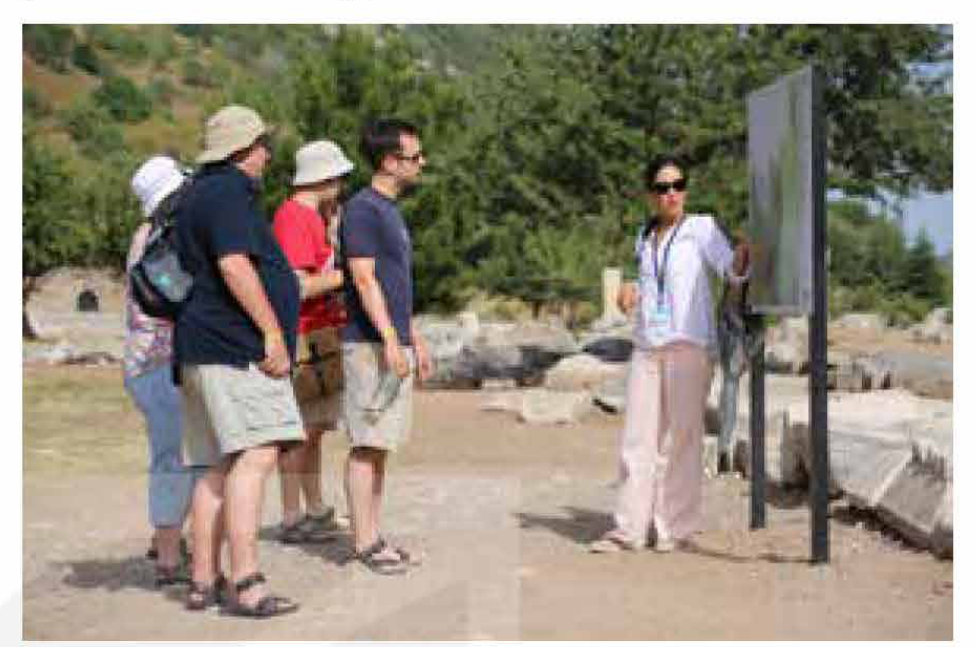

<!-- pdf:118 -->

# UNIT 9: CAREER PATHS
<!-- ocr-ok: đã đối chiếu ảnh trang gốc, số 9 của Unit 9 bị OCR bỏ sót -->

**This unit includes:**

- **LANGUAGE:**
  - **Pronunciation:** Sentence stress and rhythm
  - **Vocabulary:** Phrases related to choosing a career path
  - **Grammar:** Three-word phrasal verbs (consisting of a verb, an adverb, and a preposition)
- **SKILLS:**
  - **Reading:** Reading for main ideas and specific information in an article about things to consider when choosing a career path, and understanding text structure
  - **Speaking:** Talking about the things to consider when following different career paths
  - **Listening:** Listening for main ideas and specific information in a conversation about a career in teaching
  - **Writing:** Writing a **curriculum vitae** (**CV**)
- **COMMUNICATION AND CULTURE / CLIL:**
  - **Everyday English:** Asking for and giving clarification
  - **Culture:** **In-demand** careers for the future
- **PROJECT:**
  - Doing a survey on school-leavers' career plans

## I. GETTING STARTED

**Q&A with a career adviser**

**1. Listen and read.**

**Mr Kien:** ... So, I've talked to you about future job opportunities. I hope you'll continue to keep up with the rapid changes in the job market. Have you got any questions?

**Nam:** Yes, do you think we need to have a university degree to **pursue** a career?

**Mr Kien:** Well, it depends on the industry and the field of work that you're interested in. There're many jobs that don't require a university degree. For example, you may consider becoming a flight attendant, car mechanic, or repair worker.

**Nam:** But how do you get a job without a degree or any experience? Employers **look down on** job applicants without a university degree.

**Mr Kien:** No, they don't. You need to show that you're hard-working and willing to learn. Many companies hire school-leavers and provide on-the-job training.

**Mai:** So, when do you think we should start thinking about our careers?

**Mr Kien:** Well, the sooner, the better. However, the best time is when you start senior secondary school.

**Mai:** I read that AI will replace many workers in the future. How do I make sure that the job I choose won't be taken over by a robot?

**Mr Kien:** That's a good question. Many factory jobs and jobs in customer service have already become **automated**. As AI continues to develop, more human employees may be replaced. That's why it's important to choose jobs that involve a high level of human interaction, critical thinking, and decision-making.

<!-- pdf:119 -->

**Nam:** So, are these the most important job skills we'll need in the future?

**Mr Kien:** That's right! No matter what career you may consider, you'll need these skills. Good communication and teamwork will always be **in demand**. These **soft skills** will help you **adapt** to changes and come up with solutions to challenging problems.

**Nam:** Thank you very much for your answers.

**2. Read the conversation again. Decide whether the following statements are true (T) or false (F).**

| | T | F |
| --- | --- | --- |
| 1. According to Mr Kien, school-leavers need to have a university degree to start a career. | | |
| 2. Mr Kien mentions three jobs that you can do without a degree. | | |
| 3. Mr Kien encourages students to start thinking about their future careers when they leave school. | | |
| 4. Mr Kien advises students to develop **soft skills**, which will help them deal with difficult situations. | | |

**3. Find words and phrases in 1 with the following meanings.**

| | Meaning |
| --- | --- |
| 1. p\_\_\_\_\_\_\_ | to try to achieve something over a period of time |
| 2. a\_\_\_\_\_\_\_ | done by machines or computers |
| 3. i\_\_ d\_\_\_\_\_\_\_ | wanted by a lot of people |
| 4. s\_\_\_\_\_\_\_ s\_\_\_\_\_\_\_ | personal qualities that enable you to communicate well with other people |
| 5. a\_\_\_\_\_\_\_ | to change your behaviour in order to be more successful in a new situation |
<!-- ocr-ok: đã đối chiếu ảnh trang gốc, OCR lỗi cột trái khung chữ cách điệu -->

**4. Complete the text using phrasal verbs from the conversation in 1.**

The career adviser hopes that students will continue to (1) \_\_\_\_\_\_\_ the rapid changes in the job market. He assures Nam that employers don't (2) \_\_\_\_\_\_\_ people without a university degree. The adviser also tells students to develop **soft skills**, which can help them (3) \_\_\_\_\_\_\_ solutions to challenging problems in the workplace.

<!-- pdf:120 -->

## II. LANGUAGE

### Pronunciation

**Sentence stress and rhythm**
<!-- ocr-ok: đã đối chiếu ảnh trang gốc, tiêu đề II LANGUAGE, Pronunciation, Sentence stress and rhythm và Remember! bị OCR bỏ sót -->

**Remember!**

- Content words (e.g. main verbs, nouns, adjectives, and adverbs) are often stressed, while grammatical words (e.g. conjunctions, pronouns, prepositions, auxiliaries, and articles) are not.
- This combination of stressed and unstressed syllables produces the rhythm of spoken English.
- To sound natural and fluent, you should try to stress the correct words in your spoken sentences.

**1. Listen and repeat. Pay attention to the sentence stress and rhythm.**

1. It *depends* on the *industry* and the *field* of *work* that you're *interested* in.
2. There're *many* *jobs* that *don't* *require* a *university* *degree*.
3. These ***soft skills*** will *help* you ***adapt*** to *changes* and *come up* with *solutions* to *challenging* *problems*.

**2. Underline the stressed words in the sentences. Listen and check. Then practise saying the sentences with a natural rhythm.**

1. I'd like to apply for the **position** of Assistant Teacher.
2. We've received a lot of application letters.
3. We've chosen the best applicants to interview.
4. Successful applicants will start work in the new office.

### Vocabulary

**Choosing a career path**
<!-- ocr-ok: đã đối chiếu ảnh trang gốc, tiêu đề Vocabulary bị OCR bỏ sót -->

**1. Match the words/phrase (1–5) with the phrases (a–e) to make phrases with the meanings below.**

| Words/phrase (1–5) | Phrases (a–e) | Meanings |
| --- | --- | --- |
| 1. have | a. stressful situations | manage difficult situations |
| 2. develop | b. one's **passion** for | keep a very strong feeling of liking something |
| 3. deal with | c. an outgoing personality | like to talk to people |
| 4. gain | d. **soft skills** | build abilities to communicate with others and work well |
| 5. **pursue** | e. **work experience** | get experience of a particular job |
<!-- term: have an outgoing personality -->
<!-- term: deal with stressful situations -->

**2. Complete the sentences using the correct forms of the phrases in 1.**

1. She left her current job in order to \_\_\_\_\_\_\_ music.
2. I have earned some money and \_\_\_\_\_\_\_ from my previous part-time jobs.
3. If you \_\_\_\_\_\_\_, it will be an advantage when you apply for this job.
4. In addition to technical knowledge, you also need to \_\_\_\_\_\_\_ such as communication and teamwork skills.
5. Your working environment may not always be pleasant. Sometimes, you have to \_\_\_\_\_\_\_.

<!-- pdf:121 -->

### Grammar

**Three-word phrasal verbs**
<!-- ocr-ok: đã đối chiếu ảnh trang gốc, tiêu đề Grammar và Remember! bị OCR bỏ sót -->

**Remember!**

- In addition to two-word phrasal verbs, there are three-word phrasal verbs that usually consist of a verb, an adverb, and a preposition.
  Some three-word phrasal verbs may have an obvious meaning that we can guess from the parts, e.g. *walk away from*, *climb out through*.
  *Example:*
  The driver *walked away from* the burning car.
  The thief *climbed out through* the window.
  Many three-word phrasal verbs have an idiomatic meaning which is difficult to guess from their individual parts.

| Phrasal verb | Meaning |
| --- | --- |
| ***live up to*** | meet someone's expectations |
| ***cut down on*** | reduce |
| ***get on with*** | have a good relationship with |
| ***put up with*** | accept an unpleasant situation/person without complaining |
| ***go in for*** | have something as an interest or a hobby |
| *get through to* | contact somebody by phone |
| *look forward to* | expect something because you enjoy it |
| *keep up with* | learn about the current developments of |
| ... | ... |
<!-- term: get through to -->
<!-- term: look forward to -->

  *Example:*
  *She **gets on with** all the members of her team.*
  *I can't **put up with** his bad behaviour any longer.*
- Three-word phrasal verbs need an object, which always comes immediately after the preposition, and not in any other place.

**1. Match the verbs in 1–4 with the adverbs (a–d) and the prepositions in A–D to make complete sentences.**

| Verbs (1–4) | Adverbs (a–d) | Prepositions (A–D) |
| --- | --- | --- |
| 1. I have tried to contact the employment agency several times, but I haven't been able to get ... | a. up | A. ... to hearing from them. |
| 2. After graduating from a medical school, my father had to work very hard to keep ... | b. forward | B. ... on staff. |
| 3. I have sent them my **CV** and application letter. Now, I'm looking ... | c. down | C. ... to anyone. |
| 4. As the factory gets more **automated**, its management plans to **cut** ... | d. through | D. ... with medical knowledge. |
<!-- ocr-ok: đã đối chiếu ảnh trang gốc, OCR lỗi từ down thành Lil trong bảng nối -->

**2. Work in pairs. Make true sentences about the career path of someone you know, using three-word phrasal verbs.**

*Example:*
*My eldest sister is very good at English, and my parents wanted her to become a teacher of English. However, she didn't **live up to** my parents' expectations. Instead, she **went in for** a game design competition and became a game designer.*

<!-- pdf:122 -->

## III. READING

**Future career choices**

**1. Work in pairs. Discuss the following questions.**

1. What are your career plans?
2. What do you need to do to prepare your future career?

**2. Read the article. Circle the words or phrases with the closest meaning to the highlighted words or phrase.**

**Career experts' advice**

*Our Teen Talk magazine has recently received a lot of questions from secondary school students asking about things they should consider when choosing their careers. We've talked to our career experts, and here is their advice.*

**A. \_\_\_\_\_\_\_\_\_\_\_\_\_\_\_**

First, learn about yourself and discover your personality type, beliefs, **soft skills**, and interests. For example, if you are **passionate** about working with people and helping them develop, you may consider becoming **a social worker or a teacher**. If you are interested in learning languages, history, art, and architecture, you might look at jobs in the tourist industry. Spend time thinking about what you want to do, and list what you are good at. This can help you come up with a career path that matches your personality.

**B. \_\_\_\_\_\_\_\_\_\_\_\_\_\_\_**

Next, you should **take into account** any career qualifications you may need. Many jobs require formal education at a university or college. In order to work as a doctor, for example, you will need to study at medical school for some years of general medical training, followed by several years of **specialty** training. But there are also jobs that don't require any formal qualifications. You can be hired as a server or a barista in a coffee shop, for instance, and you will be given on-the-job training.

**C. \_\_\_\_\_\_\_\_\_\_\_\_\_\_\_**

You should also consider your chances of being hired. Some fields of work may offer very few **positions**. With technology developing at a fast pace, some jobs such as cashiers and travel agents may become **automated** or **obsolete**. **However**, other jobs are on the rise. Doctors, nurses, and pharmacists, for instance, are in great **demand** because of ageing populations and increased life expectancy. That is why before you make a decision, you should carefully examine the opportunities that a career path may provide.

1. **passionate**
   - A. having strong feelings of enthusiasm for something
   - B. showing happiness and excitement about something
2. **take into account**
   - A. describe
   - B. consider
3. **specialty**
   - A. the subject of study that someone knows a lot about
   - B. the typical food that a restaurant is famous for
4. barista
   - A. an owner of a coffee shop
   - B. a person who serves in a coffee shop
5. **obsolete**
   - A. updated
   - B. out of date
<!-- term: barista -->

<!-- pdf:123 -->

**3. Read the article again. Match each section (A–C) with a heading (1–4). There is ONE extra heading.**

1. Think about employment opportunities
2. Ask the career experts for advice
3. Follow your **passion** and interests
4. Understand education requirements

**4. Read the article again and choose the correct answer A, B, or C.**

1. How is the article organised?
   - A. Using a 'cause and effect' text structure.
   - B. Discussing similarities and differences.
   - C. Sorting information into themes and categories.
2. Why does the writer mention '**a social worker or a teacher**' in Section A?
   - A. To illustrate jobs related to working with and helping people.
   - B. To prove that it will be easy to get these jobs in the future.
   - C. To show that more and more people want to work as social workers and teachers.
3. Why does the writer include the server and barista jobs in Section B?
   - A. To compare these jobs with the jobs that need formal training.
   - B. To give an example of jobs that don't require formal training.
   - C. To give additional examples of jobs that need formal training.
4. The author uses '**However**' in Section C in order to \_\_\_\_\_\_\_.
   - A. explain why the jobs will become **obsolete**
   - B. show the consequences of increased life expectancy
   - C. introduce jobs that are **in demand**

**5. Work in pairs. Discuss the following questions.**

What kind of job do you prefer: a job that requires formal education or a job that does not? Why?

## IV. SPEAKING

**Discussion on different careers**
<!-- ocr-ok: đã đối chiếu ảnh trang gốc, tiêu đề IV SPEAKING bị OCR đọc nhầm thành 0 SPEACING -->

**1. Work in pairs. Use the given ideas to complete the information about the job of a tour guide.**

- A. attend part-time courses or complete an apprenticeship
- B. may only be employed in the high season
- C. be patient, confident, and able to deal with stressful situations
- D. good communication skills

To become a tour guide, you need to consider:

| | |
| --- | --- |
| **Personality and interests:** | • (1) \_\_\_\_\_\_\_ • be interested in culture, history, and architecture |
| **Skills and knowledge:** | • (2) \_\_\_\_\_\_\_ • knowledge of the local area: cultural, historical, and natural sites and events • knowledge of languages |
| **Education and training:** | • diploma in travel and tourism is useful, but a degree is not required • (3) \_\_\_\_\_\_\_ • learn on the job |
| **Employment opportunities:** | • (4) \_\_\_\_\_\_\_ • many tour guides are self-employed or combine tour guiding with another job • might be replaced by robots in the future |

<!-- pdf:124 -->

**2. Work in groups. Choose one of these jobs. Discuss and complete information about the job you choose.**

To become a teacher of English/police officer/doctor, you need to consider:

| | |
| --- | --- |
| **Personality and interests:** | • \_\_\_\_\_\_\_\_\_\_\_\_\_\_\_ • \_\_\_\_\_\_\_\_\_\_\_\_\_\_\_ |
| **Skills and knowledge:** | • \_\_\_\_\_\_\_\_\_\_\_\_\_\_\_ • \_\_\_\_\_\_\_\_\_\_\_\_\_\_\_ |
| **Education and training:** | • \_\_\_\_\_\_\_\_\_\_\_\_\_\_\_ • \_\_\_\_\_\_\_\_\_\_\_\_\_\_\_ |
| **Employment opportunities:** | • \_\_\_\_\_\_\_\_\_\_\_\_\_\_\_ • \_\_\_\_\_\_\_\_\_\_\_\_\_\_\_ |
<!-- ocr-ok: đã đối chiếu ảnh trang gốc, các dòng kẻ trống trong bảng bị OCR đọc thành dấu chấm -->

*Example:*

**A:** Let's talk about the job of a doctor. What do you think we need to consider before we **pursue** this career?

**B:** Well, I think a doctor's personality is very important. You must be very kind and care for patients. You must have a **passion** for helping people.

**C:** ...

**3. Work in groups. Compare the job in 1 with your chosen job in 2. Discuss the similarities and differences, and decide which job you prefer and why. Report your group's answers to the class.**

## V. LISTENING

**Preparation for employment**
<!-- ocr-ok: đã đối chiếu ảnh trang gốc, tiêu đề V LISTENING bị OCR bỏ sót -->

**1. Choose the correct meanings of the underlined words.**

1. I like science because it is a *fascinating* (**fascinating**) subject.
   - A. extremely interesting
   - B. completely boring
2. Lots of university students work as *tutors* (**tutors**) to help school children learn better.
   - A. teaching assistants
   - B. private teachers
3. People with a strong *character* (**character**) are honest, responsible, and confident.
   - A. a set of personal qualities that makes someone different from others
   - B. a main actor or actress in a film that you admire a lot
4. You need to send in your *CV* (**CV**) and an application letter in order to apply for this job.
   - A. a letter showing your academic achievements
   - B. a written record of your education and the jobs you have done

**2. Listen to a conversation between Mai Chi and her teacher, Ms Hoa. Put the information in the order you hear it.**

| Skills | Interests and hobbies | **Work experience** |
| --- | --- | --- |

- Education and qualifications
- (1) \_\_\_\_\_\_\_
- (2) \_\_\_\_\_\_\_
- (3) \_\_\_\_\_\_\_
- References
<!-- ocr-ok: đã đối chiếu ảnh trang gốc, các số (1) (2) (3) bị OCR đọc lỗi thành kí tự lạ -->

**3. Listen to the conversation again and choose the correct answer A, B, or C.**

1. What is the conversation about?
   - A. How to qualify to teach in a school.
   - B. How to get a job as a home **tutor**.
   - C. How to become a good teacher.
2. What do you need to do before starting a teacher training course?
   - A. Get some teaching experience in the classroom.
   - B. Get a degree in a related subject.
   - C. Earn a teaching certificate.
3. Which of the skills are NOT mentioned by Ms Hoa?
   - A. Good communication and teamwork skills.
   - B. Understanding people's feelings.
   - C. Tutoring skills.
4. Why does Ms Hoa think reading is an important habit for teachers?
   - A. It helps them learn new things.
   - B. It improves their communication skills.
   - C. It exercises the brain.
5. According to Ms Hoa, what does '**a reference**' mean?
   - A. An application letter that gives additional information about someone's abilities.
   - B. A person who agrees to provide information about a job applicant.
   - C. A record of the things someone has learnt and done.

**4. Work in groups. Discuss the following questions.**

Would you like to become a teacher? Why/Why not?

<!-- pdf:125 -->

## VI. WRITING

**Writing your CV**
<!-- ocr-ok: đã đối chiếu ảnh trang gốc, tiêu đề VI WRITING bị OCR đọc nhầm thành U0 weimng -->

**1. Work in pairs. Look at the following job advert and the CV of a student applying for the job. Match the headings in the box to the correct sections.**

1. Hobbies and interests
2. Education
3. **Work experience**
4. Skills
<!-- ocr-ok: đã đối chiếu ảnh trang gốc, OCR đọc nhầm Education thành Eduocion và Skills thành Sls -->

**TEACHING ASSISTANTS NEEDED**

- Do you have a **passion** for teaching children?
- Are you a good communicator?
- Are you interested in organising learning activities?
<!-- ocr-ok: đã đối chiếu ảnh trang gốc, OCR đọc khuyết dòng thứ 3 trong mẩu quảng cáo -->

We need 10 volunteer teaching assistants to help at a summer camp for primary school students. If this interests you, please send your **CV** to summercamp@webmail.com
<!-- ocr-ok: đã đối chiếu ảnh trang gốc, nội dung mẫu quảng cáo bị OCR đọc khuyết chữ -->

**CURRICULUM VITAE**

**Personal details**
Full name: Ha Ngoc Nguyen
Phone: 1112345
Email: ngocha@webmail.com

**Personal statement**
Enthusiastic and hard-working senior secondary school student, currently studying towards a school graduation diploma. **Passionate** about teaching and learning, with excellent organisation and communication skills. Eager to find a volunteer **position** to help me gain **work experience** and prepare for a career in teaching.

**A. \_\_\_\_\_\_\_\_\_\_\_\_\_\_\_**

| | |
| --- | --- |
| Nguyen Hue Senior Secondary School, Ha Noi | 20XX–present |
| Nguyen Trai Junior Secondary School, Ha Noi | 20XX–20XX |

Subjects and predicted grades: English – 9, Maths – 9.5, Literature – 8.5
Awards: Young Leaders Award, Ha Noi Outstanding Student Award
Extracurricular activities: Founding member of the school book club, conducting member surveys to choose reading materials and planning club meetings

**B. \_\_\_\_\_\_\_\_\_\_\_\_\_\_\_**

| | |
| --- | --- |
| **Childminder** | 20XX–present |

- Supervise two children (aged 7 and 9) every Saturday while parents are away
- Help children do their homework and learn new concepts

| | |
| --- | --- |
| Volunteer **Tutor** – Ha Noi Children's Village | Jul–Sep 20XX |

- Tutored children aged 8–12 in maths and English at the local orphanage for three months
- Helped teachers make learning materials

**C. \_\_\_\_\_\_\_\_\_\_\_\_\_\_\_**
Fluent English: IELTS score 5.5
Digital skills: Good understanding of common digital software and platforms, basic coding skills
Effective communication skills
Excellent organisation skills
<!-- ocr-ok: đã đối chiếu ảnh trang gốc, chữ IELTS bị OCR đọc nhầm thành [ELTS -->

**D. \_\_\_\_\_\_\_\_\_\_\_\_\_\_\_**
Singing, reading, photography

**References**
Available upon request

<!-- pdf:126 -->

**Remember!**

In your **CV**, you should include the following sections:

- **Personal details:**
  Provide your personal information such as full name, phone number, and email
- **Personal statement:**
  Provide a short summary about your personality, skills, and career goals.
- **Education:**
  Give information about your education and qualifications. List the core subjects and the grades you have received or expect to receive. You can also include any academic achievements, awards, or extracurricular activities.
- **Work experience:**
  Describe your **work experience**, especially the experience related to the job you are applying for. Include any voluntary work as well. Use bullet points to highlight your duties.
- **Skills:**
  List your strongest skills, especially the ones related to the job you are applying for.
- **Hobbies and interests:**
  This section is optional. However, if you don't have any notable **work experience**, your hobbies and interests will be a great way of showing a bit of your personality.
- **References:**
  Make sure you have at least two references who know you well and can describe your **character**, skills, and **work experience**. It's not always necessary to include their names and contact details in a **CV**, so making them available on request is fine.

**2. Look at the job advert in 1 again. Imagine that you also want to apply for the job. Write your own CV.**

## VII. COMMUNICATION AND CULTURE / CLIL

### Everyday English

**Asking for and giving clarification**
<!-- ocr-ok: đã đối chiếu ảnh trang gốc, tiêu đề Everyday English bị OCR bỏ sót -->

**1. Listen and complete the conversations with the expressions in the box. Then practise them in pairs.**

| A. Can you clarify | B. to put it another way | C. Could you explain it | D. in other words |
| --- | --- | --- | --- |

**1.**
**Mr Kien:** The job application process can be challenging, so you must start preparing yourself.
**Mai:** Mr Kien, I'm not sure I understand the process. (1) \_\_\_\_\_\_\_ for me, please?
**Mr Kien:** Well, (2) \_\_\_\_\_\_\_, it means the steps you must follow when you apply for a job. First, you find a job vacancy, get your **CV** ready, and send it with an application letter. When you hear from the recruiter, prepare for the job interview. If you're successful, you'll be offered the job.
**Mai:** I see. Thank you, Mr Kien.
**Mr Kien:** You're welcome.

**2.**
**Mark:** Mai, have you got references in your **CV**?
**Mai:** I'm still confused about this section. (3) \_\_\_\_\_\_\_ what it should include?
**Mark:** Well, it should include names of teachers, career advisors, or former employers, (4) \_\_\_\_\_\_\_, people who can provide useful information about you.
**Mai:** Oh, I understand now. Thank you.

<!-- pdf:127 -->

**2. Work in pairs. Use the models in 1 to make similar conversations for these situations. One of you is A, the other is B. Use the expressions below to help you.**

1. A is a Grade 12 student. B is a career adviser. B is explaining career path options. A is asking for clarification. B is giving clarification.
2. B is a new teaching assistant at a language centre. A has worked as a teaching assistant at the centre for several years. A is describing their job responsibilities. B is asking for clarification. A is giving clarification.

| **Asking for clarification** | **Giving clarification** |
| --- | --- |
| • I'm not sure I understand ... • Can you clarify ... for me? • Could you be more specific? • What do you mean by ...? • Sorry, I'm confused about ... Could you explain that again? | • In other words, ... • Let me clarify that. • To put it another way, ... • What I mean is ... • I'd like to explain that ... |

### Culture

**1. Read the text and answer the questions.**
<!-- ocr-ok: đã đối chiếu ảnh trang gốc, tiêu đề Culture bị OCR bỏ sót -->

**IN-DEMAND CAREERS FOR THE FUTURE**

Technology has brought a lot of changes to our lives. The introduction of new technologies and the growth of artificial intelligence have also created a lot of career opportunities. Here are some jobs that we'll be seeing more of in the coming years.

**Software developers and other coding careers**

Nowadays, coding – or the process of writing computer programs – is becoming a valuable skill that recruiters are looking for. A recent survey of tech workers and employers has found that the job of a software developer will be the most important tech job in the future. Not surprisingly, in many countries, coding has even been added to the primary school curriculum.

**Content creators**

Over the past few years, the demand for content creators – those creating content for digital channels – has increased dramatically. There are a lot of job opportunities for content creators in different industries such as media, IT, fashion, pop music, travel and food services. Companies need to communicate with their customers, so they will always need talented content creators to help them. As a result, content creation will continue to grow and will still be a career in the future.

**Data protection jobs**

Personal data should only be collected and used for specific purposes. However, personal data can also be misused or used illegally to commit offences. Therefore, the demand for data protection officers, who educate employees about data handling, and data detectives, who examine data and detect issues, will go up. There will be plenty of data privacy jobs for people with the right technical and legal skills.

The above-mentioned jobs are among the many **in-demand** jobs of the future. If you are really interested in any of them, try to spend some time exploring them, so you can prepare for your future career.

<!-- pdf:128 -->

**1. Read the text and answer the questions.**

Which job(s) involve(s) ...
1. stopping or detecting illegal actions?
2. helping businesses to understand their customers better?
3. a skill that some students can start learning from a young age?

**2. Work in pairs. Discuss the following questions.**

Which job do you find the most interesting and why? What other jobs do you think will become popular in the future?

## VIII. LOOKING BACK

### Pronunciation

**Underline the stressed words in the following sentences. Listen and check. Then practise saying the sentences with a natural rhythm.**

1. I saw a new job advert on the school noticeboard.
2. They're seeking a volunteer for their new project.
3. The heritage site wants to hire a tour guide with the relevant **work experience**.
4. My brother doesn't want to apply for a job that requires working with people.

### Vocabulary

**Complete the text. Use the correct words and phrases in the box.**
<!-- ocr-ok: đã đối chiếu ảnh trang gốc, tiêu đề Vocabulary và Grammar bị OCR bỏ sót -->

| **passion** | **soft skills** | **pursue** | **automated** | outgoing personality |
| --- | --- | --- | --- | --- |

The world of work is changing very fast. Most jobs require both technical and (1) \_\_\_\_\_\_\_. There are many employment opportunities for doctors, nurses, or software developers. Other jobs such as travel agents or cashiers may become (2) \_\_\_\_\_\_\_ or **obsolete**. More jobs will be replaced by robots. That's why it's important to choose and (3) \_\_\_\_\_\_\_ the right career path. To be successful and happy, you also need to have a(n) (4) \_\_\_\_\_\_\_ for your work and a(n) (5) \_\_\_\_\_\_\_.

### Grammar

**Choose the correct answer A, B, C, or D.**

1. It is important for Grade 12 students to keep \_\_\_\_\_\_\_ with the changes in the university entrance exams.
   - A. up
   - B. on
   - C. down
   - D. to
2. My father left his job because he couldn't **put** \_\_\_\_\_\_\_ **with** his colleagues' constant complaining.
   - A. on
   - B. up
   - C. along
   - D. through
3. The company is planning to **cut down** \_\_\_\_\_\_\_ staff to reduce costs.
   - A. in
   - B. along
   - C. on
   - D. at
4. Many teenagers find it difficult to **live** \_\_\_\_\_\_\_ **to** their parents' expectations.
   - A. in
   - B. on
   - C. back
   - D. up

<!-- pdf:129 -->

## PROJECT

**School-leavers' career plans**

**Work in groups. Ask questions to collect information from 8–10 classmates about their career plans.**

**Report your survey results to the class.**

**Survey questions**
<!-- ocr-ok: đã đối chiếu ảnh trang gốc, chữ Survey cách điệu bị OCR đọc nhầm thành Sunuey -->

1. What kind of career are you interested in? Why have you chosen it?
2. How does your career choice relate to your interests?
3. What kind of training do you need in order to **pursue** your chosen career path?
4. What skills do you need to develop to be successful?
5. Is your chosen career in high **demand**? Will there be many employment opportunities for you (in your area / in the country)?

**Now I can ...**

- use sentence stress appropriately to speak with a natural rhythm.
- understand and use phrases related to choosing a career path.
- use three-word phrasal verbs correctly.
- read for main ideas and specific information in an article about things to consider when choosing a career path, and understand text structure.
- talk about the things to consider when following different career paths.
- listen for main ideas and specific information in a conversation about a career in teaching.
- write a **curriculum vitae** (**CV**).
- ask for and give clarification.
- understand **in-demand** careers for the future.
- do a survey on school-leavers' career plans and report it to the class.

## 📷 Danh sách hình trong bài

| Mã hình | Trang PDF | Trang sách | Chú thích / Mô tả |
| --- | --- | --- | --- |
| H12-tieng_anh-u09-01 | 122 | 120 | Một nữ sinh trung học đang suy nghĩ về các lựa chọn nghề nghiệp tương lai (bác sĩ, nhân viên văn phòng, kĩ sư xây dựng, đầu bếp...) trong các bóng suy nghĩ trên bảng |
| H12-tieng_anh-u09-02 | 123 | 121 | Một nữ hướng dẫn viên du lịch đang thuyết minh trước bảng thông tin cho nhóm du khách tại khu di tích ngoài trời |
| H12-tieng_anh-u09-03 | 126 | 124 | Hình minh hoạ bàn làm việc với mẫu sơ yếu lí lịch (CV) đang được soạn thảo cùng điện thoại, máy tính bảng, kính mắt và phong bì thư |
