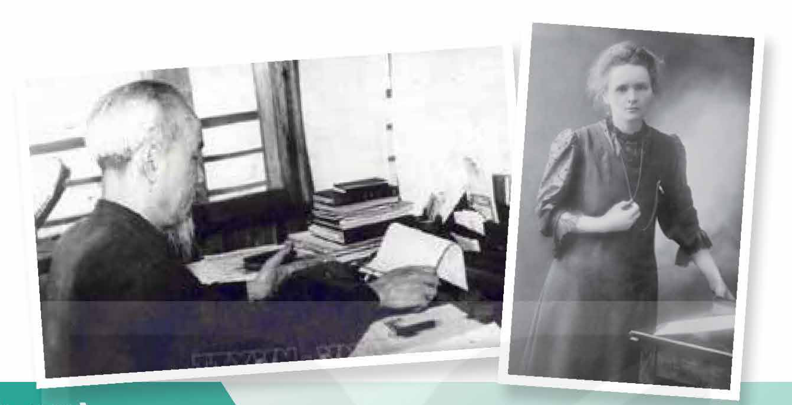
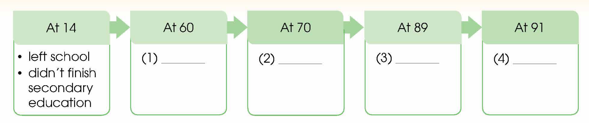
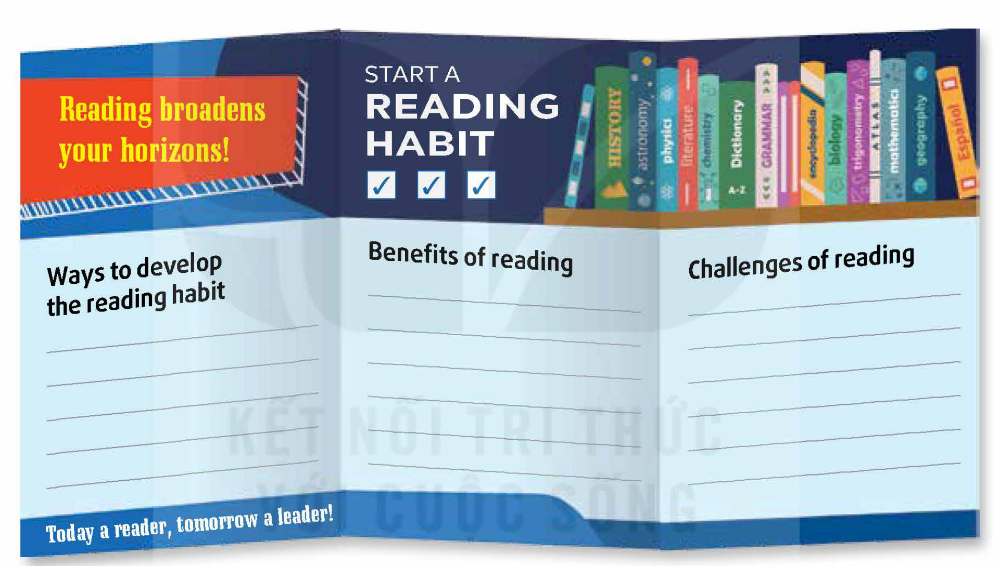

<!-- pdf:130 -->

# UNIT 10: LIFELONG LEARNING

**This unit includes:**

- **LANGUAGE:**
  - **Pronunciation:** Intonation in questions (revision)
  - **Vocabulary:** Phrases related to lifelong learning
  - **Grammar:** Reported speech: reporting orders, requests, offers, and advice
- **SKILLS:**
  - **Reading:** Reading for main ideas and specific information in a head teacher's message to school-leavers
  - **Speaking:** Talking about great role models for lifelong learning
  - **Listening:** Listening for main ideas and specific information in a talk about the challenges of lifelong learning
  - **Writing:** Synthesising and summarising information to write an article about the benefits and challenges of lifelong learning
- **COMMUNICATION AND CULTURE / CLIL:**
  - **Everyday English:** Thanking and accepting thanks
  - **Culture:** One of the oldest university graduates
- **PROJECT:**
  - Creating a leaflet about a lifelong learning habit
<!-- ocr-ok: đã đối chiếu ảnh trang gốc, OCR đọc nhầm to thành fo, thanks thành fhanks, graduates thành gradicros -->

## I. GETTING STARTED

**Learning for life**

**1. Listen and read.**

**Mark:** Hello, Grandma!

**Grandma:** Oh hi, Mark. I'm glad you're here! Can you help me increase the font size of this text on my laptop? It's too small for me to read.

**Mark:** Let me show you ... You need to press these two keys together ... See? It's easy, isn't it?

**Grandma:** It works! Everything's so easy to read now. Thanks, dear. I still have trouble using the laptop. You know, it's taken me so much time to learn computer skills.

**Mark:** That's fine, Grandma. My teacher says it's never too late to learn something new, especially new technology, because it's rapidly developing. Grandma, you've typed a lot of text! What are you working on?

<!-- pdf:131 -->

**Grandma:** Well, I'm writing a summary of a book I've read recently. You see, my doctor advised me to read every day to **boost** my memory. And I want to **brush up** on my French before I visit my friend in Paris.

**Mark:** You're amazing, Grandma! Learning languages can improve your thinking skills. Our language teacher has also asked us to try to **maintain** our language skills after leaving school. Do you know that you can use the Internet to learn a language or watch the news?
<!-- ocr-ok: đã đối chiếu ảnh trang gốc, OCR đọc nhầm try to thành fry fo, language thành longuage -->

**Grandma:** Really? This could help me stay **informed** about current events. Can you show me some news sites after I finish my book summary?

**Mark:** No problem, Grandma. But why do you have to type it?

**Grandma:** It's for the reading club I've just joined. The club leader encourages us to prepare our book reports and share them with all members in advance.

**Mark:** Are all club members your age?

**Grandma:** No, there're some young people as well. Are you interested in joining the next meeting?

**Mark:** Yes, I'd love to.

**Grandma:** OK, I'll put your name on the list of attendees then.

**2. Read the conversation again. Decide whether the following statements are true (T) or false (F).**

| | T | F |
| --- | --- | --- |
| 1. Mark's grandma is very good at using technology. | | |
| 2. Mark's grandma is working on a book summary for her reading club. | | |
| 3. After typing up her book report, Mark's grandma will learn how to make the text size bigger on her laptop. | | |
| 4. Mark wants to attend the next meeting of his grandma's reading club. | | |
<!-- ocr-ok: đã đối chiếu ảnh trang gốc, bảng chia hai cột trang nên OCR trộn thứ tự câu 1-2 và 3-4 -->

**3. Find words and phrase in 1 with the following meanings.**

| | Meaning |
| --- | --- |
| 1. b\_\_\_\_\_\_\_ | to make something become better |
| 2. b\_\_\_\_\_\_\_ u\_\_\_\_\_\_\_ (on) | to practise and quickly improve a skill or knowledge of something learnt in the past |
| 3. m\_\_\_\_\_\_\_ | to make something continue at the same level |
| 4. i\_\_\_\_\_\_\_ | having a lot of knowledge about something |
<!-- ocr-ok: đã đối chiếu ảnh trang gốc, OCR lỗi khung chữ cách điệu cột trái -->

**4. Match the beginnings with the endings to make complete sentences.**

| Beginnings | Endings |
| --- | --- |
| 1. The doctor of Mark's grandma advised her | a. to put his name on the list of attendees. |
| 2. Mark's language teacher has asked him | b. to read every day to boost her memory. |
| 3. The club leader encourages members | c. to try to maintain his language skills after leaving school. |
| 4. Mark's grandma offered | d. to prepare their book reports in advance. |
<!-- ocr-ok: đã đối chiếu ảnh trang gốc, OCR lỗi kí hiệu số và chữ cái trong vòng tròn -->

<!-- pdf:132 -->

## II. LANGUAGE

### Pronunciation

**Intonation in questions (revision)**
<!-- ocr-ok: đã đối chiếu ảnh trang gốc, tiêu đề màu cam bị OCR bỏ sót -->

**Remember!**

| **Question types** | **Intonation patterns** |
| --- | --- |
| *Yes/No* questions | ↗ (rising, at the end of the sentence) |
| *Wh*-questions | ↘ (falling, at the end of the sentence) |
| Choice questions | ↗ (rising on each choice before the word 'or'); ↘ (falling, at the end of the sentence) |
| Question tags | ↘ (falling on the question tag, when almost sure of the answer); ↗ (rising on the question tag, when not sure of the answer) |
<!-- ocr-ok: đã đối chiếu ảnh trang gốc, OCR không nhận diện được kí hiệu mũi tên ngữ điệu -->

**1. Listen and repeat. Pay attention to the intonation of the following questions.**

1. It's easy, isn't it? ↗
2. What are you working on? ↘
3. Are all club members your age? ↗
4. But why do you have to type it? ↘
5. Are you interested in joining the next meeting? ↗
<!-- ocr-ok: đã đối chiếu ảnh trang gốc, OCR không nhận diện được kí hiệu mũi tên ngữ điệu -->

**2. Mark the intonation in the following questions using ↗ (rising intonation) or ↘ (falling intonation). Then listen and check. Practise saying them in pairs.**
<!-- ocr-ok: đã đối chiếu ảnh trang gốc, OCR không nhận diện được kí hiệu mũi tên ngữ điệu -->

1. What does lifelong learning mean?
2. Do you have to pay for this online course?
3. Do students prefer online courses or face-to-face classes?
4. This is your book, isn't it? I saw your signature on the first page.

### Vocabulary

**Lifelong learning journey**

**1. Match the parts of the words to make words and phrases that mean the following.**
<!-- ocr-ok: đã đối chiếu ảnh trang gốc, OCR đọc nhầm parts thành paris -->

| Parts (1–5) | Parts & Meanings (a–e) |
| --- | --- |
| 1. **night** | a. **-rounded**: having a variety of experiences and a range of skills and interests |
| 2. **distance** | b. **education**: education for adults that is available outside schools and universities |
| 3. **well** | c. **school**: classes for adults, held in the evening |
| 4. **learning** | d. **learning**: a method of education in which people study at home and send their work to their teachers |
| 5. **adult** | e. **community**: a group of learners who share learning goals and often connect with one another |
<!-- ocr-ok: đã đối chiếu ảnh trang gốc, OCR tách rời 2 cột nối từ -->

**2. Complete the sentences using the words and phrases in 1.**

1. Lifelong learning can help you to become a \_\_\_\_\_\_\_ person.
2. Continuing education or \_\_\_\_\_\_\_ helps people keep their knowledge and skills up-to-date.
3. As my mother worked during the day, she went to \_\_\_\_\_\_\_ to get nursing qualifications.
4. Joining a \_\_\_\_\_\_\_ is a great way to meet people with similar interests.
5. Thanks to the power of the Internet, \_\_\_\_\_\_\_ or remote learning has become very popular.
<!-- ocr-ok: đã đối chiếu ảnh trang gốc, OCR đảo lộn thứ tự dòng khi có khoảng trống điền từ -->

<!-- pdf:133 -->

### Grammar

**Reported speech: reporting orders, requests, offers, and advice**

**Remember!**
<!-- ocr-ok: đã đối chiếu ảnh trang gốc, nhãn Grammar và Remember! bị OCR bỏ sót -->

- When we report orders, requests, offers, and advice, we can use a *to*-infinitive clause after the reporting verb. Reporting verbs include *ask, tell, advise, command, order, instruct, invite, encourage, persuade, remind, warn*, etc. Some verbs are followed by an object + *to*-infinitive clause.
- The verbs *say* and *tell* are the most common verbs in direct speech, but depending on the context and meaning, we can use different reporting verbs.
  *Example:*

| **Direct speech** | **Reported speech** |
| --- | --- |
| *'Sit down and stop interrupting the talk!' the club leader said/told Mark.* | *The club leader **told/ordered Mark to sit down and stop** interrupting the talk.* |
| *'Could you show me how to register for the course?' I asked my teacher.* | *I **asked my teacher to show** me how to register for the course.* |
| *'You should take up a sport to keep fit,' my fitness instructor said.* | *My fitness instructor **advised me to take up** a sport to keep fit.* |

- Some verbs, such as *offer, propose, agree*, and *demand*, can't be followed by an object before the *to*-infinitive clause.
  *Example:*

| **Direct speech** | **Reported speech** |
| --- | --- |
| *'I'll pay for your driving lessons,' my brother said.* | *My brother **offered to pay** for my driving lessons.* |
| *'OK, Mai, we'll pay for the online course,' Mai's parents said.* | *Mai's parents **agreed to pay** for the online course.* |

- Negative orders, requests, etc. are usually reported by *not + to*-infinitive.
  *Example:* *'Don't stay out late, Mark,' his mother said.*
  → *Mark's mother told/warned him not to stay out late.*
<!-- ocr-ok: đã đối chiếu ảnh trang gốc, OCR đọc nhầm to thành fo, take thành fake, out late thành ouf lofe -->

**1. Rewrite the sentences in reported speech, using the correct forms of the verbs in the box.**

| ask | offer | tell | advise |
| --- | --- | --- | --- |

1. 'Find more information about the course you want to apply,' my mother told me.
   → My mother \_\_\_\_\_\_\_.
2. 'Can you send me the list of available online courses?' my friend asked.
   → My friend \_\_\_\_\_\_\_.
3. 'I'll teach you how to use mobile applications,' my brother said.
   → My brother \_\_\_\_\_\_\_.
4. 'You shouldn't waste so much time on social media,' the head teacher said.
   → The head teacher \_\_\_\_\_\_\_.
<!-- ocr-ok: đã đối chiếu ảnh trang gốc, OCR đọc nhầm mũi tên đầu dòng và time thành fime -->

**2. Work in pairs. Talk about what people around you often say to encourage you to learn new things every day. Use reported speech to report their orders, requests, offers, and advice.**

*Example:*
*My parents asked me to read for an hour every day. They also advised me to join the school English club to improve my English. They encouraged me to start a learning journal. They told me to write down my thoughts about what I am studying in the journal.*

<!-- pdf:134 -->

## III. READING

**Head teacher's message to school-leavers**

**1. Work in pairs. Discuss the following questions.**

1. Have you ever thought of continuing learning after finishing your secondary education?
2. If yes, how will you continue your learning?

**2. Read a letter written by a head teacher to her students on the school website. Circle the phrases with the closest meaning to the highlighted words.**

Dear students,

In a few weeks' time, you'll complete your secondary education. Some of you may have already made plans for continuing your studies at university or vocational school, while others may wish to start working right away. Whatever choice you make, remember to keep on learning new knowledge and skills.

'Haven't we learnt enough in secondary school?', many may **wonder**. In fact, learning does not stop after graduation. It is a lifelong process. It involves creating and **maintaining** a positive attitude to learning for both professional and personal development. Lifelong learning is especially **relevant** in today's changing world. It allows you to adapt to changes in the modern workplace and **widens** your employment opportunities. It helps you make better, **informed** decisions and become a more **well-rounded** individual. In addition, it keeps your brain healthy and **boosts** your memory. Lifelong learning also helps you stay connected with modern ideas and meet new people as you participate in various forms of **adult education**.

'Does that mean I have to go to classes again?'. The answer is 'yes' and 'no'. *Yes*, because when you start working, you may decide to go to **night school** or enrol on a **distance learning** course to learn a skill or get a degree. The answer is also *No*, because lifelong learning happens all the time. As long as you are motivated, you can learn new knowledge and develop new skills anywhere. Uncle Ho is a great role model for lifelong learning. He never stopped learning throughout his life despite all the **hardships** and challenges. He learnt to speak different languages, including English, French, Russian, Italian, German, and Chinese mainly by himself. He even wrote poems in Chinese when he was **imprisoned** in China to keep his mind sharp. He took regular physical exercise, did traditional **martial arts**, and enjoyed activities such as swimming and mountain climbing throughout his life. We can all learn from Uncle Ho's lifelong efforts to improve himself.
<!-- term: keep one's mind sharp -->

Remember that learning is a lifelong journey. Enjoy every moment of it.

Mrs Le Minh Ngoc
Head teacher

1. **wonder**
   - A. to think about something and try to guess what is true or will happen
   - B. to walk slowly around an area without a clear purpose
<!-- ocr-ok: đã đối chiếu ảnh trang gốc, OCR đọc nhầm try thành fry và true thành frue -->

<!-- pdf:135 -->

2. **relevant**
   - A. relatively close
   - B. valuable and useful
3. **widens**
   - A. makes something larger in degree or range
   - B. makes something smaller in degree or range
4. **hardships**
   - A. large boats that are hard to operate
   - B. conditions of life that cause difficulty and suffering
5. **imprisoned**
   - A. released from a prison
   - B. put in a prison

**3. Read the letter again. Choose the correct answer A, B, C, or D.**

1. What is the main message of the letter?
   - A. Continue your studies at university or night school after leaving school.
   - B. Continue learning after leaving school to improve yourself and career.
   - C. Don't be afraid of the challenges of lifelong learning.
   - D. It's important to get a degree for your professional development.
2. Which of the following options is NOT mentioned as a choice for school-leavers?
   - A. Going to university.
   - B. Finding a job.
   - C. Going to a vocational school.
   - D. Volunteering abroad to learn languages.
3. Which of the following is NOT mentioned as a benefit of lifelong learning?
   - A. You have a better understanding of the world and can make good decisions.
   - B. It helps you to become successful in the present-day world.
   - C. It keeps your brain healthy and improves your memory.
   - D. It helps you stay connected with people and current ideas.
4. Why do some people choose distance learning according to the letter?
   - A. They may want to earn a degree, but still have a full-time job.
   - B. It is easier to enrol on a distance learning course.
   - C. There are many online courses to choose from.
   - D. It is the easiest way to stay connected with your friends from school.
5. Which of the following is NOT mentioned as an example of Uncle Ho's lifelong learning?
   - A. He regularly exercised, did traditional martial arts, and enjoyed outdoor activities.
   - B. He learnt to use different languages through self-study.
   - C. He regularly attended evening classes and joined a **learning community**.
   - D. He wrote poems in prison to keep his mind sharp.

**4. Work in pairs. Discuss the following questions.**

Imagine this letter is addressed to you. How would you reply to the head teacher? What would you say to her?

<!-- pdf:136 -->

## IV. SPEAKING

**Great role models for lifelong learning**

**1. Work in pairs. One of you is A, and the other is B. A reads the information card about Uncle Ho. B reads the information card about Marie Curie below.**

**Student A's card**

- **Uncle Ho as a lifelong learner:**
  - Managed to learn every day throughout his life *(e.g. by reading and writing until midnight after a working day)*
  - Learnt to speak French, English, Chinese, Italian, German, and Russian *(mainly through self-study, had an effective way to learn new words: writing them on pieces of paper or his arms and revising them throughout the day)*
  - Kept fit and healthy *(e.g. by doing exercise every day, doing traditional **martial arts**, and enjoying physical activities)*
- **Marie Curie as a lifelong learner:**
  - Managed to go to university \_\_\_\_\_\_\_
  - Spent a lot of time studying \_\_\_\_\_\_\_
  - Won prizes \_\_\_\_\_\_\_

**Student B's card**

- **Uncle Ho as a lifelong learner:**
  - Managed to learn every day throughout his life \_\_\_\_\_\_\_
  - Learnt to speak French, English, \_\_\_\_\_\_\_
  - Kept fit and healthy \_\_\_\_\_\_\_
- **Marie Curie as a lifelong learner:**
  - Managed to go to university *(because there were no universities accepting women in her country, Poland, she moved to France and studied physics and maths at the Sorbonne University)*
  - Spent a lot of time studying *(e.g. studied on her own while working as a **governess** or tutor, borrowed books from the library, registered for many different courses at university)*
  - Won prizes *(was the first woman to win a Nobel Prize, and the only woman to win a Nobel Prize twice, won a Nobel Prize in Physics in 1903 and another Nobel Prize in Chemistry in 1911)*
<!-- ocr-ok: đã đối chiếu ảnh trang gốc, Student B's card in ngược chiều trên trang sách -->

<!-- pdf:137 -->

**2. A talks about Uncle Ho as a lifelong learner. B listens and completes the notes. Then compare your notes.**

*Example:*
*Uncle Ho is a great role model for lifelong learning. He managed to learn every day throughout his life. He often learnt by reading and writing until midnight after a working day. ...*

**3. Switch roles. B talks about Marie Curie as a lifelong learner. A listens and completes the notes. Then compare your notes.**

*Example:*
*Marie Curie is a great role model for lifelong learning. She managed to go to university because in her country, Poland, women were not allowed to go to university to study. Marie moved to France and studied physics and maths in Sorbonne University. ...*

**4. Use your notes to talk about Uncle Ho or Marie Curie as great role models for lifelong learning. What can you learn from them? Present your talk to the class.**

## V. LISTENING

**Challenges of lifelong learning**

**1. Choose the correct meanings of the underlined words.**

1. Her job was difficult, but she didn't give up and showed great ***determination*** to succeed.
   - A. the desire to do something challenging without any support
   - B. the ability to continue trying to do something even when it is difficult
2. My mother managed to go to university despite many *obstacles*.
   - A. difficult situations
   - B. supporting conditions
<!-- term: obstacle -->
3. There were too many ***distractions*** at home, so I started going to the library to study.
   - A. things that you pay close attention to
   - B. things that stop you from paying attention to what you are doing
4. We tried to apply the knowledge we ***acquired*** from the course into practice.
   - A. gained
   - B. discussed
5. We need to work together in order to solve ***complex*** problems.
   - A. difficult to deal with
   - B. easy to deal with

**2. Listen to a talk about lifelong learning. Put the main ideas in the order you hear them.**

- a. You need money, time, and space to continue your pursuit of knowledge and skills.
- b. You need to have a strong motivation and determination to become a lifelong learner.
- c. Lifelong learning is effective only when you put what you've learnt into practice.

1. \_\_\_\_\_\_\_
2. \_\_\_\_\_\_\_
3. \_\_\_\_\_\_\_

**3. Listen to the talk again and complete the sentences. Use no more than THREE words for each gap.**

1. Lifelong learners are motivated to expand their \_\_\_\_\_\_\_ and develop new skills.
2. To become a lifelong learner, you need to be determined to \_\_\_\_\_\_\_.
3. Reading books and \_\_\_\_\_\_\_ are not enough for effective lifelong learning.
4. You must be able to use the new knowledge and skills to find a solution to a \_\_\_\_\_\_\_ or create something new.
5. Not having enough money, time, or space should not prevent you from continuing learning and becoming a \_\_\_\_\_\_\_ person.
<!-- ocr-ok: đã đối chiếu ảnh trang gốc, OCR đọc nhầm a ______ or create thành Ø_orcredgfe -->

**4. Work in groups. Discuss the following question.**

How do you think we can overcome these challenges and become lifelong learners?

<!-- pdf:138 -->

## VI. WRITING

**An article about the benefits and challenges of lifelong learning**

**1. Work in pairs. Complete the table about the benefits and challenges of lifelong learning. Use the ideas in Reading and Listening to help you.**

| **Benefits** | **Challenges** |
| --- | --- |
| • You have a better understanding of the world and can make good decisions. • (1) \_\_\_\_\_\_\_ • (2) \_\_\_\_\_\_\_ | • You need to have strong motivation and **determination** to become a lifelong learner. • (3) \_\_\_\_\_\_\_ • (4) \_\_\_\_\_\_\_ |
<!-- ocr-ok: đã đối chiếu ảnh trang gốc, OCR lỗi dòng kẻ điền từ trong bảng -->

**2. Write an article (180–200 words) about the benefits and challenges of lifelong learning. Use the ideas in 1 and the outline below to help you.**

**Benefits and Challenges of Lifelong Learning**

Lifelong learning is self-motivated learning that is focused on both personal and professional development. This type of learning is essential in today's rapidly changing world. It brings many benefits as it helps us understand the world around us and provides us with better opportunities. Lifelong learners can also face challenges. So, what are these benefits and challenges?
<!-- term: self-motivated learning -->

Let's start with the benefits. \_\_\_\_\_\_\_

What about the challenges? \_\_\_\_\_\_\_

In conclusion, lifelong learning has many benefits, but it can also be challenging. In my opinion, \_\_\_\_\_\_\_

## VII. COMMUNICATION AND CULTURE / CLIL

### Everyday English

**Thanking and accepting thanks**

**1. Listen and complete the conversations with the expressions in the box. Then practise them in pairs.**

| A. Don't mention it | B. I really appreciate it | C. It's my pleasure | D. Thank you for inviting |
| --- | --- | --- | --- |

**1.**
**Ms Lan:** Mai, the information about the online courses is very useful. Thank you for presenting it. (1) \_\_\_\_\_\_\_.
**Mai:** (2) \_\_\_\_\_\_\_, Ms Lan. I'm glad you found it useful.

**2.**
**Nam:** Mark, I like the activities of the science club very much. (3) \_\_\_\_\_\_\_ me to join the club.
**Mark:** (4) \_\_\_\_\_\_\_. Glad to help.

<!-- pdf:139 -->

**2. Work in pairs. Use the models in 1 to make similar conversations for these situations. One of you is A, the other is B. Use the expressions below to help you.**

1. A attends a cooking class taught by B. A thanks B for teaching her/him to cook a traditional dish. B replies by accepting thanks.
2. A and B are friends. B thanks A for sharing information about an app for learning English. A replies by accepting thanks.

**Useful expressions**

| **Thanking** | **Accepting thanks** |
| --- | --- |
| **Formal** • I can't thank you enough for ... • I'm really/so grateful for ... • I really appreciate it. | **Formal** • You're welcome. • It's my pleasure. • My pleasure. |
| **Informal** • Thank you/Thanks for ... • Many thanks! • Thanks a million! | **Informal** • No problem. • Don't mention it. • Glad to help. |
<!-- ocr-ok: đã đối chiếu ảnh trang gốc, OCR đọc nhầm dấu chấm đầu dòng trong bảng Useful expressions -->

### Culture

**1. Read the text and complete the diagram with information from the text.**

**One of the oldest university graduates**

Bertie Gladwin became one of Britain's oldest graduates after receiving his Master's degree in **intelligence** history from the University of Buckingham at 91. He started his degree at the age of 89 together with his wife, who was then aged 77. 'I feel very satisfied to think that I've done an MA at my age,' he said at the time. 'When you're 90, you sit around and not a lot happens, so it's important to carry on learning and to **broaden** your horizons.'
<!-- term: broaden your horizons -->

Gladwin left school at the age of 14 and never finished his secondary education or went to university. But he still found a satisfying job. When Gladwin retired, he became less active and thought getting back into learning would delay the negative symptoms of old age. He wanted to keep his brain active and learn more about something that had always interested him. Then at the age of 60, he earned a BA in **Psychology**. By the time he was 70, he had also completed a BSc in **Molecular Biology**. 'They're fascinating subjects,' he said. 'I did them just because I was interested in them and wanted to know more about them.'

- **At 14:** left school; didn't finish secondary education
- **At 60:** (1) \_\_\_\_\_\_\_
- **At 70:** (2) \_\_\_\_\_\_\_
- **At 89:** (3) \_\_\_\_\_\_\_
- **At 91:** (4) \_\_\_\_\_\_\_
<!-- ocr-ok: đã đối chiếu ảnh trang gốc, văn bản nằm trong sơ đồ H12-tieng_anh-u10-02 -->

**2. Work in groups. Share stories of people you know who keep learning despite their old age.**

<!-- pdf:140 -->

## VIII. LOOKING BACK

### Pronunciation

**Mark the intonation in the following questions. Then listen and check. Practise saying them in pairs.**

1. When was the last meeting of your reading club?
2. Is lifelong learning important for career development?
3. You don't attend **night school** classes, do you? I've never seen you before.
4. Is the course held on weekdays or at the weekend?

### Vocabulary

**Complete the text. Use the correct forms of the words and phrases in the box.**

| **learning community** | **well-rounded** | **relevant** | **adult education** | **distance learning** |
| --- | --- | --- | --- | --- |

Lifelong learning is especially (1) \_\_\_\_\_\_\_ in today's fast changing world. There are many ways to engage in lifelong learning. First, you can attend courses at (2) \_\_\_\_\_\_\_ institutions. Second, you can also take remote or (3) \_\_\_\_\_\_\_ courses with the help of technology. Third, you can join a (4) \_\_\_\_\_\_\_ of people who share common learning goals. And, finally, you can learn by reading widely and researching topics. This will help you become (5) \_\_\_\_\_\_\_ and prepare you to face future challenges.
<!-- ocr-ok: đã đối chiếu ảnh trang gốc, OCR đọc nhầm (5) thành (6) -->

### Grammar

**Choose the sentence that has the closest meaning to the given sentence.**

1. 'You should continue learning after leaving school,' my grandfather said.
   - A. My grandfather advised me to continue learning after leaving school.
   - B. I advised my grandfather to continue learning after leaving school.
   - C. My grandfather didn't want me to continue learning after leaving school.
   - D. I didn't want my grandfather to continue learning after leaving school.
2. 'I'll help you register for the course,' my sister said.
   - A. My sister forced me to register for her course.
   - B. My sister offered to help me register for the course.
   - C. I wanted to help my sister register for the course.
   - D. I wanted my sister to register for the course.
3. 'Can you show me how to download this video?' my mother asked.
   - A. I asked my mother to show me how to download that video.
   - B. I showed my mother how to download that video.
   - C. My mother asked me to show her how to download that video.
   - D. My mother showed me how to download that video.
4. 'Don't enter your sister's room. She is studying,' my father told me.
   - A. My sister ordered me not to enter her room because she was studying.
   - B. My sister ordered my father not to enter her room because she was studying.
   - C. I ordered my father not to enter my sister's room because she was studying.
   - D. My father ordered me not to enter my sister's room because she was studying.

<!-- pdf:141 -->

## PROJECT

**A leaflet about a lifelong learning habit**

**Work in groups. Do some research and choose a lifelong learning habit such as reading, self-education, taking courses or having a variety of hobbies. Create a leaflet about the habit and share it with the class.**

**Use these questions as cues.**

- What does the lifelong learning habit involve?
- How can this habit be developed?
- What are the benefits of this habit?
- Does this habit present any challenges?

**START A READING HABIT**

- Reading **broadens** your horizons!
- **Ways to develop the reading habit:** \_\_\_\_\_\_\_
- **Benefits of reading:** \_\_\_\_\_\_\_
- **Challenges of reading:** \_\_\_\_\_\_\_
- Today a reader, tomorrow a leader!
<!-- ocr-ok: đã đối chiếu ảnh trang gốc, văn bản nằm trong hình tờ rơi H12-tieng_anh-u10-03 -->

**Now I can ...**

- use appropriate rising and falling intonation in questions.
- understand and use phrases related to lifelong learning.
- use reported speech to report orders, requests, offers, and advice correctly.
- read for main ideas and specific information in a head teacher's message to school-leavers.
- talk about great role models for lifelong learning.
- listen for main ideas and specific information in a talk about the challenges of lifelong learning.
- synthesise and summarise information to write an article about the benefits and challenges of lifelong learning.
- thank and accept thanks.
- learn about one of the oldest university graduates.
- create a leaflet about a lifelong learning habit and share it with the class.

## 📷 Danh sách hình trong bài

| Mã hình | Trang PDF | Trang sách | Chú thích / Mô tả |
| --- | --- | --- | --- |
| H12-tieng_anh-u10-01 | 136 | 134 | Hai bức ảnh tư liệu đen trắng về Chủ tịch Hồ Chí Minh đang ngồi đọc sách, làm việc bên bàn và nhà bác học Marie Curie đứng bên bàn thí nghiệm |
| H12-tieng_anh-u10-02 | 139 | 137 | Sơ đồ dòng thời gian các mốc học tập trong cuộc đời của Bertie Gladwin ở các độ tuổi 14, 60, 70, 89 và 91 |
| H12-tieng_anh-u10-03 | 141 | 139 | Mẫu tờ rơi gấp ba (leaflet) chủ đề "Start a Reading Habit" minh hoạ các cách phát triển thói quen đọc sách, lợi ích và thách thức của việc đọc sách |
