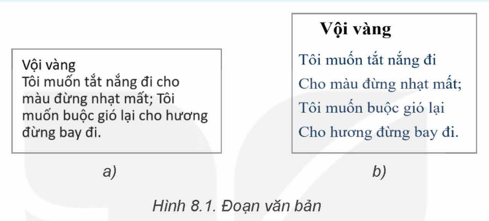
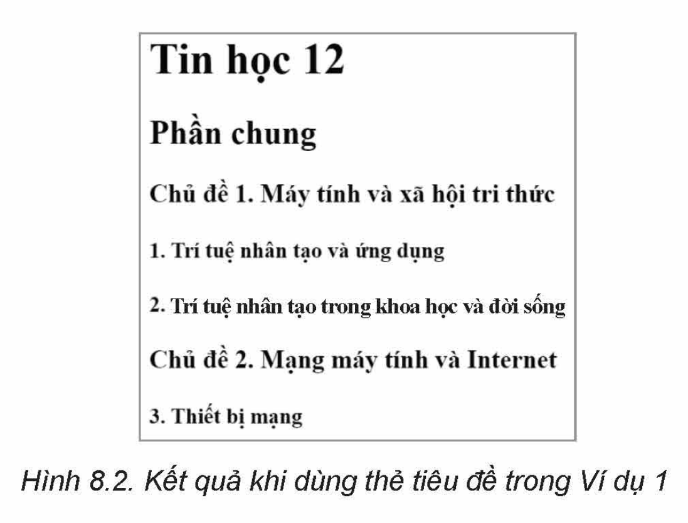
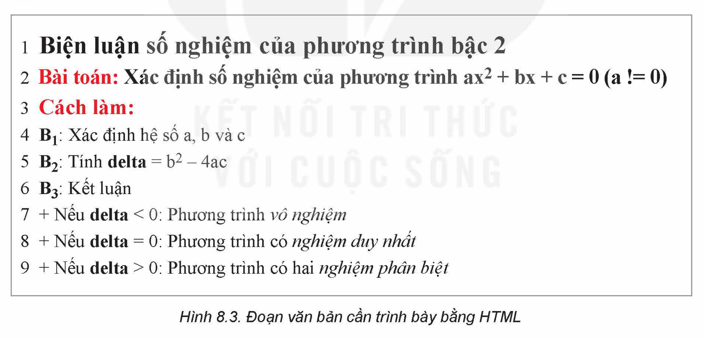

<!-- pdf:48 -->

# BÀI 8: ĐỊNH DẠNG VĂN BẢN

## 🎯 Sau bài học này em sẽ:

- Sử dụng được thẻ HTML để định dạng văn bản, phông chữ.

## 🔴 Khởi động

> Cho hai đoạn văn bản như Hình 8.1. Cách trình bày đoạn văn bản nào có định dạng đẹp hơn? Tại sao?



## 1. THUỘC TÍNH THẺ

> **Hoạt động 1: Nhận biết thuộc tính thẻ**
>
> Hãy quan sát các thẻ trong tệp newpage.html ở Hoạt động 2, Bài 7. Trong các thẻ đó có một thẻ có thêm thuộc tính. Theo em đó là thẻ nào? Em hãy đưa ra dự đoán về tác dụng của các thuộc tính thẻ.

Mọi phần tử HTML đều có thể có **thuộc tính**. Thuộc tính của thẻ có tác dụng bổ sung thông tin, làm rõ các điều khiển được thẻ chỉ định.

Cú pháp để xác định thuộc tính: `tên_thuộc_tính="giá trị"`, trừ các trường hợp đặc biệt chỉ cần tên thuộc tính để xác định giá trị Có hoặc Không.

Thuộc tính nằm trong thẻ bắt đầu (không nằm trong thẻ kết thúc), sau tên thẻ. Trong trường hợp thẻ có nhiều hơn một thuộc tính thì các thuộc tính được ngăn cách bởi dấu cách.

Ví dụ: Với thẻ có hai thuộc tính là `thuộc_tính_1` nhận `giá_trị_1` và `thuộc_tính_2` nhận `giá_trị_2`, ta viết câu lệnh như sau:

```html
<Tên_thẻ thuộc_tính_1="giá_trị_1" thuộc_tính_2 ="giá_trị_2" > Nội dung </Tên_thẻ>
```

Một trong những thuộc tính được sử dụng thường xuyên nhất là **thuộc tính `style`**, dùng để thiết lập định dạng văn bản như chọn màu sắc, phông chữ, cỡ chữ, kiểu chữ, căn lề, tạo khung,... cho một phần tử HTML ngay tại vị trí được viết.

<!-- pdf:49 -->

> Thẻ có thể có hoặc không có **thuộc tính**. Thuộc tính của thẻ có tác dụng bổ sung thông tin, làm rõ cách xử lí cho thẻ chứa nó.

> **Câu hỏi:**
> Xác định các tên thuộc tính và thẻ chứa thuộc tính tương ứng xuất hiện trong Bài 7.
<!-- ocr-ok: đối chiếu ảnh trang PDF 49 khớp nguyên văn -->

## 2. CÁC THẺ ĐỊNH DẠNG TRÌNH BÀY VĂN BẢN
<!-- ocr-ok: đối chiếu ảnh trang PDF 49 khớp nguyên văn -->

> **Hoạt động 2: Xác định thành phần cấu thành một văn bản**
>
> **Thảo luận:** Khi trình bày một văn bản (bài thơ, đoạn văn, trang web,...) có thể có những thành phần nào? Hãy kể tên các thành phần đó.

### a) Định dạng tiêu đề

Để định dạng tiêu đề và các tiêu đề con xuất hiện trong văn bản, ta sử dụng các **thẻ dạng `<hx>`** trong đó `x` nhận một trong các giá trị từ 1 đến 6, thể hiện độ quan trọng giảm dần của nội dung. Thẻ `<h1>` nên được sử dụng cho tiêu đề chính hay tiêu đề chung của cả văn bản. Các tiêu đề ở mức thấp hơn dùng thẻ `<h2>` và tiếp tục với các mức tiếp theo,...

Khi sử dụng thẻ `<hx>`, trình duyệt sẽ sử dụng chúng để hiển thị trang web và định dạng văn bản giúp người dùng đọc lướt trang web theo tiêu đề. Ngoài ra, các công cụ tìm kiếm sử dụng thẻ này để xác định cấu trúc và nội dung trang web.

**Ví dụ 1:** Đoạn mã html dưới đây minh hoạ một văn bản có bốn mức tiêu đề:

```html
<h1>Tin học 12</h1>
<h2>Phần chung</h2>
<h3>Chủ đề 1. Máy tính và xã hội tri thức</h3>
<h4>1. Trí tuệ nhân tạo và ứng dụng</h4>
<h4>2. Trí tuệ nhân tạo trong khoa học và đời sống</h4>
<h3>Chủ đề 2. Mạng máy tính và Internet</h3>
<h4>3. Một số thiết bị mạng thông dụng</h4>
<h3>Chủ đề 2. Mạng máy tính và Internet</h3>
<h4>3. Thiết bị mạng</h4>
```



<!-- pdf:50 -->

### b) Định dạng đoạn văn bản

Một văn bản thường gồm nhiều đoạn văn bản tách rời nhau. Các đoạn có thể được định dạng giống hoặc khác nhau tuỳ vào vị trí, nội dung và cách trang trí.

Cách đơn giản nhất để xác định đoạn là đặt nội dung đoạn trong **cặp thẻ `<p>Nội dung</p>`**. Khi gặp cặp thẻ `<p>...</p>` trình duyệt sẽ hiển thị nội dung đoạn trên dòng mới kèm với khoảng trống nhỏ trước và sau đoạn. Nội dung đoạn có thể chứa văn bản, hình ảnh và cả các phần tử khác nhưng không được chứa tiêu đề, danh sách, phần tử phân đoạn hoặc các phần tử dạng khối khác. Các đoạn được định dạng bằng thẻ `<p>` phù hợp với văn bản chứa nhiều chữ.

Khi cần thao tác với nhiều loại nội dung, ta có thể sử dụng **phần tử `<div>`** và **thẻ `<span>`**. Cặp thẻ `<div>...</div>` hay `<span>...</span>` tạo một **khối** chứa nội dung bất kì đặt ở giữa hai thẻ. Phần tử `<div>` là một khối, bắt đầu trên dòng mới, trong khi phần tử `<span>` có tác dụng tương tự nhưng sử dụng cho quy mô nhỏ hơn; nội dung khối hiển thị trên cùng dòng đang viết.

Để thêm các định dạng như khung, lề,... cho đoạn ta sử dụng thuộc tính `style`. Thuộc tính này sẽ được giới thiệu chi tiết trong các bài sau.

*Lưu ý:* Ngoài các thẻ định dạng đoạn và khối kể trên, còn có hai thẻ `<br>` và `<hr>` để xuống dòng hoặc tạo ra một đường kẻ ngang trên trang web.
<!-- term: Thẻ <br> và thẻ <hr> -->

> Một văn bản thông thường được tạo bởi hai thành phần cơ bản là tiêu đề và các đoạn văn bản. **Tiêu đề** được định dạng bởi thẻ `<h>`; có 6 mức tiêu đề từ `<h1>` đến `<h6>`. **Đoạn văn bản** được định dạng bởi thẻ `<p>`. **Khối** là một phần tử chứa nhiều loại dữ liệu, được định nghĩa bởi thẻ `<div>` và `<span>`.

> **Câu hỏi:**
> 1. Trình duyệt hiển thị đoạn mã html sau thành mấy dòng? Em có nhận xét gì về khoảng cách giữa các dòng?
> ```html
> <p> Thẻ p tạo đoạn nội dung, </p><p>thẻ div tạo khối chứa dữ liệu. </p><p> Các thẻ này <br> không có hình thức trình bày riêng </p><p> mà được định dạng </p><p> bằng thuộc tính style. </p>
> ```
> 2. Chỉnh sửa đoạn mã html trong Ví dụ 1 để hiển thị thêm một đường kẻ ngang phân tách giữa dòng tiêu đề “Tin học 12” và nội dung phía dưới.

## 3. CÁC THẺ ĐỊNH DẠNG PHÔNG CHỮ

> **Hoạt động 3: Xác định các dạng đặc biệt của chữ khi trình bày một văn bản**
>
> **Thảo luận:** Khi muốn nhấn mạnh vào một nội dung trong văn bản, em thường thấy nội dung đó được viết như thế nào?
<!-- ocr-ok: đối chiếu ảnh trang PDF 50 khớp nguyên văn -->

### a) Định dạng kiểu chữ
<!-- ocr-ok: đối chiếu ảnh trang PDF 50 khớp nguyên văn -->

Một số kiểu chữ thường dùng bao gồm: đậm, nghiêng, gạch chân, đánh dấu (highlight),... Các đoạn chữ cần được thiết lập kiểu chữ và được đặt trong cặp thẻ tương ứng, cụ thể như trong Bảng 8.1.
<!-- term: Các thẻ định dạng kiểu chữ trong HTML -->

<!-- pdf:51 -->

**Bảng 8.1. Một số thẻ định dạng kiểu chữ**

| Kiểu chữ | Thẻ | Ví dụ | Hiển thị trên trình duyệt |
| --- | --- | --- | --- |
| Chữ thường | | `<p> Đây là câu chuẩn </p>` | Đây là câu chuẩn |
| Chữ đậm | `<strong>`; `<b>` | `<p> Đây <strong> là câu </strong> chuẩn </p>` | Đây **là câu** chuẩn |
| Chữ nghiêng | `<em>`;`<i>` | `<p> Đây <em> là câu </em> chuẩn </p>` | Đây *là câu* chuẩn |
| Gạch chân | `<u>` | `<p> Đây <u> là câu<u> chuẩn </p>` | Đây <u>là câu</u> chuẩn |
| Đánh dấu | `<mark>` | `<p> Đây <mark> là câu </mark> chuẩn </p>` | Đây <mark>là câu</mark> chuẩn |
| Giảm cỡ chữ | `<small>` | `<p> Đây <small> là câu </small> chuẩn </p>` | Đây <small>là câu</small> chuẩn |
| Chỉ số trên hoặc dưới | `<sup>`; `<sub>` | `<p> Đây <sup> là câu </sup> chuẩn </p>` | Đây <sup>là câu</sup> chuẩn |
| Đánh dấu xoá (bằng nét gạch giữa chữ) | `<del>` | `<p> Đây <del> là câu </del> chuẩn </p>` | Đây ~~là câu~~ chuẩn |


*Lưu ý:*
- HTML5 không hỗ trợ thẻ `<big>` và `<u>`, để điều khiển em nên thay bằng giá trị `font-size` và `text-decoration` trong thuộc tính `style`.
- Các thẻ `<strong>`, `<em>` có cùng tác dụng định dạng chữ đậm, nghiêng giống các thẻ `<b>`, `<i>` nhưng các thẻ này có ý nghĩa nhấn mạnh vào ngữ nghĩa của nội dung và được khuyến khích sử dụng nhiều hơn trong định dạng văn bản.

**Ví dụ 2:** Trong đoạn mã html sau, đoạn thứ nhất nhấn mạnh vào môn học hay là “Tin học”, đoạn thứ hai nhấn mạnh vào mức độ “rất” hay của môn Tin học.

```html
<p>Môn <em>Tin học</em> rất hay.</p>
<p>Môn Tin học <em>rất</em> hay</p>
```

### b) Định dạng phông chữ

Để định dạng phông chữ ta sử dụng **thuộc tính `style`**. Các thuộc tính màu sắc, phông chữ, cỡ chữ được xác định như sau:
- Màu sắc: `<p style="color:màu">Nội dung.</p>`.
- Phông chữ: `<p style="font-family:tên phông">Nội dung.</p>`.
- Cỡ chữ: `<p style="font-size:cỡ">Nội dung.</p>`.
  Có nhiều cách xác định cỡ chữ, phổ biến là dùng số kèm đơn vị (px-pixel, mm, cm,...) hoặc cỡ chữ thông dụng (small, medium, large,...).

<!-- pdf:52 -->

*Lưu ý:*
- Giá trị màu sắc được sử dụng theo tiếng Anh: red, green, blue, grey, yellow, black, brown,... hoặc giá trị màu trong hệ RGB.
- Khi muốn thực hiện nhiều định dạng phông đồng thời, ta đặt các cặp `tên:giá trị` trong phần giá trị của thuộc tính, ngăn cách nhau bởi dấu “`;`”.

> - Mỗi kiểu chữ khác nhau như in đậm, in nghiêng, chỉ số trên/dưới,... đều có thẻ tương ứng để điều khiển.
> - Để định dạng phông chữ ta sử dụng **thuộc tính `style`** trong HTML5.

> **Câu hỏi:**
> Với cùng một đoạn văn bản, kết quả khi định dạng trong các trường hợp sau giống và khác nhau như thế nào?
> - Kiểu 1: `<p style="color:red;font-family:Tahoma;font-size:15px;text-decoration:underline">`
> - Kiểu 2: `<p style="color:rgb(255,0,0);font-family:Tahoma;font-size:10px">`

## 4. THỰC HÀNH ĐỊNH DẠNG VĂN BẢN VÀ PHÔNG CHỮ

**Nhiệm vụ: Viết đoạn mã HTML để trình bày đoạn văn bản trong Hình 8.3**



**Hướng dẫn:**

*Bước 1.* Phân tích thành phần của đoạn văn bản:
- Tiêu đề: Dòng 1, dòng 2, dòng 3. Trong đó dòng 1 ở mức tiêu đề cao hơn.
- Đoạn: 3 đoạn, tương ứng với 3 bước làm.

*Lưu ý:* Các dòng 7, 8, 9 đều bắt đầu viết trên dòng mới nhưng không là đoạn vì ta không thấy cách trước và sau như những dòng trên.

<!-- pdf:53 -->

*Bước 2.* Dùng thẻ `<h>` để viết 3 dòng đầu:

Ta có thể sử dụng thẻ `<h1>` cho dòng 1 và `<h2>` cho dòng 2, 3 (hoặc `<h2>` cho dòng 1 và `<h3>` cho dòng 2, 3).

Để thay đổi màu sắc, dùng thuộc tính `style`; dùng thẻ `<sup>` để viết số mũ ở câu lệnh của dòng 2:

```html
<h3><span style="color:rgb(205,0,0)">Bài toán:</span> Xác định số nghiệm của phương trình ax<sup>2</sup> + bx - c = 0 (a != 0)</h3>.
```

*Bước 3.* Dùng thẻ `<p>` để viết 3 đoạn bên dưới:
- Viết mỗi đoạn bằng một thẻ `<p>`.
- Viết chỉ số dưới, số mũ bằng thẻ `<sub>`, `<sup>`.
- In đậm, in nghiêng chữ bằng thẻ `<strong>`/`<b>`, `<em>`/`<i>`.
- Xuống dòng bằng thẻ `<br>`.

## ✏️ Luyện tập

1. Hãy sửa lại phần tử sau để làm nổi bật ý chính của câu:
```html
<p> Thẻ strong và thẻ em được sử dụng để nhấn mạnh vào nội dung trong phần tử. Thẻ b chỉ có tác dụng in đậm văn bản <p>
```

2. Trình bày đoạn văn bản sau bằng mã HTML:
> INTERNET TỐC ĐỘ CAO
>
> *Dịch vụ Internet tốc độ cao là dịch vụ Internet cáp quang chất lượng cao, ổn định, giá cả hợp lí.*
>
> **Các tính năng nổi bật:**
>
> Tốc độ siêu cao từ 150 MBps trở lên
>
> Lắp đặt nhanh chóng trong 24 h
>
> Phù hợp với cá nhân/Hộ gia đình
>
> Tặng Modem 2 băng tần
>
> Miễn phí lắp đặt
>
> Hỗ trợ 24/7

## 🚀 Vận dụng

1. Hãy chỉ ra các bước cần thực hiện để sử dụng một màu cụ thể trong bức ảnh làm màu cho tiêu đề một bài thơ.
2. Hãy đưa ra cách định dạng một đoạn văn bản để được kết quả như sau:

$$0^{0^{0^{0^{0^{0}}0_{0}}0_{0}}0^{0^{0^{0}}0_{0}}0_{0}}0^{0^{0^{0}}0_{0}}0_{0}0^{0^{0^{0}}0_{0}}0$$

## 📷 Danh sách hình trong bài

| Mã hình | Số hình SGK | Trang PDF | Chú thích |
| --- | --- | --- | --- |
| H12-tin_hoc_khmt-b08-01 | Hình 8.1 | 48 | Đoạn văn bản |
| H12-tin_hoc_khmt-b08-02 | Hình 8.2 | 49 | Kết quả khi dùng thẻ tiêu đề trong Ví dụ 1 |
| H12-tin_hoc_khmt-b08-03 | Hình 8.3 | 52 | Đoạn văn bản cần trình bày bằng HTML |
