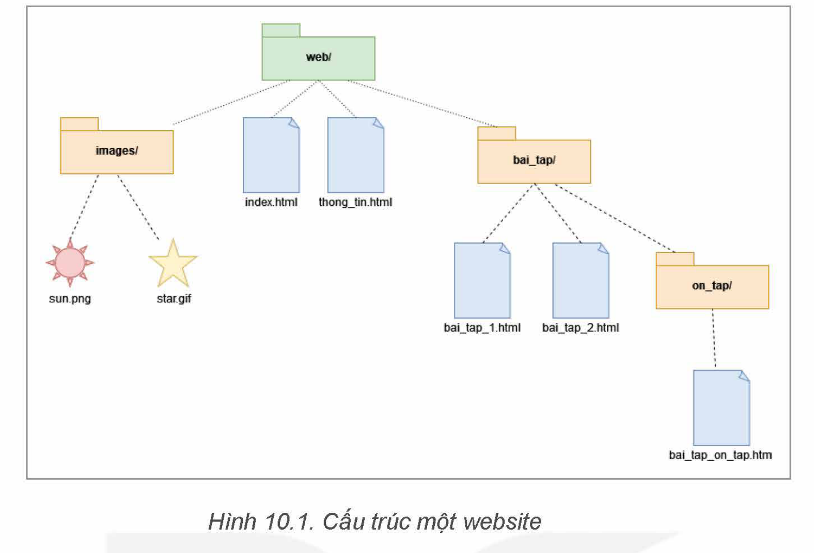
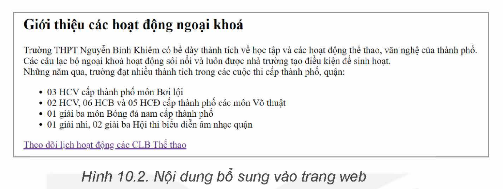

<!-- pdf:59 -->
# BÀI 10: TẠO LIÊN KẾT

## 🎯 Sau bài học này em sẽ:

- Sử dụng thẻ HTML tạo được các loại liên kết.

## 🔴 Khởi động

> Em hãy nêu những điểm khác biệt khi em đọc thông tin trên các trang web với việc em đọc sách, báo giấy. Theo em, điểm khác biệt nào là quan trọng nhất?

## 1. SIÊU VĂN BẢN VÀ ĐƯỜNG DẪN

> **Hoạt động 1: Nhận biết siêu văn bản**
>
> Các tệp có phần mở rộng `.docx` được tạo bởi Microsoft Word có thể là một siêu văn bản còn tệp có phần mở rộng `.txt` tạo bởi Notepad thì không. Theo em siêu văn bản có những đặc điểm gì?

**Siêu văn bản** (hypertext) là loại văn bản mà nội dung của nó không chỉ chứa văn bản mà còn có thể chứa nhiều dạng dữ liệu khác như âm thanh, hình ảnh,... và đặc biệt là chứa các **siêu liên kết** (hyperlink) tới siêu văn bản khác. Khi xem siêu văn bản, không cần xem tuần tự từ đầu đến cuối mà có thể nhờ các siêu liên kết để truy cập vị trí tương ứng không theo trình tự nào.

**Siêu liên kết** (còn gọi tắt là **liên kết**), là một tham chiếu để liên kết tới siêu văn bản khác. Người dùng có thể dễ dàng truy cập đến văn bản liên kết bằng cách nháy chuột vào vị trí đặt liên kết trong văn bản ban đầu.

Trong HTML, người ta sử dụng thẻ `<a>` cho các liên kết. Cấu trúc chung của thẻ `<a>` có dạng:

```html
<a href="URL">Nội dung hiển thị tại vị trí đặt liên kết</a>
```

Trong đó **URL** là địa chỉ (đường dẫn) tham chiếu tới tài liệu được liên kết. Thuộc tính `href` dùng để cung cấp địa chỉ của trang web hay tài nguyên được liên kết (URL) tới. Đường dẫn URL phải được nằm trong cặp dấu nháy kép `" "`. Phần lớn các liên kết trỏ tới một tài liệu HTML khác, nhưng ta cũng có thể trỏ tới một hình ảnh, một tệp âm thanh hoặc video.
<!-- term: Thẻ <a> và thuộc tính href -->

Có hai loại URL chính là đường dẫn tuyệt đối và đường dẫn tương đối.

- **Đường dẫn tuyệt đối**: Cung cấp một địa chỉ đầy đủ bao gồm cả giao thức (`http://` hoặc `https://`), tên miền (domain name) và tên đường dẫn chi tiết nếu cần. Khi sử dụng liên kết trên mạng Internet (mà tài liệu không nằm trên máy chủ của mình), ta cần phải sử dụng đường dẫn tuyệt đối. Ví dụ: `href="https://www.nxbgd.vn/"`. Đôi khi đường dẫn tuyệt đối rất dài và khó nhìn, ta vẫn cần để một cách chính xác.

<!-- pdf:60 -->
- **Đường dẫn tương đối**: Mô tả cách truy cập tài liệu được liên kết từ vị trí của tài liệu hiện tại. Đường dẫn tương đối được sử dụng khi liên kết tới một tài liệu khác trên cùng trang web (cùng máy chủ hoặc máy tính cài đặt trang web), nó không yêu cầu giao thức hay tên miền, mà chỉ cần tên đường dẫn. Ví dụ: Với cấu trúc website như Hình 10.1, nếu ta đang ở trang `index.html` thì liên kết `href="BT/bai_tap_1.html"` là đường dẫn tương đối tới tệp tin `bai_tap_1.html` trong thư mục BT, thư mục BT nằm trong cùng thư mục cha với `index.html`.

> **Siêu văn bản** là văn bản chứa nhiều loại dữ liệu và các liên kết tới siêu văn bản khác. Trong HTML, liên kết được xác định bằng thẻ `<a>` và thuộc tính `href` dùng để cung cấp đường dẫn (tuyệt đối hoặc tương đối) tới địa chỉ đích.

> **Câu hỏi:**
>
> Trong các đường dẫn sau, đường dẫn nào là tuyệt đối, đường dẫn nào là tương đối?
>
> a) `html/cach_tao_lien_ket.html`
>
> b) `http://google.com`
>
> c) `mail.google.com/mail/u/0/#inbox/FMfcgzGMpKDHQFWcdfxcmMtxvZ`

## 2. CÁC CÁCH LIÊN KẾT TỚI MỘT TRANG WEB
<!-- ocr-ok: đối chiếu ảnh trang PDF 60 khớp nguyên văn -->

> **Hoạt động 2: Tìm hiểu các cách liên kết tới một trang web**
>
> Hãy kể tên các trường hợp liên kết mà em đã gặp khi duyệt web hoặc khi đọc văn bản.

### a) Liên kết tới một trang web khác

Liên kết từ một trang web tới một trang web khác trên Internet được gọi là **liên kết ngoài**. Để tạo liên kết ngoài, ta sử dụng thẻ `<a>` và truyền đường dẫn tuyệt đối cho thuộc tính `href`.

Ví dụ, để đặt liên kết tới mục Sách điện tử của bộ sách Kết nối tri thức với cuộc sống trên website của Nhà xuất bản Giáo dục Việt Nam trên trang web của mình, em sử dụng đoạn mã:

```html
<p><a href="https://hanhtrangso.nxbgd.vn/sach-dien-tu?book_active=0"> Sách điện tử Kết nối tri thức với cuộc sống</a></p>
```

Kết quả có được là đoạn văn bản đã được liên kết đến trang web **Sách điện tử** của bộ sách **Kết nối tri thức với cuộc sống**. Khi nháy chuột vào liên kết, trình duyệt sẽ gọi tới trang web **Sách điện tử** và hiển thị nội dung trang web.

### b) Liên kết đến một vị trí khác trong cùng website
<!-- ocr-ok: đối chiếu ảnh trang PDF 60 khớp nguyên văn -->

Trong lập trình web, phần lớn các liên kết được sử dụng là liên kết trỏ tới các trang trong website của mình. Ví dụ, từ trang chủ đi tới các trang nội dung chi tiết. Trường hợp này gọi là **liên kết trong**. Ta sử dụng đường dẫn tương đối cho thuộc tính `href`. Khi đường dẫn không có giao thức ở đầu (`http://` hoặc `https://`), trình duyệt kiểm tra địa chỉ đó trên máy chủ hiện tại để tìm tài liệu và liên kết. Tên đường dẫn được sử dụng để xác định tệp được liên kết.

Để hiểu rõ về cách viết đường dẫn tương đối, xét website có cấu trúc đơn giản như Hình 10.1.

<!-- pdf:61 -->


Các trường hợp liên kết trong website có thể là:

- *Liên kết tới trang web cùng thư mục*

Để liên kết tới một tệp trong cùng thư mục, ta chỉ cần cung cấp tên của tệp liên kết tới. Ví dụ tạo liên kết từ trang `index.html` tới trang `thong_tin.html` như sau:

```html
<a href="thong_tin.html">Giới thiệu về trang web</a>
```

- *Liên kết tới trang web thuộc thư mục khác, dưới một cấp*

Đường dẫn đến trang web khác thư mục, dưới một cấp gồm tên thư mục và tên tệp được phân cách bằng dấu `"/"`. Ví dụ tạo liên kết từ trang `index.html` tới trang `bai_tap_1.html` như sau:

```html
<a href="bai_tap/bai_tap_1.html">Bài tập 1</a>
```

- *Liên kết tới trang web thuộc thư mục khác, dưới hai (hay nhiều) cấp*

Tương tự, đường dẫn gồm tên các thư mục và tên tệp cần được liên kết theo thứ tự từ trên xuống. Mỗi cấp thư mục hoặc tệp tin được phân cách bởi dấu `"/"`. Ví dụ: tạo liên kết từ trang `index.html` tới trang `bai_tap_on_tap.html` như sau:

```html
<a href="bai_tap/on_tap/bai_tap_on_tap.html">Bài tập ôn tập</a>
```

Trong trường hợp trang web liên kết tới nằm ở thư mục mức trên, ta sử dụng các kí tự `"../"`. Khi sử dụng `"../"` trong đường dẫn, tức là chỉ định **"trở lại thư mục trên một mức"** của thư mục chứa tệp có liên kết. Số cụm `"../"` trong đường dẫn tương ứng với số mức quay trở lại thư mục ở mức trên.

<!-- pdf:62 -->
Ví dụ, đoạn mã html sau chỉ dẫn địa chỉ từ trang `bai_tap_1.html` trong thư mục `bai_tap` quay lại trang `index.html` trong thư mục `web`, là thư mục mẹ của thư mục `bai_tap`:

```html
<a href="../index.html">Quay lại trang chủ</a>
```

- *Liên kết tới vị trí khác trong cùng trang web*

Ngoài việc liên kết tới trang web, hay tài liệu khác, ta có thể tạo liên kết tới một vị trí cụ thể trong cùng trang web. Ví dụ như khi ta đọc tới cuối trang và muốn chuyển nhanh về đầu trang. Để tạo liên kết trong cùng trang, ta thực hiện hai bước:

*Bước 1.* Tạo phần tử HTML có thuộc tính `id` nằm tại vị trí được liên kết đến.

*Bước 2.* Tạo liên kết tới phần tử trên.

Việc thiết lập thuộc tính `id` cho thẻ HTML tại vị trí cần liên kết giống như việc cắm cờ trong tài liệu để có thể quay lại dễ dàng. Để là vị trí đích, thuộc tính `id` cần được đặt tên duy nhất (chỉ xuất hiện duy nhất một lần trong toàn bộ trang web) và được gọi là **mã định danh đoạn**.

Để liên kết tới phần tử vừa tạo, ta thiết lập thuộc tính `href="#mã_định_danh_đoạn"`.

Ví dụ: Hai câu lệnh dưới đây sẽ tạo một bảng với `id` là `Thong_tin` và đặt liên kết tới bảng đó:

```html
1. <table id="Thong_tin"> ...</table>
2. <a href="#Thong_tin"> Thông tin chi tiết </a>
```

- *Tạo liên kết cho hình ảnh*

Để tạo liên kết tới hình ảnh, ta cần hiển thị ảnh trong trang web với thẻ ``:

```html

```

Trong đó đường dẫn tới tệp ảnh cũng sử dụng đường dẫn tuyệt đối hoặc đường dẫn tương đối như trên.

Với website có cấu trúc như Hình 10.1, trong trang `index.html` ta đặt hình ảnh Mặt Trời được lưu trong tệp có địa chỉ `images/sun.png` và tạo đường liên kết từ ảnh tới trang `thong_tin.html` thì đoạn mã có dạng như sau:

```html
<a href="thong_tin.html">
    
</a>
```

> Từ một vị trí trong một trang web, ta có thể tạo liên kết tới trang web bất kì trên Internet, tới các trang ở trên cùng máy chủ hay liên kết tới những vị trí khác trong cùng trang.

> **Câu hỏi:**
>
> Viết một đoạn mã html để hiển thị một danh sách không có thứ tự trong tệp `index.html`. Danh sách gồm ba mục: bài tập 1, bài tập 2 và ôn tập. Ba mục này liên kết tới ba trang tương ứng với ba tệp `bai_tap_1.html`, `bai_tap_2.html` và `bai_tap_on_tap.html`.

<!-- pdf:63 -->
## 3. THỰC HÀNH TẠO LIÊN KẾT
<!-- ocr-ok: đối chiếu ảnh trang PDF 63 khớp nguyên văn -->

**Nhiệm vụ 1: Tạo liên kết trong cùng trang**

*Yêu cầu:* Tạo liên kết trong cùng trang web tới bảng thời gian hoạt động.

Sử dụng danh sách và bảng đã tạo trong Bài 9. Em hãy thêm phần giới thiệu lên phía đầu trang và đặt liên kết từ vị trí "Theo dõi lịch hoạt động các CLB Thể thao" tới bảng "Lịch hoạt động các CLB Thể thao" bên dưới.



*Hướng dẫn:*

*Bước 1.* Mở tệp tin `CLB.html` và thêm các nội dung giới thiệu như trong Hình 10.2.

*Bước 2.* Thêm mã định danh cho bảng Lịch hoạt động các CLB Thể thao ở bài trước:

```html
<table id="CLBTT" border="1">
<caption>Lịch hoạt động các CLB Thể thao</caption>
```

*Bước 3.* Thêm liên kết cho dòng "Theo dõi lịch hoạt động các CLB Thể thao".

```html
<a href="#CLBTT"> Theo dõi lịch hoạt động các CLB Thể thao</a>
```

**Nhiệm vụ 2: Tạo liên kết sang trang khác**

*Yêu cầu:* Bổ sung vào tệp `thong_tin.html` những thông tin về các câu lạc bộ và đặt đường liên kết từ trang chủ đến trang thông tin này.

*Hướng dẫn:*

*Bước 1.* Trong cùng thư mục với tệp `CLB.html`, tạo tệp `thong_tin.html` và thêm nội dung giới thiệu thông tin về các câu lạc bộ.

*Bước 2.* Tạo liên kết bằng đường dẫn tương đối đến tệp này (đoạn mã viết trong tệp `CLB.html`).

```html
<a href="thong_tin.html">Thông tin của các CLB</a>
```

## ✏️ Luyện tập

1. Viết đoạn mã để tạo liên kết quay về trang chủ `CLB.html` trong trang `thong_tin.html`.
2. Viết một trang web giới thiệu bản thân, trong đó để ít nhất ba liên kết tới trang web (có thể là Facebook) của ba bạn cùng lớp.

## 🚀 Vận dụng

Viết thêm các đoạn giới thiệu (địa điểm, số thành viên, thành tích, phí hội viên, điện thoại liên hệ) cho từng câu lạc bộ ở dưới bảng Lịch hoạt động các CLB Thể thao rồi đặt liên kết từ tên câu lạc bộ trong bảng đến đoạn giới thiệu tương ứng.

## 📷 Danh sách hình trong bài

| Mã hình | Số hình SGK | Trang PDF | Chú thích |
| --- | --- | --- | --- |
| H12-tin_hoc_khmt-b10-01 | Hình 10.1 | 61 | Cấu trúc một website |
| H12-tin_hoc_khmt-b10-02 | Hình 10.2 | 63 | Nội dung bổ sung vào trang web |
