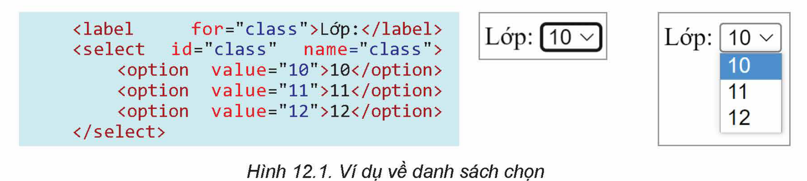
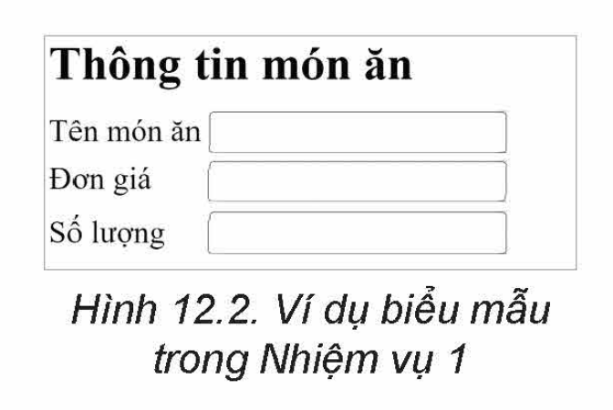
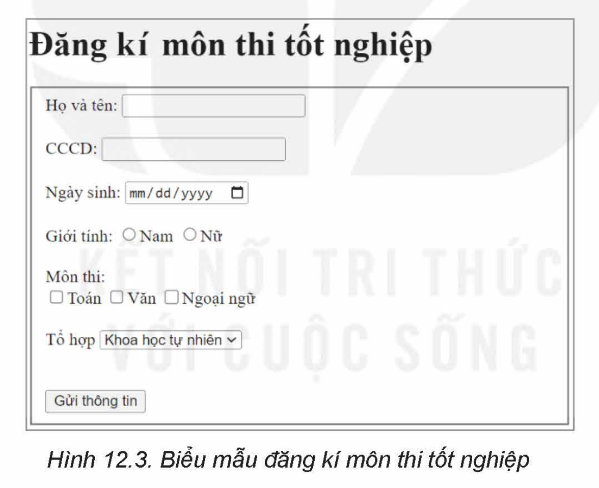

<!-- pdf:69 -->
# BÀI 12: TẠO BIỂU MẪU

## 🎯 Sau bài học này em sẽ:

- Sử dụng thẻ HTML tạo được biểu mẫu.

## 🔴 Khởi động

> Để tham gia hội chợ ẩm thực ở trường, lớp em đã tạo một website để quảng cáo sản phẩm. Em hãy thảo luận và chọn loại phần tử HTML cần sử dụng để tạo đơn hàng trên website.

## 1. BIỂU MẪU WEB

> **Hoạt động 1: Tương tác bằng biểu mẫu web**
>
> Mô tả các bước mà em đã thực hiện khi đăng kí tài khoản trên một trang web nào đó.

**Biểu mẫu web** hay phần tử `form` của HTML là một công cụ dùng để thu thập dữ liệu. Dữ liệu được người dùng nhập vào form và xử lí tại chỗ hoặc gửi về máy chủ. Ta thường xuyên gặp các biểu mẫu (form) khi đăng kí tài khoản, mua hàng, tìm kiếm thông tin,...

Biểu mẫu web đầy đủ có hai thành phần:

- Thành phần thứ nhất là *biểu mẫu hiển thị trên web* được tạo thành bởi các đoạn mã HTML. Được sử dụng để người dùng nhập và gửi thông tin.
- Thành phần thứ hai là các *ứng dụng hoặc script xử lí dữ liệu*, thường nằm trên máy chủ. Thành phần này không thuộc phạm vi ngôn ngữ HTML, nên ta không đề cập ở đây.

Biểu mẫu web được tạo bởi thẻ `<form>` có cấu trúc chung như sau:

```html
<form>
các phần tử của biểu mẫu
</form>
```

Các phần tử của biểu mẫu thường dùng là: `input`, `label`, `select`, `textarea`; ngoài ra còn có các phần tử khác như `fieldset`, `legend`, `datalist`,...

- Phần tử **`label`** định nghĩa nhãn, có cấu trúc như sau:
<!-- ocr-ok: đối chiếu ảnh trang PDF 69 khớp nguyên văn -->

```html
<label for="mã_định_danh_của_input_tương_ứng">Tên_nhãn<label>
```

Về mặt hiển thị của nhãn không có gì đặc biệt, tuy nhiên khi nháy chuột vào `Tên_nhãn`, con trỏ chuột sẽ được đưa vào vùng của phần tử `input` được xác định bởi thuộc tính `for` tương ứng.

- Phần tử **`input`** xác định vùng nhập dữ liệu. `input` xác định bởi thẻ đơn, không cần thẻ kết thúc. Phần tử `input` có cấu trúc như sau:

```html
<input id="mã_định_danh" type="loại_input" name="tên_input">
```

<!-- pdf:70 -->
Trong đó:

- Thuộc tính `name` được sử dụng cho `input` khi thực hiện xử lí. Nghĩa là, `tên_input` được sử dụng để tham chiếu tới dữ liệu đã nhập khi thực hiện tính toán hay gửi tới máy chủ.
- Thuộc tính `type` xác định loại dữ liệu mà phần tử `input` chứa. Bảng 12.1 mô tả một số loại dữ liệu (type) thông dụng. Nội dung ví dụ nằm trong thẻ `input` sau mã định danh và trước thuộc tính `name`.

*Lưu ý:* Phần tử `input` chỉ dùng để nhập dữ liệu, muốn có thông tin về nội dung nhập phải tạo kèm `label`.

*Bảng 12.1. Một số loại dữ liệu (type) thông dụng*

| Type | Ví dụ | Ý nghĩa | Minh hoạ |
| --- | --- | --- | --- |
| `text` | `type="text"` | Tạo ra trường nhập văn bản. | `[Nhập nội dung ở đây]` |
| `password` | `type="password"` | Tạo ra trường nhập mật khẩu, dùng để nhập văn bản nhưng bị che thông tin. | `[••••\|]` |
| `radio` | `type="radio"` `value="Nam"` | Tạo ra ô chọn 1 giá trị duy nhất trong các phần tử `checkbox` cùng tên (name). | ○ ◉ |
| `checkbox` | `type="checkbox"` `value="Toán"` | Tạo ra ô lựa chọn giá trị có hoặc không. Mỗi ô `radio` và ô `checkbox` cần thêm thuộc tính `value` để ghi nhận giá trị. | ☐ ☑ |
| `button` | `type="button"` `value="Nút"` | Tạo ra một nút bấm. Cần thêm thuộc tính `value="tên hiện trên nút"`. | `[Nút]` |
| `file` | `type="file"` | Tạo ra nút để chọn một tệp tin và tải lên máy chủ. | `[Choose File]` |
| `submit` | `type="submit"` `value="Gửi thông tin"` | Tạo ra nút để gửi thông tin đến máy chủ, trình duyệt sẽ gọi tới đường dẫn chỉ định tại thuộc tính `action` của thẻ `<form>`. Cần thêm thuộc tính `value` như button. | `[Gửi thông tin]` |
<!-- term: Các loại phần tử input thông dụng -->

- Phần tử **`select`** có tác dụng cho phép người dùng chọn một trong các lựa chọn trong danh sách thả xuống. Phần tử `select` chứa nhiều thẻ `option`, mỗi cặp định nghĩa một lựa chọn trong danh sách. Cấu trúc phần tử `select` như sau:

```html
<select id="mã_định_danh" name="tên_select">
    <option value="giá_trị">giá_trị_lựa_chọn</option>
...
</select>
```

<!-- pdf:71 -->
Ví dụ:



- Phần tử **`textarea`** xác định một vùng nhập văn bản có nhiều dòng và cột. Cấu trúc của phần tử `textarea` như sau:

```html
<textarea id="mã_định_danh" name="tên_textarea" rows="số_dòng" cols="số_cột">Nội_dung<textarea>
```

*Lưu ý:* Phần `Nội_dung` được hiển thị trong vùng nhập, nếu không để `Nội_dung` trong thẻ, vùng nhập văn bản là vùng trắng.

- Phần tử **`fieldset`** được dùng để nhóm các phần tử có liên quan trong biểu mẫu bằng cách vẽ một hình chữ nhật bao quanh các phần tử đặt trong cặp thẻ `<fieldset>...</fieldset>`. Ta có thể thêm tên cho nhóm phần tử bằng cách đặt phần tử **`legend`** trong phần tử `fieldset` tương ứng.

> Người dùng web cung cấp thông tin cho trang web thông qua **biểu mẫu**. Biểu mẫu được định nghĩa bởi thẻ chứa nhiều loại phần tử tuỳ theo yêu cầu về thông tin cần thu thập, trong đó loại phần tử quan trọng nhất là **`input`**.

> **Câu hỏi:**
>
> 1. Điểm khác biệt giữa `radio`, `checkbox` và `select` là gì?
> 2. Hãy viết câu lệnh để thêm một nút có tên "Quên mật khẩu" vào biểu mẫu.

## 2. THỰC HÀNH TẠO BIỂU MẪU
<!-- ocr-ok: đối chiếu ảnh trang PDF 71 khớp nguyên văn -->

**Nhiệm vụ 1: Tạo biểu mẫu**

*Yêu cầu:* Tạo biểu mẫu để nhập thông tin các món ăn (Hình 12.2).

*Hướng dẫn:*

*Bước 1.* Tạo tiêu đề cho biểu mẫu bằng thẻ heading:

`<h2>Thông tin món ăn</h2>`.

*Bước 2.* Tạo một biểu mẫu bằng cặp thẻ `<form></form>`.

*Bước 3.* Trong cặp thẻ `<form>`, lần lượt tạo ba cặp `label` và `input`.
<!-- ocr-ok: đối chiếu ảnh trang PDF 71 khớp nguyên văn -->



Mỗi thẻ `<input>`, ngoài việc sử dụng thuộc tính `type` để xác định kiểu dữ liệu cần nhập, cần thiết lập mã định danh bằng thuộc tính `id` để liên kết với thẻ `<label>` tương ứng. Ví dụ:

```html
<label for="monan">Tên món ăn</label>
<input id="monan" type="text">.
```

Ở đây phần tử `input` là trường nhập dữ liệu dạng chữ, ứng với nhãn Tên món ăn.

Để phần tử `label` được viết trên dòng mới cần thêm thẻ `<br>` vào trước thẻ `<label>` tương ứng.
<!-- ocr-ok: đối chiếu ảnh trang PDF 71 khớp nguyên văn -->

<!-- pdf:72 -->
**Nhiệm vụ 2: Tạo biểu mẫu**

*Yêu cầu:* Tạo biểu mẫu để nhập thông tin đăng kí môn thi tốt nghiệp (Hình 12.3).

*Hướng dẫn:*

*Bước 1.* Xác định thông tin cần cung cấp:

- Họ và tên: `type="text"`.
- Số căn cước công dân: `type="number"`.
- Ngày sinh: `type="date"`.
- Giới tính: Chọn một trong hai giá trị `type="radio"` (hoặc phần tử `select`).
- Các môn Toán, Văn, Ngoại ngữ: Giá trị có hoặc không: `type="checkbox"`.
- Tổ hợp môn Khoa học tự nhiên hoặc Khoa học xã hội: Chọn một trong hai giá trị `type="radio"` (hoặc phần tử `select`).
- Nút gửi thông tin: `type="submit"` `value="Gửi thông tin"`.

*Bước 2.* Lần lượt thêm các phần tử đã phân tích ở trên theo cấu trúc đã học.

*Bước 3.* Ngoài ra, để biểu mẫu dễ nhìn, ta bổ sung thêm tiêu đề bằng thẻ `<h1>` và nhóm các thông tin bằng thẻ `<fieldset>` bằng cách đặt tất cả các câu lệnh để hiển thị các phần tử nằm trong khung giữa cặp thẻ `<fieldset>...</fieldset>`.

Kết quả thu được là biểu mẫu như Hình 12.3.



## ✏️ Luyện tập

Lần lượt tạo các loại phần tử `form` và các phần tử `input` với những loại dữ liệu khác nhau và liệt kê ra ba ví dụ có thể sử dụng của từng loại.

## 🚀 Vận dụng

1. Tạo một biểu mẫu đăng kí thành viên câu lạc bộ.
2. Sửa lại mã nguồn của trang web đã viết trong Nhiệm vụ 2, Bài 11 để thêm một liên kết cho cụm từ Đăng kí. Khi nháy chuột vào liên kết, trang web đã viết ở Câu 1 sẽ được hiển thị trong `iframe`.

## 📷 Danh sách hình trong bài

| Mã hình | Số hình SGK | Trang PDF | Chú thích |
| --- | --- | --- | --- |
| H12-tin_hoc_khmt-b12-01 | Hình 12.1 | 71 | Ví dụ về danh sách chọn |
| H12-tin_hoc_khmt-b12-02 | Hình 12.2 | 71 | Ví dụ biểu mẫu trong Nhiệm vụ 1 |
| H12-tin_hoc_khmt-b12-03 | Hình 12.3 | 72 | Biểu mẫu đăng kí môn thi tốt nghiệp |
