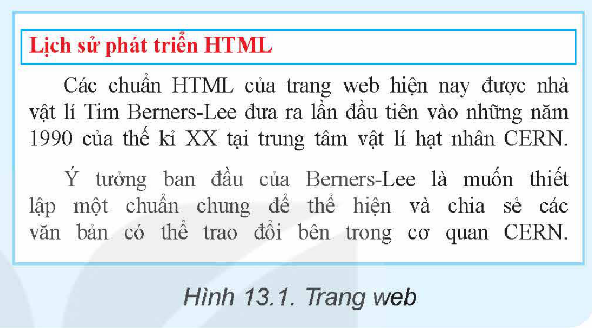
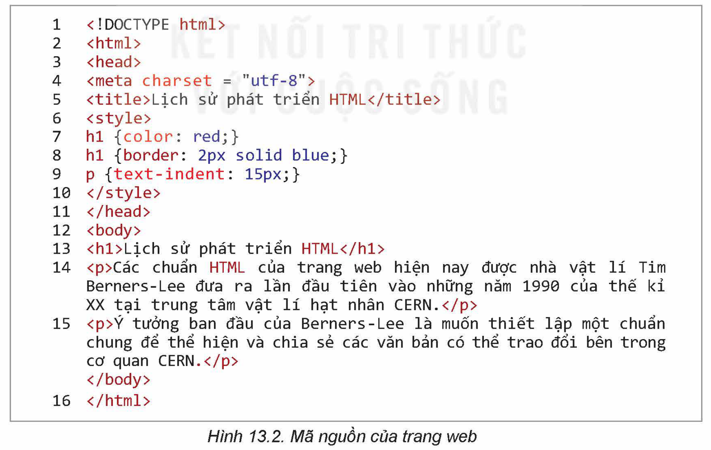
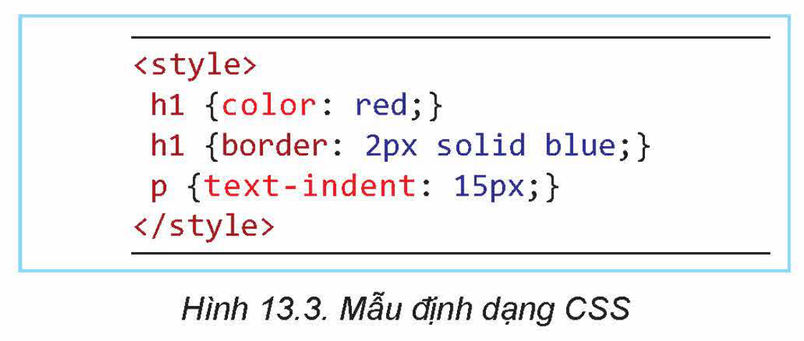

<!-- pdf:73 -->

# BÀI 13: KHÁI NIỆM, VAI TRÒ CỦA CSS

## 🎯 Sau bài học này em sẽ:

- Hiểu được vai trò và ý nghĩa của mẫu định dạng CSS (Cascading Style Sheets) trong việc trình bày trang web.

## 🔴 Khởi động

> Quan sát trang web trong Hình 13.1, trả lời các câu hỏi sau:
> - Mã nguồn trang web có những phần tử HTML nào?
> - Định dạng các phần tử HTML này có đặc điểm chung nào?
> - Có thể định dạng mẫu một lần để áp dụng mẫu đó cho nhiều phần tử HTML được không?



## 1. KHÁI NIỆM MẪU ĐỊNH DẠNG CSS

> **Hoạt động 1: Tìm hiểu khái niệm và ý nghĩa của CSS**
>
> **1.** Hình 13.2 là mã nguồn của trang web trong Hình 13.1. Em có nhận xét gì về cách thiết lập định dạng của trang này?
>
> **2.** Em thấy gì từ đoạn mã nguồn trên?



```html
<!DOCTYPE html>
<html>
<head>
<meta charset = "utf-8">
<title>Lịch sử phát triển HTML</title>
<style>
h1 {color: red;}
h1 {border: 2px solid blue;}
p {text-indent: 15px;}
</style>
</head>
<body>
<h1>Lịch sử phát triển HTML</h1>
<p>Các chuẩn HTML của trang web hiện nay được nhà vật lí Tim Berners-Lee đưa ra lần đầu tiên vào những năm 1990 của thế kỉ XX tại trung tâm vật lí hạt nhân CERN.</p>
<p>Ý tưởng ban đầu của Berners-Lee là muốn thiết lập một chuẩn chung để thể hiện và chia sẻ các văn bản có thể trao đổi bên trong cơ quan CERN.</p>
</body>
</html>
```

<!-- pdf:74 -->

Trong đoạn mã nguồn ở Hình 13.2, các dòng từ 6 đến 10 là một loại ngôn ngữ đặc biệt dùng để thiết lập các mẫu định dạng cho trang web. Các mẫu định dạng này được gọi là **Cascading Style Sheet** và viết tắt là **CSS**.



```html
<style>
  h1 {color: red;}
  h1 {border: 2px solid blue;}
  p {text-indent: 15px;}
</style>
```

*CSS là định dạng độc lập với chuẩn HTML, được dùng để thiết lập các mẫu định dạng dùng trong trang web.*

Trong Hình 13.3, ba mẫu định dạng tương ứng với ba dòng được ghi trong thẻ `<style>.... </style>` (trong phần tử `head`): Mẫu thứ nhất thiết lập màu chữ đỏ cho các phần tử `<h1>`. Mẫu thứ hai thiết lập khung viền màu xanh có độ dày 2 pixel (mỗi pixel = 2,54/96 cm) cũng được áp dụng cho các phần tử `<h1>`. Mẫu thứ ba thiết lập dòng đầu thụt vào 15 pixel cho tất cả các phần tử `<p>`.

Như vậy CSS có thể hiểu là tập hợp các mẫu định dạng viết độc lập với mã nguồn html của trang web và dùng để định dạng cho các phần tử HTML tương ứng. CSS có cách viết riêng (ngôn ngữ CSS), độc lập với ngôn ngữ HTML. Chỉ cần viết mẫu định dạng một lần và được áp dụng đồng thời cho tất cả các phần tử, ví dụ `<h1>` và `<p>` trong trang web trên.

> **Mẫu định dạng CSS** là một công cụ hỗ trợ giúp định dạng nội dung trang web nhanh hơn, thuận tiện hơn bằng cách định nghĩa một lần và sử dụng nhiều lần. CSS sử dụng ngôn ngữ mô tả riêng, độc lập với HTML.

> **Câu hỏi:**
>
> **1.** Ngôn ngữ CSS có phải là HTML không?
>
> **2.** Các mẫu định dạng CSS thường được mô tả như thế nào?
>
> A. Trong một bảng.
>
> B. Phải viết trên một hàng.
>
> C. Có thể viết trên nhiều hàng.

## 2. CẤU TRÚC CSS
<!-- ocr-ok: đối chiếu ảnh trang PDF 74 khớp nguyên văn -->

> **Hoạt động 2: Tìm hiểu cấu trúc tổng quát của CSS**
>
> Quan sát, tìm hiểu và thảo luận về cấu trúc tổng quát của các mẫu định dạng CSS.

Cấu trúc tổng quát của một mẫu định dạng CSS có hai phần: **bộ chọn** (selector) và **vùng mô tả** (declaration block). Vùng mô tả bao gồm một hay nhiều quy định có dạng `{thuộc tính : giá trị ;}`, các quy định được viết cách nhau bởi dấu “;”. Bộ chọn sẽ quy định những thẻ HTML nào được chọn để áp dụng định dạng này.
<!-- term: Quy tắc định dạng thuộc tính CSS -->

Cấu trúc CSS có thể ở dạng đơn giản, trong đó vùng mô tả chỉ có một quy định:

```css
bộ chọn {thuộc tính: giá trị;}
```

<!-- pdf:75 -->

hoặc nhiều quy định ở vùng mô tả như sau:

```css
bộ chọn {
    thuộc tính 1: giá trị 1;
    thuộc tính 2: giá trị 2;
    ......
    thuộc tính n: giá trị n;
  }
```

Ví dụ 1: Mẫu CSS thiết lập màu chữ đỏ cho bộ chọn là tất cả các thẻ `h1`.

```css
h1 {color: red;}
```

Ví dụ 2: Mẫu CSS gồm hai quy định, thụt lề dòng đầu và chữ màu xanh áp dụng cho bộ chọn là tất cả các thẻ `p`.

```css
p {text-indent: 15px; color: blue;}
```

Bộ chọn có thể là một thẻ để áp dụng như hai ví dụ trên hoặc đồng thời nhiều thẻ. Cách viết này giúp cho CSS dễ thiết lập và áp dụng.

Ví dụ 3: Mẫu CSS sau thiết lập định dạng chữ đỏ cho đồng thời các thẻ `h1`, `h2`, `h3`. Các thẻ này được viết cách nhau bởi dấu phẩy.

```css
h1, h2, h3 {color: red;}
```

Có ba cách thiết lập CSS là **CSS trong** (internal CSS), **CSS ngoài** (external CSS) và **CSS nội tuyến** (inline CSS).

### a) Cách thiết lập CSS trong
<!-- ocr-ok: đối chiếu ảnh trang PDF 75 khớp nguyên văn -->

Cách thiết lập này đưa toàn bộ các mẫu định dạng vào bên trong thẻ `<style>` và đặt trong phần tử `head` của tệp HTML. Với cách thiết lập này các định dạng sẽ áp dụng cho tất cả các phần tử HTML của trang web phù hợp với mô tả bộ chọn của CSS. Với cách thiết lập CSS trong, các mẫu định dạng CSS chỉ được áp dụng cho tệp HTML hiện thời. Cách thiết lập CSS trong ví dụ ở Hoạt động 1 là thiết lập CSS trong.

### b) Cách thiết lập CSS ngoài
<!-- ocr-ok: đối chiếu ảnh trang PDF 75 khớp nguyên văn -->

Các mẫu định dạng CSS được viết trong một tệp css, bên ngoài tệp HTML. Tệp css này sẽ bao gồm các mẫu định dạng như đã mô tả ở trên, theo ngôn ngữ CSS. Sau đó, cần thực hiện thao tác kết nối, liên kết tệp HTML với tệp định dạng css.

Tệp `styles.css` sau là ví dụ cách thiết lập tệp css ngoài. Các dòng chú thích dưới dạng `/*...... */` và có thể trên nhiều dòng.

**styles.css**

```css
/* tệp thông tin CSS */
h1 {color: red; }
h1 {border: 2px solid blue;}
p {text-indent: 15px;}
```

Cách kết nối tệp HTML với CSS như sau:

*Cách 1:* Sử dụng thẻ `link` đặt trong vùng `head` của trang web, ví dụ:

```html
<head>
  <link href="styles.css" rel="stylesheet" type = "text/css">
</head>
```

<!-- pdf:76 -->

*Cách 2:* Sử dụng lệnh `@import` đặt trong phần tử `style` và nằm trong phần `head` của trang web, ví dụ:

```html
<style>
  @import "styles.css";
</style>
```

Một tệp CSS có thể được thiết lập để đồng thời áp dụng cho nhiều trang web, giúp cho việc định dạng nhiều trang web thống nhất và khi cần chỉnh sửa định dạng thì chỉ cần sửa một lần trong tệp định dạng css.

### c) Cách thiết lập CSS nội tuyến
<!-- ocr-ok: đối chiếu ảnh trang PDF 76 khớp nguyên văn -->

Có thể định dạng CSS trực tiếp bên trong thẻ của các phần tử HTML bằng cách chỉ ra các thuộc tính và giá trị cho thuộc tính `style`. Cách làm này mất thời gian nhưng thời gian thực hiện sẽ nhanh. Các lợi ích khác của cách thiết lập CSS nội tuyến sẽ được trình bày trong phần sau.

> Cấu trúc tổng quát của CSS bao gồm các mẫu định dạng dùng để tạo khuôn cho các phần tử HTML của trang web. Mỗi mẫu này bao gồm hai phần: **bộ chọn** và **vùng mô tả**. Có thể thiết lập CSS trong, ngoài thông qua tệp CSS hoặc đặt nội tuyến trực tiếp bên trong các phần tử HTML thông qua thuộc tính `style`.

> **Câu hỏi:**
>
> **1.** Nếu muốn thiết lập CSS để áp dụng cho toàn bộ tệp HTML thì làm cách nào?
>
> **2.** Nếu muốn thiết lập CSS để có thể áp dụng đồng thời cho nhiều trang web thì làm cách nào?

## 3. VAI TRÒ, Ý NGHĨA CỦA CSS
<!-- ocr-ok: đối chiếu ảnh trang PDF 76 khớp nguyên văn -->

> **Hoạt động 3: Tìm hiểu ý nghĩa, vai trò của CSS**
>
> Tìm hiểu, thảo luận và trả lời các câu hỏi sau:
>
> **1.** Nếu không dùng CSS thì các định dạng của trang web phải thực hiện theo cách nào?
>
> **2.** Sử dụng CSS có những ưu điểm gì trong việc định dạng trang web?

Nếu không dùng CSS thì khi định dạng nội dung trang web ta phải thực hiện thông qua việc thiết lập các thuộc tính cho từng phần tử HTML. Nếu có nhiều trang web và có nhiều phần tử HTML thì công việc này mất nhiều thời gian và có thể không thống nhất. CSS ra đời để phục vụ việc định dạng nội dung trang web một cách thống nhất, nhanh chóng và thuận tiện.

- CSS sẽ giúp tách việc nhập nội dung trang web bằng thẻ HTML và việc định dạng thành hai công việc độc lập với nhau. Điều này sẽ làm giảm nhẹ công việc nhập nội dung, tăng tính chuyên nghiệp của việc định dạng.
- Các mẫu định dạng của CSS có thể được viết ngay trong phần `head` của trang html, chỉ cần viết một lần và áp dụng cho tất cả các phần tử trong bộ chọn. Như vậy, các định dạng này được thiết lập một lần và được dùng nhiều lần.

<!-- pdf:77 -->

- Các mẫu định dạng có thể viết trong tệp CSS ngoài và kết nối vào bất kì trang web nào. Tính năng này cho phép định dạng một lần và áp dụng cho nhiều trang web, thậm chí cả một website. Một ý nghĩa khác là nếu một website (hay trang web) cần thay đổi định dạng thì có thể chỉ cần chỉnh sửa một lần.

> CSS được thiết lập với mục đích làm cho công việc định dạng nội dung trang web trở nên khoa học hơn, nhanh hơn, thuận tiện hơn. Với CSS, các mẫu định dạng được thiết kế độc lập, có thể viết ra một lần nhưng được áp dụng nhiều lần.

> **Câu hỏi:**
>
> **1.** Nếu muốn tất cả các đoạn văn bản của trang web có màu xanh (blue) thì cần thiết lập định dạng CSS như thế nào?
>
> **2.** Giả sử có một mẫu định dạng CSS như sau:

```css
h1,h2,h3 {border: 2px solid red;}
```

> Hãy giải thích ý nghĩa của mẫu định dạng CSS trên.

## ✏️ Luyện tập

**1.** Ngôn ngữ định dạng CSS chính là ngôn ngữ HTML, đúng hay sai?

**2.** Khẳng định sau là đúng hay sai: Có thể chỉ cần thay đổi thông tin của một tệp CSS sẽ làm thay đổi định dạng của nhiều trang web, thậm chí cả một website.

## 🚀 Vận dụng

**1.** Trong các phần mềm soạn thảo văn bản thường có chức năng tạo các mẫu định dạng Style Sheet, dùng để tạo khuôn cho các đoạn (paragraph) của văn bản. Em hãy trình bày sự giống nhau và tương thích của Style Sheet trong các phần mềm soạn thảo văn bản với CSS của trang web.

**2.** Thiết lập trang web với nội dung sau và định dạng trang bằng các mẫu CSS.

> **Lịch sử CSS**
>
> Ý tưởng của CSS do kĩ sư Håkon Wium Lie, người Na Uy, thiết lập năm 1994 trong khi làm việc với Tim Berners-Lee tại viện hạt nhân CERN.
>
> Ý tưởng chính của CSS là tạo ra các mẫu định dạng riêng, độc lập cho các phần tử HTML của trang web. Cách tạo ngôn ngữ định dạng riêng này sẽ giúp ích rất nhiều nếu so sánh với việc định dạng theo từng thẻ HTML.
>
> **Lịch sử các phiên bản CSS đầu tiên**
>
> Các ý tưởng ban đầu được Håkon Wium Lie đưa ra năm 1994 nhưng phiên bản CSS1 chính thức ra đời năm 1996.
>
> Phiên bản tiếp theo CSS2 được khởi động ngay sau đó nhưng mãi đến 1998 mới hoàn thiện. Phiên bản chính thức hoàn thiện nhất của CSS2 là CSS2.1 ra đời năm 2011, bản CSS2.1 nâng cấp được hoàn thiện năm 2016.
>
> **Các phiên bản CSS tiếp theo**
>
> Từ bản CSS3 trở đi, CSS được phát triển theo từng gói riêng biệt. Hiện nay các gói của CSS3 vẫn đang được phát triển và hoàn thiện. Đồng thời một số chuẩn của CSS4 và CSS5 vẫn đang được tiếp tục thiết lập mới.
>
> Hiện tại hiệp hội chịu trách nhiệm phát triển các chuẩn của HTML, CSS và các công nghệ có liên quan là tổ chức World Wide Web Consortium (W3C), có địa chỉ tại https://www.w3.org/.

## 📷 Danh sách hình trong bài

| Mã hình | Số hình SGK | Trang PDF | Chú thích |
| --- | --- | --- | --- |
| H12-tin_hoc_khmt-b13-01 | Hình 13.1 | 73 | Trang web |
| H12-tin_hoc_khmt-b13-02 | Hình 13.2 | 73 | Mã nguồn của trang web |
| H12-tin_hoc_khmt-b13-03 | Hình 13.3 | 74 | Mẫu định dạng CSS |
