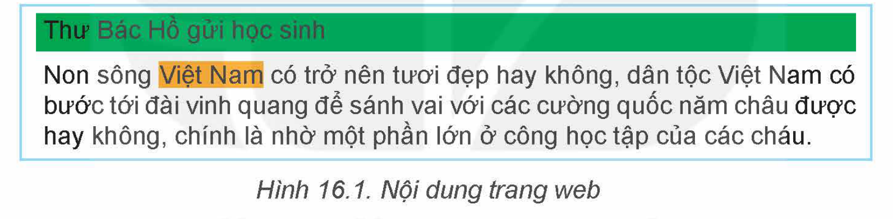
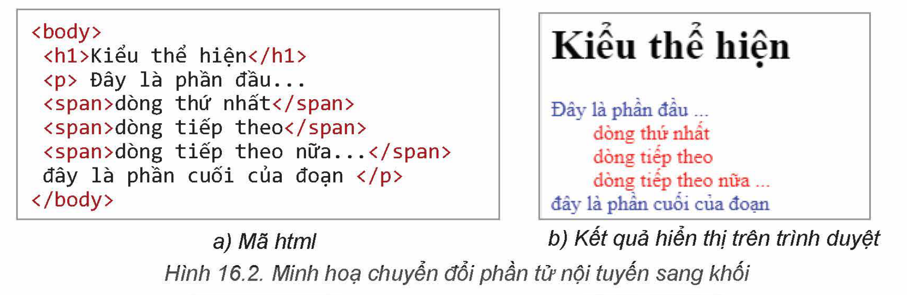
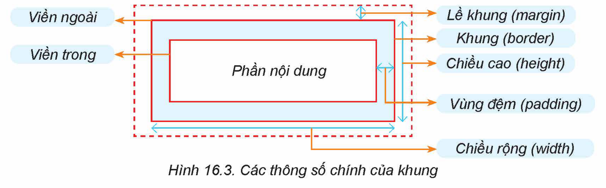
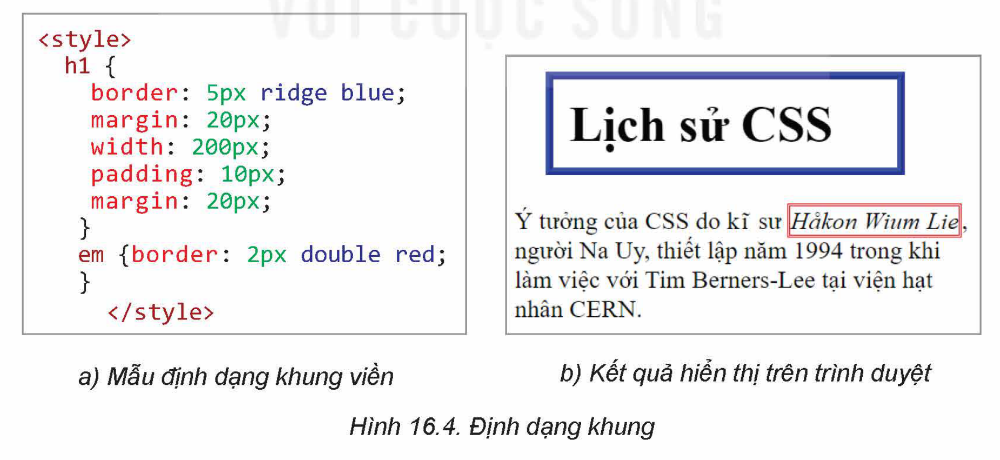
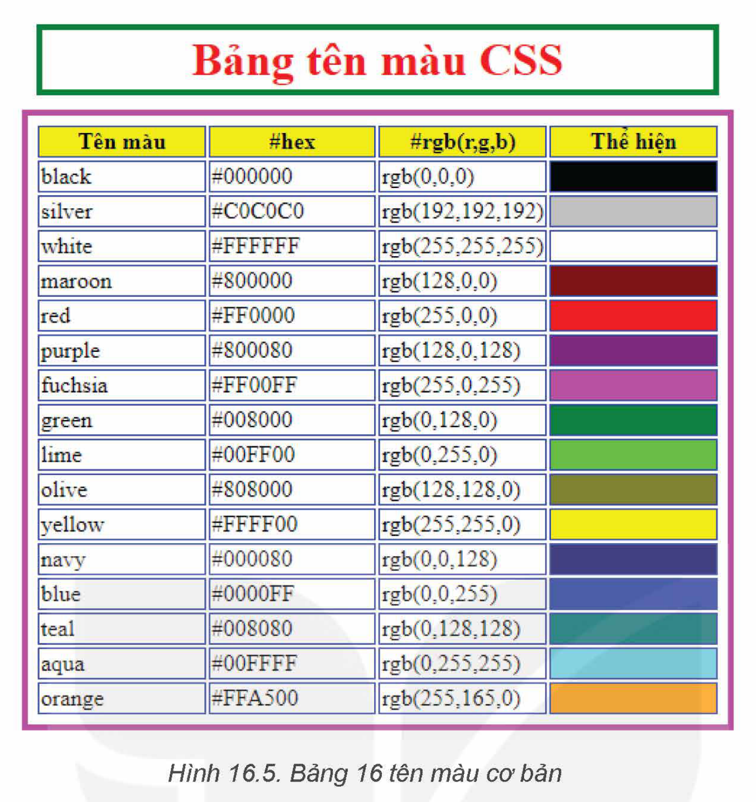

<!-- pdf:91 -->
# BÀI 16: ĐỊNH DẠNG KHUNG

## 🎯 Sau bài học này em sẽ:

- Sử dụng được CSS để định dạng khung văn bản, kích thước khung, kiểu đường viền,...
- Biết sử dụng CSS cho các bộ chọn khác nhau (id, class,...).

## 🔴 Khởi động

> Trên một trang web thường có rất nhiều phần tử cùng loại (cùng tên thẻ). Ví dụ thẻ `p` sẽ tương ứng với rất nhiều phần tử của trang web. Một định dạng với bộ chọn `p` sẽ áp dụng cho tất cả các thẻ `p`. Nếu muốn phân biệt các thẻ `p` với nhau và muốn tạo ra các CSS để phân biệt các thẻ `p` thì có thể thực hiện được không?

## 1. PHÂN LOẠI PHẦN TỬ KHỐI VÀ NỘI TUYẾN

> **Hoạt động 1: Tìm hiểu và phân biệt phần tử khối và phần tử nội tuyến**
>
> Quan sát cách tô màu nền của hai phần tử trên trang web trong Hình 16.1, em có nhận xét gì?
>
> 

Các thẻ (hay phần tử) html được chia làm hai loại, **khối** (block level) và **nội tuyến** (inline level).

Các **phần tử khối** thường bắt đầu từ đầu hàng và kéo dài suốt chiều rộng của trang web. Trong ví dụ ở Hình 16.1, dòng chữ *Thư Bác Hồ gửi học sinh* được thể hiện ở dạng khối.

Các **phần tử nội tuyến** là các phần tử nhúng bên trong một phần tử khác. Trong ví dụ ở Hình 16.1, cụm từ *Việt Nam* là một phần tử nội tuyến, được nhúng trong phần tử `p`.

Mặc định các phần tử HTML sẽ thuộc một trong hai loại khối hoặc nội tuyến (Bảng 16.1).

*Bảng 16.1. Phân loại phần tử CSS*

| Phần tử loại khối | Phần tử loại nội tuyến |
| --- | --- |
| `h1` – `h6`, `p`, `div`, `address`, `nav`, `article`, `section`, `aside`, `form`, `header`, `footer`, `table`, `hr`, `ol`, `ul`, `li`, `canvas` | `b`, `span`, `a`, `img`, `em`, `strong`, `sub`, `sup`, `var`, `samp`, `cite`, `dfn`, `kbd`, `pre`, `code`, `q`, `i`, `u`, `del`, `ins`, `mark`, `br`, `label`, `textarea`, `input`, `script` |

Chúng ta có thể thay đổi loại phần tử HTML bằng thuộc tính **`display`**. Các giá trị của thuộc tính này bao gồm **block**, **inline**, **none**. Giá trị **none** sẽ làm ẩn (không hiển thị) phần tử này trên trang web. Ví dụ CSS sau sẽ đổi loại phần tử **span** từ dạng mặc định là **inline** sang **block**.

<!-- pdf:92 -->
```html
<style>
  span {display: block;
    text-indent: 2em;
    color: red;}
  p {color: blue;}
</style>
```

Kết quả áp dụng mẫu CSS trên được minh hoạ trong Hình 16.2.



> Các phần tử HTML đều thuộc một trong hai loại **khối** (block) hoặc **nội tuyến** (inline). Có thể dùng thuộc tính **`display`** để thay đổi loại phần tử.

> **Câu hỏi:**
>
> 1. Chiều rộng của các phần tử nội tuyến phụ thuộc vào những yếu tố nào? Có phụ thuộc vào chiều rộng của cửa sổ trình duyệt không?
> 2. Khẳng định “Chiều rộng của các phần tử khối chỉ phụ thuộc vào kích thước của cửa sổ trình duyệt” là đúng hay sai?

## 2. THIẾT LẬP ĐỊNH DẠNG KHUNG BẰNG CSS

Trong hoạt động tiếp theo các em sẽ được làm quen với cách định dạng khung, viền cho các phần tử HTML của trang web. Cần phân biệt hai loại phần tử HTML, phần tử khối và phần tử nội tuyến. Với phần tử dạng khối, các khung được xác định với đầy đủ tính chất, còn với các phần tử nội tuyến thì khung chỉ có thể thiết lập mà không có các thông số chiều cao, chiều rộng.

> **Hoạt động 2: Tìm hiểu cách thiết lập định dạng khung cho các phần tử**
>
> Quan sát Hình 16.3 để biết các thông số chính của khung của phần tử HTML để có thể hiểu được cách thiết lập khung, viền bằng CSS.
>
> 

<!-- pdf:93 -->
Các thuộc tính liên quan đến khung của một phần tử HTML được mô tả trong Bảng 16.2. Lưu ý các thuộc tính này đều không có tính kế thừa.

*Bảng 16.2. Các thuộc tính liên quan đến khung*

| Thuộc tính | Ý nghĩa |
| --- | --- |
| `width` | Chiều rộng của khung. Thuộc tính này chỉ áp dụng cho phần tử dạng khối. |
| `height` | Chiều cao khung. Thuộc tính này chỉ áp dụng cho phần tử dạng khối. |
| `padding` | Vùng đệm, khoảng cách từ vùng text đến đường viền ngoài của khung. |
| `margin` | Lề khung, khoảng cách từ đường viền ngoài của khung đến văn bản xung quanh (nếu có). |
| `border-color` | Màu của viền khung. |
| `border-width` | Độ dày của đường viền khung. |
| `border-style` | Kiểu đường viền khung. Các giá trị có thể là: none, solid, dotted, dashed, double, inset, outset, ridge, groove. |
| `border` | Thuộc tính này có thể gán giá trị là đồng thời các thuộc tính border-width, border-style và border-color, ví dụ: `{border: 2px solid red;}` |
<!-- term: Các thuộc tính khung trong CSS -->

Cho một đoạn mã HTML như sau:

```html
<body>
<h1> Lịch sử CSS </h1>
<p>Ý tưởng của CSS do kĩ sư <em>Håkon Wium Lie</em>,
   người Na Uy, thiết lập năm 1994 trong khi làm việc với
   Tim Berners-Lee tại viện hạt nhân CERN. </p>
</body>
```

Nếu thiết lập mẫu định dạng như Hình 16.4a cho đoạn mã HTML ở trên thì kết quả nhận được tương tự như Hình 16.4b.



> Có thể thiết lập định dạng khung cho các phần tử bằng CSS. Cần phân biệt hai loại phần tử khối và phần tử nội tuyến với các thông số khác nhau.

<!-- pdf:94 -->
> **Câu hỏi:**
>
> 1. Trong các thuộc tính khung của một phần tử HTML, khoảng cách từ vùng văn bản đến đường viền khung được gọi là gì?
> 2. Lề khung khác gì với vùng đệm?

## 3. MỘT SỐ BỘ CHỌN ĐẶC BIỆT CỦA CSS

> **Hoạt động 3: Tìm hiểu một số cách thiết lập các bộ chọn đặc biệt khác**
>
> Thảo luận, tìm hiểu thêm cách thiết lập bộ chọn đặc biệt của CSS và trả lời các câu hỏi sau:
> 1. Có thể đặt mẫu định dạng cho các thẻ với thuộc tính cho trước được không?
> 2. Có thể thiết lập các mẫu định dạng khác nhau cho cùng một loại phần tử giống nhau được không? Nếu có thì thực hiện bằng cách nào?

### a) Thiết lập bộ chọn là một lớp các phần tử có ý nghĩa gần giống nhau
<!-- ocr-ok: đối chiếu ảnh trang PDF 94 khớp nguyên văn -->

Trong thực tế, có thể có nhu cầu định dạng cho một nhóm phần tử có cùng ý nghĩa, ví dụ các đoạn văn bản có liên quan đến một sự kiện nào đó hoặc một số đoạn văn bản quan trọng cần nhấn mạnh. Trong các trường hợp này, thiết lập **bộ chọn lớp** (`class`) cho các phần tử đó để có thể thiết lập định dạng chung. Cấu trúc chung của định dạng CSS liên quan đến lớp:

```css
.class {thuộc tính : giá trị;}
```

Ví dụ một số bộ chọn lớp CSS như sau:

```html
<style>
.waring {color: red;} /*chữ màu đỏ cho các đoạn văn bản thuộc lớp warning*/
.test {/*chữ màu xanh và in đậm cho lớp test*/
 color: blue;
 font-weight: bold;}
</style>
```

Ví dụ đoạn mã HTML sau được áp dụng mẫu CSS ở ví dụ trên thì đoạn văn bản thứ nhất có chữ màu xanh và in đậm, đoạn văn bản thứ hai có chữ màu đỏ.

```html
<body>
 <p class = "test"> Thông tin đang test </p>
 <p class = "warning"> Thông tin cần warning. </p>
</body>
```

*Bảng 16.3. Một số định dạng hay gặp với bộ chọn lớp*

| Bộ chọn | Ý nghĩa |
| --- | --- |
| `.test` | Áp dụng cho tất cả các phần tử có lớp tên là test. |
| `.test.warning` | Áp dụng cho tất cả các phần tử có tên lớp đồng thời là test và warning. Ví dụ: `<p class = "test warning">... </p>` |
| `p.test` | Áp dụng cho tất cả các phần tử `p` có gắn lớp tên test. |

<!-- pdf:95 -->
### b) Thiết lập bộ chọn riêng cho từng phần tử riêng biệt có mã định danh id
<!-- ocr-ok: đối chiếu ảnh trang PDF 95 khớp nguyên văn -->

Chúng ta đã biết cách thiết lập và gắn **mã định danh `id`** cho từng phần tử trong tệp HTML. Mỗi phần tử chỉ có một mã định danh `id` duy nhất trong một trang web.

CSS cho phép thiết lập các mẫu định dạng với các phần tử có id tương ứng như sau:
<!-- term: Bộ chọn mã định danh -->

```css
#idname {thuộc tính : giá trị ;}
```

Ví dụ một số mẫu định dạng ID như sau:

```css
#home {color : red;} /*chữ màu đỏ cho phần tử với id = "home"*/
p#home {font-size: 150%;} /*cỡ chữ 150% cho phần tử p có id = "home"*/
```

### c) Thiết lập bộ chọn thuộc tính CSS

Một tính chất quan trọng khác của CSS là có thể thiết lập **bộ chọn là thuộc tính**. Các định dạng này sẽ được thiết lập và áp dụng cho các phần tử nếu được gắn với thuộc tính cụ thể nào đó. Sau đây là ví dụ định dạng CSS loại này:

```css
[href] {border: 1px solid blue;}
/*áp dụng cho tất cả các phần tử có thuộc tính href, ví dụ các phần tử a.*/
a[target = "_blank"] {color : red; font-weight: bold;}
/*áp dụng chữ màu đỏ và in đậm cho tất cả các thẻ a với thuộc tính target = "_blank" */
```

*Lưu ý:* Khi đặt tên cho id và class:

- Tên của id và class phân biệt chữ in hoa, in thường.
- Tên bắt buộc phải có ít nhất một kí tự không là số, không bắt đầu bằng số, không chứa dấu cách và các kí tự đặc biệt khác.
- Một phần tử có thể thuộc nhiều lớp khác nhau. Để khai báo, chúng ta đặt các tên lớp cách nhau bởi dấu cách. Trong ví dụ sau phần tử `p` thuộc đồng thời ba lớp là “test”, “more” và “once”:

```html
<p class = "test more once"> Đoạn chương trình cần kiểm tra. </p>
```

> Có thể thiết lập các mẫu định dạng với bộ chọn là **class**, **ID** hoặc **thuộc tính**.

> **Câu hỏi:**
>
> 1. Nêu sự khác biệt cơ bản giữa thuộc tính id và class của các phần tử HTML.
> 2. Mỗi bộ chọn sau có ý nghĩa gì?
>
> a) `div#bat_dau > p`.
>
> b) `p.test em#p123`.
<!-- ocr-ok: đối chiếu ảnh trang PDF 95 khớp nguyên văn -->

## 4. THỰC HÀNH

**Nhiệm vụ: Tạo trang web**

*Yêu cầu:* Tạo trang web mô tả bảng 16 tên màu cơ bản CSS như Hình 16.5.

***Gợi ý:*** Bài thực hành có thể thực hiện theo hai bước:

*Bước 1.* Thiết lập bảng với nội dung như trong Hình 16.5 nhưng chưa định dạng.

*Bước 2.* Viết bổ sung các mẫu CSS để định dạng khung đúng như Hình 16.5.

<!-- pdf:96 -->


***Hướng dẫn:***

*Bước 1.* Thiết lập trang web theo nội dung như Hình 16.5. Sử dụng các thẻ `<table> ... </table>` để thiết lập bảng. Tên bảng được thiết lập bằng thẻ `<caption>`. Các hàng thiết lập bằng thẻ `<tr> ...</tr>` và ô của bảng thiết lập bằng thẻ `<tr>...<tr>`. Riêng các ô tiêu đề (hàng thứ nhất) sẽ sử dụng thẻ `<th>`. Lưu ý các ô cuối của mỗi hàng cần được thiết lập màu nền theo đúng thông số màu đã ghi tại cột 1 hoặc cột 2. Ví dụ mã nguồn của bảng với 2 hàng đầu tiên như sau, các hàng khác sẽ được thiết lập tương tự:

```html
<table>
  <caption> Bảng tên màu CSS </caption>
  <tr>
    <th> Tên màu </th>
    <th> #hex </th>
    <th> #rgb(r,g,b) </th>
    <th> Thể hiện </th>
  </tr>
  <tr>
    <td>black</td>
    <td>#000000</td>
    <td>rgb(0,0,0)</td>
    <td style = “background-color: rgb(0,0,0)”></td>
  </tr>
  ...
</table>
```

<!-- pdf:97 -->
*Bước 2.* Thiết lập mẫu CSS để tạo khuôn khung, viền cho bảng.

Ví dụ các mẫu định dạng sau:

```html
<style>
  table {border: 4px solid magenta;
         padding: 5px;
         }
  td,th,tr {border: 1px solid blue;}
  td {border: 1px solid blue;
    width: 25%;}
  th { border: 1px solid blue;
    background-color: rgb(255,255,0);}
  tr {border: 1px solid black;
    }
  caption {color: red;
         font-size: 200%;
         font-weight: bold;
         border: 4px solid green;
         padding: 2px;
         margin: 10px;
         }
</style>
```

## ✏️ Luyện tập

1. Phần tử html có thể ẩn đi trên trang web được không? Nếu có thì dùng lệnh CSS gì?
2. Hãy giải thích ý nghĩa định dạng sau:

```css
.test .test_more {background-color: red;}
```

## 🚀 Vận dụng

1. Giả sử nội dung trang web của em có rất nhiều thẻ `p`, trong đó có ba đoạn mà em thấy quan trọng nhất, kí hiệu các đoạn này là P1, P2, P3. Có cách nào thiết lập định dạng CSS để có thể định dạng P1 khác biệt, P2 và P3 có cùng kiểu và cũng khác biệt không? Tất cả các đoạn còn lại có định dạng giống nhau. Hãy nêu cách giải quyết vấn đề của em.
2. Có thể thiết lập định dạng cho các khung với thông số khung, viền trên, dưới, trái, phải khác nhau được không? Em hãy tìm hiểu và trình bày cách thiết lập định dạng CSS cho các khung, viền như vậy.

## 📷 Danh sách hình trong bài

| Mã hình | Số hình SGK | Trang PDF | Chú thích |
| --- | --- | --- | --- |
| H12-tin_hoc_khmt-b16-01 | Hình 16.1 | 91 | Nội dung trang web |
| H12-tin_hoc_khmt-b16-02 | Hình 16.2 | 92 | Minh hoạ chuyển đổi phần tử nội tuyến sang khối |
| H12-tin_hoc_khmt-b16-03 | Hình 16.3 | 92 | Các thông số chính của khung |
| H12-tin_hoc_khmt-b16-04 | Hình 16.4 | 93 | Định dạng khung |
| H12-tin_hoc_khmt-b16-05 | Hình 16.5 | 96 | Bảng 16 tên màu cơ bản |
