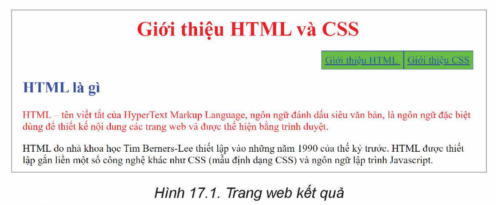

<!-- pdf:98 -->
# BÀI 17: CÁC MỨC ƯU TIÊN CỦA BỘ CHỌN

## 🎯 Sau bài học này em sẽ:

- Biết cách dùng CSS cho các kiểu bộ chọn khác nhau (id, class, pseudo-class, pseudo-element).
- Biết cách sử dụng CSS thực hiện các mẫu định dạng theo thứ tự ưu tiên của mình.

## 🔴 Khởi động

> Chúng ta đã biết nhiều cách thiết lập mẫu định dạng cho các phần tử HTML. Tuy nhiên, các lệnh định dạng CSS đã biết đều chỉ áp dụng cho các phần tử tĩnh, tức là không phụ thuộc vào tương tác với người dùng. Vậy có cách nào thiết lập CSS để định dạng cho các trạng thái tương tác với người dùng, ví dụ như trạng thái khi người dùng di chuyển hay nháy chuột lên phần tử đó không?

## 1. KIỂU BỘ CHỌN DẠNG PSEUDO-CLASS VÀ PSEUDO-ELEMENT
<!-- ocr-ok: đối chiếu ảnh trang PDF 98 khớp nguyên văn -->

> **Hoạt động 1: Tìm hiểu một số kiểu lớp và bộ chọn pseudo-class, pseudo-element**
>
> Thảo luận và trả lời các câu hỏi sau:
> 1. Thế nào là pseudo-class của bộ chọn? Cách áp dụng.
> 2. Thế nào là pseudo-element của bộ chọn? Nêu ý nghĩa của khái niệm này trong định dạng CSS.

### a) Bộ chọn pseudo-class
<!-- ocr-ok: đối chiếu ảnh trang PDF 98 khớp nguyên văn -->

**Pseudo-class** (**lớp giả**) là khái niệm chỉ các trạng thái đặc biệt của phần tử HTML. Các trạng thái này không cần định nghĩa và mặc định được coi như các lớp có sẵn của CSS. Trong CSS, các lớp giả quy định viết sau dấu “:” theo cú pháp:

```css
:pseudo-class {thuộc tính : giá trị ;}
```

*Bảng 17.1. Một số lớp giả thường dùng*

| Bộ chọn | Ý nghĩa | Ví dụ |
| --- | --- | --- |
| `:link` | Tất cả các liên kết khi chưa được kích hoạt. | Các liên kết (khi chưa kích hoạt) sẽ có màu xanh dương. `a:link {color: blue;}` |
| `:visited` | Tất cả các liên kết sau khi đã được kích hoạt một lần. | Các liên kết sau khi kích hoạt chuyển màu xám. `a:visited {color: gray;}` |
| `:hover` | Tất cả các phần tử, khi người dùng di chuyển con trỏ chuột lên đối tượng. | Khi di chuyển con trỏ chuột lên đối tượng có id = “home” sẽ hiển thị với cỡ chữ tăng lên 150%. `#home:hover {font-size: 150%;}` |
<!-- term: Các lớp giả :link, :visited, :hover -->

<!-- pdf:99 -->
Ví dụ sau mô tả CSS thiết lập định dạng cho các trạng thái đặc biệt của phần tử `a` chứa liên kết. Các trạng thái này gọi là "lớp giả". Liên kết "Tự học nhanh CSS" sẽ được thiết lập màu đỏ mặc định. Nếu đã được kích hoạt, liên kết sẽ tự động chuyển màu xanh lá cây. Khi di chuyển con trỏ chuột lên liên kết thì dòng chữ liên kết đổi màu hồng.

**HTML code:**

```html
<!DOCTYPE html>
<html>
  <head>
    <style>
      a:link {color: red; }
      a:visited {color: green; }
      a:hover { color: magenta;}
      h1 {color : blue; }
    </style>
  </head>
  <body>
    <h1>CSS là gì</h1>
    <p><a href = "https://www.w3schools.com/css/" target= "_blank">Tự học nhanh CSS</a></p>
    <p>CSS (Cascading Style Sheets) là ngôn ngữ định dạng đặc biệt được dùng để mô tả cách thể hiện của văn bản HTML trong trang web.</p>
  </body>
</html>
```

**Hiển thị:**

> **CSS là gì**
>
> <u>Tự học nhanh CSS</u>
>
> CSS (Cascading Style Sheets) là ngôn ngữ định dạng đặc biệt được dùng để mô tả cách thể hiện của văn bản HTML trong trang web.

### b) Bộ chọn kiểu pseudo-element
<!-- ocr-ok: đối chiếu ảnh trang PDF 99 khớp nguyên văn -->

**Pseudo-element** (**phần tử giả**) là khái niệm chỉ một phần (hoặc một thành phần) của các phần tử bình thường. Các phần này có thể coi là một phần tử giả và có thể thiết lập mẫu định dạng CSS. Quy định phần tử giả viết sau dấu “::” theo cú pháp:

```css
::pseudo-element {thuộc tính : giá trị ;}
```

*Bảng 17.2. Một số phần tử giả*

| Bộ chọn | Mô tả | Ví dụ |
| --- | --- | --- |
| `::first-line` | Dòng đầu tiên của đối tượng. | Dòng đầu tiên của các đoạn thuộc lớp test chuyển phông monospace. `p.test::first-line {font-family: monospace;}` |
| `::first-letter` | Kí tự đầu tiên của đối tượng. | Kí tự đầu tiên của đoạn có id = “first” có màu đỏ và kích thước gấp đôi bình thường. `p#first::first-letter {font-size: 200%; }` |
| `::selection` | Phần được chọn (bằng cách kéo thả chuột trên màn hình) của đối tượng. | Vùng đang chọn bất kì sẽ chuyển màu nền xanh lá mạ. `::selection {background-color: lime;}` |
<!-- term: Các phần tử giả ::first-line, ::first-letter, ::selection -->

Ví dụ sau mô tả CSS thiết lập định dạng cho một phần hoặc một thành phần của phần tử `p` (được gọi là phần tử giả). CSS sẽ tự động tạo khuôn cho dòng đầu tiên của tất cả các phần tử `p` của trang web với màu đỏ, phông chữ có độ rộng đều nhau và có kích thước lớn hơn 1,2 lần so với bình thường. Chú ý dòng đầu tiên này không phụ thuộc vào văn bản mà chỉ phụ thuộc vào độ rộng của cửa sổ trình duyệt.

<!-- pdf:100 -->
**HTML code:**

```html
<!DOCTYPE html>
<html>
<head>
    <style>
      p::first-line {color: red;
      font-family: monospace;
      font-size: 120%; }
    </style>
  </head>
<body>
<p>HTML là ngôn ngữ đánh dấu siêu văn bản, là ngôn ngữ đặc biệt dùng để thiết kế nội dung các trang web và được thể hiện bằng trình duyệt.</p>
<p>CSS là ngôn ngữ định dạng đặc biệt được dùng để mô tả cách thể hiện của văn bản HTML trong trang web.</p>
</body>
</html>
```

**Hiển thị:**

> `HTML là ngôn ngữ` đánh dấu siêu văn bản, là ngôn ngữ đặc biệt dùng để thiết kế nội dung các trang web và được thể hiện bằng trình duyệt.
>
> `CSS là ngôn ngữ` định dạng đặc biệt được dùng để mô tả cách thể hiện của văn bản HTML trong trang web.

> CSS hỗ trợ thiết lập định dạng cho các **lớp giả** (pseudo-class) và **phần tử giả** (pseudo-element). Lớp giả mô tả các trạng thái được định nghĩa trước của phần tử. Phần tử giả mô tả các thành phần (nhỏ hơn) của phần tử.

> **Câu hỏi:**
>
> 1. Muốn áp dụng đổi màu chữ một vùng trên màn hình khi nháy chuột tại vùng đó thì cần phải dùng định dạng CSS nào?
> 2. Muốn tăng kích thước một đoạn văn bản khi di chuyển chuột qua đoạn văn bản đó thì cần dùng định dạng CSS nào?

## 2. MỨC ĐỘ ƯU TIÊN KHI ÁP DỤNG CSS
<!-- ocr-ok: đối chiếu ảnh trang PDF 100 khớp nguyên văn -->

> **Hoạt động 2: Tìm hiểu ý nghĩa và ứng dụng của mức độ ưu tiên trong CSS**
>
> Giả sử có định dạng CSS như sau:
>
> ```html
> <style>
>     .test {color: green;}
>     p {color: red;}
> </style>
> ```
>
> CSS trên áp dụng cho phần tử HTML sau:
>
> ```html
> <p class="test">Tin học 12</p>
> ```
>
> Khi đó cụm từ “Tin học 12” sẽ có màu gì?

Khi có nhiều mẫu định dạng có thể áp dụng cho một phần tử HTML nào đó trên trang web, CSS sẽ áp dụng định dạng theo **thứ tự ưu tiên**. Trong các bài học trước, em đã biết hai quy tắc ưu tiên là tính kế thừa và quy định về thứ tự cuối cùng (cascading). Trên thực tế quy định về chọn mẫu định dạng ưu tiên từ cao xuống thấp của CSS được mô tả trong Bảng 17.3.

<!-- pdf:101 -->
*Bảng 17.3. Thứ tự (mức) ưu tiên của CSS*

| STT | CSS | Giải thích |
| --- | --- | --- |
| 1 | `!important` | Các thuộc tính trong CSS với từ khoá **!important** sẽ có mức ưu tiên cao nhất. |
| 2 | CSS trực tiếp (inline CSS). | Các định dạng nằm ngay trong phần tử HTML với thuộc tính `style`. |
| 3 | CSS liên quan đến kích thước thiết bị (Media type). | Các định dạng loại này thường dùng để điều khiển cách hiển thị thông tin phụ thuộc vào kích thước màn hình của thiết bị. Ví dụ mẫu định dạng sau sẽ tăng kích thước chữ lên 150% nếu chiều ngang màn hình nhỏ hơn 600 px: `@media only screen and (max-width: 600px) { body {font-size: 150%; }}` |
| 4 | **Trọng số** CSS. | Mỗi định dạng CSS sẽ có **trọng số** (specificity) riêng của mình. Tại mức ưu tiên này, định dạng CSS có trọng số cao nhất sẽ được áp dụng. |
| 5 | Nguyên tắc thứ tự cuối cùng (Rule order). | Nếu có nhiều mẫu định dạng với cùng trọng số thì định dạng ở vị trí cuối cùng sẽ được áp dụng. |
| 6 | Kế thừa từ CSS cha. | Nếu không tìm thấy mẫu định dạng tương ứng thì sẽ lấy thông số định dạng CSS kế thừa từ phần tử cha. |
| 7 | Mặc định theo trình duyệt. | Nếu không có bất cứ định dạng CSS nào thì trình duyệt quyết định thể hiện nội dung mặc định. |

Như vậy theo nguyên tắc trên, nếu có một dãy các mẫu định dạng CSS cùng có thể áp dụng cho một phần tử HTML thì tính kế thừa CSS và nguyên tắc thứ tự cuối cùng được xếp dưới **trọng số** CSS, tức là khi đó CSS sẽ tính trọng số các mẫu định dạng, cái nào có trọng số lớn hơn sẽ được ưu tiên áp dụng.

Cách tính **trọng số** của CSS rất đơn giản dựa trên giá trị trọng số của từng thành phần của bộ chọn (selector) trong mẫu định dạng. Trọng số của mẫu định dạng sẽ được tính bằng tổng của các giá trị thành phần đó. Giá trị của các thành phần của bộ chọn theo quy định trong Bảng 17.4.

*Bảng 17.4. Giá trị của các thành phần của bộ chọn*

| STT | Bộ chọn | Giá trị đóng góp trọng số |
| --- | --- | --- |
| 1 | Mã định danh (ID). | 100 |
| 2 | Lớp, lớp giả, bộ chọn kiểu thuộc tính. (Class, pseudo-class, attribute selector). | 10 |
| 3 | Phần tử, phần tử giả (element, pseudo-element). | 1 |
| 4 | `*` | 0 |

*Bảng 17.5. Một số ví dụ tính trọng số*

| Bộ chọn | Trọng số | Giải thích |
| --- | --- | --- |
| `p > em` | 2 | Bộ chọn có hai phần tử là `p` và `em`, vậy trọng số bằng 1 + 1 = 2. |
| `.test #p11` | 110 | Bộ chọn bao gồm 1 `class` và 1 `id`, vậy trọng số bằng 10 + 100 = 110. |
| `p.test em.more` | 22 | Bộ chọn có hai phần tử (`p`, `em`) và hai `class` (test, more), vậy trọng số bằng 2 + 20 = 22. |
| `p > em#p123` | 102 | Bộ chọn có hai phần tử (`p`, `em`) và một `id`, vậy trọng số bằng 2 + 100 = 102. |

<!-- pdf:102 -->
Trở lại với ví dụ của Hoạt động 2, cụm từ “Tin học 12” là nội dung của phần tử `p`. Có hai định dạng CSS có thể áp dụng cho phần tử. Định dạng phía trên có trọng số 10 (vì là pseudo-class), định dạng phía dưới có trọng số 1 (vì là element). Do đó định dạng phía trên sẽ được áp dụng và cụm từ đó sẽ có màu xanh lá cây.

> Nếu có nhiều mẫu định dạng CSS cùng mức ưu tiên áp dụng cho một phần tử HTML thì mẫu CSS nào có **trọng số** cao nhất sẽ được áp dụng.

> **Câu hỏi:**
>
> 1. Tính trọng số của các mẫu định dạng sau:
>
> a) `#n12 > .test`.
>
> b) `h1, h2, h3, h4 > #new`.
>
> c) `p + em.test`.
>
> 2. Khi nào nguyên tắc cascading (thứ tự cuối cùng) được áp dụng cho một dãy các định dạng CSS?

## 3. THỰC HÀNH

**Nhiệm vụ 1: Nhập tệp html**

*Yêu cầu:* Nhập tệp html với nội dung như sau:

> **Giới thiệu HTML và CSS**
>
> Giới thiệu HTML
>
> <u>Giới thiệu CSS</u>
>
> **HTML là gì**
>
> HTML – tên viết tắt của HyperText Markup Language, ngôn ngữ đánh dấu siêu văn bản, là ngôn ngữ đặc biệt dùng để thiết kế nội dung các trang web và được thể hiện bằng trình duyệt.
>
> Cấu trúc mỗi tệp HTML là một cấu trúc dạng cây của các phần tử HTML.
>
> Xem logo của HTML.
>
> Link xem thêm chi tiết về HTML tại đây (https://en.wikipedia.org/wiki/HTML).
>
> Link xem và tự học HTML tại đây (https://www.w3schools.com/html/default.asp).
>
> **CSS là gì**
>
> CSS (Cascading Style Sheets) là ngôn ngữ định dạng đặc biệt được dùng để mô tả cách thể hiện của văn bản HTML trong trang web.
>
> Mỗi định dạng CSS đều có dạng chuẩn là bộ chọn {thuộc tính : giá trị ;}.
>
> Xem logo của CSS.
>
> Link xem thêm chi tiết về CSS tại đây (https://en.wikipedia.org/wiki/CSS).
>
> Link xem và tự học CSS tại đây (https://www.w3schools.com/css/default.asp).

**Nhiệm vụ 2: Thiết lập định dạng bằng CSS**

*Yêu cầu:* Thiết lập định dạng cho tệp html ở Nhiệm vụ 1 bằng CSS theo các yêu cầu sau:

- Tiêu đề chính của bài màu đỏ, căn giữa.
- Các tiêu đề nhỏ màu xanh, đậm.
- Phần kết nối liên kết phía trên định dạng trên một hàng ngang, căn phải, các liên kết có màu nền xanh lá cây. Khi di chuột lên thì chuyển chữ màu đỏ.
- Các đoạn đầu tiên bên dưới các tiêu đề có màu đỏ, các đoạn khác vẫn màu mặc định.
- Các hình ảnh logo ban đầu ẩn đi. Khi nháy chuột lên dòng “Xem logo của HTML.” và “Xem logo của CSS.” thì các hình ảnh tương ứng được hiện ra.

Hình ảnh trang web sau khi định dạng cần được thể hiện như sau:

<!-- pdf:103 -->


***Hướng dẫn:***

- Phần liên kết đầu trang có thể thiết lập bằng các thẻ `<nav>` và `<ul>`/`<li>` như sau:

```html
<nav>
  <ul>
    <li><a href = "#P1"> Giới thiệu HTML </a></li>
    <li><a href = "#P2"> Giới thiệu CSS </a></li>
  </ul>
</nav>
```

- CSS được thiết lập như sau:

```html
<style>
  h1 {color: red; text-align: center;}
  h2 {color: blue;}
  nav { text-align: right; }
  li {display: inline;
    border: 1px solid blue;
    padding: 5px;
    background-color: lime;
    }
  a:hover {color: red; background-color: cyan;}
  h2 + p {color: red; }
  img {display: none;}
  .img:active + img {display: block ;}
</style>
```

## ✏️ Luyện tập

1. Giải thích sự khác nhau giữa hai định dạng sau:

```css
#p123 + p {color : red ;}
h2#p123 + p {color : red ;}
```

2. Trong phần Thực hành, các tên riêng (tên người, tên tổ chức) cần được bổ sung định dạng đóng khung và in nghiêng. Em sẽ thực hiện các yêu cầu này như thế nào?

## 🚀 Vận dụng

1. Tìm hiểu thêm các dạng pseudo-class khác, nêu ý nghĩa và tìm ví dụ ứng dụng thực tế cho các kiểu bộ chọn này.
2. Tìm hiểu thêm các dạng pseudo-element khác, nêu ý nghĩa và tìm ví dụ ứng dụng thực tế cho các kiểu bộ chọn này.

## 📷 Danh sách hình trong bài

| Mã hình | Số hình SGK | Trang PDF | Chú thích |
| --- | --- | --- | --- |
| H12-tin_hoc_khmt-b17-01 | Hình 17.1 | 103 | Trang web kết quả |
