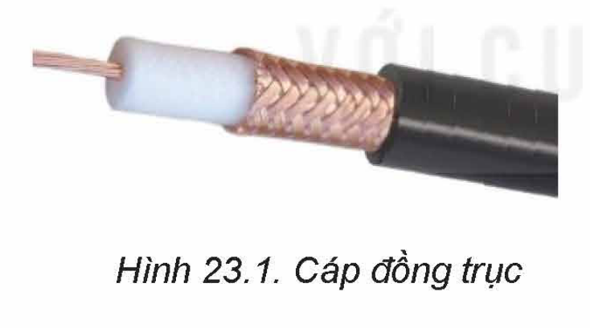
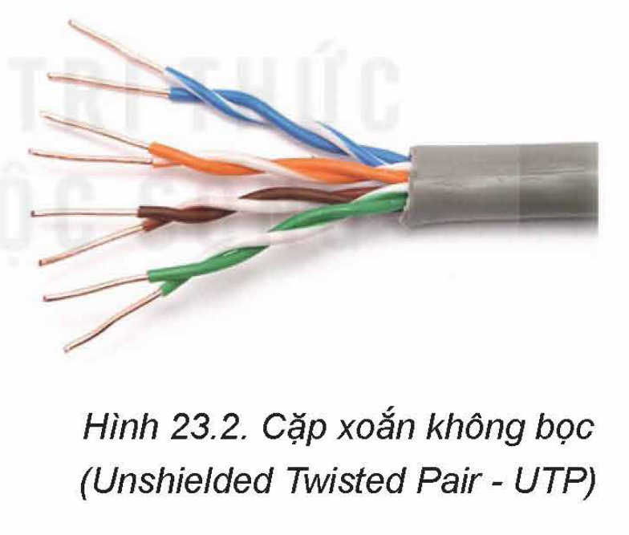
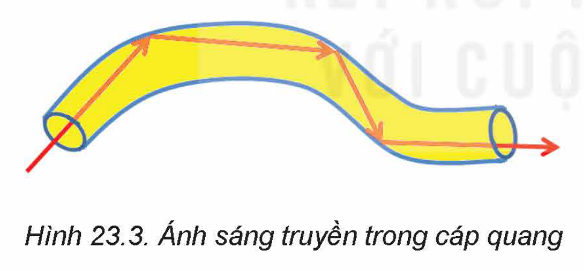
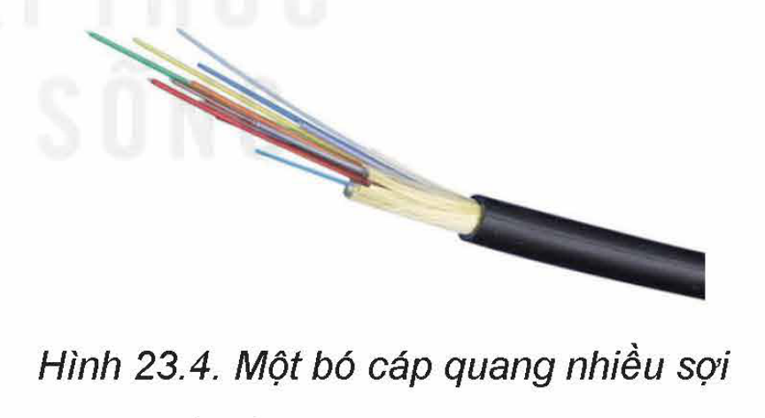
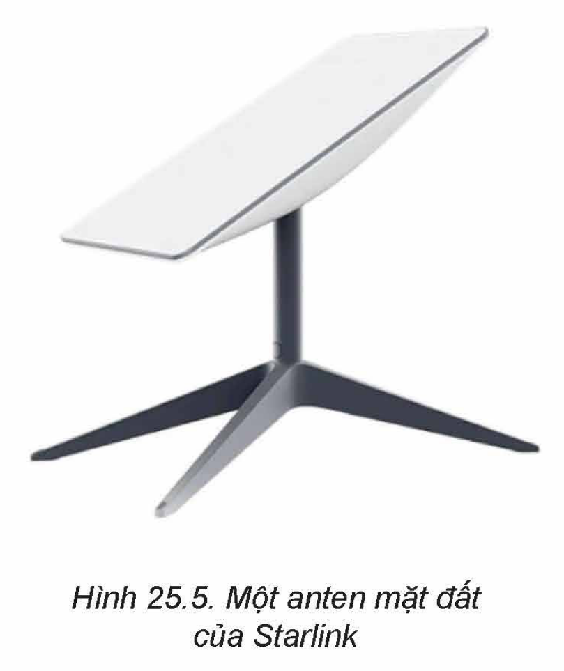
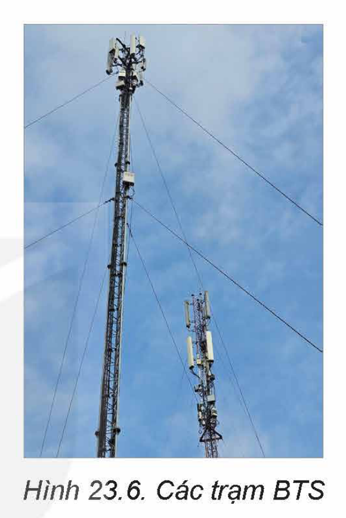

<!-- pdf:125 -->

# BÀI 23: ĐƯỜNG TRUYỀN MẠNG VÀ ỨNG DỤNG

## 🎯 Sau bài học này em sẽ:

- Biết được một số đường truyền mạng thông dụng và ứng dụng.

## 🔴 Khởi động

> Mạng máy tính là nhóm các máy tính được kết nối với nhau bởi các đường truyền theo những giao thức nhất định.
>
> **Đường truyền** (hay kênh truyền) là một thành phần của mạng máy tính. Hãy cùng tìm hiểu các loại đường truyền của mạng và ứng dụng của chúng.

## 1. ĐƯỜNG TRUYỀN CÓ DÂY
<!-- ocr-ok: tiêu đề mục 1 in màu xanh bị OCR đọc thiếu chữ -->

> **Hoạt động 1: Có những loại cáp mạng nào?**
>
> Em có biết loại cáp truyền tín hiệu nào được sử dụng trong mạng máy tính không?
<!-- ocr-ok: tiêu đề hộp hoạt động chữ trắng trên nền cam bị OCR bỏ sót -->

Có nhiều loại cáp truyền tín hiệu như cáp đồng truyền tín hiệu điện và cáp quang truyền tín hiệu ánh sáng. Cáp đồng cũng có nhiều loại như **cáp đồng trục** (Coaxial, Hình 23.1), được dùng phổ biến vào trước những năm 2000 và cáp đôi dây xoắn gọi tắt là **cáp xoắn** (Twisted Pair, Hình 23.2), phổ biến nhất hiện nay.

### a) Cáp xoắn

Cáp xoắn có bốn đôi dây xoắn với nhau giúp hạn chế ảnh hưởng của nhiễu từ môi trường xung quanh, giữ cho tín hiệu truyền qua cáp được ổn định và không bị biến đổi do nhiễu. Cáp sử dụng đầu nối và cổng RJ45. Mỗi đôi dây đều được đánh dấu bằng một màu. Cáp xoắn được dùng trong hầu hết các mạng cục bộ hiện nay.

Chất lượng cáp xoắn khác nhau, dẫn đến hiệu suất truyền dữ liệu và chi phí cũng khác nhau. Người ta chia cáp thành một số loại (**Category**, viết tắt là CAT), ví dụ CAT.4, CAT.5, CAT.6 theo các chuẩn truyền dữ liệu với các thông số về băng thông và khoảng cách truyền hiệu quả. Việc lựa chọn sử dụng loại cáp nào cần phụ thuộc vào các tiêu chuẩn truyền thông trong mạng Ethernet, được nêu trong Bảng 23.1.

<!-- pdf:126 -->

*Bảng 23.1. Các chuẩn truyền thông trong mạng Ethernet*
*"Tốc độ truyền thông thường được đo bằng Megabit/s (Mb/s) hay Gigabit/s (Gb/s)."*

| Chuẩn | Loại cáp | Tốc độ | Khoảng cách truyền hiệu quả | Tên |
| --- | --- | --- | --- | --- |
| 10BASE5 | Đồng trục | 10 Mb/s | 500 m | Thick Ethernet |
| 10BASE2 | Đồng trục | 10 Mb/s | 185 m | Thin Ethernet |
| 10BASE-T | UTP | 10 Mb/s | 100 m | Ethernet Twist Pair |
| 100BASE-TX | UTP | 100 Mb/s | 250 m | Fast Ethernet |
| 100BASE-FX | Cáp quang | 100 Mb/s | 2000 m | Fast Ethernet |
| 1000Base-SX | Cáp quang đa mode | Cỡ Gb/s | 550 m | Gigabit Ethernet |
| 1000BASE-LX | Cáp quang đơn hoặc đa mode | Cỡ Gb/s | 550 m cáp đa mode; 5000 m cáp đơn mode | Gigabit Ethernet |
| 1000Base-CX | Cáp xoắn bọc kim STP | 1-10 Gb/s | 25 m | Gigabit Ethernet |
| 1000Base-T | Cáp xoắn CAT 6 | 1-10 Gb/s | 100 m (CAT5, CAT6) | Gigabit Ethernet |
<!-- term: Các chuẩn truyền thông trong mạng Ethernet -->
<!-- ocr-ok: bảng 23.1 có các ô gộp dòng bị OCR đọc lệch cột -->

### b) Cáp quang

Với cáp xoắn, khoảng cách truyền hiệu quả chỉ khoảng 100 m. Nếu cần mở rộng mạng, người ta có thể dùng các thiết bị chuyển tiếp dữ liệu như repeater hay switch để kéo dài thêm đường truyền, tuy nhiên có những giới hạn kĩ thuật về số lần chuyển tiếp.

Cáp quang là một phương tiện rẻ tiền, có thể truyền xa.

**Cáp quang** là một ống sợi thuỷ tinh hay nhựa có đường kính rất nhỏ, mặt trong phản xạ toàn phần. Ngay cả khi cáp bị uốn cong, ánh sáng vẫn đi được thông suốt do tia sáng phản xạ trong lòng ống (Hình 23.3).

Có hai loại cáp quang, **cáp đa mode** (multimode) và **cáp quang đơn mode** (single mode – có đường kính rất nhỏ, truyền xa hơn). Cáp quang có nhiều ưu điểm như:
- Tín hiệu truyền dẫn ổn định, không bị ảnh hưởng bởi nhiễu điện từ và các điều kiện ngoại cảnh khác.
- Do tín hiệu trong cáp quang ít suy hao hơn tín hiệu trong cáp điện nên có thể truyền xa hơn.
- Băng thông lớn gấp hàng trăm lần so với cách truyền thuê bao số trên mạng điện thoại ADSL.
- Gọn nhẹ, tiêu thụ năng lượng rất thấp và chi phí rẻ hơn so với cáp đồng.
- Bảo mật vì khó lấy tín hiệu trên đường truyền.
<!-- term: Ưu điểm của cáp quang -->

<!-- pdf:127 -->

Cáp quang được dùng rất rộng rãi, đặc biệt với khoảng cách lớn. Việt Nam tham gia nhiều dự án cáp quang biển, nối các quốc gia với nhau. Đường truyền dữ liệu quốc gia, kết nối các vùng miền, các tỉnh chủ yếu là cáp quang. Các đường truyền dẫn tín hiệu Internet đến các gia đình trước đây dùng cáp ADSL trên mạng điện thoại hầu hết đã được thay thế bởi cáp quang.

Tuy nhiên, các máy tính trong mạng cục bộ sử dụng tín hiệu điện nên không thể dùng cáp quang thay thế cho cáp xoắn. Người ta chỉ dùng cáp quang trong một số trường hợp như nối các khu vực cách xa nhau của mạng cục bộ, ví dụ các toà nhà trong một trường đại học, các khoa trong một bệnh viện,... hoặc kết nối trực tiếp các máy chủ với các **dàn đĩa mạng** (Network Attached Storage - NAS) để đảm bảo băng thông cao và ổn định. Khi dùng cáp quang, cần phải sử dụng các bộ chuyển đổi tín hiệu quang thành tín hiệu điện và ngược lại.

> **Đường truyền có dây** gồm cáp đồng truyền dẫn tín hiệu điện và cáp quang truyền dẫn tín hiệu ánh sáng. Với mỗi chủng loại, tuỳ theo giao thức truyền thông, loại cáp mà tốc độ truyền và khoảng cách truyền hiệu quả cũng như chi phí sẽ khác nhau. Cần nắm được các thông số kĩ thuật của các loại cáp để việc thiết kế mạng có hiệu quả tốt nhất.

> ❓ 1. Nêu những đặc điểm tốc độ, khoảng cách truyền của cáp xoắn.
>
> 2. Cáp quang được dùng trong những trường hợp nào?

## 2. ĐƯỜNG TRUYỀN KHÔNG DÂY

> **Hoạt động 2: Đường truyền không dây được dùng ở đâu?**
>
> Em biết những loại hình mạng nào dùng đường truyền không dây?
<!-- ocr-ok: tiêu đề hộp hoạt động chữ trắng trên nền cam bị OCR bỏ sót -->

Việc truyền dữ liệu không dây ngày càng phổ biến. Lợi ích rất rõ ràng của phương thức này là không nối cáp nhưng đòi hỏi các thiết bị tham gia mạng phải có khả năng thu phát không dây.

**Truyền không dây** mã hoá dữ liệu trên sóng vô tuyến điện tần số cao. Một số loại hình mạng không dây thông dụng gồm: mạng vệ tinh, mạng thông tin di động toàn cầu GSM, mạng Wi-Fi, mạng sử dụng bluetooth, mạng sử dụng kết nối trường gần NFC,... Sau đây là một số loại hình mạng sử dụng đường truyền không dây và ứng dụng của chúng.

### a) Mạng vệ tinh

Các vệ tinh có những bộ thu phát tín hiệu. Các phương tiện dưới mặt đất có thể sử dụng các anten vệ tinh hoặc các cảm biến để thu tín hiệu vệ tinh. Ưu điểm của **mạng vệ tinh** là vùng phủ sóng rất rộng.

<!-- pdf:128 -->

**Hệ thống định vị toàn cầu** gồm các vệ tinh liên tục phát sóng xuống mặt đất giúp các thiết bị định vị xử lí để xác định toạ độ đã mang lại nhiều ứng dụng hữu ích. Việc tìm đường ngày nay rất dễ dàng. Nhiều phương tiện có thể tự lái nhờ được dẫn đường tự động qua hệ thống định vị toàn cầu.

Vệ tinh đã được sử dụng để kết nối Internet. Dự án **Starlink** dùng hàng nghìn vệ tinh quỹ đạo thấp kết nối Internet qua các trạm thu phát trên mặt đất đã trở thành hiện thực. Starlink mang lại cơ hội sử dụng Internet cho những nơi chưa có điều kiện thi công cáp như ở sa mạc, rừng sâu, đỉnh núi cao,... với chi phí thấp.

### b) Mạng thông tin di động toàn cầu GSM

Mỗi **mạng thông tin di động toàn cầu** (Global System for Mobile Communications - GSM) có nhiều **trạm thu phát** (Base Transceiver Station – BTS). Các thiết bị di động sẽ tìm kiếm và kết nối với trạm thu phát sóng gần nhất để kết nối vào mạng. Các trạm BTS (Hình 23.6) sẽ chuyển tiếp tín hiệu cho nhau để chuyển dữ liệu giữa các thiết bị đầu cuối.

Mạng GSM có nhiều thế hệ. Thế hệ thứ hai, còn gọi là **mạng 2G** mới chỉ cung cấp được dịch vụ nghe gọi và tin nhắn ngắn SMS. Phải đến **mạng thế hệ thứ ba** (3G) mới có thể truyền dữ liệu số nói chung; cho phép gửi thư điện tử, truy cập Internet, sử dụng các dịch vụ định vị toàn cầu; truyền, nhận dữ liệu âm thanh, hình ảnh chất lượng cao cho cả thuê bao cố định và thuê bao đang di chuyển. Tốc độ trao đổi dữ liệu có thể đạt tới 40 Mb/s.

**Mạng thế hệ thứ tư** (4G) có thể truyền tải dữ liệu với tốc độ tối đa tới 1,5 Gb/s.

**Mạng 5G** có thể đạt tốc độ tới 10 Gb/s, độ trễ rất thấp, có thể hỗ trợ số lượng thiết bị kết nối lớn hơn rất nhiều so với mạng 4G nên rất phù hợp với các ứng dụng IoT.

Mạng thông tin di động toàn cầu đã mở đường cho Internet di động, đưa Internet đến từng người dân qua thiết bị di động. Có thể nói GSM đã thúc đẩy tin học hoá xã hội lên một mức rất cao. Người ta có thể tương tác với nhau và sử dụng các hệ thống thông tin toàn cầu từ những thiết bị di động rất gọn nhẹ.

### c) Mạng Wi-Fi

**Điểm truy cập không dây** rất phổ biến, cũng được gọi là bộ thu phát Wi-Fi.

Điểm truy cập không dây cho phép kết nối vào mạng cục bộ hay Internet rất đơn giản, giảm thiểu việc dùng các thiết bị kết nối và lắp đặt dây cáp với điều kiện thiết bị đầu cuối phải có khả năng kết nối Wi-Fi. Các máy tính xách tay, máy tính bảng, điện thoại thông minh đã sẵn có khả năng này. Máy tính để bàn muốn kết nối Wi-Fi thì cần lắp thêm mô đun Wi-Fi dưới dạng một bảng mạch mở rộng.

Sóng Wi-Fi phổ biến dùng tần số cao như 2.4 GHz, 5 GHz và 60 GHz giúp chuyển tải dữ liệu nhanh. Có nhiều chuẩn trong **họ giao thức IEEE 802.11** sử dụng tần số khác nhau với tốc độ truyền dữ liệu khác nhau. Ví dụ:
- Chuẩn 802.11b có tốc độ 11 Mb/s.
- Chuẩn 802/11a và 802.11g có tốc độ 54 Mb/s.
- Chuẩn 802.11n có tốc độ 450 Mb/s.

<!-- pdf:129 -->

- Chuẩn 802.11ac tốc độ tối đa đạt đến 1,3 Gb/s.
- Chuẩn 802.11ad sử dụng dải tần 60 GHz có thể cho tốc độ tối đa tới 4,6 Gb/s.

Khi thiết kế mạng có Wi-Fi chúng ta cần tính đến chuẩn nào sẽ được sử dụng.

### d) Bluetooth

**Bluetooth** là một loại hình mạng có tốc độ khoảng 1 Mb/s trong một phạm vi bán kính khoảng 10 m, rất thích hợp để kết nối các thiết bị cá nhân và đồ gia dụng. Bluetooth thường chỉ kết nối hai thiết bị với nhau.

Bluetooth tiện lợi hơn rất nhiều so với cách kết nối qua cáp. Một số ví dụ sử dụng kết nối bluetooth là:
- Kết nối máy tính hay điện thoại di động với loa hay tai nghe không dây.
- Truyền dữ liệu giữa các máy tính cá nhân hay điện thoại di động.
- Kết nối không dây máy tính với thiết bị ngoại vi như chuột, bàn phím và máy in.
- Thay thế các giao tiếp nối tiếp dùng dây cáp truyền thống giữa các thiết bị đo, thiết bị định vị dùng GPS, thiết bị y tế, máy quét mã vạch,...
<!-- term: Ứng dụng của kết nối Bluetooth -->

> Truyền dữ liệu không dây rất tiện lợi và rất phổ biến, như trong các mạng vệ tinh, mạng thông tin di động, mạng Wi-Fi, bluetooth hoặc NFC. Cần hiểu rõ tính năng và môi trường làm việc của các kết nối không dây để sử dụng cho thích hợp.

> ❓ 1. Hãy nêu các ứng dụng của mạng vệ tinh.
>
> 2. Hãy nêu vai trò của mạng thông tin di động toàn cầu GSM trong xã hội hiện đại.
>
> 3. Kể một số ứng dụng sử dụng giao tiếp bluetooth.

## ✏️ Luyện tập

1. So sánh cáp quang và cáp xoắn về tốc độ, chất lượng tín hiệu, độ bảo mật, chi phí và trường hợp sử dụng.
2. Wi-Fi, bluetooth đều là các giao tiếp không dây trong một phạm vi nhỏ. Chúng có thay thế được nhau không? Tại sao? (Gợi ý: Xem xét những trường hợp ứng dụng thích hợp với mỗi loại giao tiếp).

## 🚀 Vận dụng

1. **NFC** (Near Field Communications) là công nghệ giao tiếp trong khoảng cách ngắn (dưới 4 cm). Hãy tìm hiểu NFC với những nội dung sau:
- Giao tiếp NFC được thực hiện như thế nào?
- Một số ứng dụng sử dụng NFC.
- Những ưu điểm của giao tiếp NFC.

2. Hiện nay có nhiều hệ thống định vị qua vệ tinh như GPS của Mỹ, Glonass của Nga, Galileo của Châu Âu và Bắc Đẩu của Trung Quốc. Hãy tìm hiểu thông tin trên Internet về công nghệ định vị qua vệ tinh.

## 📷 Danh sách hình trong bài

| Mã hình | Trang PDF | Chú thích trong sách |
| --- | --- | --- |
| H12-tin_hoc_khmt-b23-01 | 125 | Hình 23.1. Cáp đồng trục |
| H12-tin_hoc_khmt-b23-02 | 125 | Hình 23.2. Cặp xoắn không bọc (Unshielded Twisted Pair - UTP) |
| H12-tin_hoc_khmt-b23-03 | 126 | Hình 23.3. Ánh sáng truyền trong cáp quang |
| H12-tin_hoc_khmt-b23-04 | 126 | Hình 23.4. Một bó cáp quang nhiều sợi |
| H12-tin_hoc_khmt-b23-05 | 127 | Hình 25.5. Một anten mặt đất của Starlink |
| H12-tin_hoc_khmt-b23-06 | 128 | Hình 23.6. Các trạm BTS |
