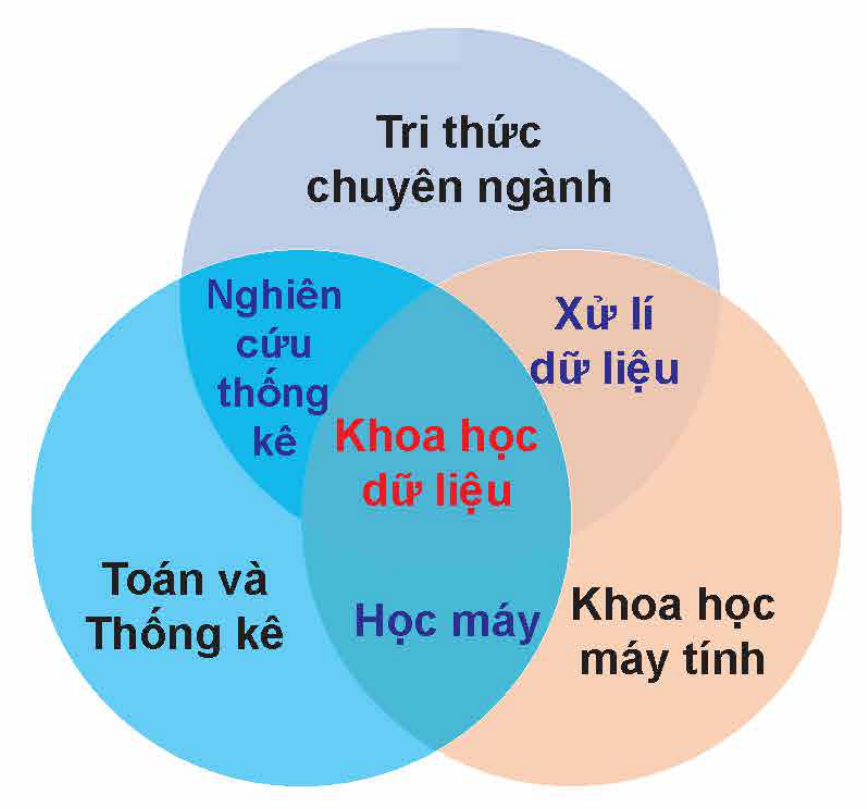
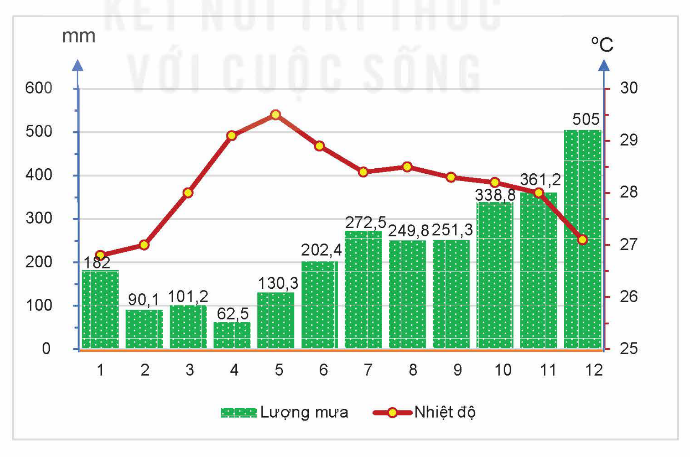
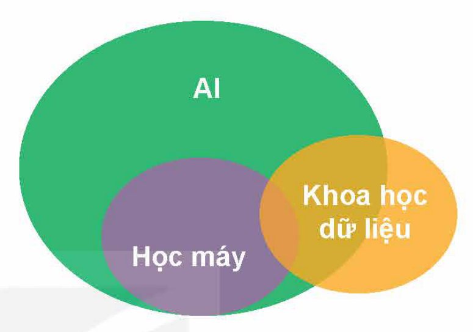

<!-- pdf:142 -->

# BÀI 26: LÀM QUEN VỚI KHOA HỌC DỮ LIỆU

## 🎯 Sau bài học này em sẽ:

- Nêu được sơ lược về khái niệm, mục tiêu của Khoa học dữ liệu.
- Nêu được một số thành tựu của Khoa học dữ liệu và ví dụ minh hoạ.

## 🔴 Khởi động

> Những năm gần đây, cùng với AI, Khoa học dữ liệu (data science) đã trở thành lĩnh vực thu hút sự quan tâm đặc biệt trên toàn thế giới. Hãy nhập từ khoá “data science” vào thanh công cụ tìm kiếm Google và cho nhận xét về kết quả tìm kiếm mà em nhận được.

## 1. KHÁI NIỆM VÀ MỤC TIÊU CỦA KHOA HỌC DỮ LIỆU

> **Hoạt động 1: Tìm hiểu về Khoa học dữ liệu**
>
> Có thể hiểu đơn giản Khoa học dữ liệu là lĩnh vực khoa học nghiên cứu về dữ liệu. Như vậy, đối tượng nghiên cứu của Khoa học dữ liệu chính là dữ liệu. Theo em, Khoa học dữ liệu không bao gồm công việc nào sau đây?
> A. Nghiên cứu phát triển các phương pháp thu thập và quản lí dữ liệu.
> B. Khai phá các thông tin, tri thức từ dữ liệu thu để nâng cao hiệu quả kinh doanh, quản lí.
> C. Kinh doanh, phân phối dữ liệu thu thập được cho các cá nhân, tổ chức quan tâm.
> D. Phát triển và áp dụng các phương pháp và kĩ thuật để nhận biết các mẫu hình, các quan hệ và xu hướng có trong dữ liệu.

### a) Khái niệm về Khoa học dữ liệu

**Khoa học dữ liệu** là một lĩnh vực liên ngành, sử dụng các phương pháp khoa học, quy trình, thuật toán để khám phá tri thức từ dữ liệu, kết hợp những tri thức đó với tri thức chuyên ngành làm cơ sở cho những quyết định.

Nói một cách cụ thể hơn, Khoa học dữ liệu sử dụng các phương pháp và công cụ của: khoa học máy tính, toán học và thống kê kết hợp với tri thức chuyên ngành để giúp tổ chức, cá nhân hiểu rõ hơn về dữ liệu mình sở hữu và tận dụng tri thức này để đưa ra những quyết định phù hợp (Hình 26.1). Trong đó:

Hình 26.1. Khoa học dữ liệu và các lĩnh vực liên quan

- *Khoa học máy tính* cung cấp các công cụ và kĩ thuật để xử lí, phân tích và khai phá dữ liệu. Các ngôn ngữ và thư viện

<!-- pdf:143 -->

lập trình cũng như Học máy, cùng với khả năng xử lí dữ liệu có quy mô và độ phức tạp khác nhau, đóng vai trò quan trọng trong việc phân tích, khai phá dữ liệu và xây dựng các mô hình dự đoán.
- *Toán học và thống kê* cung cấp cơ sở cho các phương pháp phân tích và khai phá dữ liệu. Các thuật toán thống kê và toán học giúp kiểm tra giả thuyết, tính toán phân phối xác suất, xác định sự tương quan giữa các biến trong dữ liệu,...
- **Tri thức chuyên ngành** là tri thức của từng lĩnh vực, ví dụ kinh doanh, y tế, khoa học xã hội,... có vai trò quan trọng để hiểu ngữ cảnh và ý nghĩa của dữ liệu. Nó giúp các nhà khoa học dữ liệu đánh giá được chất lượng và độ chính xác của dữ liệu, diễn giải được kết quả phân tích và khai phá dữ liệu theo cách có ý nghĩa phù hợp với lĩnh vực ứng dụng để đưa ra quyết định đúng đắn.

### b) Mục tiêu của Khoa học dữ liệu

Mục tiêu chính của Khoa học dữ liệu là phân tích và khai phá dữ liệu để có được tri thức, vận dụng tri thức đó để giải quyết vấn đề và đưa ra các quyết định phù hợp. Các mục tiêu cụ thể của Khoa học dữ liệu có thể được nêu ngắn gọn như sau:

- **Tổ chức và quản lí dữ liệu** tập trung vào việc xây dựng, duy trì hệ thống tổ chức dữ liệu một cách khoa học để đảm bảo tính toàn vẹn, sẵn sàng và quản lí hiệu quả các nguồn dữ liệu. Đây là nhiệm vụ rất quan trọng để tạo ra cơ sở hạ tầng dữ liệu mạnh mẽ và linh hoạt, hỗ trợ quá trình phân tích và ra quyết định trong lĩnh vực Khoa học dữ liệu.
- **Phân tích dữ liệu** nhằm hiểu rõ về nội dung, cấu trúc dữ liệu, xác định các đặc điểm quan trọng, nhận diện nhóm và xu hướng trong dữ liệu. Việc này giúp tạo ra cái nhìn toàn diện về dữ liệu và hỗ trợ quá trình ra quyết định.
- **Trực quan hoá dữ liệu** nhằm biểu diễn dữ liệu một cách trực quan, dễ hiểu bằng các sơ đồ, biểu đồ hay hình ảnh, giúp người dùng có được cái nhìn tổng quan về dữ liệu. Ví dụ, nhìn biểu đồ trong Hình 26.2 có thể dễ dàng suy ra được nhiệt độ và biên độ nhiệt cũng như tổng lượng mưa trung bình năm,...

Hình 26.2. Nhiệt độ và lượng mưa trung bình tháng của huyện đảo Trường Sa (Khánh Hoà) (Số liệu: Trung tâm Thông tin và Dữ liệu khí tượng thuỷ văn)

<!-- pdf:144 -->

- **Tối ưu hoá quyết định** nhằm cải thiện quyết định dựa trên dữ liệu, bao gồm việc sử dụng các thuật toán tối ưu hoá để đưa ra quyết định tốt nhất dựa trên các ràng buộc và mục tiêu. Ví dụ, tối ưu hoá quy trình sản xuất để tối ưu hoá hiệu quả của dây chuyền sản xuất hay sản lượng, chất lượng sản phẩm,...
- **Khám phá tri thức** để tìm ra các mối quan hệ ẩn chứa trong dữ liệu, xác định nguyên nhân và kết quả, tạo ra tri thức mới từ dữ liệu. Đây cũng là mục tiêu cụ thể cao nhất của Khoa học dữ liệu. Ví dụ, trong nghiên cứu dược phẩm, người ta có thể sử dụng dữ liệu bệnh nhân để tìm hiểu mối quan hệ giữa một loại thuốc và các phản ứng phụ, giúp họ hiểu rõ hơn về tác động của loại thuốc này đối với sức khoẻ của bệnh nhân. Nhiều trang web thương mại điện tử sử dụng dữ liệu lịch sử mua sắm của người dùng để dự đoán và đề xuất sản phẩm mà họ có thể quan tâm,...

Tất cả các mục tiêu cụ thể nêu trên góp phần vào việc tận dụng dữ liệu để đưa ra những quyết định thông minh, cải thiện hoạt động của tổ chức hoặc doanh nghiệp.

> **Khoa học dữ liệu** là một lĩnh vực liên ngành, sử dụng các công cụ của khoa học máy tính, toán học và thống kê để khám phá tri thức từ dữ liệu, kết hợp những tri thức đó với tri thức chuyên ngành làm cơ sở cho những quyết định phù hợp. Các mục tiêu cụ thể của Khoa học dữ liệu bao gồm thăm dò, khai thác, phân tích, khai phá và trực quan hoá dữ liệu, làm cơ sở xây dựng mô hình dự đoán, dự báo và tối ưu hoá quyết định, hướng tới mục tiêu cao nhất đó là khám phá tri thức từ dữ liệu.

> **Câu hỏi**
>
> 1. Học máy và tri thức chuyên ngành có vai trò gì trong Khoa học dữ liệu?
> 2. Tính chất liên ngành của Khoa học dữ liệu được thể hiện như thế nào?

## 2. MỘT SỐ THÀNH TỰU CỦA KHOA HỌC DỮ LIỆU

> **Hoạt động 2: Làm quen với dữ liệu lớn trong thực tế**
>
> Khi nói tới dữ liệu lớn người ta thường nghĩ tới kích thước lớn của dữ liệu. Tuy nhiên, trong thực tế, có những dữ liệu không chỉ có kích thước lớn, thường xuyên được cập nhật mà còn bao gồm nhiều loại khác nhau. Em có thể chỉ ra một vài ví dụ về những dữ liệu như vậy không?

<!-- term: Năm chữ V -->
Sự phát triển trong thời gian gần đây của Khoa học dữ liệu cũng như AI và Học máy không tách rời với sự ra đời và phát triển của dữ liệu lớn. Thuật ngữ **dữ liệu lớn**, trong ngữ cảnh thông thường, được dùng để chỉ một tập dữ liệu rất lớn và phức tạp mà các công cụ xử lí dữ liệu truyền thống không xử lí được. Dữ liệu lớn thường được đặc trưng bởi “năm chữ V” (5V): khối lượng (Volume), vận tốc (Velocity) và sự đa dạng (Variety), giá trị (Value), và tính xác thực (Veracity). Trong đó, *khối lượng* đề cập đến kích thước lớn của các tập dữ liệu đó; *vận tốc* đề cập đến tốc độ mà dữ liệu đó được tạo ra và cần được phân tích; *sự đa dạng* đề cập đến nhiều loại dữ liệu khác nhau, có thể ở dạng văn bản, âm thanh, video hoặc các dạng khác; *giá trị* đề cập đến tính hữu

<!-- pdf:145 -->

ích của dữ liệu và *tính xác thực* đề cập đến sự cần thiết phải đảm bảo tính xác thực của dữ liệu do dữ liệu lớn thường có nhiều nhiễu/sai số hoặc không chính xác trong dữ liệu.

Không thể tận dụng một cách hiệu quả dữ liệu lớn nếu không tự động hoá quy trình xử lí, phân tích và khai phá. Khoa học dữ liệu cùng với AI và Học máy cung cấp các quy trình như vậy. Nói cách khác, *việc phân tích và khám phá các tri thức hữu ích từ dữ liệu lớn có thể được coi là thành tựu và lợi ích chung lớn nhất mà Khoa học dữ liệu đem lại*.

Hình 26.3 cho cái nhìn trực quan về mối quan hệ giữa các lĩnh vực AI, Học máy và Khoa học dữ liệu. Có thể thấy đó là mối quan hệ gắn bó và tương hỗ lẫn nhau giữa các lĩnh vực đang phát triển hết sức mạnh mẽ. Chính vì thế, nhiều thành tựu được coi là thành tựu chung của cả ba lĩnh vực; không ít ứng dụng thực tế được mô tả trong các tài liệu khác nhau như là ứng dụng của AI, của Học máy hay của Khoa học dữ liệu tuỳ theo bối cảnh mà chúng được nhắc tới. Dưới đây sẽ đề cập khái quát một số thành tựu cụ thể của Khoa học dữ liệu:

Hình 26.3. Mối quan hệ giữa AI, Học máy và Khoa học dữ liệu

- *Đổi mới quá trình ra quyết định – ra quyết định dựa trên dữ liệu góp phần tăng hiệu quả công việc*: Các tổ chức và cá nhân có thể đưa ra những quyết định sáng suốt và chính xác hơn nhờ việc sử dụng dữ liệu để cung cấp thông tin cho quá trình ra quyết định. Thông qua việc phân tích và khai phá dữ liệu thu thập được, Khoa học dữ liệu có thể đưa ra những dự báo và phân tích xu hướng phát triển, từ đó giúp tổ chức, doanh nghiệp sớm chuẩn bị, sẵn sàng thích nghi với những thay đổi và đưa ra các quyết định kinh doanh phù hợp. Bằng cách sử dụng thuật toán học máy để phân tích và khai phá dữ liệu lớn về các giao dịch, ngân hàng và tổ chức tài chính có thể xác định những mẫu và điểm bất thường, từ đó xác định hoạt động gian lận, giúp ngăn ngừa tổn thất và cải thiện tính bảo mật tổng thể của hệ thống tài chính. Một ví dụ khác đó là Khoa học dữ liệu có khả năng hỗ trợ phân bổ tài nguyên hợp lí nhờ phân tích dữ liệu sử dụng tài nguyên, giúp các tổ chức tối ưu hoá việc phân bổ tài nguyên, giảm các nguy cơ lãng phí.
- *Tự động hoá và thúc đẩy quá trình đổi mới sáng tạo*: Các mô hình học máy trong Khoa học dữ liệu có thể giúp tự động hoá những tác vụ lặp đi lặp lại và tốn thời gian, cho phép con người tập trung vào những công việc phức tạp và sáng tạo hơn. Ví dụ chúng có thể giúp tự động hoá nhiều quy trình và công việc trong các lĩnh vực sản xuất, hậu cần (logistics), dịch vụ khách hàng, quản lí tài chính, giúp tiết kiệm thời gian và chi phí, tăng tính hiệu quả và độ chính xác. Đồng thời, do các công cụ và nền tảng Khoa học dữ liệu ngày càng trở nên dễ tiếp cận hơn, các tổ chức thuộc mọi lĩnh vực đều có thể vận dụng và hưởng lợi nhờ những khả năng của Khoa học dữ liệu. Vì thế, có thể nói, Khoa học dữ liệu góp phần thúc đẩy quá trình đổi mới sáng tạo, tạo ra nhiều cơ hội mới cho các lĩnh vực khác nhau.
- *Cá nhân hoá các dịch vụ, cải thiện trải nghiệm khách hàng*: Khoa học dữ liệu có thể hỗ trợ việc cung cấp các dịch vụ được cá nhân hoá, dựa trên việc phân tích các dữ liệu được thường xuyên cập nhật về khách hàng, giúp các doanh nghiệp có

<!-- pdf:146 -->

<!-- term: Y học cá nhân hoá -->
được những thông tin đầy đủ hơn về nhu cầu, sở thích và hành vi của họ. Điều này giúp các doanh nghiệp đưa ra được những giải pháp cải thiện trải nghiệm khách hàng, góp phần gia tăng doanh số. Các **hệ khuyến nghị** (còn được gọi là các **hệ tư vấn**) định hướng cá nhân hoá, được phát triển và ứng dụng rộng rãi để giới thiệu những sản phẩm hoặc nội dung mà khách hàng có thể quan tâm, đang là một trong các giải pháp kinh doanh hiệu quả. Trong lĩnh vực y tế, y học cá nhân hoá cũng là một trong những thành tựu đáng lưu ý của Khoa học dữ liệu. Tiếp cận sử dụng Khoa học dữ liệu và Học máy, thông qua việc phân tích và khai phá các bộ dữ liệu lớn về thông tin di truyền và y tế liên quan, cho phép đưa ra phác đồ điều trị phù hợp với từng bệnh nhân, giúp nâng cao hiệu quả và kết quả chăm sóc sức khoẻ cộng đồng.

> Thành tựu chung lớn nhất của Khoa học dữ liệu là mang lại khả năng phân tích và khám phá các tri thức hữu ích từ dữ liệu lớn. Một số thành tựu cụ thể khác của Khoa học dữ liệu có thể chỉ ra như đổi mới quá trình ra quyết định; tự động hoá; **cá nhân hoá dịch vụ**, cải thiện trải nghiệm khách hàng.

> **Câu hỏi**
>
> 1. Giới thiệu một vài thành tựu của Khoa học dữ liệu mà em tâm đắc nhất.
> 2. Quan sát Hình 26.4 và cho biết kết quả khuyến nghị là gì.

Hình 26.4. Ảnh chụp màn hình kết quả khuyến nghị trên YouTube

## ✏️ Luyện tập

1. Tại sao lại có thể nói Khoa học dữ liệu góp phần tạo ra nhiều cơ hội mới cho các lĩnh vực khác nhau?
2. Các tổ chức có thể sử dụng Khoa học dữ liệu để dự đoán thời điểm những trục trặc của thiết bị có thể xảy ra. Hãy phân tích để thấy được, trong trường hợp cụ thể này, Khoa học dữ liệu có thể giúp đổi mới hoàn toàn quy trình bảo trì thiết bị, thay thế quy trình hoạt động chưa hiệu quả.

## 🚀 Vận dụng

Trong thực tế, vẫn có trường hợp dùng các thuật ngữ khoa học dữ liệu và phân tích dữ liệu thay thế cho nhau. Điều này không hoàn toàn chính xác. Hãy truy cập Internet để tìm hiểu sự khác biệt giữa hai khái niệm này.

## 📷 Danh sách hình trong bài

| Mã hình | Trang PDF | Vị trí | Chú thích gốc |
|---|---|---|---|
| H12-tin_hoc_khmt-b26-01 | 142 | Mục 1.a | Hình 26.1. Khoa học dữ liệu và các lĩnh vực liên quan |
| H12-tin_hoc_khmt-b26-02 | 143 | Mục 1.b | Hình 26.2. Nhiệt độ và lượng mưa trung bình tháng của huyện đảo Trường Sa (Khánh Hoà) (Số liệu: Trung tâm Thông tin và Dữ liệu khí tượng thuỷ văn) |
| H12-tin_hoc_khmt-b26-03 | 145 | Mục 2 | Hình 26.3. Mối quan hệ giữa AI, Học máy và Khoa học dữ liệu |
| H12-tin_hoc_khmt-b26-04 | 146 | Câu hỏi củng cố mục 2 | Hình 26.4. Ảnh chụp màn hình kết quả khuyến nghị trên YouTube |
