<!-- pdf:151 -->

# BÀI 28: THỰC HÀNH TRẢI NGHIỆM TRÍCH RÚT THÔNG TIN VÀ TRI THỨC

## 🎯 Sau bài học này em sẽ:

- Sử dụng bảng tính điện tử để thực hành một số bước xử lí và phân tích dữ liệu đơn giản.
- Nêu được trải nghiệm của bản thân trong việc trích rút thông tin và tri thức hữu ích từ dữ liệu đã có.

## 🔴 Khởi động

> Có thể hiểu phân tích dữ liệu là việc trích rút thông tin hữu ích giúp tạo ra tri thức mới từ dữ liệu đã thu thập được. Trong thực tế, công việc này thường gắn với việc xử lí để biến đổi dữ liệu về dạng thuận tiện, phù hợp với yêu cầu phân tích. Hãy trao đổi và cho biết, nếu dữ liệu dạng file Excel có 2 cột: Số tuổi và Thu nhập, trong trường hợp muốn tổng hợp kết quả thu nhập theo độ tuổi thì cần bổ sung thêm cột dữ liệu nào? Dữ liệu cột đó có thể lấy từ đâu và bằng cách nào?

**Nhiệm vụ chung: Thực hiện một số bước xử lí và phân tích dữ liệu đơn giản**

*Yêu cầu:* Phân tích mối quan hệ giữa các nhóm khách hàng với xếp hạng khả năng tín dụng.

Dữ liệu sử dụng trong bài học được trích rút từ nguồn dữ liệu nêu trong trang web của Cộng đồng Khoa học dữ liệu và Học máy Kaggle. Đây là dữ liệu xếp hạng khả năng tín dụng khách hàng của một đơn vị cho vay tài chính, gồm các cột Mã định danh, Số tuổi, Thu nhập năm (tính theo USD) và Khả năng tín dụng (Hình 28.1). Dưới đây, em sẽ được hướng dẫn thực hiện vài thao tác xử lí và phân tích dữ liệu, với một số công cụ của Excel Data Analysis (Microsoft Office 365). Thông qua đó, em có được trải nghiệm bước đầu về việc trích rút thông tin và tri thức hữu ích từ dữ liệu.

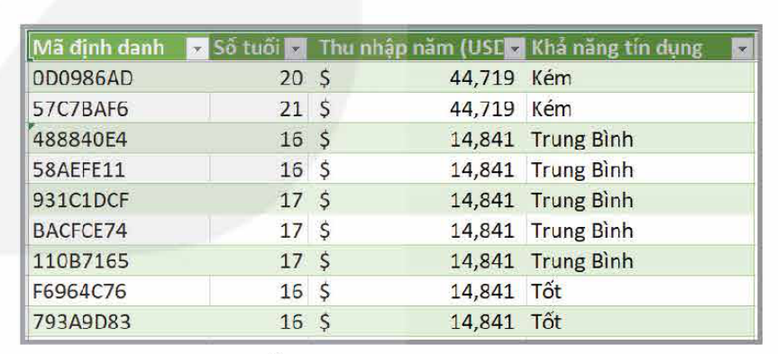

Hình 28.1. Xếp hạng khả năng tín dụng khách hàng

**Nhiệm vụ 1: Chuẩn bị dữ liệu với Power Query**

*Yêu cầu:* Bổ sung phân loại dữ liệu từ dữ liệu đã có

<!-- term: Power Query -->
*Hướng dẫn:* Chuẩn bị dữ liệu gồm nhiều công đoạn khác nhau, là một trong những giai đoạn mất nhiều thời gian và công sức nhất của quy trình khoa học dữ liệu. Tuy nhiên, trong nhiệm vụ này, ta sẽ chỉ thực hiện việc bổ sung thêm cột mới trong bảng dữ liệu đã có. Nói chung, việc thay đổi các cột dữ liệu (cột nào thêm vào, cột nào bỏ đi,...) cần được cân nhắc trước khi bắt đầu giai đoạn Chuẩn bị dữ liệu, xuất phát từ yêu cầu phân tích dữ liệu. Ví dụ, từ yêu cầu phân tích dữ liệu của Nhiệm vụ chung đã nêu ở trên, nhằm phân tích khả năng tín dụng theo độ tuổi hoặc theo mức thu nhập, ta sẽ cần bổ sung các cột Nhóm Tuổi và Mức thu nhập dựa trên số liệu các cột Số tuổi và Thu nhập năm.

### a) Tải dữ liệu vào Power Query

*Bước 1.* Tải dữ liệu từ trang *hanhtrangso.nxbgd.vn* và lưu với tên VD_KHDL.

*Bước 2.* Mở tệp VD_KHDL trong Excel.
<!-- ocr-ok: đối chiếu ảnh trang 151 -->

<!-- pdf:152 -->

*Bước 3.* Chọn vùng dữ liệu muốn xử lí: chọn Data → Get Data → From Table/Range hoặc Data → From Table tuỳ theo phiên bản Excel trên từng máy tính cụ thể.

### b) Tiền xử lí dữ liệu

*Bước 1.* Tạo cột Mức thu nhập từ cột Thu nhập năm:

- Nháy chuột chọn cột Thu nhập năm;
- Trên thanh công cụ, chọn Add Column → Conditional Column (Hình 28.2).
- Phân mức thu nhập thành các nhóm: Thấp: `<= $25 000`; Trung bình: `($25 000 – 50 000]`; Khá: `($50 000 – 75 000]`; Cao: `>= $75 000`. Nhấn OK để hoàn thành việc phân mức (Hình 28.3).

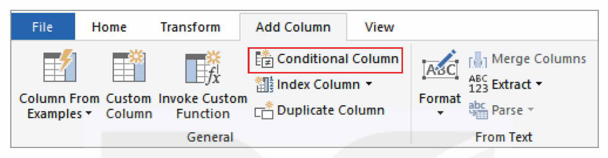

Hình 28.2. Tạo cột phân loại dữ liệu

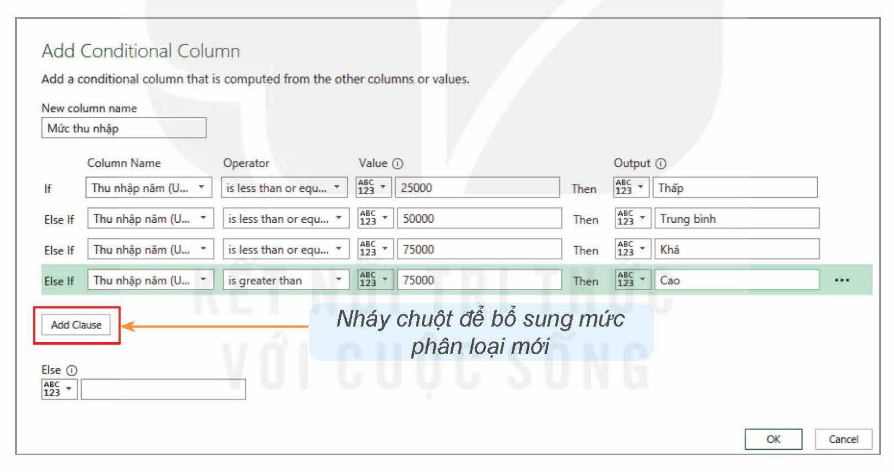

Hình 28.3. Tạo phân loại mức thu nhập

*Bước 2.* Thực hiện các thao tác tương tự Bước 1 đối với cột Số tuổi để tạo cột Nhóm tuổi: `< 21`; `21 - 30`; `31 - 40`; `41 - 50`; `> 50`.

Kết quả nhận được là bảng dữ liệu như Hình 28.4.

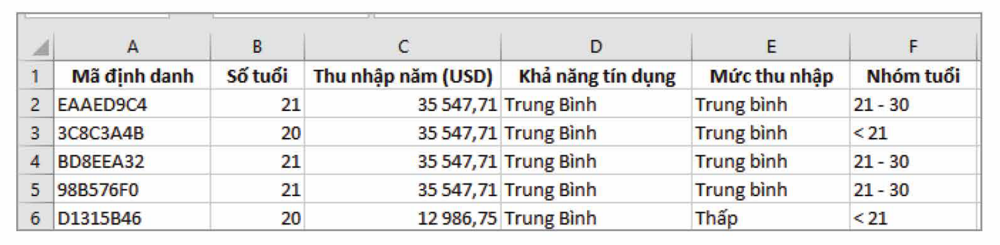

Hình 28.4. Kết quả bổ sung cột mới từ dữ liệu các cột đã có

<!-- pdf:153 -->

*Bước 3.* Lưu dữ liệu đã qua tiền xử lí: Home → Close to hoặc Home → Close/Load to tuỳ theo cài đặt cụ thể của các phiên bản Excel. Dữ liệu sau xử lí sẽ được lưu thành một Sheet mới. Có thể đổi tên Sheet đó, ví dụ thành “Done Query” cho dễ nhớ để sử dụng sau này.

*Bước 4.* Có thể thực hiện việc đổi tên bảng dữ liệu đã qua xử lí thành “Processed_Data” để thuận tiện cho việc lập bảng tổng hợp bằng PivotTable sau này:

- Nháy chuột vào ô bất kì trong bảng dữ liệu đã qua tiền xử lí.
- Trên thanh công cụ, chọn Table Design.
- Di chuyển chuột đến Table Name và đổi tên bảng theo yêu cầu (Hình 28.5).

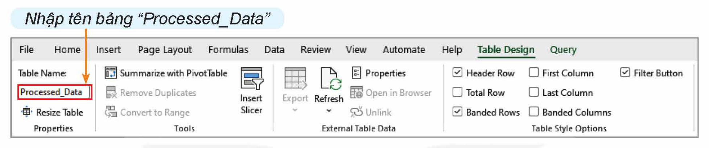

Hình 28.5. Đổi tên bảng sau khi xử lí dữ liệu

*Lưu ý:* Sau khi đã lưu kết quả tiền xử lí dữ liệu, nếu muốn tiếp tục thực hiện thêm những thao tác khác với các cột dữ liệu, thì chỉ cần hiện bảng chọn như Hình 28.5, chọn Query → Edit.

### c) Tạo trình tự sắp xếp dữ liệu mong muốn

Cột Khả Năng Tín Dụng có ba hạng mục Kém, Trung Bình, Tốt. Theo trình tự mặc định của bảng chữ cái, khi sắp xếp, dữ liệu cột này sẽ được xếp theo thứ tự *Kém – Tốt – Trung bình*. Để thay đổi trình tự sắp xếp dữ liệu này theo mong muốn, ví dụ theo trình tự *Kém – Trung bình – Tốt*, ta cần thực hiện các bước sau:

*Bước 1.* File → Options → Advanced

*Bước 2.* Di chuột xuống mục General → Edit Custom Lists
<!-- ocr-ok: đối chiếu ảnh trang 153, cột chữ hẹp cạnh hình 28.6 -->

*Bước 3.* Tạo danh sách mới: NEW LIST → Add (xem Hình 28.6).

Làm tương tự bước trên với cột Nhóm tuổi và cột Mức thu nhập để bổ sung các danh sách sắp xếp thứ tự tương ứng: `< 21`, `21 – 30`, `31 – 40`, `41 – 50`, `> 50` và Cao, Khá, Trung bình, Thấp.

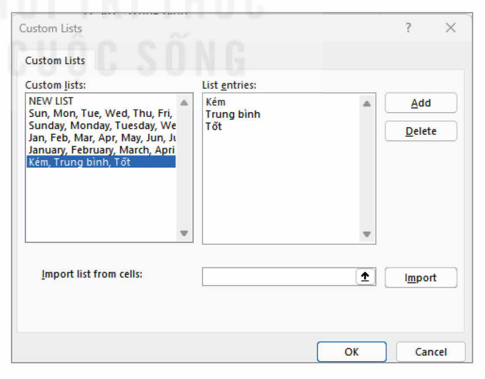

Hình 28.6. Tạo danh sách trình tự sắp xếp

<!-- pdf:154 -->

**Nhiệm vụ 2: Tổng hợp dữ liệu bằng PivotTable**

*Yêu cầu:* Tổng hợp Khả năng tín dụng theo Mức thu nhập

<!-- term: PivotTable -->
*Hướng dẫn:* Sử dụng PivotTable (Bảng tổng hợp) trong Excel để tổng hợp dữ liệu.

### a) Khởi tạo bảng PivotTable

*Bước 1.* Nhấn chuột vào ô bất kì trong bảng Processed_Data đã qua tiền xử lí
<!-- ocr-ok: đối chiếu ảnh trang 154 -->

*Bước 2.* Trên thanh công cụ, chọn Insert → PivotTable:

- Chọn New Worksheet.
- Nhấn OK.
<!-- ocr-ok: đối chiếu ảnh trang 154 -->

### b) Tạo bảng tổng hợp Khả năng tín dụng theo Mức thu nhập

*Bước 1.* Tạo bảng tổng hợp để tính số lượng mỗi hạng mức tín dụng theo từng nhóm thu nhập bằng cách kéo thả các cột vào các vùng Columns, Rows và Values tương ứng (Hình 28.7). Trong đó, Rows là tiêu chí được sử dụng để tổng hợp dữ liệu có trong Columns.

*Bước 2.* Thực hiện việc kéo thả các cột dữ liệu vào các vùng Columns, Rows và Values tương ứng và quan sát sự thay đổi kết quả trên màn hình để chọn bảng tổng hợp phù hợp với mong muốn (ví dụ như Hình 28.8, trong đó Grand Total là kết quả tổng cộng theo hàng/cột dữ liệu tương ứng).

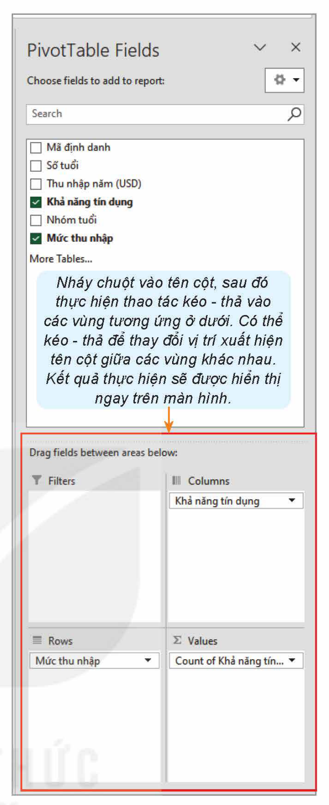

Hình 28.7. Tạo bảng thống kê khả năng tín dụng theo nhóm thu nhập

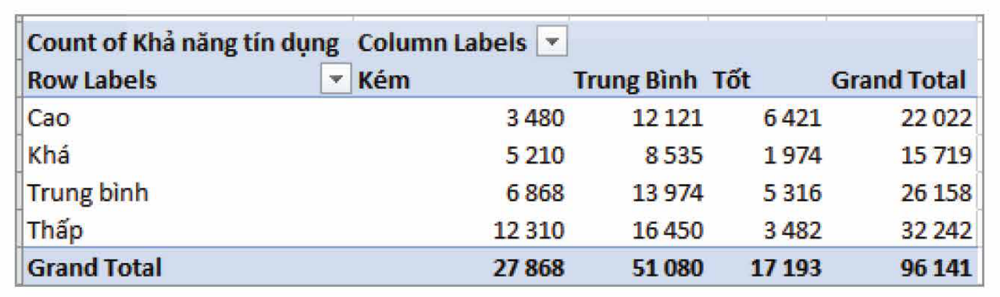

Hình 28.8. Kết quả thống kê khả năng tín dụng theo nhóm thu nhập

### c) Điều chỉnh việc hiển thị kết quả thống kê
<!-- ocr-ok: đối chiếu ảnh trang 154, tiêu đề màu xanh nhạt OCR bỏ sót -->

*Nhận xét:* Có thể thấy, số lượng khách hàng ở mỗi nhóm thu nhập có sự khác biệt quá lớn, việc so sánh các giá trị này giữa các mức tín dụng với nhau không hợp lí. Vì vậy, ta sẽ điều chỉnh bảng tổng hợp trong Hình 28.8 để tính toán tỉ lệ phần trăm tương ứng thay cho số lượng khách hàng tuyệt đối:

*Bước 1.* Nháy nút phải chuột vào bảng PivotTable đã tạo ra (Hình 28.8);

<!-- pdf:155 -->

*Bước 2.* Trong thực đơn đổ xuống, chọn Show Values As → % of Row Total ta nhận được bảng tổng hợp mới (ví dụ như Hình 28.9, trong đó tỉ lệ % tính theo tổng của mỗi hàng tương ứng của bảng).

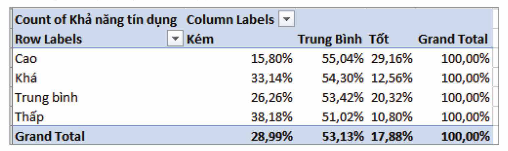

Hình 28.9. Kết quả tổng hợp khả năng tín dụng theo nhóm thu nhập (tính theo %)

**Nhiệm vụ 3: Tạo biểu đồ trực quan hoá dữ liệu**

*Yêu cầu:* Tạo biểu đồ mô tả dữ liệu tổng hợp do PivotTable tạo ra.

<!-- term: PivotChart -->
*Hướng dẫn:* Sử dụng **PivotChart** trong Excel, một công cụ liên kết với PivotTable, để thực hiện nhiệm vụ này.

Tạo biểu đồ tổng hợp khả năng tín dụng theo nhóm thu nhập:

*Bước 1.* Nháy chuột vào vị trí bất kì trong bảng tổng hợp do PivotTable tạo ra (Hình 28.9).

*Bước 2.* Trên thanh công cụ, chọn Insert → PivotChart → Column → OK. Ta nhận được biểu diễn dữ liệu nêu trên bằng biểu đồ cột (xem Hình 28.10).

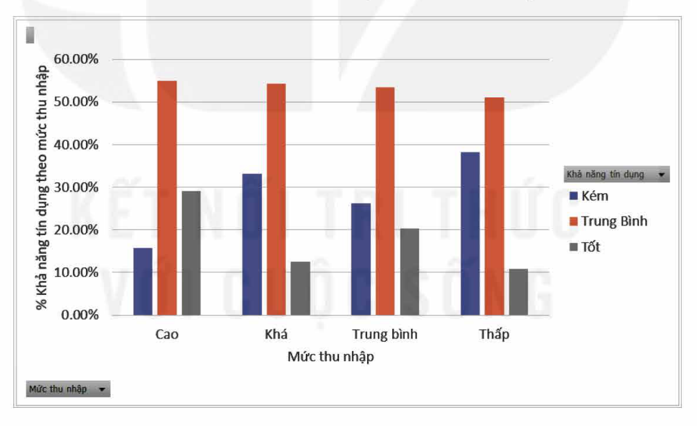

Hình 28.10. Biểu đồ khả năng tín dụng theo nhóm thu nhập

*Lưu ý:* Hình 28.10 là biểu đồ kết quả được bổ sung thêm nhãn dữ liệu, tên các mức thu nhập, tiêu đề cột ở mỗi trục biểu đồ,... để dễ dàng đọc số liệu qua biểu đồ. Việc bổ sung này được thực hiện tương tự như khi lập biểu đồ trong Excel.

**Nhiệm vụ 4: Phân tích kết quả tổng hợp dữ liệu**

*Yêu cầu:* Quan sát kết quả tổng hợp và biểu diễn dữ liệu để rút ra các kết luận về tính chất/mối quan hệ/xu hướng dữ liệu (nếu có) dựa trên mục tiêu phân tích dữ liệu đặt ra.

*Hướng dẫn:* Việc phân tích kết quả tổng hợp dữ liệu là một phần của quá trình phân tích dữ liệu. Công việc này trên thực tế là việc trích rút các thông tin và tri thức hữu ích có ý nghĩa để trả lời các câu hỏi xuất phát từ mục tiêu phân tích dữ liệu.

<!-- pdf:156 -->

### a) Trả lời câu hỏi: Khả năng tín dụng nào có xu hướng ổn định nhất trong các nhóm thu nhập?
<!-- ocr-ok: đối chiếu ảnh trang 156, tiêu đề màu xanh nhạt OCR bỏ sót -->

*Trả lời:* Căn cứ bảng tổng hợp và biểu đồ tương ứng ở Hình 28.9 và Hình 28.10 có thể dễ dàng nhận thấy, khả năng tín dụng Trung bình ổn định nhất trong tất cả các nhóm thu nhập và chiếm trên 50% tổng số khách hàng của từng nhóm.

### b) Hãy cho biết:

- Nhóm thu nhập nào có tỉ lệ phần trăm khách hàng có khả năng tín dụng mức Tốt cao nhất?
- Nhóm thu nhập nào có tỉ lệ phần trăm khách hàng có khả năng tín dụng mức Kém cao nhất?
- Nhóm thu nhập nào có số lượng khách hàng có khả năng tín dụng Tốt gần gấp đôi số khách hàng có khả năng tín dụng Kém?
- Nhóm thu nhập nào có khả năng tín dụng mức Kém cao hơn mức Tốt?

*Lưu ý:* Kết quả phân tích dữ liệu có thể trở thành tiền đề cho một nghiên cứu tiếp theo. Ví dụ, trong nhóm khách hàng có mức thu nhập loại Khá, số có khả năng tín dụng mức Kém lớn gần gấp ba số có khả năng tín dụng mức Tốt – điều này có thể gợi ý cho một việc thực hiện một cuộc điều tra xã hội nhằm tìm hiểu nguyên nhân của thực tế này.

## ✏️ Luyện tập

1. Có thể sử dụng hàm IF lồng trong nhau kết hợp với thao tác “kéo – thả” công thức trực tiếp trong bảng dữ liệu ban đầu để tạo các cột phân loại Mức thu nhập và Nhóm tuổi. Theo em, cách làm này có khuyết điểm gì so với việc sử dụng Power Query?
2. Nếu chỉ quan sát trực tiếp bảng dữ liệu ban đầu, em có thể dễ dàng trả lời các câu hỏi nêu trong Nhiệm vụ 4 không? Hãy nêu một vài nhận xét về những trải nghiệm em thu được thông qua việc thực hiện các Nhiệm vụ thực hành trong bài học.
3. Tạo bảng tổng hợp và biểu đồ khả năng tín dụng theo nhóm tuổi. Nêu nhận xét về kết quả thu được.

## 🚀 Vận dụng

Trong Hình 28.11 là nhiệt độ và lượng mưa đo được tại Trường Sa. Những thông tin hữu ích nào có thể rút ra từ dữ liệu này? Nếu biết mùa mưa là mùa có 3 tháng liên tiếp lượng mưa trung bình trên 100 mm và lớn hơn các tháng còn lại, thì mùa mưa ở Trường Sa là những tháng nào?

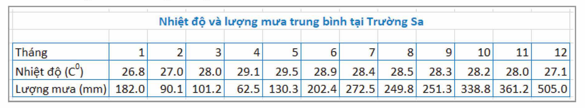

Hình 28.11. Kết quả theo dõi tình hình thời tiết tại trạm khí tượng thuỷ văn Trường Sa (Số liệu: Trung tâm Thông tin và Dữ liệu khí tượng thuỷ văn)

## 📷 Danh sách hình trong bài

| Mã hình | Trang PDF | Vị trí | Chú thích gốc |
|---|---|---|---|
| H12-tin_hoc_khmt-b28-01 | 151 | Nhiệm vụ chung | Hình 28.1. Xếp hạng khả năng tín dụng khách hàng |
| H12-tin_hoc_khmt-b28-02 | 152 | Nhiệm vụ 1.b | Hình 28.2. Tạo cột phân loại dữ liệu |
| H12-tin_hoc_khmt-b28-03 | 152 | Nhiệm vụ 1.b | Hình 28.3. Tạo phân loại mức thu nhập |
| H12-tin_hoc_khmt-b28-04 | 152 | Nhiệm vụ 1.b | Hình 28.4. Kết quả bổ sung cột mới từ dữ liệu các cột đã có |
| H12-tin_hoc_khmt-b28-05 | 153 | Nhiệm vụ 1.b | Hình 28.5. Đổi tên bảng sau khi xử lí dữ liệu |
| H12-tin_hoc_khmt-b28-06 | 153 | Nhiệm vụ 1.c | Hình 28.6. Tạo danh sách trình tự sắp xếp |
| H12-tin_hoc_khmt-b28-07 | 154 | Nhiệm vụ 2.b | Hình 28.7. Tạo bảng thống kê khả năng tín dụng theo nhóm thu nhập |
| H12-tin_hoc_khmt-b28-08 | 154 | Nhiệm vụ 2.b | Hình 28.8. Kết quả thống kê khả năng tín dụng theo nhóm thu nhập |
| H12-tin_hoc_khmt-b28-09 | 155 | Nhiệm vụ 2.c | Hình 28.9. Kết quả tổng hợp khả năng tín dụng theo nhóm thu nhập (tính theo %) |
| H12-tin_hoc_khmt-b28-10 | 155 | Nhiệm vụ 3 | Hình 28.10. Biểu đồ khả năng tín dụng theo nhóm thu nhập |
| H12-tin_hoc_khmt-b28-11 | 156 | Vận dụng | Hình 28.11. Kết quả theo dõi tình hình thời tiết tại trạm khí tượng thuỷ văn Trường Sa (Số liệu: Trung tâm Thông tin và Dữ liệu khí tượng thuỷ văn) |
