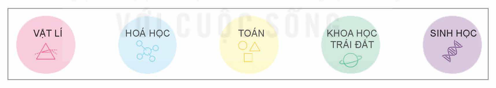
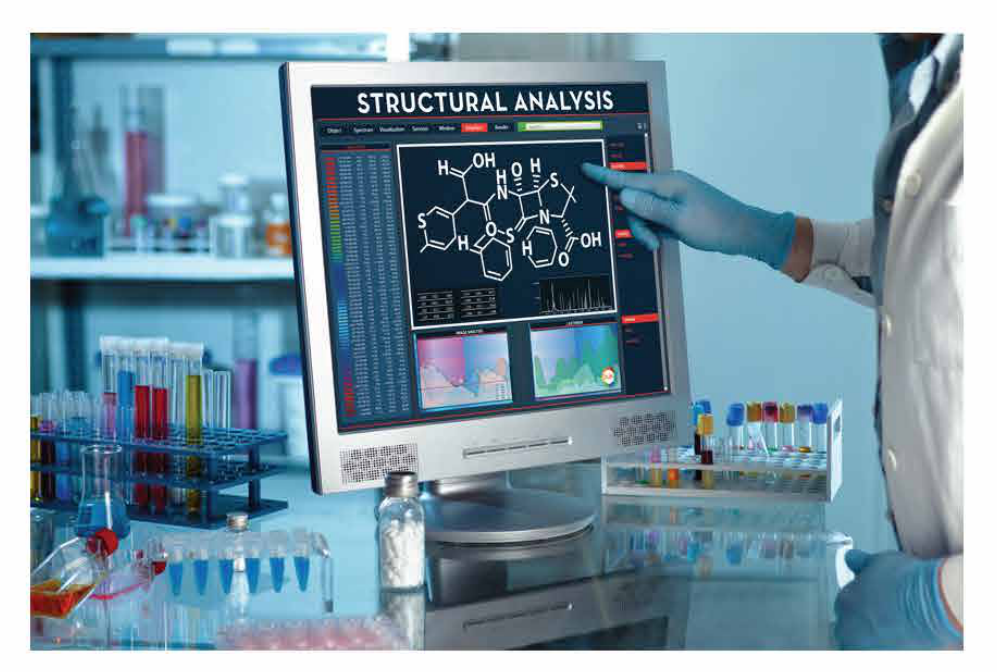
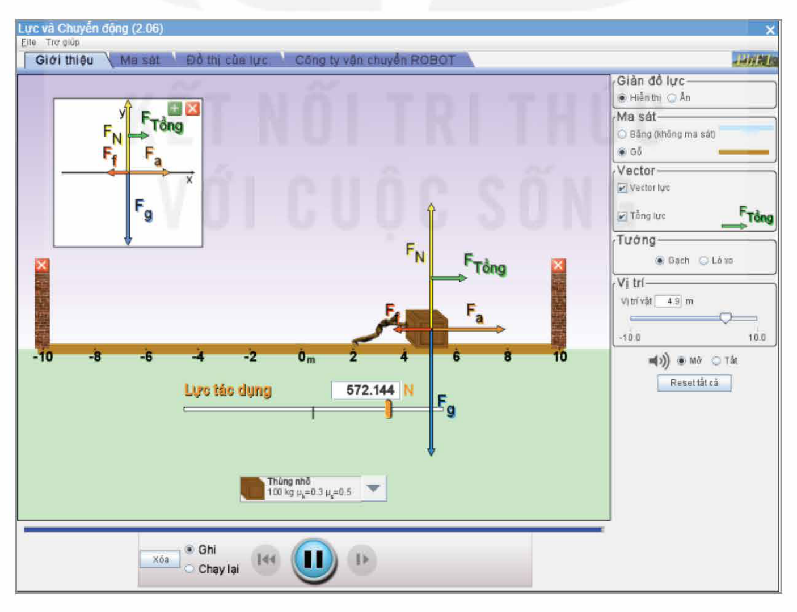
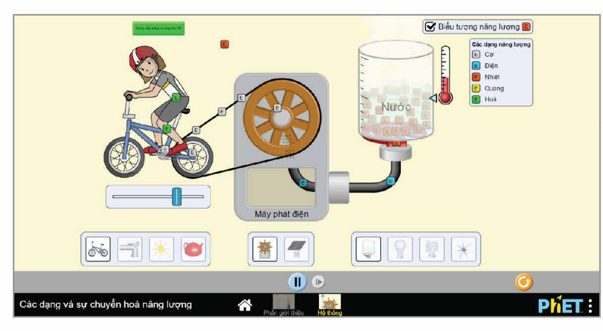
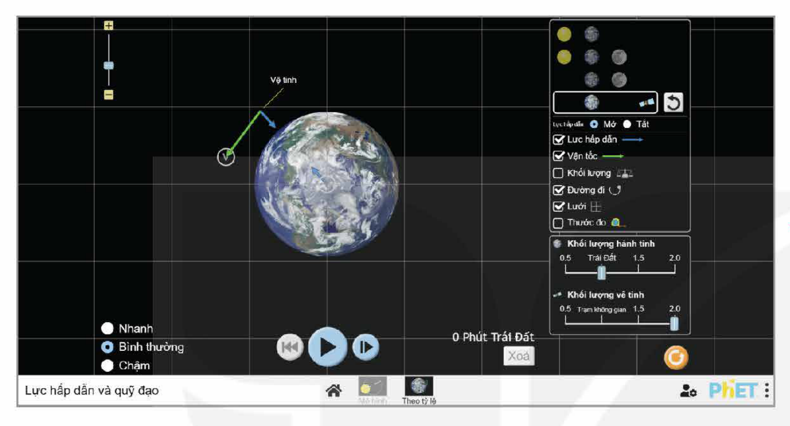
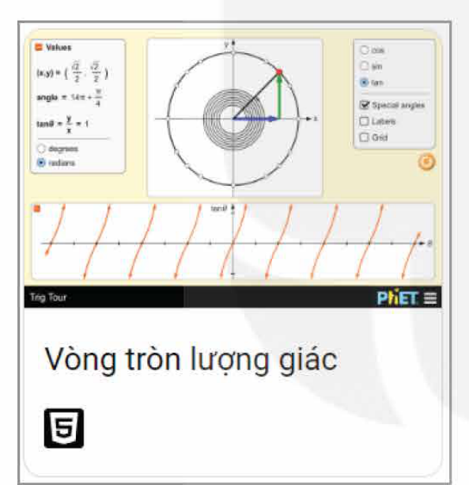
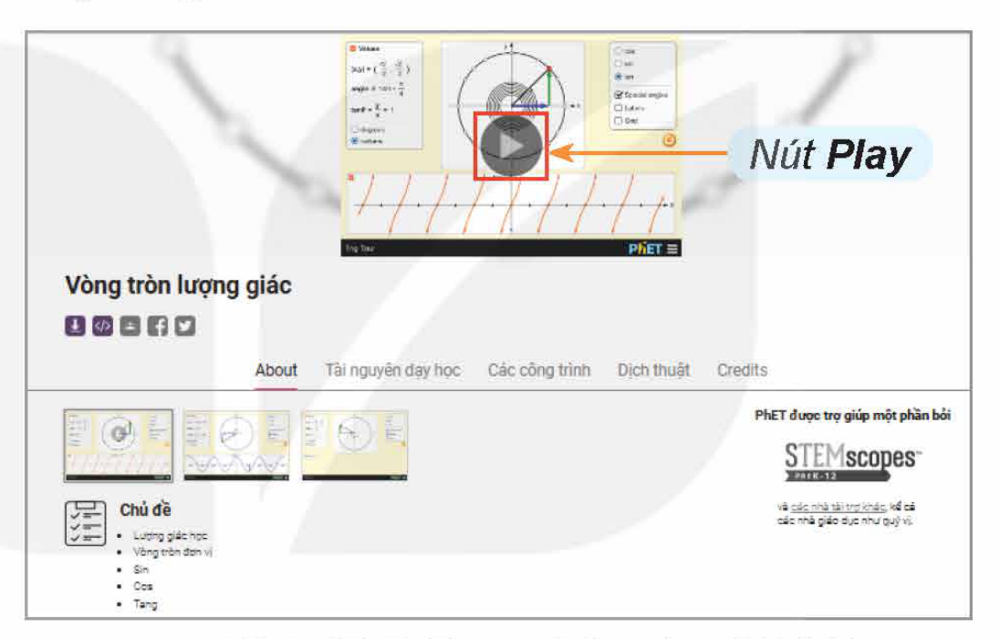
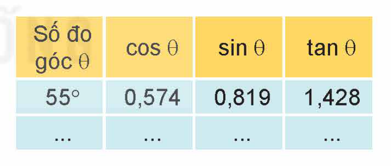
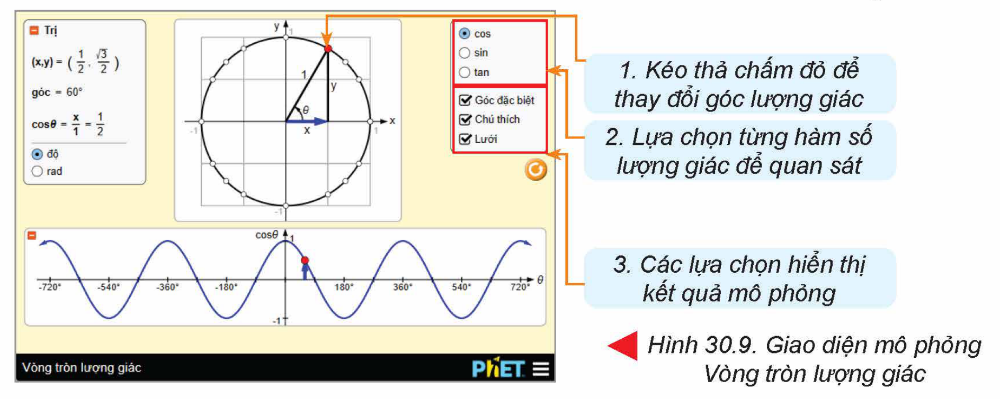

<!-- pdf:161 -->

# BÀI 30: ỨNG DỤNG MÔ PHỎNG TRONG GIÁO DỤC

## 🎯 Sau bài học này em sẽ:

- Bước đầu sử dụng một vài phần mềm giáo dục và chỉ ra được một số lợi ích của chúng.

## 🔴 Khởi động

<!-- term: GeoGebra -->
> Em đã được làm quen với phần mềm GeoGebra để mô phỏng và giải một số bài toán. Phần mềm GeoGebra có một bộ công cụ để vẽ các hình hình học, biểu đồ và các công cụ tính toán để giải một số bài toán. Theo em lợi ích của phần mềm đó là gì?

## 1. GIỚI THIỆU MỘT SỐ PHẦN MỀM MÔ PHỎNG TRONG GIÁO DỤC

> **Hoạt động 1: Tìm hiểu về một số phần mềm mô phỏng trong giáo dục**
>
> Ngoài phần mềm GeoGebra trong môn Toán, em còn biết phần mềm mô phỏng nào được sử dụng trong các môn học khác?

GeoGebra chỉ là một trong số những phần mềm mô phỏng ứng dụng trong dạy học. Nhiều môn học khác cũng sử dụng phần mềm mô phỏng để hỗ trợ việc dạy và học trong nhà trường. Ví dụ:

<!-- term: PhET -->
- *Bộ phần mềm và công cụ PhET*: Cung cấp các công cụ và phần mềm mô phỏng tương tác trực tuyến đa lĩnh vực, giúp học sinh hiểu rõ hơn các khái niệm Vật lí, Hoá học, Toán học, Khoa học Trái Đất và Sinh học (Hình 30.1).

Hình 30.1. Một số môn học có hỗ trợ mô phỏng trong bộ sưu tập của PhET

<!-- term: Avogadro -->
<!-- term: Gplates -->
<!-- term: Yenka -->
<!-- term: Concord Consortium -->
- *Phần mềm Avogadro*: Phần mềm mô phỏng hoá học mã nguồn mở, cho phép người dùng mô phỏng và thiết kế phân tử hoá học ở các cấp độ khác nhau, từ phân tử đơn giản đến phức tạp.
- *Phần mềm Gplates*: Phần mềm mô phỏng động học địa chất, cho phép người dùng mô phỏng sự biến đổi của các lục địa, địa mạo và địa chất trên toàn cầu trong quá khứ và hiện tại.
- *Phần mềm Yenka*: Bộ công cụ giáo dục tập hợp nhiều thí nghiệm thú vị của các lĩnh vực Toán, Vật lí, Hoá học, Điện tử cho phép quan sát một cách trực quan và cụ thể.
- *Các phần mềm mô phỏng của Concord Consortium*, cung cấp nhiều mô hình minh hoạ sinh động các khái niệm khoa học, cho phép tương tác với các phân tử

<!-- pdf:162 -->

hoặc hiện tượng vĩ mô theo nhiều cách khác nhau. Người dùng có thể xem chi tiết các phản ứng hoá học, tương tác với thế giới gene di truyền không thể nhìn thấy, “nén” hàng thế kỉ thành vài giây để giải mã những bí ẩn của quá trình tiến hoá hoặc quan sát quá trình kiến tạo Trái Đất,...

Hình 30.2. Mô phỏng cấu trúc hình học phân tử của Concord Consortium

<!-- term: PhET -->
Đặc điểm chung của các phần mềm này là miễn phí, một số cần tải về từ các trang web tương ứng để cài đặt và sử dụng trên máy tính cá nhân, số còn lại có thể sử dụng trực tuyến nếu có kết nối Internet. Sau đây ta sẽ làm quen với bộ công cụ mô phỏng PhET hiện đang được sử dụng rộng rãi trong rất nhiều nhà trường trên toàn thế giới tại trang web có địa chỉ *https://phet.colorado.edu*. Đây là một dự án mã nguồn mở do Đại học Colorado Boulder của Mỹ phát triển và quản lí. Bất kì ai cũng có thể tải mã nguồn của PhET về và sử dụng miễn phí để tạo ra những mô phỏng mới hoặc tuỳ chỉnh các mô phỏng hiện có cho mục đích giáo dục và phi lợi nhuận.

PhET cho phép người dùng tương tác với nhiều mô hình khoa học và toán học bằng cách thay đổi các tham số và điều kiện, từ đó quan sát các hiện tượng và kết quả một cách trực quan. Một số mô phỏng trong PhET có hỗ trợ giao diện bằng tiếng Việt. Dưới đây là một vài mô phỏng được thực hiện trong PhET:

- *Mô phỏng về lực và chuyển động* với trò chơi Khách bộ hành, giúp diễn giải, tiên đoán và xác định, vận tốc và gia tốc cho các trường hợp thường gặp (Hình 30.3).

Hình 30.3. Trò chơi mô phỏng lực và chuyển động

- *Mô phỏng sự chuyển hoá năng lượng* giúp người dùng làm quen với các dạng năng lượng cơ, điện, nhiệt, quang, hoá và sự chuyển hoá giữa chúng (Hình 30.4).
- *Mô phỏng chuyển động* (vận tốc, quỹ đạo,...) của các vật thể trong không gian trong mối quan hệ với lực hấp dẫn (Hình 30.5).

<!-- pdf:163 -->

Hình 30.4. Mô phỏng các dạng năng lượng và sự chuyển hoá năng lượng

Hình 30.5. Mô phỏng lực hấp dẫn và quỹ đạo của một vệ tinh

> **Hoạt động 2: Thảo luận về lợi ích của phần mềm mô phỏng trong giáo dục**
>
> Hãy chỉ ra một số hạn chế nếu thực hiện các thí nghiệm trong Hình 30.3 và Hình 30.4 ngoài đời thực. Từ đó, thảo luận, rút ra những lợi ích của việc sử dụng phần mềm mô phỏng trong giáo dục.

> Có rất nhiều phần mềm mô phỏng miễn phí trong lĩnh vực giáo dục có thể sử dụng trực tuyến hoặc tải về máy tính. Một số phần mềm có hỗ trợ tiếng Việt.

> **Câu hỏi**
>
> Phát biểu về phần mềm mô phỏng trong lĩnh vực giáo dục nào sau đây là đúng?
> A. Phần mềm mô phỏng trong lĩnh vực giáo dục giúp trình bày các khái niệm khó hiểu một cách trực quan và hấp dẫn, giúp học sinh dễ dàng hình dung và hiểu rõ hơn về các hiện tượng và quá trình, nâng cao hiệu quả dạy học.
> B. Phần mềm mô phỏng trong lĩnh vực giáo dục giúp giảm thiểu các rủi ro và chi phí so với việc thực hiện các thí nghiệm trong thực tế.
> C. Phần mềm mô phỏng trong lĩnh vực giáo dục giúp thúc đẩy sự tò mò và sáng tạo của học sinh.
> D. Phần mềm mô phỏng trong lĩnh vực giáo dục giúp học sinh tự học, tự nghiên cứu.
> E. Tất cả các phần mềm mô phỏng trong lĩnh vực giáo dục đều miễn phí và có hỗ trợ tiếng Việt.

<!-- pdf:164 -->

## 2. THỰC HÀNH: SỬ DỤNG PHẦN MỀM MÔ PHỎNG TRONG GIÁO DỤC

(Phần mềm mô phỏng trong lĩnh vực giáo dục được sử dụng để thực hành là phần mềm trực tuyến PhET).

**Nhiệm vụ 1: Sử dụng phần mềm mô phỏng toán học**

*Yêu cầu:* Biết cách sử dụng phần mềm mô phỏng toán học.

*Hướng dẫn:*

*Bước 1.* Truy cập trang web https://phet.colorado.edu/vi/.

*Bước 2.* Trên trang chủ của PhET, nháy chuột chọn biểu tượng môn Toán (Hình 30.1) để mở danh sách các phần mềm mô phỏng toán học.

*Bước 3.* Nháy chuột chọn mô phỏng Vòng tròn lượng giác (Hình 30.6).

*Bước 4.* Đọc hiểu các thông tin giới thiệu về phần mềm. Sau đó, nháy chuột chọn nút Play (Hình 30.7) để kích hoạt mô phỏng.

Hình 30.6. Mô phỏng Vòng tròn lượng giác

Hình 30.7. Trang thông tin giới thiệu phần mềm

*Bước 5.* Tương tác với phần mềm mô phỏng bằng cách thay đổi các thông số (Hình 30.9). Ghi lại khoảng 5 kết quả quan sát được vào bảng theo mẫu ở Hình 30.8.

Hình 30.8. Bảng mẫu

Hình 30.9. Giao diện mô phỏng Vòng tròn lượng giác

<!-- pdf:165 -->

*Bước 6.* Thảo luận và nhận xét về lợi ích cũng như tính ứng dụng của mô phỏng Vòng tròn lượng giác. So sánh việc thực hiện mô phỏng tương tự ở phần mềm khác, chẳng hạn GeoGebra.

**Nhiệm vụ 2: Khám phá mô phỏng khoa học**

*Yêu cầu:* Thực hiện theo hướng dẫn để khám phá một mô phỏng khoa học bất kì.

*Hướng dẫn:*

*Bước 1.* Truy cập trang chủ của PhET và nháy chuột chọn biểu tượng môn thuộc lĩnh vực khoa học mà em thích.

*Bước 2.* Nháy chuột chọn một phần mềm mô phỏng trong bộ sưu tập của môn học đó mà em muốn khám phá.

*Bước 3.* Quan sát, tương tác và thảo luận để trả lời các câu hỏi sau:

1. Có thể thay đổi các thông số nào của phần mềm?
2. Tương tác với phần mềm bằng cách nào?
3. Kết quả của phần mềm bao gồm những gì?
4. Lợi ích của phần mềm này là gì?
5. Những hạn chế nếu có khi tạo ra thí nghiệm này ngoài đời thực là gì?

*Gợi ý một vài tương tác có thể thực hiện với phần mềm mô phỏng trong PhET:*

Các phần mềm mô phỏng trong PhET cho phép người dùng thay đổi các tham số cũng như các yếu tố trong mô hình ảo để quan sát, dự báo kết quả hoạt động của mô hình. Chẳng hạn, với phần mềm mô phỏng *Các dạng năng lượng và sự chuyển hoá năng lượng* ở Hình 30.4, khi nháy chuột vào nút Play ở vị trí bên dưới, chính giữa màn hình, mô hình ảo sẽ hoạt động, cho ta thấy sự chuyển hoá năng lượng như sau:

- Khi người đạp xe, hoá năng (E) có trong thức ăn con người được chuyển thành cơ năng (E). Cơ năng làm quay máy phát điện, sinh ra điện năng (E). Điện năng làm nóng dây may xo, sinh ra nhiệt năng (E) làm cho nước sôi.
- Quan sát thú vị: Trên Hình 30.4 có một chữ E màu đỏ “lơ lửng” trên lưng người đạp xe. Hãy tương tác với mô phỏng để tìm ra nguồn gốc của nhiệt năng đó.

## ✏️ Luyện tập

1. Hãy khám phá thêm một số phần mềm mô phỏng khác trong bộ sưu tập của PhET.
2. Tại sao phần mềm mô phỏng lại giúp giảm thiểu rủi ro và chi phí so với việc thực hiện các thí nghiệm trong thực tế?

## 🚀 Vận dụng

Các phần mềm mô phỏng chỉ là một phần trong những công việc do tổ chức phi lợi nhuận có tên Concord Consortium thực hiện. Tìm kiếm thông tin trên Internet để viết một bài giới thiệu ngắn về Concord Consortium và những công việc trong lĩnh vực giáo dục mà tổ chức này thực hiện.

## 📷 Danh sách hình trong bài

| Mã hình | Trang PDF | Vị trí | Chú thích gốc |
|---|---|---|---|
| H12-tin_hoc_khmt-b30-01 | 161 | Mục 1 | Hình 30.1. Một số môn học có hỗ trợ mô phỏng trong bộ sưu tập của PhET |
| H12-tin_hoc_khmt-b30-02 | 162 | Mục 1 | Hình 30.2. Mô phỏng cấu trúc hình học phân tử của Concord Consortium |
| H12-tin_hoc_khmt-b30-03 | 162 | Mục 1 | Hình 30.3. Trò chơi mô phỏng lực và chuyển động |
| H12-tin_hoc_khmt-b30-04 | 163 | Mục 1 | Hình 30.4. Mô phỏng các dạng năng lượng và sự chuyển hoá năng lượng |
| H12-tin_hoc_khmt-b30-05 | 163 | Mục 1 | Hình 30.5. Mô phỏng lực hấp dẫn và quỹ đạo của một vệ tinh |
| H12-tin_hoc_khmt-b30-06 | 164 | Mục 2, Nhiệm vụ 1 | Hình 30.6. Mô phỏng Vòng tròn lượng giác |
| H12-tin_hoc_khmt-b30-07 | 164 | Mục 2, Nhiệm vụ 1 | Hình 30.7. Trang thông tin giới thiệu phần mềm |
| H12-tin_hoc_khmt-b30-08 | 164 | Mục 2, Nhiệm vụ 1 | Hình 30.8. Bảng mẫu |
| H12-tin_hoc_khmt-b30-09 | 164 | Mục 2, Nhiệm vụ 1 | Hình 30.9. Giao diện mô phỏng Vòng tròn lượng giác |
