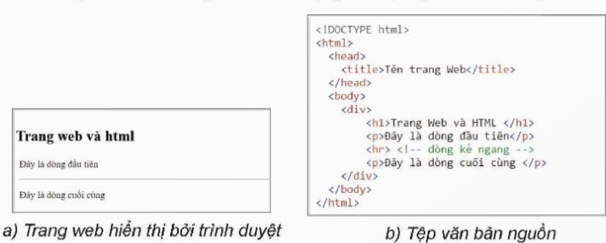
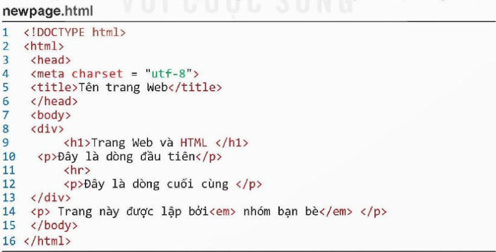
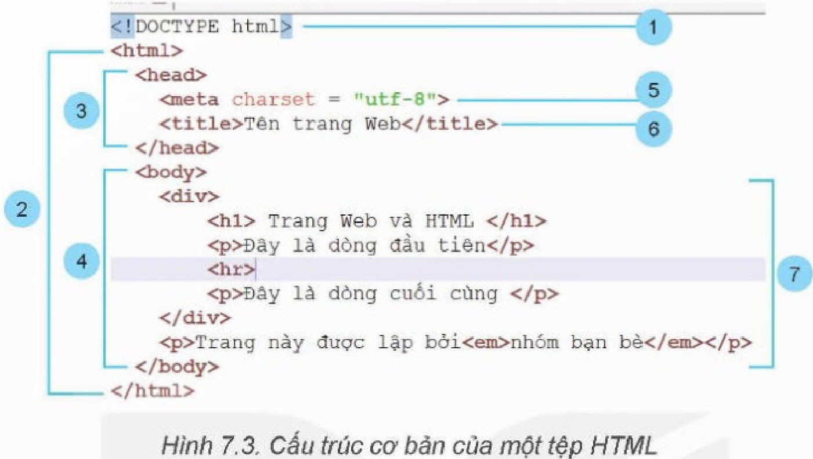
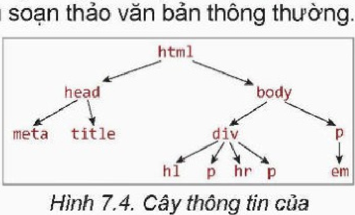
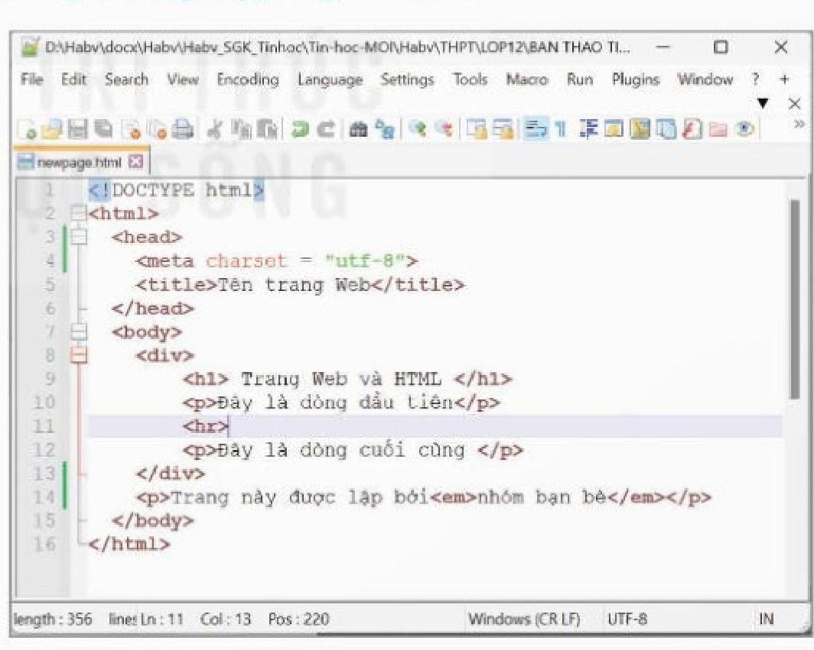
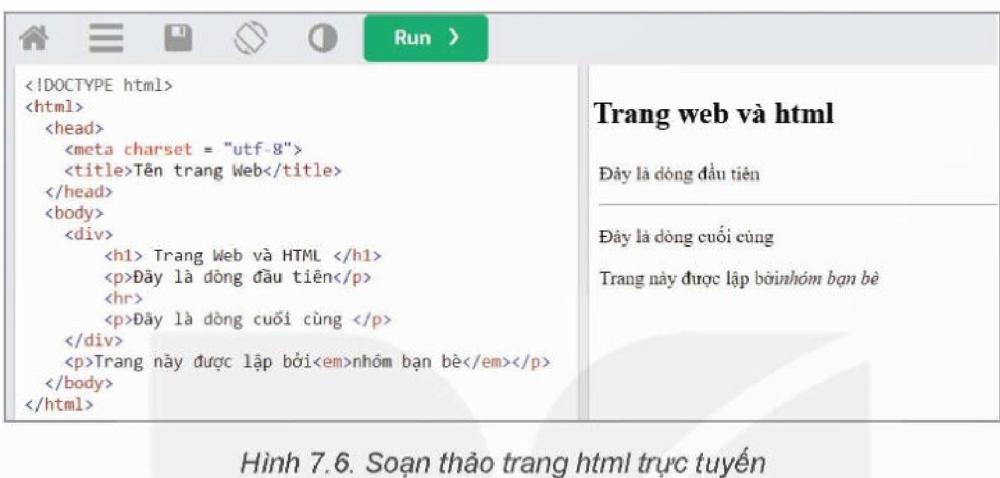
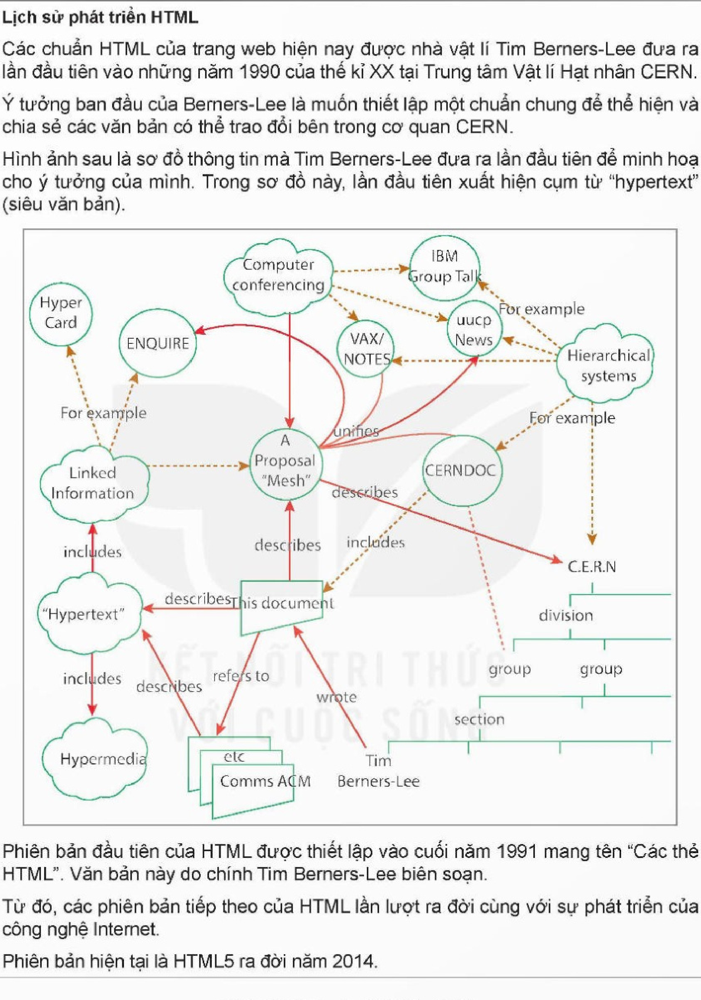

<!-- pdf:41 -->

# BÀI 7: HTML VÀ CẤU TRÚC TRANG WEB

## 🎯 Sau bài học này em sẽ:

- Hiểu và giải thích được cấu trúc của một trang web dưới dạng HTML.

## 🔴 Khởi động

> Các em đã được làm quen với khái niệm website và trang web, cũng có thể em đã biết cách sử dụng phần mềm để tạo ra các trang web với nội dung đa dạng và phong phú, hình thức trình bày đẹp.
>
> Tuy nhiên, có thể các em vẫn muốn biết:
> - Các trang web thực chất có cấu trúc như thế nào?
> - Có thể “lập trình” để tạo ra được các trang web hay không? Nếu lập trình được thì “mã nguồn” của trang web là gì?
> - Các trang web có quan hệ như thế nào với ngôn ngữ HTML?
> - Trang web và trình duyệt web có quan hệ như thế nào?
>
> Em hãy tìm câu trả lời.

## 1. TRANG WEB VÀ HTML

> **Hoạt động 1: Tìm hiểu ngôn ngữ HTML và trang web**
>
> Các trang web mà em vẫn thường xem được hiển thị bởi trình duyệt web (ví dụ: Cốc cốc, FireFox, Chrome). Thực chất chúng được tạo ra từ các tệp văn bản. Các tệp văn bản này được gọi là **trang nguồn** (hay **mã nguồn**) của trang web tương ứng. Quan sát Hình 7.1 và nhận xét về mã nguồn. Em thấy gì từ tệp nguồn của trang web?



```html
<!DOCTYPE html>
<html>
  <head>
    <title>Tên trang Web</title>
  </head>
  <body>
    <div>
      <h1>Trang Web và HTML </h1>
      <p>Đây là dòng đầu tiên</p>
      <hr> <!-- dòng kẻ ngang -->
      <p>Đây là dòng cuối cùng </p>
    </div>
  </body>
</html>
```

**HTML** là viết tắt của cụm từ Hypertext Markup Language (*ngôn ngữ đánh dấu siêu văn bản*), là một bộ quy tắc dùng để thiết lập cấu trúc và hiển thị nội dung trang web.

<!-- pdf:42 -->

Trang web được thiết lập từ các tệp văn bản thường có phần mở rộng là **.html** hoặc **.htm** được gọi là **trang html**. Trên trang html, ta có thể thấy nội dung bao gồm phần văn bản (text) và các kí tự đánh dấu đặc biệt nằm trong hai dấu “`<`”, “`>`”. Các kí tự này, được gọi là **thẻ đánh dấu HTML** (còn gọi là **thẻ HTML** hay **tag**). Trong ví dụ ở Hình 7.1b chúng ta thấy các thẻ HTML như `<head>`, `<title>`, `<body>`, `<h1>`, `<p>`, `<div>`,...

Các thẻ HTML được sử dụng để xác định phần tử HTML tương ứng. Các phần tử HTML định dạng thông tin trong trang web. Để hiển thị thông tin trong trang web, cần phần mềm trình duyệt web.

### a) Thẻ đánh dấu HTML

**Thẻ đánh dấu HTML** (tag) là các thành phần chính tạo thành ngôn ngữ đánh dấu siêu văn bản. Mỗi loại thẻ có một tên riêng và có ý nghĩa nhất định trong định dạng nội dung của trang web. Các thẻ được viết trong cặp dấu “`<`”, “`>`”. Thông thường mỗi thẻ sẽ bao gồm thẻ bắt đầu và thẻ kết thúc, chỉ ra phạm vi tác dụng của thẻ.

| Thẻ | Ý nghĩa thẻ | HTML code | Hiển thị trên trình duyệt |
| --- | --- | --- | --- |
| `p` | Đoạn văn bản | `<p>Đây là đoạn văn bản.</p>` | Đây là đoạn văn bản. |
| `h1` | Tiêu đề 1 của văn bản | `<h1>Đây là tiêu đề 1</h1>` | **Đây là tiêu đề 1** |

*Lưu ý:*
- Tên thẻ HTML không phân biệt chữ hoa, chữ thường nhưng mặc định tên thẻ được viết chữ thường.
- Các thẻ có thể lồng nhau. Ví dụ sau là thẻ `<em>` được lồng bên trong thẻ `<p>`:

```html
<p> Trang này được lập bởi <em>nhóm bạn bè</em> thân thiết </p>
```

- Mỗi thẻ có thể đi kèm các thông tin thuộc tính của thẻ. Ví dụ sau mô tả thuộc tính màu được gán thêm cho thẻ `<p>`, do đó toàn bộ đoạn văn bản này có màu đỏ khi hiển thị trên trình duyệt.

```html
<p style = "color : red">This is a paragraph.</p>
```

- Phần lớn các thẻ đều là **thẻ đôi**, tức là có **thẻ bắt đầu** (opening tag) và **thẻ kết thúc** (closing tag). Vị trí kết thúc thẻ có thêm dấu “`/`” chẳng hạn `</p>`.
- Tuy nhiên có một số loại **thẻ đơn**, tức là chỉ có thẻ bắt đầu. Các thẻ đơn thường có dạng `<tên thẻ>` hoặc `<tên thẻ/>`, ví dụ `<hr/>` (dòng kẻ ngang), `<br/>` (ngắt xuống dòng),...
- HTML và trình duyệt không nhận biết được nhiều dấu cách. Nếu gõ nhiều dấu cách máy sẽ hiểu là chỉ có một dấu cách. Trình duyệt cũng không nhận biết dấu xuống dòng khi người dùng nhấn phím **Enter** trong quá trình soạn thảo. Cần chú ý điều này khi soạn thảo HTML.

### b) Phần tử HTML

***Phần tử HTML*** (element) là khái niệm cơ bản của trang html. Thông thường, một phần tử được định nghĩa bởi thẻ bắt đầu, thẻ kết thúc và phần nội dung nằm giữa cặp thẻ này.

```html
<tên thẻ> nội dung của phần tử HTML </tên thẻ>
```

*Lưu ý:* Các thẻ đơn cùng với nội dung của nó cũng được gọi là phần tử HTML.

<!-- pdf:43 -->

Vậy phần tử HTML có thể hiểu là toàn bộ phần thẻ và nội dung của thẻ. Mỗi tệp HTML là tập hợp các **phần tử HTML**. Các phần tử HTML đóng vai trò quan trọng tạo nên cấu trúc và nội dung của trang web. Các phần tử HTML có thể độc lập, rời nhau hoặc lồng nhau.

Trong ví dụ ở Hình 7.1, em thấy hai phần tử HTML rời nhau là `<head>` và `<body>`, trong khi đó phần tử `<div>` chứa bên trong bốn phần tử HTML khác.

*Lưu ý:*
- Dòng đầu tiên của mỗi tệp HTML có dạng `<!DOCTYPE html>` có vai trò thông báo kiểu của tệp là html và không được coi là phần tử HTML.
- Phần tử HTML đặc biệt có ý nghĩa chú thích trong tệp HTML có dạng:

```html
<!-- đây là dòng chú thích -->
```

> Trang web được thiết lập theo một ngôn ngữ có cấu trúc đặc biệt gọi là ngôn ngữ đánh dấu siêu văn bản HTML. Các tệp HTML là tệp văn bản được cấu tạo từ các phần tử HTML. Mỗi **phần tử HTML** gồm nội dung được đánh dấu bởi các **thẻ** (HTML tag) có tính năng điều khiển hoặc định dạng nội dung. Trình duyệt có chức năng hiển thị nội dung trang web theo đúng định dạng được thiết lập.

> **Câu hỏi:**
> 1. Tệp văn bản trong Hình 7.1 có bao nhiêu phần tử HTML?
> 2. Nêu sự giống và khác nhau giữa **thẻ HTML** và **phần tử HTML**.

## 2. CẤU TRÚC CƠ BẢN CỦA MỘT TỆP HTML

> **Hoạt động 2: Tìm hiểu cấu trúc cơ bản của một tệp HTML**
>
> Quan sát tệp HTML sau, em có nhận xét gì về cấu trúc chung của một trang web?



```html
<!DOCTYPE html>
<html>
  <head>
    <meta charset = "utf-8">
    <title>Tên trang Web</title>
  </head>
  <body>
    <div>
      <h1>Trang Web và HTML </h1>
      <p>Đây là dòng đầu tiên</p>
      <hr>
      <p>Đây là dòng cuối cùng </p>
    </div>
    <p> Trang này được lập bởi<em> nhóm bạn bè</em> </p>
  </body>
</html>
```

<!-- pdf:44 -->

Mỗi tệp HTML bao gồm nhiều phần tử HTML, các phần tử HTML có thể lồng nhau. Ví dụ trong Hình 7.2, phần tử với thẻ `<div>` chứa phần tử với thẻ `<h1>`. Quan hệ lồng nhau giữa các phần tử HTML có thể hình dung như quan hệ cha – con hay quan hệ giữa các nút của một sơ đồ hình cây.



1. Dòng đầu tiên, `<!DOCTYPE html>`, không được coi là phần tử HTML và mang ý nghĩa đặc biệt, thông báo cho trình duyệt biết đây là tệp có định dạng html. Có thể coi là dòng khai báo html của tệp văn bản.
2. Phần tử `<html>` là bắt buộc, là phần tử gốc và chứa tất cả các phần tử HTML còn lại của trang web. Trong sơ đồ hình cây HTML, đây là phần tử gốc (root). Phần tử `<html>` thường chứa hai phần tử con `<head>` và `<body>`.
3. Phần tử `<head>` chứa các phần tử có liên quan chung đến toàn bộ trang web. Trong `<head>` thường có phần tử `<title>`. Một số phần tử khác thường có trong `<head>` bao gồm `<meta>`, `<style>` và `<script>`.
4. Phần tử `<body>` chứa tất cả các phần tử còn lại là thông tin của trang web. Các phần tử này sẽ được tìm hiểu trong các bài học sau.
5. Phần tử `<meta>` được dùng để mô tả các thông tin bổ sung của trang web như cách mã hoá Unicode, từ khoá dùng để tìm kiếm trang, tên tác giả trang web. Phần tử này nằm trong phần tử `<head>`. Trong Hình 7.3, phần tử `<meta charset = "utf-8">` mô tả cách mã hoá văn bản trên trang web theo mã UTF-8.
6. Phần tử `<title>` nằm trong `<head>`. Thẻ `<title>` mô tả tên của trang web hiện thời. Tên của trang web sẽ xuất hiện trong danh sách kết quả tìm kiếm. Phần tử `<title>` phải là văn bản thường và không được phép chứa các phần tử con.
7. Nhóm các thẻ định dạng văn bản thường dùng là các thẻ tiêu đề theo thứ tự giảm cấp dần là `<h1>`, `<h2>`, `<h3>`, `<h4>`, `<h5>`, `<h6>`. Thẻ `<p>` mô tả một đoạn văn bản hoàn chỉnh.
<!-- term: Cấu trúc cơ bản của tệp HTML -->

*Lưu ý:* Văn bản HTML không nhận biết kí tự xuống dòng (nhấn phím **Enter**) để kết thúc đoạn văn bản (paragraph) như các phần mềm soạn thảo văn bản thông thường.

Như vậy, cấu trúc chung của một trang web có thể hình dung như một **cây thông tin các phần tử HTML** có quan hệ cha con (lồng nhau), nút gốc (root) là phần tử `<html>`. Cấu trúc cây HTML này sẽ được giới thiệu trong các phần sau. Ví dụ, trang web ở Hình 7.2 có cây thông tin như Hình 7.4.



<!-- pdf:45 -->

> Cấu trúc cơ bản của tệp HTML có dạng như một **cây thông tin các phần tử HTML**. Quan hệ cha – con của các nút trên cây được mô tả bằng sự lồng nhau của các phần tử (hay thẻ) HTML. Gốc của cây HTML chính là phần tử `<html>`.

> **Câu hỏi:**
> 1. Vẽ sơ đồ cây của đoạn văn bản HTML sau:
> ```html
> <p>Thông tin này in <b>đậm</b>, in <i>nghiêng</i> in <u>gạch dưới</u>, in bình thường.</p>
> ```
> 2. Cây HTML có bao nhiêu phần tử gốc?

## 3. PHẦN MỀM SOẠN THẢO HTML

> **Hoạt động 3: Tìm hiểu cách soạn thảo các tệp HTML**
>
> Hãy tìm hiểu những phần mềm có thể dùng để soạn thảo tệp HTML. Thảo luận để tìm ra cách soạn thảo tệp HTML hợp lí nhất.

Có nhiều cách để tạo tệp nguồn HTML. Ví dụ sử dụng các phần mềm soạn thảo như notepad, Notepad++ hay Sublime Text. Ta cũng có thể soạn thảo trên các trang hỗ trợ tạo tệp HTML trực tuyến.

### a) Phần mềm Notepad

Đây là phần mềm soạn thảo văn bản đơn giản không định dạng, cung cấp một số chức năng chỉnh sửa cơ bản. Notepad có sẵn trên hệ điều hành Windows. Trên MacOS cũng có phần mềm tương tự Notepad là TextEdit.

### b) Phần mềm soạn thảo HTML chuyên nghiệp nguồn mở

- **Phần mềm Notepad++**

Notepad++ là phần mềm soạn thảo chương trình đa năng, hỗ trợ soạn thảo chương trình với nhiều ngôn ngữ khác nhau, trong đó có ngôn ngữ HTML. Đây là phần mềm miễn phí, mã nguồn mở và có thể tải về từ địa chỉ https://notepad-plus-plus.org/. Giao diện có thể như Hình 7.5.

*Lưu ý:* Để phần mềm hiển thị và hỗ trợ soạn thảo đúng HTML cần thực hiện lệnh **Language** → **H** → **HTML** để chọn ngôn ngữ HTML.



- **Phần mềm Sublime Text**

Sublime Text là phần mềm soạn thảo chương trình với nhiều ngôn ngữ khác nhau, tương tự như Notepad++. Phần mềm này có phiên bản cơ bản miễn phí. Địa chỉ tải phần mềm: https://www.sublimetext.com/.

*Lưu ý:* Để phần mềm hiển thị và hỗ trợ soạn thảo đúng theo ngôn ngữ HTML cần thực hiện lệnh **View** → **Syntax** → **HTML** để chọn ngôn ngữ HTML.

<!-- pdf:46 -->

### c) Sử dụng trang web hỗ trợ soạn thảo HTML trực tuyến

Một cách phổ biến để soạn thảo HTML là sử dụng các trang hỗ trợ soạn thảo HTML trực tuyến. Để thực hiện theo cách này, yêu cầu máy tính có kết nối Internet và cài đặt trình duyệt chuẩn, ví dụ như Cốc cốc, FireFox, Chrome hay Microsoft Edge.

Ví dụ Hình 7.6 là giao diện soạn thảo HTML trực tuyến. Khi đó có thể quan sát ngay kết quả hiển thị trang web trên trình duyệt. Việc soạn thảo HTML được thực hiện tại khung bên trái, nháy nút **Run** để kiểm tra kết quả tại khung bên phải.



Một số trang web hỗ trợ soạn thảo HTML trực tuyến là: w3schools.com, tutorialspoint.com,...

> Có thể soạn thảo tệp HTML bằng nhiều phần mềm khác nhau. Cũng có thể soạn thảo trực tuyến và kiểm tra kết quả trực tiếp trên trình duyệt.

> **Câu hỏi:**
> 1. Xếp các tên sau vào hai nhóm: phần mềm soạn thảo HTML và trình duyệt web:
> a) Notepad.
> b) Opera.
> c) Sublime Text.
> d) Chrome.
> e) Cốc Cốc.
> f) Notepad++.
> g) FireFox.
> h) Microsoft Edge.
>
> 2. Em có nhận xét gì về sự khác biệt khi soạn thảo HTML giữa các phần mềm chuyên nghiệp (ví dụ Notepad++, Sublime Text) và phần mềm soạn thảo văn bản thông thường (ví dụ Notepad)?

## ✏️ Luyện tập

1. Tìm ví dụ về phần tử HTML không thể lồng, tức là không thể có quan hệ cha – con trong cây thông tin của trang web.
2. Chọn một văn bản đơn giản. Soạn thảo tệp HTML để hiển thị nội dung văn bản đó. Vẽ cây thông tin các phần tử HTML của trang web vừa soạn thảo.

## 🚀 Vận dụng

1. Em hãy tìm trên mạng các trang web hỗ trợ soạn thảo HTML trực tuyến.
2. Sử dụng phần mềm soạn thảo HTML và soạn thảo trang web có nội dung như Hình 7.7. Lưu ý rằng thẻ `` với tính năng thể hiện ảnh trên trang web có cú pháp: ``, trong đó “tên tệp ảnh” chính là đường dẫn của tệp hình ảnh cần đưa lên trang.

<!-- pdf:47 -->



> **Lịch sử phát triển HTML**
>
> Các chuẩn HTML của trang web hiện nay được nhà vật lí Tim Berners-Lee đưa ra lần đầu tiên vào những năm 1990 của thế kỉ XX tại Trung tâm Vật lí Hạt nhân CERN.
>
> Ý tưởng ban đầu của Berners-Lee là muốn thiết lập một chuẩn chung để thể hiện và chia sẻ các văn bản có thể trao đổi bên trong cơ quan CERN.
>
> Hình ảnh sau là sơ đồ thông tin mà Tim Berners-Lee đưa ra lần đầu tiên để minh hoạ cho ý tưởng của mình. Trong sơ đồ này, lần đầu tiên xuất hiện cụm từ “hypertext” (siêu văn bản).
>
> Phiên bản đầu tiên của HTML được thiết lập vào cuối năm 1991 mang tên “Các thẻ HTML”. Văn bản này do chính Tim Berners-Lee biên soạn.
>
> Từ đó, các phiên bản tiếp theo của HTML lần lượt ra đời cùng với sự phát triển của công nghệ Internet.
>
> Phiên bản hiện tại là HTML5 ra đời năm 2014.

## 📷 Danh sách hình trong bài

| Mã hình | Số hình SGK | Trang PDF | Chú thích |
| --- | --- | --- | --- |
| H12-tin_hoc_thud-b07-01 | Hình 7.1 | 41 | Trang web và tệp văn bản nguồn |
| H12-tin_hoc_thud-b07-02 | Hình 7.2 | 43 | Cấu trúc tệp html |
| H12-tin_hoc_thud-b07-03 | Hình 7.3 | 44 | Cấu trúc cơ bản của một tệp HTML |
| H12-tin_hoc_thud-b07-04 | Hình 7.4 | 44 | Cây thông tin của trang web ở Hình 7.2 |
| H12-tin_hoc_thud-b07-05 | Hình 7.5 | 45 | Giao diện soạn thảo HTML của Notepad++ |
| H12-tin_hoc_thud-b07-06 | Hình 7.6 | 46 | Soạn thảo trang html trực tuyến |
| H12-tin_hoc_thud-b07-07 | Hình 7.7 | 47 | Lịch sử phát triển HTML |
