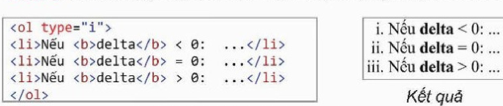
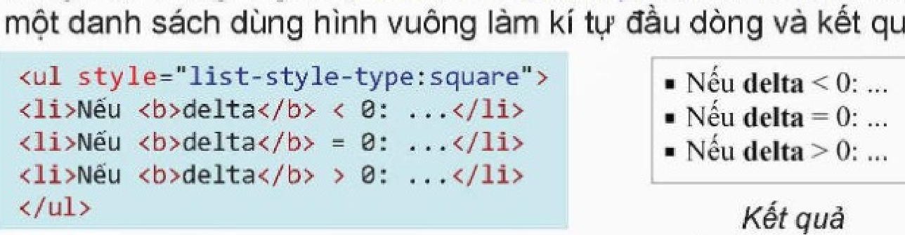
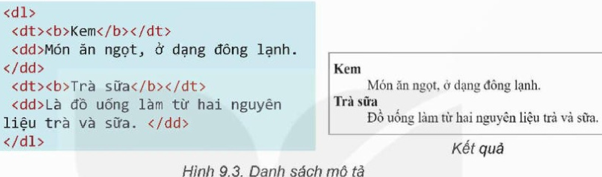
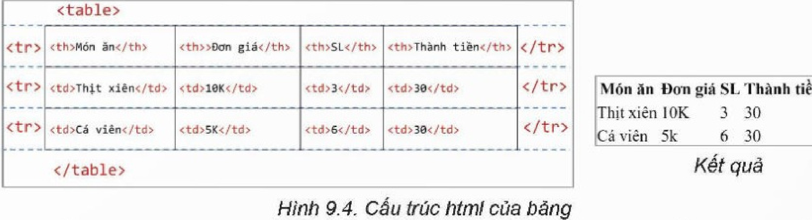
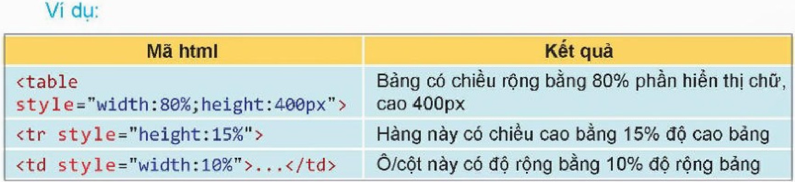
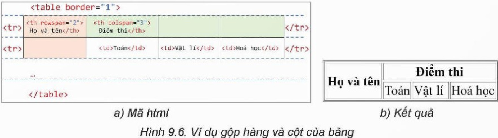
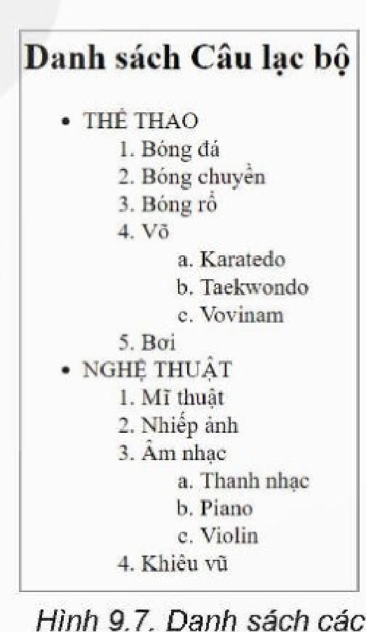
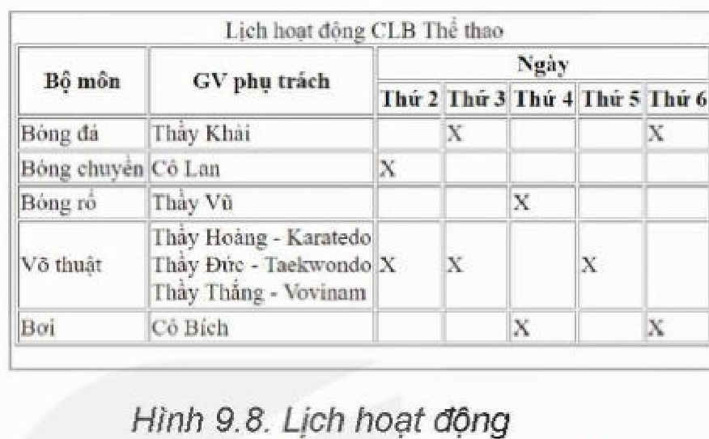

<!-- pdf:54 -->

# BÀI 9: TẠO DANH SÁCH, BẢNG

## 🎯 Sau bài học này em sẽ:

- Sử dụng thẻ HTML tạo được danh sách, bảng.

## 🔴 Khởi động

> Theo em, khi trang web chỉ toàn các đoạn văn bản thì cần trình bày thế nào cho dễ nhìn?

## 1. TẠO DANH SÁCH

> **Hoạt động 1: Nhận biết phần tử danh sách**
>
> Em hãy quan sát Hình 8.3 và nhận xét xem có điểm nào có thể cải tiến về mặt trình bày không.

**Danh sách** trong html cho phép nhóm và liệt kê tập hợp các mục tương tự nhau thành một danh sách để hiển thị. Các dạng danh sách trong html cơ bản gồm: *danh sách không có thứ tự*, *danh sách có thứ tự* và *danh sách mô tả*. Có thể tạo danh sách lồng nhau.

### a) Danh sách có hoặc không có thứ tự

Trong danh sách, các mục được hiển thị tuần tự, kí tự đầu dòng có thể là một số, chữ, dấu, kí hiệu hoặc hình ảnh. Cấu trúc của đoạn mã html tạo danh sách như sau:

```html
<thẻ bắt đầu>
<li> mục thứ 1 </li>
...
<li> mục thứ n </li>
</thẻ kết thúc>
```

- Để tạo **danh sách có thứ tự**, dùng cặp thẻ `<ol></ol>`. Để chọn kiểu đánh thứ tự và giá trị bắt đầu, dùng thuộc tính `type` và `start` (Hình 9.1):
  - `type`: xác định kiểu đánh số. Các kiểu đánh số là: “`1`”, “`A`”, “`a`”, “`I`” và “`i`”.
  - `start`: xác định giá trị bắt đầu đánh số, nhận giá trị là các số thực.



```html
<ol type="i">
<li>Nếu <b>delta</b> < 0: ...</li>
<li>Nếu <b>delta</b> = 0: ...</li>
<li>Nếu <b>delta</b> > 0: ...</li>
</ol>
```

- Để tạo **danh sách không có thứ tự**, dùng cặp thẻ `<ul></ul>`. Để chọn kí tự đầu dòng, ta thiết lập giá trị của đặc tính `list-style-type` trong thuộc tính `style` bằng một trong 4 giá trị `disc`, `circle`, `square` và `none`. Hình 9.2 mô tả ví dụ một danh sách dùng hình vuông làm kí tự đầu dòng và kết quả.



```html
<ul style="list-style-type:square">
<li>Nếu <b>delta</b> < 0: ...</li>
<li>Nếu <b>delta</b> = 0: ...</li>
<li>Nếu <b>delta</b> > 0: ...</li>
</ul>
```

<!-- pdf:55 -->

### b) Danh sách mô tả

**Danh sách mô tả** dùng để liệt kê các mục kèm với mô tả cho từng mục. Cấu trúc của đoạn mã tạo danh sách mô tả khác cấu trúc của đoạn mã tạo danh sách có hoặc không có thứ tự. Để tạo danh sách mô tả, em dùng ba thẻ `<dl>`, `<dt>` và `<dd>`:

```html
<dl>
<dt> ... </dt> Tên mục 1 (chẳng hạn như một thuật ngữ hoặc một nhãn)
<dd> ... </dd> Mô tả của mục 1 (định nghĩa của thuật ngữ hoặc mô tả cho nhãn tương ứng)
...
<dt> ... </dt> Tên mục n
<dd> ... </dd> Mô tả của mục n
</dl>
```

**Ví dụ:**



```html
<dl>
  <dt><b>Kem</b></dt>
  <dd>Món ăn ngọt, ở dạng đông lạnh.</dd>
  <dt><b>Trà sữa</b></dt>
  <dd>Là đồ uống làm từ hai nguyên liệu trà và sữa. </dd>
</dl>
```

*Lưu ý:* Ta có thể tạo ra các danh sách lồng nhau bằng cách để một danh sách là một mục của một danh sách khác (bằng cách đặt danh sách đó bên trong cụm thẻ `<li></li>` của mục tương ứng).

> Trong HTML, ta có thể định nghĩa các kiểu **danh sách có thứ tự**, **không có thứ tự** và **danh sách mô tả** bằng các thẻ `<ol>`, `<ul>` và `<dl>`.

> **Câu hỏi:**
> Làm thế nào để tạo một danh sách lồng nhau, danh sách mức 1 đánh số dạng 1, 2, 3,... và danh sách mức 2 đánh số dạng a, b, c?

## 2. THIẾT LẬP BẢNG

> **Hoạt động 2: Lựa chọn định dạng phù hợp nhất**
>
> Trong Hội chợ ẩm thực ở trường, lớp 12E dự định bán một số món, các bạn muốn đăng trên trang web của lớp các thông tin: món ăn, đơn giá, số lượng và tổng số tiền. Theo em, các bạn nên dùng dạng biểu diễn nào: danh sách, danh sách mô tả hay bảng. Tại sao?

**Phần tử bảng** được dùng khi ta cần thêm dữ liệu có thể sắp xếp dưới dạng hàng và cột vào trang web. Dữ liệu trong bảng có thể là bất kì loại thông tin nào, không nhất thiết là dạng số. Bảng là công cụ để tạo ra các bố cục nhiều cột hoặc phân bố nội dung và các khoảng trắng. Chính vì vậy, độ phức tạp của bảng từng là thước đo giá trị thiết kế trang web. Tuy nhiên, sử dụng bảng tạo bố cục tương đối phức tạp nên người ta thường sử dụng CSS để tạo bố cục, nội dung này được trình bày ở các bài sau.

*Bảng* được tạo từ các *hàng*, mỗi hàng gồm các *ô dữ liệu*. Hàng đầu tiên có thể là hàng *tiêu đề*. Ngôn ngữ HTML xây dựng bảng từ các thành phần tương ứng như trên. Các thành phần lần lượt được định nghĩa bởi các thẻ `<table>`– tạo bảng, `<tr>`– tạo hàng, `<td>`– tạo các ô dữ liệu và `<th>`– tạo ô tiêu đề.

<!-- pdf:56 -->

Hình 9.4 mô tả đoạn mã html tạo một bảng bằng các thẻ trên (theo thứ tự từ trên xuống dưới, từ trái sang phải) và bảng kết quả thu được.



```html
<table>
  <tr><th>Món ăn</th><th>Đơn giá</th><th>SL</th><th>Thành tiền</th></tr>
  <tr><td>Thịt xiên</td><td>10K</td><td>3</td><td>30</td></tr>
  <tr><td>Cá viên</td><td>5K</td><td>6</td><td>30</td></tr>
</table>
```

Bảng trong Hình 9.4 có thể được định dạng thêm để đẹp và dễ đọc hơn bằng cách chỉnh các thuộc tính của bảng. Các định dạng cơ bản bao gồm: thêm tiêu đề cho bảng, tạo khung bảng, điều chỉnh kích thước hàng/cột/ô và gộp ô.

- *Thêm tiêu đề:* sử dụng thẻ `<caption>`, ngay sau thẻ `<table>` và trước thẻ `<tr>` đầu tiên.

**Ví dụ:**

| Mã html | Kết quả |
| --- | --- |
| `<caption>Hoá đơn</caption>` | Bảng có tiêu đề là “Hoá đơn” |

- *Tạo khung bảng:* Trong HTML5, độ dày khung được thiết lập cho viền khung bảng hoặc khung của từng ô bằng thuộc tính con `border` của thuộc tính `style` có giá trị là một bộ ba thuộc tính nhỏ hơn sau:

```text
"độ_dày_theo_px kiểu_viền [màu_viền]"
```

trong đó, ba thuộc tính cách nhau bởi dấu cách, hai thuộc tính đầu là bắt buộc; thuộc tính `kiểu_viền` có thể nhận một trong bốn giá trị (`solid`, `dotted`, `double`, `none`), còn thuộc tính `màu_viền` mặc định là màu đen và có thể bỏ qua.

- *Điều chỉnh kích thước:* Sử dụng đặc tính con `width` và `height` của thuộc tính `style`. Kích thước được đặt có thể là theo tỉ lệ với khối bao ngoài đối tượng (%) hoặc theo số điểm ảnh (px).

*Lưu ý:* Không nên sử dụng kích thước theo px do các thiết bị hiển thị có sự khác nhau về kích thước và số điểm ảnh có thể dẫn đến bảng không hiển thị đúng như mong đợi.

**Ví dụ:**



| Mã html | Kết quả |
| --- | --- |
| `<table style="width:80%;height:400px">` | Bảng có chiều rộng bằng 80% phần hiển thị chữ, cao 400px |
| `<tr style="height:15%">` | Hàng này có chiều cao bằng 15% độ cao bảng |
| `<td style="width:10%">...</td>` | Ô/cột này có độ rộng bằng 10% độ rộng bảng |

- *Gộp ô:* Sử dụng thuộc tính `rowspan` (cho hàng) và `colspan` (cho cột). Bản chất của việc gộp ô là mở rộng một ô bằng cách thêm một số hàng hoặc một số cột lân cận có cùng nội dung. Việc này giúp tạo ra được bảng có cấu trúc phức tạp nhưng cũng làm cho việc đánh dấu, theo dõi và kiểm soát số lượng ô trở lên khó khăn hơn. Việc gộp ô trên hàng được thực hiện như sau (tương tự đối với cột, sử dụng thuộc tính `colspan`):
<!-- term: Thuộc tính định dạng bảng HTML -->

<!-- pdf:57 -->

- Thêm `rowspan="số_hàng_muốn_ghép"` cho phần tử `<th>` hoặc `<td>` thuộc hàng đầu tiên cần ghép.
- Đối với các hàng tiếp theo: Bỏ qua cặp thẻ `<th>` hoặc `<td>` tại vị trí tương ứng (nếu bước trên đặt `rowspan="3"` thì bỏ qua hai hàng tiếp theo).

Ví dụ như Hình 9.6.



```html
<table border="1">
  <tr>
    <th rowspan="2">Họ và tên</th>
    <th colspan="3">Điểm thi</th>
  </tr>
  <tr>
    <td>Toán</td>
    <td>Vật lí</td>
    <td>Hoá học</td>
  </tr>
  ...
</table>
```

> **Phần tử bảng** dùng để biểu diễn dữ liệu có cấu trúc dạng bảng. Phần tử bảng được tạo bởi các thẻ chính là `<table>`, `<tr>`, `<td>` và `<th>`; trình bày bảng bằng thuộc tính `style`.

> **Câu hỏi:**
> Bảng trong ví dụ trên Hình 9.6 có nhược điểm gì? Cần làm thế nào để giải quyết nhược điểm đó?

## 3. THỰC HÀNH TẠO DANH SÁCH VÀ BẢNG

**Nhiệm vụ 1: Tạo danh sách**

*Yêu cầu:* Viết đoạn mã html để tạo danh sách các câu lạc bộ của trường như Hình 9.7.



**Hướng dẫn:**

*Bước 1.* Xác định thành phần của văn bản:

Văn bản gồm hai phần tử: một phần tử tiêu đề và một phần tử danh sách lồng nhau.

*Bước 2.* Tạo tiêu đều bằng cặp thẻ `<h2>...</h2>`.
<!-- ocr-ok: đối chiếu ảnh trang PDF 57 khớp nguyên văn -->

*Bước 3.* Tạo danh sách không có thứ tự:

```html
<ul>
  <li></li>
  <li></li>
</ul>
```

*Bước 4.* Tạo mục THỂ THAO, với phần mã được thêm vào giữa cặp thẻ ở dòng 2 là định nghĩa của một danh sách có thứ tự:

```html
<li>THỂ THAO
<ol>
<li>Bóng đá</li>
...
<li>Bơi</li>
</ol>
</li>
```

<!-- pdf:58 -->

*Lưu ý:* Mục thứ tư của danh sách này là một danh sách có thứ tự, kiểu đánh số `type="a"`.

*Bước 5.* Làm tương tự với mục NGHỆ THUẬT để hoàn thiện danh sách.

**Nhiệm vụ 2: Tạo bảng**

*Yêu cầu:* Lập bảng lịch hoạt động của các câu lạc bộ (Hình 9.8).



**Hướng dẫn:**

*Bước 1.* Xác định các thông số của bảng:
- Bảng có 7 hàng, 7 cột.
- Thuộc tính Caption của bảng là “Lịch hoạt động CLB Thể thao”.
- Hai ô 1, 2 của cột 1 và hai ô 1, 2 của cột 2 được gộp (`rowspan="2"`).
- Các ô 3, 4, 5, 6, 7 của hàng 1 được gộp (`colspan="5"`).
<!-- ocr-ok: đối chiếu ảnh trang PDF 58 khớp nguyên văn -->

Khung viền được đặt `border="1"` trong thẻ `<table>` hoặc sử dụng `style="border:1px solid"` cho thẻ `<table>` và từng thẻ `<td>` trong bảng.

*Bước 2.* Tạo bảng kèm caption:

```html
<table border="1">
<caption>Lịch hoạt động CLB Thể thao</caption>
```

*Bước 3.* Tạo hai hàng đầu như phân tích phía trên.

```html
<tr style="border:1px solid">
  <th rowspan="2">Bộ môn</th>
  <th rowspan="2">GV phụ trách</th>
  <th colspan="5">Ngày</th>
</tr>
<tr>
  <th>Thứ 2</th> ... <th>Thứ 6</th>
</tr>
```

*Bước 4.* Tạo các hàng còn lại, mỗi hàng là một cặp `<tr></tr>` bao bảy cặp `<td></td>` ở giữa chứa dữ liệu như Hình 9.7.

Lưu lại tệp với tên CLB.html.

## ✏️ Luyện tập

Sửa lại chương trình trong Hình 9.5a, sử dụng thuộc tính `style` thay vì thuộc tính `border` để tạo viền cho bảng. Sử dụng màu xanh cho viền của ô hai dòng đầu bảng và sử dụng ba màu đỏ, vàng, xanh cho ba chữ Toán, Vật lí và Hoá học.

## 🚀 Vận dụng

Cho trước một bảng dữ liệu cỡ $n \times 4$, mỗi hàng tương ứng với một bộ (họ tên, điểm Toán, điểm Vật lí, điểm Hoá học). Viết chương trình Python để tạo ra tệp HTML thực hiện việc vẽ bảng tương tự như Hình 9.5 và bổ sung dữ liệu vào các hàng phía dưới.

## 📷 Danh sách hình trong bài

| Mã hình | Số hình SGK | Trang PDF | Chú thích |
| --- | --- | --- | --- |
| H12-tin_hoc_thud-b09-01 | Hình 9.1 | 54 | Danh sách có thứ tự |
| H12-tin_hoc_thud-b09-02 | Hình 9.2 | 54 | Danh sách có kí tự đầu dòng |
| H12-tin_hoc_thud-b09-03 | Hình 9.3 | 55 | Danh sách mô tả |
| H12-tin_hoc_thud-b09-04 | Hình 9.4 | 56 | Cấu trúc html của bảng |
| H12-tin_hoc_thud-b09-05 | Hình 9.5 | 56 | Ví dụ thuộc tính của bảng |
| H12-tin_hoc_thud-b09-06 | Hình 9.6 | 57 | Ví dụ gộp hàng và cột của bảng |
| H12-tin_hoc_thud-b09-07 | Hình 9.7 | 57 | Danh sách các câu lạc bộ |
| H12-tin_hoc_thud-b09-08 | Hình 9.8 | 58 | Lịch hoạt động |
