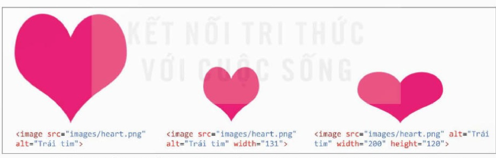
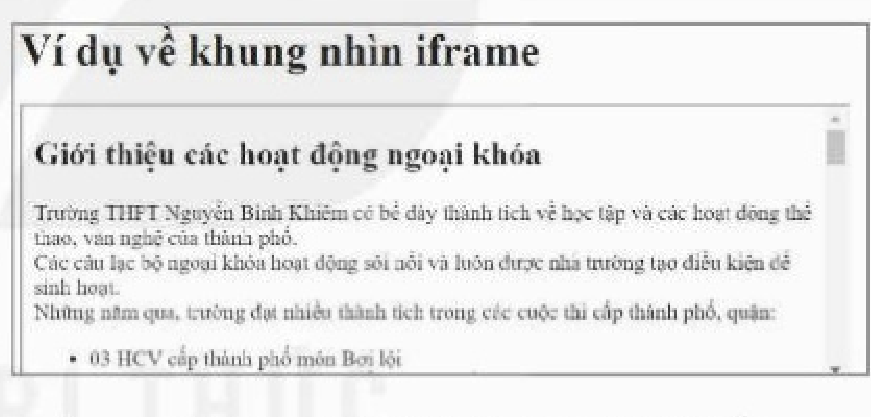
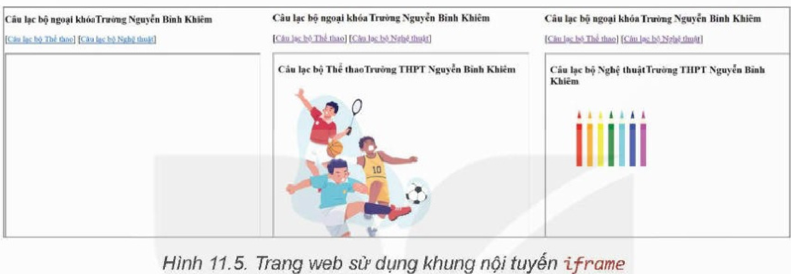

<!-- pdf:64 -->
# BÀI 11: CHÈN TỆP TIN ĐA PHƯƠNG TIỆN VÀ KHUNG NỘI TUYẾN VÀO TRANG WEB

## 🎯 Sau bài học này em sẽ:

- Sử dụng thẻ HTML chèn được các tệp tin đa phương tiện vào trang web và điều chỉnh kích thước cho phù hợp.

## 🔴 Khởi động

> Có những điểm gì khiến em thấy hứng thú hơn khi xem các trang web so với đọc sách?

## 1. CHÈN TỆP ẢNH VÀO TRANG WEB

> **Hoạt động 1: Các định dạng tệp ảnh**
>
> Hãy kể tên các định dạng tệp ảnh mà em biết. Phân loại chúng vào nhóm đồ hoạ vectơ hoặc đồ hoạ điểm ảnh.

Hình ảnh giúp cho các trang web sinh động hơn. Có thể nhúng hình ảnh trực tiếp trong nội dung của trang hoặc dưới dạng hình nền. Trong bài này, chúng ta sẽ tìm hiểu cách chèn ảnh vào nội dung trang web bằng thẻ ``.

Để có thể hiển thị trên web, các tệp ảnh cần được định dạng là một trong những loại được trình duyệt web hỗ trợ. Các định dạng phổ biến như PNG, JPEG hoặc GIF và một số định dạng mới, phổ biến cho web như JPEG-XR hay WebP. Các ảnh có định dạng khác như TIFF, EPS,... cần được chuyển đổi sang định dạng được hỗ trợ ở trên.

**Thẻ ``** là thẻ đơn, dùng để thêm ảnh vào trang web. Khi gặp thẻ ``, trình duyệt hiểu là "cần đặt một hình ảnh vào đây". Hình ảnh có thể được chèn ngay trong dòng văn bản mà không tạo ra ngắt dòng (Hình 11.1):


Với thẻ ``, trình duyệt sẽ phải tải ảnh lên trước khi hiển thị trên trang web. Do vậy, khi chèn hình ảnh vào trang web, ta cần quan tâm tới dung lượng của tệp hình ảnh vì dung lượng lớn sẽ làm việc hiển thị hình ảnh trên trang web gặp khó khăn nếu tốc độ của mạng chậm.

Trong các thuộc tính của thẻ ``, thuộc tính `src` là bắt buộc, để chỉ đường dẫn tới tệp ảnh. Ngoài ra, thuộc tính quan trọng khác là `alt` nên được sử dụng kèm để cung cấp **văn bản thay thế** khi việc hiển thị ảnh bị lỗi. Văn bản thay thế cần có tác dụng giúp người đọc hình dung ra nội dung bức ảnh. Đoạn mã để chèn ảnh có thể như sau:

<!-- pdf:65 -->
```html

```

Ví dụ, ta tạo một liên kết từ ảnh `pdffiles.png` trong thư mục `images` tới một tệp có đường dẫn `tai_lieu/bieu_mau.pdf` có nội dung là biểu mẫu xin nhập học bằng đoạn mã html sau:

```html
<p> Tải biểu mẫu xin nhập học:
<a href="tai_lieu/bieu_mau.pdf">
    
</a>
</p>
```

Hình 11.2a thể hiện kết quả khi có tệp `pdffiles.png` trong thư mục `images` và Hình 11.2b trong trường hợp không có.


Để thiết lập kích thước cho ảnh ta sử dụng các thuộc tính `width`, `height` cho thẻ `img`. Thuộc tính `width`, `height` cho biết kích thước hiển thị ảnh bằng pixel. Khi sử dụng các thuộc tính này, trình duyệt sẽ giữ đúng không gian trong bố cục khi hình ảnh đang tải giúp hiển thị trang nhanh hơn. Nếu chỉ sử dụng một trong hai thuộc tính (`width` hoặc `height`), chiều còn lại sẽ được tính toán để hiển thị theo tỉ lệ của ảnh gốc.
<!-- term: Thuộc tính width và height của thẻ  -->

Ví dụ, Hình 11.3 thể hiện kết quả khi chèn ảnh hình trái tim *heart.png* có chiều rộng 262 pixel, chiều dài 257 pixel với các giá trị thuộc tính khác nhau.



*Lưu ý:* Khi chèn ảnh, nên chèn bằng đường dẫn tương đối để tránh trường hợp xảy ra lỗi khi ảnh trên mạng bị thay đổi.

> Cách chèn ảnh vào trang web là sử dụng thẻ ``.

> **Câu hỏi:**
>
> 1. Thẻ `` chỉ dùng khi chèn ảnh jpg vào trang web có đúng không?
> 2. Hãy nêu một số trường hợp có thể xảy ra lỗi khi hiển thị ảnh.

<!-- pdf:66 -->
## 2. CHÈN ÂM THANH VÀ VIDEO VÀO TRANG WEB
<!-- ocr-ok: đối chiếu ảnh trang PDF 66 khớp nguyên văn -->

> **Hoạt động 2: Nhận biết các thẻ và các thuộc tính thẻ liên quan tới video**
>
> Quan sát đoạn mã sau và xác định xem đoạn mã này có chức năng gì?
>
> ```html
> <video src="videos/war_is_over.mp4" width="300" height="250" autoplay>
> ```
<!-- ocr-ok: đối chiếu ảnh trang PDF 66 khớp nguyên văn -->

Để chèn video hoặc âm thanh vào trang web, ta sử dụng thẻ `<video>` và `<audio>`. Hai thẻ này được hỗ trợ trong hầu hết các trình duyệt, tuy nhiên định dạng của các tệp tin đa phương tiện có thể sử dụng vẫn phụ thuộc vào trình duyệt.

- Hai định dạng tệp video phổ biến nhất là mp4 và webm. Mp4 chạy được trực tiếp trên hầu hết các trình duyệt.
- Ba định dạng tệp âm thanh phổ biến được hỗ trợ bởi hầu hết trình duyệt hiện tại là mp3, wav và ogg.

Để chèn tệp video hay âm thanh vào trang web, ta sử dụng thẻ `<video>` hoặc `<audio>`:

```html
<video[audio] thuộc_tính="giá_trị_thuộc_tính"></video[audio]>
```

Tương tự như thẻ ``, thẻ `<video>` cũng có các thuộc tính cơ bản như `src`, `width`, `height`. Ngoài ra còn có các thuộc tính khác như:

- `controls`: là thuộc tính boolean, không cần có giá trị, để trình duyệt hiển thị các thành phần điều khiển như nút phát/tạm dừng, điều khiển âm lượng,... Thuộc tính này nên được sử dụng để có thể điều khiển trong quá trình phát tệp tin đa phương tiện.
- `autoplay`: là thuộc tính boolean, không cần có giá trị, cho phép trình duyệt chạy video ngay khi hiển thị. Tuy nhiên, một số trình duyệt như Google Chrome thường không cho video chạy ngay khi hiển thị hoặc có thể chạy ngay khi hiển thị nếu có thuộc tính `muted` – không phát tiếng.
- `poster`: cung cấp đường dẫn đến tệp ảnh, dùng để hiển thị khi chưa chạy video.
<!-- term: Thuộc tính của thẻ <video> và <audio> -->

Thẻ `<audio>` không có thuộc tính `width`, `height` và `poster`.

Trong trường hợp có nhiều video hoặc nhiều tệp âm thanh tương ứng với các định dạng khác nhau, ta có thể sử dụng thẻ `<source>` trong cặp thẻ `<video>` hay `<audio>` để chỉ định các loại định dạng khác nhau. Trình duyệt sẽ tự động tìm và hiển thị tệp tin với định dạng mà nó hỗ trợ.

Ví dụ:

```html
<video width="320" height="240" controls>
<source src="movie.mp4" type="video/mp4">
<source src="movie.ogg" type="video/ogg">
Trình duyệt của bạn không hỗ trợ HTML video
</video>
```

> **Thẻ `<video>`** và **thẻ `<audio>`** dùng để chèn các tệp tin video và âm thanh vào trang web. Để các trình duyệt thể hiện đúng, các tệp tin phải có định dạng được hỗ trợ bởi trình duyệt.

> **Câu hỏi:**
>
> Thuộc tính `src` có tác dụng gì với thẻ `<audio>`?

<!-- pdf:67 -->
## 3. TẠO KHUNG NỘI TUYẾN TRONG TRANG WEB

> **Hoạt động 3: Trao đổi và nhận xét**
>
> Trong các bài đăng có đính kèm video, một số trang web sẽ hiển thị nội dung video trong một khung và cho phép tương tác bên trong khung đó. Em có nhận xét gì về giao diện của cả trang khi thực hiện các thao tác bên trong khung này?

**Khung nội tuyến** là một khung nhìn chứa tài nguyên web khác trong trang web hiện tại. Để tạo khung nội tuyến, ta sử dụng thẻ `<iframe>` (viết tắt của inline frame – khung nội tuyến). Ví dụ, khi cần chèn nội dung từ YouTube hoặc bản đồ từ Google Maps vào trang web của mình, các nền tảng đều cung cấp cho ta một đoạn mã sử dụng `iframe` để ta sao chép và dán vào trang web. `iframe` cũng là công cụ tiêu chuẩn để chèn các nội dung quảng cáo.

Các thuộc tính thường dùng của thẻ `<iframe>` là:

- `src`: đường dẫn tới nội dung hiển thị trong khung nội tuyến.
- `width`, `height`: chiều rộng và chiều cao của khung nội tuyến.

Ví dụ, tạo một trang web có tên `iframe.html` và chèn vào một khung nội tuyến có kích thước 600 × 400 pixel. Trong khung nội tuyến ta hiển thị nội dung của trang web `CLB.html`.

Đoạn mã để thực hiện việc này trong tệp `iframe.html` là:

```html
<iframe src="CLB.html" width="600" height="400"></iframe>
```

Khi đó trình duyệt sẽ hiển thị trang web `iframe.html` như Hình 11.4.



*Lưu ý:* Các phần tử `iframe` thường dùng kết hợp với thẻ `<a>` để tạo liên kết và hiển thị nội dung bằng cách thêm thuộc tính `target` cho thẻ `<a>` để chỉ định nơi mở tài liệu được liên kết.

> **Thẻ `<iframe>`** sử dụng để chèn một trang web hoặc một tài nguyên web vào trong một trang web khác.

> **Câu hỏi:**
>
> Viết các câu lệnh để tạo hai khung nội tuyến có kích thước bằng nhau, hiển thị song song (theo phương ngang) trên trang web.

## 4. THỰC HÀNH CHÈN TỆP ĐA PHƯƠNG TIỆN VÀ KHUNG NỘI TUYẾN
<!-- ocr-ok: đối chiếu ảnh trang PDF 67 khớp nguyên văn -->

**Nhiệm vụ 1: Chèn tệp ảnh**
<!-- ocr-ok: đối chiếu ảnh trang PDF 67 khớp nguyên văn -->

*Yêu cầu:* Tạo hai trang `the_thao.html` và `nghe_thuat.html` và chèn hai loại ảnh minh hoạ.

*Hướng dẫn:*

- Tạo trang `the_thao.html` và chèn một ảnh bằng thẻ ``.

*Chuẩn bị:* Tạo thư mục `images` trong thư mục chứa các bài tập thực hành, sao chép một ảnh hoạt động thể thao của trường/lớp vào thư mục đó (chẳng hạn tệp `thethao.png`).

Chèn ảnh đã chuẩn bị vào trang web:

```html

```

<!-- pdf:68 -->
**Nhiệm vụ 2: Chèn tệp âm thanh**

*Yêu cầu:* Chèn thêm bài hát "Quốc ca" vào trang web.

*Hướng dẫn:* Chuẩn bị tệp bài hát Quốc ca (mp4 nếu là video, mp3 nếu là audio) và thực hiện chèn vào trang web bằng thẻ phù hợp và để ở chế độ autoplay.

*Lưu ý:* Em chỉ nên sử dụng các tài nguyên không gặp vấn đề về nội dung và bản quyền cho trang web của mình.

**Nhiệm vụ 3: Chèn khung nội tuyến**

*Yêu cầu:* Chèn khung nội tuyến vào trang `CLB.html`, hiển thị nội dung của hai trang `the_thao.html` hoặc `nghe_thuat.html` tuỳ theo lựa chọn (Hình 11.5).



*Hướng dẫn:* Sử dụng `iframe` để chèn nội dung của hai trang đã viết trong Nhiệm vụ 1.

*Bước 1.* Tạo tệp tin `index.html` có nội dung "Câu lạc bộ ngoại khoá Trường Nguyễn Bỉnh Khiêm" đặt trong cặp thẻ `<h2></h2>`.

*Bước 2.* Tạo một phần tử `iframe` để hiển thị nội dung, phần tử `iframe` được gán mã định danh để đặt liên kết.

```html
<iframe id="iframe" width="60%" height="700" ></iframe>
```

*Bước 3.* Tạo hai vị trí đặt liên kết tương ứng với hai lựa chọn là câu lạc bộ thể thao hoặc câu lạc bộ nghệ thuật và đặt liên kết bằng thẻ `<a>` với thuộc tính `target` là mã định danh của khung nhìn vừa tạo.

```html
[<a href="the_thao.html" target="iframe">Câu lạc bộ Thể thao</a>] [<a href="nghe_thuat.html" target="iframe">Câu lạc bộ Nghệ thuật</a>]
```

*Lưu ý:* Thứ tự hiển thị là thứ tự các đoạn mã lệnh, để các lựa chọn câu lạc bộ hiển thị phía trên cần viết câu lệnh trong Bước 3 ở trên câu lệnh trong Bước 2.

## ✏️ Luyện tập

1. Cho ảnh có kích thước gốc là 720 × 450 pixel. Chèn ảnh vào trang web bằng câu lệnh:

```html

```

Hỏi ảnh trong trang web có kích thước bao nhiêu?

2. Chèn thêm một số ảnh của mình vào trang web giới thiệu bản thân (em đã tạo ở phần Luyện tập, Bài 10).

## 🚀 Vận dụng

Tạo một khung nội tuyến và liên kết đến bài hát em yêu thích (ví dụ trên YouTube) vào trang web giới thiệu bản thân.

## 📷 Danh sách hình trong bài

| Mã hình | Số hình SGK | Trang PDF | Chú thích |
| --- | --- | --- | --- |
| H12-tin_hoc_thud-b11-01 | Hình 11.1 | 64 | Chèn ảnh bằng thẻ `` |
| H12-tin_hoc_thud-b11-02 | Hình 11.2 | 65 | Kết quả khi sử dụng thuộc tính `alt` với trình duyệt Google Chrome |
| H12-tin_hoc_thud-b11-03 | Hình 11.3 | 65 | Kết quả hiển thị với các thiết lập kích thước khác nhau của cùng một ảnh |
| H12-tin_hoc_thud-b11-04 | Hình 11.4 | 67 | Ví dụ khung nội tuyến |
| H12-tin_hoc_thud-b11-05 | Hình 11.5 | 68 | Trang web sử dụng khung nội tuyến `iframe` |
