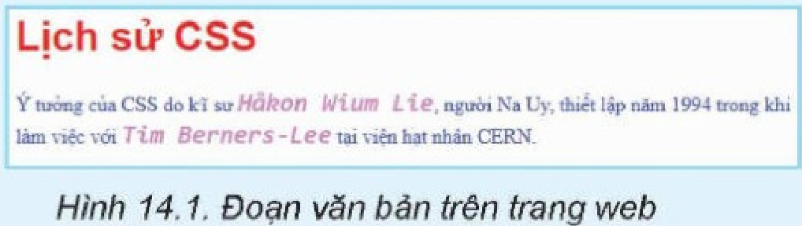
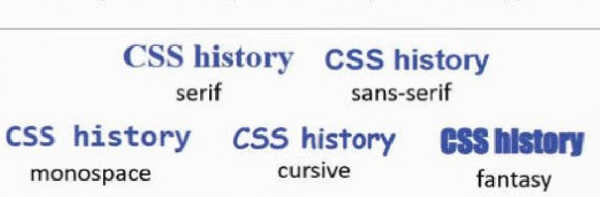
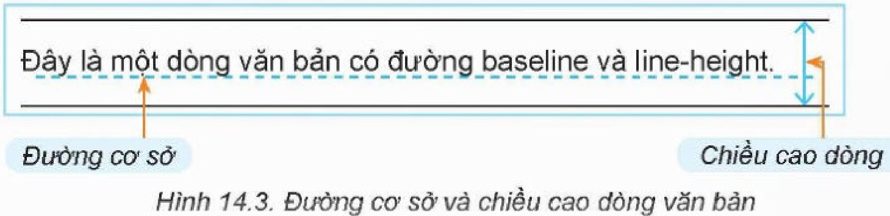
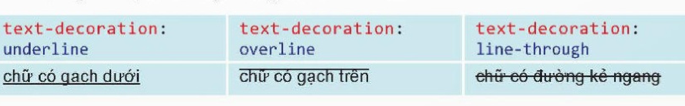
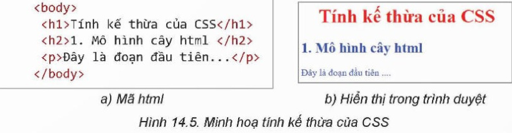
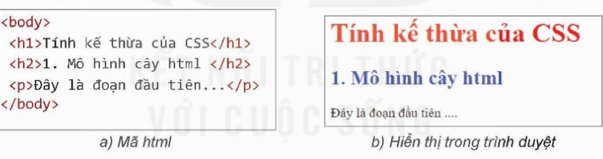
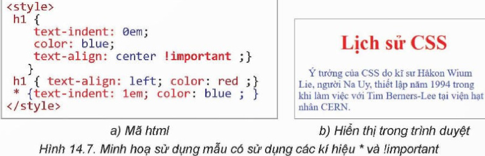
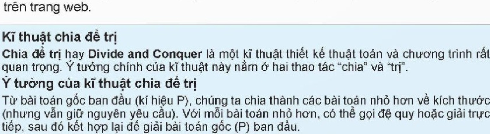

<!-- pdf:78 -->

# BÀI 14: ĐỊNH DẠNG VĂN BẢN BẰNG CSS

## 🎯 Sau bài học này em sẽ:

- Sử dụng được CSS để định dạng văn bản, phông chữ.

## 🔴 Khởi động

> Quan sát đoạn văn bản được thể hiện trên một trang web trong Hình 14.1. Em có nhận xét gì về các định dạng liên quan đến phông chữ của văn bản?



## 1. ĐỊNH DẠNG VĂN BẢN BẰNG CSS
<!-- ocr-ok: đối chiếu ảnh trang PDF 78 khớp nguyên văn -->

> **Hoạt động 1: Tìm hiểu các mẫu định dạng CSS định dạng văn bản**
>
> Các định dạng văn bản trong Hình 14.1 đều liên quan đến định dạng kí tự gồm phông chữ, màu chữ và kiểu chữ. Các thuộc tính của CSS liên quan bao gồm định dạng phông chữ (text font), màu chữ (text color) và dòng văn bản (text line). Quan sát và thảo luận để hiểu rõ hơn các mẫu định dạng CSS này.

### a) CSS định dạng phông chữ
<!-- ocr-ok: đối chiếu ảnh trang PDF 78 khớp nguyên văn -->

CSS hỗ trợ thiết lập các thuộc tính liên quan đến chọn phông (`font-family`), chọn cỡ chữ (`font-size`), chọn kiểu chữ (`font-style`), độ dày nét chữ (`font-weight`) và nhiều thuộc tính khác.

- **font-family**. CSS cho phép thiết lập mẫu định dạng chọn phông sử dụng thuộc tính `font-family`. Trên máy tính có thể cài đặt nhiều phông chữ khác nhau, mỗi phông chữ có một tên riêng. Tuy nhiên, các phông chữ có thể được chia làm năm loại sau: **serif** (chữ có chân); **sans-serif** (chữ không chân); **monospace** (chữ có chiều rộng đều nhau); **cursive** (chữ viết tay); **fantasy** (chữ trừu tượng).



Ví dụ: Mẫu CSS sau cho biết cách thiết lập phông chữ cho các thẻ `h1`, lựa chọn các phông ưu tiên theo thứ tự Times, Times New Roman, Tahoma, cuối cùng là một phông loại có chân bất kì.

```css
h1 {font-family: Times, "Times New Roman", Tahoma, serif ;}
```

<!-- pdf:79 -->

Trong ví dụ trên, sau thuộc tính `font-family` là một hay một danh sách các tên phông chữ. Nếu tên phông chữ có chứa dấu cách thì cần đặt trong hai dấu nháy kép (hoặc nháy đơn). Danh sách các phông chữ này thường cùng loại và tên của loại phông đó ở vị trí cuối cùng. Nếu đưa ra một danh sách các phông chữ, trình duyệt sẽ lần lượt tìm các phông trong danh sách từ trái sang phải để chọn thể hiện văn bản. Nếu không tìm thấy phông chữ nào trong danh sách thì sẽ chọn phông cùng loại bất kì.

- **font-size**. Thuộc tính này sẽ thiết lập cỡ chữ. Cú pháp của mẫu định dạng như sau:

```css
selector {font-size: cỡ chữ;}
```

Cỡ chữ có thể là một trong những dạng sau:

- Cỡ chữ theo đơn vị đo chính xác tuyệt đối, ví dụ: **cm** (centimét), **mm** (milimét), **in** (inch = 2,54 cm), **px** ($\text{pixel} = \dfrac{1}{96}\text{ inch}$), **pt** ($\text{point} = \dfrac{1}{72}\text{ inch}$).
- Cỡ chữ theo các đơn vị đo tương đối: **em** (so với cỡ chữ hiện thời của trình duyệt), **ex** (so với chiều cao chữ x của cỡ chữ hiện thời), **rem** (so với cỡ chữ của phần tử gốc html của tệp HTML).
- Cỡ chữ theo tỉ lệ phần trăm (%) cỡ chữ của phần tử cha.
- Cỡ chữ theo các mức **xx-small**, **x-small**, **small**, **medium**, **large**, **x-large**, **xx-large**. Cỡ chữ mặc định là **medium**.

Ví dụ:

| Mẫu css | Ý nghĩa |
| --- | --- |
| `p {font-size: 1.2em;}` | Thiết lập cho toàn bộ các phần tử `p` có cỡ chữ bằng 1,2 cỡ chữ của trình duyệt hiện thời. |
| `html {font-size: 100%;}` | Thiết lập cỡ chữ mặc định cho toàn bộ trang web theo chế độ mặc định của trình duyệt. |

- **font-style**. Thuộc tính này thiết lập kiểu chữ thường hay kiểu chữ nghiêng của văn bản. Thuộc tính này có hai giá trị là **normal** (thường) và **italics** (nghiêng).
- **font-weight**. Thuộc tính này thiết lập kiểu chữ đậm. Giá trị của thuộc tính này có thể đặt bằng chữ là **normal** (bình thường), **bold** (đậm) hoặc đặt bằng các giá trị từ **100**, **200**,..., **900**, trong đó các mức độ viết đậm từ 500 trở lên.

Ví dụ: Mẫu sau thiết lập các thẻ `strong` và `em` với kiểu chữ nghiêng và đậm khác nhau.

```css
em {font-style: italics; font-weight: bold;}
strong {font-style: italics; font-weight: 900;}
```

### b) CSS định dạng màu chữ
<!-- ocr-ok: đối chiếu ảnh trang PDF 79 khớp nguyên văn -->

Thuộc tính **color** sẽ thiết lập màu chữ. Một số giá trị màu cơ bản cho thuộc tính này như sau: **black** (đen), **white** (trắng), **purple** (tím), **blue** (xanh dương), **orange** (cam), **red** (đỏ), **green** (xanh lá cây), **yellow** (vàng).

Một số ví dụ thiết lập thuộc tính màu chữ.

```css
h1 {color: red;}
em {color: green;}
* {color: black;}
```

Bộ chọn với kí tự `*` là tất cả các phần tử HTML của trang web. Khi áp dụng CSS trên thì các phần tử `h1` có chữ màu đỏ, các phần tử `em` có chữ màu xanh lá cây, còn toàn bộ các phần tử còn lại có chữ màu đen.

<!-- pdf:80 -->

### c) CSS định dạng dòng văn bản
<!-- ocr-ok: đối chiếu ảnh trang PDF 80 khớp nguyên văn -->

Các mẫu định dạng loại này sẽ thiết lập các thuộc tính liên quan đến các dòng văn bản khi thể hiện trên trình duyệt. Để hiểu cách định dạng này cần biết **đường cơ sở** (baseline) và **chiều cao dòng** văn bản (line-height).

**Đường cơ sở** (baseline) là đường ngang mà các chữ cái đứng thẳng trên nó. **Chiều cao dòng** văn bản là khoảng cách giữa các đường cơ sở của các dòng trong cùng một đoạn văn bản. CSS sẽ mặc định coi chiều cao = **2em** và thể hiện bằng cách bổ sung khoảng cách phía trên và dưới của văn bản. Hình 14.3 cho chúng ta hình dung đường cơ sở (baseline) và chiều cao dòng (line-height).



- **line-height**. Thuộc tính này dùng để thiết lập chiều cao dòng cho bộ chọn của mẫu định dạng. Ngoài các đơn vị đo thông thường, còn có thể thiết lập các số đo tương đối như sau:

```css
p {line-height: 3;} /* thiết lập chiều cao bằng 3 lần cỡ chữ hiện thời của trình duyệt. */
p {line-height: 2em;} /* thiết lập chiều cao bằng 2 lần chiều cao dòng hiện thời */
p {line-height: 200%;} /* thiết lập chiều cao dòng bằng 200% của chiều cao dòng của phần tử cha mà phần tử hiện thời được kế thừa */
```

- **text-align**. Thuộc tính này thiết lập căn lề cho các phần tử được chọn. Các kiểu căn hàng bao gồm: **left**, **center**, **right**, **justify**. Ví dụ:

```css
p {line-align: right;} /* thiết lập căn phải */
```

- **text-decoration**. Thuộc tính này thiết lập tính chất “trang trí” dòng văn bản bằng các đường kẻ ngang trên, dưới hay giữa dòng. Thuộc tính này sẽ thay thế và mở rộng cho thẻ `u` của HTML. Thuộc tính này có bốn giá trị thường sử dụng là **none** (mặc định, không trang trí), **underline** (đường kẻ dưới chữ), **overline** (đường kẻ phía trên chữ) và **line-through** (kẻ giữa dòng chữ) như minh hoạ ở Hình 14.4.

*Lưu ý:* Thuộc tính này không có tính kế thừa.



- **text-indent**. Thuộc tính định dạng thụt lề dòng đầu tiên. Nếu giá trị lớn hơn 0 thì dòng đầu tiên thụt vào. Nếu giá trị nhỏ hơn 0 thì dòng đầu tiên lùi ra ngoài còn gọi là **thụt lề treo** (hanging indent).

<!-- pdf:81 -->

Ví dụ:

```css
p {text-indent: 10px;} /* Dòng đầu tiên thụt vào đúng 10 pixel */
p {text-indent: 2em;} /* Dòng đầu tiên thụt vào bằng 2 kí tự */
p {text-indent: 5%;} /*Dòng đầu tiên thụt vào một khoảng cách bằng 5% chiều rộng dòng của phần tử cha. */
```

> Các mẫu định dạng văn bản cơ bản bao gồm các thuộc tính liên quan đến phông chữ, màu chữ và định dạng dòng văn bản.

> **Câu hỏi:**
>
> **1.** Giải thích các mẫu định dạng CSS sau:

```html
<style>
  h1 {color: red;text-align: center;}
  p {text-align: justify;}
</style>
```

> **2.** Giả sử mẫu định dạng CSS có dạng sau:

```html
<style>
  body {color: blue;}
</style>
```

> Hãy kiểm tra tác dụng của CSS này trên một tệp HTML bất kì và đưa ra nhận xét.

## 2. TÍNH KẾ THỪA VÀ CÁCH LỰA CHỌN THEO THỨ TỰ CỦA CSS
<!-- ocr-ok: đối chiếu ảnh trang PDF 81 khớp nguyên văn -->

> **Hoạt động 2: Tìm hiểu tính kế thừa và cách chọn thứ tự ưu tiên của CSS**
>
> Quan sát, tìm hiểu, trao đổi và trả lời các câu hỏi sau:
>
> **1.** Các mẫu định dạng có tính kế thừa trong mô hình cây HTML không? Nếu một mẫu định dạng thiết lập định dạng ở một phần tử HTML thì định dạng đó có áp dụng cho tất cả các phần tử là con, cháu của phần tử này không?
>
> **2.** Nếu có nhiều mẫu CSS cùng được thiết lập cho một phần tử HTML thì trình duyệt sẽ áp dụng các mẫu định dạng CSS này theo thứ tự ưu tiên như thế nào?

### a) Tính kế thừa của CSS
<!-- ocr-ok: đối chiếu ảnh trang PDF 81 khớp nguyên văn -->

Một tính chất rất quan trọng của CSS là **tính kế thừa**. Nếu một mẫu CSS áp dụng cho một phần tử HTML bất kì thì nó sẽ được tự động áp dụng cho tất cả các phần tử là con, cháu của phần tử đó trong mô hình cây HTML (trừ các trường hợp ngoại lệ, ví dụ các phần tử với mẫu định dạng riêng). Ví dụ CSS sau định dạng chữ màu xanh dương cho thẻ `body`:

```html
<style>
  body {color: blue;}
  h1 {color: red;text-align: center;}
</style>
```

<!-- pdf:82 -->

Trong Hình 14.5, chỉ riêng thẻ `h1` có chữ màu đỏ do được định dạng theo mẫu CSS, còn các phần tử `h2` và `p` đều kế thừa từ phần tử cha `body` có chữ màu xanh dương.



```html
<body>
  <h1>Tính kế thừa của CSS</h1>
  <h2>1. Mô hình cây html </h2>
  <p>Đây là đoạn đầu tiên...</p>
</body>
```

### b) Thứ tự ưu tiên khi áp dụng mẫu CSS
<!-- ocr-ok: đối chiếu ảnh trang PDF 82 khớp nguyên văn -->

Do được phép có nhiều mẫu định dạng CSS nên có thể xảy ra trường hợp nhiều mẫu cùng áp dụng cho một phần tử HTML, khi đó câu hỏi đặt ra là trình duyệt sẽ chọn các mẫu định dạng theo thứ tự ưu tiên nào để áp dụng?

Khi đó trình duyệt sẽ thực hiện mẫu định dạng được viết cuối cùng. Đây chính là tính chất “cascading” của CSS. Trong ví dụ mẫu CSS sau có hai định dạng cùng được viết áp dụng cho `h1`, mẫu đầu quy định căn giữa, mẫu sau quy định căn trái.

```html
<style>
  body {color: blue;}
  h1 {color: red;text-align: center;}
  h1 {text-align: left;}
</style>
```

Khi áp dụng trong ví dụ sau, phần tử `h1` được căn trái theo mẫu cuối cùng của CSS:



### c) Sử dụng kí hiệu * và !important
<!-- ocr-ok: đối chiếu ảnh trang PDF 82 khớp nguyên văn -->

CSS còn cho phép sử dụng kí hiệu `*` và `!important` với ý nghĩa như sau:

- Kí hiệu `*` dùng trong bộ chọn sẽ có ý nghĩa là phần tử bất kì. Nếu có một mẫu định dạng chứa kí hiệu `*` thì định dạng này sẽ áp dụng cho mọi phần tử mà chưa có trong bất cứ mẫu định dạng nào khác của CSS. Mức độ ưu tiên của `*` là thấp nhất.
- Kí hiệu **!important** important nếu được sử dụng trong một mẫu định dạng thì mẫu này với thuộc tính tương ứng sẽ được ưu tiên cao nhất mà không phụ thuộc vào vị trí của mẫu trong CSS. Chú ý kí hiệu **!important** cần được viết ngay sau thuộc tính cần đánh dấu ưu tiên. Chỉ thuộc tính này của bộ chọn có thứ tự ưu tiên cao nhất.
<!-- term: Bộ chọn * -->

Ví dụ: Mẫu CSS có hai mẫu định dạng với cùng bộ chọn là `h1`. Mẫu đầu tiên có `!important` với thuộc tính `"text-align : center;"` nên thuộc tính này sẽ được ưu tiên cao nhất. Mẫu thứ hai của `h1` có dạng `"text-align: left; color: red;"` thì thuộc tính

<!-- pdf:83 -->

màu sắc sẽ được ưu tiên áp dụng. Mẫu cuối cùng có kí hiệu `*` sẽ có mức ưu tiên thấp nhất mặc dù nó được viết ở vị trí cuối cùng. Kết quả áp dụng CSS trên cho tệp HTML như Hình 14.7.



```html
<style>
  h1 {
    text-indent: 0em;
    color: blue;
    text-align: center !important ;}
  }
  h1 { text-align: left; color: red ;}
  * {text-indent: 1em; color: blue ; }
</style>
```

> Các mẫu định dạng CSS được áp dụng theo nguyên tắc kế thừa trong mô hình cây HTML. Nếu mẫu định dạng được viết cho một phần tử thì sẽ được áp dụng mặc định cho tất cả các phần tử con, cháu. Nếu có nhiều mẫu định dạng được viết cho cùng một bộ chọn thì mẫu viết sau cùng sẽ được áp dụng. Nếu bộ chọn có kí tự `*` thì được áp dụng cho mọi phần tử nhưng với độ ưu tiên thấp nhất. Ngược lại, mẫu định dạng với từ khoá `!important` có mức ưu tiên cao nhất.

> **Câu hỏi:**
>
> **1.** Giả sử có mẫu định dạng sau:

```html
<style>
  body {font-family: sans-serif;}
</style>
```

> Khi đó toàn bộ văn bản của trang web sẽ mặc định thể hiện với phông có chân, đúng hay sai?
>
> **2.** Giả sử có mẫu định dạng như sau:

```html
<style>
  body {font-family: sans-serif;}
  h1 {text-align: center !important;}
  h1 {text-align: left;}
  * {font-family: serif;}
</style>
```

> Mẫu nào sẽ được áp dụng cho `h1`, mẫu nào sẽ được áp dụng cho thẻ `p`?

## 3. THỰC HÀNH
<!-- ocr-ok: đối chiếu ảnh trang PDF 83 khớp nguyên văn -->

**Nhiệm vụ 1: Thiết lập mẫu định dạng CSS**

*Yêu cầu:* Thiết lập mẫu định dạng CSS để trình bày nội dung văn bản trong Hình 14.8 trên trang web.



> **Kĩ thuật chia để trị**
>
> **Chia để trị** hay **Divide and Conquer** là một kĩ thuật thiết kế thuật toán và chương trình rất quan trọng. Ý tưởng chính của kĩ thuật này nằm ở hai thao tác “chia” và “trị”.
>
> **Ý tưởng của kĩ thuật chia để trị**
>
> Từ bài toán gốc ban đầu (kí hiệu P), chúng ta chia thành các bài toán nhỏ hơn về kích thước (nhưng vẫn giữ nguyên yêu cầu). Với mỗi bài toán nhỏ hơn, có thể gọi đệ quy hoặc giải trực tiếp, sau đó kết hợp lại để giải bài toán gốc (P) ban đầu.

<!-- pdf:84 -->

Văn bản trong Hình 14.8 cần được trình bày theo yêu cầu sau:

- Các tiêu đề căn trái, cỡ chữ 16 px, màu đỏ, phông chữ không chân.
- Các dòng văn bản thụt lề dòng đầu 2 kí tự, căn trái.
- Toàn bộ văn bản, trừ tiêu đề, là phông chữ có chân.

*Hướng dẫn:*

```css
h1,h2 {font-family: sans-serif; font-size: 16px;
   color: red; text-align: left; }
p {font-family: serif; text-align: left; text-indent: 2em; }
```

**Nhiệm vụ 2: Thiết lập mẫu định dạng CSS**

*Yêu cầu:* Thiết lập định dạng cho trang web ở Nhiệm vụ 1 với các yêu cầu sau:

- Các tiêu đề căn giữa, cỡ chữ 16 px, màu xanh.
- Các dòng văn bản thụt lề dòng đầu 2 kí tự, căn đều hai bên.
- Các từ in đậm và in nghiêng trong văn bản sẽ thể hiện theo mặc định của trình duyệt.

*Hướng dẫn:*

```css
h1,h2 {font-family: sans-serif; font-size: 16px;
   color: blue; text-align: center; }
p {text-align: justify; text-indent: 2em; }
strong,em {font-size: 100%; }
```

## ✏️ Luyện tập

**1.** Mỗi phông chữ sau đây thuộc loại nào?

a) Times New Roman.

b) Courier New.

c) Abadi.

d) Bradley Hand ITC.

e) Berlin Sans FB.

f) ALGERIAN.

g) Consolas.

h) Cascadia.

**2.** Hãy liệt kê các thuộc tính CSS liên quan đến định dạng đoạn văn bản sau:

> **Trời Hà Nội xanh**
>
> Sáng tác: **Văn Ký**
>
> Xanh xanh thắm bầu trời xanh *Hà Nội*
>
> *Hồ Gươm* xanh như mái tóc em xanh

## 🚀 Vận dụng

**1.** Tìm hiểu thêm các thuộc tính phông chữ như **font-variant** và thuộc tính dòng văn bản như **letter-space** (khoảng cách giữa các kí tự), **word-space** (khoảng cách giữa các từ) và **text-shadow** (chữ bóng).

**2.** Với bài đọc thêm **Lịch sử CSS** (Bài 13), em hãy thiết lập hai tệp CSS khác nhau để định dạng cho trang web mô tả bài đọc thêm này. Hai kiểu định dạng được thiết lập cần khác nhau về phông chữ, cỡ chữ và màu chữ.

## 📷 Danh sách hình trong bài

| Mã hình | Số hình SGK | Trang PDF | Chú thích |
| --- | --- | --- | --- |
| H12-tin_hoc_thud-b14-01 | Hình 14.1 | 78 | Đoạn văn bản trên trang web |
| H12-tin_hoc_thud-b14-02 | Hình 14.2 | 78 | Font-family |
| H12-tin_hoc_thud-b14-03 | Hình 14.3 | 80 | Đường cơ sở và chiều cao dòng văn bản |
| H12-tin_hoc_thud-b14-04 | Hình 14.4 | 80 | Các định dạng đường kẻ ngang dòng văn bản |
| H12-tin_hoc_thud-b14-05 | Hình 14.5 | 82 | Minh hoạ tính kế thừa của CSS |
| H12-tin_hoc_thud-b14-06 | Hình 14.6 | 82 | Minh hoạ thứ tự ưu tiên của các mẫu CSS |
| H12-tin_hoc_thud-b14-07 | Hình 14.7 | 83 | Minh hoạ sử dụng mẫu có sử dụng các kí hiệu * và !important |
| H12-tin_hoc_thud-b14-08 | Hình 14.8 | 83 | Nội dung cần trình bày |
