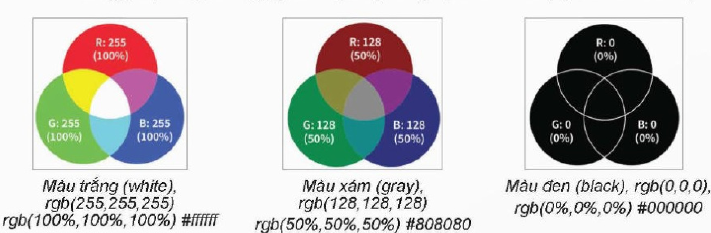
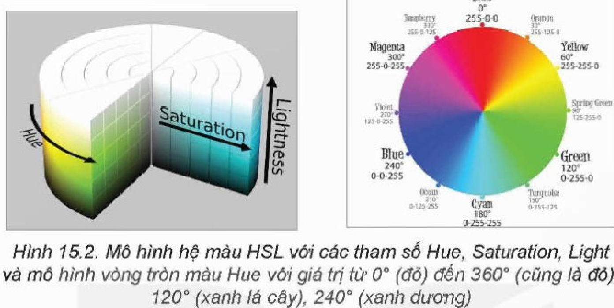
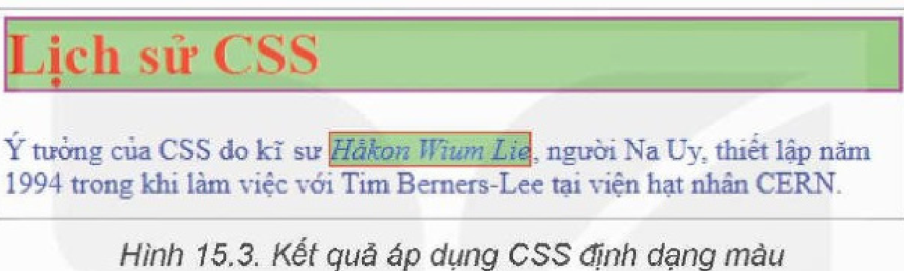
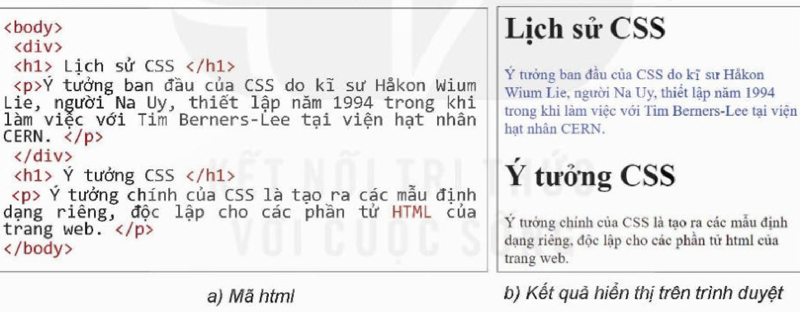
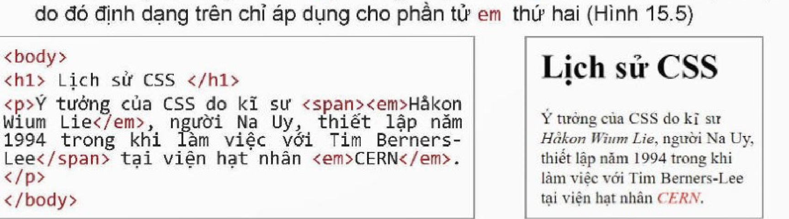
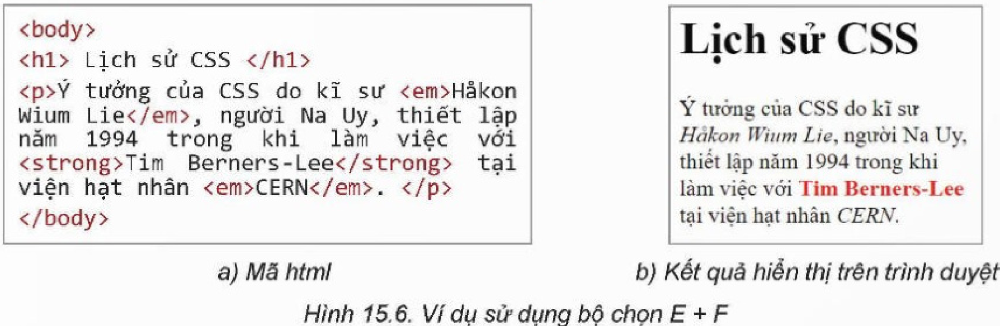
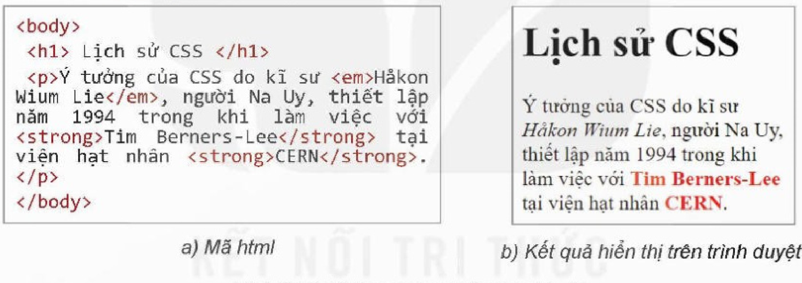
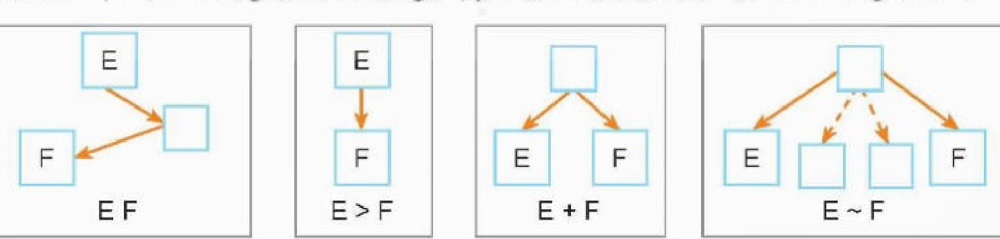

<!-- pdf:85 -->

# BÀI 15: TẠO MÀU CHO CHỮ VÀ NỀN

## 🎯 Sau bài học này em sẽ:

- Sử dụng được CSS màu để thiết lập màu cho chữ và nền.

## 🔴 Khởi động

> Các định dạng sau có thiết lập cùng một màu hay không? Em có nhận xét gì về cách thiết lập màu này?
>
> a) `p {color: rgb(128,0,128);}`
>
> b) `p {color: #800080 ;}`
>
> c) `p {color: hsl(300,100%,25.1%);}`

## 1. HỆ THỐNG MÀU CỦA CSS
<!-- ocr-ok: đối chiếu ảnh trang PDF 85 khớp nguyên văn -->

> **Hoạt động 1: Tìm hiểu cách biểu diễn màu trong HTML và CSS**
>
> Cùng thảo luận và tìm hiểu hệ màu RGB hỗ trợ bởi HTML và CSS.

### a) Hệ màu RGB
<!-- ocr-ok: đối chiếu ảnh trang PDF 85 khớp nguyên văn -->

HTML và CSS hỗ trợ hệ màu theo mẫu **RGB** (R – red, G – green, B – blue). Mỗi màu là một tổ hợp gồm ba giá trị (r, g, b), trong đó mỗi giá trị này là số nguyên nằm trong khoảng từ 0 đến 255, tức là một số 8 bit. Tổng số màu cho phép là $2^8 \times 2^8 \times 2^8 = 2^{24} = 16\,777\,216$ màu.

Mỗi giá trị màu được thiết lập bởi một trong các cách sau:

- **rgb(x-red, x-green, x-blue)**, trong đó x-red, x-green, x-blue có thể nhận các giá trị độc lập từ 0 đến 255.
- **rgb(x-red%, x-green%, x-blue%)**, trong đó các tham số biểu thị giá trị phần trăm của 255.
- **#rrggbb**, trong đó rr, gg, bb là giá trị trong hệ đếm hexa (hệ đếm cơ số 16).



### b) Hệ màu HSL
<!-- ocr-ok: đối chiếu ảnh trang PDF 85 khớp nguyên văn -->

Một hệ màu khác mà HTML và CSS hỗ trợ là **HSL** (Hue, Saturation, Lightness). H (Hue) là vòng tròn màu với giá trị từ 0 đến 360. S (saturation) chỉ độ bão hoà hay

<!-- pdf:86 -->

độ đậm đặc của màu với giá trị từ 0% đến 100%. Màu sẽ biến mất chỉ còn xám khi độ bão hoà bằng 0%. Ngược lại, màu sẽ đầy đủ nếu độ bão hoà bằng 100%. L (Lightness) là độ sáng với giá trị từ 0% đến 100%. Với 0% chỉ mức độ sáng thấp nhất, màu đen. Với 100%, độ sáng là lớn nhất, màu sẽ trắng. Như vậy, đặt lightness = 50% để có màu đúng.



### c) Các tên màu có sẵn trong CSS
<!-- ocr-ok: đối chiếu ảnh trang PDF 86 khớp nguyên văn -->

Bên cạnh việc thiết lập màu bằng các hàm rgb() và hsl(), CSS còn thiết lập sẵn các tên màu để dễ dàng cho việc sử dụng. Phiên bản CSS2 thiết lập tên 16 màu chuẩn. Tên màu không phân biệt chữ hoa chữ thường.

Ví dụ một số tên màu có sẵn: black, gray, white, red, green, orange, yellow, purple, blue, lime,...

Phiên bản CSS3 đã thiết lập 140 tên màu.

> Hệ màu trên trang web được hỗ trợ bởi HTML và CSS chủ yếu là **hệ màu RGB**. Ngoài ra, có thể sử dụng **hệ màu HSL** hoặc các tên màu có sẵn.

*Lưu ý:* Các màu xám (hay đen trắng) có thể được thiết lập theo các cách sau:

- **rgb(x,x,x)** với các tham số r, g, b bằng nhau.
- **hsl(h,0%,x%)** khi tham số saturation bằng 0%.

> **Câu hỏi:**
>
> **1.** Các màu cơ bản red, yellow, green, blue, magenta, cyan được thể hiện bằng hàm hsl như thế nào?
>
> **2.** Trong hệ màu rgb có bao nhiêu màu thuộc màu xám?

> **Hoạt động 2: Tìm hiểu cách thiết lập màu chữ và màu nền bằng CSS**
>
> Cùng thảo luận về cách thiết lập màu trong các mẫu CSS và trả lời các câu hỏi sau:
>
> **1.** Cách thiết lập định dạng màu chữ trong CSS như thế nào?
>
> **2.** Cách thiết lập màu nền cho các phần tử của CSS như thế nào?

Các phần tử HTML của trang web có thể được tô màu bằng các thuộc tính sau:

- Thuộc tính `color` dùng định dạng màu chữ (màu nổi).
- Thuộc tính `background-color` dùng để định dạng màu nền.

<!-- pdf:87 -->

- Thuộc tính `border` dùng để định dạng màu khung viền quanh phần tử.

Ví dụ:

- Trong mẫu CSS sau, phần tử `h1` được định dạng màu chữ, màu nền và màu của khung viền:

```css
h1 {color: red;
background-color: lightgreen;
border: 2px solid magenta;
}
```

- Trong mẫu CSS sau, định dạng khung viền, màu nền cho phần tử `em`, định dạng màu chữ cho phần tử `p`:

```css
em {background-color: lightgreen;
   border: 1px solid red;}
   p {color: blue;}
```

Kết quả áp dụng hai CSS trên có thể như Hình 15.3.



> CSS hỗ trợ định dạng màu chữ bằng thuộc tính **color**, màu nền bằng thuộc tính **background-color** và màu khung viền bằng thuộc tính **border**.

*Lưu ý:* Các thuộc tính định dạng màu chữ và màu nền đều có tính kế thừa, riêng thuộc tính **border** không có tính kế thừa.

> **Câu hỏi:**
>
> **1.** Sửa lại CSS trong ví dụ trên, định dạng màu nền và khung viền cho cụm từ *Tim Berners-Lee* với màu khác biệt.
>
> **2.** Sửa lại CSS trên, định dạng khung viền cho phần tử `p`. Em hãy kiểm tra xem tính chất này có kế thừa cho các phần tử con không.

## 2. THIẾT LẬP BỘ CHỌN LÀ TỔ HỢP CÁC PHẦN TỬ CÓ QUAN HỆ
<!-- ocr-ok: đối chiếu ảnh trang PDF 87 khớp nguyên văn -->

Từ trước đến nay chúng ta chỉ xem xét các mẫu định dạng CSS với bộ chọn là các phần tử độc lập, riêng biệt. Trong hoạt động này, chúng ta sẽ tìm hiểu các mẫu định dạng với bộ chọn là các phần tử có liên quan đến nhau. Các định dạng này có rất nhiều ứng dụng trên thực tế. Các định dạng này có thể hiểu là được áp dụng trên các phần tử với điều kiện nhất định.

> **Hoạt động 3: Tìm hiểu cách thiết lập bộ chọn là tổ hợp các phần tử**
>
> Quan sát, trao đổi và thảo luận về 4 trường hợp bộ chọn là tổ hợp các phần tử, nêu ý nghĩa và sự khác biệt giữa các trường hợp này: E F, E > F, E + F và E ~ F.

Bảng 15.1 mô tả chi tiết, ý nghĩa và ví dụ áp dụng cho các trường hợp định dạng CSS có dạng là tổ hợp các phần tử có quan hệ với nhau:

<!-- pdf:88 -->

*Bảng 15.1. Bốn bộ chọn là tổ hợp các phần tử*

| Bộ chọn | Ý nghĩa | Ví dụ |
| --- | --- | --- |
| E F | *Quan hệ con cháu.* Áp dụng cho các phần tử F với điều kiện F là phần tử con/cháu của E, tức là E phải ở phía trên F trong cây HTML. | `div p {color: blue;}` <br> Áp dụng cho các phần tử `p` với điều kiện `p` phải là phần tử con/cháu của `div`. |
| E > F | *Quan hệ cha con trực tiếp.* Áp dụng cho các phần tử F với điều kiện F là phần tử con của E. | `p > em {color: red;}` <br> Áp dụng cho các phần tử `em` với điều kiện `em` phải là phần tử con của `p`. |
| E + F | *Quan hệ anh em liền kề.* Áp dụng cho các phần tử F là phần tử liền kề ngay sau E, E và F phải có cùng phần tử cha. | `em + strong {color: red;}` <br> Áp dụng cho phần tử `strong` nếu `strong` đứng liền kề ngay sau `em`. |
| E ~ F | *Quan hệ anh em.* Áp dụng cho các phần tử F là phần tử đứng sau, không cần liên tục với E, E và F phải có cùng phần tử cha. | `em ~ strong {color: red;}` <br> Áp dụng cho phần tử `strong` nếu `strong` đứng sau `em`, không cần liền kề. |
<!-- term: Bộ chọn tổ hợp trong CSS -->

Sau đây là một số ví dụ minh hoạ cho các trường hợp của Bảng 15.1.

### a) Ví dụ minh hoạ cho trường hợp E F
<!-- ocr-ok: đối chiếu ảnh trang PDF 88 khớp nguyên văn -->

Với định dạng `div p {color: blue;}` áp dụng cho trang HTML sau, ta thấy đoạn văn bản đầu tiên là phần tử con của `div`, đoạn thứ hai là phần tử con của `body`, do vậy mẫu định dạng trên chỉ áp dụng cho phần tử `p` đầu tiên (Hình 15.4).



```html
<body>
  <div>
    <h1> Lịch sử CSS </h1>
    <p>Ý tưởng ban đầu của CSS do kĩ sư Håkon Wium Lie, người Na Uy, thiết lập năm 1994 trong khi làm việc với Tim Berners-Lee tại viện hạt nhân CERN. </p>
  </div>
  <h1> Ý tưởng CSS </h1>
  <p> Ý tưởng chính của CSS là tạo ra các mẫu định dạng riêng, độc lập cho các phần tử HTML của trang web. </p>
</body>
```

### b) Ví dụ minh hoạ cho trường hợp E > F
<!-- ocr-ok: đối chiếu ảnh trang PDF 88 khớp nguyên văn -->

Giả sử định dạng `p > em {color: red;}` áp dụng cho văn bản sau. Trong đoạn văn bản này có hai phần tử `em`, nhưng chỉ phần tử `em` thứ hai là con trực tiếp của `p`, do đó định dạng trên chỉ áp dụng cho phần tử `em` thứ hai (Hình 15.5)



```html
<body>
  <h1> Lịch sử CSS </h1>
  <p>Ý tưởng của CSS do kĩ sư <span><em>Håkon Wium Lie</em>, người Na Uy, thiết lập năm 1994 trong khi làm việc với Tim Berners-Lee</span> tại viện hạt nhân <em>CERN</em>. </p>
</body>
```

<!-- pdf:89 -->

### c) Ví dụ minh hoạ cho trường hợp E + F
<!-- ocr-ok: đối chiếu ảnh trang PDF 89 khớp nguyên văn -->

Xét định dạng `em + strong {color: red;}`. Trong văn bản sau có một phần tử `strong` liền kề với phần tử `em` và cả hai đều là con trực tiếp của `p`, do đó mẫu định dạng trên sẽ áp dụng cho phần tử `strong` (Hình 15.6).



```html
<body>
  <h1> Lịch sử CSS </h1>
  <p>Ý tưởng của CSS do kĩ sư <em>Håkon Wium Lie</em>, người Na Uy, thiết lập năm 1994 trong khi làm việc với <strong>Tim Berners-Lee</strong> tại viện hạt nhân <em>CERN</em>. </p>
</body>
```

### d) Ví dụ minh hoạ cho trường hợp E ~ F
<!-- ocr-ok: đối chiếu ảnh trang PDF 89 khớp nguyên văn -->

Với định dạng `em ~ strong {color: red;}`, văn bản sau có hai phần tử `strong` đều nằm phía sau của phần tử `em`, do đó mẫu định dạng trên sẽ áp dụng cho cả hai phần tử `strong` (Hình 15.7).



```html
<body>
  <h1> Lịch sử CSS </h1>
  <p>Ý tưởng của CSS do kĩ sư <em>Håkon Wium Lie</em>, người Na Uy, thiết lập năm 1994 trong khi làm việc với <strong>Tim Berners-Lee</strong> tại viện hạt nhân <strong>CERN</strong>. </p>
</body>
```

Quan hệ E, F trong các trường hợp trên có thể mô tả như trong các sơ đồ sau:



> CSS hỗ trợ các kiểu bộ chọn là tổ hợp các phần tử quan hệ dạng: **E F**, **E > F**, **E + F** và **E ~ F**.

> **Câu hỏi:**
>
> **1.** Trong ví dụ ở Hình 15.7, nếu thay mẫu `em ~ strong` bằng `p > strong` thì kết quả sẽ như thế nào?
>
> **2.** Trong ví dụ ở Hình 15.7, nếu thay mẫu `em ~ strong` bằng `em + strong` thì kết quả sẽ như thế nào?
>
> **3.** Trong ví dụ ở Hình 15.7, nếu thay mẫu `em ~ strong` bằng `p strong` thì kết quả sẽ như thế nào?

<!-- pdf:90 -->

## 3. THỰC HÀNH
<!-- ocr-ok: đối chiếu ảnh trang PDF 90 khớp nguyên văn -->

**Nhiệm vụ: Tạo trang HTML và định dạng CSS**

*Yêu cầu:* Thiết lập trang HTML và định dạng CSS để thể hiện văn bản sau chính xác và đẹp như sau:

> **LỢI ÍCH CỦA CSS**
>
> Sử dụng CSS mang lại rất nhiều tiện ích và hiệu quả trong công việc. Sau đây là một vài nguyên nhân chính khi sử dụng mẫu định dạng CSS để trình bày trang web:
>
> – **Trình bày chính xác.** Có thể điều khiển ***chính xác*** cách trang web hiển thị cũng như khi in ra ***máy in***.
>
> – **Tiết kiệm công sức đáng kể.** Bạn có thể thay đổi lại hoàn toàn cách trang trí, định dạng, trình bày một trang hoặc ***cả một website*** chỉ bằng việc chỉnh sửa và thay đổi **một tệp** CSS duy nhất.
>
> – **Điều khiển hiển thị đa dạng.** CSS cho phép điều khiển định dạng trên các phương tiện máy tính khác nhau, từ ***máy tính màn hình lớn*** cho đến các ***thiết bị di động*** nhỏ.
>
> – **Tiếp cận trình bày theo ngữ nghĩa văn bản.** CSS cho phép trình bày nội dung không theo cú pháp logic giống như các ngôn ngữ lập trình bình thường mà cho phép thay đổi, điều khiển việc trang trí, trình bày ***theo ngữ nghĩa ngôn ngữ*** của nội dung văn bản.

*Hướng dẫn:*

*Bước 1.* Nhập văn bản trên thành tệp html. Có thể thiết lập các phần tử HTML như sau:

- Bốn ý chính của lợi ích CSS được trình bày bằng cặp thẻ `<ul><li>`.
- Các câu đầu in đậm của các ý chính dùng thẻ `<strong>`.
- Các cụm từ in nghiêng dùng thẻ `<em>`.

*Bước 2.* Viết ra các yêu cầu trình bày trang web, ví dụ:

- Tiêu đề chữ màu đỏ.
- Nội dung chính dùng dấu đầu dòng, không có thứ tự để trình bày.
- Các dòng của danh sách có chiều cao dòng bằng 1,5 bình thường.
- Dòng chữ nhấn mạnh đầu dòng để màu xanh đậm.
- Các cụm từ nhấn mạnh bên trong các dòng dùng màu đỏ, chữ nghiêng.

*Bước 3.* Thiết lập các mẫu định dạng CSS.

```html
<style>
  h1 {color: red;}
  li {line-height: 1.5}
  strong {color: blue;}
  strong ~ em {color: red;}
</style>
```

## ✏️ Luyện tập

**1.** Thiết lập hệ màu cơ bản (17 màu của CSS2.1) theo bộ ba tham số R, G, B.

**2.** Khi nào thì các mẫu định dạng E F và E > F có tác dụng như nhau?

## 🚀 Vận dụng

**1.** Tìm ví dụ và giải thích ý nghĩa cho các mẫu định dạng CSS tổng quát như sau:

a) E1 E2 E3.

b) E1 > E2 > E3.

**2.** Tìm ví dụ và giải thích ý nghĩa cho các mẫu định dạng CSS tổng quát như sau:

a) E + F + G.

b) E > F + G.

## 📷 Danh sách hình trong bài

| Mã hình | Số hình SGK | Trang PDF | Chú thích |
| --- | --- | --- | --- |
| H12-tin_hoc_thud-b15-01 | Hình 15.1 | 85 | Một số hình ảnh tham số màu được thiết lập trong CSS |
| H12-tin_hoc_thud-b15-02 | Hình 15.2 | 86 | Mô hình hệ màu HSL với các tham số Hue, Saturation, Light và mô hình vòng tròn màu Hue |
| H12-tin_hoc_thud-b15-03 | Hình 15.3 | 87 | Kết quả áp dụng CSS định dạng màu |
| H12-tin_hoc_thud-b15-04 | Hình 15.4 | 88 | Ví dụ sử dụng bộ chọn E F |
| H12-tin_hoc_thud-b15-05 | Hình 15.5 | 88 | Ví dụ sử dụng bộ chọn E > F |
| H12-tin_hoc_thud-b15-06 | Hình 15.6 | 89 | Ví dụ sử dụng bộ chọn E + F |
| H12-tin_hoc_thud-b15-07 | Hình 15.7 | 89 | Ví dụ sử dụng bộ chọn E ~ F |
| H12-tin_hoc_thud-b15-08 | — | 89 | Sơ đồ quan hệ E, F trong các trường hợp E F, E > F, E + F và E ~ F |
