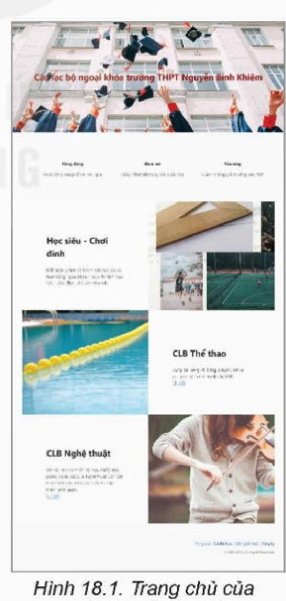
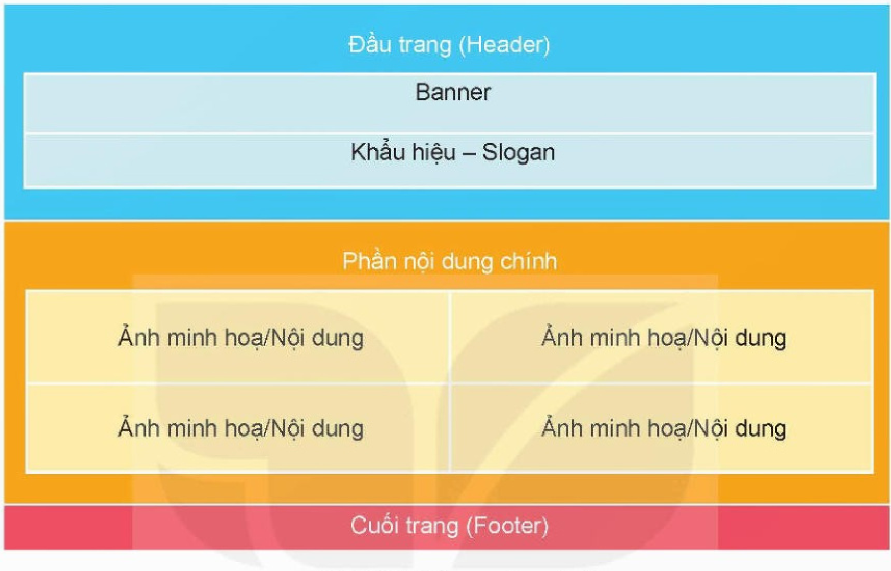
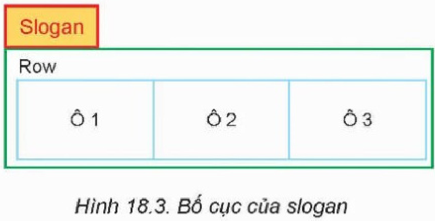

<!-- pdf:104 -->
# BÀI 18: THỰC HÀNH TỔNG HỢP THIẾT KẾ TRANG WEB

## 🎯 Sau bài học này em sẽ:

- Tạo được trang web bằng html và định dạng bằng CSS.

## 🔴 Khởi động

> Giả sử website của em có nhiều tệp html. Có thể hay không chỉ dùng một tệp CSS duy nhất để định dạng cho toàn bộ các trang web? Nếu có thể hãy nêu các bước cần thực hiện.

## 1. DỰ ÁN: XÂY DỰNG WEBSITE GIỚI THIỆU CÁC CÂU LẠC BỘ NGOẠI KHOÁ CỦA TRƯỜNG

> **Hoạt động: Thảo luận theo nhóm**
>
> Thảo luận theo nhóm để trả lời các câu hỏi sau:
> 1. Tổ chức cấu trúc website như thế nào cho phù hợp?
> 2. Với mỗi câu lạc bộ sẽ đưa những thông tin gì?
> 3. Trình bày các trang web như thế nào cho đẹp và thống nhất với nhau?
> 4. Làm thế nào để website sinh động và đẹp mắt?

Website cần một trang chủ và các trang riêng cho từng nhóm hoặc từng câu lạc bộ tuỳ theo số lượng và thông tin hoạt động chi tiết của các câu lạc bộ. Ở mức đơn giản, em có thể thiết kế website với ba thành viên trang tương ứng với trang chủ, trang giới thiệu các câu lạc bộ thể thao và các câu lạc bộ nghệ thuật.

Trang chủ sẽ chứa các thông tin chung nhất về các câu lạc bộ và liên kết tới các trang thành viên - ví dụ như trong Hình 18.1. Minh hoạ có thể tuỳ chọn vào các tài nguyên sẵn có – thường là ảnh và video. Các trang thành viên đăng thông tin chi tiết, lịch hoạt động, thành tích,... tuỳ nhu cầu. Ngoài ra, em có thể tạo thêm một trang chứa biểu mẫu để các bạn đăng kí tham gia.

Các trang nên tuân theo phong cách trình bày chung bằng cách sử dụng liên kết tới cùng một tệp tin CSS.

Để thực hiện ý tưởng này, trước hết ta cần lên ý tưởng về bố cục của từng phần trong một trang web rồi sử dụng CSS để định dạng (kích thước, vị trí, màu sắc, cỡ chữ,...) của mỗi phần.



<!-- pdf:105 -->
## 2. THỰC HÀNH:

**Nhiệm vụ 1: Tạo tệp CSS**

*Yêu cầu:* Tạo tệp CSS để trình bày website như Hình 18.2.



***Hướng dẫn:***

Với bố cục như Hình 18.2, mỗi thành phần (đầu trang, nội dung chính, cuối trang, banner, slogan, ảnh/nội dung) được định nghĩa bằng một lớp riêng hoặc sử dụng chung lớp nếu cùng định dạng.
<!-- term: Bố cục trang web -->

Phần đầu trang gồm hai phần nhỏ:

- Banner: Có thể sử dụng một ảnh làm nền và tiêu đề là tiêu đề trang web, cỡ chữ to, màu sắc nổi bật. Ví dụ, CSS để trang web hiển thị như Hình 18.1 được thiết lập như sau:

```css
.banner {
  background: url("../assets/img/bg-masthead.jpg") no-repeat center center;
  background-size: cover;
  padding-top: 12rem;
  padding-bottom: 12rem;
  text-align: center !important;
  color: darkred !important;
}
```

- Slogan: Trong Hình 18.1, slogan gồm 3 ô trên hàng ngang có định dạng giống nhau, mỗi ô có độ rộng bằng 1/3 độ rộng trang. Vì các ô giống nhau nên ta chỉ cần tạo một lớp CSS (đặt tên là `block_3`). Tuy nhiên khi sử dụng thẻ `div`, các ô này sẽ được xếp theo chiều dọc. Để hiển thị theo phương ngang, ta sẽ tạo ra một lớp Row có độ rộng bằng độ rộng trang, lớp Row chứa 3 ô trên.

<!-- pdf:106 -->
Cách trình bày nhiều ô trong cùng một hàng được sử dụng phổ biến trong các trang web, tạo sự cân đối và hài hoà khi hiển thị. Trong phần nội dung, cách thiết lập hoàn toàn tương tự, áp dụng cho việc chia hai cột bằng nhau trên mỗi hàng. Do vậy, ta sẽ định nghĩa thêm lớp slogan (Hình 18.3) và lớp nội dung chính (content) để bao phía ngoài lớp Row. Mỗi lớp có thể có thêm các đặc tính trình bày riêng.



Ví dụ, CSS cho slogan như Hình 18.3 được thiết lập như sau:

```css
.slogan {
  background-color: rgb(248, 249, 250) !important;
  text-align: center !important;
  width: 100%;
  padding-right: 0.5rem;
  padding-left: 3rem;
  padding-top: 7rem;
  padding-bottom: 7rem;
}
.row {
  display: flex;
  flex-wrap: wrap;
  margin-top: -1;
  max-width: 100%;
  padding-right: 3rem;
  padding-left: 3rem;
}
.block_3 {
  flex: 0 0 auto;
  width: 33.33333333%;
}
```

Với phần nội dung chính và cuối trang, ta thực hiện việc phân tích bố cục và thiết lập CSS hoàn toàn tương tự.

Sau khi hoàn thành, lưu tệp tin dưới tên `style.css`.

**Nhiệm vụ 2: Tạo các tệp html**

*Yêu cầu:* Tạo các tệp html `index.html`, `thethao.html` và `nghethuat.html` để tạo trang web theo phân tích ở Nhiệm vụ 1.

***Hướng dẫn:***

Để sử dụng các thiết lập CSS từ Nhiệm vụ 1, ta cần tạo các khối bằng thẻ `div` với các lớp CSS đã tạo. Ví dụ, để tạo khối banner cho trang chủ, ta làm như sau:

<!-- pdf:107 -->
```html
<div class="banner">
<h2>CLB ngoại khoá trường THPT Nguyễn Bỉnh Khiêm</h2>
</div>
```

Với khối slogan, ta cần tạo ba lớp thẻ `div` như đã phân tích, phần nội dung cần hiển thị của từng ô nằm trong khối thẻ `div` trong cùng:

```html
<div class="slogan">
    <div class="row">
        <div class="block_3">
            <h3>Năng động</h3>
            <p class="text-content">Hoạt động năng nổ và hiệu quả</p>
        </div>
        <div class="block_3">
            <h3>Đam mê</h3>
            <p class="text-content">Cháy hết mình trong các cuộc chơi</p>
        </div>
        <div class="block_3">
            <h3>Toả sáng</h3>
            <p class="text-content">Giành những giải thưởng cao nhất</p>
        </div>
    </div>
</div>
```

Thực hiện tương tự cho cả ba tệp tin.

Chuẩn bị một số hình ảnh và video các hoạt động tại lớp/trường em để sử dụng trong mỗi trang web.

Tạo các liên kết từ trang chủ đến hai trang còn lại và đặt liên kết tới các trang khác ở phần cuối trang.

## ✏️ Luyện tập

1. Tạo trang `dang_ki.html` chứa biểu mẫu đăng kí câu lạc bộ và bổ sung liên kết tới trang `dang_ki` trong phần cuối trang của tất cả các trang.
2. Thay đổi định dạng và màu sắc của phông chữ trong các vùng khi di chuyển chuột qua.

## 🚀 Vận dụng

Hãy đưa ra một thiết kế khác cho website đã tạo ở phần Thực hành. Viết định dạng theo thiết kế mới và chuyển toàn bộ website sang định dạng mới.

## 📷 Danh sách hình trong bài

| Mã hình | Số hình SGK | Trang PDF | Chú thích |
| --- | --- | --- | --- |
| H12-tin_hoc_thud-b18-01 | Hình 18.1 | 104 | Trang chủ của website câu lạc bộ |
| H12-tin_hoc_thud-b18-02 | Hình 18.2 | 105 | Bố cục của website |
| H12-tin_hoc_thud-b18-03 | Hình 18.3 | 106 | Bố cục của slogan |
