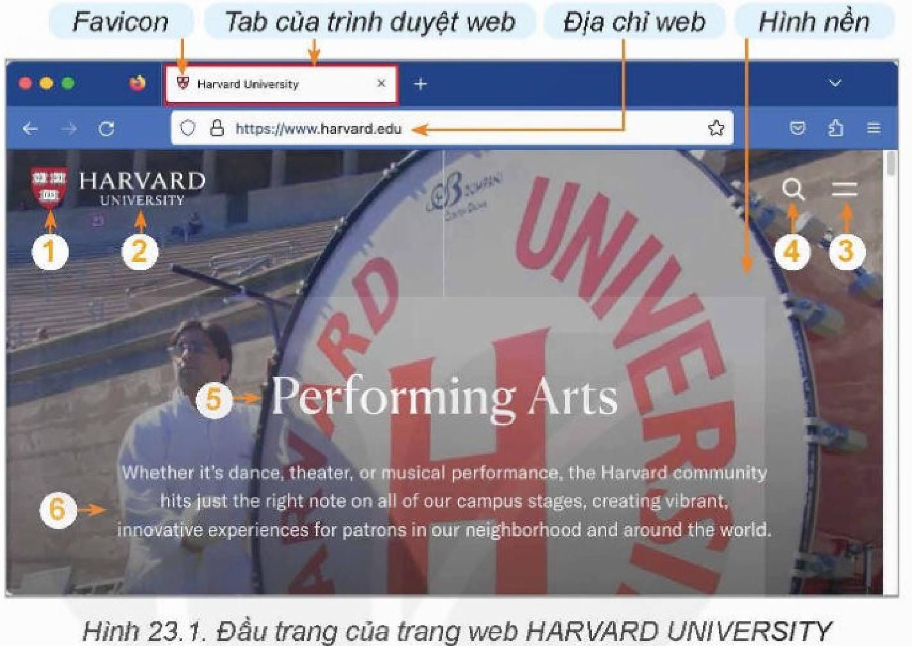
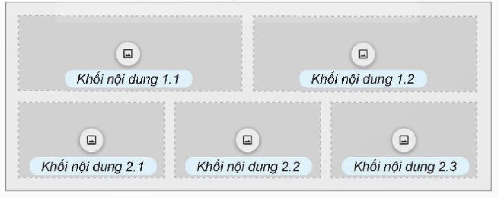
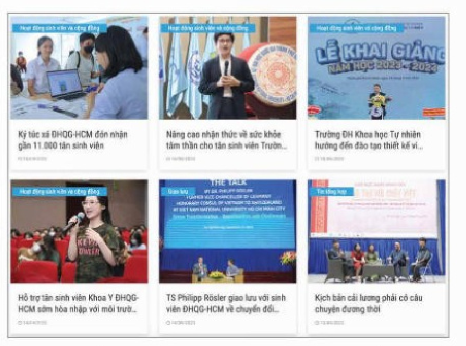
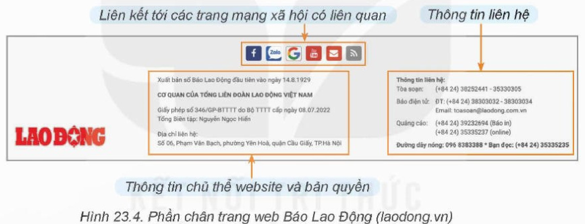
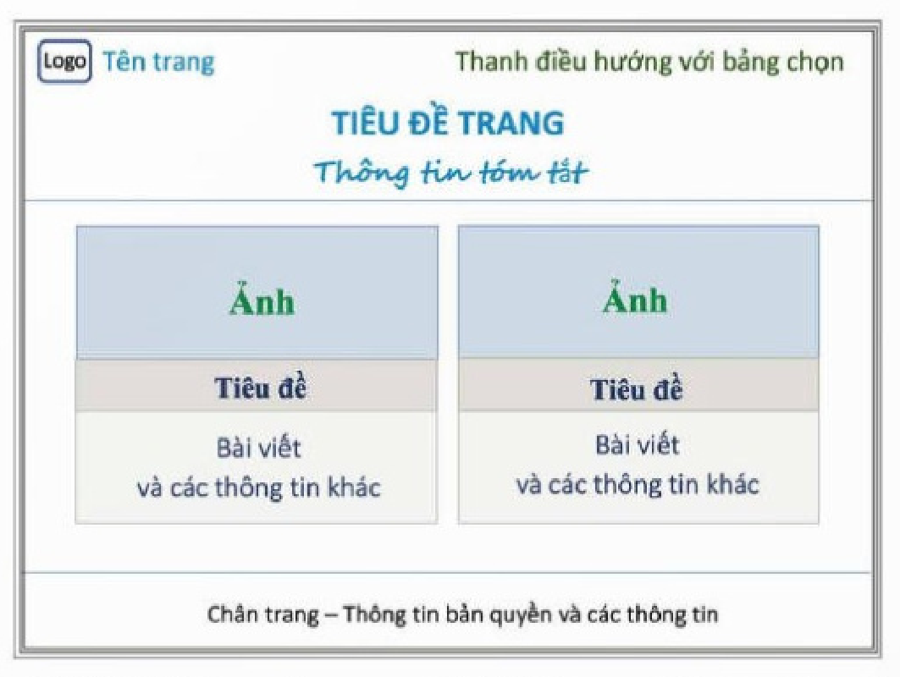
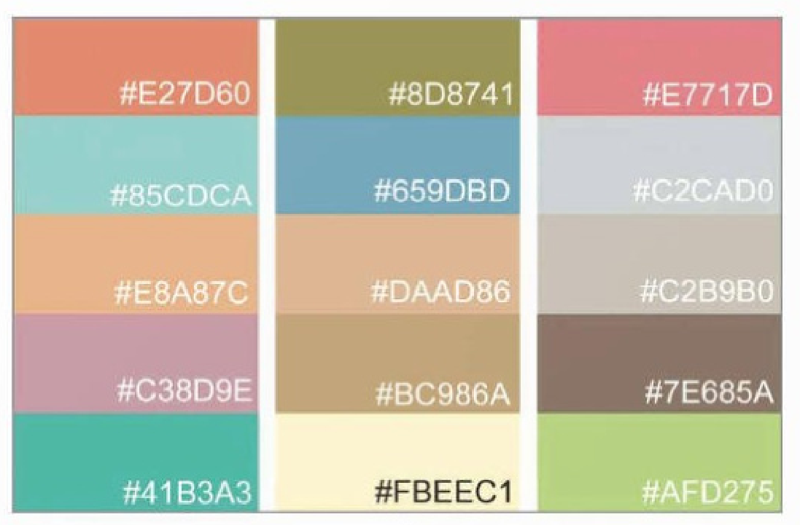
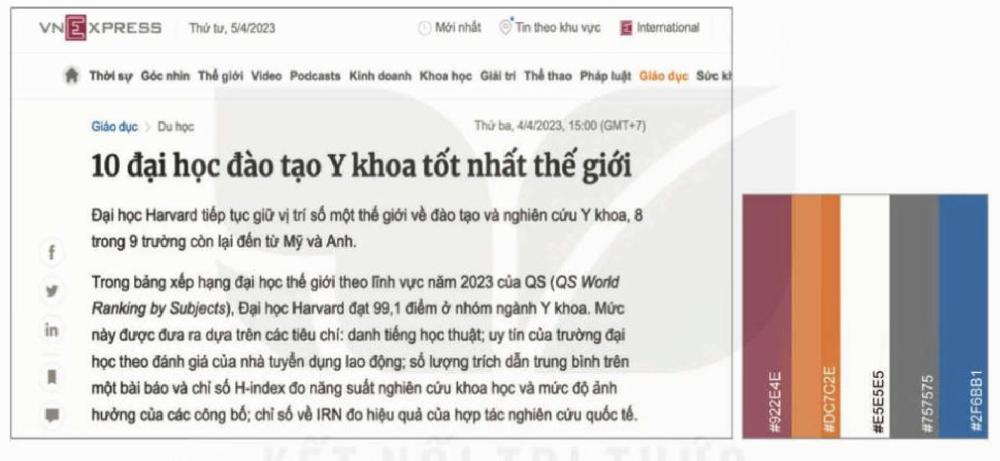
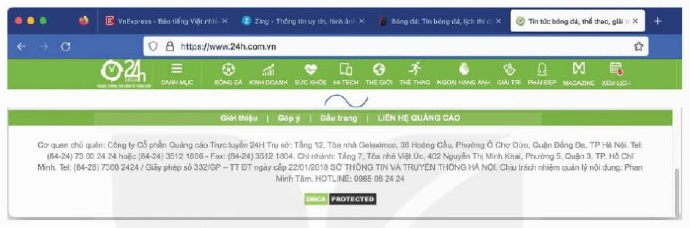

<!-- pdf:128 -->

# BÀI 23: CHUẨN BỊ XÂY DỰNG TRANG WEB

## 🎯 Sau bài học này em sẽ:

- Có nhận thức ban đầu về các thành phần của trang web và các bước thiết kế trang web.

## 🔴 Khởi động

> Từ kiến thức đã học, em đã biết khái niệm về trang web. Trong cuộc sống, học tập hằng ngày, em đã từng thấy nhiều trang web và sự phổ biến của chúng, chẳng hạn khi xem tin tức trên các báo điện tử, mạng xã hội,... Các trang web này có những đặc điểm chung gì? Cần chuẩn bị những gì khi muốn xây dựng một trang web?

## 1. NHỮNG ĐẶC ĐIỂM CHUNG CỦA TRANG WEB

> **Hoạt động 1: Thảo luận khám phá cấu trúc và đặc điểm chung của trang web**
>
> - Có thể chia một trang web thành các phần chính như thế nào?
> - Mỗi phần có những đặc điểm nào chung (nhìn thấy ở nhiều trang web)?
<!-- ocr-ok: đã đối chiếu ảnh trang 128, tiêu đề hoạt động chữ trắng trên nền cam bị OCR đọc nhầm -->

<!-- term: Cấu trúc trang web -->
Dễ nhận thấy mỗi trang web đầy đủ nhất đều có cấu trúc gồm ba phần chính:
- Phần đầu trang (header) với những thông tin chung nhất về trang.
- Phần thân trang (body) chứa nội dung của trang.
- Phần chân trang (footer) chứa các thông tin ngắn gọn về chủ thể, bản quyền.

### a) Phần đầu trang

<!-- term: Phần đầu trang -->
Phần đầu trang có vai trò như trang bìa thu gọn của một cuốn sách hay là phần trình bày đầu mỗi chương sách: Có hình nền và những thông tin nổi bật trên đó như **logo**, **tên trang**, **thanh điều hướng** (thanh này sẽ bao gồm **bảng chọn** các chức năng; chức năng tìm kiếm có thể được tách riêng ra khỏi bảng chọn), tiêu đề và thông tin tóm tắt của trang hay là thông tin mới cập nhật.

*Lưu ý:*

- Khi trang web được tải lên bởi một trình duyệt web, tên của nó sẽ được hiển thị tại tiêu đề của tab, phía sau một logo nhỏ, gọi là **favicon** (viết tắt của favorite icon). Favicon có thể không phải được thu gọn từ logo của trang mà được tạo dựng riêng, không phải chỉ cho một trang mà cho cả website, chứa nhiều trang web liên quan đến nhau.

<!-- pdf:129 -->

<!-- term: Địa chỉ URL -->
- Mỗi trang web hay website trên Internet có một địa chỉ truy cập dạng URL (Uniform Resource Locator) để người dùng Internet có thể đọc chúng qua một trình duyệt web như Firefox, Chrome, Edge hay Safari,...
- Tuỳ theo thiết kế mà đôi khi người ta dành ra một vài dòng trước phần đầu trang để đưa ra những thông báo quan trọng ví dụ như trang đang được xây dựng hay bảo trì,...; phần này gọi là **phần thông báo**.

*Hình 23.1. Đầu trang của trang web HARVARD UNIVERSITY*
*1 – Logo, 2 – Tên trang, 3 – Biểu tượng của bảng chọn, 4 – Biểu tượng của chức năng tìm kiếm, 5 – Tiêu đề, 6 – Tóm tắt thông tin nổi bật*

### b) Phần thân trang

<!-- term: Phần thân trang -->
Thân trang là phần chứa nội dung của trang web, thường được bố cục thành các khối hình chữ nhật (Hình 23.2), mỗi khối trình bày một nội dung với tiêu đề riêng.

*Hình 23.2. Cấu trúc phần thân trang*

<!-- term: Ứng dụng nhúng -->
Mỗi khối nội dung có thể chứa các thông tin dạng văn bản, hình ảnh, âm thanh, biểu mẫu nhập dữ liệu hay là các ứng dụng nhúng khác nhau (ví dụ: ứng dụng bản đồ, ứng dụng dự báo thời tiết,...).

<!-- pdf:130 -->

*Hình 23.3. Ví dụ phần thân trang web Đại học Quốc gia TP. Hồ Chí Minh*

### c) Phần chân trang

<!-- term: Phần chân trang -->
Phần này có thể bao gồm những thông tin về thương hiệu, bản quyền, bảo mật, tóm tắt những thông tin cần nhấn mạnh thêm, thông tin liên hệ và những liên kết tới các trang mạng xã hội liên quan.

*Hình 23.4. Phần chân trang web Báo Lao Động (laodong.vn)*

> - Một trang web đầy đủ gồm ba phần chính: *đầu trang*, *thân trang* và *chân trang*.
> - Phần *đầu trang* là nơi hiển thị *logo*, *tên trang*, *thanh điều hướng* bao gồm *bảng chọn* các chức năng, tiêu đề và thông tin tóm tắt của trang.
> - *Favicon* là biểu tượng đại diện cho tất cả các trang web trong một website và hiển thị trước địa chỉ trang web trên tab của trình duyệt.
> - Phần *thân trang* được tổ chức theo cấu trúc nhiều khối hình chữ nhật, mỗi khối giới thiệu một nội dung.
> - Phần *chân trang* được dành để đưa những thông tin về thương hiệu, bản quyền, bảo mật, tóm tắt những thông tin cần nhấn mạnh thêm, thông tin liên hệ và những liên kết tới các trang mạng xã hội liên quan.

> ❓ **Câu hỏi**
>
> 1. Tên trang web và logo trang được đặt ở phần nào của trang web?
> 2. Phần thân trang web thường có bố cục như thế nào?
> 3. Thông tin liên hệ của chủ thể của trang web được đặt ở phần nào của trang web?

<!-- pdf:131 -->

## 2. CÁC BƯỚC CHUẨN BỊ ĐỂ XÂY DỰNG TRANG WEB
<!-- ocr-ok: đã đối chiếu ảnh trang 131, đầu tiêu đề mục màu xanh bị OCR cắt mất chữ -->

> **Hoạt động 2: Cần làm gì khi bắt đầu xây dựng một trang web?**
> <!-- ocr-ok: đã đối chiếu ảnh trang 131, tiêu đề hoạt động chữ trắng trên nền cam bị OCR bỏ sót -->
>
> Hãy thảo luận và trả lời câu hỏi: Để xây dựng một trang web chúng ta nên bắt đầu từ đâu?
>
> Gợi ý:
>
> - Chuẩn bị những thông tin cho phần đầu trang.
> - Chuẩn bị những thông tin cho phần chân trang.
> - Chuẩn bị các bài viết và hình ảnh đẹp.
> - Phân tích, xác lập định hướng về mục đích trang web, đối tượng người dùng và định hướng thiết kế trang web.

<!-- term: Các bước chuẩn bị xây dựng trang web -->
Việc xây dựng trang web cần bắt đầu với việc phân tích, xác lập định hướng về mục đích của trang web và đối tượng người dùng. Mỗi trang web phải bắt nguồn từ một nhu cầu cụ thể. Trang web được xây dựng cho những người đọc nó, vì vậy cần phải xác định được đối tượng người đọc (người dùng), khả năng và mong muốn của họ. Từ đó xác định được mục đích, đối tượng, các yêu cầu về trang web trước khi đi vào các chi tiết thiết kế nội dung và hình thức. Trình tự các bước chuẩn bị cần phải thực hiện có thể tóm tắt như sau:

`[Định hình ý tưởng]` $\rightarrow$ `[Xây dựng thiết kế]` $\rightarrow$ `[Chuẩn bị tư liệu, lựa chọn phần mềm]`
<!-- ocr-ok: đã đối chiếu ảnh trang 131, sơ đồ mũi tên ba bước chuẩn bị bị OCR bỏ sót hai ô đầu -->

- Định hình ý tưởng:
  - Xác định mục đích và đối tượng phục vụ của trang web.
  - Thiết lập các yêu cầu cần đạt được cả về nội dung và hình thức.
- Thiết kế:
  - Xây dựng dàn ý.
  - Xây dựng kiến trúc nội dung, thiết kế mĩ thuật, chọn bảng màu, phông chữ,...
- Lựa chọn phần mềm, chuẩn bị tư liệu:
  - Lựa chọn phần mềm để xây dựng trang web.
  - Chuẩn bị thông tin cho phần đầu trang: Làm logo, favicon, ảnh nền và đặt tên trang web.
  - Chuẩn bị tư liệu cho phần thân và chân trang.

*Lưu ý:* Cần phân biệt việc xây dựng trang web đơn giản với xây dựng website. Công việc chuẩn bị xây dựng website có thể đòi hỏi thêm một số bước khác, đặc biệt là cách tổ chức vận hành và quản trị website.

### a) Định hình ý tưởng

<!-- term: Định hình ý tưởng trang web -->
Nội dung chính của bước này là xác định mục đích, đối tượng và các yêu cầu cần đạt được; nói cách khác là tìm được câu trả lời tường minh cho các câu hỏi:

- Mục đích của trang web là gì? Lớp người dùng nào hay là những ai sẽ quan tâm thường xuyên đến trang web này?
- Để đạt được mục đích và đáp ứng được nhu cầu của người dùng thì trang web phải đạt được những yêu cầu như thế nào về nội dung, kiến trúc và mĩ thuật?

<!-- pdf:132 -->

Để có thể xác định được rõ mục đích cũng như các yêu cầu cần đặt ra với trang web, cần khảo sát, phân tích các nhu cầu cũng như những đặc điểm của người dùng một cách cẩn thận kĩ lưỡng. Càng hiểu được nhu cầu của người dùng thì sẽ càng xác định được rõ hơn mục đích cũng như các yêu cầu cần đặt ra về nội dung và hình thức của trang web.

Để biết được rõ nhu cầu người dùng, cần phải đặt ra và trả lời những câu hỏi như: Người dùng mong muốn biết những thông tin gì? Những gì sẽ làm nên sự thu hút và gây hứng thú đối với họ? Những gì là đặc điểm văn hoá và thị hiếu của người dùng?

*Ví dụ:* Dự án xây dựng trang web với chủ đề “Việt Nam – Vẻ đẹp tiềm ẩn” của một nhóm thiện nguyện tâm huyết mong muốn quảng bá những nét đẹp của thiên nhiên, văn hoá, con người Việt Nam.

- Xác định mục đích của trang web và đối tượng sử dụng:
  - Mục đích: Giới thiệu vẻ đẹp của thiên nhiên, văn hoá, con người Việt Nam.
  - Đối tượng sử dụng: Tất cả những người yêu thích phong cảnh thiên nhiên, những nét đẹp về văn hoá nghệ thuật cũng như ẩm thực các vùng miền Việt Nam.
  - Những điều làm nên sức hấp dẫn, thu hút đối với lớp đối tượng này là những bức ảnh đẹp về thiên nhiên, về cuộc sống lao động của người dân, những bài viết và hình ảnh về lịch sử, văn hoá, đặc điểm ẩm thực địa phương. Là những người thích khám phá, họ sẽ muốn biết vị trí trên bản đồ, cách tự đi đến đó, mùa hay thời gian đẹp nhất để đến tham quan mỗi danh lam thắng cảnh,...
  - Nếu xác định trang web phục vụ cho cả người nước ngoài thì cần lưu ý những nội dung giúp họ tìm hiểu và khám phá những đặc điểm văn hoá truyền thống dân tộc cùng những vẻ đẹp độc đáo của thiên nhiên và con người Việt Nam.
- Yêu cầu về nội dung và hình thức:
  - Những nội dung được giới thiệu phải phản ánh được nét đẹp riêng của thiên nhiên, văn hoá, con người ở mỗi vùng miền.
  - Định dạng thông tin đa dạng, sinh động: văn bản, hình ảnh, âm thanh,...
  - Những thông tin khác nên được giới thiệu kèm theo như bản đồ, đường đi, mùa/thời gian đẹp nhất, đặc điểm thời tiết,...
  - Hình thức của trang web phải dễ theo dõi, sinh động, đẹp và trang nhã về màu sắc.
  - Trang web cũng cần có tương tác với người dùng để biết thêm nhu cầu của họ, từ đó có thể từng bước bổ sung, điều chỉnh nội dung và hình thức cho phù hợp hơn.

### b) Thiết kế

<!-- term: Thiết kế trang web -->
Bước này cần phải được bắt đầu với việc xây dựng dàn ý tổng thể, từ đó xây dựng bố cục của trang và đưa ra những chỉ định về thiết kế mĩ thuật.

- Xây dựng dàn ý và bố cục:
  - Việc xây dựng dàn ý sẽ giúp hình dung toàn bộ về những nội dung sẽ được giới thiệu trong trang web và cách sắp xếp các nội dung này sao cho ấn tượng, mạch lạc, dễ tiếp cận và dễ hiểu nhất.
  - Trang web “Việt Nam – Vẻ đẹp tiềm ẩn” sẽ giới thiệu các cảnh đẹp tiềm ẩn ở các vùng miền khác nhau, chẳng hạn Tây Bắc, Đông Bắc, Miền Trung, Tây Nguyên, Miền Đông, Miền Tây. Vì vậy, ở thanh điều hướng cần tạo bảng chọn gồm danh sách các vùng miền và thông tin liên hệ/phản hồi. Phần thân trang sẽ là một số bài viết mới nổi bật về một số địa danh. Có thể tham khảo một mẫu bố cục như Hình 23.5.

<!-- pdf:133 -->

*Hình 23.5. Bố cục trang web “Việt Nam – Vẻ đẹp tiềm ẩn”*

- Thiết kế mĩ thuật:

  <!-- term: Thiết kế mĩ thuật trang web -->
  Thiết kế mĩ thuật trang web là việc thiết kế hình thức của trang web sao cho có vẻ đẹp phù hợp với thẩm mĩ của người dùng và phù hợp với nội dung, góp phần gây ấn tượng và tăng sức thuyết phục của nội dung. Vì vậy, về chi tiết, công việc này được tiến hành với từng nội dung, từng bài viết của trang web. Ở mức thiết kế chung, sẽ chỉ giới hạn trong phạm vi lựa chọn các định dạng chữ và bảng màu.

  - *Định dạng chữ:* Cần lựa chọn nhất quán và hài hoà về phông chữ, kiểu chữ (nghiêng, đậm,...) và cỡ chữ dùng cho mỗi phần của trang web. Ví dụ:
    + Phông chữ dùng cho các bảng chọn trên thanh điều hướng, nên là các phông Sans Serif (không có chân), hẹp ngang, dễ đọc và tiết kiệm diện tích hiển thị như phông Arial Condensed.
    + Các phông Serif (có chân), như Times New Roman rất ít được dùng để trình bày nội dung của trang web do khó nhận diện trên màn hình và chỉ dùng trong các trường hợp cỡ chữ lớn như tiêu đề. Phần nội dung bài viết nên chọn một phông Sans Serif như Calibri, Arial, Verdana, Tahoma,...
    + Kiểu chữ đậm có ý nghĩa nhấn mạnh, thường dùng cho các tiêu đề. Kiểu chữ nghiêng có ý nghĩa phân biệt, thường dùng khi muốn phân biệt từ ngữ, câu chữ hay phần chú thích.
    + Cỡ chữ có thể quy định tối thiểu bốn cỡ: cỡ nhỏ nhất, chỉ dùng cho chú thích không cần nhấn mạnh như chân trang; cỡ thường dùng cho phần nội dung bài viết, cỡ lớn cho tiêu đề và cỡ rất lớn cho những tiêu đề nổi bật.
  - *Bảng màu:*
    + Một trang web với những màu sắc tương phản quá gắt hay không hài hoà sẽ gây phản cảm với người đọc. Vì vậy, để gây cảm xúc tốt và thu hút người đọc cần phải chọn một số màu có độ tương phản nhẹ nhàng và hài hoà. Mỗi bảng màu thường có 5 màu pha trộn giữa các màu gam ấm, lạnh và trung tính, chưa kể hai màu trắng và đen (Hình 23.6).
    + Hình 23.7 là một ví dụ về phông chữ, bảng màu trong một trang web của VnExpress. Phông chữ có chân chỉ được dùng ở dòng tiêu đề. Tất cả các phần khác đều dùng phông không chân. Có bốn cỡ chữ khác nhau, kết hợp với các kiểu chữ thường, đậm hay nghiêng; bảng màu gồm 5 màu tương phản vừa phải chuyển dần từ màu ấm đến màu lạnh.

<!-- pdf:134 -->

*Hình 23.6. Ví dụ về bảng màu*

*Hình 23.7. Ví dụ định dạng chữ và bảng màu của một trang web trên VnExpress*

### c) Lựa chọn phần mềm, chuẩn bị tư liệu

<!-- term: Phần mềm làm trang web trực quan -->
Hiện nay, có nhiều phần mềm hỗ trợ làm trang web một cách trực quan, nhưng hầu hết chúng là những phần mềm thương mại. Tuy nhiên, Google có cung cấp miễn phí, trong hệ sinh thái của họ, một phần mềm làm trang web với giao diện hoàn toàn trực quan. Phần mềm này có điểm rất mạnh là dễ sử dụng và kết nối một cách dễ dàng với những phần mềm khác của Google như Docs, Sheets, Slides, Maps, Photos, YouTube,... Các trang web sau khi làm xong sẽ được lưu trữ trên Google Drive và có thể chia sẻ, xuất bản ngay trên Google với một địa chỉ URL hỗ trợ bởi Google. Yêu cầu cần có chỉ là người dùng đăng kí để có tài khoản Google Mail.

Vì vậy, sách này sẽ chọn giới thiệu phần mềm làm web của Google và hướng dẫn từng bước tạo dựng trang web với ví dụ cụ thể là làm trang web “Việt Nam – Vẻ đẹp tiềm ẩn”.

Việc chuẩn bị tư liệu cho trang web là việc kéo dài suốt thời gian thực hiện dự án, bắt đầu từ việc thiết kế favicon, logo, lựa chọn hình nền cho phần đầu trang, thực hiện các bài viết cho từng nội dung, lựa chọn hình ảnh minh hoạ,...

<!-- pdf:135 -->

> ❓ **Câu hỏi**
>
> 1. Để định hình được ý tưởng xây dựng một trang web cần phải thực hiện những công việc gì?
> 2. Công việc thiết kế trang web bao gồm những nội dung gì?

## ✏️ Luyện tập

1. Hãy phân tích phần đầu trang và chân trang của trang web 24 giờ ở Hình 23.8 và chỉ rõ các vị trí các phần tử mà em nhận dạng được: tên trang, logo, favicon, bảng chọn,... Tóm tắt những thông tin được trình bày ở phần chân trang.

*Hình 23.8. Phần đầu trang và chân trang của trang web 24 giờ*

2. Hãy vào website Tổng cục Du lịch Việt Nam (https://vietnamtourism.gov.vn/). Phân tích thiết kế nội dung, bố cục, phông chữ, màu sắc và phát biểu nhận xét của mình.

## 🚀 Vận dụng

1. Hãy truy cập website của ít nhất 3 trường đại học trong danh sách các trường đại học sau:
   - University of Massachusetts (https://www.massachusetts.edu/).
   - Stanford University (https://www.stanford.edu/).
   - Đại học Quốc gia Hà Nội (https://www.vnu.edu.vn).
   - Đại học Quốc gia TP. Hồ Chí Minh (https://vnuhcm.edu.vn/).
   - Đại học Bách khoa Hà Nội (https://hust.edu.vn/).
   - Trường Đại học Cần Thơ (https://www.ctu.edu.vn/).
   - Đại học Đà Nẵng (https://www.udn.vn/).

   Phân tích nội dung, bố cục, phông chữ, màu sắc và rút ra nhận xét của mình.

2. “Những bài ca đi cùng năm tháng” là một đề tài làm trang web giới thiệu về những bản nhạc, nhạc sĩ, ca sĩ được các thế hệ công chúng yêu thích trong những giai đoạn đấu tranh giành độc lập và xây dựng đất nước của dân tộc ta. Em hãy phân tích, xây dựng ý tưởng thực hiện đề tài này và phác thảo thiết kế trang web cho đề tài này.

3. Hãy tìm hiểu phần mềm hỗ trợ làm trang web của Google tại địa chỉ https://www.sites.google.com.

## 📷 Danh mục hình ảnh

| Mã hình | Trang PDF | Vị trí trong bài | Chú thích gốc |
| --- | --- | --- | --- |
| H12-tin_hoc_thud-b23-01 | 129 | Mục 1, phần a | Hình 23.1. Đầu trang của trang web HARVARD UNIVERSITY |
| H12-tin_hoc_thud-b23-02 | 129 | Mục 1, phần b | Hình 23.2. Cấu trúc phần thân trang |
| H12-tin_hoc_thud-b23-03 | 130 | Mục 1, phần b | Hình 23.3. Ví dụ phần thân trang web Đại học Quốc gia TP. Hồ Chí Minh |
| H12-tin_hoc_thud-b23-04 | 130 | Mục 1, phần c | Hình 23.4. Phần chân trang web Báo Lao Động (laodong.vn) |
| H12-tin_hoc_thud-b23-05 | 133 | Mục 2, phần b | Hình 23.5. Bố cục trang web “Việt Nam – Vẻ đẹp tiềm ẩn” |
| H12-tin_hoc_thud-b23-06 | 134 | Mục 2, phần b | Hình 23.6. Ví dụ về bảng màu |
| H12-tin_hoc_thud-b23-07 | 134 | Mục 2, phần b | Hình 23.7. Ví dụ định dạng chữ và bảng màu của một trang web trên VnExpress |
| H12-tin_hoc_thud-b23-08 | 135 | Phần Luyện tập | Hình 23.8. Phần đầu trang và chân trang của trang web 24 giờ |
