<!-- pdf:136 -->

# BÀI 24: XÂY DỰNG PHẦN ĐẦU TRANG WEB

## 🎯 Sau bài học này em sẽ:

- Biết các bước xây dựng phần đầu trang web với hỗ trợ của Google Sites.

## 🔴 Khởi động

<!-- term: Google Sites -->
> **Google Sites** là một ứng dụng trong hệ sinh thái đa dạng của Google. Ứng dụng miễn phí này giúp người dùng xây dựng các trang web và xuất bản chúng lên Internet. Với Google Sites, một nhóm người dùng không chuyên về tin học vẫn có thể cùng nhau xây dựng các trang web theo một chủ đề nào đó. Trong Bài 23, em đã biết *Phần đầu trang* của trang web là một thành phần quan trọng. Em hãy tìm hiểu cách thức xây dựng phần đầu trang web bằng Google Sites.

## Nhiệm vụ 1: Làm quen với giao diện đầu tiên của Google Sites

*Yêu cầu:* Nhận diện được ba phần trong giao diện đầu tiên của Google Sites.

*Hướng dẫn:*

*Bước 1.* Đăng nhập vào tài khoản Google.

Tại thanh địa chỉ của trình duyệt, nhập sites.google.com để vào giao diện tạo trang web mới của Google: sites.google.com/new.

*Bước 2.* Nhận biết ba phần của giao diện.

<!-- term: Giao diện đầu tiên của Google Sites -->
1) Phần trên cùng có ô tìm kiếm và biểu tượng để truy cập vào danh sách các ứng dụng khác của Google.
2) Phần thứ hai có các lựa chọn để tạo một trang web mới là một trang web trắng hoặc một trang web theo mẫu có sẵn (Hình 24.1).
3) Phần thứ ba là danh sách các trang mà người dùng mới mở trước đó.

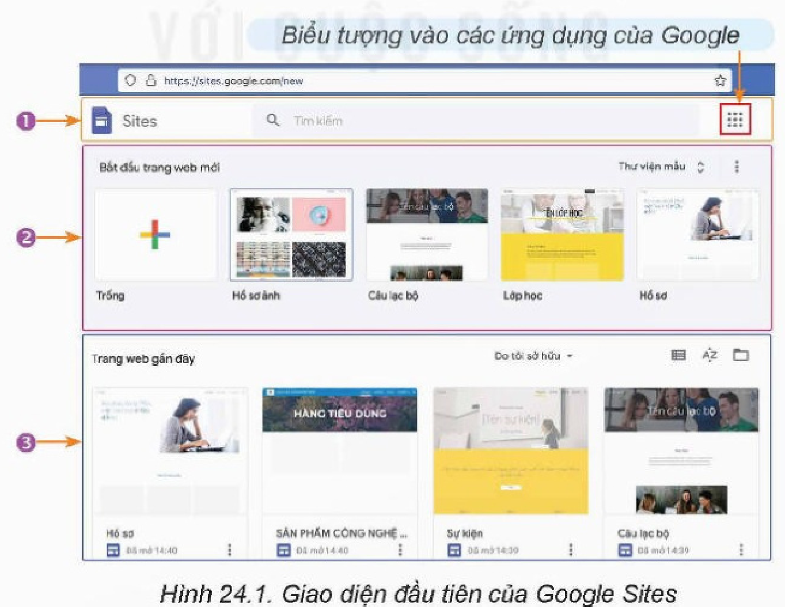

*Hình 24.1. Giao diện đầu tiên của Google Sites*

<!-- pdf:137 -->

## Nhiệm vụ 2: Tìm hiểu giao diện tạo phần đầu trang

*Yêu cầu:* Nhận diện được các chức năng của giao diện tạo phần đầu trang.
<!-- ocr-ok: đã đối chiếu ảnh trang 137, văn bản nằm cạnh Hình 24.2 làm OCR ghép lẫn dòng -->

*Hướng dẫn:*

*Bước 1.* Tạo trang web mới.

Chọn biểu tượng dấu cộng nhiều màu (Hình 24.1) để tạo một trang web mới. Giao diện tạo trang web mới sẽ xuất hiện như Hình 24.2.

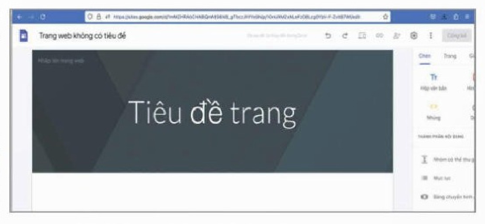

*Hình 24.2. Giao diện tạo trang web mới*

*Bước 2.* Làm quen với giao diện và các chức năng tạo phần đầu trang.

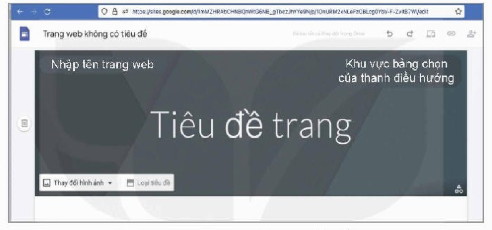

*Hình 24.3. Giao diện thiết lập phần đầu trang*

<!-- term: Giao diện thiết lập phần đầu trang -->
- Phần đầu trang (Hình 24.3) có thể có logo, tên trang, hình nền của phần đầu trang, tiêu đề trang, bảng chọn trên thanh điều hướng.
- Dòng **Trang web không có tiêu đề** là nơi thao tác nhập/hiển thị tên tệp lưu trữ trang web. Các tệp này sẽ được lưu trữ ở Google Drive của người dùng.
- Dòng **Nhập tên trang web** là nơi nhập/hiển thị logo, favicon và tên trang web.

<!-- term: Loại tiêu đề -->
- Dòng **Thay đổi hình ảnh**, **Loại tiêu đề** là các bảng chọn kích thước phần đầu trang và hình ảnh nền. Phần đầu trang có các kích thước tuỳ chọn: Bìa, Biểu ngữ lớn, Biểu ngữ hay Chỉ có tiêu đề (không có ảnh nền). Các kích thước này chỉ khác nhau về chiều cao. Tuỳ chọn Bìa có dạng tương tự bìa sách, có chiều cao lớn nhất, chiếm toàn bộ màn hình (Hình 24.4).

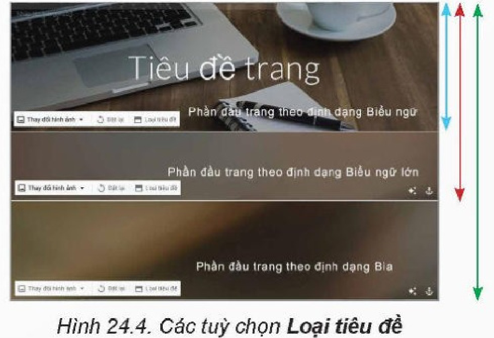

*Hình 24.4. Các tuỳ chọn Loại tiêu đề*

- Dòng Tiêu đề trang là nơi nhập/hiển thị tiêu đề trang và nội dung tóm tắt trang.

*Lưu ý:* Nội dung liên quan đến Thanh điều hướng sẽ được xem xét ở những bài sau.

<!-- pdf:138 -->

## Nhiệm vụ 3: Tạo phần đầu trang

*Yêu cầu:* Thiết lập được phần đầu trang web và xuất bản trang. Ví dụ như phần đầu trang web “Việt Nam – vẻ đẹp tiềm ẩn” sau đây:

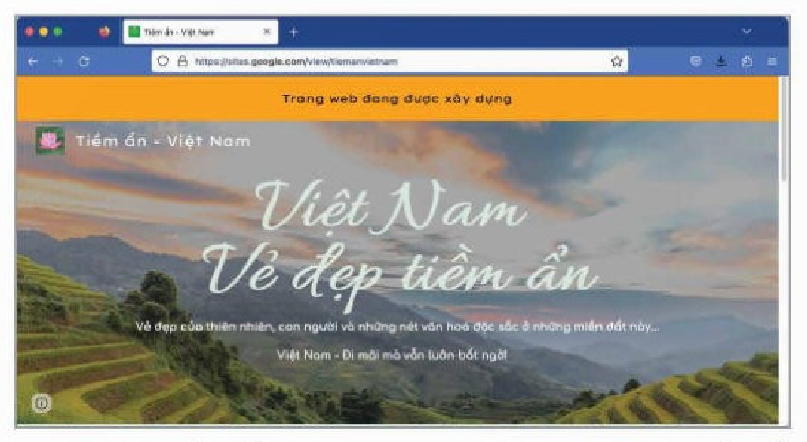

*Hình 24.5. Phần đầu trang web “Việt Nam – vẻ đẹp tiềm ẩn”*

*Hướng dẫn:*

*Bước 1.* Nhập tên tệp lưu trữ trang web.

Nháy chuột vào dòng **Trang web không có tiêu đề**, nhập tên tệp gợi nhớ, ví dụ VN - Ver 1. Sau đó, nếu mở Google Drive sẽ thấy có tệp mới VN - Ver 1.

*Bước 2.* Thiết lập logo, favicon, nhập tên trang và thông báo đầu trang.

<!-- term: Thiết lập logo và favicon trên Google Sites -->
- Định dạng các tệp ảnh logo và favicon có thể là png, jpg hay gif. Logo có thể có dạng hình chữ nhật, favicon dạng hình vuông với kích thước 16 x 16, 32 x 32 hay 48 x 48 pixels.
- Nháy chuột vào ô **Nhập tên trang web** rồi nháy chuột vào **Thêm biểu tượng** (Hình 24.6). Phần mềm sẽ hiển thị cửa sổ **Cài đặt** như Hình 24.7. Chọn **Hình ảnh thương hiệu** ở khung bên trái, khung bên phải xuất hiện các tuỳ chọn để thiết lập logo và favicon. Nháy chuột vào nút **Chọn** để chọn ảnh từ Google Drive (trong các thư mục như thư mục ảnh Được chia sẻ với tôi, Bộ nhớ dùng chung (thư mục dùng chung của nhóm làm việc) hay thư mục Ảnh gần đây) hoặc nháy chuột vào nút **Tải lên** để tải lên ảnh từ thiết bị của người dùng (Hình 24.7).

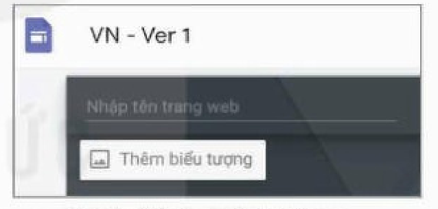

*Hình 24.6. Bảng chọn thêm biểu tượng*

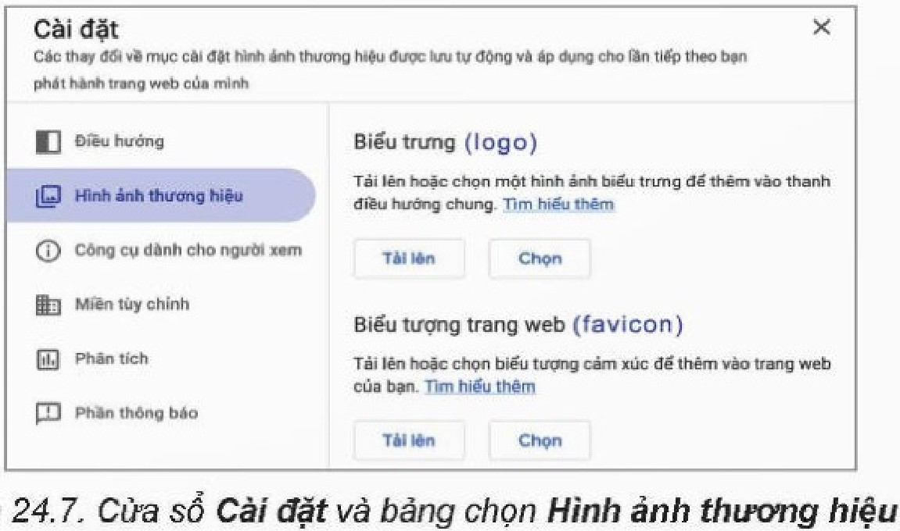

*Hình 24.7. Cửa sổ Cài đặt và bảng chọn Hình ảnh thương hiệu*

<!-- pdf:139 -->

<!-- term: Thiết lập phần thông báo -->
- Nếu muốn đưa thông báo vào đầu trang, ví dụ “Trang web đang được xây dựng”, thì nháy chuột vào **Phần thông báo** ở Hình 24.8. Nhập nội dung thông báo vào ô **Lời nhắn**, chọn màu chữ thông báo và bật **Hiển thị phần thông báo**. Khi cần thay đổi hoặc tắt thông báo, người dùng chỉnh sửa ở bảng chọn này (Hình 24.8).

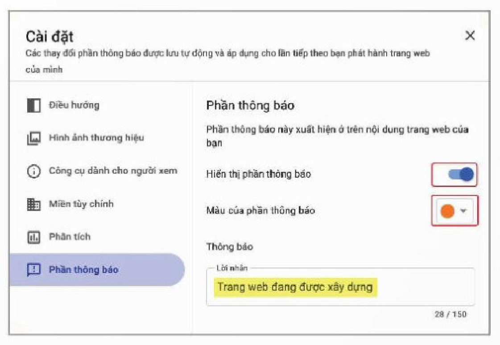

*Hình 24.8. Giao diện bảng chọn thêm thông báo*

- Sau khi thiết lập logo và favicon, nhập tên trang là Tiềm ẩn – Việt Nam. Lưu ý tên trang web nên ngắn gọn vì được gán vào địa chỉ URL của trang.

*Bước 3.* Thiết lập kích thước phần đầu trang, ảnh nền và tiêu đề trang.

<!-- term: Thiết lập ảnh nền và tiêu đề trang -->
- Thiết lập kích thước phần đầu trang: Nháy chuột vào **Loại tiêu đề** và chọn một kích thước.
- Thiết lập ảnh nền: Nháy chuột vào **Thay đổi hình ảnh**, rồi chọn **Tải lên** (ảnh từ máy tính) hoặc **Chọn** để chọn ảnh từ Google Drive, Google Photos hay từ Internet (Hình 24.9).

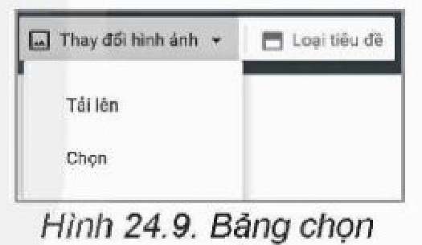

*Hình 24.9. Bảng chọn ảnh nền*

- Khi thiết lập ảnh nền, độ sáng của ảnh được tự động điều chỉnh để vẫn đọc được phần chữ trên nền. Trường hợp người dùng muốn giữ nguyên độ sáng của ảnh, nháy chuột vào biểu tượng lấp lánh ở góc dưới bên phải để huỷ bỏ chế độ tự động điều chỉnh độ sáng của ảnh (Hình 24.10).
- Ảnh gốc làm nền có thể có kích thước lớn hơn so với khung tiêu đề. Để điều chỉnh phần ấn tượng nhất của ảnh hiển thị trọn vẹn trong đầu trang, nháy chuột vào biểu tượng mỏ neo ở góc dưới bên phải, sau đó chọn các mũi tên điều hướng để điều chỉnh vị trí của ảnh (Hình 24.11).

*Hình 24.10. Bỏ tự động điều chỉnh độ sáng của ảnh*

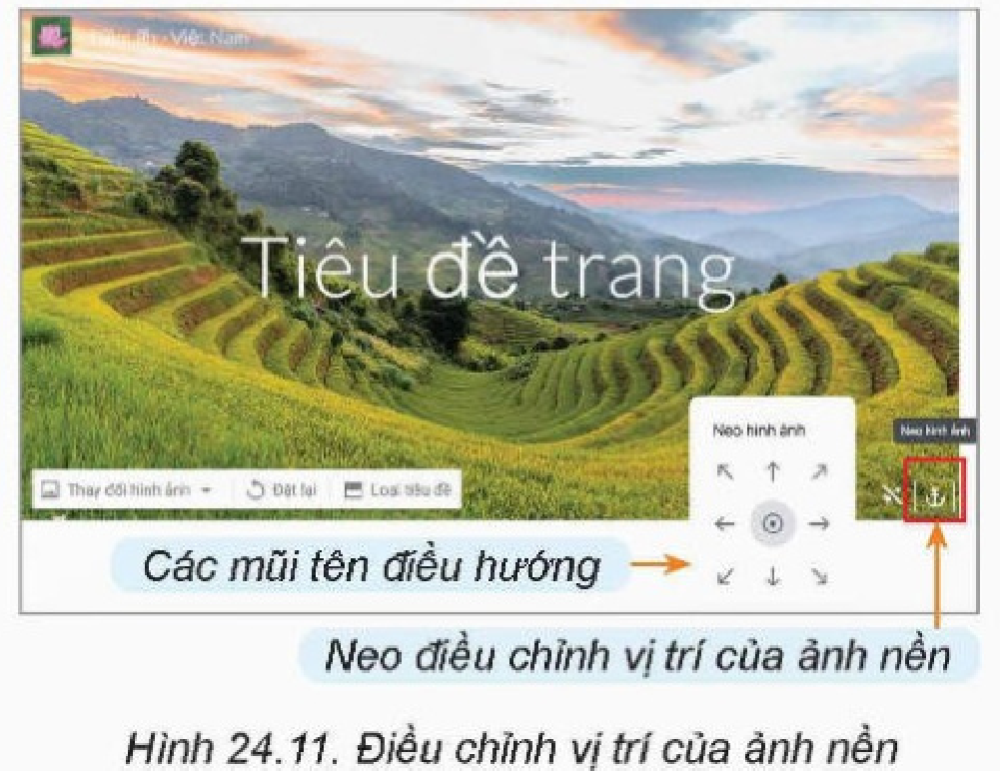

*Hình 24.11. Điều chỉnh vị trí của ảnh nền*

<!-- pdf:140 -->

*Bước 4.* Thiết lập tiêu đề trang.

Nháy chuột vào **Tiêu đề trang**, nhập tiêu đề trang. Có thể thay đổi phông chữ, cỡ chữ, màu sắc hay căn lề, dãn dòng,... cho tiêu đề trang ở các bảng chọn tương ứng (Hình 24.12). Nếu tiêu đề dài thì có thể thay đổi kích thước khung văn bản hoặc nhấn phím **Shift + Enter** để ngắt xuống dòng. Có thể định dạng các dòng là ***Tiêu đề*** (cỡ chữ lớn), ***Tiêu đề*** (cỡ chữ nhỏ),... ở bảng chọn bên trái (Hình 24.12).

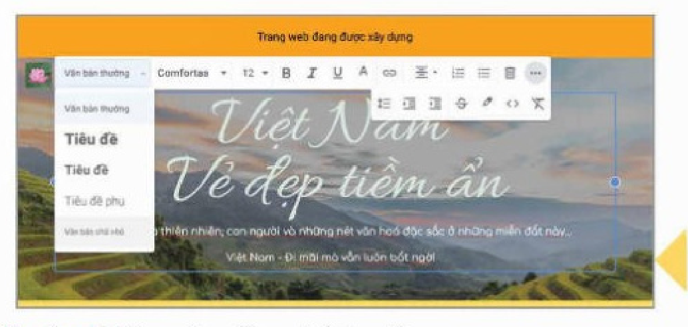

*Hình 24.12. Giao diện thiết lập tiêu đề trang*

*Bước 5.* Xem trước, chỉnh sửa.

<!-- term: Xem trước và công bố trang web -->
Tương tự các ứng dụng khác của Google, Google Sites sẽ tự động lưu trang web đang tạo vào Drive. Trước khi xuất bản trang web, có thể xem trước bằng cách nháy chuột vào biểu tượng **Xem trước** (Hình 24.13) rồi chọn xem trên điện thoại, máy tính bảng hay máy tính với các biểu tượng tương ứng (Hình 24.14).

*Hình 24.13. Lựa chọn xem trước, sao chép liên kết*

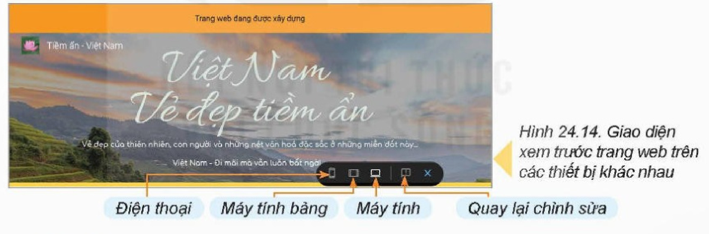

*Hình 24.14. Giao diện xem trước trang web trên các thiết bị khác nhau*

*Bước 6.* Xuất bản và truy cập trang web theo URL.

Nháy chuột vào nút **Công bố** để xuất bản. Để sao chép địa chỉ URL, nháy chuột vào biểu tượng liên kết (Hình 24.13). Dán địa chỉ URL vào thanh địa chỉ của một trình duyệt để nhận được kết quả như Hình 24.5.

## ✏️ Luyện tập

Hãy tóm tắt các bước xây dựng phần đầu trang web. Thực hiện việc thay đổi loại tiêu đề, hình nền, thay đổi tiêu đề cùng màu sắc và font chữ.

## 🚀 Vận dụng

Hãy xây dựng phần đầu trang web của đề tài “Những bài ca đi cùng năm tháng”.

## 📷 Danh mục hình ảnh

| Mã hình | Trang PDF | Vị trí trong bài | Chú thích gốc |
| --- | --- | --- | --- |
| H12-tin_hoc_thud-b24-01 | 136 | Nhiệm vụ 1, Bước 2 | Hình 24.1. Giao diện đầu tiên của Google Sites |
| H12-tin_hoc_thud-b24-02 | 137 | Nhiệm vụ 2, Bước 1 | Hình 24.2. Giao diện tạo trang web mới |
| H12-tin_hoc_thud-b24-03 | 137 | Nhiệm vụ 2, Bước 2 | Hình 24.3. Giao diện thiết lập phần đầu trang |
| H12-tin_hoc_thud-b24-04 | 137 | Nhiệm vụ 2, Bước 2 | Hình 24.4. Các tuỳ chọn Loại tiêu đề |
| H12-tin_hoc_thud-b24-05 | 138 | Nhiệm vụ 3, Yêu cầu | Hình 24.5. Phần đầu trang web “Việt Nam – vẻ đẹp tiềm ẩn” |
| H12-tin_hoc_thud-b24-06 | 138 | Nhiệm vụ 3, Bước 2 | Hình 24.6. Bảng chọn thêm biểu tượng |
| H12-tin_hoc_thud-b24-07 | 138 | Nhiệm vụ 3, Bước 2 | Hình 24.7. Cửa sổ Cài đặt và bảng chọn Hình ảnh thương hiệu |
| H12-tin_hoc_thud-b24-08 | 139 | Nhiệm vụ 3, Bước 2 | Hình 24.8. Giao diện bảng chọn thêm thông báo |
| H12-tin_hoc_thud-b24-09 | 139 | Nhiệm vụ 3, Bước 3 | Hình 24.9. Bảng chọn ảnh nền |
| H12-tin_hoc_thud-b24-10 | 139 | Nhiệm vụ 3, Bước 3 | Hình 24.10. Bỏ tự động điều chỉnh độ sáng của ảnh |
| H12-tin_hoc_thud-b24-11 | 139 | Nhiệm vụ 3, Bước 3 | Hình 24.11. Điều chỉnh vị trí của ảnh nền |
| H12-tin_hoc_thud-b24-12 | 140 | Nhiệm vụ 3, Bước 4 | Hình 24.12. Giao diện thiết lập tiêu đề trang |
| H12-tin_hoc_thud-b24-13 | 140 | Nhiệm vụ 3, Bước 5 | Hình 24.13. Lựa chọn xem trước, sao chép liên kết |
| H12-tin_hoc_thud-b24-14 | 140 | Nhiệm vụ 3, Bước 5 | Hình 24.14. Giao diện xem trước trang web trên các thiết bị khác nhau |
