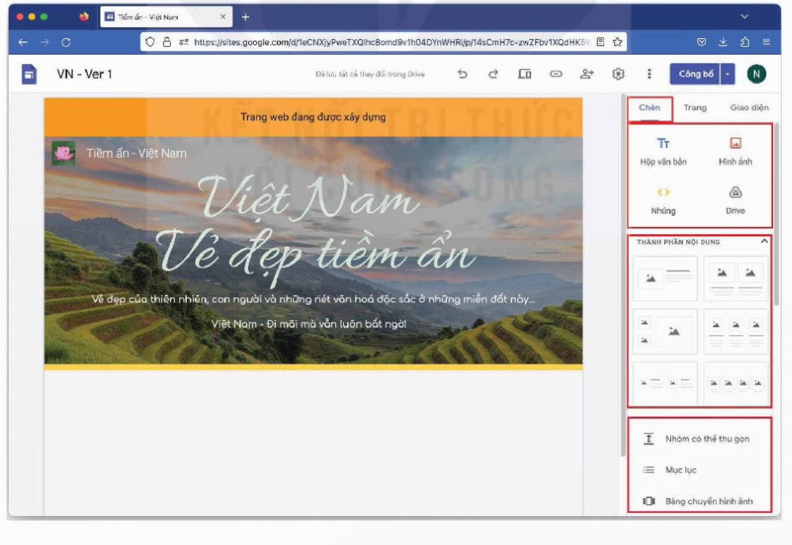
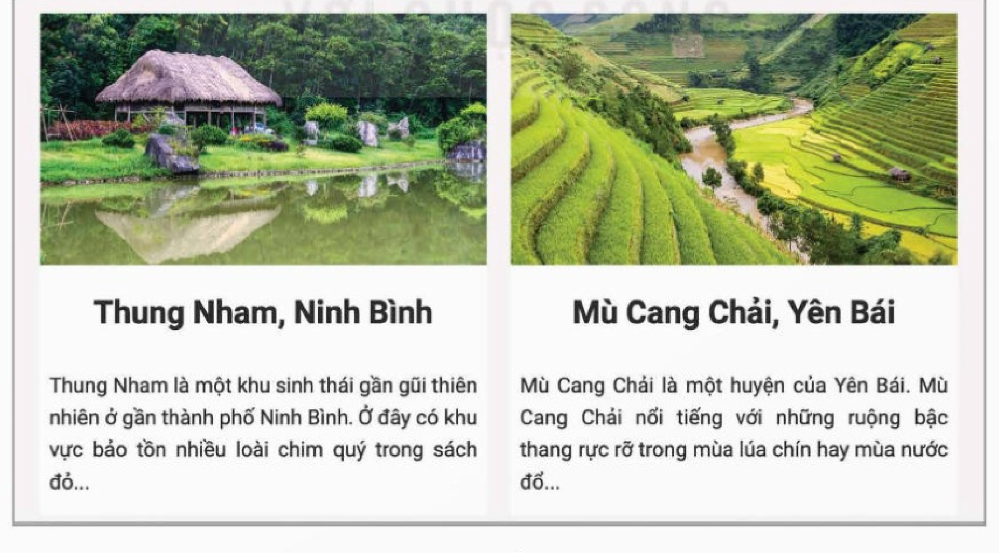
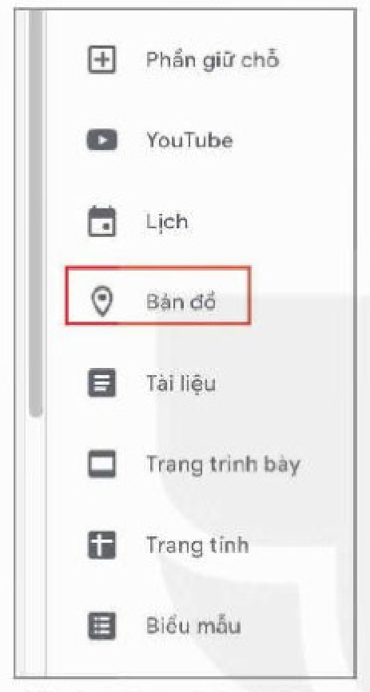
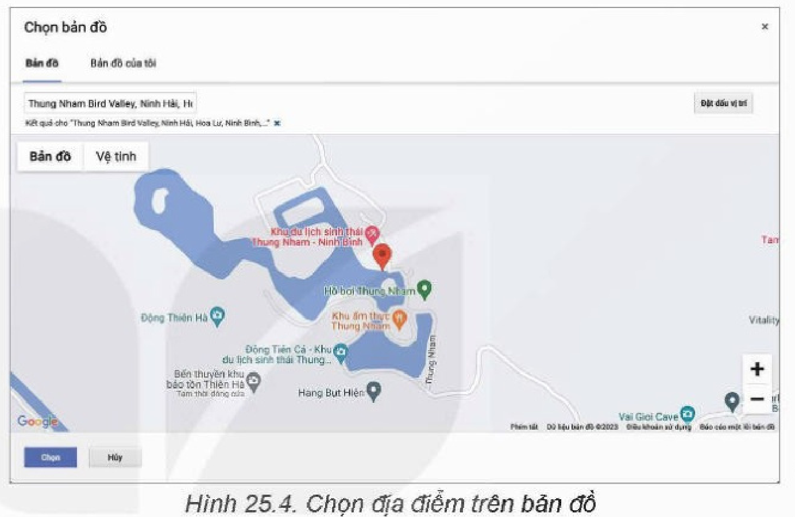
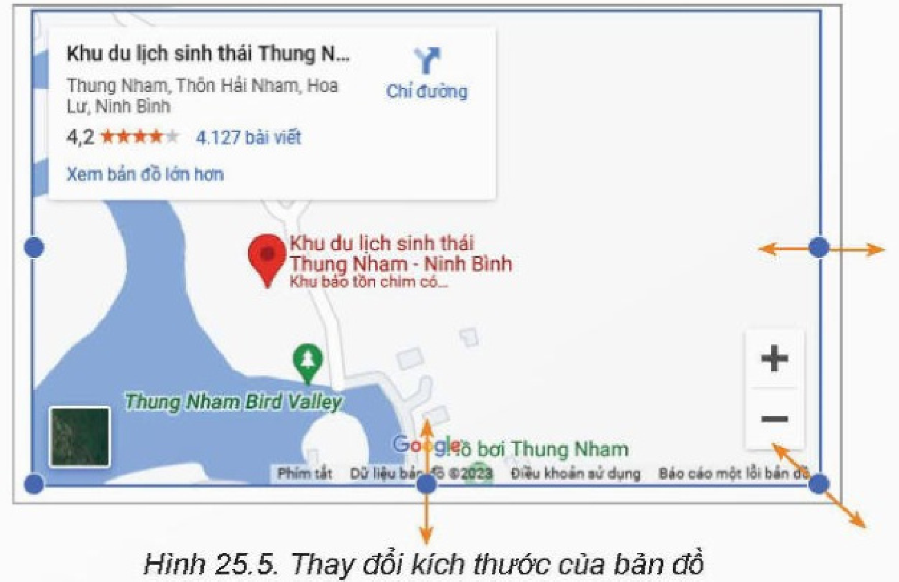
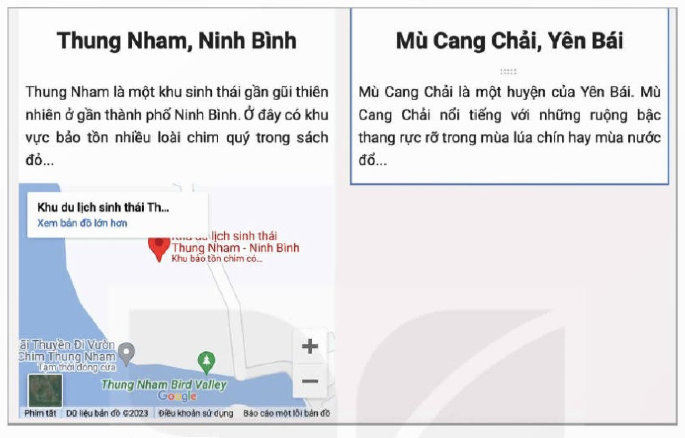
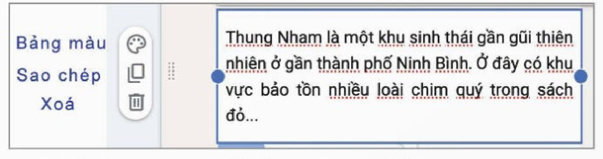
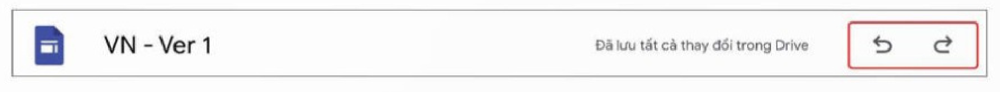
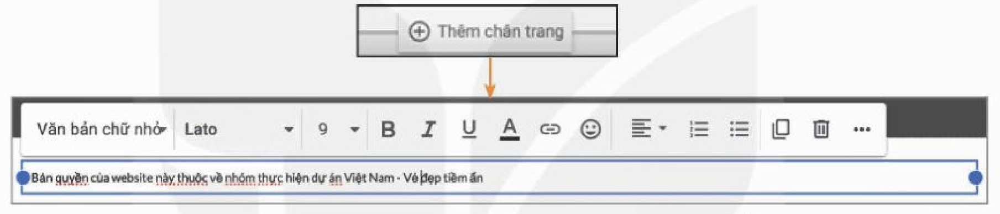
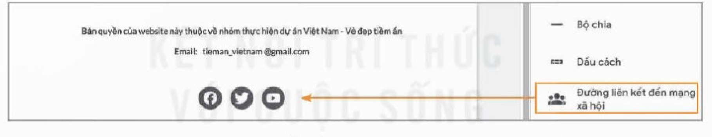

<!-- pdf:141 -->

# BÀI 25: XÂY DỰNG PHẦN THÂN VÀ CHÂN TRANG WEB

## 🎯 Sau bài học này em sẽ:

- Biết cách xây dựng phần nội dung và chân trang web với sự hỗ trợ của Google Sites.

## 🔴 Khởi động

> Với sự hỗ trợ của Google Sites, em đã xây dựng được phần đầu trang web “Việt Nam – Vẻ đẹp tiềm ẩn”. Em có thể tự thực hiện được thiết kế phần nội dung chính (phần thân) và phần chân trang web không?

## Nhiệm vụ 1: Tìm hiểu giao diện tạo phần thân trang web

*Yêu cầu:* Nhận biết các chức năng trong giao diện tạo phần thân trang web.

*Hướng dẫn:*

*Bước 1.* Xác định vị trí ba bảng chọn các lệnh tạo phần thân trang web.

Có ba bảng chọn **Chèn**, **Trang** và **Giao diện** ở khung bên phải cửa sổ thiết kế trang web (Hình 25.1). Trong bài này chúng ta chỉ làm việc với bảng chọn **Chèn**.

*Hình 25.1. Bảng chọn Chèn trong giao diện tạo phần thân trang web*

<!-- pdf:142 -->

*Bước 2.* Tìm hiểu các nhóm lệnh của bảng chọn **Chèn**.

Bảng chọn **Chèn** có ba nhóm lệnh sau:

<!-- term: Bảng chọn Chèn trong Google Sites -->
- Nhóm lệnh đầu tiên: **Hộp văn bản**, **Hình ảnh**, **Nhúng**, **Drive**.
  Nếu muốn chèn văn bản hay hình ảnh vào trang web thì nháy chuột vào biểu tượng **Hộp văn bản** hay **Hình ảnh** tương ứng. Nếu muốn chèn thông tin từ Google Drive (văn bản, hình ảnh, video, các tư liệu khác được tạo bằng các ứng dụng của Google) thì nháy chuột vào **Drive**. Nếu muốn chèn các dữ liệu nhúng từ các ứng dụng Internet khác như thời tiết, âm nhạc,... thì nháy chuột vào **Nhúng**.
- Nhóm lệnh thứ hai: **Các thành phần nội dung**.
  Google Sites cho phép thực hiện tạo phần thân trang theo kiến trúc khối với các mẫu được hỗ trợ sẵn (Hình 25.1).
- Nhóm lệnh thứ ba: **Các đối tượng khác**.
  Cho phép chèn các đối tượng khác như khối văn bản có thể thu gọn, mục lục, băng chuyền hình ảnh, bản đồ, đoạn video từ YouTube, liên kết,...

## Nhiệm vụ 2: Tạo phần thân trang web

*Yêu cầu:* Thiết lập được các khối nội dung trong phần thân trang web như Hình 25.2.

*Hướng dẫn:*

*Bước 1.* Thiết lập cấu trúc nội dung có hai khối.

Ở nhóm Thành phần nội dung của bảng chọn **Chèn**, nháy chuột chọn biểu tượng bố cục hai cột, phần thân trang sẽ có cấu trúc hai khối nội dung.

*Bước 2.* Thêm ảnh, tiêu đề và văn bản.

Đối với mỗi khối, nháy chuột vào biểu tượng dấu cộng để thêm ảnh vào trang web. Bên dưới ảnh thêm tiêu đề và nội dung bài viết (Hình 25.2).

*Hình 25.2. Trang web có cấu trúc nội dung hai cột*

<!-- pdf:143 -->

## Nhiệm vụ 3: Thêm bản đồ vào trang web

*Yêu cầu:* Nắm vững được các thao tác bổ sung đối tượng (ví dụ bản đồ) và chỉnh sửa.

*Hướng dẫn:*

*Bước 1.* Chèn bản đồ.

<!-- term: Nhúng bản đồ vào trang web -->
- Việc thêm bản đồ vào trang web thực chất là nhúng ứng dụng bản đồ vào trang web. Có thể sử dụng lệnh **Nhúng** trong bảng chọn **Chèn** để chèn bản đồ. Tuy nhiên, nếu muốn nhúng Google Maps vào trang web thì chỉ cần chọn **Bản đồ** (Hình 25.3) ở nhóm thứ ba của bảng chọn **Chèn**.

*Hình 25.3. Lệnh thêm bản đồ vào trang web*

*Hình 25.4. Chọn địa điểm trên bản đồ*

- Trong cửa sổ **Chọn bản đồ**, nhập tên (chẳng hạn Thung Nham) vào ô **Nhập vị trí** rồi xác định một địa điểm hoặc chọn **Đặt dấu vị trí** để xác định địa điểm trên bản đồ bằng cách nháy chuột. Sau khi có một địa điểm trên bản đồ (có dấu ghim đỏ) thì nháy chuột vào nút **Chọn** để thêm bản đồ vào trang web (Hình 25.4).

*Bước 2.* Thay đổi kích thước và di chuyển bản đồ.

*Hình 25.5. Thay đổi kích thước của bản đồ*

<!-- pdf:144 -->

- Có thể thay đổi kích thước của bản đồ bằng cách chọn bản đồ rồi kéo thả chuột tại các nút trên khung để được kích thước mong muốn (Hình 25.5).
- Kéo thả chuột để di chuyển bản đồ vào vị trí mong muốn (Hình 25.6).

*Hình 25.6. Di chuyển bản đồ vào trong bài viết*

## Nhiệm vụ 4: Chỉnh sửa các đối tượng đã có

*Yêu cầu:* Nắm vững được các thao tác chỉnh sửa trang web.

*Hướng dẫn:*

<!-- term: Thao tác chỉnh sửa đối tượng trên trang web -->
- Các thao tác thay đổi kích thước, di chuyển các đối tượng đã có (khối văn bản, hình ảnh, bản đồ,...) tương tự đối với bản đồ: chọn khối và kéo thả chuột.
- Nếu muốn sao chép hay xoá một đối tượng: chọn đối tượng đó và quan sát bảng chọn tắt tương ứng, trong đó có các nút lệnh sao chép và thùng rác (xoá). Nháy chuột vào nút lệnh tương ứng nếu muốn sao chép hoặc xoá đối tượng đã chọn (Hình 25.7).

*Hình 25.7. Bảng chọn tắt để sao chép, xoá đối tượng được chọn*

*Lưu ý:* Có thể huỷ bỏ một lệnh vừa thực hiện (undo) hay thực hiện lại một lệnh trước đó (redo) (Hình 25.8).

<!-- pdf:145 -->

*Hình 25.8. Các biểu tượng undo, redo*

## Nhiệm vụ 5: Thiết lập chân trang

*Yêu cầu:* Nắm vững được các thao tác thiết lập phần chân trang.

<!-- term: Thiết lập chân trang trên Google Sites -->
*Hướng dẫn:* Di chuyển xuống cuối trang, sẽ thấy xuất hiện nút **Thêm chân trang**. Nháy chuột vào nút này, không gian cho phần chân trang sẽ xuất hiện. Tương tự như với phần thân trang, có thể chèn vào phần này các khối văn bản và sắp xếp chúng theo ý muốn của người dùng. Chẳng hạn, nội dung phổ biến nhất là tuyên bố về bản quyền, thông tin liên lạc như địa chỉ email, số điện thoại,... (Hình 25.9, Hình 25.10). Cũng có thể chèn vào các liên kết đến mạng xã hội của chủ thể trang web bằng cách nháy chuột vào **Đường liên kết đến mạng xã hội**, sau đó nhập vào các địa chỉ liên kết (Hình 25.10).

*Hình 25.9. Thiết lập không gian cho chân trang và chèn khối văn bản vào phần chân trang*

*Hình 25.10. Chèn các liên kết đến trang mạng xã hội của chủ thể trang web*

## ✏️ Luyện tập

Hãy thực hiện chèn một vài cấu trúc nội dung khác trong bảng chọn **Thành phần nội dung** (Hình 25.1), ví dụ: YouTube, Trang tính, Lịch,...

## 🚀 Vận dụng

Hãy xây dựng phần thân và chân trang web đầu tiên cho đề tài “Những bài ca đi cùng năm tháng”.

## 📷 Danh mục hình ảnh

| Mã hình | Trang PDF | Vị trí trong bài | Chú thích gốc |
| --- | --- | --- | --- |
| H12-tin_hoc_thud-b25-01 | 141 | Nhiệm vụ 1, Bước 1 | Hình 25.1. Bảng chọn Chèn trong giao diện tạo phần thân trang web |
| H12-tin_hoc_thud-b25-02 | 142 | Nhiệm vụ 2, Bước 2 | Hình 25.2. Trang web có cấu trúc nội dung hai cột |
| H12-tin_hoc_thud-b25-03 | 143 | Nhiệm vụ 3, Bước 1 | Hình 25.3. Lệnh thêm bản đồ vào trang web |
| H12-tin_hoc_thud-b25-04 | 143 | Nhiệm vụ 3, Bước 1 | Hình 25.4. Chọn địa điểm trên bản đồ |
| H12-tin_hoc_thud-b25-05 | 143 | Nhiệm vụ 3, Bước 2 | Hình 25.5. Thay đổi kích thước của bản đồ |
| H12-tin_hoc_thud-b25-06 | 144 | Nhiệm vụ 3, Bước 2 | Hình 25.6. Di chuyển bản đồ vào trong bài viết |
| H12-tin_hoc_thud-b25-07 | 144 | Nhiệm vụ 4 | Hình 25.7. Bảng chọn tắt để sao chép, xoá đối tượng được chọn |
| H12-tin_hoc_thud-b25-08 | 145 | Nhiệm vụ 4 | Hình 25.8. Các biểu tượng undo, redo |
| H12-tin_hoc_thud-b25-09 | 145 | Nhiệm vụ 5 | Hình 25.9. Thiết lập không gian cho chân trang và chèn khối văn bản vào phần chân trang |
| H12-tin_hoc_thud-b25-10 | 145 | Nhiệm vụ 5 | Hình 25.10. Chèn các liên kết đến trang mạng xã hội của chủ thể trang web |
