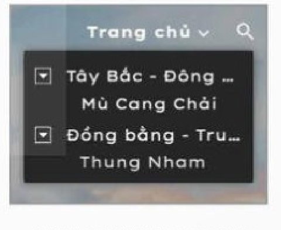
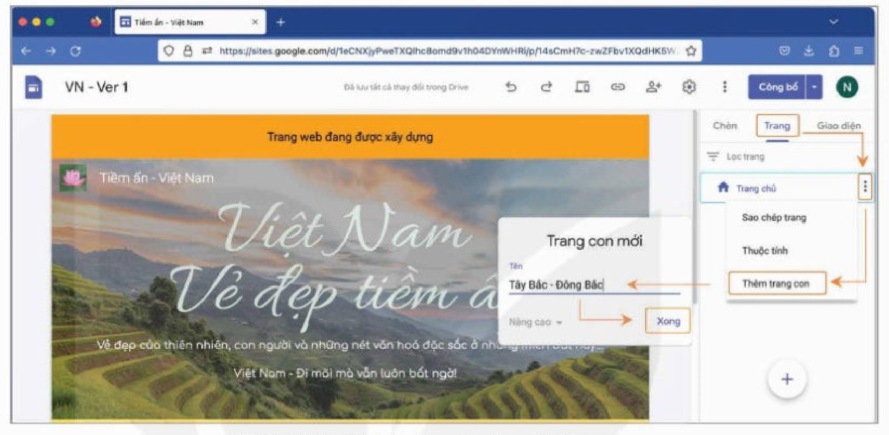
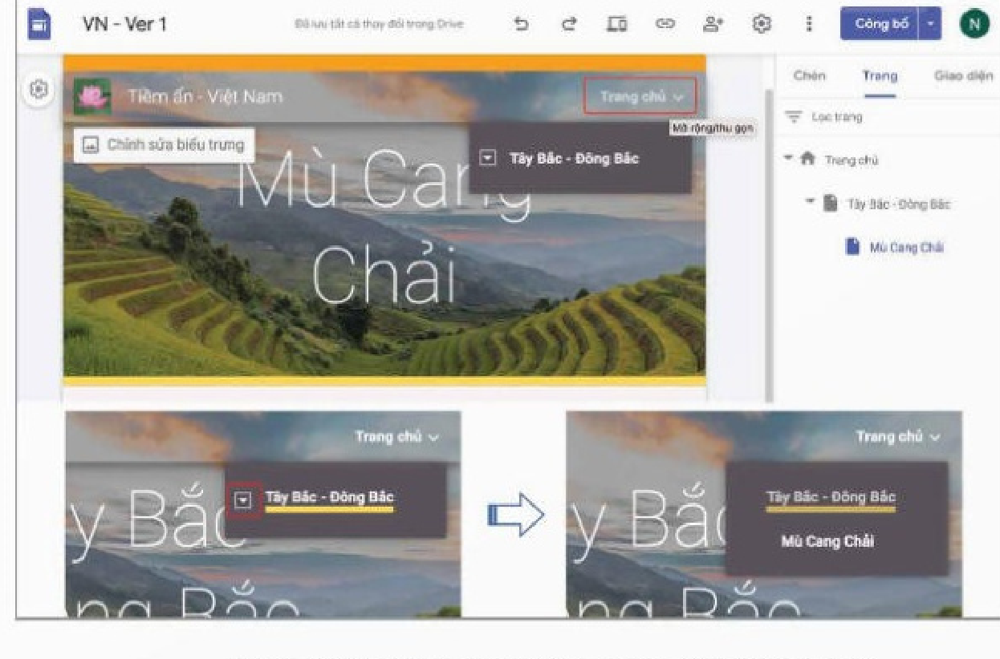
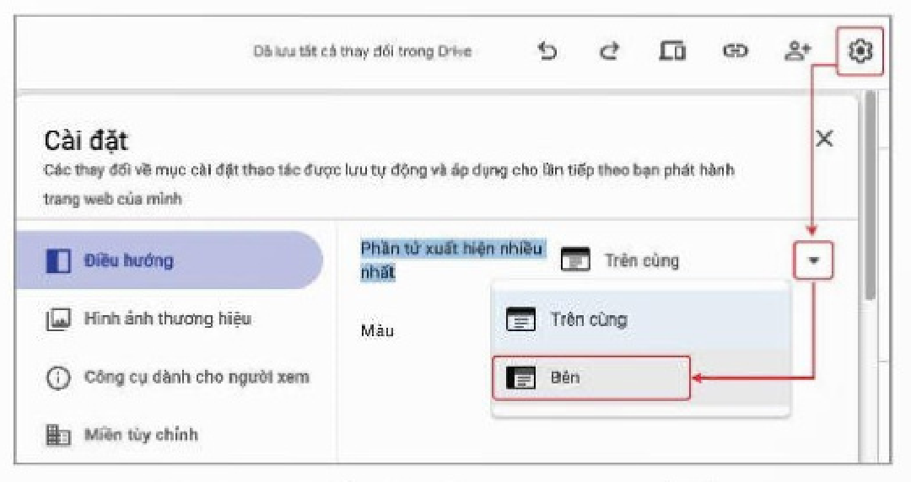
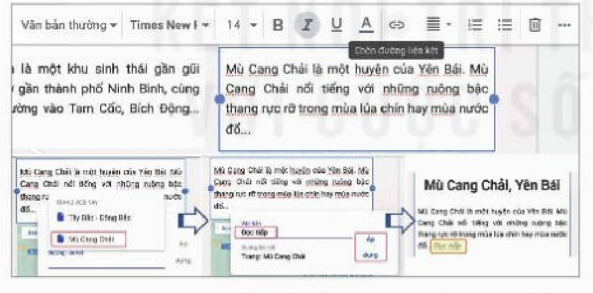

<!-- pdf:146 -->

# BÀI 26: LIÊN KẾT VÀ THANH ĐIỀU HƯỚNG

## 🎯 Sau bài học này em sẽ:

- Biết cách tạo liên kết và thiết lập bảng chọn trên thanh điều hướng với sự hỗ trợ của Google Sites.

## 🔴 Khởi động

> Ở các bài trước, em đã biết cách tạo ra các khối văn bản giới thiệu về các địa danh (Thung Nham, Mù Cang Chải) trong trang web đầu tiên, thường được gọi là **trang chủ** (home page). Nếu nội dung văn bản giới thiệu quá dài người dùng sẽ không dễ dàng đọc tiếp những phần sau. Hơn nữa, độ dài hai bài viết cạnh nhau có thể khác nhau, để lộ ra khoảng trống làm trang web không cân đối. Có giải pháp nào để khắc phục vấn đề này không?

## Nhiệm vụ 1: Tìm hiểu mô hình các trang web liên kết với nhau theo cấu trúc hình cây

*Yêu cầu:* Hiểu được mô hình tổ chức các trang web theo cấu trúc hình cây.

*Hướng dẫn:* Giải pháp hữu hiệu để có thể trình bày đầy đủ văn bản mà không làm hỏng sự cân đối trong trình bày của trang web là tạo ra các trang độc lập và sử dụng các liên kết đến chúng từ phần giới thiệu ở trang chủ. Chẳng hạn, ở trang chủ mỗi địa danh có hình ảnh, tiêu đề cùng ba dòng giới thiệu tóm tắt và kết thúc với *Đọc tiếp*. Cụm từ này được gắn **liên kết** (link) đến trang web với đầy đủ thông tin về địa danh đó. Khi duyệt web, người dùng nháy chuột vào *Đọc tiếp* để mở trang web có đầy đủ thông tin về địa danh tương ứng.

*Hình 26.1. Liên kết từ bài tóm tắt đến trang giới thiệu đầy đủ*

*Hình 26.2. Trang chủ và các trang con*

<!-- term: Trang con -->
Tương tự, trên thanh điều hướng, cũng có thể đưa vào các cụm từ mang liên kết đến các trang khác, làm thành một bảng chọn trên thanh điều hướng. Từ đó xuất hiện khái niệm **trang con**. Các trang web được mở từ bảng chọn của trang chủ được gọi là trang con của trang chủ. Các trang con của trang chủ cũng có thể có các trang con của mình,... (Hình 26.2). Như vậy, các trang web có thể được tổ chức, sắp xếp theo cấu trúc tương tự cây thư mục.

## Nhiệm vụ 2: Tạo và truy cập các trang con

*Yêu cầu:* Xây dựng được các trang con của trang chủ.

<!-- pdf:147 -->

*Hướng dẫn:*

*Bước 1.* Tạo trang con.

<!-- term: Tạo trang con trên Google Sites -->
- Chọn bảng chọn **Trang** trong khung bên phải trong cửa sổ thiết kế của Google Sites. Nháy chuột vào dấu ba chấm dọc cạnh **Trang chủ** và chọn **Thêm trang con**. Nhập tên trang con Tây Bắc – Đông Bắc và chọn **Xong** (Hình 26.3).
- Tương tự, em có thể tạo trang con của trang Tây Bắc – Đông Bắc, chẳng hạn là trang Mù Cang Chải. Ở khung bên phải sẽ xuất hiện trang chủ và trang con Tây Bắc – Đông Bắc của trang chủ và trang con Mù Cang Chải của trang Tây Bắc – Đông Bắc (Hình 26.4).

*Hình 26.3. Trình tự thao tác tạo các trang con*

*Bước 2.* Truy cập các trang.

- Trong giao diện thiết kế trang web, đưa con trỏ chuột đến **Trang chủ**, sẽ có bảng chọn mở ra với lựa chọn Tây Bắc – Đông Bắc. Nháy chuột vào biểu tượng mũi tên bên trái Tây Bắc – Đông Bắc, sẽ thấy lựa chọn Mù Cang Chải (Hình 26.4).
- Muốn truy cập một trang con thì nháy chuột vào tên trang đó ở bảng chọn được mở ra từ **Trang chủ**.

*Hình 26.4. Truy cập bảng chọn của trang web*

<!-- pdf:148 -->

<!-- term: Chế độ điều hướng trên Google Sites -->
- Google Sites tự động điều chỉnh giao diện trang web khi người dùng truy cập bằng điện thoại hay máy tính bảng. Theo đó, bảng chọn trên thanh điều hướng được tự động chuyển sang phía phải, ngay trước logo của trang và có dạng ba gạch ngang. Nếu muốn bảng chọn này hiển thị trên máy tính giống như trên điện thoại thì chọn **Cài đặt** $\rightarrow$ **Điều hướng** $\rightarrow$ **Phần tử xuất hiện nhiều nhất** $\rightarrow$ **Bên** (Hình 26.5).

*Hình 26.5. Thiết lập bảng chọn dạng như trên điện thoại*

*Bước 3.* Thêm nội dung cho các trang con.

- Các trang Tây Bắc – Đông Bắc, Mù Cang Chải đã được khởi tạo nhưng chưa có nội dung. Phần đầu của các trang này được tạo tự động với hình nền của trang chủ và tiêu đề tương ứng là Tây Bắc – Đông Bắc hay Mù Cang Chải.
- Công việc tiếp theo phải làm là chỉnh sửa phần đầu các trang này và thêm vào nội dung. Chẳng hạn, vì là các trang con nên giảm chiều cao của phần đầu trang, thay hình nền để phân biệt. Trang Mù Cang Chải chứa thông tin đầy đủ chi tiết về Mù Cang Chải bao gồm văn bản, hình ảnh, âm thanh, video,... Trang Tây Bắc – Đông Bắc sẽ chứa thông tin giới thiệu khái quát về vùng Tây Bắc – Đông Bắc.

*Bước 4.* Tạo liên kết trong bài giới thiệu.

<!-- term: Chèn đường liên kết trên Google Sites -->
- Mở trang chủ, nháy chuột ở cuối đoạn giới thiệu về Mù Cang Chải, nháy chuột vào biểu tượng liên kết (chèn đường liên kết). Chọn đường liên kết là trang **Mù Cang Chải**, nhập **Đọc tiếp** vào ô **Văn bản**, nháy chuột chọn **Áp dụng** (Hình 26.6).

*Hình 26.6. Gắn liên kết vào bài viết*

- Hãy lập trang con Đồng bằng – Trung du Bắc bộ và lập trang con Thung Nham của trang này.
- Tạo liên kết trong bài Thung Nham ở trang chủ đến trang Thung Nham.

## ✏️ Luyện tập

- Hãy tạo trang con Tây Nguyên của trang chủ và tạo trang con Bản Đôn của trang Tây Nguyên.
- Viết vài dòng giới thiệu ngắn về Bản Đôn ở trang chủ và tạo liên kết đến trang Bản Đôn.

## 🚀 Vận dụng

Xây dựng các trang con Ca khúc, Nhạc sĩ, Ca sĩ cho đề tài các trang web “Những bài ca đi cùng năm tháng”.

## 📷 Danh mục hình ảnh

| Mã hình | Trang PDF | Vị trí trong bài | Chú thích gốc |
| --- | --- | --- | --- |
| H12-tin_hoc_thud-b26-01 | 146 | Nhiệm vụ 1 | Hình 26.1. Liên kết từ bài tóm tắt đến trang giới thiệu đầy đủ |
| H12-tin_hoc_thud-b26-02 | 146 | Nhiệm vụ 1 | Hình 26.2. Trang chủ và các trang con |
| H12-tin_hoc_thud-b26-03 | 147 | Nhiệm vụ 2, Bước 1 | Hình 26.3. Trình tự thao tác tạo các trang con |
| H12-tin_hoc_thud-b26-04 | 147 | Nhiệm vụ 2, Bước 2 | Hình 26.4. Truy cập bảng chọn của trang web |
| H12-tin_hoc_thud-b26-05 | 148 | Nhiệm vụ 2, Bước 2 | Hình 26.5. Thiết lập bảng chọn dạng như trên điện thoại |
| H12-tin_hoc_thud-b26-06 | 148 | Nhiệm vụ 2, Bước 4 | Hình 26.6. Gắn liên kết vào bài viết |
