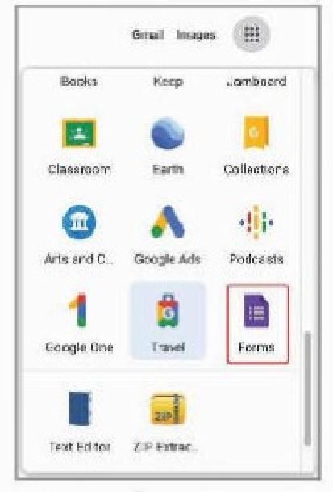
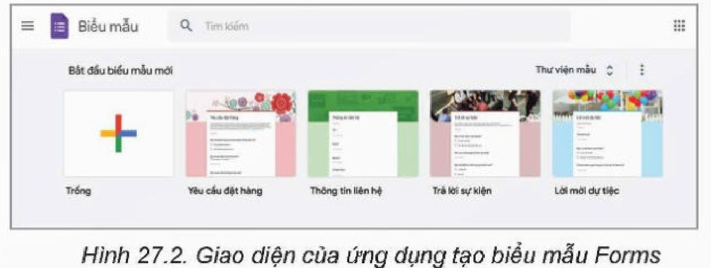
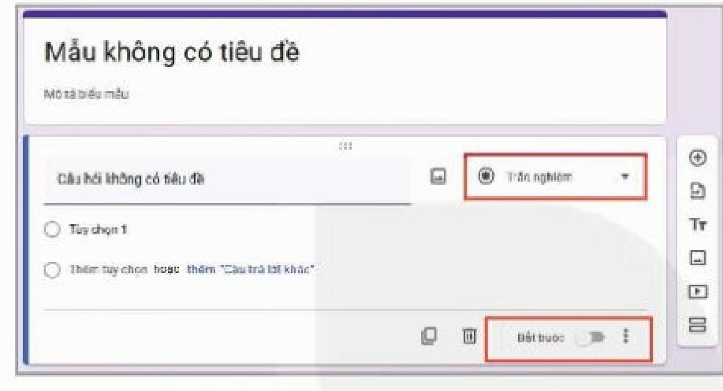
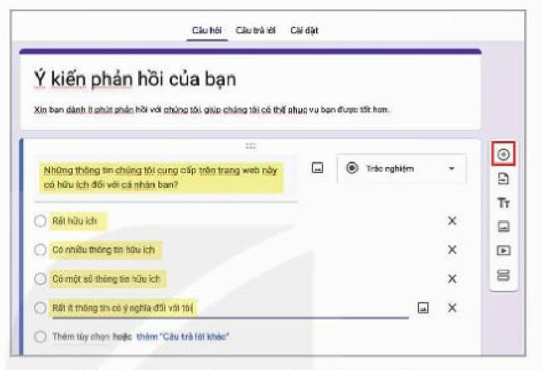
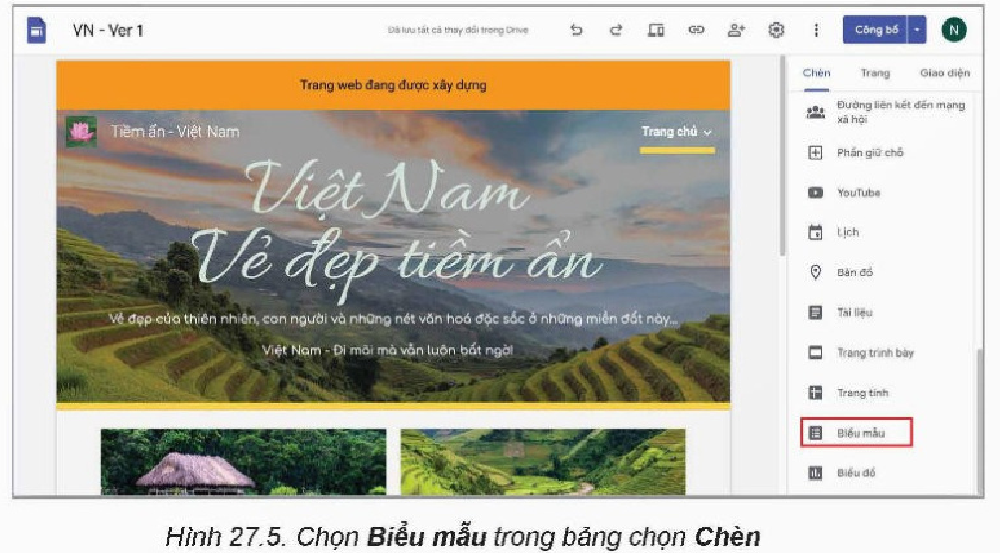
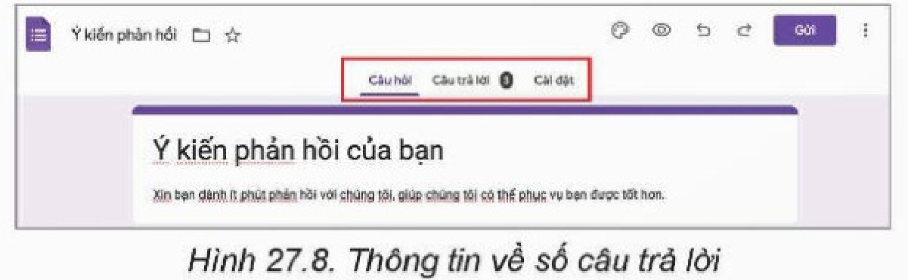
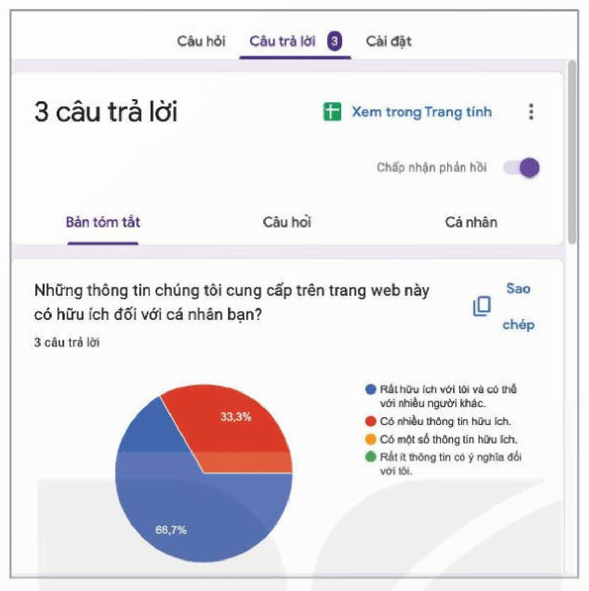
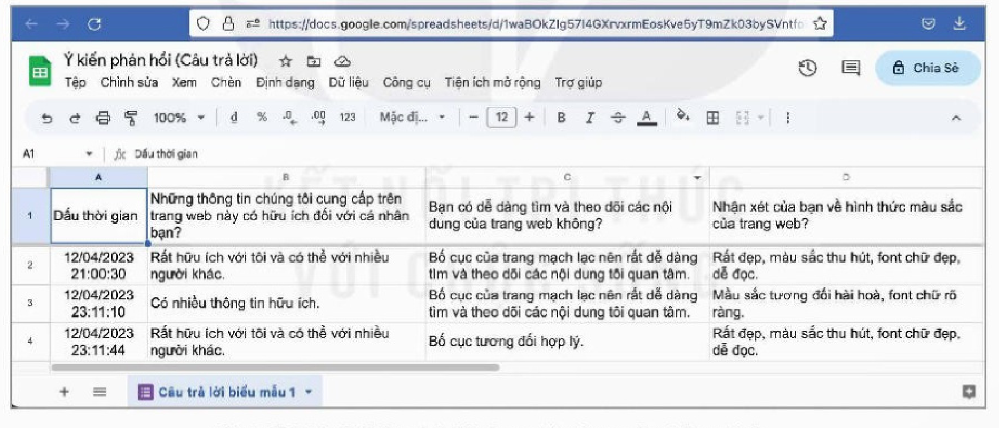

<!-- pdf:149 -->

# BÀI 27: BIỂU MẪU TRÊN TRANG WEB

## 🎯 Sau bài học này em sẽ:

- Biết cách tạo các biểu mẫu cho trang web và lấy kết quả từ biểu mẫu với hỗ trợ của Google Sites.

## 🔴 Khởi động

> Em đã từng nhập thông tin vào biểu mẫu trên trang web như tra cứu điểm thi vào lớp 10 hay đăng nhập thư điện tử. Trang web có biểu mẫu lấy ý kiến phản hồi của bạn đọc để giúp trang web hoàn thiện hơn hoặc về một vấn đề gì đó. Việc tạo biểu mẫu trên trang web được thực hiện như thế nào?

## Nhiệm vụ 1: Tạo biểu mẫu

Việc tạo **biểu mẫu** (form) trên trang web để lấy ý kiến phản hồi của người dùng về bản chất là tạo biểu mẫu bằng ứng dụng **Forms** của Google rồi *nhúng vào trang web được thiết kế bằng Google Sites*.

*Yêu cầu:* Xây dựng được biểu mẫu với ứng dụng Forms (biểu mẫu) trong Google.

*Hướng dẫn:*

*Bước 1.* Chuẩn bị biểu mẫu.

Trước hết phải chuẩn bị biểu mẫu là một bộ câu hỏi, có thể là các câu hỏi trắc nghiệm hoặc là câu trả lời ngắn. Ví dụ về một câu hỏi như sau:

Những thông tin chúng tôi cung cấp trên trang web này có hữu ích đối với bạn không?

A. Rất hữu ích với tôi và có thể với nhiều người khác.

B. Có nhiều thông tin hữu ích.

C. Có một số thông tin hữu ích.

D. Rất ít thông tin có ý nghĩa đối với tôi.

*Bước 2.* Tìm hiểu giao diện ứng dụng Forms.

Vào kho ứng dụng của Google, chọn ứng dụng **Forms** (Hình 27.1). Giao diện của Forms tương tự Google Sites. Có thể chọn một trong số kiểu biểu mẫu được tạo sẵn như: **Yêu cầu đặt hàng**, **Thông tin liên hệ**,... (Hình 27.2).

*Hình 27.1. Ứng dụng Forms của Google*

*Hình 27.2. Giao diện của ứng dụng tạo biểu mẫu Forms*

<!-- pdf:150 -->

*Bước 3.* Tạo biểu mẫu.

<!-- term: Tạo câu hỏi trong Google Forms -->
- Để tạo một biểu mẫu mới, nháy chuột vào biểu tượng dấu cộng nhiều màu.
- Biểu mẫu mới không có tiêu đề được khởi tạo. Nháy chuột vào **Mẫu không có tiêu đề** để nhập tiêu đề của biểu mẫu (chẳng hạn, Ý kiến phản hồi của bạn). Sau đó nhập mô tả ngắn gọn về mẫu.
- Tạo câu hỏi: Chọn câu hỏi **Trắc nghiệm**, bật kiểu câu hỏi là **Bắt buộc**. Sau đó nhập câu hỏi. Nháy chuột vào **Tuỳ chọn 1** và nhập nội dung cho tuỳ chọn 1. Nháy chuột vào **Thêm tuỳ chọn hoặc thêm “Câu trả lời khác”** để thêm tuỳ chọn khác (Hình 27.3).

*Hình 27.3. Giao diện tạo biểu mẫu mới và nhập câu hỏi*

*Hình 27.4. Thêm câu hỏi mới trong biểu mẫu*

- Nháy chuột chọn nút dấu cộng trong bảng chọn bên phải để tiếp tục nhập câu hỏi khác tương tự (Hình 27.4).

## Nhiệm vụ 2: Nhúng biểu mẫu vào trang web

*Yêu cầu:* Nhúng được Forms trong Google vào trang web.

*Hướng dẫn:*

Để nhúng biểu mẫu đã tạo vào cuối trang chủ, ta thực hiện như sau:

<!-- term: Nhúng biểu mẫu vào trang web -->
- Mở trang chủ. Nháy chuột vào nút lệnh **Biểu mẫu** trong bảng chọn **Chèn** (Hình 27.5).

*Hình 27.5. Chọn Biểu mẫu trong bảng chọn Chèn*

<!-- pdf:151 -->

<!-- term: Nhúng biểu mẫu vào trang web -->
- Chọn biểu mẫu Ý kiến phản hồi của bạn, nháy chuột vào nút **Chèn** ở góc dưới bên phải (Hình 27.6).

*Hình 27.6. Chèn biểu mẫu vào trang web*

- Biểu mẫu sẽ được thêm vào cuối trang chủ (Hình 27.7).
- Xuất bản trang web.
- Mở trang web bằng địa chỉ URL, trả lời các câu hỏi trong biểu mẫu Ý kiến phản hồi của bạn.

*Hình 27.7. Biểu mẫu trong trang web*

## Nhiệm vụ 3: Xem dữ liệu thống kê phản hồi

*Yêu cầu:* Biết cách xem dữ liệu thống kê phản hồi.

*Hướng dẫn:*

Để xem và thống kê ý kiến phản hồi của người dùng sau khi trang web được xuất bản, cần thực hiện các bước như sau:

- Mở ứng dụng **Forms** và mở lại biểu mẫu Ý kiến phản hồi của bạn.
- Dòng đầu tiên có thông tin về số câu trả lời cho biểu mẫu này.

*Hình 27.8. Thông tin về số câu trả lời*

<!-- term: Thống kê phản hồi trong Google Forms -->
Nháy chuột vào **Câu trả lời** để xem chi tiết: Bản tóm tắt thống kê câu trả lời dạng biểu đồ, **Câu hỏi** cho biết thông tin chi tiết cho từng câu hỏi, **Cá nhân** cho biết thông tin chi tiết về câu trả lời của từng người (Hình 27.9) hay chọn **Xem trong trang tính** để thấy được toàn bộ (Hình 27.10).

<!-- pdf:152 -->

*Hình 27.9. Thống kê về phương án trả lời cho từng câu hỏi*

*Hình 27.10. Dữ liệu trả lời được tập hợp vào bảng tính*

## ✏️ Luyện tập

Tìm hiểu và cho nhận xét về một số biểu mẫu được thiết kế sẵn trong Hình 27.2.

## 🚀 Vận dụng

Tiếp tục đề tài làm các trang web “Những bài ca đi cùng năm tháng”, hãy tạo biểu mẫu thu thập ý kiến người dùng để có thể phát triển các trang web tốt hơn.

## 📷 Danh mục hình ảnh

| Mã hình | Trang PDF | Vị trí trong bài | Chú thích gốc |
| --- | --- | --- | --- |
| H12-tin_hoc_thud-b27-01 | 149 | Nhiệm vụ 1, Bước 2 | Hình 27.1. Ứng dụng Forms của Google |
| H12-tin_hoc_thud-b27-02 | 149 | Nhiệm vụ 1, Bước 2 | Hình 27.2. Giao diện của ứng dụng tạo biểu mẫu Forms |
| H12-tin_hoc_thud-b27-03 | 150 | Nhiệm vụ 1, Bước 3 | Hình 27.3. Giao diện tạo biểu mẫu mới và nhập câu hỏi |
| H12-tin_hoc_thud-b27-04 | 150 | Nhiệm vụ 1, Bước 3 | Hình 27.4. Thêm câu hỏi mới trong biểu mẫu |
| H12-tin_hoc_thud-b27-05 | 150 | Nhiệm vụ 2 | Hình 27.5. Chọn Biểu mẫu trong bảng chọn Chèn |
| H12-tin_hoc_thud-b27-06 | 151 | Nhiệm vụ 2 | Hình 27.6. Chèn biểu mẫu vào trang web |
| H12-tin_hoc_thud-b27-07 | 151 | Nhiệm vụ 2 | Hình 27.7. Biểu mẫu trong trang web |
| H12-tin_hoc_thud-b27-08 | 151 | Nhiệm vụ 3 | Hình 27.8. Thông tin về số câu trả lời |
| H12-tin_hoc_thud-b27-09 | 152 | Nhiệm vụ 3 | Hình 27.9. Thống kê về phương án trả lời cho từng câu hỏi |
| H12-tin_hoc_thud-b27-10 | 152 | Nhiệm vụ 3 | Hình 27.10. Dữ liệu trả lời được tập hợp vào bảng tính |
