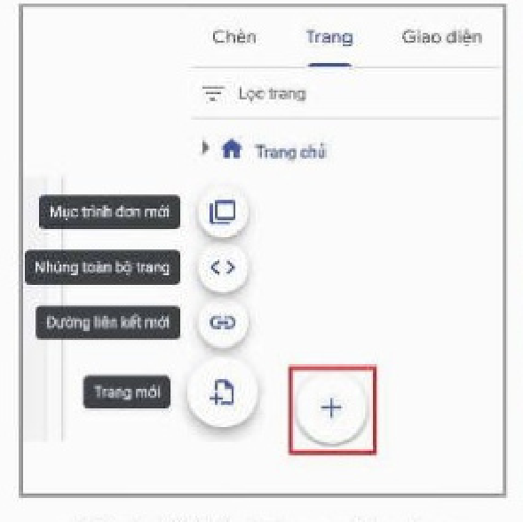
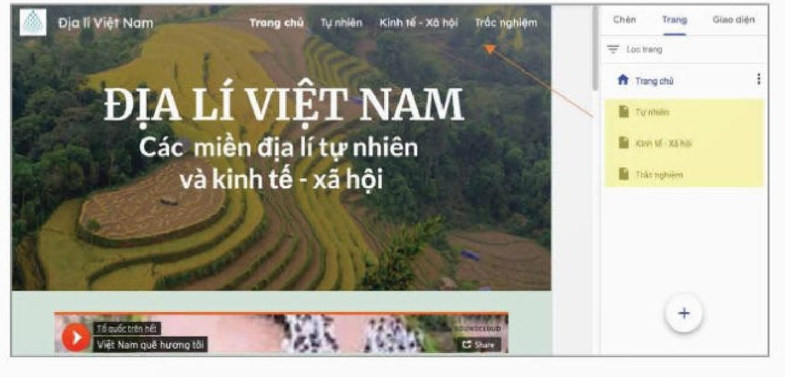
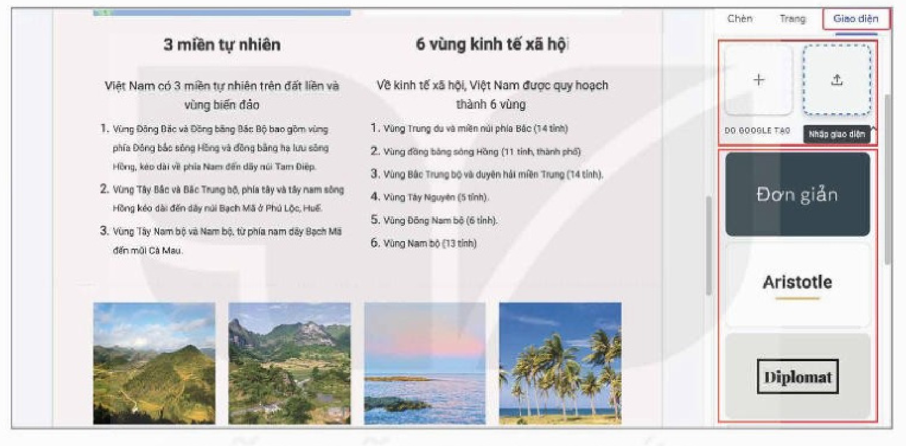
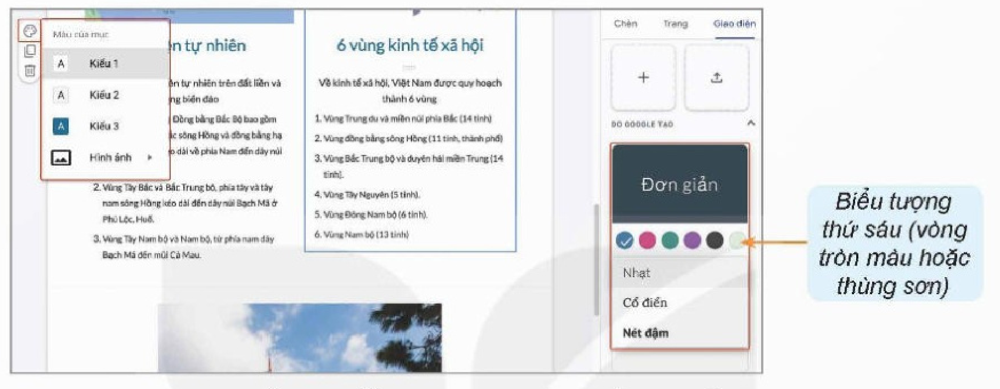
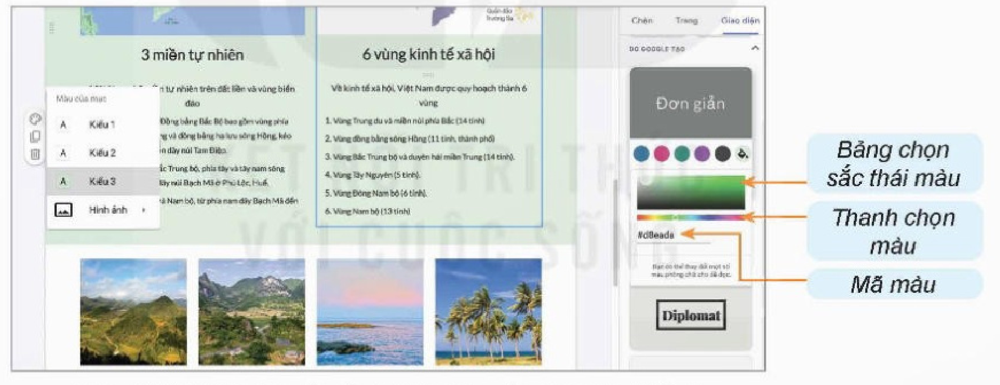

<!-- pdf:153 -->

# BÀI 28: THỰC HÀNH TỔNG HỢP

## 🎯 Sau bài học này em sẽ:

- Biết cách vận dụng kiến thức đã học để xây dựng hoàn chỉnh một website. Qua đó hoàn thiện kĩ năng sử dụng Google Sites để xây dựng các trang web trong tương lai.

## 🔴 Khởi động

> Em đã được học qua từng bài học về các bước chuẩn bị xây dựng một trang web, cách thực hiện từng phần trang web, kĩ thuật làm bảng chọn, làm biểu mẫu,... vấn đề còn lại là khả năng vận dụng tất cả những kiến thức đã học ấy một cách sáng tạo, phù hợp để xây dựng hoàn chỉnh các trang web. Em có thể tóm tắt quy trình chung xây dựng một trang web thành các bước theo một trình tự mà em cho là hợp lí và xây dựng hoàn chỉnh các trang web cho một chủ đề em lựa chọn không?

## KHÁI QUÁT NHIỆM VỤ VÀ YÊU CẦU
<!-- ocr-ok: đã đối chiếu ảnh trang 153, tiêu đề màu xanh bị OCR mất dấu thanh -->

Lựa chọn chủ đề và xây dựng hoàn chỉnh các trang web theo chủ đề đã chọn. Sản phẩm thu được phải đáp ứng các yêu cầu sau:

- Nội dung: Bao gồm các tư liệu đa phương tiện với ít nhất 3 đến 4 bài viết ngắn gọn.
- Bố cục: Bố cục nội dung và hình thức hợp lí.
- Hình thức: Sử dụng màu sắc và phông chữ hợp lí.
- Yêu cầu khác:
  - Tất cả các trang web đều có dữ liệu đa phương tiện, không phải trang văn bản thuần chữ. Có bảng chọn ở thanh điều hướng để đi tới các trang con. Có liên kết trong bài viết tới các trang khác của website hoặc tới các trang trên Internet. Có biểu mẫu với nội dung hợp lí.
  - Thuyết minh sản phẩm: Dưới dạng một bài giới thiệu ngắn gọn về mục đích, ý nghĩa của sản phẩm cùng các yêu cầu đã đạt được.

## Nhiệm vụ 1: Lựa chọn chủ đề

*Yêu cầu:* Lựa chọn được chủ đề phù hợp.

*Hướng dẫn:* Có thể làm việc cá nhân hoặc làm việc nhóm (không quá 3 người).

Chọn chủ đề của website: không nên quá rộng, đối tượng người dùng cũng nên hạn chế, những yêu cầu vừa phải, có thể nhanh chóng chuẩn bị tư liệu và dùng Google Sites thực hiện được trong khoảng thời gian 3 tiết thực hành trên lớp.

Xung quanh môi trường sống, học tập của em có rất nhiều chủ đề để em có thể lựa chọn. *Lớp 12A thân yêu của chúng tôi, Những kỉ niệm THPT, Lưu bút trước ngày tốt nghiệp THPT,...* là những chủ đề có ý nghĩa mà các em có thể nhớ mãi sau này. Đề tài về môn học mà em yêu thích cũng là một gợi ý thú vị. Ngoài chủ đề về trường học, thì chủ đề về quê hương, xóm nhỏ, ngõ phố của em hay gia đình em,... nơi nuôi dưỡng em trưởng thành cũng có thể rất sinh động vì chắc chắn được em dành nhiều tình cảm từ sâu thẳm trái tim mình.

<!-- pdf:154 -->

## Nhiệm vụ 2: Thực hiện các bước chuẩn bị

*Yêu cầu:* Vận dụng kiến thức đã học để thực hiện việc phân tích thiết kế các trang web.

*Hướng dẫn:*

Em cần thực hiện tất cả các bước phân tích, định hình ý tưởng, thiết kế và chuẩn bị tư liệu như ở Bài 23. Ví dụ, với chủ đề xây dựng website giới thiệu về địa lí Việt Nam.

**Đối tượng sử dụng:** Nên xác định là các bạn học sinh yêu thích địa lí, cùng lứa tuổi; kiến thức địa lí giới hạn trong chương trình địa lí bậc phổ thông, cùng với một số kiến thức khác được tìm hiểu thêm qua sách báo và Internet. Do khối lượng kiến thức về địa lí Việt Nam trong chương trình phổ thông cũng đã rất lớn, nên chủ đề được lựa chọn sẽ chỉ giới hạn theo hướng thể hiện một cách trình bày mới về các miền (vùng) địa lí tự nhiên, kinh tế xã hội với những minh hoạ trực quan sinh động, dễ nhớ, dễ hiểu, có tương tác với người dùng.

**Dàn ý nội dung:** Có hai phần nội dung là địa lí tự nhiên và địa lí kinh tế – xã hội. Phần thứ ba là các câu hỏi trắc nghiệm kiểm tra hiểu biết địa lí của người dùng.

- Về địa lí tự nhiên cần chỉ ra các miền (vùng) tự nhiên (có các đặc điểm địa hình, khí hậu, động thực vật đặc trưng) trên phần đất liền của Việt Nam, đường phân định các miền và minh hoạ một cách trực quan sinh động dễ hiểu, dễ nhớ nhất. Đi sâu hơn có thể giới thiệu các đặc điểm địa hình, khí hậu, động thực vật của từng miền. Không đặt ra mục tiêu giới thiệu các tiểu vùng trong từng miền và những đặc điểm,...
- Tương tự, về địa lí kinh tế – xã hội, cần chỉ ra các vùng kinh tế và các nội dung liên quan.
- Lưu ý cần có trang web riêng về các vùng biển đảo, đặc biệt đối với các quần đảo Hoàng Sa, Trường Sa: có vị trí địa lí, đơn vị hành chính, tỉnh trực thuộc.
- Phần trắc nghiệm kiến thức: Đưa ra bộ câu hỏi trắc nghiệm về kiến thức địa lí.

**Bố cục:**

- Trang chủ với hai khối nội dung giới thiệu khái quát về các miền địa lí tự nhiên và các vùng kinh tế – xã hội. Để trang chủ được sinh động, hấp dẫn bạn đọc, có thể sử dụng ảnh nền có hình bản đồ Việt Nam và đưa vào những bản nhạc ca ngợi quê hương đất nước con người Việt Nam cùng tập hợp các ảnh đẹp về các vùng miền mà em sưu tầm và được phép sử dụng.
- Trên thanh điều hướng có bảng chọn **Trang chủ**, **Địa lí Tự nhiên**, **Địa lí Kinh tế – Xã hội**, **Trắc nghiệm**. Mỗi lựa chọn sẽ dẫn đến những trang với nội dung tương ứng.

**Về màu sắc và phông chữ:** Chọn bảng màu nhẹ nhàng và tươi tắn. Sử dụng phông chữ Sans Serif, các kích thước 10, 12, 18. Kích thước và màu sắc của tiêu đề trên ảnh nền có thể thay đổi cho phù hợp.

**Chuẩn bị tư liệu:**

- Cần chuẩn bị tư liệu bản đồ cho thấy vị trí lãnh thổ của Việt Nam trong khu vực. Có đường ranh giới các miền địa lí tự nhiên và các vùng địa lí kinh tế – xã hội. Các bài viết khái quát về các miền (vùng) này. Các tư liệu hình ảnh liên quan về địa hình, động, thực vật đặc trưng cũng như về hoạt động kinh tế – xã hội của từng miền (vùng) này. Chuẩn bị một số bản nhạc có thể đưa vào trang chủ và các trang khác.
- Chuẩn bị bộ câu hỏi trắc nghiệm cho phần trắc nghiệm kiến thức.
- Chuẩn bị logo, favicon và ảnh nền. Lựa chọn và ấn định tên trang, tiêu đề trang.

**Phần mềm thực hiện:** Google Sites.

<!-- pdf:155 -->

## Nhiệm vụ 3: Xây dựng các trang web theo chủ đề đã lựa chọn

*Yêu cầu:* Sử dụng Google Sites để xây dựng các trang web.

*Hướng dẫn:* Từng bước thực hiện xây dựng các phần của trang chủ và các trang khác theo hướng dẫn trong các bài học trước. Sau đây là một vài gợi ý để thay đổi hình thức hiển thị bảng chọn trên thanh điều hướng và sử dụng các mẫu giao diện có sẵn của Google Sites.

*Bước 1.* Xây dựng bảng chọn trên thanh điều hướng theo chiều ngang.

<!-- term: Bảng chọn trên thanh điều hướng theo chiều ngang -->
Ở Bài 26, em đã được học cách thiết lập các trang con của trang chủ và tổ chức bảng chọn **Trang chủ** với cấu trúc đổ xuống theo chiều dọc. Quan sát nhiều trang web trên Internet, có thể em muốn thực hiện bảng chọn trải ra theo chiều ngang trên thanh điều hướng (Hình 28.1). Thực hiện việc này như thế nào?

*Hình 28.1. Trang web Địa lí Việt Nam có bảng chọn theo chiều ngang và bản nhạc “Việt Nam quê hương tôi” ở đầu phần thân trang*

<!-- term: Bảng chọn trên thanh điều hướng theo chiều ngang -->
Hãy tạo các trang mới: Tự nhiên, Kinh tế – Xã hội và Trắc nghiệm cùng cấp với **Trang chủ**.

Cách thực hiện như sau:

<!-- term: Bảng chọn trên thanh điều hướng theo chiều ngang -->
- Trong bảng chọn **Trang**, nháy chuột vào dấu cộng để thêm **Trang mới** (Hình 28.2).
- Nhập tên của trang mới rồi chọn nút lệnh **Xong**.

Sau khi tạo thêm ba trang Tự nhiên, Kinh tế – Xã hội và Trắc nghiệm em được kết quả như Hình 28.3.

*Hình 28.2. Thao tác tạo trang mới*

*Hình 28.3. Kết quả hiển thị sau khi tạo ba trang mới*

<!-- pdf:156 -->

*Lưu ý:* Trong giao diện bảng chọn **Trang**, em có thể thực hiện thao tác kéo thả để di chuyển, thay đổi trình tự và mức hiển thị trang trong cấu trúc cây các trang như di chuyển thư mục trong cây thư mục.

*Bước 2.* Sử dụng các mẫu giao diện có sẵn của Google Sites.

**Mẫu giao diện** là một tập hợp các quy định về bảng màu, phông chữ, thiết kế đầu trang,... Khi đã chọn một mẫu thì toàn bộ giao diện sẽ được điều khiển hiển thị mặc định, thống nhất theo các quy định của mẫu đó. Tuy nhiên vẫn có thể thay đổi riêng về màu sắc, phông chữ của một phần nào đó trong quá trình thiết lập.

Google Sites đã có sẵn một số mẫu giao diện, mỗi mẫu có định dạng cụ thể về thiết kế đầu trang cùng các định dạng:

- Bảng màu có 3 màu, trong đó 2 màu cố định (tông nhẹ) và 1 màu (tông đậm) có thể điều chỉnh.
- Phông chữ với 3 phông và kiểu cố định.

*Hình 28.4. Bảng chọn Giao diện*

<!-- term: Bảng chọn Giao diện trong Google Sites -->
Nháy chuột vào bảng chọn **Giao diện** của bảng chọn bên phải cửa sổ để mở bảng chọn **Giao diện** (Hình 28.4). Bảng chọn này gồm hai nhóm:
- Nhóm thứ nhất có hai lựa chọn để người dùng có thể tự thiết kế mẫu hoặc tải mẫu có sẵn lên.
- Nhóm thứ hai là các mẫu có sẵn của Google Sites (Hình 28.4).

Thao tác chọn mẫu có sẵn của Google Sites gồm các bước sau:

- Nháy chuột vào một trong các mẫu có sẵn để chọn, ví dụ mẫu **Đơn giản**.
- Nháy chuột lần lượt vào 5 hình tròn các màu phía dưới và quan sát để thấy màu sắc của trang lần lượt thay đổi theo các màu đó. Chọn một màu ưng ý.
- Tương tự, em chọn 1 trong 3 phông chữ được ấn định sẵn.
- Đưa con trỏ chuột vào vùng bất kì của trang, để nhìn thấy bảng chọn tắt xuất hiện ở bên trái. Khi nháy chuột vào bảng chọn màu, em có thể chọn 1 trong 3 kiểu hiển thị màu khác nhau Kiểu 1, Kiểu 2, Kiểu 3 (Hình 28.5).

Khi chọn hiển thị màu của trang theo Kiểu 3, nếu em nháy chuột vào vị trí thứ sáu (hình tròn màu hoặc thùng sơn) ở mẫu **Đơn giản** (Hình 28.6), giao diện điều chỉnh màu sẽ hiện ra cho phép em tiếp tục thực hiện các thao tác sau để điều chỉnh màu thứ ba của bảng màu:

<!-- pdf:157 -->

- Khi nháy chuột vào một điểm trên thanh chọn màu em sẽ thấy sự thay đổi màu sắc của trang, cũng như giá trị mã màu phía dưới. Hãy chọn một điểm màu trên thanh chọn màu.
- Khi nháy chuột vào một điểm trên bảng chọn sắc thái màu em cũng sẽ thấy sự thay đổi màu sắc của trang, cũng như giá trị mã màu phía dưới. Hãy chọn một điểm trên bảng chọn sắc thái màu.

Thực hiện kết hợp luân phiên hai bước trên cho tới khi em thấy màu sắc trên trang hiển thị như mong muốn.

*Hình 28.5. Minh hoạ về chọn mẫu Đơn giản và chọn kiểu màu sắc*

*Hình 28.6. Minh hoạ về điều chỉnh màu sắc cho màu Kiểu 3*
<!-- ocr-ok: đã đối chiếu ảnh trang 157, chú thích Hình 28.6 bị OCR bỏ sót -->

## ✏️ Luyện tập

Thực hiện các thao tác kéo thả để thay đổi vị trí và mức hiển thị của một trang so với các trang khác.

## 🚀 Vận dụng

Tiếp tục với đề tài “Những bài ca đi cùng năm tháng”, vận dụng những kiến thức tiếp thu được ở Nhiệm vụ 3, hãy thiết lập bảng chọn trên thanh điều hướng theo chiều ngang. Lựa chọn mẫu giao diện cho phù hợp.

## 📷 Danh mục hình ảnh

| Mã hình | Trang PDF | Vị trí trong bài | Chú thích gốc |
| --- | --- | --- | --- |
| H12-tin_hoc_thud-b28-01 | 155 | Nhiệm vụ 3, Bước 1 | Hình 28.1. Trang web Địa lí Việt Nam có bảng chọn theo chiều ngang và bản nhạc “Việt Nam quê hương tôi” ở đầu phần thân trang |
| H12-tin_hoc_thud-b28-02 | 155 | Nhiệm vụ 3, Bước 1 | Hình 28.2. Thao tác tạo trang mới |
| H12-tin_hoc_thud-b28-03 | 155 | Nhiệm vụ 3, Bước 1 | Hình 28.3. Kết quả hiển thị sau khi tạo ba trang mới |
| H12-tin_hoc_thud-b28-04 | 156 | Nhiệm vụ 3, Bước 2 | Hình 28.4. Bảng chọn Giao diện |
| H12-tin_hoc_thud-b28-05 | 157 | Nhiệm vụ 3, Bước 2 | Hình 28.5. Minh hoạ về chọn mẫu Đơn giản và chọn kiểu màu sắc |
| H12-tin_hoc_thud-b28-06 | 157 | Nhiệm vụ 3, Bước 2 | Hình 28.6. Minh hoạ về điều chỉnh màu sắc cho màu Kiểu 3 |
