<!-- pdf:7 -->

<!-- Phần giới thiệu Chương I (in chung đầu trang PDF 7): CHƯƠNG I. ỨNG DỤNG ĐẠO HÀM ĐỂ KHẢO SÁT VÀ VẼ ĐỒ THỊ HÀM SỐ -->

Trong chương này chúng ta ứng dụng đạo hàm để khảo sát sự biến thiên, vẽ đồ thị của hàm số và giải quyết những vấn đề thực tiễn liên quan.

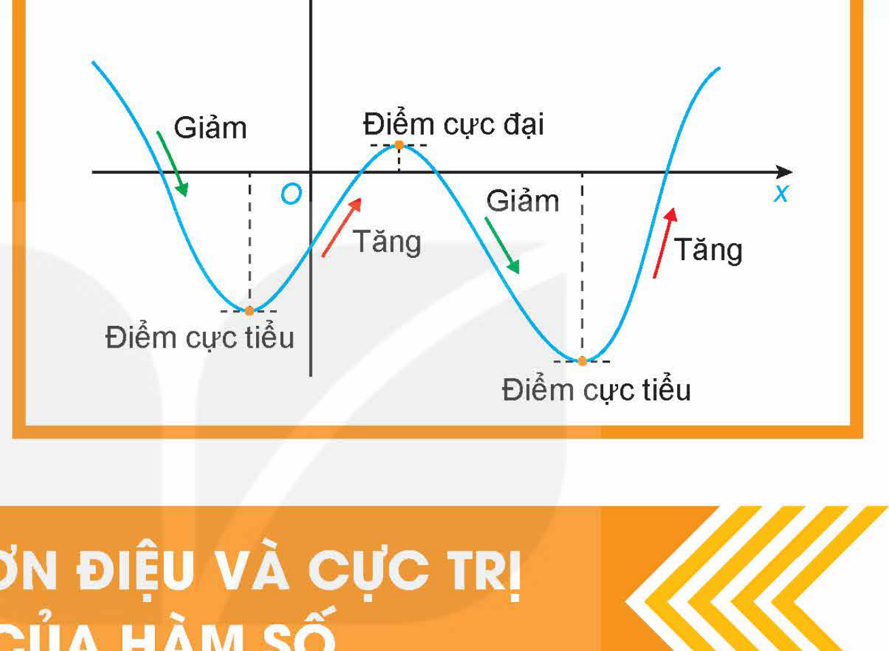

# BÀI 1: TÍNH ĐƠN ĐIỆU VÀ CỰC TRỊ CỦA HÀM SỐ

## 🔤 Thuật ngữ

- Bảng biến thiên
- Đồng biến
- Nghịch biến
- Cực đại
- Cực tiểu
- Cực trị

## 🎯 Mục tiêu

- Nhận biết tính đồng biến, nghịch biến của một hàm số trên một khoảng dựa vào dấu đạo hàm cấp một của nó.
- Thể hiện tính đồng biến, nghịch biến của hàm số trong bảng biến thiên.
- Nhận biết tính đơn điệu của hàm số thông qua bảng biến thiên hoặc thông qua hình ảnh hình học của đồ thị hàm số.
- Nhận biết điểm cực trị, giá trị cực trị của hàm số thông qua bảng biến thiên hoặc thông qua hình ảnh hình học của đồ thị hàm số.

## 🔴 Mở đầu

Xét một chất điểm chuyển động trên một trục số nằm ngang, chiều dương từ trái sang phải (H.1.1). Giả sử vị trí $s(t)$ (mét) của chất điểm trên trục số đã chọn tại thời điểm $t$ (giây) được cho bởi công thức

$s(t) = t^3 - 9t^2 + 15t, \ t \ge 0.$

Hỏi trong khoảng thời gian nào thì chất điểm chuyển động sang phải, trong khoảng thời gian nào thì chất điểm chuyển động sang trái?

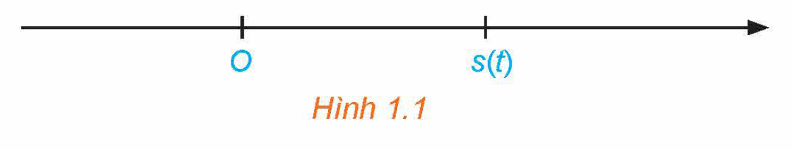
*Hình 1.1*

<!-- pdf:8 -->

## 1. TÍNH ĐƠN ĐIỆU CỦA HÀM SỐ

**a) Khái niệm tính đơn điệu của hàm số**

**HĐ1:** Nhận biết tính đồng biến, nghịch biến của hàm số

Quan sát đồ thị của hàm số $y = x^2$ (H.1.2).

a) Hàm số đồng biến trên khoảng nào?

b) Hàm số nghịch biến trên khoảng nào?

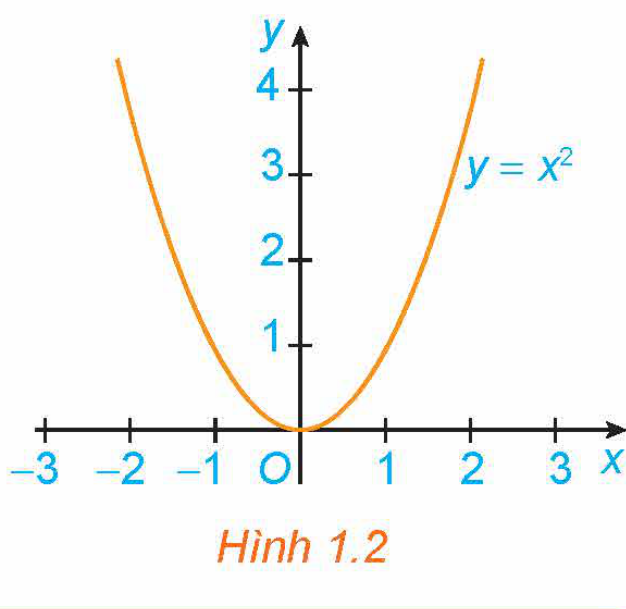
*Hình 1.2*

> Giả sử $K$ là một khoảng, một đoạn hoặc một nửa khoảng và $y = f(x)$ là hàm số xác định trên $K$.
> - Hàm số $y = f(x)$ được gọi là **đồng biến** trên $K$ nếu $\forall x_1, x_2 \in K, x_1 < x_2 \Rightarrow f(x_1) < f(x_2)$.
> - Hàm số $y = f(x)$ được gọi là **nghịch biến** trên $K$ nếu $\forall x_1, x_2 \in K, x_1 < x_2 \Rightarrow f(x_1) > f(x_2)$.

**Chú ý:**

- Nếu hàm số đồng biến trên $K$ thì đồ thị của hàm số *đi lên* từ trái sang phải (H.1.3a). Nếu hàm số nghịch biến trên $K$ thì đồ thị của hàm số *đi xuống* từ trái sang phải (H.1.3b).

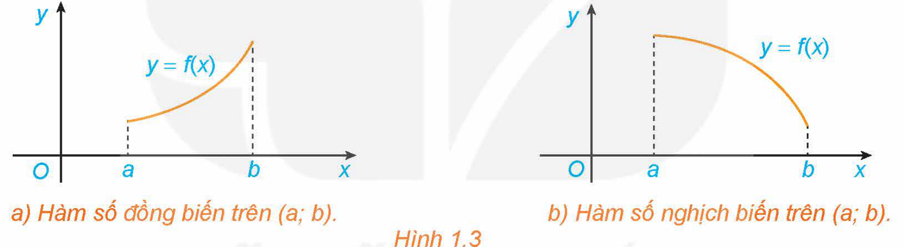
*Hình 1.3. a) Hàm số đồng biến trên $(a; b)$. b) Hàm số nghịch biến trên $(a; b)$.*

- Hàm số đồng biến hay nghịch biến trên $K$ còn được gọi chung là **đơn điệu** trên $K$. Việc tìm các khoảng đồng biến, nghịch biến của hàm số còn được gọi là tìm các **khoảng đơn điệu** (hay xét **tính đơn điệu**) của hàm số.
- Khi xét tính đơn điệu của hàm số mà không chỉ rõ tập $K$ thì ta hiểu là xét trên tập xác định của hàm số đó.

**Ví dụ 1:** Hình 1.4 là đồ thị của hàm số $y = f(x) = |x|$. Hãy tìm các khoảng đồng biến, khoảng nghịch biến của hàm số.

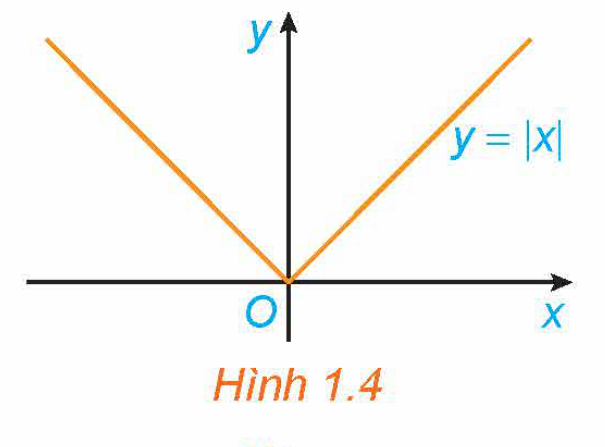
*Hình 1.4*

**Giải:**

Tập xác định của hàm số là $\mathbb{R}$.

Từ đồ thị suy ra: Hàm số đồng biến trên khoảng $(0; +\infty)$, nghịch biến trên khoảng $(-\infty; 0)$.

**Luyện tập 1:** Hình 1.5 là đồ thị của hàm số $y = x^3 - 3x^2 + 2$. Hãy tìm các khoảng đồng biến, khoảng nghịch biến của hàm số.

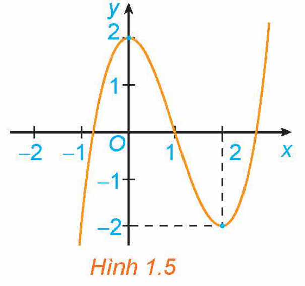
*Hình 1.5*

<!-- pdf:9 -->

**HĐ2:** Nhận biết mối quan hệ giữa tính đơn điệu và dấu của đạo hàm

Xét hàm số $y = \begin{cases} -x & \text{nếu } x < -1 \\ 1 & \text{nếu } -1 \le x \le 1 \\ x & \text{nếu } x > 1 \end{cases}$ có đồ thị như Hình 1.6.

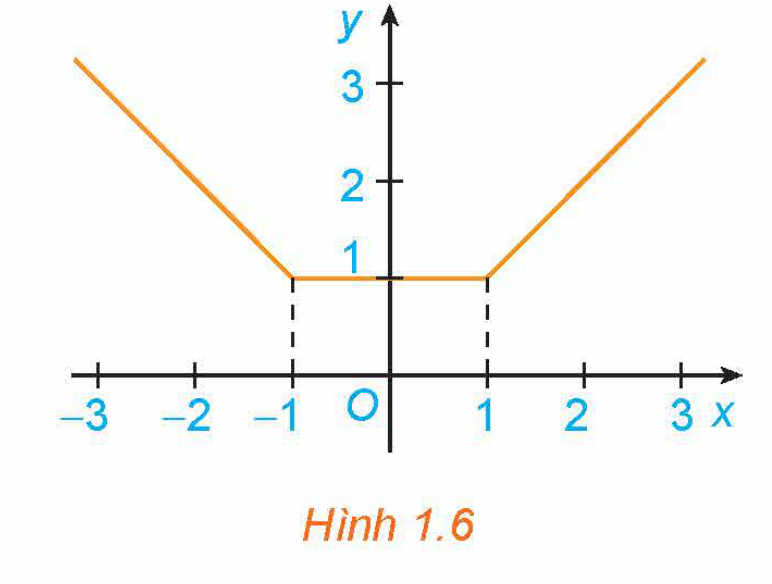
*Hình 1.6*

a) Xét dấu đạo hàm của hàm số trên các khoảng $(-\infty; -1)$, $(1; +\infty)$. Nêu nhận xét về mối quan hệ giữa tính đồng biến, nghịch biến và dấu đạo hàm của hàm số trên mỗi khoảng này.

b) Có nhận xét gì về đạo hàm $y'$ và hàm số $y$ trên khoảng $(-1; 1)$?

<!-- term: Định lí tính đơn điệu của hàm số -->
> **ĐỊNH LÍ:**
> Cho hàm số $y = f(x)$ có đạo hàm trên khoảng $K$.
> a) Nếu $f'(x) > 0$ với mọi $x \in K$ thì hàm số $f(x)$ đồng biến trên khoảng $K$.
> b) Nếu $f'(x) < 0$ với mọi $x \in K$ thì hàm số $f(x)$ nghịch biến trên khoảng $K$.

**Chú ý:**

- Định lí trên vẫn đúng trong trường hợp $f'(x)$ bằng $0$ tại một số hữu hạn điểm trong khoảng $K$.
- Người ta chứng minh được rằng, nếu $f'(x) = 0$ với mọi $x \in K$ thì hàm số $f(x)$ không đổi trên khoảng $K$.

**Ví dụ 2:** Tìm các khoảng đồng biến, khoảng nghịch biến của hàm số $y = x^2 - 4x + 2$.

**Giải:**

Tập xác định của hàm số là $\mathbb{R}$.

Ta có: $y' = 2x - 4$; $y' > 0$ với $x \in (2; +\infty)$; $y' < 0$ với $x \in (-\infty; 2)$.

Do đó, hàm số đồng biến trên khoảng $(2; +\infty)$, nghịch biến trên khoảng $(-\infty; 2)$.

**Luyện tập 2:** Tìm các khoảng đồng biến, khoảng nghịch biến của hàm số $y = -x^2 + 2x + 3$.

**b) Sử dụng bảng biến thiên xét tính đơn điệu của hàm số**

**HĐ3:** Xét tính đơn điệu của hàm số bằng bảng biến thiên

Cho hàm số $y = f(x) = x^3 - 3x^2 + 2x + 1$.

a) Tính đạo hàm $f'(x)$ và tìm các điểm $x$ mà $f'(x) = 0$.

b) Lập **bảng biến thiên** của hàm số, tức là lập bảng thể hiện dấu của đạo hàm và sự đồng biến, nghịch biến của hàm số trên các khoảng tương ứng.

c) Nêu kết luận về khoảng đồng biến, nghịch biến của hàm số.

<!-- pdf:10 -->

<!-- term: Quy tắc xét tính đơn điệu -->
Các bước để xét tính đơn điệu của hàm số $y = f(x)$:
1. Tìm tập xác định của hàm số.
2. Tính đạo hàm $f'(x)$. Tìm các điểm $x_i$ ($i = 1, 2, ...$) mà tại đó đạo hàm bằng $0$ hoặc không tồn tại.
3. Sắp xếp các điểm $x_i$ theo thứ tự tăng dần và lập bảng biến thiên của hàm số.
4. Nêu kết luận về khoảng đồng biến, nghịch biến của hàm số.

**Ví dụ 3:** Tìm các khoảng đơn điệu của hàm số $y = \frac{x^2 - 2x + 5}{x - 1}$.

**Giải:**

Tập xác định của hàm số là $\mathbb{R} \setminus \{1\}$.

Ta có: $y' = \frac{(2x - 2)(x - 1) - (x^2 - 2x + 5)}{(x - 1)^2} = \frac{x^2 - 2x - 3}{(x - 1)^2}$; $y' = 0 \Leftrightarrow x = -1$ hoặc $x = 3$.

Lập bảng biến thiên của hàm số:

| $x$ | $-\infty$ | | $-1$ | | $1$ | | $3$ | | $+\infty$ |
| --- | --- | --- | --- | --- | --- | --- | --- | --- | --- |
| $y'$ | | $+$ | $0$ | $-$ | $\Vert$ | $-$ | $0$ | $+$ | |
| $y$ | $-\infty$ | $\nearrow$ | $-4$ | $\searrow$ | $-\infty \ \Vert \ +\infty$ | $\searrow$ | $4$ | $\nearrow$ | $+\infty$ |

Từ bảng biến thiên, ta có:

Hàm số đồng biến trên các khoảng $(-\infty; -1)$ và $(3; +\infty)$.

Hàm số nghịch biến trên các khoảng $(-1; 1)$ và $(1; 3)$.

**Ví dụ 4:** Xét chiều biến thiên của hàm số $y = \frac{x - 2}{x + 1}$.

> Việc tìm các khoảng đồng biến, nghịch biến của hàm số còn được nói gọn là **xét chiều biến thiên** của hàm số.

**Giải:**

Tập xác định của hàm số là $\mathbb{R} \setminus \{-1\}$.

Ta có: $y' = \frac{(x + 1) - (x - 2)}{(x + 1)^2} = \frac{3}{(x + 1)^2} > 0$, với mọi $x \ne -1$.

Lập bảng biến thiên của hàm số:

| $x$ | $-\infty$ | | $-1$ | | $+\infty$ |
| --- | --- | --- | --- | --- | --- |
| $y'$ | | $+$ | $\Vert$ | $+$ | |
| $y$ | $1$ | $\nearrow$ | $+\infty \ \Vert \ -\infty$ | $\nearrow$ | $1$ |

Từ bảng biến thiên, ta có: Hàm số đồng biến trên các khoảng $(-\infty; -1)$ và $(-1; +\infty)$.

<!-- pdf:11 -->

**Luyện tập 3:** Tìm các khoảng đơn điệu của các hàm số sau:

a) $y = \frac{1}{3}x^3 + 3x^2 + 5x + 2$;

b) $y = \frac{-x^2 + 5x - 7}{x - 2}$.

**Vận dụng 1:** Giải bài toán trong *tình huống mở đầu* bằng cách thực hiện lần lượt các yêu cầu sau:
<!-- ocr-ok: đã đối chiếu ảnh trang PDF 11, OCR đọc sai nhãn Vận dụng 1 -->

a) Theo ý nghĩa cơ học của đạo hàm, vận tốc $v(t)$ là đạo hàm của $s(t)$. Hãy tìm vận tốc $v(t)$.

b) Xét dấu của hàm $v(t)$, từ đó suy ra câu trả lời.

> Chất điểm chuyển động theo chiều dương khi vận tốc $v(t) > 0$.

## 2. CỰC TRỊ CỦA HÀM SỐ

**a) Khái niệm cực trị của hàm số**

**HĐ4:** Nhận biết khái niệm cực đại, cực tiểu của hàm số

Quan sát đồ thị của hàm số $y = x^3 + 3x^2 - 4$ (H.1.7). Xét dấu đạo hàm của hàm số đã cho và hoàn thành các bảng sau vào vở:

| $x$ | $-3$ | | $-2$ | | $-1$ |
| --- | --- | --- | --- | --- | --- |
| $y'$ | | $?$ | $0$ | $?$ | |
| $y$ | $-4$ | $\nearrow$ | $?$ | $\searrow$ | $-2$ |

| $x$ | $-1$ | | $0$ | | $1$ |
| --- | --- | --- | --- | --- | --- |
| $y'$ | | $?$ | $0$ | $?$ | |
| $y$ | $-2$ | $\searrow$ | $?$ | $\nearrow$ | $0$ |

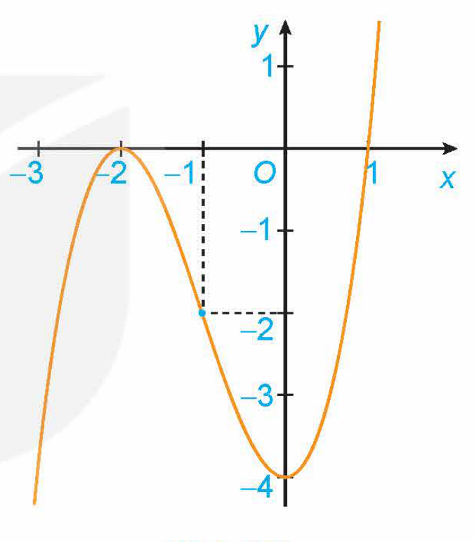
*Hình 1.7*

Tổng quát, ta có định nghĩa sau:

> Cho hàm số $y = f(x)$ xác định và liên tục trên khoảng $(a; b)$ ($a$ có thể là $-\infty$, $b$ có thể là $+\infty$) và điểm $x_0 \in (a; b)$.
> - Nếu tồn tại số $h > 0$ sao cho $f(x) < f(x_0)$ với mọi $x \in (x_0 - h; x_0 + h) \subset (a; b)$ và $x \ne x_0$ thì ta nói hàm số $f(x)$ đạt **cực đại** tại $x_0$.
> - Nếu tồn tại số $h > 0$ sao cho $f(x) > f(x_0)$ với mọi $x \in (x_0 - h; x_0 + h) \subset (a; b)$ và $x \ne x_0$ thì ta nói hàm số $f(x)$ đạt **cực tiểu** tại $x_0$.

**Chú ý:**

- Nếu hàm số $y = f(x)$ đạt cực đại tại $x_0$ thì $x_0$ được gọi là **điểm cực đại** của hàm số $f(x)$. Khi đó, $f(x_0)$ được gọi là **giá trị cực đại** của hàm số $f(x)$ và kí hiệu là $f_{\text{CĐ}}$ hay $y_{\text{CĐ}}$. Điểm $M_0(x_0; f(x_0))$ được gọi là **điểm cực đại của đồ thị hàm số**.
- Nếu hàm số $y = f(x)$ đạt cực tiểu tại $x_0$ thì $x_0$ được gọi là **điểm cực tiểu** của hàm số $f(x)$. Khi đó, $f(x_0)$ được gọi là **giá trị cực tiểu** của hàm số $f(x)$ và kí hiệu là $f_{\text{CT}}$ hay $y_{\text{CT}}$. Điểm $M_0(x_0; f(x_0))$ được gọi là **điểm cực tiểu của đồ thị hàm số**.
- Các điểm cực đại và điểm cực tiểu được gọi chung là **điểm cực trị**. Giá trị cực đại và giá trị cực tiểu được gọi chung là **giá trị cực trị** (hay **cực trị**) của hàm số.

<!-- pdf:12 -->

**Ví dụ 5:** Hình 1.8 là đồ thị của hàm số $y = f(x)$. Hãy tìm các cực trị của hàm số.

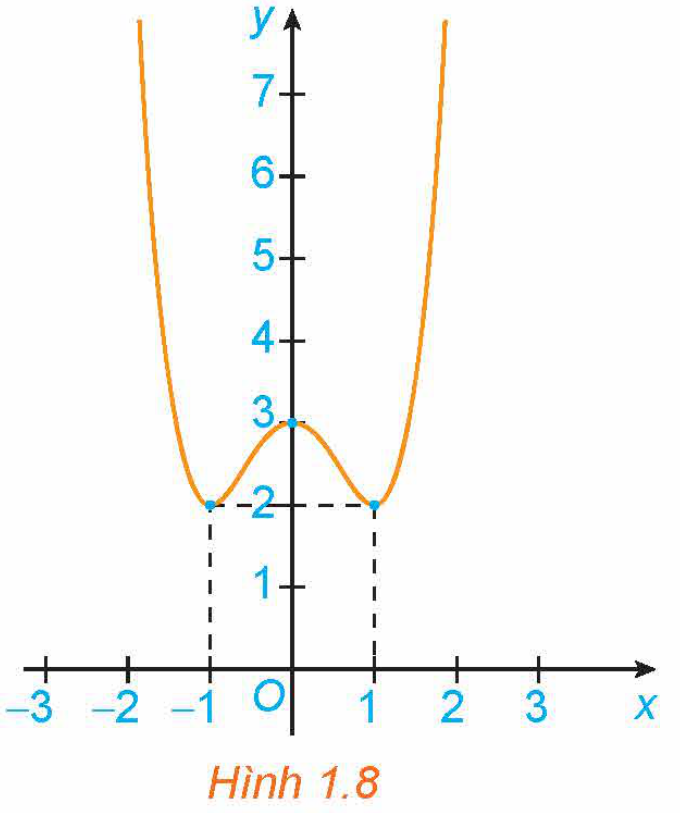
*Hình 1.8*

**Giải:**

Từ đồ thị hàm số, ta có:

Hàm số đạt cực tiểu tại $x = -1$ và $y_{\text{CT}} = y(-1) = 2$.

Hàm số đạt cực đại tại $x = 0$ và $y_{\text{CĐ}} = y(0) = 3$.

Hàm số đạt cực tiểu tại $x = 1$ và $y_{\text{CT}} = y(1) = 2$.

**Luyện tập 4:** Hình 1.9 là đồ thị của hàm số $y = f(x)$. Hãy tìm các cực trị của hàm số.

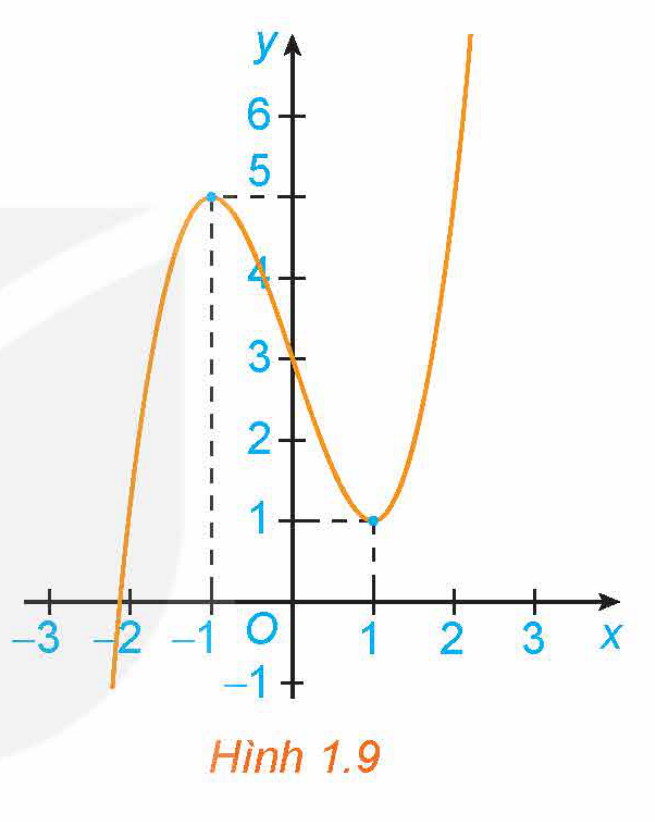
*Hình 1.9*

**b) Cách tìm cực trị của hàm số**

**HĐ5:** Nhận biết cách tìm cực trị của hàm số

Cho hàm số $y = \frac{1}{3}x^3 - 3x^2 + 8x + 1$.

a) Tính đạo hàm $f'(x)$ và tìm các điểm mà tại đó đạo hàm $f'(x)$ bằng $0$.

b) Lập bảng biến thiên của hàm số.

c) Từ bảng biến thiên suy ra các điểm cực trị của hàm số.

<!-- term: Định lí cực trị của hàm số -->
> **ĐỊNH LÍ:**
> Giả sử hàm số $y = f(x)$ liên tục trên khoảng $(a; b)$ chứa điểm $x_0$ và có đạo hàm trên các khoảng $(a; x_0)$ và $(x_0; b)$. Khi đó:
> a) Nếu $f'(x) < 0$ với mọi $x \in (a; x_0)$ và $f'(x) > 0$ với mọi $x \in (x_0; b)$ thì $x_0$ là một điểm cực tiểu của hàm số $f(x)$.
> b) Nếu $f'(x) > 0$ với mọi $x \in (a; x_0)$ và $f'(x) < 0$ với mọi $x \in (x_0; b)$ thì $x_0$ là một điểm cực đại của hàm số $f(x)$.

<!-- pdf:13 -->

> ❓ Giải thích vì sao nếu $f'(x)$ không đổi dấu khi $x$ qua $x_0$ thì $x_0$ không phải là điểm cực trị của hàm số $f(x)$?

Định lí trên được viết gọn lại trong hai bảng biến thiên sau:

| $x$ | $a$ | | $x_0$ | | $b$ |
| --- | --- | --- | --- | --- | --- |
| $f'(x)$ | | $-$ | | $+$ | |
| $f(x)$ | | $\searrow$ | $f(x_0)$ (Cực tiểu) | $\nearrow$ | |

| $x$ | $a$ | | $x_0$ | | $b$ |
| --- | --- | --- | --- | --- | --- |
| $f'(x)$ | | $+$ | | $-$ | |
| $f(x)$ | | $\nearrow$ | $f(x_0)$ (Cực đại) | $\searrow$ | |

<!-- term: Quy tắc tìm cực trị của hàm số -->
**Chú ý:** Từ định lí trên ta có các bước tìm cực trị của hàm số $y = f(x)$ như sau:
1. Tìm tập xác định của hàm số.
2. Tính đạo hàm $f'(x)$. Tìm các điểm mà tại đó đạo hàm $f'(x)$ bằng $0$ hoặc đạo hàm không tồn tại.
3. Lập bảng biến thiên của hàm số.
4. Từ bảng biến thiên suy ra các cực trị của hàm số.

**Ví dụ 6:** Tìm cực trị của hàm số $y = x^3 - 6x^2 + 9x + 30$.

**Giải:**

Tập xác định của hàm số là $\mathbb{R}$.

Ta có: $y' = 3x^2 - 12x + 9$; $y' = 0 \Leftrightarrow x = 1$ hoặc $x = 3$.

Lập bảng biến thiên của hàm số:

| $x$ | $-\infty$ | | $1$ | | $3$ | | $+\infty$ |
| --- | --- | --- | --- | --- | --- | --- | --- |
| $y'$ | | $+$ | $0$ | $-$ | $0$ | $+$ | |
| $y$ | $-\infty$ | $\nearrow$ | $34$ | $\searrow$ | $30$ | $\nearrow$ | $+\infty$ |

Từ bảng biến thiên, ta có:

Hàm số đạt cực đại tại $x = 1$ và $y_{\text{CĐ}} = y(1) = 34$.
Hàm số đạt cực tiểu tại $x = 3$ và $y_{\text{CT}} = y(3) = 30$.
<!-- ocr-ok: đã đối chiếu ảnh trang PDF 13 -->

**Chú ý:** Nếu $f'(x_0) = 0$ nhưng $f'(x)$ không đổi dấu khi $x$ qua $x_0$ thì $x_0$ không phải là điểm cực trị của hàm số. Chẳng hạn, hàm số $f(x) = x^3$ có $f'(x) = 3x^2$, $f'(0) = 0$, nhưng $x = 0$ không phải là điểm cực trị của hàm số (H.1.10).

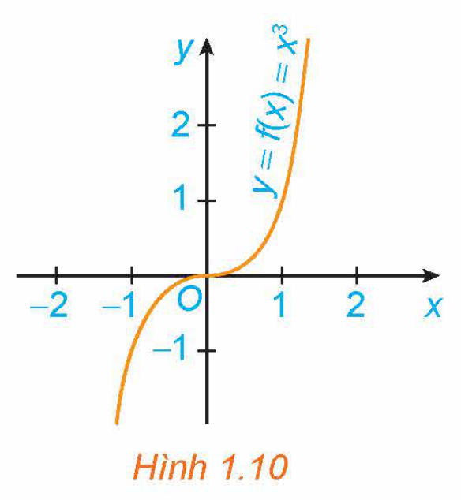
*Hình 1.10*

<!-- pdf:14 -->

**Ví dụ 7:** Tìm cực trị của hàm số $y = \frac{x^2 - 2x + 9}{x - 2}$.

**Giải:**

Tập xác định của hàm số là $\mathbb{R} \setminus \{2\}$.

Ta có: $y' = \frac{(2x - 2)(x - 2) - (x^2 - 2x + 9)}{(x - 2)^2} = \frac{x^2 - 4x - 5}{(x - 2)^2}$; $y' = 0 \Leftrightarrow x = -1$ hoặc $x = 5$.

Lập bảng biến thiên của hàm số:

| $x$ | $-\infty$ | | $-1$ | | $2$ | | $5$ | | $+\infty$ |
| --- | --- | --- | --- | --- | --- | --- | --- | --- | --- |
| $y'$ | | $+$ | $0$ | $-$ | $\Vert$ | $-$ | $0$ | $+$ | |
| $y$ | $-\infty$ | $\nearrow$ | $-4$ | $\searrow$ | $-\infty \ \Vert \ +\infty$ | $\searrow$ | $8$ | $\nearrow$ | $+\infty$ |

Từ bảng biến thiên, ta có:

Hàm số đạt cực đại tại $x = -1$ và $y_{\text{CĐ}} = y(-1) = -4$.
Hàm số đạt cực tiểu tại $x = 5$ và $y_{\text{CT}} = y(5) = 8$.
<!-- ocr-ok: đã đối chiếu ảnh trang PDF 14 -->

**Ví dụ 8:** Tìm cực trị của hàm số $y = \frac{x + 1}{x - 1}$.

**Giải:**

Tập xác định của hàm số là $\mathbb{R} \setminus \{1\}$.

Ta có: $y' = \frac{(x - 1) - (x + 1)}{(x - 1)^2} = \frac{-2}{(x - 1)^2} < 0$, với mọi $x \ne 1$.

Lập bảng biến thiên của hàm số:

| $x$ | $-\infty$ | | $1$ | | $+\infty$ |
| --- | --- | --- | --- | --- | --- |
| $y'$ | | $-$ | $\Vert$ | $-$ | |
| $y$ | $1$ | $\searrow$ | $-\infty \ \Vert \ +\infty$ | $\searrow$ | $1$ |

Từ bảng biến thiên suy ra hàm số không có cực trị.

**Luyện tập 5:** Tìm cực trị của các hàm số sau:

a) $y = x^4 - 3x^2 + 1$;

b) $y = \frac{-x^2 + 2x - 1}{x + 2}$.

**Vận dụng 2:** Một vật được phóng thẳng đứng lên trên từ độ cao $2\text{ m}$ với vận tốc ban đầu là $24,5\text{ m/s}$. Trong Vật lí, ta biết rằng khi bỏ qua sức cản của không khí thì độ cao $h$ (mét) của vật sau $t$ (giây) được cho bởi công thức

$h(t) = 2 + 24,5t - 4,9t^2.$

Hỏi tại thời điểm nào thì vật đạt độ cao lớn nhất?

<!-- pdf:15 -->

## ✏️ Bài tập

**1.1.** Tìm các khoảng đồng biến, khoảng nghịch biến của các hàm số có đồ thị như sau:

a) Đồ thị hàm số $y = x^3 - \frac{3}{2}x^2$ (H.1.11);

b) Đồ thị hàm số $y = \sqrt[3]{(x^2 - 4)^2}$ (H.1.12).

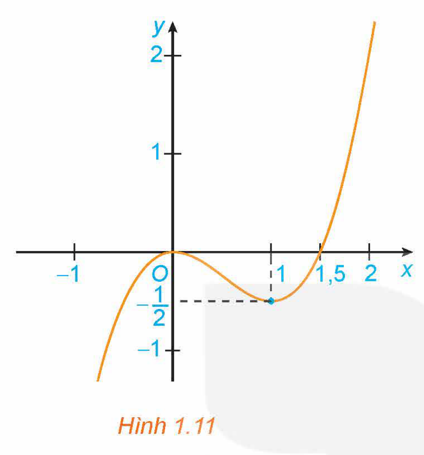
*Hình 1.11*

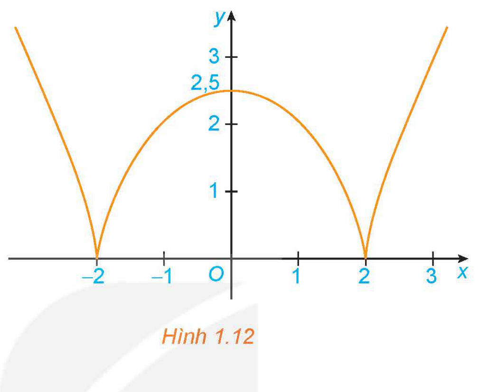
*Hình 1.12*

**1.2.** Xét sự đồng biến, nghịch biến của các hàm số sau:

a) $y = \frac{1}{3}x^3 - 2x^2 + 3x + 1$;

b) $y = -x^3 + 2x^2 - 5x + 3$.

**1.3.** Tìm các khoảng đơn điệu của các hàm số sau:

a) $y = \frac{2x - 1}{x + 2}$;

b) $y = \frac{x^2 + x + 4}{x - 3}$.

**1.4.** Xét chiều biến thiên của các hàm số sau:

a) $y = \sqrt{4 - x^2}$;

b) $y = \frac{x}{x^2 + 1}$.

**1.5.** Giả sử số dân của một thị trấn sau $t$ năm kể từ năm 2000 được mô tả bởi hàm số

$N(t) = \frac{25t + 10}{t + 5}, \ t \ge 0,$

trong đó $N(t)$ được tính bằng nghìn người.

a) Tính số dân của thị trấn đó vào các năm 2000 và 2015.

b) Tính đạo hàm $N'(t)$ và $\lim_{t \to +\infty} N(t)$. Từ đó, giải thích tại sao số dân của thị trấn đó luôn tăng nhưng sẽ không vượt quá một ngưỡng nào đó.

<!-- pdf:16 -->

**1.6.** Đồ thị của đạo hàm bậc nhất $y = f'(x)$ của hàm số $f(x)$ được cho trong Hình 1.13.

a) Hàm số $f(x)$ đồng biến trên những khoảng nào? Giải thích.

b) Tại giá trị nào của $x$ thì $f(x)$ có cực đại hoặc cực tiểu? Giải thích.

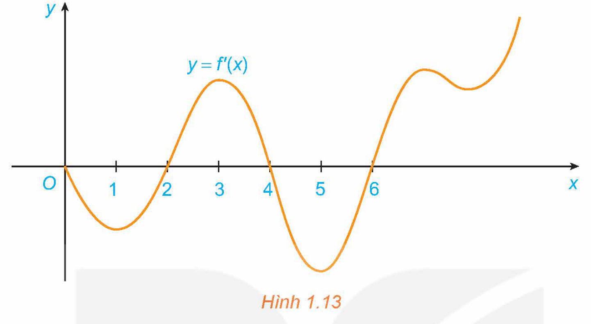
*Hình 1.13*

**1.7.** Tìm cực trị của các hàm số sau:

a) $y = 2x^3 - 9x^2 + 12x - 5$;

b) $y = x^4 - 4x^2 + 2$;

c) $y = \frac{x^2 - 2x + 3}{x - 1}$;

d) $y = \sqrt{4x - 2x^2}$.

**1.8.** Cho hàm số $y = f(x) = |x|$.

a) Tính các giới hạn $\lim_{x \to 0^+} \frac{f(x) - f(0)}{x - 0}$ và $\lim_{x \to 0^-} \frac{f(x) - f(0)}{x - 0}$.

Từ đó suy ra hàm số không có đạo hàm tại $x = 0$.

b) Sử dụng định nghĩa, chứng minh hàm số có cực tiểu tại $x = 0$ (xem Hình 1.4).

**1.9.** Giả sử doanh số (tính bằng số sản phẩm) của một sản phẩm mới (trong vòng một số năm nhất định) tuân theo quy luật logistic được mô hình hoá bằng hàm số

$f(t) = \frac{5\,000}{1 + 5\text{e}^{-t}}, \ t \ge 0,$

trong đó thời gian $t$ được tính bằng năm, kể từ khi phát hành sản phẩm mới. Khi đó, đạo hàm $f'(t)$ sẽ biểu thị tốc độ bán hàng. Hỏi sau khi phát hành bao nhiêu năm thì tốc độ bán hàng là lớn nhất?

## 📷 Danh sách hình trong bài

| Mã hình | Trang PDF | Vị trí trong bài | Chú thích gốc |
| --- | --- | --- | --- |
| H12-toan-b01-01 | 7 | Mở đầu chương I | (sách không đánh số, sơ đồ minh hoạ mở đầu Chương I) |
| H12-toan-b01-02 | 7 | Mở đầu | Hình 1.1 |
| H12-toan-b01-03 | 8 | Mục 1.a, HĐ1 | Hình 1.2 |
| H12-toan-b01-04 | 8 | Mục 1.a, Chú ý | Hình 1.3. a) Hàm số đồng biến trên $(a; b)$. b) Hàm số nghịch biến trên $(a; b)$. |
| H12-toan-b01-05 | 8 | Mục 1.a, Ví dụ 1 | Hình 1.4 |
| H12-toan-b01-06 | 8 | Mục 1.a, Luyện tập 1 | Hình 1.5 |
| H12-toan-b01-07 | 9 | Mục 1.a, HĐ2 | Hình 1.6 |
| H12-toan-b01-08 | 11 | Mục 2.a, HĐ4 | Hình 1.7 |
| H12-toan-b01-09 | 12 | Mục 2.a, Ví dụ 5 | Hình 1.8 |
| H12-toan-b01-10 | 12 | Mục 2.a, Luyện tập 4 | Hình 1.9 |
| H12-toan-b01-11 | 13 | Mục 2.b, Chú ý | Hình 1.10 |
| H12-toan-b01-12 | 15 | Bài tập 1.1a | Hình 1.11 |
| H12-toan-b01-13 | 15 | Bài tập 1.1b | Hình 1.12 |
| H12-toan-b01-14 | 16 | Bài tập 1.6 | Hình 1.13 |
