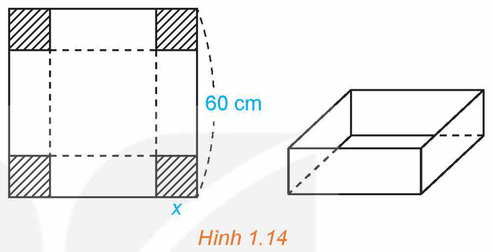
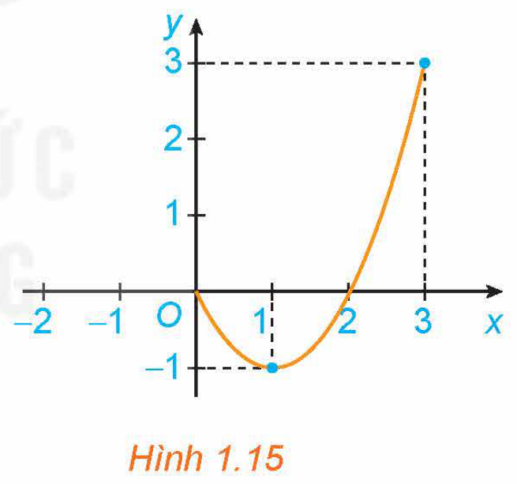
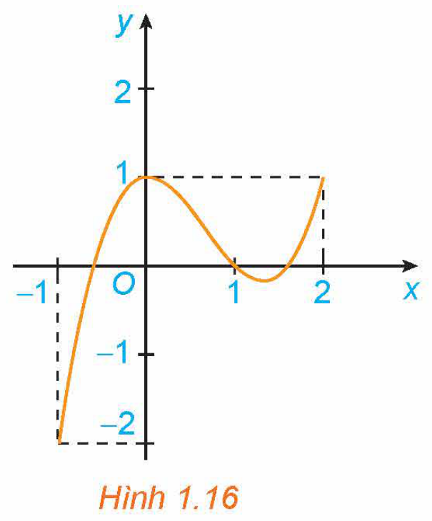
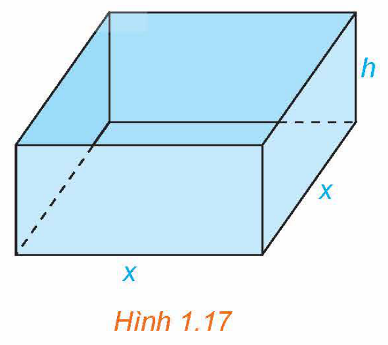

<!-- pdf:17 -->

# BÀI 2: GIÁ TRỊ LỚN NHẤT VÀ GIÁ TRỊ NHỎ NHẤT CỦA HÀM SỐ

## 🔤 Thuật ngữ

- Giá trị lớn nhất
- Giá trị nhỏ nhất

## 🎯 Mục tiêu

- Nhận biết giá trị lớn nhất, giá trị nhỏ nhất của hàm số trên một tập xác định cho trước.
- Xác định giá trị lớn nhất, giá trị nhỏ nhất của hàm số bằng đạo hàm trong những trường hợp đơn giản.

## 🔴 Mở đầu

Từ một tấm bìa carton hình vuông có độ dài cạnh bằng $60\text{ cm}$, người ta cắt bốn hình vuông bằng nhau ở bốn góc rồi gập thành một chiếc hộp có dạng hình hộp chữ nhật không có nắp (H.1.14). Tính cạnh của các hình vuông bị cắt sao cho thể tích của chiếc hộp là lớn nhất.

*Hình 1.14*

## 1. ĐỊNH NGHĨA

**HĐ1:** Nhận biết khái niệm giá trị lớn nhất, giá trị nhỏ nhất của hàm số

Cho hàm số $y = f(x) = x^2 - 2x$ với $x \in [0; 3]$, có đồ thị như Hình 1.15.

a) Giá trị lớn nhất $M$ của hàm số trên đoạn $[0; 3]$ là bao nhiêu? Tìm $x_0$ sao cho $f(x_0) = M$.

b) Giá trị nhỏ nhất $m$ của hàm số trên đoạn $[0; 3]$ là bao nhiêu? Tìm $x_0$ sao cho $f(x_0) = m$.

*Hình 1.15*

> Cho hàm số $y = f(x)$ xác định trên tập $D$.
>
> - Số $M$ được gọi là **giá trị lớn nhất** của hàm số $y = f(x)$ trên tập $D$ nếu $f(x) \le M$ với mọi $x \in D$ và tồn tại $x_0 \in D$ sao cho $f(x_0) = M$.
>   Kí hiệu $M = \max_{x \in D} f(x)$ hoặc $M = \max_D f(x)$.
> - Số $m$ được gọi là **giá trị nhỏ nhất** của hàm số $y = f(x)$ trên tập $D$ nếu $f(x) \ge m$ với mọi $x \in D$ và tồn tại $x_0 \in D$ sao cho $f(x_0) = m$.
>   Kí hiệu $m = \min_{x \in D} f(x)$ hoặc $m = \min_D f(x)$.

<!-- pdf:18 -->

**Chú ý:**

- Ta quy ước rằng khi nói giá trị lớn nhất và giá trị nhỏ nhất của hàm số $f(x)$ (mà không nói “trên tập $D$”) thì ta hiểu đó là giá trị lớn nhất hay giá trị nhỏ nhất của $f(x)$ trên tập xác định của hàm số.
- Để tìm giá trị lớn nhất và giá trị nhỏ nhất của hàm số trên tập $D$, ta thường lập bảng biến thiên của hàm số trên tập $D$ để kết luận.

**Ví dụ 1:** Tìm giá trị lớn nhất và giá trị nhỏ nhất của hàm số $y = f(x) = \sqrt{1 - x^2}$.

**Giải:**

Tập xác định của hàm số là $[-1; 1]$.

*Cách 1.* Sử dụng định nghĩa.

Ta có:

- $f(x) = \sqrt{1 - x^2} \ge 0$; dấu bằng xảy ra khi $1 - x^2 = 0$, tức là khi $x = -1$ hoặc $x = 1$. Do đó $\min_{[-1; 1]} f(x) = f(-1) = f(1) = 0$.
- $f(x) = \sqrt{1 - x^2} \le 1$; dấu bằng xảy ra khi $1 - x^2 = 1$, tức là khi $x = 0$. Do đó $\max_{[-1; 1]} f(x) = f(0) = 1$.
<!-- ocr-ok: đã đối chiếu ảnh trang PDF 18 -->

*Cách 2.* Sử dụng bảng biến thiên.

Với $x \in (-1; 1)$, ta có: $y' = \frac{(1 - x^2)'}{2\sqrt{1 - x^2}} = -\frac{x}{\sqrt{1 - x^2}}$; $y' = 0 \Leftrightarrow x = 0$.

Lập bảng biến thiên của hàm số trên đoạn $[-1; 1]$:

| $x$ | $-1$ | | $0$ | | $1$ |
| :---: | :---: | :---: | :---: | :---: | :---: |
| $y'$ | $\Vert$ | $+$ | $0$ | $-$ | $\Vert$ |
| $y$ | $0$ | $\nearrow$ | $1$ | $\searrow$ | $0$ |

Từ bảng biến thiên, ta được: $\min_{[-1; 1]} f(x) = f(-1) = f(1) = 0$; $\max_{[-1; 1]} f(x) = f(0) = 1$.

**Chú ý:** Trong thực hành, ta cũng dùng các kí hiệu $\min_D y, \max_D y$ để chỉ giá trị nhỏ nhất, giá trị lớn nhất (nếu có) của hàm số $y = f(x)$ trên tập $D$. Do đó, trong Ví dụ 1 ta có thể viết:

$\min_{[-1; 1]} y = y(-1) = y(1) = 0; \quad \max_{[-1; 1]} y = y(0) = 1.$

**Ví dụ 2:** Tìm giá trị lớn nhất và giá trị nhỏ nhất (nếu có) của hàm số $y = x - 2 + \frac{1}{x}$ trên khoảng $(0; +\infty)$.

**Giải:**

Ta có: $y' = 1 - \frac{1}{x^2}$; $y' = 0 \Leftrightarrow x = 1$ (vì $x > 0$).

Tính các giới hạn:

$\lim_{x \to 0^+} y = \lim_{x \to 0^+} \left(x - 2 + \frac{1}{x}\right) = +\infty; \quad \lim_{x \to +\infty} y = \lim_{x \to +\infty} \left(x - 2 + \frac{1}{x}\right) = +\infty.$

<!-- pdf:19 -->

Lập bảng biến thiên của hàm số trên khoảng $(0; +\infty)$:

| $x$ | $0$ | | $1$ | | $+\infty$ |
| :---: | :---: | :---: | :---: | :---: | :---: |
| $y'$ | | $-$ | $0$ | $+$ | |
| $y$ | $+\infty$ | $\searrow$ | $0$ | $\nearrow$ | $+\infty$ |

Từ bảng biến thiên, ta được: $\min_{(0; +\infty)} y = y(1) = 0$; hàm số không có giá trị lớn nhất trên khoảng $(0; +\infty)$.

**Ví dụ 3:** Giải bài toán trong *tình huống mở đầu*.

**Giải:**

Gọi $x\text{ (cm)}$ là độ dài cạnh của các hình vuông nhỏ được cắt ở bốn góc của tấm bìa. Điều kiện: $0 < x < 30$. Khi cắt bỏ bốn hình vuông nhỏ có cạnh $x\text{ (cm)}$ ở bốn góc và gập lên thì ta được một chiếc hộp chữ nhật không có nắp, có đáy là hình vuông với độ dài cạnh bằng $(60 - 2x)\text{ (cm)}$ và chiều cao bằng $x\text{ (cm)}$. Thể tích của chiếc hộp này là

$V(x) = (60 - 2x)^2 \cdot x = 4x^3 - 240x^2 + 3\,600x\text{ (cm}^3\text{)}.$

Ta có: $V'(x) = 12x^2 - 480x + 3\,600$; $V'(x) = 0 \Leftrightarrow x^2 - 40x + 300 = 0 \Leftrightarrow x = 10$ (thoả mãn điều kiện) hoặc $x = 30$ (loại).

Lập bảng biến thiên:

| $x$ | $0$ | | $10$ | | $30$ |
| :---: | :---: | :---: | :---: | :---: | :---: |
| $V'(x)$ | | $+$ | $0$ | $-$ | |
| $V(x)$ | $0$ | $\nearrow$ | $16\,000$ | $\searrow$ | $0$ |

Vậy để thể tích của chiếc hộp là lớn nhất thì độ dài cạnh của các hình vuông nhỏ phải cắt là $10\text{ cm}$.

**Luyện tập 1:** Tìm giá trị lớn nhất và giá trị nhỏ nhất (nếu có) của các hàm số sau:

a) $y = \sqrt{2x - x^2}$;

b) $y = -x + \frac{1}{x - 1}$ trên khoảng $(1; +\infty)$.

## 2. CÁCH TÌM GIÁ TRỊ LỚN NHẤT VÀ GIÁ TRỊ NHỎ NHẤT CỦA HÀM SỐ TRÊN MỘT ĐOẠN

**HĐ2:** Hình thành các bước tìm giá trị lớn nhất và giá trị nhỏ nhất của hàm số trên một đoạn

Xét hàm số $y = f(x) = x^3 - 2x^2 + 1$ trên đoạn $[-1; 2]$, với đồ thị như Hình 1.16.

a) Tìm giá trị lớn nhất và giá trị nhỏ nhất của hàm số trên đoạn $[-1; 2]$.

*Hình 1.16*

<!-- pdf:20 -->

b) Tính đạo hàm $f'(x)$ và tìm các điểm $x \in (-1; 2)$ mà $f'(x) = 0$.

c) Tính giá trị của hàm số tại hai đầu mút của đoạn $[-1; 2]$ và tại các điểm $x$ đã tìm ở câu b. So sánh số nhỏ nhất trong các giá trị này với $\min_{[-1; 2]} f(x)$, số lớn nhất trong các giá trị này với $\max_{[-1; 2]} f(x)$.

<!-- term: Tìm giá trị lớn nhất, nhỏ nhất trên đoạn -->
> Giả sử $y = f(x)$ là hàm số liên tục trên $[a; b]$ và có đạo hàm trên $(a; b)$, có thể trừ ra tại một số hữu hạn điểm mà tại đó hàm số không có đạo hàm. Giả sử chỉ có hữu hạn điểm trong đoạn $[a; b]$ mà đạo hàm $f'(x)$ bằng $0$.
>
> Các bước tìm giá trị lớn nhất và giá trị nhỏ nhất của hàm số $f(x)$ trên đoạn $[a; b]$:
> 1. Tìm các điểm $x_1, x_2, \dots, x_n \in (a; b)$, tại đó $f'(x)$ bằng $0$ hoặc không tồn tại.
> 2. Tính $f(x_1), f(x_2), \dots, f(x_n), f(a)$ và $f(b)$.
> 3. Tìm số lớn nhất $M$ và số nhỏ nhất $m$ trong các số trên. Ta có:
>    $M = \max_{[a; b]} f(x); \quad m = \min_{[a; b]} f(x).$

**Ví dụ 4:** Tìm giá trị lớn nhất và giá trị nhỏ nhất của hàm số $y = x^4 - 4x^2 + 3$ trên đoạn $[0; 4]$.

**Giải:**

Ta có: $y' = 4x^3 - 8x = 4x(x^2 - 2)$; $y' = 0 \Leftrightarrow x = 0$ hoặc $x = \sqrt{2}$ (vì $x \in [0; 4]$);

$y(0) = 3; \quad y(4) = 195; \quad y(\sqrt{2}) = -1.$

Do đó: $\max_{[0; 4]} y = y(4) = 195; \quad \min_{[0; 4]} y = y(\sqrt{2}) = -1.$

**Ví dụ 5:** Tìm giá trị lớn nhất và giá trị nhỏ nhất của hàm số $y = \sin x + \cos x$ trên đoạn $[0; 2\pi]$.

**Giải:**

Ta có: $y' = \cos x - \sin x$; $y' = 0 \Leftrightarrow \cos x = \sin x \Leftrightarrow x = \frac{\pi}{4}$ hoặc $x = \frac{5\pi}{4}$ (vì $x \in [0; 2\pi]$);

$y(0) = 1; \quad y(2\pi) = 1; \quad y\left(\frac{\pi}{4}\right) = \sqrt{2}; \quad y\left(\frac{5\pi}{4}\right) = -\sqrt{2}.$

Do đó: $\max_{[0; 2\pi]} y = y\left(\frac{\pi}{4}\right) = \sqrt{2}; \quad \min_{[0; 2\pi]} y = y\left(\frac{5\pi}{4}\right) = -\sqrt{2}.$

**Luyện tập 2:** Tìm giá trị lớn nhất và giá trị nhỏ nhất của các hàm số sau:

a) $y = 2x^3 - 3x^2 + 5x + 2$ trên đoạn $[0; 2]$;

b) $y = (x + 1)e^{-x}$ trên đoạn $[-1; 1]$.

**Vận dụng:** Giả sử sự lây lan của một loại virus ở một địa phương có thể được mô hình hoá bằng hàm số $N(t) = -t^3 + 12t^2$, $0 \le t \le 12$, trong đó $N$ là số người bị nhiễm bệnh (tính bằng trăm người) và $t$ là thời gian (tuần).

a) Hãy ước tính số người tối đa bị nhiễm bệnh ở địa phương đó.

b) Đạo hàm $N'(t)$ biểu thị tốc độ lây lan của virus (còn gọi là tốc độ truyền bệnh). Hỏi virus sẽ lây lan nhanh nhất khi nào?

<!-- pdf:21 -->

## ✏️ Bài tập

**1.10.** Tìm giá trị lớn nhất và giá trị nhỏ nhất (nếu có) của các hàm số sau:

a) $y = -x^2 + 4x + 3$;

b) $y = x^3 - 2x^2 + 1$ trên $[0; +\infty)$;

c) $y = \frac{x^2 - 2x + 3}{x - 1}$ trên $(1; +\infty)$;

d) $y = \sqrt{4x - 2x^2}$.

**1.11.** Tìm giá trị lớn nhất và giá trị nhỏ nhất (nếu có) của các hàm số sau:

a) $y = x^4 - 2x^2 + 3$;

b) $y = xe^{-x}$;

c) $y = x\ln x$;

d) $y = \sqrt{x - 1} + \sqrt{3 - x}$.

**1.12.** Tìm giá trị lớn nhất và giá trị nhỏ nhất của các hàm số sau:

a) $y = 2x^3 - 6x + 3$ trên đoạn $[-1; 2]$;

b) $y = x^4 - 3x^2 + 2$ trên đoạn $[0; 3]$;

c) $y = x - \sin 2x$ trên đoạn $[0; \pi]$;

d) $y = (x^2 - x)e^x$ trên đoạn $[0; 1]$.

**1.13.** Trong các hình chữ nhật có chu vi là $24\text{ cm}$, hãy tìm hình chữ nhật có diện tích lớn nhất.

**1.14.** Một nhà sản xuất muốn thiết kế một chiếc hộp có dạng hình hộp chữ nhật không có nắp, có đáy là hình vuông và diện tích bề mặt bằng $108\text{ cm}^2$ như Hình 1.17. Tìm các kích thước của chiếc hộp sao cho thể tích của hộp là lớn nhất.

*Hình 1.17*

**1.15.** Một nhà sản xuất cần làm ra những chiếc bình có dạng hình trụ với dung tích $1\,000\text{ cm}^3$. Mặt trên và mặt dưới của bình được làm bằng vật liệu có giá $1,2$ nghìn đồng/$\text{cm}^2$, trong khi mặt bên của bình được làm bằng vật liệu có giá $0,75$ nghìn đồng/$\text{cm}^2$. Tìm các kích thước của bình để chi phí vật liệu sản xuất mỗi chiếc bình là nhỏ nhất.

## 📷 Danh sách hình trong bài

| Mã hình | Trang PDF | Chú thích trong sách | Mô tả ngắn |
| :--- | :---: | :--- | :--- |
| H12-toan-b02-01 | 17 | Hình 1.14 | Tấm bìa carton hình vuông cạnh 60 cm bị cắt bốn góc và chiếc hộp chữ nhật không nắp |
| H12-toan-b02-02 | 17 | Hình 1.15 | Đồ thị hàm số $y = f(x) = x^2 - 2x$ trên đoạn $[0; 3]$ |
| H12-toan-b02-03 | 19 | Hình 1.16 | Đồ thị hàm số $y = f(x) = x^3 - 2x^2 + 1$ trên đoạn $[-1; 2]$ |
| H12-toan-b02-04 | 21 | Hình 1.17 | Chiếc hộp chữ nhật không nắp có đáy hình vuông cạnh $x$ và chiều cao $h$ |
