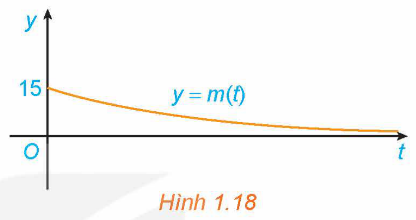
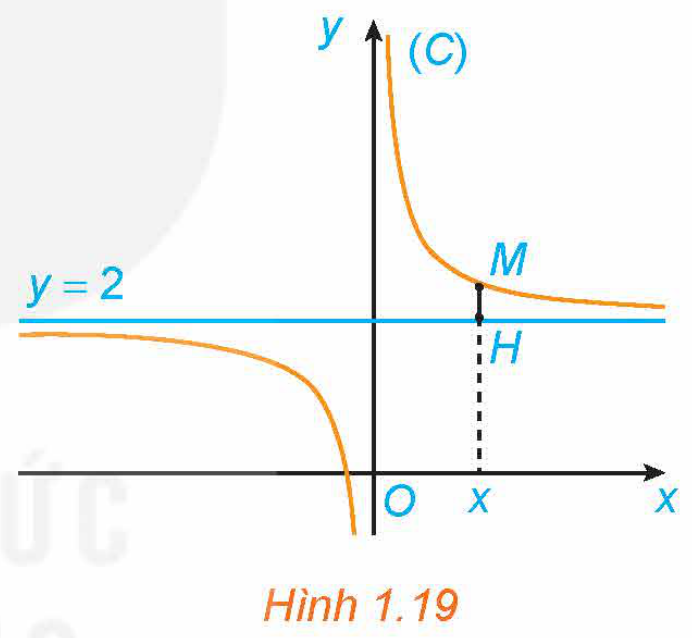
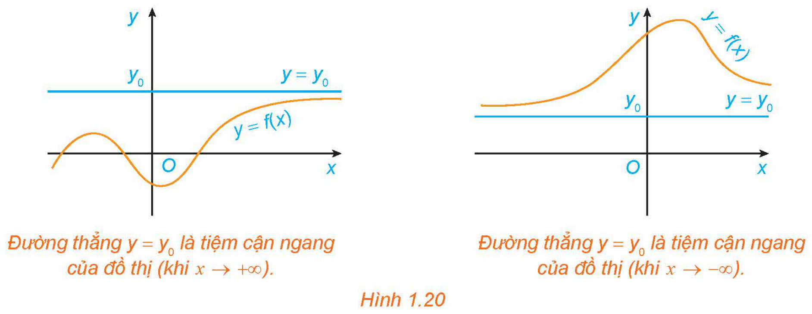
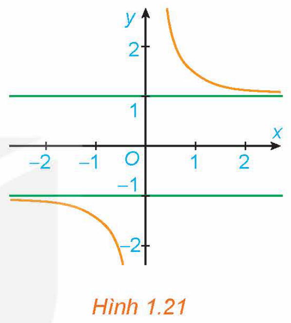
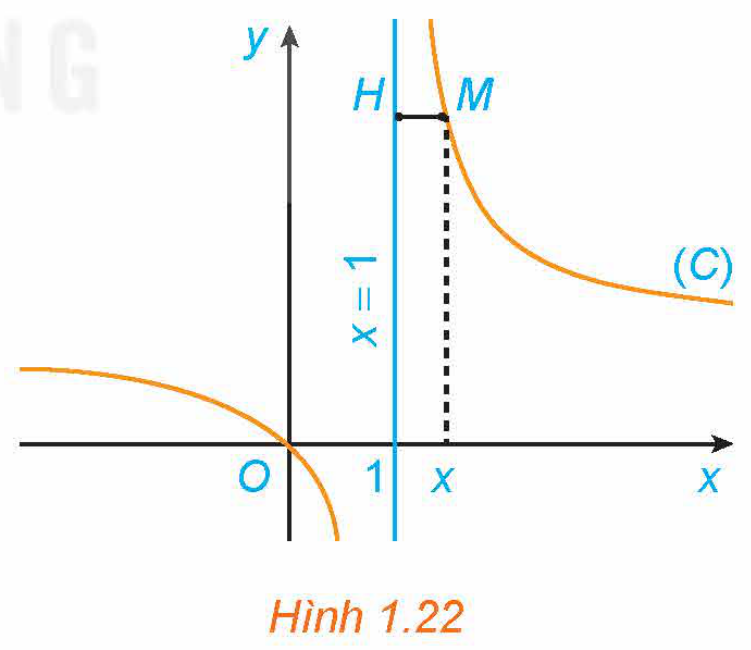
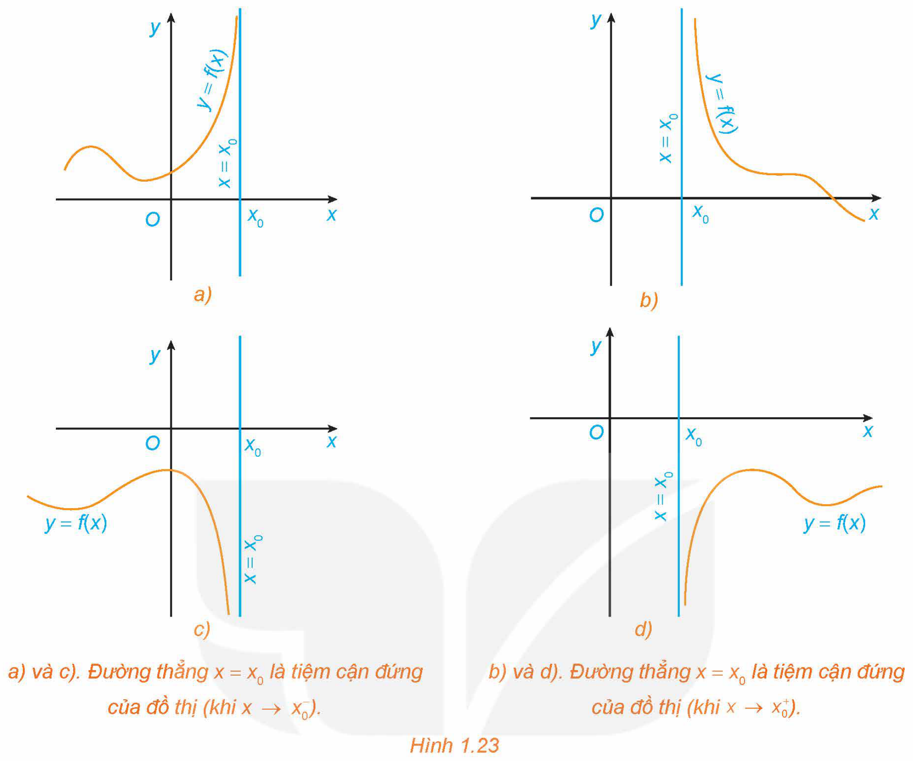
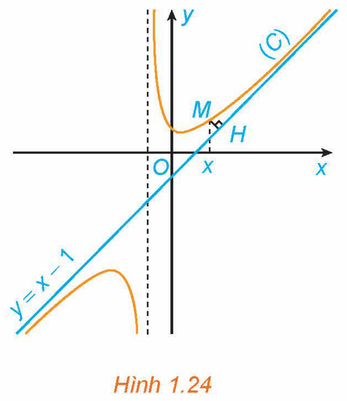
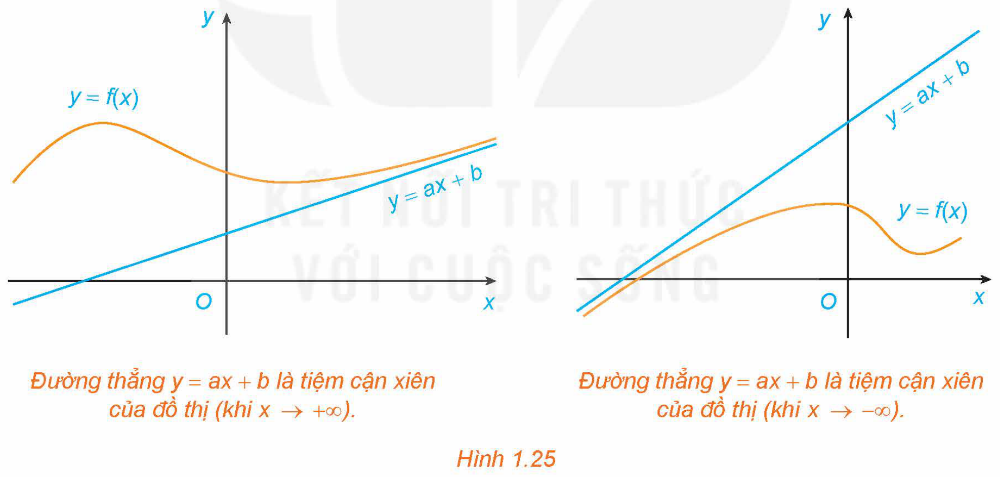
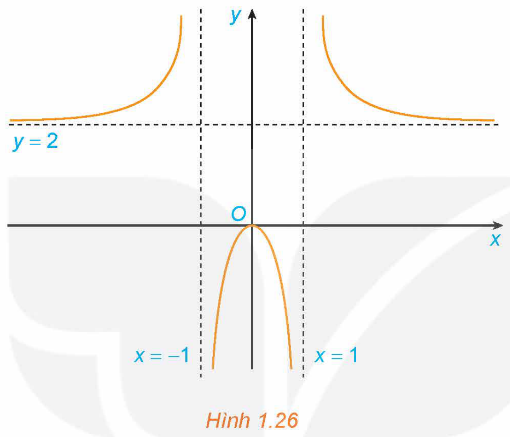

<!-- pdf:22 -->

# BÀI 3: ĐƯỜNG TIỆM CẬN CỦA ĐỒ THỊ HÀM SỐ

## 🔤 Thuật ngữ

- Tiệm cận ngang
- Tiệm cận đứng
- Tiệm cận xiên

## 🎯 Mục tiêu

- Nhận biết hình ảnh hình học của đường tiệm cận ngang, đường tiệm cận đứng, đường tiệm cận xiên của đồ thị hàm số.

## 🔴 Mở đầu

Giả sử khối lượng còn lại của một chất phóng xạ (gam) sau $t$ ngày phân rã được cho bởi hàm số

$m(t) = 15e^{-0,012t}.$

Khối lượng $m(t)$ thay đổi ra sao khi $t \to +\infty$? Điều này thể hiện trên Hình 1.18 như thế nào?

*Hình 1.18*

## 1. ĐƯỜNG TIỆM CẬN NGANG

**HĐ1:** Nhận biết đường tiệm cận ngang

Cho hàm số $y = f(x) = \frac{2x + 1}{x}$ có đồ thị $(C)$. Với $x > 0$, xét điểm $M(x; f(x))$ thuộc $(C)$. Gọi $H$ là hình chiếu vuông góc của $M$ trên đường thẳng $y = 2$ (H.1.19).
<!-- ocr-ok: đã đối chiếu ảnh trang PDF 22 -->

a) Tính khoảng cách $MH$.

b) Có nhận xét gì về khoảng cách $MH$ khi $x \to +\infty$?

*Hình 1.19*

> Đường thẳng $y = y_0$ gọi là **đường tiệm cận ngang** (gọi tắt là **tiệm cận ngang**) của đồ thị hàm số $y = f(x)$ nếu
> $\lim_{x \to +\infty} f(x) = y_0 \text{ hoặc } \lim_{x \to -\infty} f(x) = y_0.$

*Hình 1.20. Đường thẳng $y = y_0$ là tiệm cận ngang của đồ thị (khi $x \to +\infty$) và đường thẳng $y = y_0$ là tiệm cận ngang của đồ thị (khi $x \to -\infty$).*

<!-- pdf:23 -->

**Ví dụ 1:** Tìm tiệm cận ngang của đồ thị hàm số $y = f(x) = \frac{3x - 2}{x + 1}$.

**Giải:**

Ta có: $\lim_{x \to +\infty} f(x) = \lim_{x \to +\infty} \frac{3x - 2}{x + 1} = \lim_{x \to +\infty} \frac{3 - \frac{2}{x}}{1 + \frac{1}{x}} = 3$. Tương tự, $\lim_{x \to -\infty} f(x) = 3$.

Vậy đồ thị hàm số $f(x)$ có tiệm cận ngang là đường thẳng $y = 3$.

**Ví dụ 2:** Tìm các tiệm cận ngang của đồ thị hàm số $y = f(x) = \frac{\sqrt{x^2 + 1}}{x}$.

**Giải:**

Ta có:

$\lim_{x \to +\infty} f(x) = \lim_{x \to +\infty} \frac{\sqrt{x^2 + 1}}{x} = \lim_{x \to +\infty} \sqrt{\frac{x^2 + 1}{x^2}} = \lim_{x \to +\infty} \sqrt{1 + \frac{1}{x^2}} = 1;$

$\lim_{x \to -\infty} f(x) = \lim_{x \to -\infty} \frac{\sqrt{x^2 + 1}}{x} = \lim_{x \to -\infty} \left(-\sqrt{\frac{x^2 + 1}{x^2}}\right) = \lim_{x \to -\infty} \left(-\sqrt{1 + \frac{1}{x^2}}\right) = -1.$

Vậy đồ thị hàm số $f(x)$ có hai tiệm cận ngang là $y = 1$ và $y = -1$.

**Nhận xét:** Đồ thị hàm số $f(x)$ như Hình 1.21.

*Hình 1.21*

**Luyện tập 1:** Tìm tiệm cận ngang của đồ thị hàm số $y = f(x) = \frac{2x - 1}{x - 1}$.

**Vận dụng 1:** Giải bài toán trong *tình huống mở đầu*.

## 2. ĐƯỜNG TIỆM CẬN ĐỨNG

**HĐ2:** Nhận biết đường tiệm cận đứng

Cho hàm số $y = f(x) = \frac{x}{x - 1}$ có đồ thị $(C)$. Với $x > 1$, xét điểm $M(x; f(x))$ thuộc $(C)$. Gọi $H$ là hình chiếu vuông góc của $M$ trên đường thẳng $x = 1$ (H.1.22).
<!-- ocr-ok: đã đối chiếu ảnh trang PDF 23 -->

a) Tính khoảng cách $MH$.

b) Khi $M$ thay đổi trên $(C)$ sao cho khoảng cách $MH$ dần đến $0$, có nhận xét gì về tung độ của điểm $M$?
<!-- ocr-ok: đã đối chiếu ảnh trang PDF 23 -->

*Hình 1.22*

> Đường thẳng $x = x_0$ gọi là **đường tiệm cận đứng** (gọi tắt là **tiệm cận đứng**) của đồ thị hàm số $y = f(x)$ nếu ít nhất một trong các điều kiện sau được thoả mãn:
> $\lim_{x \to x_0^+} f(x) = +\infty; \quad \lim_{x \to x_0^-} f(x) = -\infty; \quad \lim_{x \to x_0^+} f(x) = -\infty; \quad \lim_{x \to x_0^-} f(x) = +\infty.$

<!-- pdf:24 -->

*Hình 1.23. a) và c). Đường thẳng $x = x_0$ là tiệm cận đứng của đồ thị (khi $x \to x_0^-$); b) và d). Đường thẳng $x = x_0$ là tiệm cận đứng của đồ thị (khi $x \to x_0^+$).*

**Ví dụ 3:** Tìm tiệm cận đứng của đồ thị hàm số $y = f(x) = \frac{3 - x}{x + 2}$.

**Giải:**

Ta có: $\lim_{x \to -2^+} f(x) = \lim_{x \to -2^+} \frac{3 - x}{x + 2} = +\infty$. Tương tự, $\lim_{x \to -2^-} f(x) = -\infty$. Vậy đồ thị hàm số $f(x)$ có tiệm cận đứng là đường thẳng $x = -2$.

**Ví dụ 4:** Tìm tiệm cận đứng của đồ thị hàm số $y = f(x) = \frac{x^2 + 2}{x}$.

**Giải:**

Ta có: $\lim_{x \to 0^+} f(x) = \lim_{x \to 0^+} \frac{x^2 + 2}{x} = +\infty$. Tương tự, $\lim_{x \to 0^-} f(x) = -\infty$. Vậy đồ thị hàm số $f(x)$ có tiệm cận đứng là đường thẳng $x = 0$.

**Luyện tập 2:** Tìm các tiệm cận ngang và tiệm cận đứng của đồ thị hàm số $y = f(x) = \frac{2x + 1}{x - 4}$.

**Vận dụng 2:** Để loại bỏ $p\%$ một loài tảo độc khỏi một hồ nước, người ta ước tính chi phí bỏ ra là

$C(p) = \frac{45p}{100 - p}\text{ (triệu đồng), với } 0 \le p < 100.$

Tìm tiệm cận đứng của đồ thị hàm số $C(p)$ và nêu ý nghĩa thực tiễn của đường tiệm cận này.

<!-- pdf:25 -->

## 3. ĐƯỜNG TIỆM CẬN XIÊN

**HĐ3:** Nhận biết đường tiệm cận xiên

Cho hàm số $y = f(x) = x - 1 + \frac{2}{x + 1}$ có đồ thị $(C)$ và đường thẳng $y = x - 1$ như Hình 1.24.

a) Với $x > -1$, xét điểm $M(x; f(x))$ thuộc $(C)$. Gọi $H$ là hình chiếu vuông góc của $M$ trên đường thẳng $y = x - 1$. Có nhận xét gì về khoảng cách $MH$ khi $x \to +\infty$?

b) Chứng tỏ rằng $\lim_{x \to +\infty} [f(x) - (x - 1)] = 0$. Tính chất này thể hiện trên Hình 1.24 như thế nào?

*Hình 1.24*

> Đường thẳng $y = ax + b$ ($a \ne 0$) gọi là **đường tiệm cận xiên** (gọi tắt là **tiệm cận xiên**) của đồ thị hàm số $y = f(x)$ nếu
> $\lim_{x \to +\infty} [f(x) - (ax + b)] = 0 \text{ hoặc } \lim_{x \to -\infty} [f(x) - (ax + b)] = 0.$

*Hình 1.25. Đường thẳng $y = ax + b$ là tiệm cận xiên của đồ thị (khi $x \to +\infty$) và đường thẳng $y = ax + b$ là tiệm cận xiên của đồ thị (khi $x \to -\infty$).*

**Ví dụ 5:** Cho hàm số $y = f(x) = x + \frac{1}{x + 2}$. Tìm tiệm cận xiên của đồ thị hàm số $f(x)$.

$\lim_{x \to +\infty} \frac{1}{x} = \lim_{x \to -\infty} \frac{1}{x} = 0.$

**Giải:**

Ta có: $\lim_{x \to +\infty} [f(x) - x] = \lim_{x \to +\infty} \frac{1}{x + 2} = 0$. Tương tự $\lim_{x \to -\infty} [f(x) - x] = 0$.

Vậy đồ thị hàm số $f(x)$ có tiệm cận xiên là đường thẳng $y = x$.

<!-- pdf:26 -->

**Chú ý:** Ta biết rằng nếu đường thẳng $y = ax + b$ ($a \ne 0$) là tiệm cận xiên của đồ thị hàm số $y = f(x)$ thì $\lim_{x \to +\infty} [f(x) - (ax + b)] = 0$ hoặc $\lim_{x \to -\infty} [f(x) - (ax + b)] = 0$.

Do đó $\lim_{x \to +\infty} [f(x) - (ax + b)] \cdot \frac{1}{x} = 0$ hoặc $\lim_{x \to -\infty} [f(x) - (ax + b)] \cdot \frac{1}{x} = 0$.

Từ đây suy ra $a = \lim_{x \to +\infty} \frac{f(x)}{x}$ hoặc $a = \lim_{x \to -\infty} \frac{f(x)}{x}$.

Khi đó, ta có $b = \lim_{x \to +\infty} [f(x) - ax]$ hoặc $b = \lim_{x \to -\infty} [f(x) - ax]$.

Ngược lại, với $a$ và $b$ xác định như trên, đường thẳng $y = ax + b$ ($a \ne 0$) là một tiệm cận xiên của đồ thị hàm số $y = f(x)$. Đặc biệt, nếu $a = 0$ thì đồ thị hàm số có tiệm cận ngang.

**Ví dụ 6:** Tìm tiệm cận xiên của đồ thị hàm số $y = f(x) = \frac{x^2 - x + 2}{x + 1}$.

**Giải:**

Ta có:

$a = \lim_{x \to +\infty} \frac{f(x)}{x} = \lim_{x \to +\infty} \frac{x^2 - x + 2}{x^2 + x} = 1;$

$b = \lim_{x \to +\infty} [f(x) - x] = \lim_{x \to +\infty} \frac{-2x + 2}{x + 1} = -2.$

(Tương tự, $\lim_{x \to -\infty} \frac{f(x)}{x} = 1, \lim_{x \to -\infty} [f(x) - x] = -2$.)

Vậy đồ thị hàm số $f(x)$ có tiệm cận xiên là đường thẳng $y = x - 2$.

**Nhận xét:** Trong thực hành, để tìm tiệm cận xiên của hàm phân thức trong Ví dụ 6, ta viết:

$y = f(x) = \frac{x^2 - x + 2}{x + 1} = x - 2 + \frac{4}{x + 1}.$

Ta có: $\lim_{x \to +\infty} [f(x) - (x - 2)] = \lim_{x \to +\infty} \frac{4}{x + 1} = 0$;

$\lim_{x \to -\infty} [f(x) - (x - 2)] = \lim_{x \to -\infty} \frac{4}{x + 1} = 0.$

Do đó, đồ thị hàm số $f(x)$ có tiệm cận xiên là đường thẳng $y = x - 2$.

**Luyện tập 3:** Tìm các tiệm cận đứng và tiệm cận xiên của đồ thị hàm số $y = f(x) = \frac{x^2 - 4x + 2}{1 - x}$.

<!-- pdf:27 -->

## ✏️ Bài tập

**1.16.** Hình 1.26 là đồ thị của hàm số $y = f(x) = \frac{2x^2}{x^2 - 1}$.

Sử dụng đồ thị này, hãy:

a) Viết kết quả của các giới hạn sau: $\lim_{x \to -\infty} f(x); \lim_{x \to +\infty} f(x); \lim_{x \to 1^-} f(x); \lim_{x \to -1^+} f(x)$.

b) Chỉ ra các tiệm cận của đồ thị hàm số đã cho.

*Hình 1.26*

**1.17.** Đường thẳng $x = 1$ có phải là tiệm cận đứng của đồ thị hàm số $y = \frac{x^2 + 2x - 3}{x - 1}$ không?

**1.18.** Tìm các tiệm cận của đồ thị các hàm số sau:

a) $y = \frac{3 - x}{2x + 1}$;

b) $y = \frac{2x^2 + x - 1}{x + 2}$.

**1.19.** Một công ty sản xuất đồ gia dụng ước tính chi phí để sản xuất $x$ (sản phẩm) là

$C(x) = 2x + 50\text{ (triệu đồng)}.$

Khi đó $f(x) = \frac{C(x)}{x}$ là chi phí sản xuất trung bình cho mỗi sản phẩm. Chứng tỏ rằng hàm số $f(x)$ giảm và $\lim_{x \to +\infty} f(x) = 2$. Tính chất này nói lên điều gì?

**1.20.** Một mảnh vườn hình chữ nhật có diện tích bằng $144\text{ m}^2$. Biết độ dài một cạnh của mảnh vườn là $x\text{ (m)}$.

a) Viết biểu thức tính chu vi $P(x)\text{ (mét)}$ của mảnh vườn.

b) Tìm các tiệm cận của đồ thị hàm số $P(x)$.

## 📷 Danh sách hình trong bài

| Mã hình | Trang PDF | Chú thích trong sách | Mô tả ngắn |
| :--- | :---: | :--- | :--- |
| H12-toan-b03-01 | 22 | Hình 1.18 | Đồ thị hàm số biểu diễn khối lượng chất phóng xạ $y = m(t)$ theo thời gian $t$ |
| H12-toan-b03-02 | 22 | Hình 1.19 | Đồ thị $(C)$ của hàm số $y = \frac{2x + 1}{x}$ và đường thẳng $y = 2$ |
| H12-toan-b03-03 | 22 | Hình 1.20 | Minh hoạ đường thẳng $y = y_0$ là tiệm cận ngang của đồ thị khi $x \to +\infty$ và khi $x \to -\infty$ |
| H12-toan-b03-04 | 23 | Hình 1.21 | Đồ thị hàm số $y = \frac{\sqrt{x^2 + 1}}{x}$ với hai tiệm cận ngang $y = 1$ và $y = -1$ |
| H12-toan-b03-05 | 23 | Hình 1.22 | Đồ thị $(C)$ của hàm số $y = \frac{x}{x - 1}$ và đường thẳng $x = 1$ |
| H12-toan-b03-06 | 24 | Hình 1.23 | Minh hoạ đường thẳng $x = x_0$ là tiệm cận đứng của đồ thị trong các trường hợp $x \to x_0^-$ và $x \to x_0^+$ |
| H12-toan-b03-07 | 25 | Hình 1.24 | Đồ thị $(C)$ của hàm số $y = x - 1 + \frac{2}{x + 1}$ và đường thẳng $y = x - 1$ |
| H12-toan-b03-08 | 25 | Hình 1.25 | Minh hoạ đường thẳng $y = ax + b$ là tiệm cận xiên của đồ thị khi $x \to +\infty$ và khi $x \to -\infty$ |
| H12-toan-b03-09 | 27 | Hình 1.26 | Đồ thị hàm số $y = f(x) = \frac{2x^2}{x^2 - 1}$ |
