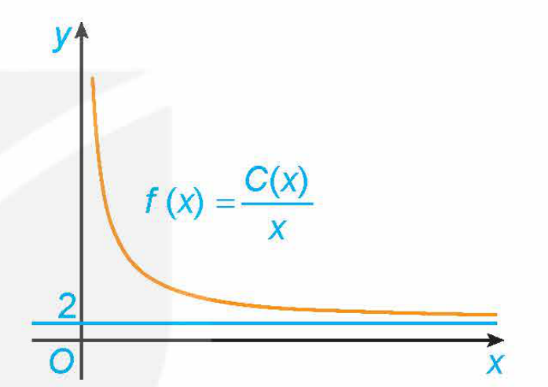
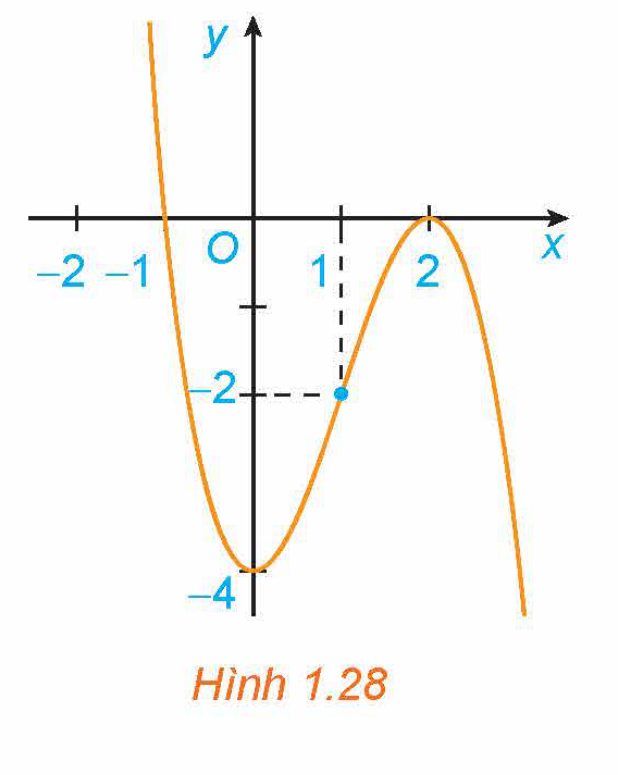
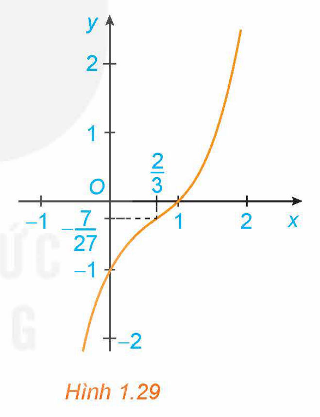
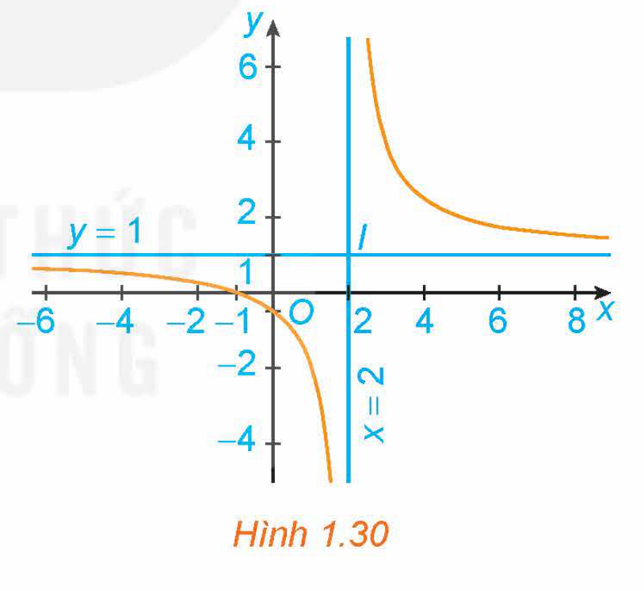
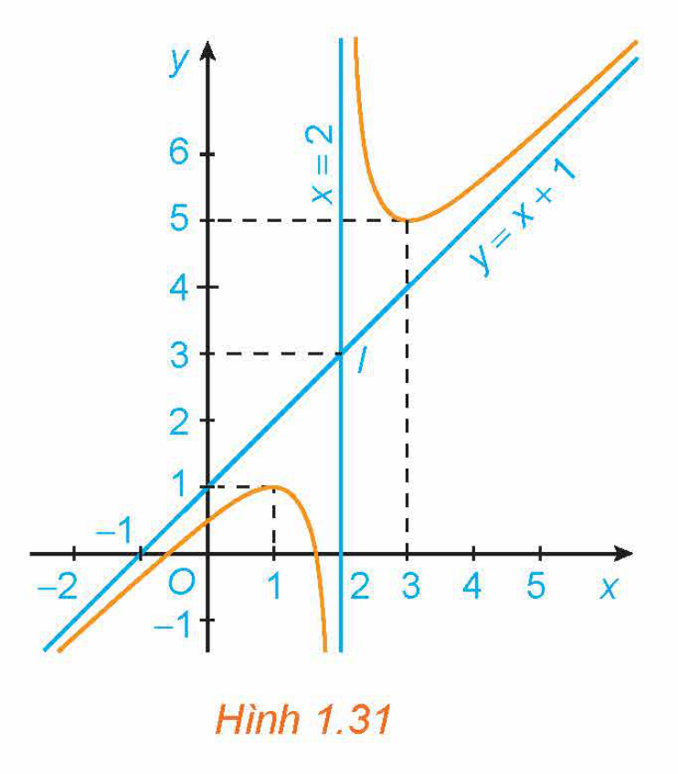
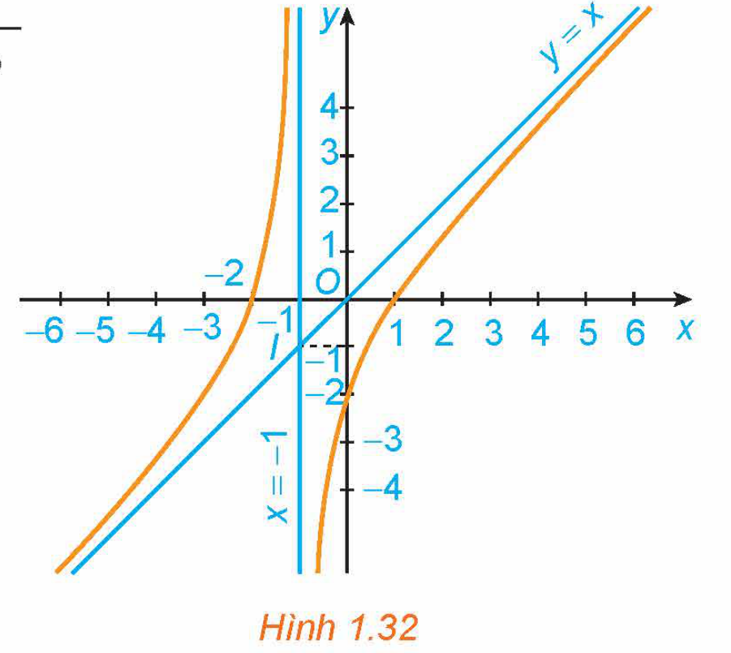
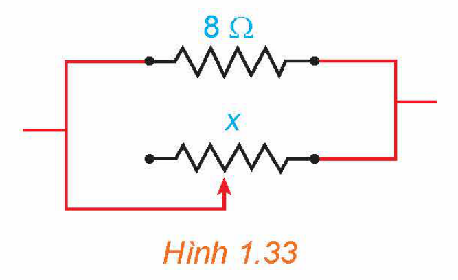

<!-- pdf:28 -->

# BÀI 4: KHẢO SÁT SỰ BIẾN THIÊN VÀ VẼ ĐỒ THỊ CỦA HÀM SỐ

## 🔤 Thuật ngữ

- Chiều biến thiên
- Bảng biến thiên
- Cực trị
- Tiệm cận
- Đồ thị
- Tâm đối xứng
- Trục đối xứng

## 🎯 Mục tiêu

- Mô tả sơ đồ tổng quát để khảo sát hàm số (tìm tập xác định, xét chiều biến thiên, tìm cực trị, tìm tiệm cận, lập bảng biến thiên, vẽ đồ thị).
- Khảo sát tập xác định, chiều biến thiên, cực trị, tiệm cận, bảng biến thiên và vẽ đồ thị của các hàm số: hàm bậc ba, hàm phân thức hữu tỉ đơn giản.
- Nhận biết tính đối xứng (trục đối xứng, tâm đối xứng) của đồ thị các hàm số trên.

## 🔴 Mở đầu

Một đơn vị sản xuất hàng tiêu dùng ước tính chi phí để sản xuất $x$ đơn vị sản phẩm là $C(x) = 2x + 45$ (triệu đồng). Khi đó, chi phí trung bình cho mỗi đơn vị sản phẩm là $f(x) = \frac{C(x)}{x}$. Hãy giải thích tại sao chi phí trung bình giảm theo $x$ nhưng luôn lớn hơn $2$ triệu đồng/sản phẩm. Điều này thể hiện trên đồ thị của hàm số $f(x)$ trong Hình 1.27 như thế nào?

*Hình 1.27*

## 1. SƠ ĐỒ KHẢO SÁT HÀM SỐ

**HĐ1:** Làm quen với việc khảo sát và vẽ đồ thị hàm số

Cho hàm số $y = x^2 - 4x + 3$. Thực hiện lần lượt các yêu cầu sau:

a) Tính $y'$ và tìm các điểm tại đó $y' = 0$.

b) Xét dấu $y'$ để tìm các khoảng đồng biến, khoảng nghịch biến và cực trị của hàm số.

c) Tính $\lim_{x \to -\infty} y$, $\lim_{x \to +\infty} y$ và lập bảng biến thiên của hàm số.

d) Vẽ đồ thị của hàm số và nhận xét về tính đối xứng của đồ thị.

<!-- term: Sơ đồ khảo sát hàm số -->
Sơ đồ khảo sát hàm số $y = f(x)$:
> 1. Tìm tập xác định của hàm số.
> 2. Khảo sát sự biến thiên của hàm số:
>    - Tính đạo hàm $y'$. Tìm các điểm tại đó $y'$ bằng $0$ hoặc đạo hàm không tồn tại.
>    - Xét dấu $y'$ để chỉ ra các khoảng đơn điệu của hàm số.
>    - Tìm cực trị của hàm số.
>    - Tìm các giới hạn tại vô cực, giới hạn vô cực và tìm tiệm cận của đồ thị hàm số (nếu có).
>    - Lập bảng biến thiên của hàm số.
> 3. Vẽ đồ thị của hàm số dựa vào bảng biến thiên.

<!-- pdf:29 -->

> **Chú ý:** Khi vẽ đồ thị, nên xác định thêm một số điểm đặc biệt của đồ thị, chẳng hạn tìm giao điểm của đồ thị với các trục toạ độ (khi có và việc tìm không quá phức tạp). Ngoài ra, cần lưu ý đến tính đối xứng của đồ thị (đối xứng tâm, đối xứng trục).

## 2. KHẢO SÁT VÀ VẼ ĐỒ THỊ HÀM SỐ ĐA THỨC BẬC BA

Trong mục này, ta sử dụng sơ đồ tổng quát ở Mục 1 để khảo sát sự biến thiên và vẽ đồ thị của hàm số bậc ba.

**Ví dụ 1:** Khảo sát sự biến thiên và vẽ đồ thị của hàm số $y = -x^3 + 3x^2 - 4$.

**Giải:**

1. Tập xác định của hàm số: $\mathbb{R}$.

2. Sự biến thiên:

- Ta có: $y' = -3x^2 + 6x$. Vậy $y' = 0$ khi $x = 0$ hoặc $x = 2$.
- Trên khoảng $(0; 2)$, $y' > 0$ nên hàm số đồng biến. Trên các khoảng $(-\infty; 0)$ và $(2; +\infty)$, $y' < 0$ nên hàm số nghịch biến trên mỗi khoảng đó.
- Hàm số đạt cực tiểu tại $x = 0$, giá trị cực tiểu $y_{CT} = -4$. Hàm số đạt cực đại tại $x = 2$, giá trị cực đại $y_{CĐ} = 0$.
- Giới hạn tại vô cực: $\lim_{x \to -\infty} y = \lim_{x \to -\infty} x^3 \left(-1 + \frac{3}{x} - \frac{4}{x^3}\right) = +\infty$; $\lim_{x \to +\infty} y = \lim_{x \to +\infty} x^3 \left(-1 + \frac{3}{x} - \frac{4}{x^3}\right) = -\infty$.
- Bảng biến thiên:

| $x$ | $-\infty$ | | $0$ | | $2$ | | $+\infty$ |
| --- | --- | --- | --- | --- | --- | --- | --- |
| $y'$ | | $-$ | $0$ | $+$ | $0$ | $-$ | |
| $y$ | $+\infty$ | $\searrow$ | $-4$ | $\nearrow$ | $0$ | $\searrow$ | $-\infty$ |

3. Đồ thị (H.1.28):

- Giao điểm của đồ thị hàm số với trục tung là điểm $(0; -4)$.
- Ta có $y = 0 \Leftrightarrow -x^3 + 3x^2 - 4 = 0 \Leftrightarrow -(x - 2)^2(x + 1) = 0 \Leftrightarrow x = -1$ hoặc $x = 2$. Do đó giao điểm của đồ thị hàm số với trục hoành là các điểm $(-1; 0)$ và $(2; 0)$.
- Đồ thị hàm số có tâm đối xứng là điểm $(1; -2)$.

*Hình 1.28*

> **Chú ý:** Đồ thị của hàm số bậc ba $y = ax^3 + bx^2 + cx + d \ (a \ne 0)$:
> - Có **tâm đối xứng** là điểm có hoành độ thoả mãn $y'' = 0$, hay $x = -\frac{b}{3a}$.
> - Không có tiệm cận.

<!-- pdf:30 -->

**Ví dụ 2:** Khảo sát sự biến thiên và vẽ đồ thị của hàm số $y = x^3 - 2x^2 + 2x - 1$.

**Giải:**

1. Tập xác định của hàm số: $\mathbb{R}$.

2. Sự biến thiên:

- Ta có: $y' = 3x^2 - 4x + 2$. Vậy $y' > 0$ với mọi $x \in \mathbb{R}$.
- Hàm số đồng biến trên khoảng $(-\infty; +\infty)$.
- Hàm số không có cực trị.
- Giới hạn tại vô cực: $\lim_{x \to -\infty} y = \lim_{x \to -\infty} x^3 \left(1 - \frac{2}{x} + \frac{2}{x^2} - \frac{1}{x^3}\right) = -\infty$; $\lim_{x \to +\infty} y = \lim_{x \to +\infty} x^3 \left(1 - \frac{2}{x} + \frac{2}{x^2} - \frac{1}{x^3}\right) = +\infty$.
- Bảng biến thiên:
<!-- ocr-ok: đã đối chiếu ảnh trang PDF 30 -->

| $x$ | $-\infty$ | | $+\infty$ |
| --- | --- | --- | --- |
| $y'$ | | $+$ | |
| $y$ | $-\infty$ | $\nearrow$ | $+\infty$ |

3. Đồ thị (H.1.29):

- Giao điểm của đồ thị hàm số với trục tung là điểm $(0; -1)$.
- Ta có $y = 0 \Leftrightarrow x^3 - 2x^2 + 2x - 1 = 0 \Leftrightarrow (x - 1)(x^2 - x + 1) = 0 \Leftrightarrow x = 1$.
  Do đó giao điểm của đồ thị hàm số với trục hoành là điểm $(1; 0)$.
- Đồ thị hàm số có tâm đối xứng là điểm $\left(\frac{2}{3}; -\frac{7}{27}\right)$.

*Hình 1.29*

**Luyện tập 1:** Khảo sát sự biến thiên và vẽ đồ thị của hàm số $y = -2x^3 + 3x^2 - 5x$.

## 3. KHẢO SÁT VÀ VẼ ĐỒ THỊ HÀM SỐ PHÂN THỨC HỮU TỈ

Trong mục này, ta sử dụng sơ đồ tổng quát ở Mục 1 để khảo sát sự biến thiên và vẽ đồ thị của một số hàm phân thức hữu tỉ đơn giản.

**a) Hàm số phân thức $y = \frac{ax + b}{cx + d} \ (c \ne 0, ad - bc \ne 0)$**

**Ví dụ 3:** Khảo sát sự biến thiên và vẽ đồ thị của hàm số $y = \frac{x + 1}{x - 2}$.

**Giải:**

1. Tập xác định của hàm số: $\mathbb{R} \setminus \{2\}$.

<!-- pdf:31 -->

2. Sự biến thiên:

- Ta có: $y' = -\frac{3}{(x - 2)^2} < 0$ với mọi $x \ne 2$.
- Hàm số nghịch biến trên từng khoảng $(-\infty; 2)$ và $(2; +\infty)$.
- Hàm số không có cực trị.
- Tiệm cận: $\lim_{x \to 2^-} y = \lim_{x \to 2^-} \frac{x + 1}{x - 2} = -\infty$; $\lim_{x \to 2^+} y = \lim_{x \to 2^+} \frac{x + 1}{x - 2} = +\infty$;
  $\lim_{x \to +\infty} y = \lim_{x \to +\infty} \frac{x + 1}{x - 2} = 1$; $\lim_{x \to -\infty} y = \lim_{x \to -\infty} \frac{x + 1}{x - 2} = 1$.
  Do đó, đồ thị của hàm số có tiệm cận đứng là đường thẳng $x = 2$, tiệm cận ngang là đường thẳng $y = 1$.
- Bảng biến thiên:

| $x$ | $-\infty$ | | $2$ | | $+\infty$ |
| --- | --- | --- | --- | --- | --- |
| $y'$ | | $-$ | $\Vert$ | $-$ | |
| $y$ | $1$ | $\searrow$ | $-\infty \ \Vert \ +\infty$ | $\searrow$ | $1$ |

3. Đồ thị (H.1.30):

- Giao điểm của đồ thị hàm số với trục tung là điểm $\left(0; -\frac{1}{2}\right)$.
- Giao điểm của đồ thị hàm số với trục hoành là điểm $(-1; 0)$.
- Đồ thị hàm số nhận giao điểm $I(2; 1)$ của hai đường tiệm cận làm tâm đối xứng và nhận hai đường phân giác của các góc tạo bởi hai đường tiệm cận này làm trục đối xứng.

*Hình 1.30*

> **Chú ý:** Đồ thị của hàm số phân thức $y = \frac{ax + b}{cx + d} \ (c \ne 0, ad - bc \ne 0)$:
> - Nhận giao điểm của tiệm cận đứng và tiệm cận ngang làm **tâm đối xứng**;
> - Nhận hai đường phân giác của các góc tạo bởi hai đường tiệm cận này làm các **trục đối xứng**.

**Luyện tập 2:** Giải bài toán ở *tình huống mở đầu*, coi $f(x)$ là hàm số xác định với $x \ge 1$.

**Vận dụng:** Một bể chứa ban đầu có $200$ lít nước. Sau đó, cứ mỗi phút người ta bơm thêm $40$ lít nước, đồng thời cho vào bể $20$ gam chất khử trùng (hoà tan).

a) Tính thể tích nước và khối lượng chất khử trùng có trong bể sau $t$ phút. Từ đó tính nồng độ chất khử trùng (gam/lít) trong bể sau $t$ phút.

<!-- pdf:32 -->

b) Coi nồng độ chất khử trùng là hàm số $f(t)$ với $t \ge 0$. Khảo sát sự biến thiên và vẽ đồ thị của hàm số này.

c) Hãy giải thích tại sao nồng độ chất khử trùng tăng theo $t$ nhưng không vượt ngưỡng $0,5$ gam/lít.

**b) Hàm số phân thức $y = \frac{ax^2 + bx + c}{px + q} \ (a \ne 0, p \ne 0, \text{đa thức tử không chia hết cho đa thức mẫu})$**

**Ví dụ 4:** Khảo sát và vẽ đồ thị của hàm số $y = \frac{x^2 - x - 1}{x - 2}$.

**Giải:**

1. Tập xác định của hàm số: $\mathbb{R} \setminus \{2\}$.

2. Sự biến thiên: Viết $y = x + 1 + \frac{1}{x - 2}$.

- Ta có: $y' = 1 - \frac{1}{(x - 2)^2} = \frac{x^2 - 4x + 3}{(x - 2)^2}$. Vậy $y' = 0 \Leftrightarrow \frac{x^2 - 4x + 3}{(x - 2)^2} = 0 \Leftrightarrow x = 1$ hoặc $x = 3$.
- Trên các khoảng $(-\infty; 1)$ và $(3; +\infty)$, $y' > 0$ nên hàm số đồng biến trên từng khoảng này.
  Trên các khoảng $(1; 2)$ và $(2; 3)$, $y' < 0$ nên hàm số nghịch biến trên từng khoảng này.
- Hàm số đạt cực đại tại $x = 1$ với $y_{CĐ} = 1$; hàm số đạt cực tiểu tại $x = 3$ với $y_{CT} = 5$.
- $\lim_{x \to -\infty} y = \lim_{x \to -\infty} \frac{x^2 - x - 1}{x - 2} = \lim_{x \to -\infty} \frac{x - 1 - \frac{1}{x}}{1 - \frac{2}{x}} = -\infty$; $\lim_{x \to +\infty} y = \lim_{x \to +\infty} \frac{x^2 - x - 1}{x - 2} = \lim_{x \to +\infty} \frac{x - 1 - \frac{1}{x}}{1 - \frac{2}{x}} = +\infty$.
- Tiệm cận: $\lim_{x \to 2^-} y = \lim_{x \to 2^-} \left(x + 1 + \frac{1}{x - 2}\right) = -\infty$; $\lim_{x \to 2^+} y = \lim_{x \to 2^+} \left(x + 1 + \frac{1}{x - 2}\right) = +\infty$;
  $\lim_{x \to +\infty} [y - (x + 1)] = \lim_{x \to +\infty} \frac{1}{x - 2} = 0$; $\lim_{x \to -\infty} [y - (x + 1)] = \lim_{x \to -\infty} \frac{1}{x - 2} = 0$.
  Do đó, đồ thị hàm số có tiệm cận đứng là đường thẳng $x = 2$, tiệm cận xiên là đường thẳng $y = x + 1$.
- Bảng biến thiên:

| $x$ | $-\infty$ | | $1$ | | $2$ | | $3$ | | $+\infty$ |
| --- | --- | --- | --- | --- | --- | --- | --- | --- | --- |
| $y'$ | | $+$ | $0$ | $-$ | $\Vert$ | $-$ | $0$ | $+$ | |
| $y$ | $-\infty$ | $\nearrow$ | $1$ | $\searrow$ | $-\infty \ \Vert \ +\infty$ | $\searrow$ | $5$ | $\nearrow$ | $+\infty$ |

3. Đồ thị (H.1.31):

- Giao điểm của đồ thị hàm số với trục tung là điểm $\left(0; \frac{1}{2}\right)$.

*Hình 1.31*

<!-- pdf:33 -->

- Ta có $y = 0 \Leftrightarrow \frac{x^2 - x - 1}{x - 2} = 0 \Leftrightarrow x = \frac{1 - \sqrt{5}}{2}$ hoặc $x = \frac{1 + \sqrt{5}}{2}$. Do đó giao điểm của đồ thị hàm số với trục hoành là các điểm $\left(\frac{1 - \sqrt{5}}{2}; 0\right)$ và $\left(\frac{1 + \sqrt{5}}{2}; 0\right)$.
- Đồ thị hàm số nhận giao điểm $I(2; 3)$ của hai đường tiệm cận làm tâm đối xứng và nhận hai đường phân giác của các góc tạo bởi hai đường tiệm cận này làm các trục đối xứng.

**Ví dụ 5:** Khảo sát sự biến thiên và vẽ đồ thị của hàm số $y = \frac{x^2 + x - 2}{x + 1}$.

**Giải:**

1. Tập xác định của hàm số: $\mathbb{R} \setminus \{-1\}$.

2. Sự biến thiên:

- Viết $y = x - \frac{2}{x + 1}$, ta có $y' = 1 + \frac{2}{(x + 1)^2} > 0$ với mọi $x \ne -1$.
- Hàm số đồng biến trên từng khoảng $(-\infty; -1)$ và $(-1; +\infty)$.
- Hàm số không có cực trị.
- $\lim_{x \to -\infty} y = \lim_{x \to -\infty} \frac{x^2 + x - 2}{x + 1} = \lim_{x \to -\infty} \frac{x + 1 - \frac{2}{x}}{1 + \frac{1}{x}} = -\infty$; $\lim_{x \to +\infty} y = \lim_{x \to +\infty} \frac{x^2 + x - 2}{x + 1} = \lim_{x \to +\infty} \frac{x + 1 - \frac{2}{x}}{1 + \frac{1}{x}} = +\infty$.
- Tiệm cận: $\lim_{x \to -1^-} y = \lim_{x \to -1^-} \left(x - \frac{2}{x + 1}\right) = +\infty$; $\lim_{x \to -1^+} y = \lim_{x \to -1^+} \left(x - \frac{2}{x + 1}\right) = -\infty$;
  $\lim_{x \to +\infty} [y - x] = \lim_{x \to +\infty} \left(-\frac{2}{x + 1}\right) = 0$; $\lim_{x \to -\infty} [y - x] = \lim_{x \to -\infty} \left(-\frac{2}{x + 1}\right) = 0$.
  Do đó, đồ thị hàm số có tiệm cận đứng là đường thẳng $x = -1$, tiệm cận xiên là đường thẳng $y = x$.
- Bảng biến thiên:

| $x$ | $-\infty$ | | $-1$ | | $+\infty$ |
| --- | --- | --- | --- | --- | --- |
| $y'$ | | $+$ | $\Vert$ | $+$ | |
| $y$ | $-\infty$ | $\nearrow$ | $+\infty \ \Vert \ -\infty$ | $\nearrow$ | $+\infty$ |

3. Đồ thị (H.1.32):

- Giao điểm của đồ thị hàm số với trục tung là điểm $(0; -2)$.
- Ta có $y = 0 \Leftrightarrow \frac{x^2 + x - 2}{x + 1} = 0 \Leftrightarrow x = -2$ hoặc $x = 1$.
  Do đó giao điểm của đồ thị hàm số với trục hoành là các điểm $(-2; 0)$ và $(1; 0)$.

*Hình 1.32*

<!-- pdf:34 -->

- Đồ thị hàm số nhận giao điểm $I(-1; -1)$ của hai đường tiệm cận làm tâm đối xứng và nhận hai đường phân giác của góc tạo bởi hai đường tiệm cận này làm các trục đối xứng.

> **Chú ý:** Đồ thị của hàm số phân thức $y = \frac{ax^2 + bx + c}{px + q} \ (a \ne 0, p \ne 0$, đa thức tử không chia hết cho đa thức mẫu):
> - Nhận giao điểm của tiệm cận đứng và tiệm cận xiên làm **tâm đối xứng**;
> - Nhận hai đường phân giác của các góc tạo bởi hai đường tiệm cận này làm các **trục đối xứng**.

**Luyện tập 3:** Khảo sát sự biến thiên và vẽ đồ thị của hàm số $y = \frac{-x^2 + 3x - 1}{x - 2}$.

## ✏️ Bài tập

**1.21.** Khảo sát sự biến thiên và vẽ đồ thị của các hàm số sau:

a) $y = -x^3 + 3x + 1$;

b) $y = x^3 + 3x^2 - x - 1$.

**1.22.** Khảo sát sự biến thiên và vẽ đồ thị của các hàm số sau:

a) $y = \frac{2x + 1}{x + 1}$;

b) $y = \frac{x + 3}{1 - x}$.

**1.23.** Khảo sát sự biến thiên và vẽ đồ thị của các hàm số sau:

a) $y = \frac{2x^2 - x + 4}{x - 1}$;

b) $y = \frac{x^2 + 2x + 1}{x + 3}$.

**1.24.** Một cốc chứa $30\text{ ml}$ dung dịch KOH (potassium hydroxide) với nồng độ $100\text{ mg/ml}$. Một bình chứa dung dịch KOH khác với nồng độ $8\text{ mg/ml}$ được trộn vào cốc.

a) Tính nồng độ KOH trong cốc sau khi trộn $x\text{ (ml)}$ từ bình chứa, kí hiệu là $C(x)$.

b) Coi $C(x)$ là hàm số xác định với $x \ge 0$. Khảo sát sự biến thiên và vẽ đồ thị của hàm số này.

c) Giải thích tại sao nồng độ KOH trong cốc giảm theo $x$ nhưng luôn lớn hơn $8\text{ mg/ml}$.

**1.25.** Trong Vật lí, ta biết rằng khi mắc song song hai điện trở $R_1$ và $R_2$ thì điện trở tương đương $R$ của mạch điện được tính theo công thức $R = \frac{R_1 R_2}{R_1 + R_2}$ (theo *Vật lí đại cương*, *NXB Giáo dục Việt Nam*, *2016*).

*Hình 1.33*

Giả sử một điện trở $8\ \Omega$ được mắc song song với một biến trở như Hình 1.33. Nếu điện trở đó được kí hiệu là $x\ (\Omega)$ thì điện trở tương đương $R$ là hàm số của $x$. Vẽ đồ thị của hàm số $y = R(x)$, $x > 0$ và dựa vào đồ thị đã vẽ, hãy cho biết:

a) Điện trở tương đương của mạch thay đổi thế nào khi $x$ tăng.

b) Tại sao điện trở tương đương của mạch không bao giờ vượt quá $8\ \Omega$.

## 📷 Danh sách hình trong bài

| Mã hình | Trang PDF | Vị trí trong bài | Chú thích gốc |
| --- | --- | --- | --- |
| H12-toan-b04-01 | 28 | Mở đầu | Hình 1.27 |
| H12-toan-b04-02 | 29 | Mục 2, Ví dụ 1 | Hình 1.28 |
| H12-toan-b04-03 | 30 | Mục 2, Ví dụ 2 | Hình 1.29 |
| H12-toan-b04-04 | 31 | Mục 3.a, Ví dụ 3 | Hình 1.30 |
| H12-toan-b04-05 | 32 | Mục 3.b, Ví dụ 4 | Hình 1.31 |
| H12-toan-b04-06 | 33 | Mục 3.b, Ví dụ 5 | Hình 1.32 |
| H12-toan-b04-07 | 34 | Bài tập 1.25 | Hình 1.33 |
