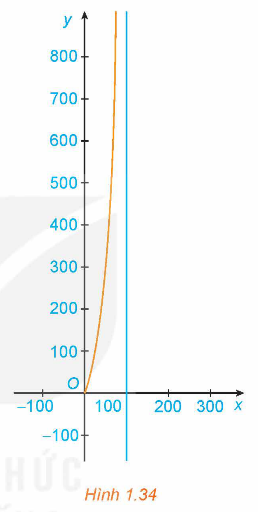
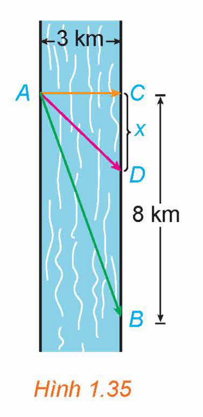
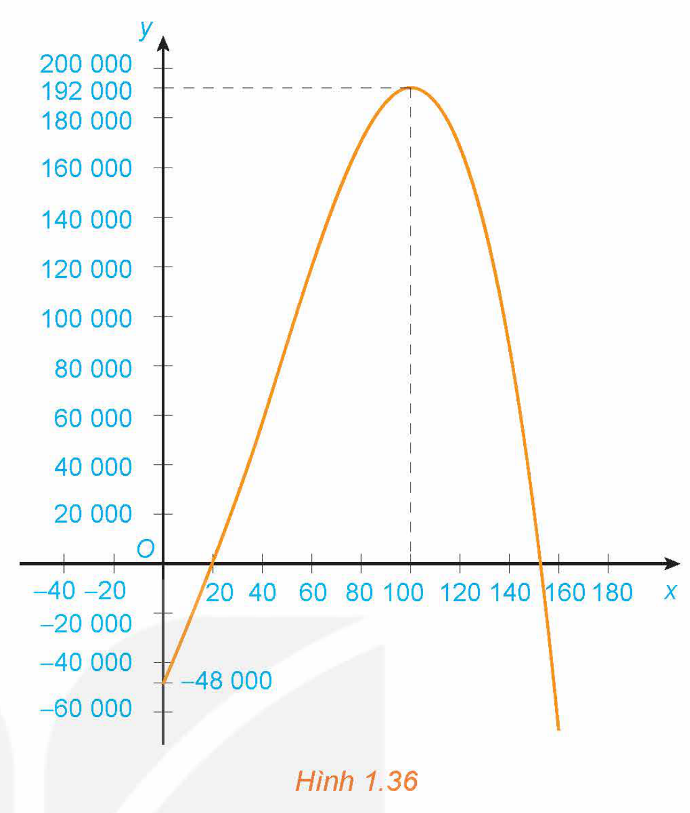

<!-- pdf:35 -->

# BÀI 5: ỨNG DỤNG ĐẠO HÀM ĐỂ GIẢI QUYẾT MỘT SỐ VẤN ĐỀ LIÊN QUAN ĐẾN THỰC TIỄN

## 🔤 Thuật ngữ

- Tốc độ thay đổi tức thời
- Bài toán tối ưu hoá

## 🎯 Mục tiêu

- Vận dụng đạo hàm và khảo sát hàm số để giải quyết một số vấn đề liên quan đến thực tiễn.

## 🔴 Mở đầu

Một đội bóng đá thi đấu trong một sân vận động có sức chứa $55\ 000$ khán giả. Với giá mỗi vé là $100$ nghìn đồng, số khán giả trung bình là $27\ 000$ người. Qua thăm dò dư luận, người ta thấy rằng mỗi khi giá vé giảm thêm $10$ nghìn đồng, sẽ có thêm khoảng $3\ 000$ khán giả. Hỏi ban tổ chức nên đặt giá vé là bao nhiêu để doanh thu từ tiền bán vé là lớn nhất?

## 1. TỐC ĐỘ THAY ĐỔI CỦA MỘT ĐẠI LƯỢNG

Giả sử $y$ là một hàm số của $x$ và ta viết $y = f(x)$. Nếu $x$ thay đổi từ $x_1$ đến $x_2$, thì sự thay đổi của $x$ là
<!-- ocr-ok: đã đối chiếu ảnh trang PDF 35 -->

$\Delta x = x_2 - x_1,$

và sự thay đổi tương ứng của $y$ là

$\Delta y = f(x_2) - f(x_1).$

Tỉ số $\frac{\Delta y}{\Delta x} = \frac{f(x_2) - f(x_1)}{x_2 - x_1}$ được gọi là **tốc độ thay đổi trung bình** của $y$ đối với $x$ trên đoạn $[x_1; x_2]$.

Giới hạn $\lim_{\Delta x \to 0} \frac{\Delta y}{\Delta x} = \lim_{x_2 \to x_1} \frac{f(x_2) - f(x_1)}{x_2 - x_1}$ được gọi là **tốc độ thay đổi tức thời** của $y$ đối với $x$ tại điểm $x = x_1$.

Như vậy, đạo hàm $f'(a)$ là tốc độ thay đổi tức thời của đại lượng $y = f(x)$ đối với $x$ tại điểm $x = a$. Dưới đây, chúng ta xem xét một số ứng dụng của ý tưởng này đối với vật lí, hoá học, sinh học và kinh tế:

- Nếu $s = s(t)$ là **hàm vị trí** của một vật chuyển động trên một đường thẳng thì $v = s'(t)$ biểu thị **vận tốc tức thời** của vật (tốc độ thay đổi của độ dịch chuyển theo thời gian). Tốc độ thay đổi tức thời của vận tốc theo thời gian là **gia tốc tức thời** của vật:

$a(t) = v'(t) = s''(t).$

- Nếu $C = C(t)$ là nồng độ của một chất tham gia phản ứng hoá học tại thời điểm $t$, thì $C'(t)$ là **tốc độ phản ứng tức thời** (tức là độ thay đổi nồng độ) của chất đó tại thời điểm $t$.
- Nếu $P = P(t)$ là số lượng cá thể trong một quần thể động vật hoặc thực vật tại thời điểm $t$, thì $P'(t)$ biểu thị **tốc độ tăng trưởng tức thời** của quần thể tại thời điểm $t$.

<!-- pdf:36 -->

- Nếu $C = C(x)$ là **hàm chi phí**, tức là tổng chi phí khi sản xuất $x$ đơn vị hàng hoá, thì tốc độ thay đổi tức thời $C'(x)$ của chi phí đối với số lượng đơn vị hàng được sản xuất được gọi là **chi phí biên**.
- Về ý nghĩa kinh tế, chi phí biên $C'(x)$ xấp xỉ với chi phí để sản xuất thêm một đơn vị hàng hoá tiếp theo, tức là đơn vị hàng hoá thứ $x + 1$ (xem SGK *Toán 11 tập hai*, trang 87, bộ sách *Kết nối tri thức với cuộc sống*).

**Ví dụ 1:** Khi bỏ qua sức cản của không khí, độ cao (mét) của một vật được phóng thẳng đứng lên trên từ điểm cách mặt đất $2\text{ m}$ với vận tốc ban đầu $24,5\text{ m/s}$ là $h(t) = 2 + 24,5t - 4,9t^2$ (theo *Vật lí đại cương*, *NXB Giáo dục Việt Nam*, *2016*).

a) Tìm vận tốc của vật sau $2$ giây.

b) Khi nào vật đạt độ cao lớn nhất và độ cao lớn nhất đó là bao nhiêu?

c) Khi nào thì vật chạm đất và vận tốc của vật lúc chạm đất là bao nhiêu?

**Giải:**

a) Theo ý nghĩa cơ học của đạo hàm, vận tốc của vật là $v = h'(t) = 24,5 - 9,8t\text{ (m/s)}$.

Do đó, vận tốc của vật sau $2$ giây là $v(2) = 24,5 - 9,8 \cdot 2 = 4,9\text{ (m/s)}$.

b) Vì $h(t)$ là hàm số bậc hai có hệ số $a = -4,9 < 0$ nên $h(t)$ đạt giá trị lớn nhất tại $t = -\frac{b}{2a} = \frac{24,5}{2 \cdot 4,9} = 2,5$ (giây). Khi đó, độ cao lớn nhất của vật là $h(2,5) = 32,625\text{ (m)}$.

c) Vật chạm đất khi độ cao bằng $0$, tức là $h = 2 + 24,5t - 4,9t^2 = 0$, hay $t \approx 5,08$ (giây).
<!-- ocr-ok: đã đối chiếu ảnh trang PDF 36 -->

Vận tốc của vật lúc chạm đất là $v(5,08) = 24,5 - 9,8 \cdot 5,08 = -25,284\text{ (m/s)}$.

Vận tốc âm chứng tỏ chiều chuyển động của vật là ngược chiều dương (hướng lên trên) của trục đã chọn (khi lập phương trình chuyển động của vật).

**Ví dụ 2:** Giả sử số lượng của một quần thể nấm men tại môi trường nuôi cấy trong phòng thí nghiệm được mô hình hoá bằng hàm số $P(t) = \frac{a}{b + \text{e}^{-0,75t}}$, trong đó thời gian $t$ được tính bằng giờ. Tại thời điểm ban đầu $t = 0$, quần thể có $20$ tế bào và tăng với tốc độ $12$ tế bào/giờ. Tìm các giá trị của $a$ và $b$. Theo mô hình này, điều gì xảy ra với quần thể nấm men về lâu dài?

**Giải:**

Ta có: $P'(t) = \frac{0,75a\text{e}^{-0,75t}}{(b + \text{e}^{-0,75t})^2}, \ t \ge 0$.

Theo đề bài, ta có: $P(0) = 20$ và $P'(0) = 12$. Do đó, ta có hệ phương trình:

$\begin{cases} \frac{a}{b + 1} = 20 \\ \frac{0,75a}{(b + 1)^2} = 12 \end{cases} \Leftrightarrow \begin{cases} a = 20(b + 1) \\ \frac{15}{b + 1} = 12. \end{cases}$

Giải hệ phương trình này, ta được $a = 25$ và $b = \frac{1}{4}$.

<!-- pdf:37 -->

Khi đó, $P'(t) = \frac{18,75\text{e}^{-0,75t}}{\left(\frac{1}{4} + \text{e}^{-0,75t}\right)^2} > 0, \ \forall t \ge 0$, tức là số lượng quần thể nấm men luôn tăng.

Tuy nhiên, do $\lim_{t \to +\infty} P(t) = \lim_{t \to +\infty} \frac{25}{\frac{1}{4} + \text{e}^{-0,75t}} = 100$ nên số lượng quần thể nấm men tăng nhưng không vượt quá $100$ tế bào.

**Ví dụ 3:** Giả sử chi phí $C(x)$ (nghìn đồng) để sản xuất $x$ đơn vị của một loại hàng hoá nào đó được cho bởi hàm số $C(x) = 30\ 000 + 300x - 2,5x^2 + 0,125x^3$.

a) Tìm hàm chi phí biên.

b) Tìm $C'(200)$ và giải thích ý nghĩa.

c) So sánh $C'(200)$ với chi phí sản xuất đơn vị hàng hoá thứ $201$.

**Giải:**

a) Hàm chi phí biên là $C'(x) = 300 - 5x + 0,375x^2$.

b) Ta có: $C'(200) = 300 - 5 \cdot 200 + 0,375 \cdot 200^2 = 14\ 300$.

Chi phí biên tại $x = 200$ là $14\ 300$ nghìn đồng, nghĩa là chi phí để sản xuất thêm một đơn vị hàng hoá tiếp theo (đơn vị hàng hoá thứ $201$) là khoảng $14\ 300$ nghìn đồng.

c) Chi phí sản xuất đơn vị hàng hoá thứ $201$ là

$C(201) - C(200) = 1\ 004\ 372,625 - 990\ 000 = 14\ 372,625$ (nghìn đồng).

Giá trị này xấp xỉ với chi phí biên $C'(200)$ đã tính ở câu b.

**Ví dụ 4:** Để loại bỏ $x\%$ chất gây ô nhiễm không khí từ khí thải của một nhà máy, người ta ước tính chi phí cần bỏ ra là

$C(x) = \frac{300x}{100 - x}$ (triệu đồng), $0 \le x < 100$.

Khảo sát sự biến thiên và vẽ đồ thị của hàm số $y = C(x)$. Từ đó, hãy cho biết:

a) Chi phí cần bỏ ra sẽ thay đổi như thế nào khi $x$ tăng?

b) Có thể loại bỏ được $100\%$ chất gây ô nhiễm không khí không? Vì sao?

**Giải:**

Xét hàm số $y = C(x) = \frac{300x}{100 - x}, \ 0 \le x < 100$.

Ta có:

- $y' = \frac{30\ 000}{(100 - x)^2} > 0$, với mọi $x \in [0; 100)$.
  Do đó hàm số luôn đồng biến trên nửa khoảng $[0; 100)$.
- $\lim_{x \to 100^-} C(x) = \lim_{x \to 100^-} \frac{300x}{100 - x} = +\infty$, nên đồ thị hàm số có tiệm cận đứng là $x = 100$.

<!-- pdf:38 -->

Bảng biến thiên:

| $x$ | $0$ | | $100$ |
| --- | --- | --- | --- |
| $C'(x)$ | | $+$ | |
| $C(x)$ | $0$ | $\nearrow$ | $+\infty$ |

Đồ thị hàm số như Hình 1.34.

*Hình 1.34*

a) Chi phí cần bỏ ra $C(x)$ sẽ luôn tăng khi $x$ tăng.
<!-- ocr-ok: đã đối chiếu ảnh trang PDF 38 -->

b) Vì $\lim_{x \to 100^-} C(x) = +\infty$ (hàm số $C(x)$ không xác định khi $x = 100$) nên nhà máy không thể loại bỏ $100\%$ chất gây ô nhiễm không khí (dù bỏ ra chi phí là bao nhiêu đi chăng nữa).

**Luyện tập 1:** Khi máu di chuyển từ tim qua các động mạch chính rồi đến các mao mạch và quay trở lại qua các tĩnh mạch, huyết áp tâm thu (tức là áp lực của máu lên động mạch khi tim co bóp) liên tục giảm xuống. Giả sử một người có huyết áp tâm thu $P$ (tính bằng $\text{mmHg}$) được cho bởi hàm số

$P(t) = \frac{25t^2 + 125}{t^2 + 1}, \ 0 \le t \le 10,$

trong đó thời gian $t$ được tính bằng giây. Tính tốc độ thay đổi của huyết áp sau $5$ giây kể từ khi máu rời tim.

## 2. MỘT VÀI BÀI TOÁN TỐI ƯU HOÁ ĐƠN GIẢN

Một trong những ứng dụng phổ biến nhất của đạo hàm là cung cấp một phương pháp tổng quát, hiệu quả để giải những bài toán tối ưu hoá. Trong mục này, chúng ta sẽ giải quyết những vấn đề thường gặp như tối đa hoá diện tích, khối lượng, lợi nhuận, cũng như tối thiểu hoá khoảng cách, thời gian, chi phí.

Khi giải những bài toán như vậy, khó khăn lớn nhất thường là việc chuyển đổi bài toán thực tế cho bằng lời thành bài toán tối ưu hoá toán học bằng cách thiết lập một hàm số phù hợp mà ta cần tìm giá trị lớn nhất hoặc giá trị nhỏ nhất của nó, trên miền biến thiên phù hợp của biến số.

<!-- term: Bài toán tối ưu hoá -->
Quy trình giải một bài toán tối ưu hoá:
*Bước 1.* Xác định đại lượng $Q$ mà ta cần làm cho giá trị của đại lượng ấy lớn nhất hoặc nhỏ nhất và biểu diễn nó qua các đại lượng khác trong bài toán.
*Bước 2.* Chọn một đại lượng thích hợp nào đó, kí hiệu là $x$, và biểu diễn các đại lượng khác ở Bước 1 theo $x$. Khi đó, đại lượng $Q$ sẽ là hàm số của một biến $x$. Tìm tập xác định của hàm số $Q = Q(x)$.
*Bước 3.* Tìm giá trị lớn nhất hoặc giá trị nhỏ nhất của hàm số $Q = Q(x)$ bằng các phương pháp đã biết và kết luận.

<!-- pdf:39 -->

**Ví dụ 5:** Một nhà sản xuất cần làm những hộp đựng hình trụ có thể tích $1$ lít. Tìm các kích thước của hộp đựng để chi phí vật liệu dùng để sản xuất là nhỏ nhất (kết quả được tính theo centimét và làm tròn đến chữ số thập phân thứ hai).

**Giải:**

Đổi $1$ lít $= 1\ 000\text{ cm}^3$.

Gọi $r\text{ (cm)}$ là bán kính đáy của hình trụ, $h\text{ (cm)}$ là chiều cao của hình trụ.

Diện tích toàn phần của hình trụ là: $S = 2\pi r^2 + 2\pi rh$.

Do thể tích của hình trụ là $1\ 000\text{ cm}^3$ nên ta có: $1\ 000 = V = \pi r^2 h$, hay $h = \frac{1\ 000}{\pi r^2}$.

Do đó, diện tích toàn phần của hình trụ là: $S = 2\pi r^2 + \frac{2\ 000}{r}, \ r > 0$.

Ta cần tìm $r$ sao cho $S$ đạt giá trị nhỏ nhất. Ta có:

$S' = 4\pi r - \frac{2\ 000}{r^2} = \frac{4\pi r^3 - 2\ 000}{r^2}; \ S' = 0 \Leftrightarrow \pi r^3 = 500 \Leftrightarrow r = \sqrt[3]{\frac{500}{\pi}}.$

Bảng biến thiên:

| $r$ | $0$ | | $\sqrt[3]{\frac{500}{\pi}}$ | | $+\infty$ |
| --- | --- | --- | --- | --- | --- |
| $S'(r)$ | | $-$ | $0$ | $+$ | |
| $S(r)$ | $+\infty$ | $\searrow$ | $S\left(\sqrt[3]{\frac{500}{\pi}}\right)$ | $\nearrow$ | $+\infty$ |

Khi đó: $h = \frac{1\ 000}{\pi r^2} = \frac{1\ 000}{\pi \sqrt[3]{\frac{250\ 000}{\pi^2}}} = \frac{100}{\sqrt[3]{250\pi}}$.

Vậy cần sản xuất các hộp đựng hình trụ có bán kính đáy $r = \sqrt[3]{\frac{500}{\pi}} \approx 5,42\text{ (cm)}$ và chiều cao $h = \frac{100}{\sqrt[3]{250\pi}} \approx 10,84\text{ (cm)}$.

> **Chú ý:** Từ lời giải Ví dụ 5 ta thấy: Nếu hình trụ có thể tích $V$ không đổi thì diện tích bề mặt của hình trụ nhỏ nhất khi chiều cao bằng đường kính đáy.

<!-- pdf:40 -->

**Luyện tập 2:** Anh An chèo thuyền từ điểm $A$ trên bờ một con sông thẳng rộng $3\text{ km}$ và muốn đến điểm $B$ ở bờ đối diện cách $8\text{ km}$ về phía hạ lưu càng nhanh càng tốt (H.1.35). Anh An có thể chèo thuyền trực tiếp qua sông đến điểm $C$ rồi chạy bộ đến $B$, hoặc anh có thể chèo thuyền thẳng đến $B$, hoặc anh cũng có thể chèo thuyền đến một điểm $D$ nào đó giữa $C$ và $B$ rồi chạy bộ đến $B$. Nếu vận tốc chèo thuyền là $6\text{ km/h}$ và vận tốc chạy bộ là $8\text{ km/h}$ thì anh An phải chèo thuyền sang bờ ở điểm nào để đến được $B$ càng sớm càng tốt? (Giả sử rằng vận tốc của nước là không đáng kể so với vận tốc chèo thuyền của anh An).

*Hình 1.35*

Nhắc lại rằng nếu $C(x)$ là **hàm chi phí**, tức là chi phí sản xuất $x$ đơn vị của một sản phẩm nào đó, thì **chi phí biên** là tốc độ thay đổi của $C$ đối với $x$, tức là đạo hàm $C'(x)$.

Gọi $p(x)$ là giá bán mỗi đơn vị mà công ty có thể tính nếu bán $x$ đơn vị. Khi đó, $p$ được gọi là **hàm cầu** (hay **hàm giá**) và chúng ta mong đợi đó là một hàm giảm của $x$. Nếu $x$ đơn vị được bán và giá mỗi đơn vị là $p(x)$ thì tổng doanh thu là

$R(x) = x \cdot p(x)$

và $R(x)$ được gọi là **hàm doanh thu**. Đạo hàm $R'(x)$ của hàm doanh thu được gọi là **hàm doanh thu biên** và là tốc độ thay đổi của doanh thu đối với số lượng đơn vị sản phẩm bán ra.

Nếu $x$ đơn vị được bán, thì tổng lợi nhuận là

$P(x) = R(x) - C(x)$

và $P(x)$ được gọi là **hàm lợi nhuận**. **Hàm lợi nhuận biên** là đạo hàm $P'(x)$ của hàm lợi nhuận.

**Ví dụ 6:** Giải bài toán trong *tình huống mở đầu*.

**Giải:**

Gọi $p$ (nghìn đồng) là giá của mỗi vé; $x$ là số khán giả mua vé. Ta cần xác định hàm cầu $p = p(x)$. Theo giả thiết, tốc độ thay đổi của $x$ tỉ lệ với tốc độ thay đổi của $p$ nên hàm số $p = p(x)$ là hàm số bậc nhất.

Giá vé $p_1 = 100$ ứng với $x_1 = 27\ 000$ và giá vé $p_2 = 90$ ứng với $x_2 = 27\ 000 + 3\ 000 = 30\ 000$.
<!-- ocr-ok: đã đối chiếu ảnh trang PDF 40 -->

Do đó, phương trình đường thẳng $p = ax + b$ đi qua hai điểm $(27\ 000; 100)$ và $(30\ 000; 90)$ là $p - 100 = \frac{100 - 90}{27\ 000 - 30\ 000}(x - 27\ 000)$, hay $p - 100 = -\frac{1}{300}(x - 27\ 000)$, tức là $x = -300p + 57\ 000$.

Hàm doanh thu từ tiền bán vé là

$R(p) = px = p(-300p + 57\ 000) = -300p^2 + 57\ 000p.$

Ta cần tìm $p$ sao cho $R$ đạt giá trị lớn nhất. Ta có:

$R'(p) = -600p + 57\ 000; \ R'(p) = 0 \Leftrightarrow p = 95.$

<!-- pdf:41 -->

Bảng biến thiên:

| $p$ | $0$ | | $95$ | | $+\infty$ |
| --- | --- | --- | --- | --- | --- |
| $R'(p)$ | | $+$ | $0$ | $-$ | |
| $R(p)$ | $0$ | $\nearrow$ | $2\ 707\ 500$ | $\searrow$ | $-\infty$ |

Vậy với giá vé là $95$ nghìn đồng một vé thì doanh thu bán vé là lớn nhất.

**Ví dụ 7:** Một nhà phân tích thị trường làm việc cho một công ty sản xuất thiết bị gia dụng nhận thấy rằng nếu công ty sản xuất và bán $x$ chiếc máy xay sinh tố hằng tháng thì lợi nhuận thu được (nghìn đồng) là

$P(x) = -0,3x^3 + 36x^2 + 1\ 800x - 48\ 000.$

Khảo sát sự biến thiên và vẽ đồ thị hàm số $y = P(x), \ x \ge 0$. Sử dụng đồ thị đã vẽ để trả lời các câu hỏi sau:

a) Khi chỉ sản xuất một vài máy xay sinh tố, công ty sẽ bị lỗ (vì lúc này lợi nhuận âm). Hỏi hằng tháng công ty phải sản xuất ít nhất bao nhiêu chiếc máy xay sinh tố để hoà vốn?

b) Lợi nhuận lớn nhất mà công ty có thể đạt được là bao nhiêu? Công ty có nên sản xuất $200$ chiếc máy xay sinh tố hằng tháng hay không?

**Giải:**

Xét hàm số $y = P(x) = -0,3x^3 + 36x^2 + 1\ 800x - 48\ 000, \ x \ge 0$.

Ta có:

- $y' = P'(x) = -0,9x^2 + 72x + 1\ 800$; $y' = 0 \Leftrightarrow x = 100$ (vì $x \ge 0$).
  $P'(x) > 0$ với mọi $x \in [0; 100)$, $P'(x) < 0$ với mọi $x \in (100; +\infty)$.
  Do đó hàm số đồng biến trên nửa khoảng $[0; 100)$ và nghịch biến trên khoảng $(100; +\infty)$.
  Tại $x = 100$, hàm số đạt cực đại và $y_{CĐ} = y(100) = 192\ 000$.
- $\lim_{x \to +\infty} P(x) = -\infty$.

Bảng biến thiên:

| $x$ | $0$ | | $100$ | | $+\infty$ |
| --- | --- | --- | --- | --- | --- |
| $P'(x)$ | | $+$ | $0$ | $-$ | |
| $P(x)$ | $-48\ 000$ | $\nearrow$ | $192\ 000$ | $\searrow$ | $-\infty$ |

<!-- pdf:42 -->

Đồ thị hàm số như Hình 1.36 (ở đây ta lấy một đơn vị trên trục hoành bằng $1\ 000$ đơn vị trên trục tung).

*Hình 1.36*

Từ đồ thị đã vẽ suy ra:

a) Đồ thị xuất phát từ điểm $(0; -48\ 000)$, ở phía dưới trục hoành (tức là công ty đang bị lỗ), và giao với trục hoành tại điểm đầu tiên có hoành độ $x = 20$. Do đó, hằng tháng công ty cần sản xuất ít nhất $20$ chiếc máy xay sinh tố để hoà vốn.

b) Từ đồ thị ta thấy khi sản xuất hơn $100$ chiếc máy xay sinh tố mỗi tháng thì càng sản xuất nhiều lợi nhuận càng giảm. Do đó, công ty không nên sản xuất $200$ chiếc máy xay sinh tố hằng tháng.

Lợi nhuận lớn nhất mà công ty có thể thu được là $y_{CĐ} = y(100) = 192\ 000$ (nghìn đồng), tức là $192$ triệu đồng, đạt được khi sản xuất đúng $100$ chiếc máy xay sinh tố mỗi tháng.

**Vận dụng:** Một nhà sản xuất trung bình bán được $1\ 000$ ti vi màn hình phẳng mỗi tuần với giá $14$ triệu đồng một chiếc. Một cuộc khảo sát thị trường chỉ ra rằng nếu cứ giảm giá bán $500$ nghìn đồng, số lượng ti vi bán ra sẽ tăng thêm khoảng $100$ ti vi mỗi tuần.

a) Tìm hàm cầu.

b) Công ty nên giảm giá bao nhiêu cho người mua để doanh thu là lớn nhất?

c) Nếu hàm chi phí hằng tuần là $C(x) = 12\ 000 - 3x$ (triệu đồng), trong đó $x$ là số ti vi bán ra trong tuần, nhà sản xuất nên đặt giá bán như thế nào để lợi nhuận là lớn nhất?

## ✏️ Bài tập

**1.26.** Giả sử một hạt chuyển động trên một trục thẳng đứng chiều dương hướng lên trên sao cho toạ độ của hạt (đơn vị: mét) tại thời điểm $t$ (giây) là $y = t^3 - 12t + 3, \ t \ge 0$.

a) Tìm các hàm vận tốc và gia tốc.

b) Khi nào thì hạt chuyển động lên trên và khi nào thì hạt chuyển động xuống dưới?

c) Tìm quãng đường hạt đi được trong khoảng thời gian $0 \le t \le 3$.

d) Khi nào hạt tăng tốc? Khi nào hạt giảm tốc?

<!-- pdf:43 -->

**1.27.** Giả sử chi phí (tính bằng trăm nghìn đồng) để sản xuất $x$ đơn vị hàng hoá nào đó là:

$C(x) = 23\ 000 + 50x - 0,5x^2 + 0,00175x^3.$

a) Tìm hàm chi phí biên.

b) Tìm $C'(100)$ và giải thích ý nghĩa của nó.

c) So sánh $C'(100)$ với chi phí sản xuất đơn vị hàng hoá thứ $101$.

**1.28.** Người quản lí của một khu chung cư có $100$ căn hộ cho thuê nhận thấy rằng tất cả các căn hộ sẽ có người thuê nếu giá thuê một căn hộ là $8$ triệu đồng một tháng. Một cuộc khảo sát thị trường cho thấy rằng, trung bình cứ mỗi lần tăng giá thuê căn hộ thêm $100$ nghìn đồng thì sẽ có thêm một căn hộ bị bỏ trống. Người quản lí nên đặt giá thuê mỗi căn hộ là bao nhiêu để doanh thu là lớn nhất?

**1.29.** Giả sử hàm cầu đối với một loại hàng hoá được cho bởi công thức

$p = \frac{354}{1 + 0,01x}, \ x \ge 0,$

trong đó $p$ là giá bán (nghìn đồng) của mỗi đơn vị sản phẩm và $x$ là số lượng đơn vị sản phẩm đã bán.

a) Tìm công thức tính $x$ như là hàm số của $p$. Tìm tập xác định của hàm số này. Tính số đơn vị sản phẩm đã bán khi giá bán của mỗi đơn vị sản phẩm là $240$ nghìn đồng.

b) Khảo sát sự biến thiên và vẽ đồ thị của hàm số $x = x(p)$. Từ đồ thị đã vẽ, hãy cho biết:

- Số lượng đơn vị sản phẩm bán được sẽ thay đổi thế nào khi giá bán $p$ tăng;
- Ý nghĩa thực tiễn của giới hạn $\lim_{p \to 0^+} x(p)$.

## 📷 Danh sách hình trong bài

| Mã hình | Trang PDF | Vị trí trong bài | Chú thích gốc |
| --- | --- | --- | --- |
| H12-toan-b05-01 | 35 | Mở đầu | (sách không đánh số, ảnh minh hoạ sân vận động ở phần Mở đầu) |
| H12-toan-b05-02 | 38 | Mục 1, Ví dụ 4 | Hình 1.34 |
| H12-toan-b05-03 | 40 | Mục 2, Luyện tập 2 | Hình 1.35 |
| H12-toan-b05-04 | 42 | Mục 2, Ví dụ 7 | Hình 1.36 |
