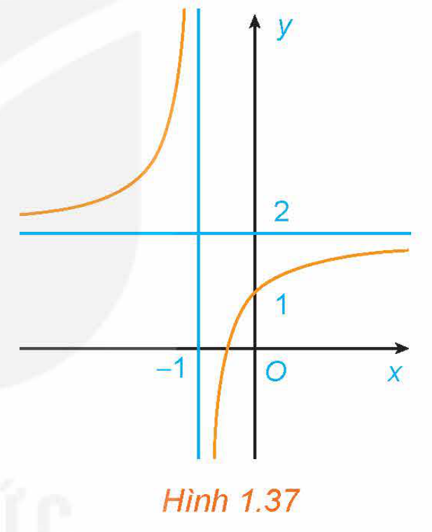
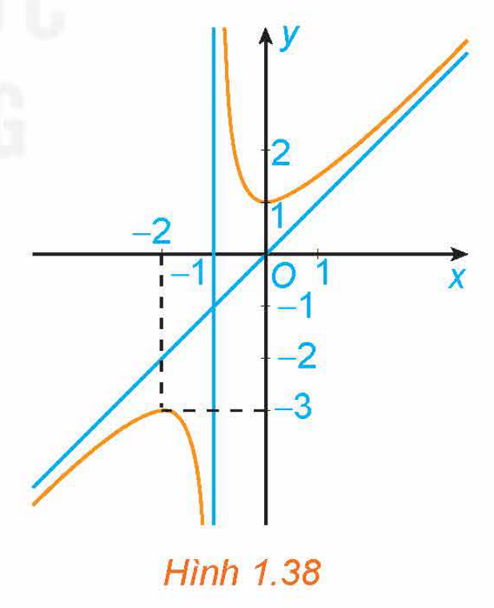
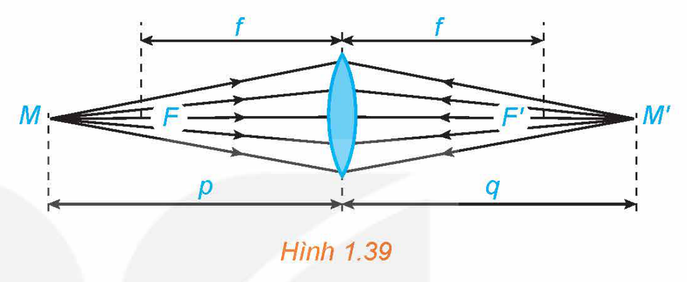
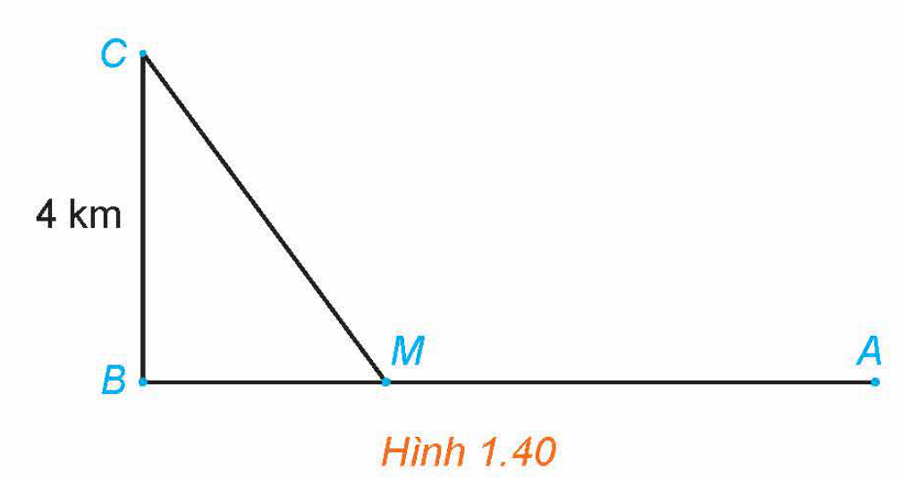

<!-- pdf:44 -->

# BÀI TẬP CUỐI CHƯƠNG I

## ✏️ A – TRẮC NGHIỆM

**1.30.** Cho hàm số $y = f(x)$ có đạo hàm trên khoảng $(a; b)$. Phát biểu nào dưới đây là đúng?

A. Nếu $f'(x) \ge 0$ với mọi $x$ thuộc $(a; b)$ thì hàm số $y = f(x)$ đồng biến trên $(a; b)$.
<!-- ocr-ok: đã đối chiếu ảnh trang PDF 44 -->

B. Nếu $f'(x) > 0$ với mọi $x$ thuộc $(a; b)$ thì hàm số $y = f(x)$ đồng biến trên $(a; b)$.
<!-- ocr-ok: đã đối chiếu ảnh trang PDF 44 -->

C. Hàm số $y = f(x)$ đồng biến trên $(a; b)$ khi và chỉ khi $f'(x) \ge 0$ với mọi $x$ thuộc $(a; b)$.

D. Hàm số $y = f(x)$ đồng biến trên $(a; b)$ khi và chỉ khi $f'(x) > 0$ với mọi $x$ thuộc $(a; b)$.

**1.31.** Hàm số nào sau đây nghịch biến trên $\mathbb{R}$?

A. $y = -x^3 + 3x^2 - 9x$.

B. $y = -x^3 + x + 1$.

C. $y = \frac{x - 1}{x - 2}$.

D. $y = 2x^2 + 3x + 2$.

**1.32.** Hàm số nào dưới đây không có cực trị?

A. $y = |x|$.

B. $y = x^4$.

C. $y = -x^3 + x$.

D. $y = \frac{2x - 1}{x + 1}$.

**1.33.** Giá trị cực tiểu của hàm số $y = x^2 \ln x$ là

A. $\frac{1}{\text{e}}$.

B. $-\frac{1}{\text{e}}$.

C. $-\frac{1}{2\text{e}}$.

D. $\frac{1}{2\text{e}}$.

**1.34.** Giá trị lớn nhất của hàm số $y = (x - 2)^2 \cdot \text{e}^x$ trên đoạn $[1; 3]$ là

A. $0$.

B. $\text{e}^3$.

C. $\text{e}^4$.

D. $\text{e}$.

**1.35.** Cho hàm số $y = f(x)$ thoả mãn: $\lim_{x \to 2^+} f(x) = 1$; $\lim_{x \to 2^-} f(x) = 1$; $\lim_{x \to -\infty} f(x) = 2$ và $\lim_{x \to +\infty} f(x) = 2$. Khẳng định nào sau đây là đúng?

A. Đường thẳng $x = 2$ là tiệm cận đứng của đồ thị hàm số.

B. Đường thẳng $y = 2$ là tiệm cận ngang của đồ thị hàm số.

C. Đường thẳng $y = 1$ là tiệm cận ngang của đồ thị hàm số.

D. Đường thẳng $x = 2$ là tiệm cận ngang của đồ thị hàm số.

**1.36.** Tiệm cận xiên của đồ thị hàm số $y = \frac{x^2 + 2x - 2}{x + 2}$ là

A. $y = -2$.

B. $y = 1$.

C. $y = x + 2$.

D. $y = x$.

<!-- pdf:45 -->

**1.37.** Cho hàm số $y = f(x)$ xác định trên $\mathbb{R} \setminus \{1; 3\}$, liên tục trên mỗi khoảng xác định và có bảng biến thiên như sau:

| $x$ | $-\infty$ | | $1$ | | $2$ | | $3$ | | $+\infty$ |
| --- | --- | --- | --- | --- | --- | --- | --- | --- | --- |
| $f'(x)$ | | $-$ | $\Vert$ | $-$ | $0$ | $+$ | $\Vert$ | $+$ | |
| $f(x)$ | $1$ | $\searrow$ | $-1 \ \Vert \ 7$ | $\searrow$ | $5$ | $\nearrow$ | $+\infty \ \Vert \ -4$ | $\nearrow$ | $-1$ |

Khẳng định nào sau đây là **sai**?

A. Đường thẳng $y = 1$ là tiệm cận ngang của đồ thị hàm số đã cho.

B. Đường thẳng $y = -1$ là tiệm cận ngang của đồ thị hàm số đã cho.

C. Đường thẳng $x = 3$ là tiệm cận đứng của đồ thị hàm số đã cho.

D. Đường thẳng $x = 1$ là tiệm cận đứng của đồ thị hàm số đã cho.

**1.38.** Đồ thị trong Hình 1.37 là đồ thị của hàm số:

A. $y = \frac{x + 2}{x + 1}$.

B. $y = \frac{2x + 1}{x + 1}$.

C. $y = \frac{x - 1}{x + 1}$.

D. $y = \frac{x + 3}{1 - x}$.

*Hình 1.37*

**1.39.** Đồ thị trong Hình 1.38 là đồ thị của hàm số:

A. $y = x - \frac{1}{x + 1}$.

B. $y = \frac{2x + 1}{x + 1}$.

C. $y = \frac{x^2 - x + 1}{x + 1}$.

D. $y = \frac{x^2 + x + 1}{x + 1}$.

*Hình 1.38*

## ✏️ B – TỰ LUẬN

**1.40.** Xét chiều biến thiên và tìm các cực trị (nếu có) của các hàm số sau:

a) $y = x^3 - 3x^2 + 3x - 1$;

b) $y = x^4 - 2x^2 - 1$;

c) $y = \frac{2x - 1}{3x + 1}$;

d) $y = \frac{x^2 + 2x + 2}{x + 1}$.

<!-- pdf:46 -->

**1.41.** Tìm giá trị lớn nhất và giá trị nhỏ nhất (nếu có) của các hàm số sau:

a) $y = \frac{2x + 1}{3x - 2}$ trên nửa khoảng $[2; +\infty)$;

b) $y = \sqrt{2 - x^2}$.

**1.42.** Tìm các tiệm cận của mỗi đồ thị hàm số sau:

a) $y = \frac{3x - 2}{x + 1}$;

b) $y = \frac{x^2 + 2x - 1}{2x - 1}$.

**1.43.** Khảo sát sự biến thiên và vẽ đồ thị của các hàm số sau:

a) $y = -x^3 + 6x^2 - 9x + 12$;

b) $y = \frac{2x - 1}{x + 1}$;

c) $y = \frac{x^2 - 2x}{x - 1}$.

**1.44.** Xét một thấu kính hội tụ có tiêu cự $f$ (H.1.39). Khoảng cách $p$ từ vật đến thấu kính liên hệ với khoảng cách $q$ từ ảnh đến thấu kính bởi hệ thức:

$\frac{1}{p} + \frac{1}{q} = \frac{1}{f}.$

*Hình 1.39*

a) Viết công thức tính $q = g(p)$ như một hàm số của biến $p \in (f; +\infty)$.

b) Tính các giới hạn $\lim_{p \to +\infty} g(p)$; $\lim_{p \to f^+} g(p)$ và giải thích ý nghĩa các kết quả này.

c) Lập bảng biến thiên của hàm số $q = g(p)$ trên khoảng $(f; +\infty)$.

**1.45.** Dân số của một quốc gia sau $t$ (năm) kể từ năm 2023 được ước tính bởi công thức:

$N(t) = 100\text{e}^{0,012t}$ ($N(t)$ được tính bằng triệu người, $0 \le t \le 50$).

a) Ước tính dân số của quốc gia này vào các năm 2030 và 2035 (kết quả tính bằng triệu người, làm tròn kết quả đến chữ số thập phân thứ ba).

b) Xem $N(t)$ là hàm số của biến số $t$ xác định trên đoạn $[0; 50]$. Xét chiều biến thiên của hàm số $N(t)$ trên đoạn $[0; 50]$.

c) Đạo hàm của hàm số $N(t)$ biểu thị tốc độ tăng dân số của quốc gia đó (tính bằng triệu người/năm). Vào năm nào tốc độ tăng dân số của quốc gia đó là $1,6$ triệu người/năm?

**1.46.** Một đường dây điện được nối từ một nhà máy điện ở $A$ đến một hòn đảo ở $C$ như Hình 1.40. Khoảng cách từ $C$ đến $B$ là $4\text{ km}$. Bờ biển chạy thẳng từ $A$ đến $B$ với khoảng cách là $10\text{ km}$. Tổng chi phí lắp đặt cho $1\text{ km}$ dây điện trên biển là $50$ triệu đồng, còn trên đất liền là $30$ triệu đồng. Xác định vị trí điểm $M$ trên đoạn $AB$ (điểm nối dây từ đất liền ra đảo) để tổng chi phí lắp đặt là nhỏ nhất.

*Hình 1.40*

## 📷 Danh sách hình trong bài

| Mã hình | Trang PDF | Vị trí trong bài | Chú thích gốc |
| --- | --- | --- | --- |
| H12-toan-bt-c01-01 | 45 | Bài tập 1.38 | Hình 1.37 |
| H12-toan-bt-c01-02 | 45 | Bài tập 1.39 | Hình 1.38 |
| H12-toan-bt-c01-03 | 46 | Bài tập 1.44 | Hình 1.39 |
| H12-toan-bt-c01-04 | 46 | Bài tập 1.46 | Hình 1.40 |
