<!-- pdf:47 -->

<!-- Phần giới thiệu Chương II (in chung đầu trang PDF 47): CHƯƠNG II. VECTƠ VÀ HỆ TRỤC TOẠ ĐỘ TRONG KHÔNG GIAN -->

Vectơ trong mặt phẳng là một công cụ hữu hiệu để biểu diễn các đối tượng hình học và các đại lượng có hướng trong mặt phẳng. Với mục đích tương tự, người ta cũng đưa ra khái niệm vectơ trong không gian. Khái niệm này là cơ sở để xây dựng toạ độ trong không gian, từ đó cho phép đại số hoá các bài toán hình học không gian và giải quyết chúng bằng các biến đổi đại số.

*Tờ tiền 200 Phờ-răng của Thuỵ Sĩ gợi lên hình ảnh về một hệ toạ độ trong không gian.*

# BÀI 6: VECTƠ TRONG KHÔNG GIAN

## 🔤 Thuật ngữ

- Vectơ trong không gian

## 🎯 Mục tiêu

- Nhận biết vectơ trong không gian.
- Nhận biết và thực hiện các phép toán vectơ trong không gian.

## 🔴 Mở đầu

Ở lớp 10, ta đã biết về vectơ trong mặt phẳng và biết sử dụng vectơ để biểu thị các đại lượng có hướng và độ lớn trong mặt phẳng, ví dụ như vận tốc hay lực. Đối với các đại lượng có hướng trong không gian, ta có thể sử dụng vectơ để biểu diễn chúng hay không? Các phép toán vectơ trong trường hợp này giống và khác như thế nào với các phép toán vectơ trong mặt phẳng?

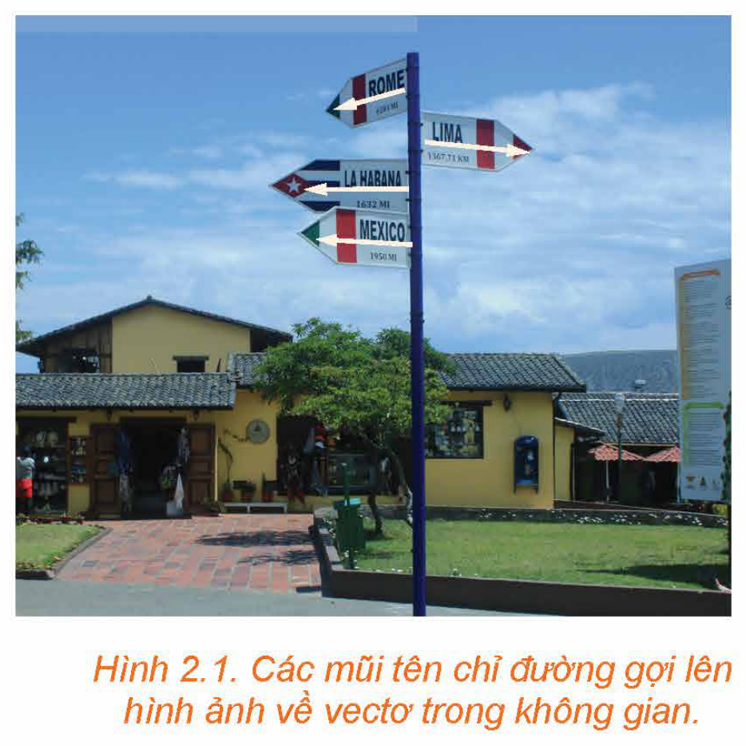
*Hình 2.1. Các mũi tên chỉ đường gợi lên hình ảnh về vectơ trong không gian.*

<!-- pdf:48 -->

## 1. VECTƠ TRONG KHÔNG GIAN

**HĐ1:** Nhận biết vectơ trong không gian

Trong Hình 2.2, lực căng dây (được tạo ra bởi sức nặng của kiện hàng) được thể hiện bởi các đoạn thẳng có mũi tên màu đỏ.

a) Các đoạn thẳng này cho biết gì về hướng và độ lớn của các lực căng dây?

b) Các đoạn thẳng này có cùng nằm trong một mặt phẳng không?

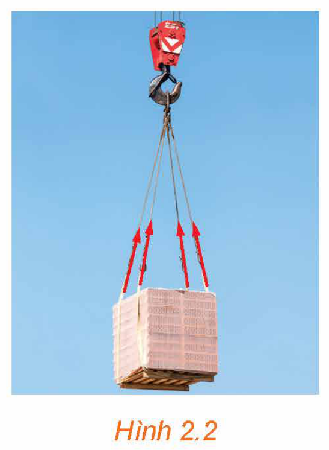
*Hình 2.2*

> - **Vectơ trong không gian** là một đoạn thẳng có hướng.
> - **Độ dài** của vectơ trong không gian là khoảng cách giữa điểm đầu và điểm cuối của vectơ đó.

**Câu hỏi:** Hình 2.3 cho ta ví dụ về một số đại lượng có thể được biểu diễn bởi vectơ trong không gian. Hãy tìm thêm một số ví dụ tương tự.

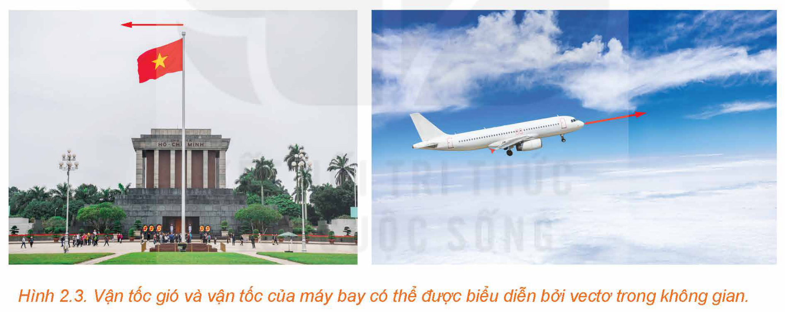
*Hình 2.3. Vận tốc gió và vận tốc của máy bay có thể được biểu diễn bởi vectơ trong không gian.*

**Chú ý:** Tương tự như vectơ trong mặt phẳng, đối với vectơ trong không gian ta cũng có các kí hiệu và khái niệm sau:

- Vectơ có điểm đầu là $A$ và điểm cuối là $B$ được kí hiệu là $\overrightarrow{AB}$.
- Khi không cần chỉ rõ điểm đầu và điểm cuối của vectơ thì vectơ còn được kí hiệu là $\vec{a}, \vec{b}, \vec{x}, \vec{y}, \dots$
- Độ dài của vectơ $\overrightarrow{AB}$ được kí hiệu là $|\overrightarrow{AB}|$, độ dài của vectơ $\vec{a}$ được kí hiệu là $|\vec{a}|$.
- Đường thẳng đi qua điểm đầu và điểm cuối của một vectơ được gọi là **giá** của vectơ đó (H.2.4).

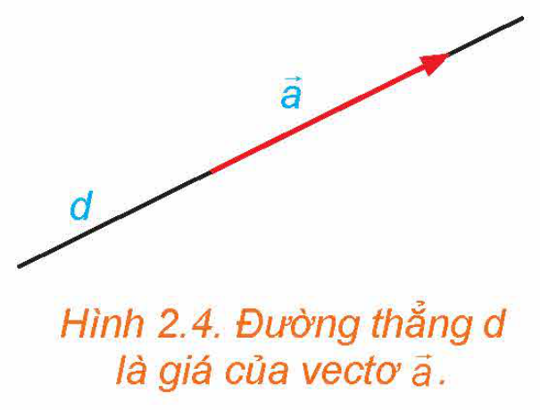
*Hình 2.4. Đường thẳng $d$ là giá của vectơ $\vec{a}$.*

<!-- pdf:49 -->

**Ví dụ 1:** Cho tứ diện $ABCD$ có độ dài mỗi cạnh bằng $1$ (H.2.5).

a) Có bao nhiêu vectơ có điểm đầu là $A$ và điểm cuối là một trong các đỉnh còn lại của tứ diện?

b) Trong các vectơ tìm được ở câu a, những vectơ nào có giá nằm trong mặt phẳng $(ABC)$?

c) Tính độ dài của các vectơ tìm được ở câu a.

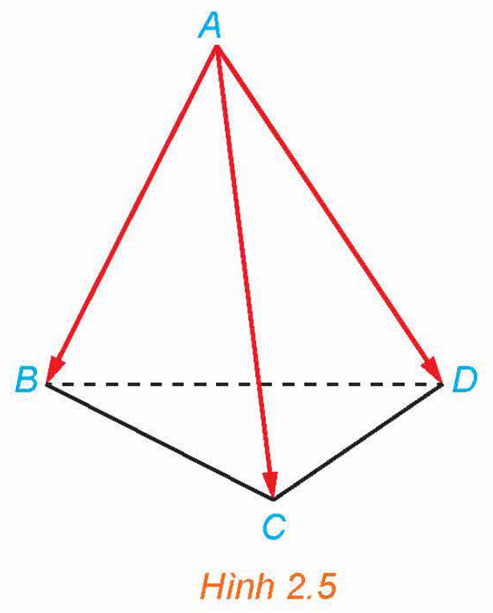
*Hình 2.5*

**Giải:**

a) Có ba vectơ là $\overrightarrow{AB}, \overrightarrow{AC}$ và $\overrightarrow{AD}$.

b) Trong ba vectơ $\overrightarrow{AB}, \overrightarrow{AC}$ và $\overrightarrow{AD}$ chỉ có hai vectơ $\overrightarrow{AB}$ và $\overrightarrow{AC}$ có giá nằm trong mặt phẳng $(ABC)$.

c) Vì tứ diện $ABCD$ có độ dài mỗi cạnh bằng $1$ nên $|\overrightarrow{AB}| = |\overrightarrow{AC}| = |\overrightarrow{AD}| = 1$.

**Luyện tập 1:** Cho hình lập phương $ABCD.A'B'C'D'$ (H.2.6).

Trong các vectơ $\overrightarrow{AC}, \overrightarrow{AD}, \overrightarrow{AD'}$:

a) Hai vectơ nào có giá cùng nằm trong mặt phẳng $(ABCD)$?

b) Hai vectơ nào có cùng độ dài?

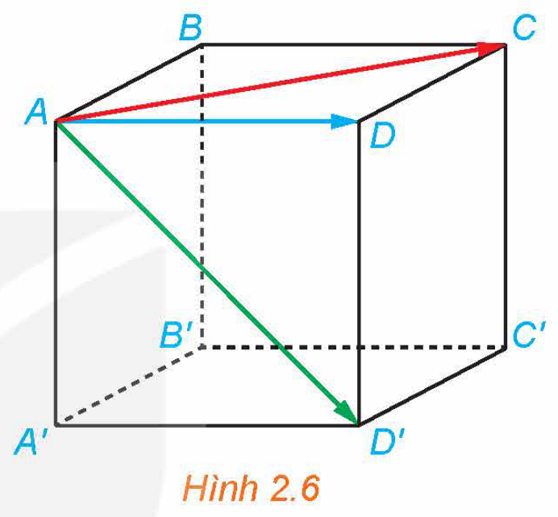
*Hình 2.6*

**HĐ2:** Hình thành khái niệm hai vectơ cùng phương, cùng hướng/ngược hướng, hai vectơ bằng nhau trong không gian

Cho hình hộp $ABCD.A'B'C'D'$ (H.2.7).

a) So sánh độ dài của hai vectơ $\overrightarrow{AB}$ và $\overrightarrow{D'C'}$.

b) Nhận xét về giá của hai vectơ $\overrightarrow{AB}$ và $\overrightarrow{D'C'}$.

c) Hai vectơ $\overrightarrow{AB}$ và $\overrightarrow{D'C'}$ có cùng phương không? Có cùng hướng không?

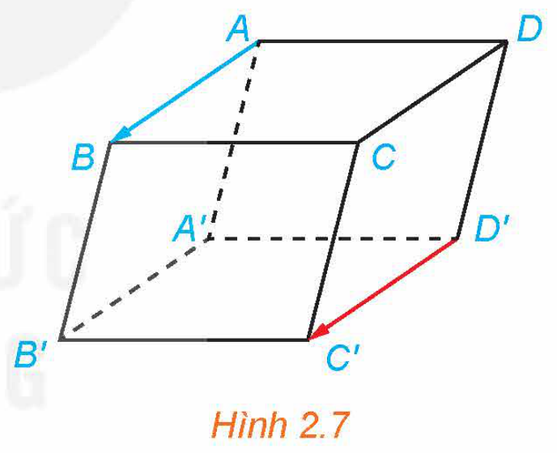
*Hình 2.7*

Tương tự như trường hợp của vectơ trong mặt phẳng, ta có các khái niệm sau đối với vectơ trong không gian:

> - Hai vectơ được gọi là **cùng phương** nếu chúng có giá song song hoặc trùng nhau.
> - Nếu hai vectơ cùng phương thì chúng **cùng hướng** hoặc **ngược hướng**.
> - Hai vectơ $\vec{a}$ và $\vec{b}$ được gọi là **bằng nhau**, kí hiệu $\vec{a} = \vec{b}$, nếu chúng có cùng độ dài và cùng hướng.

**Câu hỏi:** Nếu hai vectơ cùng bằng một vectơ thứ ba thì hai vectơ đó có bằng nhau không?

**Chú ý:** Tương tự như vectơ trong mặt phẳng, ta có tính chất và các quy ước sau đối với vectơ trong không gian:

- Trong không gian, với mỗi điểm $O$ và vectơ $\vec{a}$ cho trước, có duy nhất điểm $M$ sao cho $\overrightarrow{OM} = \vec{a}$.

<!-- pdf:50 -->

- Các vectơ có điểm đầu và điểm cuối trùng nhau, ví dụ như $\overrightarrow{AA}, \overrightarrow{BB}, \dots$ gọi là các **vectơ-không**.
- Ta quy ước vectơ-không có độ dài là $0$, cùng hướng (và vì vậy cùng phương) với mọi vectơ. Do đó, các vectơ-không đều bằng nhau và được kí hiệu chung là $\vec{0}$.

**Ví dụ 2:** Cho hình lăng trụ $ABC.A'B'C'$ (H.2.8).

a) Trong ba vectơ $\overrightarrow{BC}, \overrightarrow{CC'}$ và $\overrightarrow{B'B}$, vectơ nào bằng vectơ $\overrightarrow{AA'}$? Giải thích vì sao.

b) Gọi $M$ là trung điểm của cạnh $BC$. Xác định điểm $M'$ sao cho $\overrightarrow{MM'} = \overrightarrow{AA'}$.

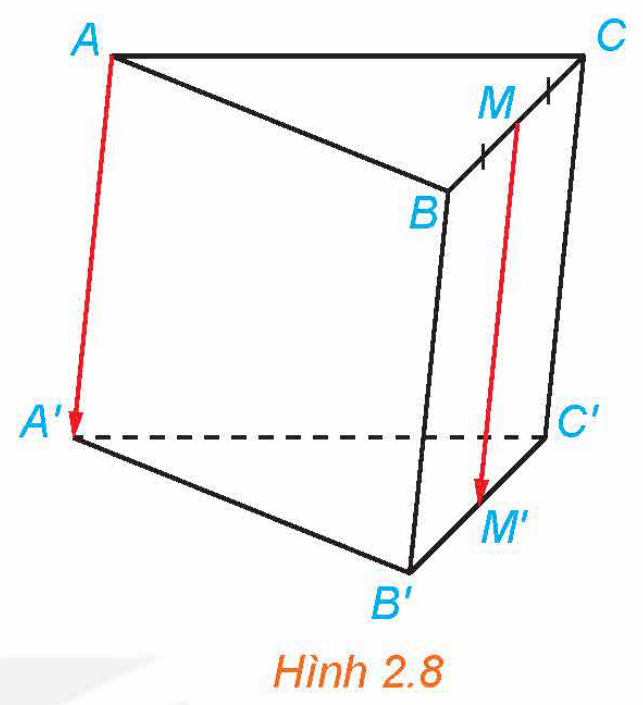
*Hình 2.8*

**Giải:**

a) Hai đường thẳng $AA'$ và $BC$ chéo nhau nên hai vectơ $\overrightarrow{AA'}$ và $\overrightarrow{BC}$ không cùng phương. Do đó, hai vectơ $\overrightarrow{AA'}$ và $\overrightarrow{BC}$ không bằng nhau.

Tứ giác $ACC'A'$ là hình bình hành nên $AA' // CC'$ và $AA' = CC'$. Hai vectơ $\overrightarrow{AA'}$ và $\overrightarrow{CC'}$ có cùng độ dài và cùng hướng nên hai vectơ đó bằng nhau.

Tương tự, hai vectơ $\overrightarrow{AA'}$ và $\overrightarrow{B'B}$ có cùng độ dài và ngược hướng nên hai vectơ $\overrightarrow{AA'}$ và $\overrightarrow{B'B}$ không bằng nhau.

b) Gọi $M'$ là trung điểm của cạnh $B'C'$. Vì tứ giác $BCC'B'$ là hình bình hành nên $MM' // BB'$ và $MM' = BB'$. Hình lăng trụ $ABC.A'B'C'$ có $AA' // BB'$ và $AA' = BB'$, suy ra $MM' // AA'$ và $MM' = AA'$. Hai vectơ $\overrightarrow{MM'}$ và $\overrightarrow{AA'}$ có cùng độ dài và cùng hướng nên $\overrightarrow{MM'} = \overrightarrow{AA'}$. Vậy trung điểm của cạnh $B'C'$ là điểm $M'$ cần tìm.

**Luyện tập 2:** Cho hình chóp $S.ABCD$ có đáy $ABCD$ là hình bình hành.

a) Trong ba vectơ $\overrightarrow{SC}, \overrightarrow{AD}$ và $\overrightarrow{DC}$, vectơ nào bằng vectơ $\overrightarrow{AB}$?

b) Gọi $M$ là một điểm thuộc cạnh $AD$. Xác định điểm $N$ sao cho $\overrightarrow{MN} = \overrightarrow{AB}$.

**Vận dụng 1:** Một toà nhà có chiều cao của các tầng là như nhau. Một chiếc thang máy di chuyển từ tầng 15 lên tầng 22 của toà nhà, sau đó di chuyển từ tầng 22 lên tầng 29. Các vectơ biểu diễn độ dịch chuyển của thang máy trong hai lần di chuyển đó có bằng nhau không? Giải thích vì sao.

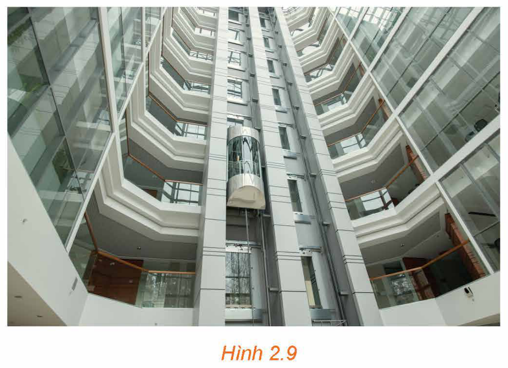
*Hình 2.9*

<!-- pdf:51 -->

## 2. TỔNG VÀ HIỆU CỦA HAI VECTƠ TRONG KHÔNG GIAN

**a) Tổng của hai vectơ trong không gian**

**HĐ3:** Hình thành khái niệm tổng của hai vectơ trong không gian

Trong không gian, cho hai vectơ $\vec{a}$ và $\vec{b}$ không cùng phương. Lấy điểm $A$ và vẽ các vectơ $\overrightarrow{AB} = \vec{a}, \overrightarrow{BC} = \vec{b}$. Lấy điểm $A'$ khác $A$ và vẽ các vectơ $\overrightarrow{A'B'} = \vec{a}, \overrightarrow{B'C'} = \vec{b}$ (H.2.10).

Bốn điểm $A, B, A', B'$ đồng phẳng và tứ giác $ABB'A'$ là hình bình hành.
<!-- ocr-ok: đã đối chiếu ảnh trang PDF 51 -->

a) Giải thích vì sao $\overrightarrow{AA'} = \overrightarrow{BB'}$ và $\overrightarrow{BB'} = \overrightarrow{CC'}$.

b) Giải thích vì sao $AA'C'C$ là hình bình hành, từ đó suy ra $\overrightarrow{AC} = \overrightarrow{A'C'}$.

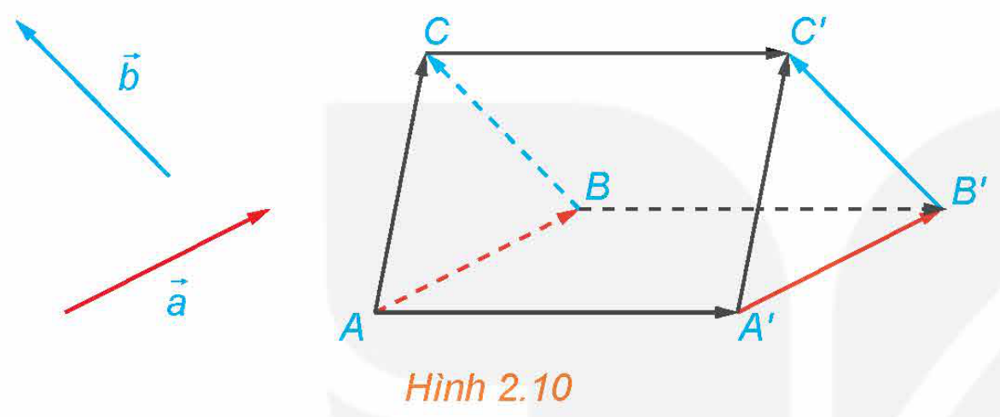
*Hình 2.10*

> Trong không gian, cho hai vectơ $\vec{a}$ và $\vec{b}$. Lấy một điểm $A$ bất kì và các điểm $B, C$ sao cho $\overrightarrow{AB} = \vec{a}, \overrightarrow{BC} = \vec{b}$. Khi đó, vectơ $\overrightarrow{AC}$ được gọi là **tổng của hai vectơ** $\vec{a}$ và $\vec{b}$, kí hiệu là $\vec{a} + \vec{b}$.
>
> Trong không gian, phép lấy tổng của hai vectơ được gọi là **phép cộng vectơ**.

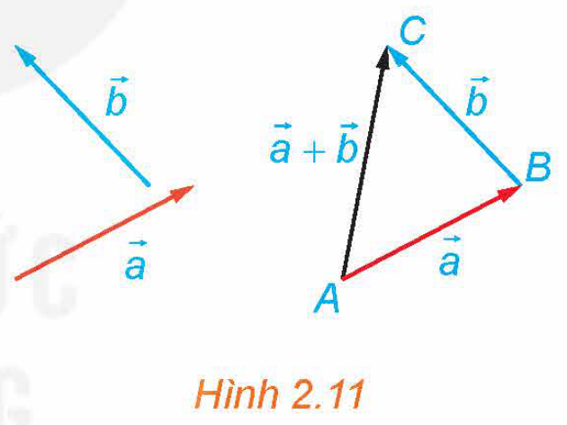
*Hình 2.11*

**Nhận xét:** Quy tắc ba điểm và quy tắc hình bình hành trong mặt phẳng vẫn đúng trong không gian:

- Nếu $A, B, C$ là ba điểm bất kì thì $\overrightarrow{AB} + \overrightarrow{BC} = \overrightarrow{AC}$;
- Nếu $ABCD$ là hình bình hành thì $\overrightarrow{AB} + \overrightarrow{AD} = \overrightarrow{AC}$.

**Ví dụ 3:** Cho hình lập phương $ABCD.A'B'C'D'$ có độ dài mỗi cạnh bằng $1$ (H.2.12). Tính độ dài của vectơ $\overrightarrow{BC} + \overrightarrow{DD'}$.

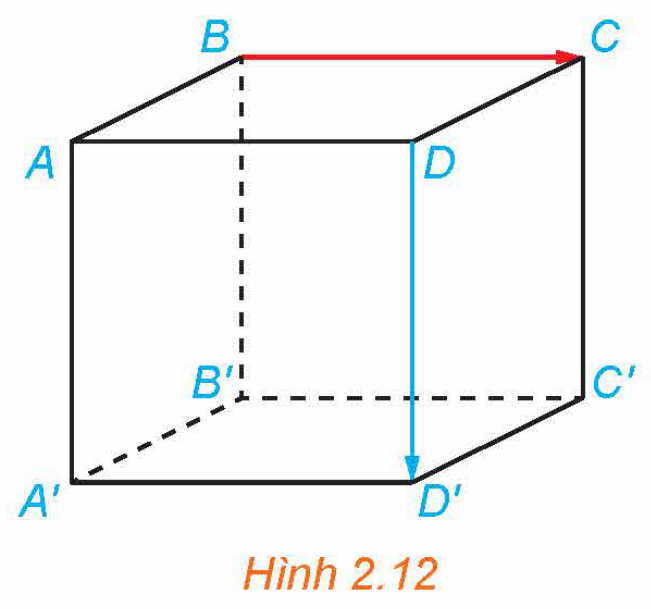
*Hình 2.12*

**Giải:**

Tứ giác $ABCD$ là hình vuông nên $\overrightarrow{BC} = \overrightarrow{AD}$.

Do đó $\overrightarrow{BC} + \overrightarrow{DD'} = \overrightarrow{AD} + \overrightarrow{DD'} = \overrightarrow{AD'}$.

Tứ giác $ADD'A'$ là hình vuông nên $AD' = \sqrt{AD^2 + DD'^2} = \sqrt{2}$, suy ra $|\overrightarrow{BC} + \overrightarrow{DD'}| = \sqrt{2}$.

<!-- pdf:52 -->

**Luyện tập 3:** Trong Ví dụ 3, hãy tính độ dài của vectơ $\overrightarrow{AC} + \overrightarrow{C'D'}$.

**Chú ý:** Tương tự như phép cộng vectơ trong mặt phẳng, phép cộng vectơ trong không gian có các tính chất sau:

- Tính chất giao hoán: Nếu $\vec{a}$ và $\vec{b}$ là hai vectơ bất kì thì $\vec{a} + \vec{b} = \vec{b} + \vec{a}$.
- Tính chất kết hợp: Nếu $\vec{a}, \vec{b}$ và $\vec{c}$ là ba vectơ bất kì thì $(\vec{a} + \vec{b}) + \vec{c} = \vec{a} + (\vec{b} + \vec{c})$.
- Tính chất cộng với vectơ $\vec{0}$: Nếu $\vec{a}$ là một vectơ bất kì thì $\vec{a} + \vec{0} = \vec{0} + \vec{a} = \vec{a}$.

Từ tính chất kết hợp của phép cộng vectơ trong không gian, ta có thể viết tổng của ba vectơ $\vec{a}, \vec{b}$ và $\vec{c}$ là $\vec{a} + \vec{b} + \vec{c}$ mà không cần sử dụng các dấu ngoặc. Tương tự đối với tổng của nhiều vectơ trong không gian.

**Ví dụ 4:** Cho tứ diện $ABCD$ (H.2.13). Chứng minh rằng $\overrightarrow{AC} + \overrightarrow{BD} = \overrightarrow{AD} + \overrightarrow{BC}$.

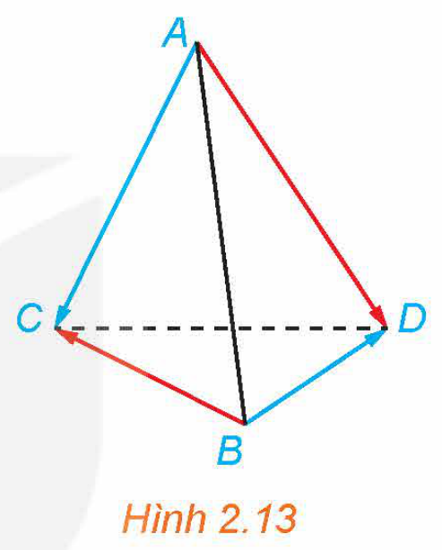
*Hình 2.13*

**Giải:**

Theo quy tắc ba điểm trong không gian, ta có $\overrightarrow{AC} = \overrightarrow{AD} + \overrightarrow{DC}$.

Từ đó lần lượt áp dụng tính chất của phép cộng vectơ trong không gian, ta được:

$\overrightarrow{AC} + \overrightarrow{BD} = (\overrightarrow{AD} + \overrightarrow{DC}) + \overrightarrow{BD} = \overrightarrow{AD} + (\overrightarrow{DC} + \overrightarrow{BD}) = \overrightarrow{AD} + (\overrightarrow{BD} + \overrightarrow{DC}) = \overrightarrow{AD} + \overrightarrow{BC}.$

**Luyện tập 4:** Cho tứ diện $ABCD$ (H.2.13). Chứng minh rằng $\overrightarrow{AB} + \overrightarrow{CD} = \overrightarrow{AD} + \overrightarrow{CB}$.

**HĐ4:** Thiết lập quy tắc hình hộp

Cho hình hộp $ABCD.A'B'C'D'$ (H.2.14).

Ta có thể áp dụng quy tắc hình bình hành trong không gian.

a) Hai vectơ $\overrightarrow{AB} + \overrightarrow{AD}$ và $\overrightarrow{AC}$ có bằng nhau hay không?

b) Hai vectơ $\overrightarrow{AB} + \overrightarrow{AD} + \overrightarrow{AA'}$ và $\overrightarrow{AC'}$ có bằng nhau hay không?

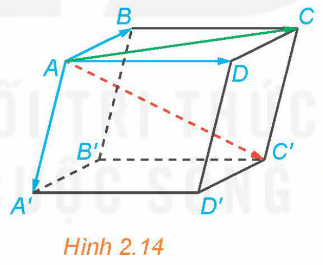
*Hình 2.14*

Kết quả sau đây được gọi là **quy tắc hình hộp**.

> Cho hình hộp $ABCD.A'B'C'D'$. Khi đó, ta có $\overrightarrow{AB} + \overrightarrow{AD} + \overrightarrow{AA'} = \overrightarrow{AC'}$.

**Câu hỏi:** Trong Hình 2.14, hãy phát biểu quy tắc hình hộp với các vectơ có điểm đầu là $B$.

**Ví dụ 5:** Cho hình hộp $ABCD.A'B'C'D'$ (H.2.14). Chứng minh rằng $\overrightarrow{BC} + \overrightarrow{DC} + \overrightarrow{AA'} = \overrightarrow{AC'}$.

**Giải:**

Vì tứ giác $ABCD$ là hình bình hành nên $\overrightarrow{BC} = \overrightarrow{AD}$ và $\overrightarrow{DC} = \overrightarrow{AB}$. Áp dụng quy tắc hình hộp suy ra $\overrightarrow{BC} + \overrightarrow{DC} + \overrightarrow{AA'} = \overrightarrow{AD} + \overrightarrow{AB} + \overrightarrow{AA'} = \overrightarrow{AC'}$.

**Luyện tập 5:** Cho hình hộp chữ nhật $ABCD.A'B'C'D'$. Chứng minh rằng $\overrightarrow{BB'} + \overrightarrow{CD} + \overrightarrow{AD} = \overrightarrow{BD'}$.

<!-- pdf:53 -->

**b) Hiệu của hai vectơ trong không gian**

**HĐ5:** Nhận biết vectơ đối của một vectơ trong không gian

Hình 2.15 mô tả một lọ hoa được đặt trên bàn, trọng lượng của lọ hoa tạo nên một lực tác dụng lên mặt bàn và một phản lực từ mặt bàn lên lọ hoa. Có nhận xét gì về độ dài và hướng của các vectơ biểu diễn hai lực đó?

Theo Định luật III Newton, lực tác dụng và phản lực là hai lực cùng phương, ngược hướng và có độ lớn bằng nhau.

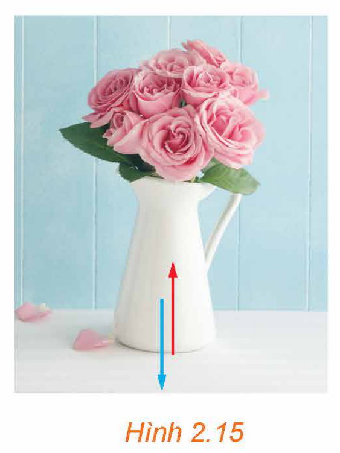
*Hình 2.15*

> Trong không gian, vectơ có cùng độ dài và ngược hướng với vectơ $\vec{a}$ được gọi là **vectơ đối** của vectơ $\vec{a}$, kí hiệu là $-\vec{a}$.

**Chú ý:**

- Hai vectơ là đối nhau nếu và chỉ nếu tổng của chúng bằng $\vec{0}$.
- Vectơ $\overrightarrow{BA}$ là một vectơ đối của vectơ $\overrightarrow{AB}$.
- Vectơ $\vec{0}$ được coi là vectơ đối của chính nó.

Tương tự như hiệu của hai vectơ trong mặt phẳng, ta có định nghĩa về hiệu của hai vectơ trong không gian:

> Vectơ $\vec{a} + (-\vec{b})$ được gọi là **hiệu của hai vectơ** $\vec{a}$ và $\vec{b}$ và kí hiệu là $\vec{a} - \vec{b}$.
>
> Trong không gian, phép lấy hiệu của hai vectơ được gọi là **phép trừ vectơ**.

**Nhận xét:** Với ba điểm $O, A, B$ bất kì trong không gian, ta có $\overrightarrow{OB} - \overrightarrow{OA} = \overrightarrow{AB}$.

**Ví dụ 6:** Cho hình chóp $S.ABCD$ có đáy $ABCD$ là hình bình hành. Gọi $M, N$ lần lượt là trung điểm của $AB, CD$ (H.2.16). Chứng minh rằng:

a) $\overrightarrow{AM}$ và $\overrightarrow{CN}$ là hai vectơ đối nhau;

b) $\overrightarrow{SC} - \overrightarrow{AM} - \overrightarrow{AN} = \overrightarrow{SA}$.

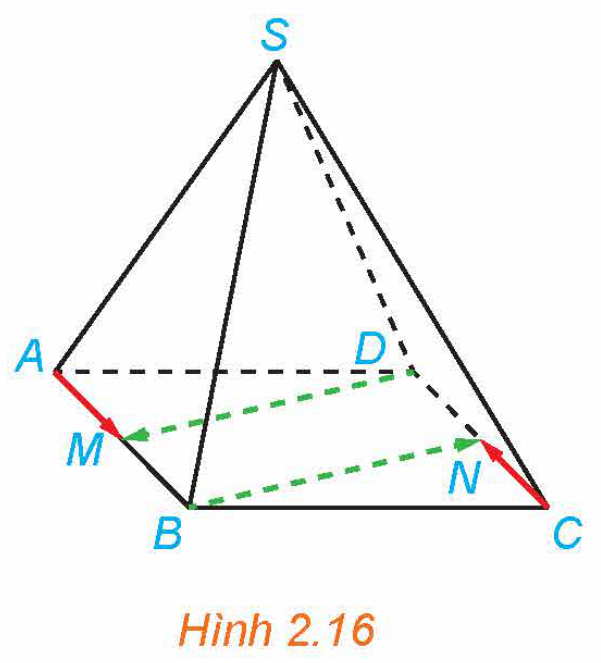
*Hình 2.16*

<!-- pdf:54 -->

**Giải:**

a) Tứ giác $ABCD$ là hình bình hành nên $AB = CD$ và $AB // CD$, suy ra $AM = CN$ và $AM // CN$. Hai vectơ $\overrightarrow{AM}$ và $\overrightarrow{CN}$ có cùng độ dài và ngược hướng nên chúng là hai vectơ đối nhau.

b) Từ câu a, ta có $\overrightarrow{CN} = -\overrightarrow{AM}$.

Suy ra $\overrightarrow{SC} - \overrightarrow{AM} - \overrightarrow{AN} = \overrightarrow{SC} + \overrightarrow{CN} - \overrightarrow{AN} = \overrightarrow{SN} - \overrightarrow{AN} = \overrightarrow{SN} + \overrightarrow{NA} = \overrightarrow{SA}$.

**Luyện tập 6:** Trong Ví dụ 6, chứng minh rằng:

a) $\overrightarrow{BN}$ và $\overrightarrow{DM}$ là hai vectơ đối nhau;

b) $\overrightarrow{SD} - \overrightarrow{BN} - \overrightarrow{CM} = \overrightarrow{SC}$.

**Vận dụng 2:** Thang cuốn tại các trung tâm thương mại, siêu thị lớn hay nhà ga, sân bay thường có hai làn, trong đó có một làn lên và một làn xuống. Khi thang cuốn chuyển động, vectơ biểu diễn vận tốc của mỗi làn có là hai vectơ đối nhau hay không? Giải thích vì sao.

Tốc độ di chuyển của thang cuốn thường từ $0,5\text{ m/s}$ đến $0,75\text{ m/s}$. Khi sử dụng thang cuốn cần giữ tay vịn, tránh để trang phục vướng vào thang và chú ý giám sát trẻ nhỏ đi cùng.

## 3. TÍCH CỦA MỘT SỐ VỚI MỘT VECTƠ TRONG KHÔNG GIAN

**HĐ6:** Hình thành khái niệm tích của một số với một vectơ trong không gian

Cho hình lăng trụ tam giác $ABC.A'B'C'$. Gọi $M, N$ lần lượt là trung điểm của $AB, AC$ (H.2.17).

a) Hai vectơ $\overrightarrow{MN}$ và $\overrightarrow{B'C'}$ có cùng phương không? Có cùng hướng không?

b) Giải thích vì sao $|\overrightarrow{MN}| = \frac{1}{2}|\overrightarrow{B'C'}|$.

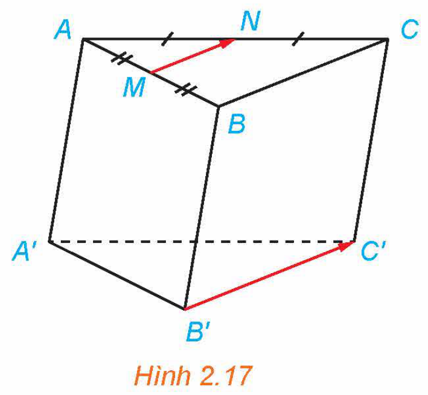
*Hình 2.17*

<!-- pdf:55 -->

Tương tự như tích của một số với một vectơ trong mặt phẳng, ta có định nghĩa về tích của một số với một vectơ trong không gian:

<!-- term: Tích của một số với một vectơ -->
> Trong không gian, tích của một số thực $k \ne 0$ với một vectơ $\vec{a} \ne \vec{0}$ là một vectơ, kí hiệu là $k\vec{a}$, được xác định như sau:
> - Cùng hướng với vectơ $\vec{a}$ nếu $k > 0$; ngược hướng với vectơ $\vec{a}$ nếu $k < 0$;
> - Có độ dài bằng $|k| \cdot |\vec{a}|$.
>
> Trong không gian, phép lấy tích của một số với một vectơ được gọi là **phép nhân một số với một vectơ**.

**Câu hỏi:** Hai vectơ $1\vec{a}$ và $\vec{a}$ có bằng nhau không? Hai vectơ $(-1)\vec{a}$ và $-\vec{a}$ có bằng nhau không?

**Chú ý:**

- Quy ước $k\vec{a} = \vec{0}$ nếu $k = 0$ hoặc $\vec{a} = \vec{0}$.
- Nếu $k\vec{a} = \vec{0}$ thì $k = 0$ hoặc $\vec{a} = \vec{0}$.
- Trong không gian, điều kiện cần và đủ để hai vectơ $\vec{a}$ và $\vec{b}$ ($\vec{b} \ne \vec{0}$) cùng phương là có một số thực $k$ sao cho $\vec{a} = k\vec{b}$.
<!-- ocr-ok: đã đối chiếu ảnh trang PDF 55 -->

**Ví dụ 7:** Trong HĐ6, gọi $O$ là giao điểm của $AB'$ và $A'B$ (H.2.18). Chứng minh rằng $\overrightarrow{CC'} = (-2)\overrightarrow{OM}$.

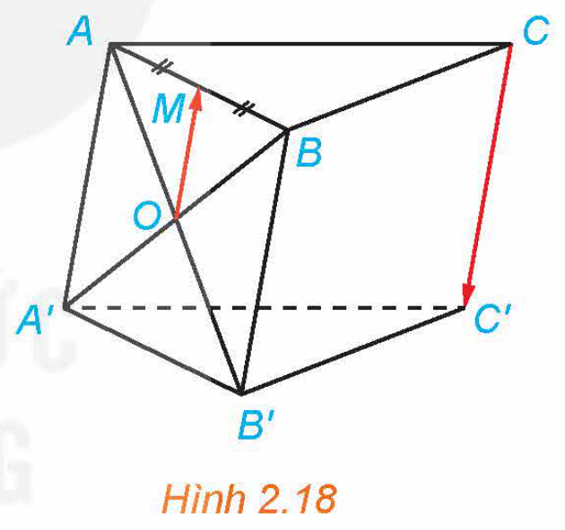
*Hình 2.18*

**Giải:**

Vì $O$ là trung điểm của $AB'$ nên $OM$ là đường trung bình của tam giác $AB'B$. Suy ra $B'B // OM$ và $B'B = 2OM$. Tứ giác $BCC'B'$ là hình bình hành nên $B'B // C'C$ và $B'B = C'C$. Do đó $C'C // OM$ và $C'C = 2OM$. Vì hai vectơ $\overrightarrow{CC'}$ và $\overrightarrow{OM}$ ngược hướng nên $\overrightarrow{CC'} = (-2)\overrightarrow{OM}$.
<!-- ocr-ok: đã đối chiếu ảnh trang PDF 55 -->

**Luyện tập 7:** Cho hình chóp $S.ABCD$ có đáy $ABCD$ là hình bình hành. Gọi $E, F$ lần lượt là các điểm thuộc các cạnh $SA, SB$ sao cho $SE = \frac{1}{3}SA; SF = \frac{1}{3}SB$. Chứng minh rằng $\overrightarrow{EF} = \frac{1}{3}\overrightarrow{DC}$.

**Chú ý:** Tương tự như phép nhân một số với một vectơ trong mặt phẳng, phép nhân một số với một vectơ trong không gian có các tính chất sau:

- Tính chất kết hợp: Nếu $h, k$ là hai số thực và $\vec{a}$ là một vectơ bất kì thì $h(k\vec{a}) = (hk)\vec{a}$.
- Tính chất phân phối: Nếu $h, k$ là hai số thực và $\vec{a}, \vec{b}$ là hai vectơ bất kì thì $(h + k)\vec{a} = h\vec{a} + k\vec{a}$ và $k(\vec{a} + \vec{b}) = k\vec{a} + k\vec{b}$.
- Tính chất nhân với $1$ và $-1$: Nếu $\vec{a}$ là một vectơ bất kì thì $1\vec{a} = \vec{a}$ và $(-1)\vec{a} = -\vec{a}$.

<!-- pdf:56 -->

**Ví dụ 8:** Cho tứ diện $ABCD$. Gọi $G$ là trọng tâm của tam giác $BCD$ (H.2.19). Chứng minh rằng $\overrightarrow{AB} + \overrightarrow{AC} + \overrightarrow{AD} = 3\overrightarrow{AG}$.

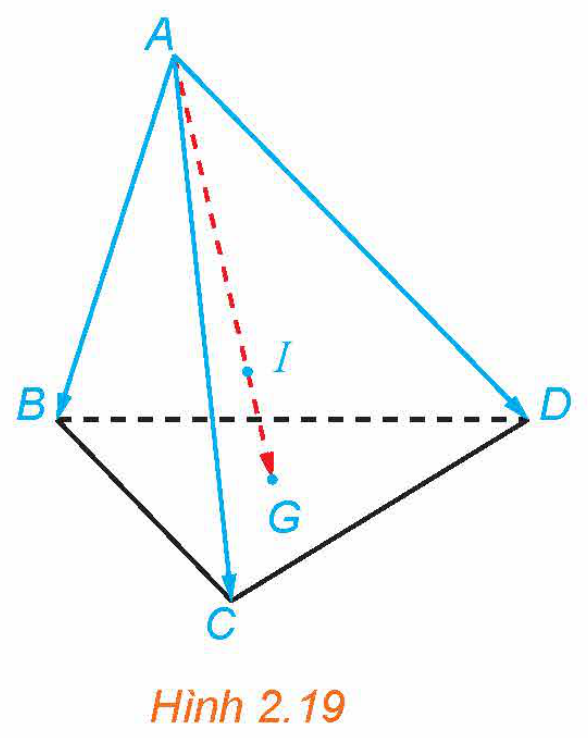
*Hình 2.19*

**Giải:**

Vì $G$ là trọng tâm của tam giác $BCD$ nên $\overrightarrow{GB} + \overrightarrow{GC} + \overrightarrow{GD} = \vec{0}$.

Do đó ta có: $\overrightarrow{AB} + \overrightarrow{AC} + \overrightarrow{AD} = \overrightarrow{AG} + \overrightarrow{GB} + \overrightarrow{AG} + \overrightarrow{GC} + \overrightarrow{AG} + \overrightarrow{GD} = 3\overrightarrow{AG} + (\overrightarrow{GB} + \overrightarrow{GC} + \overrightarrow{GD}) = 3\overrightarrow{AG} + \vec{0} = 3\overrightarrow{AG}$.

**Chú ý:** Tương tự như trong mặt phẳng, nếu $G$ là trọng tâm của tam giác $ABC$ thì với điểm $O$ tuỳ ý, ta có

$\overrightarrow{OA} + \overrightarrow{OB} + \overrightarrow{OC} = 3\overrightarrow{OG}.$

**Luyện tập 8:** Trong Ví dụ 8, gọi $I$ là điểm thuộc đoạn thẳng $AG$ sao cho $\overrightarrow{AI} = 3\overrightarrow{IG}$ (H.2.19). Chứng minh rằng

$\overrightarrow{IA} + \overrightarrow{IB} + \overrightarrow{IC} + \overrightarrow{ID} = \vec{0}.$

Điểm $I$ trong Luyện tập 8 được gọi là **trọng tâm** của tứ diện $ABCD$.

**Vận dụng 3:** Khi chuyển động trong không gian, máy bay luôn chịu tác động của bốn lực chính: lực đẩy của động cơ, lực cản của không khí, trọng lực và lực nâng khí động học (H.2.20). Lực cản của không khí ngược hướng với lực đẩy của động cơ và có độ lớn tỉ lệ thuận với bình phương vận tốc máy bay. Một chiếc máy bay tăng vận tốc từ $900\text{ km/h}$ lên $920\text{ km/h}$, trong quá trình tăng tốc máy bay giữ nguyên hướng bay. Lực cản của không khí khi máy bay đạt vận tốc $900\text{ km/h}$ và $920\text{ km/h}$ lần lượt được biểu diễn bởi hai vectơ $\overrightarrow{F_1}$ và $\overrightarrow{F_2}$. Hãy giải thích vì sao $\overrightarrow{F_1} = k\overrightarrow{F_2}$ với $k$ là một số thực dương nào đó. Tính giá trị của $k$ (làm tròn kết quả đến chữ số thập phân thứ hai).

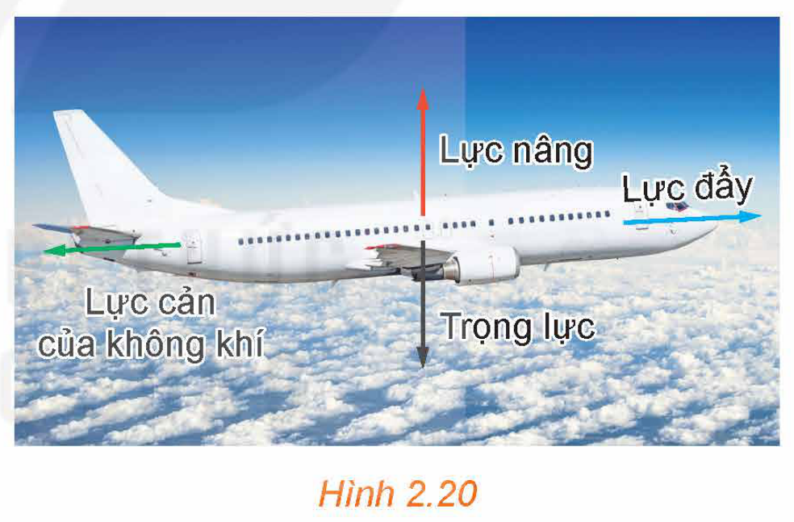
*Hình 2.20*

## 4. TÍCH VÔ HƯỚNG CỦA HAI VECTƠ TRONG KHÔNG GIAN

**a) Góc giữa hai vectơ trong không gian**

**HĐ7:** Hình thành khái niệm góc giữa hai vectơ trong không gian

Trong không gian, cho hai vectơ $\vec{a}, \vec{b}$ khác $\vec{0}$. Lấy điểm $O$ và vẽ các vectơ $\overrightarrow{OA} = \vec{a}, \overrightarrow{OB} = \vec{b}$. Lấy điểm $O'$ khác $O$ và vẽ các vectơ $\overrightarrow{O'A'} = \vec{a}, \overrightarrow{O'B'} = \vec{b}$ (H.2.21).

a) Giải thích vì sao $\overrightarrow{AB} = \overrightarrow{A'B'}$.

b) Áp dụng định lí côsin cho hai tam giác $OAB$ và $O'A'B'$ để giải thích vì sao $\widehat{AOB} = \widehat{A'O'B'}$.

<!-- pdf:57 -->

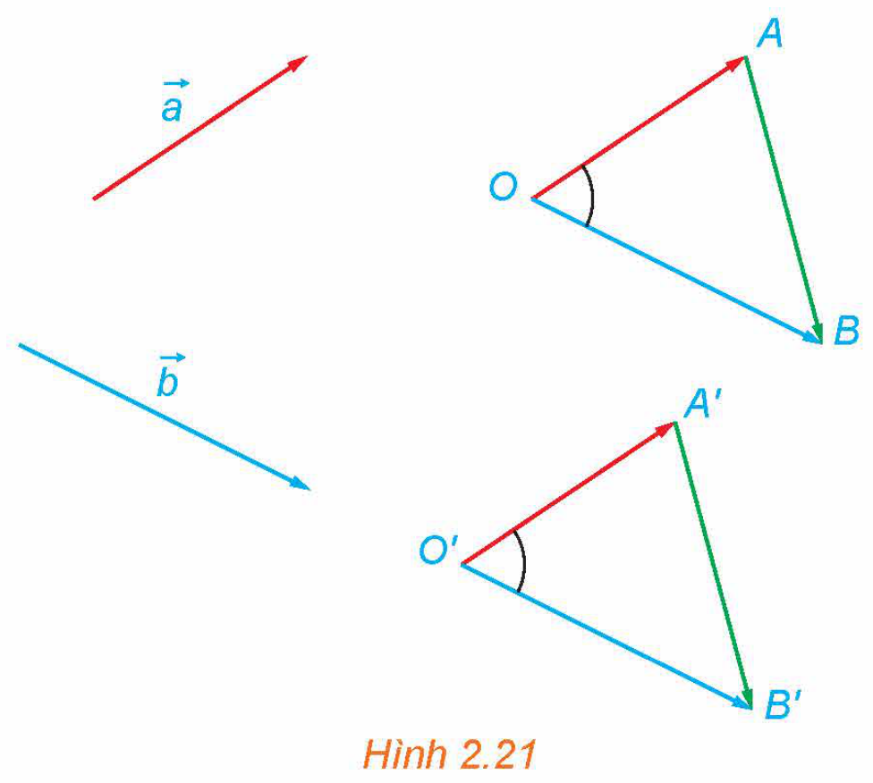
*Hình 2.21*

Áp dụng định lí côsin cho tam giác $OAB$, ta có: $\cos \widehat{AOB} = \frac{OA^2 + OB^2 - AB^2}{2OA \cdot OB}$.

> Trong không gian, cho hai vectơ $\vec{a}, \vec{b}$ khác $\vec{0}$. Lấy một điểm $O$ bất kì và gọi $A, B$ là hai điểm sao cho $\overrightarrow{OA} = \vec{a}, \overrightarrow{OB} = \vec{b}$. Khi đó, góc $\widehat{AOB}$ ($0^\circ \le \widehat{AOB} \le 180^\circ$) được gọi là **góc giữa hai vectơ** $\vec{a}$ và $\vec{b}$, kí hiệu là $(\vec{a}, \vec{b})$.

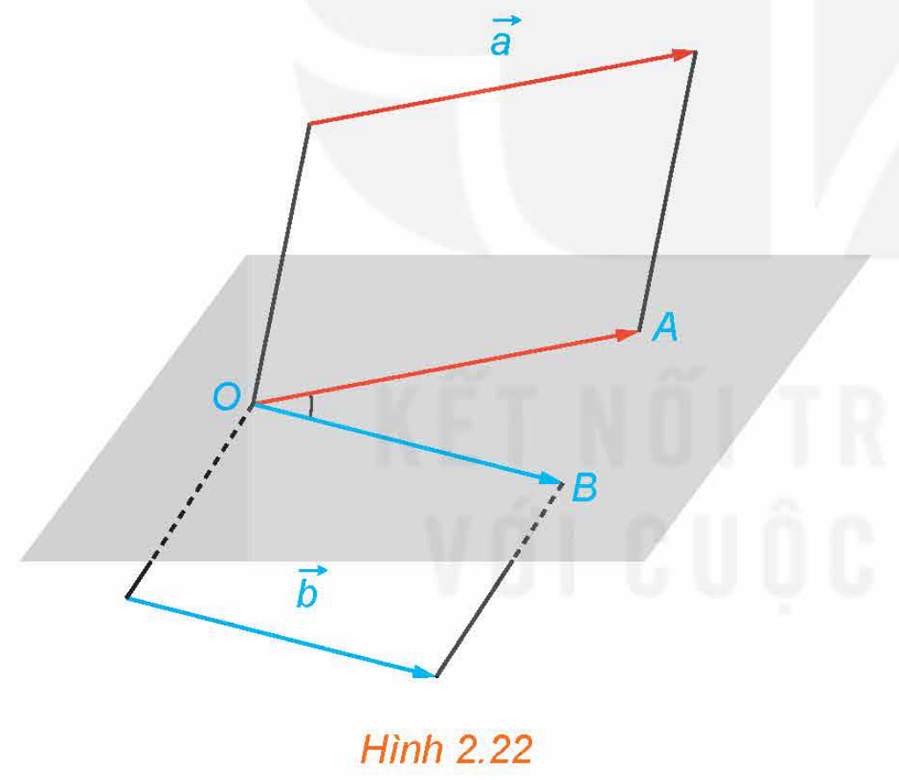
*Hình 2.22*

Nếu góc giữa hai vectơ $\vec{a}$ và $\vec{b}$ là $90^\circ$ thì ta nói hai vectơ $\vec{a}$ và $\vec{b}$ **vuông góc** với nhau và kí hiệu là $\vec{a} \perp \vec{b}$.

**Chú ý:**

- Để xác định góc giữa hai vectơ $\overrightarrow{AB}$ và $\overrightarrow{CD}$ trong không gian ta có thể lấy điểm $E$ sao cho $\overrightarrow{AE} = \overrightarrow{CD}$, khi đó $(\overrightarrow{AB}, \overrightarrow{CD}) = \widehat{BAE}$ (H.2.23).
- Quy ước góc giữa một vectơ bất kì và $\vec{0}$ có thể nhận một giá trị tuỳ ý từ $0^\circ$ đến $180^\circ$.

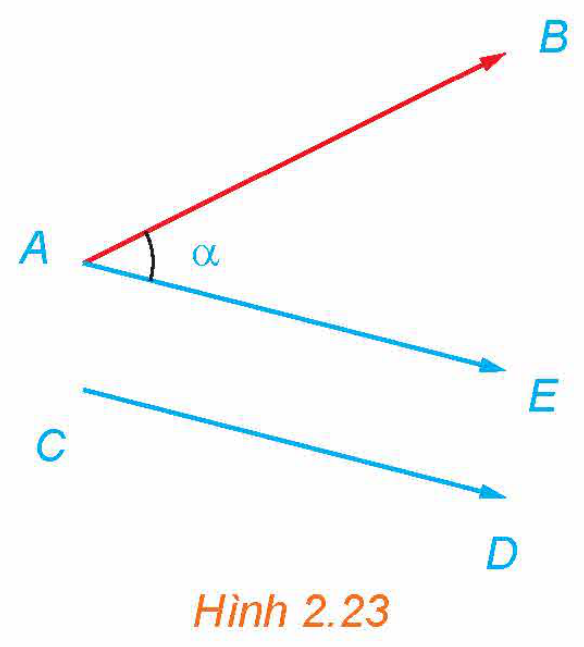
*Hình 2.23*

**Câu hỏi:** Xác định góc giữa hai vectơ cùng hướng (và khác $\vec{0}$), góc giữa hai vectơ ngược hướng trong không gian.

<!-- pdf:58 -->

**Ví dụ 9:** Cho hình lập phương $ABCD.A'B'C'D'$ (H.2.24). Tính góc giữa các cặp vectơ sau:

a) $\overrightarrow{AD}$ và $\overrightarrow{B'C'}$;

b) $\overrightarrow{AC}$ và $\overrightarrow{A'D'}$.

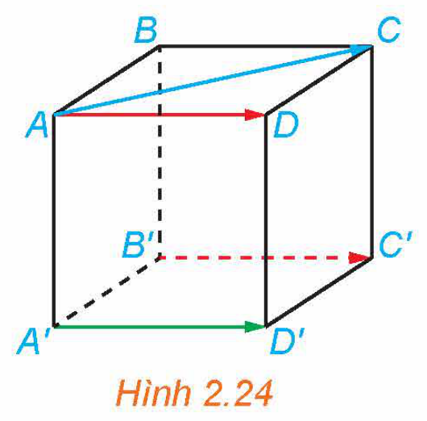
*Hình 2.24*

**Giải:**

a) Hai vectơ $\overrightarrow{AD}$ và $\overrightarrow{B'C'}$ cùng hướng nên $(\overrightarrow{AD}, \overrightarrow{B'C'}) = 0^\circ$.

b) Vì tứ giác $ADD'A'$ là hình bình hành nên $\overrightarrow{AD} = \overrightarrow{A'D'}$. Do đó $(\overrightarrow{AC}, \overrightarrow{A'D'}) = (\overrightarrow{AC}, \overrightarrow{AD}) = \widehat{CAD}$. Tam giác $ADC$ vuông cân tại $D$ nên $\widehat{CAD} = 45^\circ$, vì vậy $(\overrightarrow{AC}, \overrightarrow{A'D'}) = 45^\circ$.

**Luyện tập 9:** Cho hình lăng trụ tam giác đều $ABC.A'B'C'$ (H.2.25). Tính các góc $(\overrightarrow{AA'}, \overrightarrow{BC})$ và $(\overrightarrow{AB}, \overrightarrow{A'C'})$.

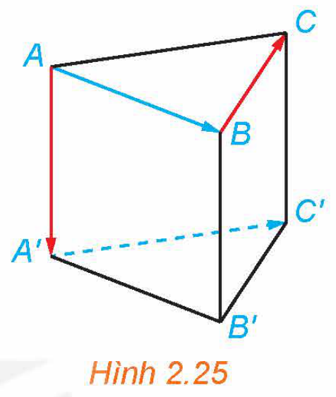
*Hình 2.25*

**b) Tích vô hướng của hai vectơ trong không gian**

**HĐ8:** Nhận biết khái niệm tích vô hướng của hai vectơ trong không gian

Hãy nhắc lại công thức xác định tích vô hướng của hai vectơ trong mặt phẳng.

> Trong không gian, cho hai vectơ $\vec{a}, \vec{b}$ đều khác $\vec{0}$. **Tích vô hướng** của hai vectơ $\vec{a}$ và $\vec{b}$ là một số, kí hiệu là $\vec{a} \cdot \vec{b}$, được xác định bởi công thức:
> $\vec{a} \cdot \vec{b} = |\vec{a}| \cdot |\vec{b}| \cdot \cos(\vec{a}, \vec{b}).$

**Chú ý:**

- Quy ước nếu $\vec{a} = \vec{0}$ hoặc $\vec{b} = \vec{0}$ thì $\vec{a} \cdot \vec{b} = 0$.
- Cho hai vectơ $\vec{a}, \vec{b}$ đều khác $\vec{0}$. Khi đó: $\vec{a} \perp \vec{b} \Leftrightarrow \vec{a} \cdot \vec{b} = 0$.
- Với mọi vectơ $\vec{a}$, ta có $\vec{a}^2 = |\vec{a}|^2$.
- Nếu $\vec{a}, \vec{b}$ là hai vectơ khác $\vec{0}$ thì $\cos(\vec{a}, \vec{b}) = \frac{\vec{a} \cdot \vec{b}}{|\vec{a}| \cdot |\vec{b}|}$.
<!-- ocr-ok: đã đối chiếu ảnh trang PDF 58 -->

**Ví dụ 10:** Cho hình chóp tứ giác đều $S.ABCD$ có độ dài tất cả các cạnh bằng $a$ (H.2.26). Tính các tích vô hướng sau:

a) $\overrightarrow{AS} \cdot \overrightarrow{BC}$;

b) $\overrightarrow{AS} \cdot \overrightarrow{AC}$.

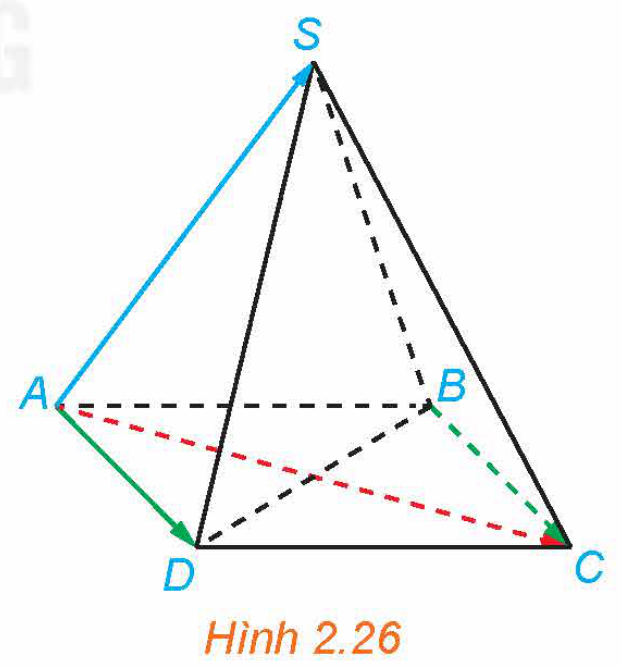
*Hình 2.26*

**Giải:**

a) Tam giác $SAD$ có ba cạnh bằng nhau nên là tam giác đều, suy ra $\widehat{SAD} = 60^\circ$. Tứ giác $ABCD$ là hình vuông nên $\overrightarrow{AD} = \overrightarrow{BC}$, suy ra $(\overrightarrow{AS}, \overrightarrow{BC}) = (\overrightarrow{AS}, \overrightarrow{AD}) = \widehat{SAD} = 60^\circ$. Do đó

$\overrightarrow{AS} \cdot \overrightarrow{BC} = |\overrightarrow{AS}| \cdot |\overrightarrow{BC}| \cdot \cos 60^\circ = a \cdot a \cdot \frac{1}{2} = \frac{a^2}{2}.$

<!-- pdf:59 -->

b) Tứ giác $ABCD$ là hình vuông có độ dài mỗi cạnh là $a$ nên độ dài đường chéo $AC$ là $\sqrt{2}a$. Tam giác $SAC$ có $SA = SC = a$ và $AC = \sqrt{2}a$ nên tam giác $SAC$ vuông cân tại $S$, suy ra $\widehat{SAC} = 45^\circ$. Do đó $\overrightarrow{AS} \cdot \overrightarrow{AC} = |\overrightarrow{AS}| \cdot |\overrightarrow{AC}| \cdot \cos \widehat{SAC} = a \cdot \sqrt{2}a \cdot \frac{\sqrt{2}}{2} = a^2$.

**Luyện tập 10:** Trong Ví dụ 10, hãy tính các tích vô hướng $\overrightarrow{AS} \cdot \overrightarrow{BD}$ và $\overrightarrow{AS} \cdot \overrightarrow{CD}$.

**Nhận xét:** Tích vô hướng của hai vectơ trong không gian cũng có các tính chất giống như các tính chất của tích vô hướng của hai vectơ trong mặt phẳng. Cụ thể, nếu $\vec{a}, \vec{b}, \vec{c}$ là các vectơ trong không gian và $k$ là một số thực thì ta có:

- $\vec{a} \cdot \vec{b} = \vec{b} \cdot \vec{a}$;
- $k(\vec{a} \cdot \vec{b}) = (k\vec{a}) \cdot \vec{b} = \vec{a} \cdot (k\vec{b})$;
- $\vec{a} \cdot (\vec{b} + \vec{c}) = \vec{a} \cdot \vec{b} + \vec{a} \cdot \vec{c}$.

**Ví dụ 11:** Cho tứ diện $ABCD$ có $AC$ và $BD$ cùng vuông góc với $AB$. Gọi $M, N$ lần lượt là trung điểm của hai cạnh $AB, CD$ (H.2.27). Chứng minh rằng:

a) $\overrightarrow{MN} = \frac{1}{2}(\overrightarrow{AC} + \overrightarrow{BD})$;

b) $\overrightarrow{MN} \cdot \overrightarrow{AB} = 0$.

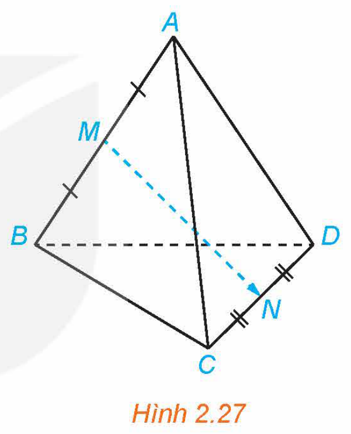
*Hình 2.27*

**Giải:**

a) Ta có: $\overrightarrow{MN} = \overrightarrow{MA} + \overrightarrow{AC} + \overrightarrow{CN}$ và $\overrightarrow{MN} = \overrightarrow{MB} + \overrightarrow{BD} + \overrightarrow{DN}$.

Do đó $2\overrightarrow{MN} = (\overrightarrow{MA} + \overrightarrow{MB}) + (\overrightarrow{AC} + \overrightarrow{BD}) + (\overrightarrow{CN} + \overrightarrow{DN})$.

Vì $M, N$ lần lượt là trung điểm của $AB, CD$ nên $\overrightarrow{MA} + \overrightarrow{MB} = \overrightarrow{CN} + \overrightarrow{DN} = \vec{0}$.
<!-- ocr-ok: đã đối chiếu ảnh trang PDF 59 -->

Suy ra $2\overrightarrow{MN} = \overrightarrow{AC} + \overrightarrow{BD}$, hay $\overrightarrow{MN} = \frac{1}{2}(\overrightarrow{AC} + \overrightarrow{BD})$.

b) Từ giả thiết, ta có $\overrightarrow{AC} \cdot \overrightarrow{AB} = \overrightarrow{BD} \cdot \overrightarrow{AB} = 0$.

Vì vậy, $\overrightarrow{MN} \cdot \overrightarrow{AB} = \frac{1}{2}(\overrightarrow{AC} + \overrightarrow{BD}) \cdot \overrightarrow{AB} = \frac{1}{2}\overrightarrow{AC} \cdot \overrightarrow{AB} + \frac{1}{2}\overrightarrow{BD} \cdot \overrightarrow{AB} = 0$.

**Luyện tập 11:** Cho hình lập phương $ABCD.A'B'C'D'$. Chứng minh rằng $\overrightarrow{A'C} \cdot \overrightarrow{B'D'} = 0$.

**Vận dụng 4:** Như đã biết, nếu có một lực $\overrightarrow{F}$ tác động vào một vật tại điểm $M$ và làm cho vật đó di chuyển một quãng đường $MN$ thì công $A$ sinh ra được tính theo công thức $A = \overrightarrow{F} \cdot \overrightarrow{MN}$, trong đó lực $F$ có độ lớn tính bằng Newton, quãng đường $MN$ tính bằng mét và công $A$ tính bằng Jun (H.2.28). Do đó, nếu dùng một lực $\overrightarrow{F}$ có độ lớn không đổi để làm một vật di chuyển một quãng đường không đổi thì công sinh ra sẽ lớn nhất khi lực tác động cùng hướng với chuyển động của vật. Hãy giải thích vì sao.

Kết quả trên có thể được áp dụng như thế nào khi kéo (hoặc đẩy) các vật nặng?

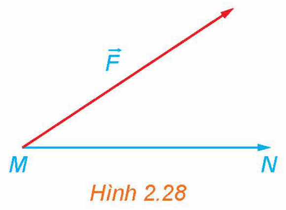
*Hình 2.28*

<!-- pdf:60 -->

## ✏️ Bài tập

**2.1.** Trong không gian, cho ba vectơ $\vec{a}, \vec{b}, \vec{c}$ phân biệt và đều khác $\vec{0}$. Những mệnh đề nào sau đây là đúng?

a) Nếu $\vec{a}$ và $\vec{b}$ đều cùng hướng với $\vec{c}$ thì $\vec{a}$ và $\vec{b}$ cùng hướng.

b) Nếu $\vec{a}$ và $\vec{b}$ đều ngược hướng với $\vec{c}$ thì $\vec{a}$ và $\vec{b}$ cùng hướng.

c) Nếu $\vec{a}$ và $\vec{b}$ đều cùng hướng với $\vec{c}$ thì $\vec{a}$ và $\vec{b}$ ngược hướng.

d) Nếu $\vec{a}$ và $\vec{b}$ đều ngược hướng với $\vec{c}$ thì $\vec{a}$ và $\vec{b}$ ngược hướng.

**2.2.** Cho hình hộp chữ nhật $ABCD.A'B'C'D'$ có $AB = 2, AD = 3$ và $AA' = 4$. Tính độ dài của các vectơ $\overrightarrow{BB'}, \overrightarrow{BD}$ và $\overrightarrow{BD'}$.

**2.3.** Một chiếc bàn cân đối hình chữ nhật được đặt trên mặt sàn nằm ngang, mặt bàn song song với mặt sàn và bốn chân bàn vuông góc với mặt sàn như Hình 2.29. Trọng lực tác dụng lên bàn (biểu thị bởi vectơ $\vec{a}$) phân tán đều qua bốn chân bàn và gây nên các phản lực từ mặt sàn lên các chân bàn (biểu thị bởi các vectơ $\vec{b}, \vec{c}, \vec{d}, \vec{e}$).

a) Hãy chỉ ra mối quan hệ về phương và hướng của các vectơ $\vec{a}, \vec{b}, \vec{c}, \vec{d}$ và $\vec{e}$.

b) Giải thích vì sao các vectơ $\vec{b}, \vec{c}, \vec{d}, \vec{e}$ đôi một bằng nhau.

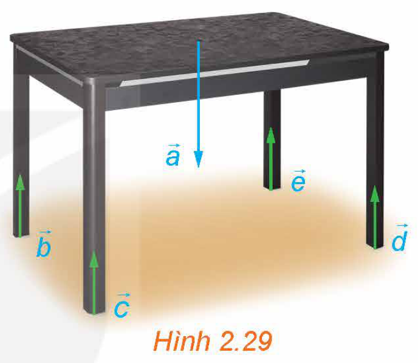
*Hình 2.29*

**2.4.** Cho hình hộp $ABCD.A'B'C'D'$. Chứng minh rằng:

a) $\overrightarrow{AB} + \overrightarrow{DD'} + \overrightarrow{C'D'} = \overrightarrow{CC'}$;

b) $\overrightarrow{AB} + \overrightarrow{CD'} - \overrightarrow{CC'} = \vec{0}$;

c) $\overrightarrow{BC} - \overrightarrow{CC'} + \overrightarrow{DC} = \overrightarrow{A'C}$.

**2.5.** Cho hình lăng trụ tam giác $ABC.A'B'C'$ có $\overrightarrow{AA'} = \vec{a}, \overrightarrow{AB} = \vec{b}$ và $\overrightarrow{AC} = \vec{c}$. Hãy biểu diễn các vectơ sau qua các vectơ $\vec{a}, \vec{b}, \vec{c}$:

a) $\overrightarrow{AB'}$;

b) $\overrightarrow{B'C}$;

c) $\overrightarrow{BC'}$.

**2.6.** Cho hình chóp tứ giác $S.ABCD$. Chứng minh rằng tứ giác $ABCD$ là hình bình hành nếu và chỉ nếu $\overrightarrow{SA} + \overrightarrow{SC} = \overrightarrow{SB} + \overrightarrow{SD}$.

**2.7.** Cho hình chóp $S.ABC$. Trên cạnh $SA$, lấy điểm $M$ sao cho $SM = 2AM$. Trên cạnh $BC$, lấy điểm $N$ sao cho $CN = 2BN$. Chứng minh rằng $\overrightarrow{MN} = \frac{1}{3}(\overrightarrow{SA} + \overrightarrow{BC}) + \overrightarrow{AB}$.
<!-- ocr-ok: đã đối chiếu ảnh trang PDF 60 -->

**2.8.** Trong Luyện tập 8, ta đã biết trọng tâm của tứ diện $ABCD$ là một điểm $I$ thoả mãn $\overrightarrow{AI} = 3\overrightarrow{IG}$, ở đó $G$ là trọng tâm của tam giác $BCD$. Áp dụng tính chất trên để tính khoảng cách từ trọng tâm của một khối rubik (đồng chất) hình tứ diện đều đến một mặt của nó, biết rằng chiều cao của khối rubik là $8\text{ cm}$ (H.2.30).

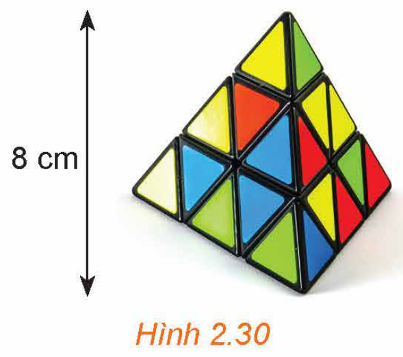
*Hình 2.30*

<!-- pdf:61 -->

**2.9.** Ba sợi dây không giãn với khối lượng không đáng kể được buộc chung một đầu và được kéo căng về ba hướng khác nhau (H.2.31). Nếu các lực kéo làm cho ba sợi dây ở trạng thái đứng yên thì khi đó ba sợi dây nằm trên cùng một mặt phẳng. Hãy giải thích vì sao.

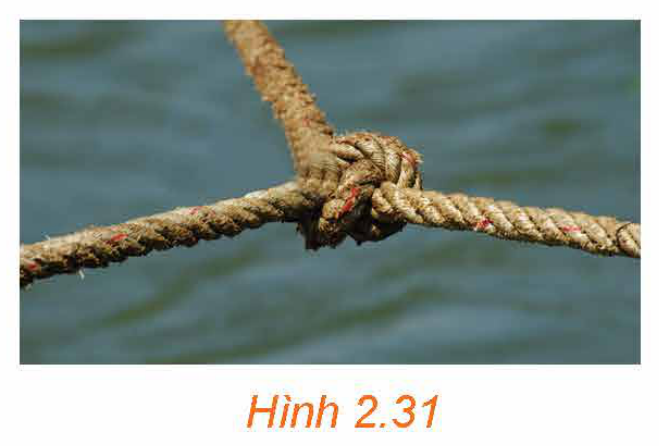
*Hình 2.31*

**2.10.** Cho hình lăng trụ tứ giác đều $ABCD.A'B'C'D'$ có độ dài mỗi cạnh đáy bằng $1$ và độ dài mỗi cạnh bên bằng $2$. Hãy tính góc giữa các cặp vectơ sau đây và tính tích vô hướng của mỗi cặp vectơ đó:

a) $\overrightarrow{AA'}$ và $\overrightarrow{C'C}$;

b) $\overrightarrow{AA'}$ và $\overrightarrow{BC}$;

c) $\overrightarrow{AC}$ và $\overrightarrow{B'A'}$.

**2.11.** Trong không gian, cho hai vectơ $\vec{a}$ và $\vec{b}$ cùng có độ dài bằng $1$. Biết rằng góc giữa hai vectơ đó là $45^\circ$, hãy tính:

a) $\vec{a} \cdot \vec{b}$;

b) $(\vec{a} + 3\vec{b}) \cdot (\vec{a} - 2\vec{b})$;

c) $(\vec{a} + \vec{b})^2$.

**2.12.** Cho tứ diện $ABCD$. Chứng minh rằng:

a) $\overrightarrow{AB} \cdot \overrightarrow{CD} = \overrightarrow{AC} \cdot \overrightarrow{CD} + \overrightarrow{BC} \cdot \overrightarrow{DC}$;

b) $\overrightarrow{AB} \cdot \overrightarrow{CD} + \overrightarrow{AC} \cdot \overrightarrow{DB} + \overrightarrow{AD} \cdot \overrightarrow{BC} = 0$.

**Em có biết?**

Việc phân tích (hay biểu diễn) một vectơ trong không gian qua các vectơ cho trước có thể giúp giải thích một số hiện tượng trong cuộc sống. Ví dụ, khi đi bộ, chân tạo một lực tác động $\overrightarrow{F}$ lên mặt đất. Theo Định luật III Newton, từ mặt đất có một phản lực tác động ngược trở lại bàn chân là $\overrightarrow{F'} = -\overrightarrow{F}$. Lực $\overrightarrow{F'}$ có thể được phân tích thành $\overrightarrow{F'} = \overrightarrow{F'_1} + \overrightarrow{F'_2}$, ở đó $\overrightarrow{F'_1}$ có giá song song với mặt đất và $\overrightarrow{F'_2}$ có giá vuông góc với mặt đất (H.2.32). Vì vậy, chỉ có lực $\overrightarrow{F'_1}$ tạo nên chuyển động tiến về phía trước của người đi bộ. Có thể nhận thấy rằng nếu độ lớn của lực $\overrightarrow{F}$ là không đổi (và khi đó độ lớn của lực $\overrightarrow{F'}$ là không đổi) thì độ lớn của lực $\overrightarrow{F'_1}$ càng lớn nếu giá của lực $\overrightarrow{F}$ càng “gần” vị trí song song với mặt đất, tức là góc giữa giá của lực $\overrightarrow{F}$ và mặt đất càng nhỏ.

Nhận xét trên lí giải vì sao trong các cuộc thi điền kinh, khi chuẩn bị xuất phát, các vận động viên thường dùng bàn đạp (nếu được cho phép) để cẳng chân phát lực tạo với mặt đất góc nhỏ nhất, từ đó tạo được tốc độ xuất phát lớn nhất (H.2.33).

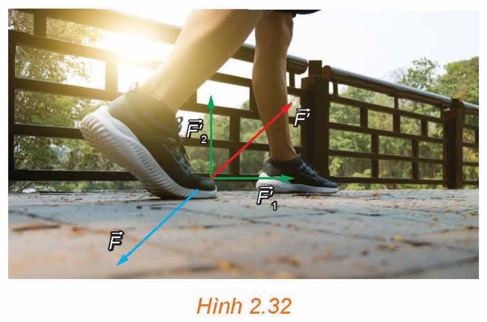
*Hình 2.32*

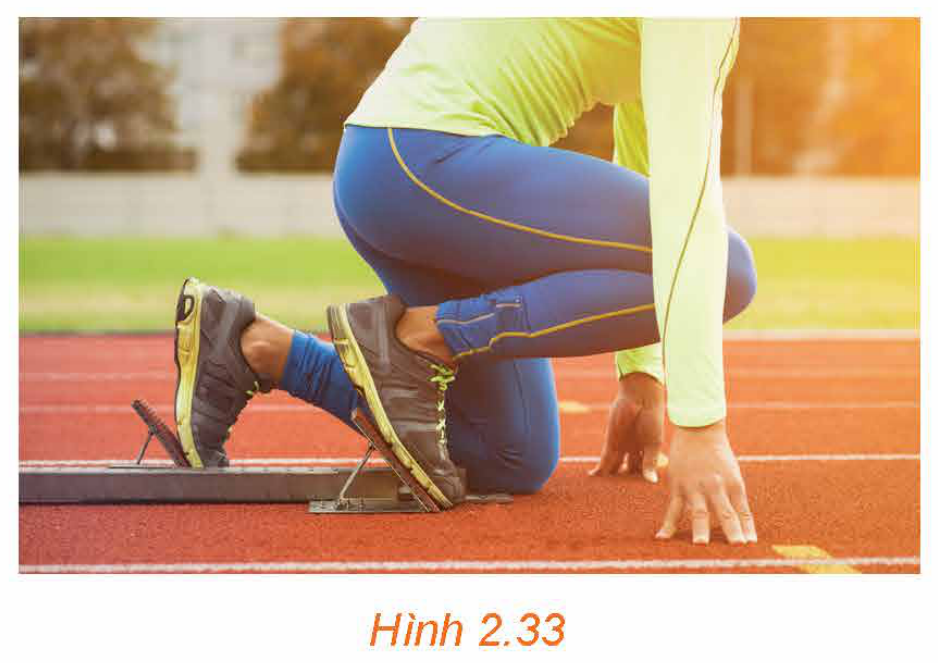
*Hình 2.33*

## 📷 Danh sách hình trong bài

| Mã hình | Trang PDF | Chú thích trong sách | Mô tả ngắn |
| :--- | :---: | :--- | :--- |
| H12-toan-b06-01 | 47 | Hình 2.1. Các mũi tên chỉ đường gợi lên hình ảnh về vectơ trong không gian. | Biển chỉ đường với các mũi tên hướng về nhiều phía trong không gian |
| H12-toan-b06-02 | 48 | Hình 2.2 | Kiện hàng được treo bởi các sợi dây cáp với các mũi tên màu đỏ biểu diễn lực căng dây |
| H12-toan-b06-03 | 48 | Hình 2.3. Vận tốc gió và vận tốc của máy bay có thể được biểu diễn bởi vectơ trong không gian. | Lá cờ bay trước gió và máy bay đang bay trên bầu trời kèm mũi tên chỉ vận tốc |
| H12-toan-b06-04 | 48 | Hình 2.4. Đường thẳng $d$ là giá của vectơ $\vec{a}$. | Vectơ $\vec{a}$ nằm trên đường thẳng $d$ |
| H12-toan-b06-05 | 49 | Hình 2.5 | Tứ diện $ABCD$ với các vectơ $\overrightarrow{AB}, \overrightarrow{AC}, \overrightarrow{AD}$ |
| H12-toan-b06-06 | 49 | Hình 2.6 | Hình lập phương $ABCD.A'B'C'D'$ với các vectơ $\overrightarrow{AC}, \overrightarrow{AD}, \overrightarrow{AD'}$ |
| H12-toan-b06-07 | 49 | Hình 2.7 | Hình hộp $ABCD.A'B'C'D'$ với hai vectơ $\overrightarrow{AB}$ và $\overrightarrow{D'C'}$ |
| H12-toan-b06-08 | 50 | Hình 2.8 | Hình lăng trụ tam giác $ABC.A'B'C'$ với trung điểm $M$ của $BC$ và $M'$ của $B'C'$ |
| H12-toan-b06-09 | 50 | Hình 2.9 | Thang máy di chuyển giữa các tầng của một toà nhà cao tầng |
| H12-toan-b06-10 | 51 | Hình 2.10 | Minh hoạ tổng hai vectơ $\vec{a}, \vec{b}$ không phụ thuộc vào việc chọn điểm đầu $A$ hay $A'$ |
| H12-toan-b06-11 | 51 | Hình 2.11 | Phép cộng hai vectơ $\vec{a} + \vec{b} = \overrightarrow{AC}$ với $\overrightarrow{AB} = \vec{a}, \overrightarrow{BC} = \vec{b}$ |
| H12-toan-b06-12 | 51 | Hình 2.12 | Hình lập phương $ABCD.A'B'C'D'$ với hai vectơ $\overrightarrow{BC}$ và $\overrightarrow{DD'}$ |
| H12-toan-b06-13 | 52 | Hình 2.13 | Tứ diện $ABCD$ với các vectơ $\overrightarrow{AC}, \overrightarrow{BD}, \overrightarrow{AD}, \overrightarrow{BC}$ |
| H12-toan-b06-14 | 52 | Hình 2.14 | Hình hộp $ABCD.A'B'C'D'$ minh hoạ quy tắc hình hộp $\overrightarrow{AB} + \overrightarrow{AD} + \overrightarrow{AA'} = \overrightarrow{AC'}$ |
| H12-toan-b06-15 | 53 | Hình 2.15 | Lọ hoa đặt trên mặt bàn với hai vectơ biểu diễn lực tác dụng và phản lực |
| H12-toan-b06-16 | 53 | Hình 2.16 | Hình chóp $S.ABCD$ có đáy là hình bình hành với trung điểm $M$ của $AB$ và $N$ của $CD$ |
| H12-toan-b06-17 | 54 | Hình 2.17 | Hình lăng trụ tam giác $ABC.A'B'C'$ với $M, N$ là trung điểm của $AB, AC$ |
| H12-toan-b06-18 | 55 | Hình 2.18 | Hình lăng trụ tam giác $ABC.A'B'C'$ với giao điểm $O$ của $AB'$ và $A'B$ |
| H12-toan-b06-19 | 56 | Hình 2.19 | Tứ diện $ABCD$ với trọng tâm $G$ của tam giác $BCD$ và trọng tâm $I$ của tứ diện |
| H12-toan-b06-20 | 56 | Hình 2.20 | Bốn lực chính tác động lên máy bay: lực đẩy, lực cản của không khí, trọng lực và lực nâng |
| H12-toan-b06-21 | 57 | Hình 2.21 | Minh hoạ góc giữa hai vectơ $\vec{a}, \vec{b}$ không phụ thuộc vào vị trí điểm $O$ |
| H12-toan-b06-22 | 57 | Hình 2.22 | Góc $\widehat{AOB}$ giữa hai vectơ $\vec{a} = \overrightarrow{OA}$ và $\vec{b} = \overrightarrow{OB}$ trong không gian |
| H12-toan-b06-23 | 57 | Hình 2.23 | Xác định góc $\alpha = \widehat{BAE}$ giữa hai vectơ $\overrightarrow{AB}$ và $\overrightarrow{CD}$ bằng cách dựng $\overrightarrow{AE} = \overrightarrow{CD}$ |
| H12-toan-b06-24 | 58 | Hình 2.24 | Hình lập phương $ABCD.A'B'C'D'$ với các vectơ $\overrightarrow{AD}, \overrightarrow{B'C'}, \overrightarrow{AC}, \overrightarrow{A'D'}$ |
| H12-toan-b06-25 | 58 | Hình 2.25 | Hình lăng trụ tam giác đều $ABC.A'B'C'$ |
| H12-toan-b06-26 | 58 | Hình 2.26 | Hình chóp tứ giác đều $S.ABCD$ có các cạnh bằng $a$ |
| H12-toan-b06-27 | 59 | Hình 2.27 | Tứ diện $ABCD$ với $M, N$ là trung điểm của $AB, CD$ |
| H12-toan-b06-28 | 59 | Hình 2.28 | Lực $\overrightarrow{F}$ tác động tại điểm $M$ làm vật di chuyển theo vectơ $\overrightarrow{MN}$ |
| H12-toan-b06-29 | 60 | Hình 2.29 | Chiếc bàn với trọng lực $\vec{a}$ và các phản lực $\vec{b}, \vec{c}, \vec{d}, \vec{e}$ tại bốn chân bàn |
| H12-toan-b06-30 | 60 | Hình 2.30 | Khối rubik hình tứ diện đều có chiều cao $8\text{ cm}$ |
| H12-toan-b06-31 | 61 | Hình 2.31 | Ba sợi dây buộc chung một đầu và được kéo căng về ba hướng khác nhau |
| H12-toan-b06-32 | 61 | Hình 2.32 | Phân tích phản lực $\overrightarrow{F'} = \overrightarrow{F'_1} + \overrightarrow{F'_2}$ tác động lên bàn chân khi đi bộ |
| H12-toan-b06-33 | 61 | Hình 2.33 | Vận động viên điền kinh dùng bàn đạp xuất phát |
