<!-- pdf:62 -->

# BÀI 7: HỆ TRỤC TOẠ ĐỘ TRONG KHÔNG GIAN

## 🔤 Thuật ngữ

- Hệ trục toạ độ trong không gian
- Toạ độ của điểm trong không gian
- Toạ độ của vectơ trong không gian

## 🎯 Mục tiêu

- Nhận biết toạ độ của điểm, của vectơ đối với hệ trục toạ độ.
- Vận dụng toạ độ của vectơ để giải một số bài toán có liên quan đến thực tiễn.

## 🔴 Mở đầu

Trong Hình 2.34, một chiếc bóng đèn được treo cách sàn nhà là $2\text{ m}$, cách hai bức tường lần lượt là $1\text{ m}$ và $1,5\text{ m}$. Kiến thức toán học nào giúp mô tả chính xác và ngắn gọn vị trí của chiếc bóng đèn trong không gian?

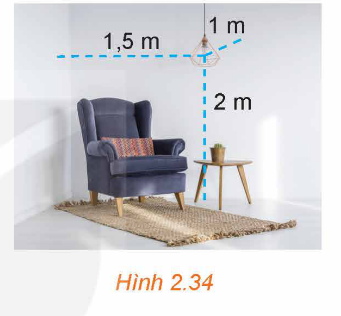
*Hình 2.34*

## 1. HỆ TRỤC TOẠ ĐỘ TRONG KHÔNG GIAN

**HĐ1:** Hình thành khái niệm hệ trục toạ độ trong không gian

Trong không gian, xét ba trục $Ox, Oy, Oz$ có chung gốc $O$ và đôi một vuông góc với nhau. Gọi $\vec{i}, \vec{j}, \vec{k}$ là các vectơ đơn vị trên các trục đó (H.2.35).

a) Gọi tên các mặt phẳng toạ độ có trong Hình 2.35.

b) Các mặt phẳng toạ độ trong Hình 2.35 có đôi một vuông góc với nhau không?

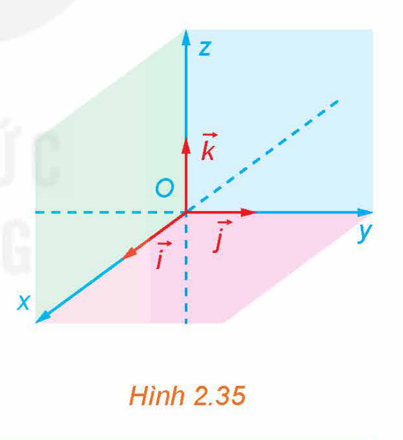
*Hình 2.35*

> Trong không gian, ba trục $Ox, Oy, Oz$ đôi một vuông góc với nhau tại gốc $O$ của mỗi trục. Gọi $\vec{i}, \vec{j}, \vec{k}$ lần lượt là các **vectơ đơn vị** trên các trục $Ox, Oy, Oz$.
> - Hệ ba trục như vậy được gọi là **hệ trục toạ độ Descartes vuông góc** $Oxyz$, hay đơn giản là **hệ toạ độ** $Oxyz$.
> - Điểm $O$ được gọi là **gốc toạ độ**.
> - Các mặt phẳng $(Oxy), (Oyz), (Ozx)$ đôi một vuông góc với nhau được gọi là các **mặt phẳng toạ độ**.
>
> Không gian với hệ toạ độ $Oxyz$ còn được gọi là **không gian** $Oxyz$.

<!-- pdf:63 -->

> ❓ Góc căn phòng trong Hình 2.34 có gợi lên hình ảnh về hệ toạ độ $Oxyz$ trong không gian hay không? Nếu có, hãy mô tả gốc toạ độ và các mặt phẳng toạ độ trong hình ảnh đó.

**Ví dụ 1:** Cho hình lập phương $ABCD.A'B'C'D'$ có độ dài mỗi cạnh bằng $1$ (H.2.36). Có thể lập một hệ toạ độ $Oxyz$ có gốc $O$ trùng với đỉnh $B'$ và các vectơ $\vec{i}, \vec{j}, \vec{k}$ lần lượt là các vectơ $\overrightarrow{B'A'}, \overrightarrow{B'C'}, \overrightarrow{B'B}$ không? Giải thích vì sao.

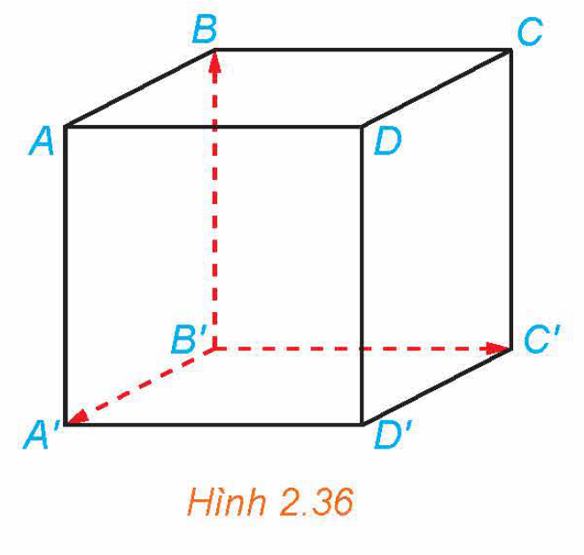
*Hình 2.36*

**Giải:**

Hình lập phương $ABCD.A'B'C'D'$ có các cạnh $B'A', B'C'$ và $B'B$ đôi một vuông góc với nhau.

Vì hình lập phương có độ dài mỗi cạnh bằng $1$ nên các vectơ $\overrightarrow{B'A'}, \overrightarrow{B'C'}, \overrightarrow{B'B}$ cùng có điểm đầu là $B'$ và đều có độ dài bằng $1$.

Từ các điều trên, suy ra có thể lập một hệ toạ độ $Oxyz$ có gốc $O$ trùng với đỉnh $B'$ và các vectơ $\vec{i}, \vec{j}, \vec{k}$ lần lượt là các vectơ $\overrightarrow{B'A'}, \overrightarrow{B'C'}, \overrightarrow{B'B}$.

**Luyện tập 1:** Cho hình hộp chữ nhật $ABCD.A'B'C'D'$. Có thể lập một hệ toạ độ $Oxyz$ có gốc $O$ trùng với đỉnh $C$ và các vectơ $\vec{i}, \vec{j}, \vec{k}$ lần lượt cùng hướng với các vectơ $\overrightarrow{CB}, \overrightarrow{CD}, \overrightarrow{CC'}$ không? Giải thích vì sao.

## 2. TOẠ ĐỘ CỦA ĐIỂM, TOẠ ĐỘ CỦA VECTƠ TRONG KHÔNG GIAN

**HĐ2:** Hình thành khái niệm toạ độ của điểm trong không gian

Trong không gian $Oxyz$, cho một điểm $M$ không thuộc các mặt phẳng toạ độ. Vẽ hình hộp chữ nhật $OADB.CFME$ có ba đỉnh $A, B, C$ lần lượt thuộc các tia $Ox, Oy, Oz$ (H.2.37).

a) Hai vectơ $\overrightarrow{OM}$ và $\overrightarrow{OA} + \overrightarrow{OB} + \overrightarrow{OC}$ có bằng nhau hay không?

b) Giải thích vì sao có thể viết $\overrightarrow{OM} = x\vec{i} + y\vec{j} + z\vec{k}$ với $x, y, z$ là các số thực.

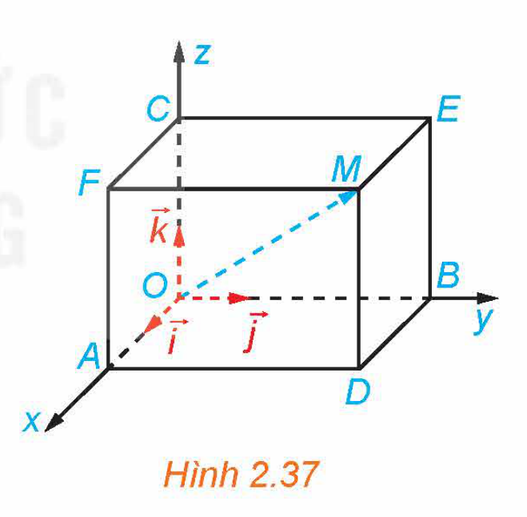
*Hình 2.37*

Người ta chứng minh được rằng với điểm $M$ tuỳ ý, bộ ba số $(x; y; z)$ trong HĐ2 là duy nhất. Ngược lại nếu $\overrightarrow{OM} = x\vec{i} + y\vec{j} + z\vec{k}$ thì điểm $M$ xác định duy nhất.

> Trong không gian $Oxyz$, cho một điểm $M$ tuỳ ý. Bộ ba số $(x; y; z)$ duy nhất sao cho $\overrightarrow{OM} = x\vec{i} + y\vec{j} + z\vec{k}$ được gọi là **toạ độ của điểm** $M$ đối với hệ toạ độ $Oxyz$. Khi đó, ta viết $M = (x; y; z)$ hoặc $M(x; y; z)$, trong đó $x$ là **hoành độ**, $y$ là **tung độ** và $z$ là **cao độ** của $M$.

> ❓ Hãy tìm toạ độ của gốc $O$.

<!-- pdf:64 -->

**Ví dụ 2:** Hình 2.38 minh hoạ một hệ toạ độ $Oxyz$ trong không gian cùng với các hình vuông có cạnh bằng $1$ đơn vị. Tìm toạ độ của điểm $M$.

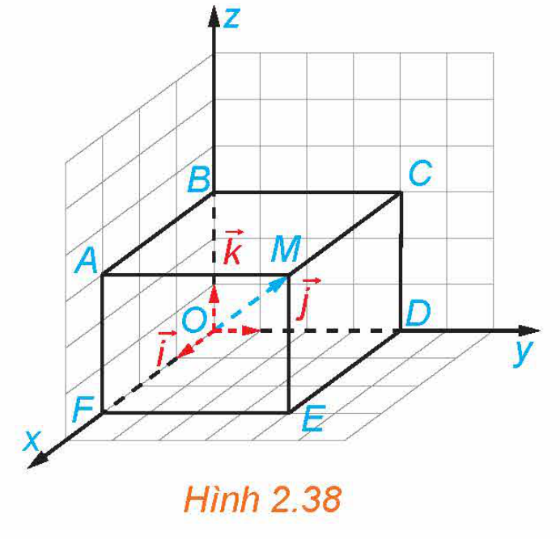
*Hình 2.38*

**Giải:**

Trong Hình 2.38, $ABCM.FODE$ là hình hộp chữ nhật. Áp dụng quy tắc hình hộp suy ra

$\overrightarrow{OM} = \overrightarrow{OF} + \overrightarrow{OD} + \overrightarrow{OB} = 3\vec{i} + 4\vec{j} + 3\vec{k}.$

Vì vậy, toạ độ của điểm $M$ là $(3; 4; 3)$.

**Luyện tập 2:** Tìm toạ độ của điểm $N$ trong Hình 2.39.

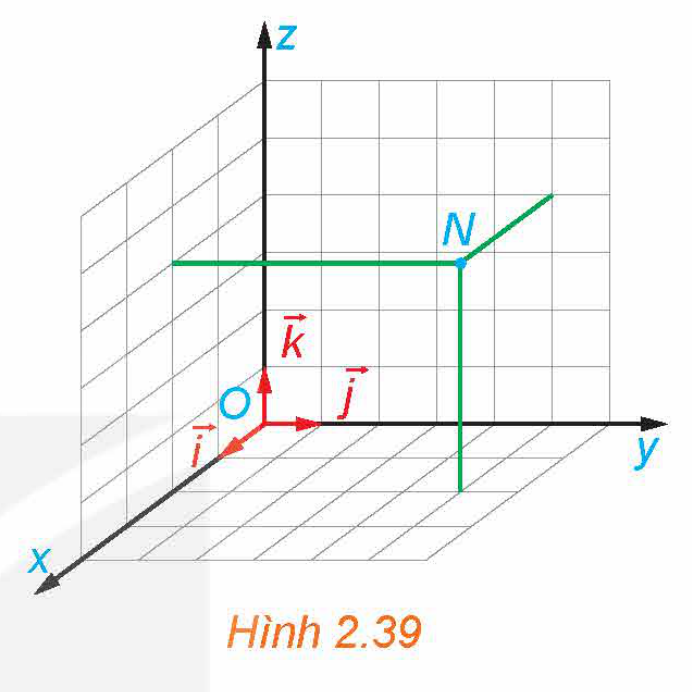
*Hình 2.39*

**Ví dụ 3:** Trong không gian $Oxyz$, cho hình hộp chữ nhật $ABCD.A'B'C'D'$ có đỉnh $A'$ trùng với gốc $O$ và các đỉnh $D', B', A$ lần lượt thuộc các tia $Ox, Oy, Oz$ (H.2.40). Giả sử đỉnh $C$ có toạ độ là $(2; 3; 5)$ đối với hệ toạ độ $Oxyz$, hãy tìm toạ độ của các đỉnh $D', B', A$ đối với hệ toạ độ đó.

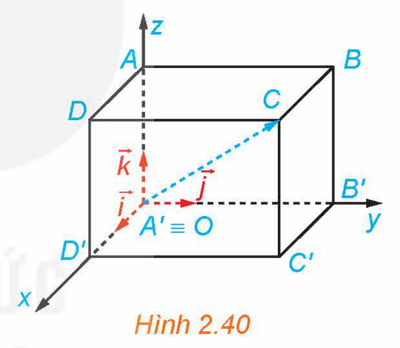
*Hình 2.40*

**Giải:**

Vì đỉnh $D'$ thuộc tia $Ox$ nên hai vectơ $\overrightarrow{OD'}$ và $\vec{i}$ cùng phương, suy ra có số thực $m$ sao cho $\overrightarrow{OD'} = m\vec{i}$. Tương tự, có các số thực $n, p$ sao cho $\overrightarrow{OB'} = n\vec{j}$ và $\overrightarrow{OA} = p\vec{k}$. Theo quy tắc hình hộp, suy ra $\overrightarrow{OC} = \overrightarrow{OD'} + \overrightarrow{OB'} + \overrightarrow{OA} = m\vec{i} + n\vec{j} + p\vec{k}$ và do đó điểm $C$ có toạ độ là $(m; n; p)$.

Mặt khác, đỉnh $C$ có toạ độ là $(2; 3; 5)$ nên $m = 2, n = 3, p = 5$, tức là $\overrightarrow{OD'} = 2\vec{i}, \overrightarrow{OB'} = 3\vec{j}$ và $\overrightarrow{OA} = 5\vec{k}$.
<!-- ocr-ok: đối chiếu ảnh p.64 -->

Từ đây suy ra $D'(2; 0; 0), B'(0; 3; 0)$ và $A(0; 0; 5)$.

**Luyện tập 3:** Trong Ví dụ 3, hãy xác định toạ độ của các điểm $B, D$ và $C'$.

**Nhận xét:** Nếu điểm $M$ có toạ độ $(x; y; z)$ đối với hệ toạ độ $Oxyz$ thì:

- Hình chiếu vuông góc của $M$ trên các trục $Ox, Oy$ và $Oz$ có toạ độ lần lượt là $(x; 0; 0)$, $(0; y; 0)$ và $(0; 0; z)$.
- Hình chiếu vuông góc của $M$ trên các mặt phẳng $(Oxy), (Oyz)$ và $(Ozx)$ có toạ độ lần lượt là $(x; y; 0), (0; y; z)$ và $(x; 0; z)$.

**Vận dụng 1:** Trong *tình huống mở đầu*, hãy chọn một hệ toạ độ phù hợp và xác định toạ độ của chiếc bóng đèn đối với hệ toạ độ đó.

**HĐ3:** Hình thành khái niệm toạ độ của vectơ trong không gian

Trong không gian $Oxyz$, cho vectơ $\vec{a}$ tuỳ ý (H.2.41). Lấy điểm $M$ sao cho $\overrightarrow{OM} = \vec{a}$ và giải thích vì sao có bộ ba số $(x; y; z)$ sao cho $\vec{a} = x\vec{i} + y\vec{j} + z\vec{k}$.

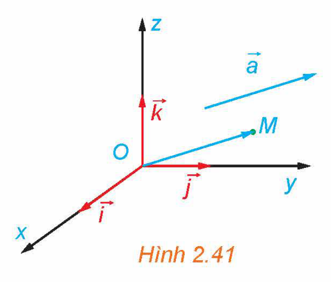
*Hình 2.41*

<!-- pdf:65 -->

Người ta chứng minh được rằng bộ ba số $(x; y; z)$ trong HĐ3 là duy nhất.

> Trong không gian $Oxyz$, cho vectơ $\vec{a}$ tuỳ ý. Bộ ba số $(x; y; z)$ duy nhất sao cho $\vec{a} = x\vec{i} + y\vec{j} + z\vec{k}$ được gọi là **toạ độ của vectơ** $\vec{a}$ đối với hệ toạ độ $Oxyz$. Khi đó, ta viết $\vec{a} = (x; y; z)$ hoặc $\vec{a}(x; y; z)$.

**Nhận xét:**

- Toạ độ của vectơ $\vec{a}$ cũng là toạ độ của điểm $M$ sao cho $\overrightarrow{OM} = \vec{a}$.
- Trong không gian, cho hai vectơ $\vec{a} = (x; y; z)$ và $\vec{b} = (x'; y'; z')$. Khi đó, $\vec{a} = \vec{b}$ nếu và chỉ nếu $\begin{cases} x = x' \\ y = y' \\ z = z'. \end{cases}$

**Ví dụ 4:** Trong không gian $Oxyz$, hãy tìm toạ độ của các vectơ $\vec{i}, \vec{j}$ và $\vec{k}$.

**Giải:**

Vì $\vec{i} = 1\cdot\vec{i} + 0\cdot\vec{j} + 0\cdot\vec{k}$ nên $\vec{i} = (1; 0; 0)$.

Vì $\vec{j} = 0\cdot\vec{i} + 1\cdot\vec{j} + 0\cdot\vec{k}$ nên $\vec{j} = (0; 1; 0)$.

Vì $\vec{k} = 0\cdot\vec{i} + 0\cdot\vec{j} + 1\cdot\vec{k}$ nên $\vec{k} = (0; 0; 1)$.

**Luyện tập 4:** Trong không gian $Oxyz$, hãy xác định toạ độ của vectơ $\vec{i} + 2\vec{j} + 5\vec{k}$.

**HĐ4:** Thiết lập toạ độ của vectơ theo toạ độ hai đầu mút
<!-- ocr-ok: đối chiếu ảnh p.65 -->

Trong không gian $Oxyz$, cho hai điểm $M(x; y; z)$ và $N(x'; y'; z')$.

a) Hãy biểu diễn hai vectơ $\overrightarrow{OM}$ và $\overrightarrow{ON}$ qua các vectơ $\vec{i}, \vec{j}$ và $\vec{k}$.

b) Xác định toạ độ của vectơ $\overrightarrow{MN}$.

<!-- term: Toạ độ vectơ theo hai đầu mút -->
> Trong không gian $Oxyz$, cho hai điểm $M(x_M; y_M; z_M)$ và $N(x_N; y_N; z_N)$. Khi đó: $\overrightarrow{MN} = (x_N - x_M; y_N - y_M; z_N - z_M)$.

**Ví dụ 5:** Trong không gian $Oxyz$, cho hình lăng trụ tam giác $ABC.A'B'C'$ có $A(1; 0; 2), B(3; 2; 5), C(7; -3; 9)$ và $A'(5; 0; 1)$.

a) Tìm toạ độ của $\overrightarrow{AA'}$.

b) Tìm toạ độ của các điểm $B', C'$.

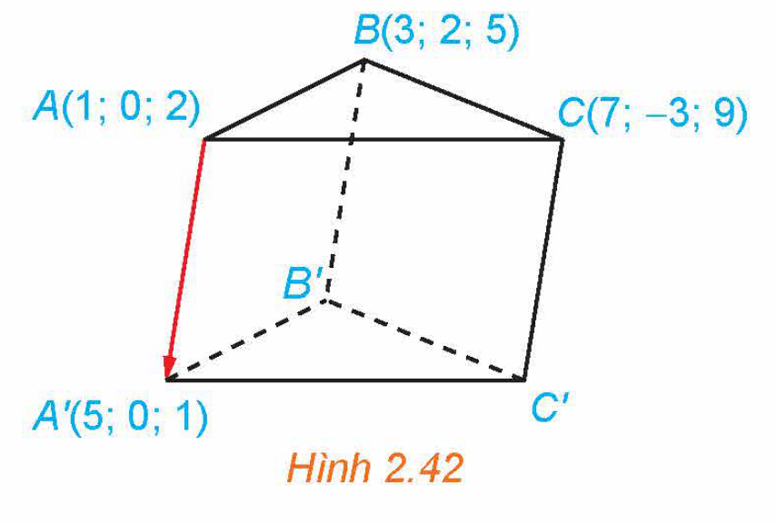
*Hình 2.42*

**Giải:** (H.2.42)

a) Ta có: $\overrightarrow{AA'} = (x_{A'} - x_A; y_{A'} - y_A; z_{A'} - z_A) = (4; 0; -1)$.

b) Gọi toạ độ của điểm $B'$ là $(x; y; z)$ thì $\overrightarrow{BB'} = (x - 3; y - 2; z - 5)$. Vì $ABC.A'B'C'$ là hình lăng trụ nên $ABB'A'$ là hình bình hành, suy ra $\overrightarrow{AA'} = \overrightarrow{BB'}$.

<!-- pdf:66 -->

Do đó $\begin{cases} x - 3 = 4 \\ y - 2 = 0 \\ z - 5 = -1 \end{cases}$ hay $x = 7, y = 2$ và $z = 4$. Vậy $B'(7; 2; 4)$.
<!-- ocr-ok: đối chiếu ảnh p.66 -->

Lập luận tương tự suy ra $C'(11; -3; 8)$.

**Luyện tập 5:** Trong Ví dụ 5, xác định toạ độ của các điểm $D$ và $D'$ sao cho $ABCD.A'B'C'D'$ là hình hộp.

**Vận dụng 2:** Để theo dõi hành trình của một chiếc máy bay, ta có thể lập hệ toạ độ $Oxyz$ có gốc $O$ trùng với vị trí của trung tâm kiểm soát không lưu, mặt phẳng $(Oxy)$ trùng với mặt đất (được coi là phẳng) với trục $Ox$ hướng về phía tây, trục $Oy$ hướng về phía nam và trục $Oz$ hướng thẳng đứng lên trời (H.2.43). Sau khi cất cánh và đạt độ cao nhất định, chiếc máy bay duy trì hướng bay về phía nam với tốc độ không đổi là $890\text{ km/h}$ trong nửa giờ. Xác định toạ độ của vectơ biểu diễn độ dịch chuyển của chiếc máy bay trong nửa giờ đó đối với hệ toạ độ đã chọn, biết rằng đơn vị đo trong không gian $Oxyz$ được lấy theo kilômét.

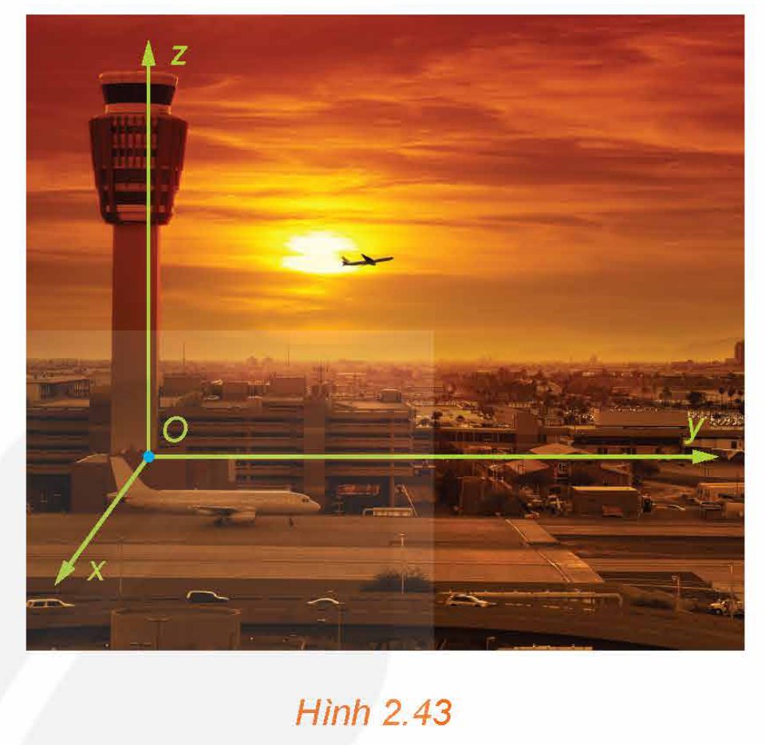
*Hình 2.43*

## ✏️ Bài tập

**2.13.** Trong không gian $Oxyz$, cho ba vectơ $\vec{a}, \vec{b}, \vec{c}$ đều khác $\vec{0}$ và có giá đôi một vuông góc. Những mệnh đề nào sau đây là đúng?

a) Có thể lập một hệ toạ độ $Oxyz$ có các trục toạ độ lần lượt song song với giá của các vectơ $\vec{a}, \vec{b}, \vec{c}$.

b) Có thể lập một hệ toạ độ $Oxyz$ có các trục toạ độ lần lượt trùng với giá của các vectơ $\vec{a}, \vec{b}, \vec{c}$.

c) Có thể lập một hệ toạ độ $Oxyz$ có các vectơ $\vec{i}, \vec{j}, \vec{k}$ lần lượt bằng các vectơ $\vec{a}, \vec{b}, \vec{c}$.

d) Có thể lập một hệ toạ độ $Oxyz$ có các vectơ $\vec{i}, \vec{j}, \vec{k}$ lần lượt cùng phương các vectơ $\vec{a}, \vec{b}, \vec{c}$.

**2.14.** Hãy mô tả hệ toạ độ $Oxyz$ trong căn phòng ở Hình 2.44 sao cho gốc $O$ trùng với góc trên của căn phòng, khung tranh nằm trong mặt phẳng $(Oxy)$ và mặt trần nhà trùng với mặt phẳng $(Oxz)$.

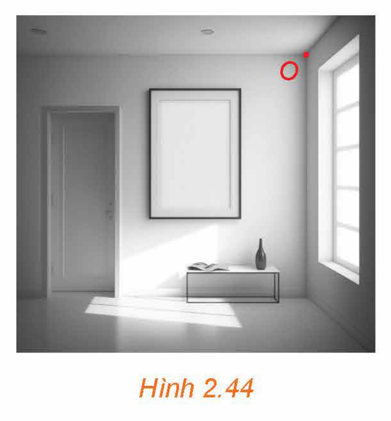
*Hình 2.44*

<!-- pdf:67 -->

**2.15.** Trong không gian $Oxyz$, xác định toạ độ của vectơ $\overrightarrow{AB}$ trong mỗi trường hợp sau:

a) $A(0; 0; 0)$ và $B(4; 2; -5)$;

b) $A(1; -3; 7)$ và $B(1; -3; 7)$;

c) $A(5; 4; 9)$ và $B(-5; 7; 2)$.

**2.16.** Trong không gian $Oxyz$, xác định toạ độ của điểm $A$ trong mỗi trường hợp sau:

a) $A$ trùng với gốc toạ độ;

b) $A$ nằm trên tia $Ox$ và $OA = 2$;
<!-- ocr-ok: đối chiếu ảnh p.67 -->

c) $A$ nằm trên tia đối của tia $Oy$ và $OA = 3$.

**2.17.** Trong không gian $Oxyz$, cho hình hộp chữ nhật $ABCD.A'B'C'D'$ có đỉnh $A$ trùng với gốc $O$ và các đỉnh $D, B, A'$ có toạ độ lần lượt là $(2; 0; 0), (0; 4; 0), (0; 0; 3)$ (H.2.45). Xác định toạ độ của các đỉnh còn lại của hình hộp chữ nhật.

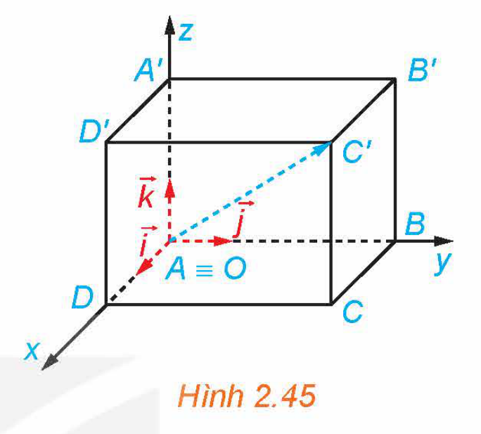
*Hình 2.45*

**2.18.** Trong không gian $Oxyz$, cho hình hộp $OABC.O'A'B'C'$ có $A(1; 1; -1), B(0; 3; 0), C'(2; -3; 6)$.

a) Xác định toạ độ của điểm $C$.

b) Xác định toạ độ các đỉnh còn lại của hình hộp.

**2.19.** Trong Vận dụng 2, hãy giải thích vì sao tại mỗi thời điểm chiếc máy bay di chuyển trên đường băng thì toạ độ của nó luôn có dạng $(x; y; 0)$ với $x, y$ là hai số thực nào đó.

## 💡 Em có biết?

Tên gọi “toạ độ Descartes” được lấy theo tên của nhà toán học người Pháp, René Descartes, nhằm ghi nhớ những đóng góp của ông trong Hình học Giải tích. Như đã biết, toạ độ Descartes xác định duy nhất vị trí của một điểm trong không gian.

Bên cạnh toạ độ Descartes, toạ độ cầu với vai trò tương tự cũng thường được sử dụng và được định nghĩa như sau:

Với mỗi điểm $M$ trong không gian $Oxyz$, gọi $M'$ là hình chiếu vuông góc của $M$ trên mặt phẳng $(Oxy)$. Gọi $r$ là khoảng cách từ $O$ đến $M$, gọi $\theta$ ($0 \le \theta < 2\pi$) là số đo của góc lượng giác (trong mặt phẳng $(Oxy)$) có tia đầu là $Ox$, tia cuối là $OM'$ và gọi $\phi$ ($0 \le \phi \le \pi$) là số đo của góc tạo bởi hai tia $OM$ và $Oz$ (H.2.46). Bộ ba $(r; \theta; \phi)$ được gọi là *toạ độ cầu* của điểm $M$, trong đó $r$ là *bán kính*, $\theta$ là *góc phương vị* hay *góc kinh độ* và $\phi$ là *góc cực* của $M$.

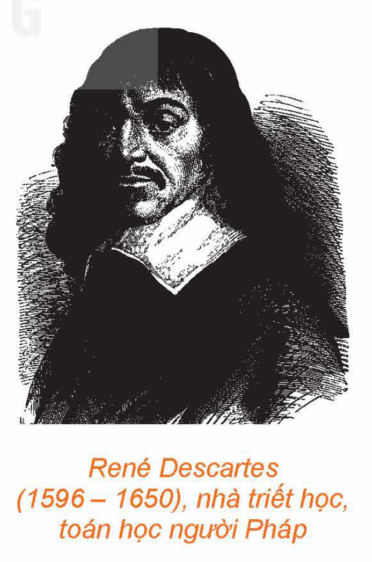
*René Descartes (1596 – 1650), nhà triết học, toán học người Pháp*
<!-- ocr-ok: đối chiếu ảnh p.67 -->

<!-- pdf:68 -->

Toạ độ cầu $(r; \theta; \phi)$ và toạ độ Descartes $(x; y; z)$ của $M$ liên hệ với nhau qua các công thức:

$\begin{cases} r = \sqrt{x^2 + y^2 + z^2} \\ \tan \theta = \frac{y}{x} \\ \cos \phi = \frac{z}{\sqrt{x^2 + y^2 + z^2}} \end{cases}$ và $\begin{cases} x = r \cos \theta \sin \phi \\ y = r \sin \theta \sin \phi \\ z = r \cos \phi. \end{cases}$

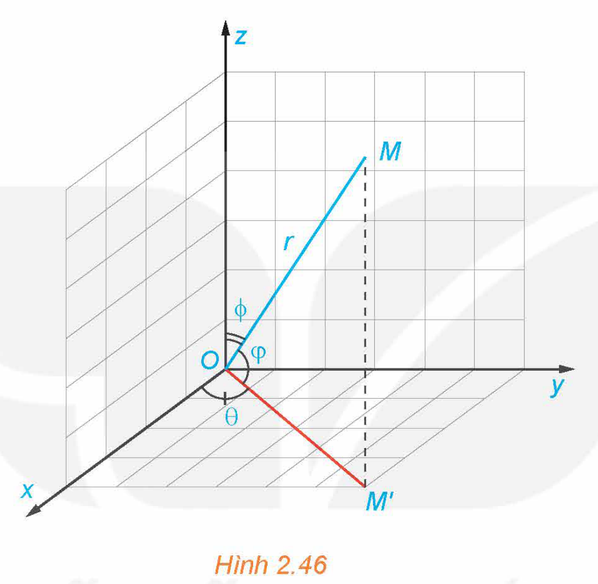
*Hình 2.46*

Trong một số trường hợp, người ta thay góc cực $\phi$ bởi *góc nâng* (hay *góc vĩ độ*) $\varphi = \frac{\pi}{2} - \phi \left(-\frac{\pi}{2} \le \varphi \le \frac{\pi}{2}\right)$. Khi đó toạ độ cầu $(r; \theta; \varphi)$ và toạ độ Descartes $(x; y; z)$ cũng được liên hệ với nhau bởi các công thức tương tự như trên.

Toạ độ cầu thuận tiện cho việc tính toán trên mặt cầu và trên một số đối tượng có tính đối xứng, do đó, được sử dụng phổ biến trong toán học, vật lí, địa lí và thiên văn. Cơ quan Hàng không và Vũ trụ Hoa Kỳ NASA (National Aeronautics and Space Administration) sử dụng toạ độ địa hình (Topodetic coordinates), một dạng tương tự của toạ độ cầu, trong việc xác định vị trí của vật thể trong không gian.

## 📷 Danh sách hình trong bài

| Mã hình | Trang PDF | Vị trí trong bài | Chú thích gốc |
| --- | --- | --- | --- |
| H12-toan-b07-01 | 62 | Mở đầu | Hình 2.34 |
| H12-toan-b07-02 | 62 | Mục 1, HĐ1 | Hình 2.35 |
| H12-toan-b07-03 | 63 | Mục 1, Ví dụ 1 | Hình 2.36 |
| H12-toan-b07-04 | 63 | Mục 2, HĐ2 | Hình 2.37 |
| H12-toan-b07-05 | 64 | Mục 2, Ví dụ 2 | Hình 2.38 |
| H12-toan-b07-06 | 64 | Mục 2, Luyện tập 2 | Hình 2.39 |
| H12-toan-b07-07 | 64 | Mục 2, Ví dụ 3 | Hình 2.40 |
| H12-toan-b07-08 | 64 | Mục 2, HĐ3 | Hình 2.41 |
| H12-toan-b07-09 | 65 | Mục 2, Ví dụ 5 | Hình 2.42 |
| H12-toan-b07-10 | 66 | Mục 2, Vận dụng 2 | Hình 2.43 |
| H12-toan-b07-11 | 66 | Bài tập 2.14 | Hình 2.44 |
| H12-toan-b07-12 | 67 | Bài tập 2.17 | Hình 2.45 |
| H12-toan-b07-13 | 67 | Em có biết? | René Descartes (1596 – 1650), nhà triết học, toán học người Pháp |
| H12-toan-b07-14 | 68 | Em có biết? | Hình 2.46 |
