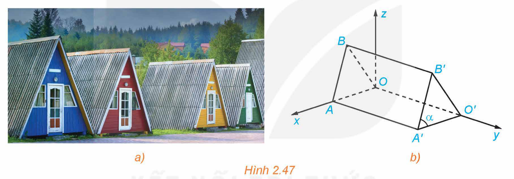
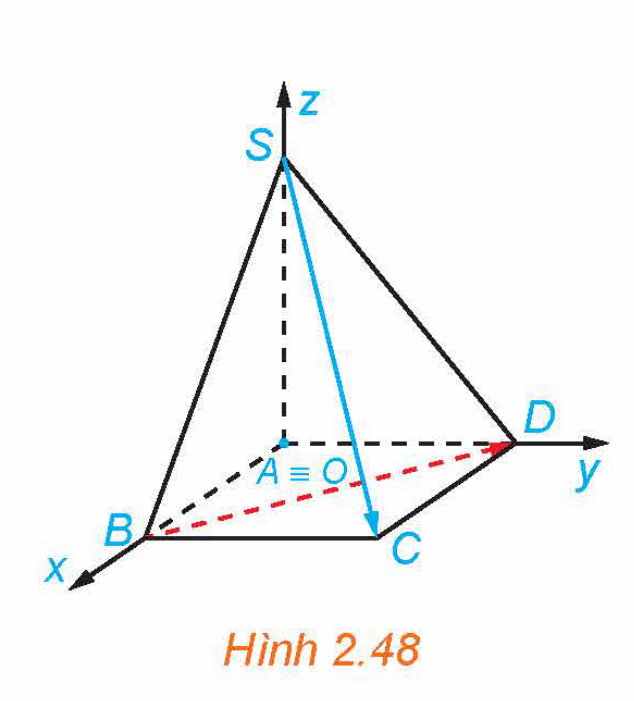
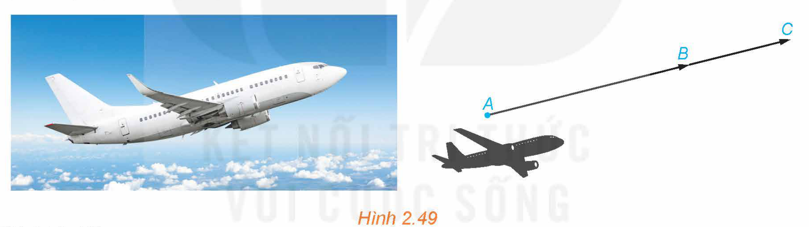
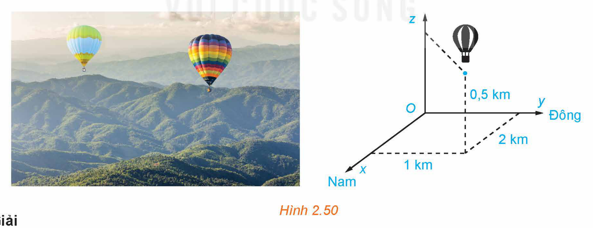
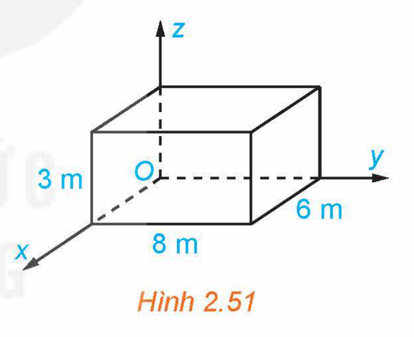
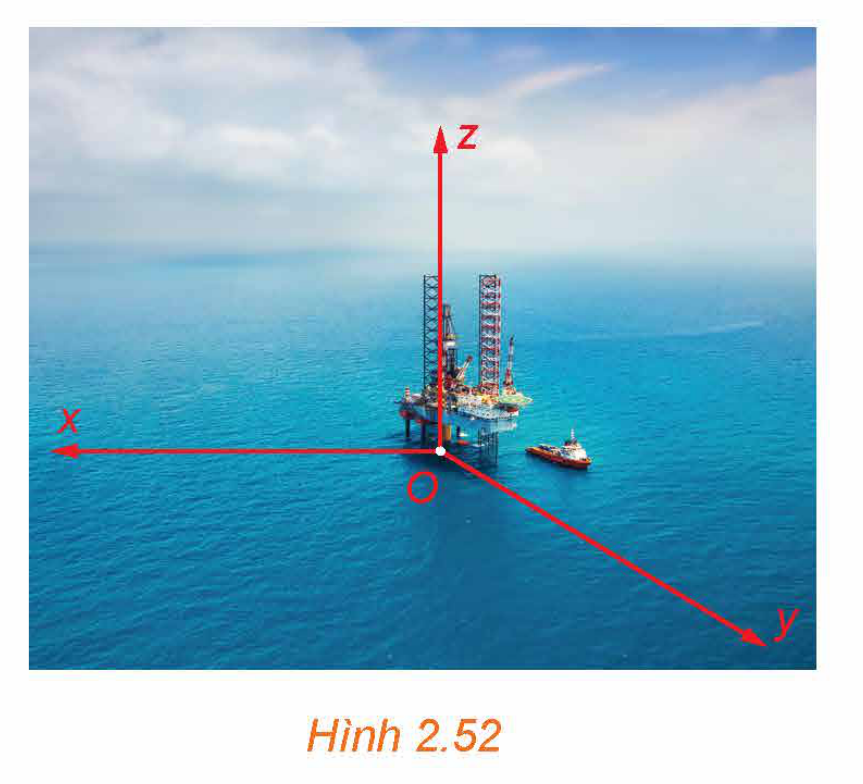

<!-- pdf:69 -->

# BÀI 8: BIỂU THỨC TOẠ ĐỘ CỦA CÁC PHÉP TOÁN VECTƠ

## 🎯 Mục tiêu

- Nhận biết biểu thức toạ độ của các phép toán vectơ trong không gian, thể hiện các phép toán vectơ theo toạ độ, xác định độ dài của một vectơ khi biết toạ độ hai đầu mút.
- Vận dụng biểu thức toạ độ của các phép toán vectơ để giải một số bài toán có liên quan đến thực tiễn.

## 🔴 Mở đầu

Những căn nhà gỗ trong Hình 2.47a được phác thảo dưới dạng một hình lăng trụ đứng tam giác $OAB.O'A'B'$ như trong Hình 2.47b. Với hệ trục toạ độ $Oxyz$ thể hiện như Hình 2.47b (đơn vị đo lấy theo centimét), hai điểm $A'$ và $B'$ có toạ độ lần lượt là $(240; 450; 0)$ và $(120; 450; 300)$. Từ những thông tin trên, có thể tính được kích thước mỗi chiều của những căn nhà gỗ hay không?

*Hình 2.47*

## 1. BIỂU THỨC TOẠ ĐỘ CỦA PHÉP CỘNG HAI VECTƠ, PHÉP TRỪ HAI VECTƠ, PHÉP NHÂN MỘT SỐ VỚI MỘT VECTƠ

**HĐ1:** Hình thành biểu thức toạ độ của phép cộng hai vectơ, phép trừ hai vectơ, phép nhân một số với một vectơ trong không gian

Trong không gian $Oxyz$, cho hai vectơ $\vec{a} = (1; 0; 5)$ và $\vec{b} = (1; 3; 9)$.

a) Biểu diễn hai vectơ $\vec{a}$ và $\vec{b}$ qua các vectơ đơn vị $\vec{i}, \vec{j}, \vec{k}$.

b) Biểu diễn hai vectơ $\vec{a} + \vec{b}$ và $2\vec{a}$ qua các vectơ đơn vị $\vec{i}, \vec{j}, \vec{k}$, từ đó xác định toạ độ của hai vectơ đó.

<!-- term: Biểu thức toạ độ các phép toán vectơ -->
> Trong không gian $Oxyz$, cho hai vectơ $\vec{a} = (x; y; z)$ và $\vec{b} = (x'; y'; z')$. Ta có:
> - $\vec{a} + \vec{b} = (x + x'; y + y'; z + z')$;
> - $\vec{a} - \vec{b} = (x - x'; y - y'; z - z')$;
> - $k\vec{a} = (kx; ky; kz)$ với $k$ là một số thực.
<!-- ocr-ok: đối chiếu ảnh p.69 -->

> ❓ Nếu toạ độ của vectơ $\vec{a}$ là $(x; y; z)$ thì toạ độ của vectơ đối của $\vec{a}$ là gì?
<!-- ocr-ok: đối chiếu ảnh p.69 -->

<!-- pdf:70 -->

**Nhận xét:** Vectơ $\vec{a} = (x; y; z)$ cùng phương với vectơ $\vec{b} = (x'; y'; z') \ne \vec{0}$ khi và chỉ khi tồn tại số thực $k$ sao cho $\begin{cases} x = kx' \\ y = ky' \\ z = kz'. \end{cases}$

**Ví dụ 1:** Trong không gian $Oxyz$, cho hai vectơ $\vec{a} = (2; 1; 5)$ và $\vec{b} = (2; 2; 1)$. Tìm toạ độ của mỗi vectơ sau:

a) $\vec{a} - \vec{b}$;

b) $3\vec{a} + 2\vec{b}$.

**Giải:**

a) Vì $\vec{a} = (2; 1; 5)$ và $\vec{b} = (2; 2; 1)$ nên $\vec{a} - \vec{b} = (2 - 2; 1 - 2; 5 - 1) = (0; -1; 4)$.

b) Ta có $3\vec{a} = (3\cdot 2; 3\cdot 1; 3\cdot 5) = (6; 3; 15)$ và $2\vec{b} = (2\cdot 2; 2\cdot 2; 2\cdot 1) = (4; 4; 2)$.

Do đó $3\vec{a} + 2\vec{b} = (6 + 4; 3 + 4; 15 + 2) = (10; 7; 17)$.

**Luyện tập 1:** Trong không gian $Oxyz$, cho ba vectơ $\vec{u} = (1; 8; 6), \vec{v} = (-1; 3; -2)$ và $\vec{w} = (0; 5; 4)$. Tìm toạ độ của vectơ $\vec{u} - 2\vec{v} + \vec{w}$.

**HĐ2:** Thiết lập toạ độ trung điểm đoạn thẳng, toạ độ trọng tâm tam giác

Trong không gian $Oxyz$, cho tam giác $ABC$ có $A(x_A; y_A; z_A)$, $B(x_B; y_B; z_B)$ và $C(x_C; y_C; z_C)$.
<!-- ocr-ok: đối chiếu ảnh p.70 -->

a) Gọi $M$ là trung điểm của đoạn thẳng $AB$. Tìm toạ độ của $M$ theo toạ độ của $A$ và $B$.

b) Gọi $G$ là trọng tâm của tam giác $ABC$. Tìm toạ độ của $G$ theo toạ độ của $A, B$ và $C$.

> Ta đã biết:
> $\overrightarrow{OM} = \frac{1}{2}(\overrightarrow{OA} + \overrightarrow{OB});$
> $\overrightarrow{OG} = \frac{1}{3}(\overrightarrow{OA} + \overrightarrow{OB} + \overrightarrow{OC}).$

> Trong không gian $Oxyz$, cho ba điểm không thẳng hàng $A(x_A; y_A; z_A)$, $B(x_B; y_B; z_B)$ và $C(x_C; y_C; z_C)$. Khi đó:
> - **Toạ độ trung điểm** của đoạn thẳng $AB$ là $\left(\frac{x_A + x_B}{2}; \frac{y_A + y_B}{2}; \frac{z_A + z_B}{2}\right)$;
> - **Toạ độ trọng tâm** của tam giác $ABC$ là $\left(\frac{x_A + x_B + x_C}{3}; \frac{y_A + y_B + y_C}{3}; \frac{z_A + z_B + z_C}{3}\right)$.

**Ví dụ 2:** Trong không gian $Oxyz$, cho ba điểm $A(1; 2; 3), B(3; 2; 1)$ và $C(2; -1; 5)$. Tìm toạ độ trung điểm $M$ của đoạn thẳng $AB$ và toạ độ trọng tâm $G$ của tam giác $ABC$.

**Giải:**

Vì $M$ là trung điểm của đoạn thẳng $AB$ nên toạ độ của điểm $M$ là $\left(\frac{1 + 3}{2}; \frac{2 + 2}{2}; \frac{3 + 1}{2}\right)$, suy ra $M(2; 2; 2)$.

Vì $G$ là trọng tâm của tam giác $ABC$ nên toạ độ của điểm $G$ là $\left(\frac{1 + 3 + 2}{3}; \frac{2 + 2 + (-1)}{3}; \frac{3 + 1 + 5}{3}\right)$, suy ra $G(2; 1; 3)$.

<!-- pdf:71 -->

**Luyện tập 2:** Trong không gian $Oxyz$, cho ba điểm $A(2; 9; -1), B(9; 4; 5)$ và $G(3; 0; 4)$. Tìm toạ độ điểm $C$ sao cho tam giác $ABC$ nhận $G$ là trọng tâm.

## 2. BIỂU THỨC TOẠ ĐỘ CỦA TÍCH VÔ HƯỚNG

**HĐ3:** Thiết lập biểu thức toạ độ của tích vô hướng trong không gian

Trong không gian $Oxyz$, cho hai vectơ $\vec{a} = (x; y; z)$ và $\vec{b} = (x'; y'; z')$.

a) Giải thích vì sao $\vec{i} \cdot \vec{i} = 1$ và $\vec{i} \cdot \vec{j} = \vec{i} \cdot \vec{k} = 0$.

b) Sử dụng biểu diễn $\vec{a} = x\vec{i} + y\vec{j} + z\vec{k}$ để tính các tích vô hướng $\vec{a} \cdot \vec{i}, \vec{a} \cdot \vec{j}$ và $\vec{a} \cdot \vec{k}$.

c) Sử dụng biểu diễn $\vec{b} = x'\vec{i} + y'\vec{j} + z'\vec{k}$ để tính tích vô hướng $\vec{a} \cdot \vec{b}$.

<!-- term: Biểu thức toạ độ của tích vô hướng -->
> Trong không gian $Oxyz$, tích vô hướng của hai vectơ $\vec{a} = (x; y; z)$ và $\vec{b} = (x'; y'; z')$ được xác định bởi công thức:
> $\vec{a} \cdot \vec{b} = xx' + yy' + zz'.$

**Nhận xét:**

- Hai vectơ $\vec{a}$ và $\vec{b}$ vuông góc với nhau nếu và chỉ nếu $xx' + yy' + zz' = 0$.
- Nếu $\vec{a} = (x; y; z)$ thì $|\vec{a}| = \sqrt{\vec{a} \cdot \vec{a}} = \sqrt{x^2 + y^2 + z^2}$.
- Nếu $\vec{a} = (x; y; z)$ và $\vec{b} = (x'; y'; z')$ là hai vectơ khác $\vec{0}$ thì
<!-- ocr-ok: đối chiếu ảnh p.71 -->

$\cos(\vec{a}, \vec{b}) = \frac{\vec{a} \cdot \vec{b}}{|\vec{a}| \cdot |\vec{b}|} = \frac{xx' + yy' + zz'}{\sqrt{x^2 + y^2 + z^2} \cdot \sqrt{x'^2 + y'^2 + z'^2}}.$

**Ví dụ 3:** Trong không gian $Oxyz$, cho hai vectơ $\vec{a} = (1; 4; 2)$ và $\vec{b} = (-4; 1; 0)$.

a) Tính $\vec{a} \cdot \vec{b}$ và cho biết hai vectơ $\vec{a}$ và $\vec{b}$ có vuông góc với nhau hay không.

b) Tính độ dài của vectơ $\vec{a}$.

**Giải:**

a) Ta có: $\vec{a} \cdot \vec{b} = 1\cdot(-4) + 4\cdot 1 + 2\cdot 0 = 0$. Do đó, hai vectơ $\vec{a}$ và $\vec{b}$ vuông góc với nhau.

b) Độ dài của vectơ $\vec{a}$ là $|\vec{a}| = \sqrt{1^2 + 4^2 + 2^2} = \sqrt{21}$.

**Luyện tập 3:** Trong Ví dụ 3, tính $(\vec{a} + \vec{b})^2$.

**Ví dụ 4:** Cho hình chóp $S.ABCD$ có đáy $ABCD$ là hình chữ nhật và $SA$ vuông góc với mặt phẳng $(ABCD)$. Giả sử $SA = 2, AB = 3, AD = 4$. Xét hệ toạ độ $Oxyz$ với $O$ trùng $A$ và các tia $Ox, Oy, Oz$ lần lượt trùng với các tia $AB, AD, AS$ (H.2.48).

a) Xác định toạ độ của các điểm $S, A, B, C, D$.

b) Tính $BD$ và $SC$.

c) Tính $(\overrightarrow{BD}, \overrightarrow{SC})$.

*Hình 2.48*

**Giải:**

a) Vì $A$ trùng gốc toạ độ nên $A(0; 0; 0)$. Vì $B$ thuộc tia $Ox$ và $AB = 3$ nên $B(3; 0; 0)$. Vì $D$ thuộc tia $Oy$ và $AD = 4$ nên $D(0; 4; 0)$. Vì $S$ thuộc tia $Oz$ và $AS = 2$ nên $S(0; 0; 2)$. Vì hình chiếu của $C$ lên các trục $Ox, Oy, Oz$ lần lượt là $B, D, A$ nên $C(3; 4; 0)$.
<!-- ocr-ok: đối chiếu ảnh p.71 -->

<!-- pdf:72 -->

b) Ta có $\overrightarrow{BD} = (0 - 3; 4 - 0; 0 - 0) = (-3; 4; 0)$, suy ra $BD = |\overrightarrow{BD}| = \sqrt{(-3)^2 + 4^2 + 0^2} = 5$.

Ta có $\overrightarrow{SC} = (3 - 0; 4 - 0; 0 - 2) = (3; 4; -2)$, suy ra $SC = |\overrightarrow{SC}| = \sqrt{3^2 + 4^2 + (-2)^2} = \sqrt{29}$.

c) Ta có $\cos(\overrightarrow{BD}, \overrightarrow{SC}) = \frac{\overrightarrow{BD} \cdot \overrightarrow{SC}}{|\overrightarrow{BD}| \cdot |\overrightarrow{SC}|} = \frac{(-3)\cdot 3 + 4\cdot 4 + 0\cdot(-2)}{5\sqrt{29}} = \frac{7}{5\sqrt{29}}$, suy ra $(\overrightarrow{BD}, \overrightarrow{SC}) \approx 74,9^\circ$.
<!-- ocr-ok: đối chiếu ảnh p.72 -->

<!-- term: Khoảng cách giữa hai điểm trong không gian -->
**Chú ý:** Nếu $A(x_A; y_A; z_A)$ và $B(x_B; y_B; z_B)$ thì $AB = |\overrightarrow{AB}| = \sqrt{(x_B - x_A)^2 + (y_B - y_A)^2 + (z_B - z_A)^2}$.
<!-- ocr-ok: đối chiếu ảnh p.72 -->

Đặc biệt, khi $B$ trùng $O$ ta nhận được công thức $OA = \sqrt{x_A^2 + y_A^2 + z_A^2}$.

**Luyện tập 4:** Trong không gian $Oxyz$, cho $A(0; 2; 1), B(3; -2; 1)$ và $C(-2; 5; 7)$.

a) Tính chu vi của tam giác $ABC$.

b) Tính $\widehat{BAC}$.

## 3. VẬN DỤNG TOẠ ĐỘ CỦA VECTƠ TRONG MỘT SỐ BÀI TOÁN CÓ LIÊN QUAN ĐẾN THỰC TIỄN

**Ví dụ 5:** Trong không gian với một hệ trục toạ độ cho trước (đơn vị đo lấy theo kilômét), ra đa phát hiện một chiếc máy bay di chuyển với vận tốc và hướng không đổi từ điểm $A(800; 500; 7)$ đến điểm $B(940; 550; 8)$ trong $10$ phút. Nếu máy bay tiếp tục giữ nguyên vận tốc và hướng bay thì toạ độ của máy bay sau $5$ phút tiếp theo là gì?

*Hình 2.49*

**Giải:** (H.2.49)

Gọi $C(x; y; z)$ là vị trí của máy bay sau $5$ phút tiếp theo. Vì hướng của máy bay không đổi nên $\overrightarrow{AB}$ và $\overrightarrow{BC}$ cùng hướng. Do vận tốc của máy bay không đổi và thời gian bay từ $A$ đến $B$ gấp đôi thời gian bay từ $B$ đến $C$ nên $AB = 2BC$.

Do đó $\overrightarrow{BC} = \frac{1}{2}\overrightarrow{AB} = \left(\frac{940 - 800}{2}; \frac{550 - 500}{2}; \frac{8 - 7}{2}\right) = (70; 25; 0,5)$.

Mặt khác, $\overrightarrow{BC} = (x - 940; y - 550; z - 8)$ nên $\begin{cases} x - 940 = 70 \\ y - 550 = 25 \\ z - 8 = 0,5. \end{cases}$

Từ đó $\begin{cases} x = 1\,010 \\ y = 575 \\ z = 8,5 \end{cases}$ và vì vậy $C(1\,010; 575; 8,5)$.

Vậy toạ độ của máy bay sau $5$ phút tiếp theo là $(1\,010; 575; 8,5)$.

<!-- pdf:73 -->

**Luyện tập 5:** Với các giả thiết như trong Ví dụ 5, hãy xác định toạ độ của chiếc máy bay sau $10$ phút tiếp theo (tính từ thời điểm máy bay ở điểm $B$).

**Ví dụ 6:** Hãy trả lời câu hỏi trong *tình huống mở đầu*.

**Giải:** Vì điểm $A'$ có toạ độ là $(240; 450; 0)$ nên khoảng cách từ $A'$ đến các trục $Ox, Oy$ lần lượt là $450\text{ cm}$ và $240\text{ cm}$. Suy ra $A'A = 450\text{ cm}$ và $A'O' = 240\text{ cm}$. Từ giả thiết suy ra $\overrightarrow{A'B'} = (-120; 0; 300)$, do đó $A'B' = |\overrightarrow{A'B'}| = \sqrt{(-120)^2 + 0^2 + 300^2} = 60\sqrt{29} \approx 323\text{ (cm)}$.
<!-- ocr-ok: đối chiếu ảnh p.73 -->

Vì $O'O = A'A = 450\text{ cm}$ và $O'$ nằm trên trục $Oy$ nên toạ độ của điểm $O'$ là $(0; 450; 0)$.
<!-- ocr-ok: đối chiếu ảnh p.73 -->

Do đó $\overrightarrow{O'B'} = (120; 0; 300)$ và $O'B' = |\overrightarrow{O'B'}| = \sqrt{120^2 + 0^2 + 300^2} = 60\sqrt{29} \approx 323\text{ (cm)}$.

Vậy mỗi căn nhà gỗ có chiều dài là $450\text{ cm}$, chiều rộng là $240\text{ cm}$, mỗi cạnh bên của mặt tiền có độ dài là $323\text{ cm}$.

**Luyện tập 6:** Trong *tình huống mở đầu*, hãy tính độ lớn của góc $\alpha$.

> Góc $\alpha$ chính là góc giữa mặt bên của căn nhà gỗ và mặt đất.

**Ví dụ 7:** Hai chiếc khinh khí cầu bay lên từ cùng một địa điểm. Chiếc thứ nhất nằm cách điểm xuất phát $2\text{ km}$ về phía nam và $1\text{ km}$ về phía đông, đồng thời cách mặt đất $0,5\text{ km}$. Chiếc thứ hai nằm cách điểm xuất phát $1\text{ km}$ về phía bắc và $1,5\text{ km}$ về phía tây, đồng thời cách mặt đất $0,8\text{ km}$.

Chọn hệ trục toạ độ $Oxyz$ với gốc $O$ đặt tại điểm xuất phát của hai khinh khí cầu, mặt phẳng $(Oxy)$ trùng với mặt đất với trục $Ox$ hướng về phía nam, trục $Oy$ hướng về phía đông và trục $Oz$ hướng thẳng đứng lên trời (H.2.50), đơn vị đo lấy theo kilômét.

a) Tìm toạ độ của mỗi chiếc khinh khí cầu đối với hệ toạ độ đã chọn.

b) Xác định khoảng cách giữa hai khinh khí cầu (làm tròn kết quả đến chữ số thập phân thứ hai).

*Hình 2.50*

**Giải:**

a) Chiếc khinh khí cầu thứ nhất và thứ hai có toạ độ lần lượt là $(2; 1; 0,5)$ và $(-1; -1,5; 0,8)$.

b) Khoảng cách giữa hai chiếc khinh khí cầu là

$\sqrt{(-1 - 2)^2 + (-1,5 - 1)^2 + (0,8 - 0,5)^2} = \sqrt{15,34} \approx 3,92\text{ (km)}.$

<!-- pdf:74 -->

**Luyện tập 7:** Trong Ví dụ 7, khinh khí cầu thứ nhất hay thứ hai ở xa điểm xuất phát hơn? Giải thích vì sao.

## ✏️ Bài tập

**2.20.** Trong không gian $Oxyz$, cho ba vectơ $\vec{a} = (3; 1; 2), \vec{b} = (-3; 0; 4)$ và $\vec{c} = (6; -1; 0)$.

a) Tìm toạ độ của các vectơ $\vec{a} + \vec{b} + \vec{c}$ và $2\vec{a} - 3\vec{b} - 5\vec{c}$.

b) Tính các tích vô hướng $\vec{a} \cdot (-\vec{b})$ và $(2\vec{a}) \cdot \vec{c}$.

**2.21.** Trong không gian $Oxyz$, cho ba điểm $M(-4; 3; 3), N(4; -4; 2)$ và $P(3; 6; -1)$.

a) Tìm toạ độ của các vectơ $\overrightarrow{MN}, \overrightarrow{MP}$, từ đó chứng minh rằng ba điểm $M, N, P$ không thẳng hàng.

b) Tìm toạ độ của vectơ $\overrightarrow{NM} + \overrightarrow{NP}$, từ đó suy ra toạ độ của điểm $Q$ sao cho tứ giác $MNPQ$ là hình bình hành.

c) Tính chu vi của hình bình hành $MNPQ$.

**2.22.** Trong không gian $Oxyz$, cho tam giác $ABC$ có $A(1; 0; 1), B(0; -3; 1)$ và $C(4; -1; 4)$.

a) Tìm toạ độ trọng tâm của tam giác $ABC$.

b) Chứng minh rằng $\widehat{BAC} = 90^\circ$.

c) Tính $\widehat{ABC}$.

**2.23.** Một phòng học có thiết kế dạng hình hộp chữ nhật với chiều dài là $8\text{ m}$, chiều rộng là $6\text{ m}$ và chiều cao là $3\text{ m}$. Một chiếc đèn được treo tại chính giữa trần nhà của phòng học. Xét hệ trục toạ độ $Oxyz$ có gốc $O$ trùng với một góc phòng và mặt phẳng $(Oxy)$ trùng với mặt sàn, đơn vị đo được lấy theo mét (H.2.51). Hãy tìm toạ độ của điểm treo đèn.

*Hình 2.51*

**2.24.** Trong không gian, xét hệ toạ độ $Oxyz$ có gốc $O$ trùng với vị trí của một giàn khoan trên biển, mặt phẳng $(Oxy)$ trùng với mặt biển (được coi là phẳng) với trục $Ox$ hướng về phía tây, trục $Oy$ hướng về phía nam và trục $Oz$ hướng thẳng đứng lên trời (H.2.52). Đơn vị đo trong không gian $Oxyz$ lấy theo kilômét. Một chiếc ra đa đặt tại giàn khoan có phạm vi theo dõi là $30\text{ km}$. Hỏi ra đa có thể phát hiện được một chiếc tàu thám hiểm có toạ độ là $(25; 15; -10)$ đối với hệ toạ độ nói trên hay không? Hãy giải thích vì sao.

*Hình 2.52*

## 📷 Danh sách hình trong bài

| Mã hình | Trang PDF | Vị trí trong bài | Chú thích gốc |
| --- | --- | --- | --- |
| H12-toan-b08-01 | 69 | Mở đầu | Hình 2.47 |
| H12-toan-b08-02 | 71 | Mục 2, Ví dụ 4 | Hình 2.48 |
| H12-toan-b08-03 | 72 | Mục 3, Ví dụ 5 | Hình 2.49 |
| H12-toan-b08-04 | 73 | Mục 3, Ví dụ 7 | Hình 2.50 |
| H12-toan-b08-05 | 74 | Bài tập 2.23 | Hình 2.51 |
| H12-toan-b08-06 | 74 | Bài tập 2.24 | Hình 2.52 |
