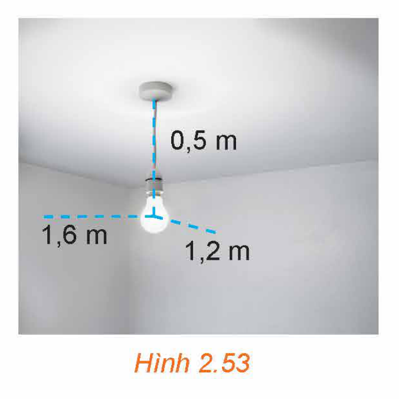

<!-- pdf:75 -->

# BÀI TẬP CUỐI CHƯƠNG II

## ✏️ A – TRẮC NGHIỆM

**2.25.** Cho tứ diện $ABCD$. Lấy $G$ là trọng tâm của tam giác $BCD$. Khẳng định nào sau đây là **sai**?

A. $\overrightarrow{BG} + \overrightarrow{CG} + \overrightarrow{DG} = \vec{0}$.

B. $\overrightarrow{AB} + \overrightarrow{AC} + \overrightarrow{AD} = 3\overrightarrow{AG}$.

C. $\overrightarrow{BC} + \overrightarrow{BD} = 3\overrightarrow{BG}$.

D. $\overrightarrow{GA} + \overrightarrow{GB} + \overrightarrow{GC} + \overrightarrow{GD} = \vec{0}$.

**2.26.** Cho hình hộp $ABCD.A'B'C'D'$. Lấy $M$ là trung điểm của đoạn thẳng $CC'$. Vectơ $\overrightarrow{AM}$ bằng

A. $\overrightarrow{AB} + \overrightarrow{AD} + \overrightarrow{AA'}$.

B. $\overrightarrow{AB} + \overrightarrow{AD} + \frac{1}{2}\overrightarrow{AA'}$.

C. $\overrightarrow{AB} + \frac{1}{2}\overrightarrow{AD} + \frac{1}{2}\overrightarrow{AA'}$.

D. $\frac{1}{2}\overrightarrow{AB} + \overrightarrow{AD} + \overrightarrow{AA'}$.

**2.27.** Cho hình hộp $ABCD.A'B'C'D'$. Khẳng định nào dưới đây là **sai**?

A. $\overrightarrow{AB} + \overrightarrow{CC'} = \overrightarrow{AB'}$.

B. $\overrightarrow{AB} + \overrightarrow{AD} + \overrightarrow{AA'} = \overrightarrow{AC'}$.

C. $\overrightarrow{AD} + \overrightarrow{BB'} = \overrightarrow{AD'}$.

D. $\overrightarrow{AB} + \overrightarrow{CC'} = \overrightarrow{AC'}$.

**2.28.** Cho tứ diện đều $ABCD$ có độ dài cạnh bằng $a$, gọi $M$ là trung điểm của đoạn thẳng $CD$. Tích vô hướng $\overrightarrow{AB} \cdot \overrightarrow{AM}$ bằng

A. $\frac{a^2}{4}$.

B. $\frac{a^2}{2}$.

C. $\frac{a^2}{3}$.

D. $a^2$.

**2.29.** Trong không gian $Oxyz$, cho $\vec{a} = (1; -2; 2), \vec{b} = (-2; 0; 3)$. Khẳng định nào dưới đây là **sai**?

A. $\vec{a} + \vec{b} = (-1; -2; 5)$.

B. $\vec{a} - \vec{b} = (3; -2; -1)$.

C. $3\vec{a} = (3; -2; 2)$.

D. $2\vec{a} + \vec{b} = (0; -4; 7)$.

**2.30.** Trong không gian $Oxyz$, cho hình bình hành $ABCD$ có $A(-1; 0; 3), B(2; 1; -1)$ và $C(3; 2; 2)$. Toạ độ của điểm $D$ là

A. $(2; -1; 0)$.

B. $(0; -1; -6)$.

C. $(0; 1; 6)$.

D. $(-2; 1; 0)$.

**2.31.** Trong không gian $Oxyz$, cho $A(1; 0; -1), B(0; -1; 2)$ và $G(2; 1; 0)$. Biết tam giác $ABC$ có trọng tâm là điểm $G$. Toạ độ của điểm $C$ là

A. $(5; 4; -1)$.

B. $(-5; -4; 1)$.

C. $(1; 2; -1)$.

D. $(-1; -2; 1)$.

**2.32.** Trong không gian $Oxyz$, cho $\vec{a} = (2; 1; -3), \vec{b} = (-2; -1; 2)$. Tích vô hướng $\vec{a} \cdot \vec{b}$ bằng

A. $-2$.

B. $-11$.

C. $11$.

D. $2$.

**2.33.** Trong không gian $Oxyz$, cho $\vec{a} = (2; 1; -2), \vec{b} = (0; -1; 1)$. Góc giữa hai vectơ $\vec{a}, \vec{b}$ bằng

A. $60^\circ$.

B. $135^\circ$.

C. $120^\circ$.

D. $45^\circ$.

<!-- pdf:76 -->

**2.34.** Trong không gian $Oxyz$, cho $\vec{a} = (-2; 2; 2), \vec{b} = (1; -1; -2)$. Côsin của góc giữa hai vectơ $\vec{a}, \vec{b}$ bằng

A. $\frac{-2\sqrt{2}}{3}$.

B. $\frac{2\sqrt{2}}{3}$.

C. $\frac{\sqrt{2}}{3}$.

D. $\frac{-\sqrt{2}}{3}$.

## ✏️ B – TỰ LUẬN

**2.35.** Cho hình chóp $S.ABCD$ có đáy $ABCD$ là hình chữ nhật. Chứng minh rằng:

$\overrightarrow{SA} + \overrightarrow{SC} = \overrightarrow{SB} + \overrightarrow{SD}.$

**2.36.** Cho tứ diện $ABCD$, lấy hai điểm $M, N$ thoả mãn $\overrightarrow{MB} + 2\overrightarrow{MA} = \vec{0}$ và $\overrightarrow{NC} = 2\overrightarrow{DN}$. Hãy biểu diễn $\overrightarrow{MN}$ theo $\overrightarrow{AD}$ và $\overrightarrow{BC}$.
<!-- ocr-ok: đối chiếu ảnh p.76 -->

**2.37.** Cho hình hộp $ABCD.A'B'C'D'$, gọi $G$ là trọng tâm của tam giác $BDA'$.

a) Biểu diễn $\overrightarrow{AG}$ theo $\overrightarrow{AB}, \overrightarrow{AD}$ và $\overrightarrow{AA'}$.
<!-- ocr-ok: đối chiếu ảnh p.76 -->

b) Từ câu a, hãy chứng tỏ ba điểm $A, G$ và $C'$ thẳng hàng.

**2.38.** Trong không gian $Oxyz$, cho các điểm $A(2; -1; 3), B(1; 1; -1)$ và $C(-1; 0; 2)$.

a) Tìm toạ độ trọng tâm $G$ của tam giác $ABC$.

b) Tìm toạ độ điểm $M$ thuộc trục $Oz$ sao cho đường thẳng $BM$ vuông góc với đường thẳng $AC$.

**2.39.** Trong không gian $Oxyz$, cho hình hộp $OABC.O'A'B'C'$ và các điểm $A(2; 3; 1), C(-1; 2; 3)$ và $O'(1; -2; 2)$. Tìm toạ độ các đỉnh còn lại của hình hộp.

**2.40.** Trong không gian $Oxyz$, cho hai vectơ $\vec{a} = (-2; 1; 2), \vec{b} = (1; 1; -1)$.

a) Xác định toạ độ của vectơ $\vec{u} = \vec{a} - 2\vec{b}$.

b) Tính độ dài vectơ $\vec{u}$.

c) Tính $\cos(\vec{a}, \vec{b})$.

**2.41.** Trong không gian $Oxyz$, cho các điểm $A(4; 2; -1), B(1; -1; 2)$ và $C(0; -2; 3)$.

a) Tìm toạ độ của vectơ $\overrightarrow{AB}$ và tính độ dài đoạn thẳng $AB$.

b) Tìm toạ độ điểm $M$ sao cho $\overrightarrow{AB} + \overrightarrow{CM} = \vec{0}$.

c) Tìm toạ độ điểm $N$ thuộc mặt phẳng $(Oxy)$, sao cho $A, B, N$ thẳng hàng.

**2.42.** Hình 2.53 minh hoạ một chiếc đèn được treo cách trần nhà là $0,5\text{ m}$, cách hai tường lần lượt là $1,2\text{ m}$ và $1,6\text{ m}$. Hai bức tường vuông góc với nhau và cùng vuông góc với trần nhà. Người ta di chuyển chiếc đèn đó đến vị trí mới cách trần nhà là $0,4\text{ m}$, cách hai tường đều là $1,5\text{ m}$.

a) Lập một hệ trục toạ độ $Oxyz$ phù hợp và xác định toạ độ của bóng đèn lúc đầu và sau khi di chuyển.

b) Vị trí mới của bóng đèn cách vị trí ban đầu là bao nhiêu mét? (Làm tròn kết quả đến chữ số thập phân thứ nhất).

*Hình 2.53*

## 📷 Danh sách hình trong bài

| Mã hình | Trang PDF | Vị trí trong bài | Chú thích gốc |
| --- | --- | --- | --- |
| H12-toan-bt-c02-01 | 76 | Bài tập 2.42 | Hình 2.53 |
