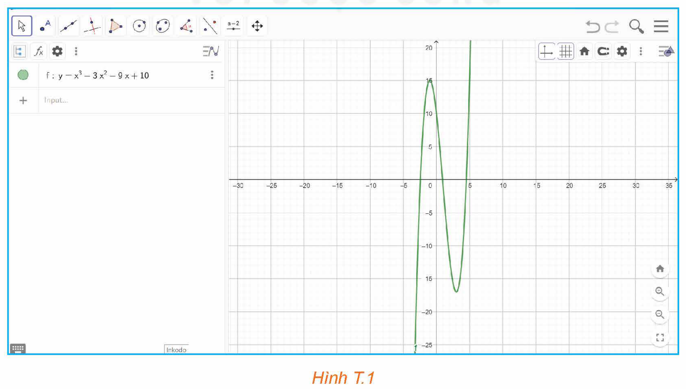
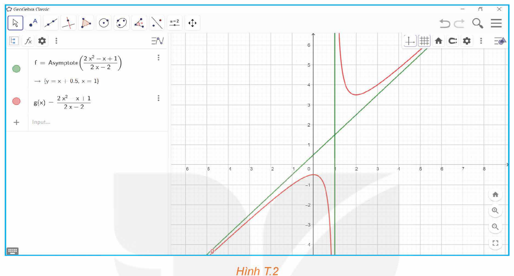
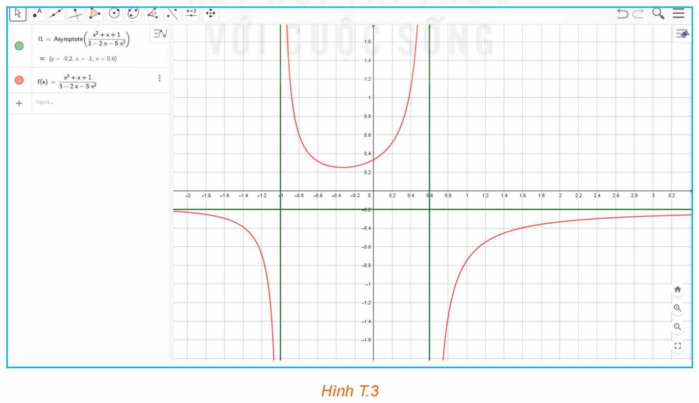

<!-- pdf:89 -->

<!-- Phần tiêu đề chung: HOẠT ĐỘNG THỰC HÀNH TRẢI NGHIỆM -->

# KHẢO SÁT VÀ VẼ ĐỒ THỊ HÀM SỐ VỚI PHẦN MỀM GEOGEBRA

## 🎯 Mục tiêu

- Sử dụng phần mềm GeoGebra để khảo sát và vẽ đồ thị hàm số, đặc biệt đối với những hàm số phức tạp.

Khởi động phần mềm GeoGebra, chọn Complex Adaptive System (CAS) để thực hiện tính toán đạo hàm, tìm cực trị, tìm giá trị lớn nhất (GTLN), giá trị nhỏ nhất (GTNN) của hàm số và tìm các đường tiệm cận của đồ thị hàm số; chọn Graphics 2 để vẽ đồ thị của hàm số.

## 1. TÍNH ĐẠO HÀM CỦA HÀM SỐ

**a) Tính đạo hàm của hàm số trên một khoảng**

Để tính đạo hàm của hàm số trên một khoảng, ta dùng lệnh `Derivative (<hàm số>)`, kết quả sẽ được hiển thị ngay bên dưới.

```text
1  Derivative(x^5 - 4x^3 + 2x - 3)
   -> 5x^4 - 12x^2 + 2
```

**b) Tính đạo hàm của hàm số tại một điểm**

Trước tiên, ta dùng lệnh `Derivative (<hàm số>)` để tính đạo hàm của hàm số trên tập xác định của hàm số đó.

Nhấn nút ở đầu lệnh, lúc này tên của hàm số được phần mềm đặt tự động. Sau đó, để tính đạo hàm của hàm số tại một điểm xác định, ta thay giá trị của biến vào hàm đạo hàm của hàm số đó, kết quả sẽ được hiển thị ngay bên dưới.

```text
1  f(x) := Derivative(x^5 - 4x^3 + 2x - 3)
   -> f(x) := 5x^4 - 12x^2 + 2
2  f(2)
   -> 34
```

<!-- pdf:90 -->

**c) Tính đạo hàm cấp cao của hàm số**

Để tính đạo hàm cấp $n$ của hàm số trên một khoảng xác định, ta dùng lệnh `Derivative (<hàm số>, <số cấp>)`, kết quả sẽ được hiển thị ngay bên dưới.

```text
1  Derivative(x^5 - 4x^3 + 2x - 3, 3)
   -> 60x^2 - 24
```

Cho hàm số $y = f(x)$ có đạo hàm cấp $n - 1$, kí hiệu là $f^{(n-1)}(x)$ ($n \in \mathbb{N}, n > 1$). Nếu $f^{(n-1)}(x)$ có đạo hàm thì đạo hàm của nó được gọi là **đạo hàm cấp $n$** của $f(x)$, kí hiệu là $f^{(n)}(x)$.

$f^{(n)}(x) = \left(f^{(n-1)}(x)\right)'.$

## 2. TÌM CỰC TRỊ, GIÁ TRỊ LỚN NHẤT, GIÁ TRỊ NHỎ NHẤT (NẾU CÓ) CỦA HÀM SỐ

**a) Tìm cực trị của hàm số**

Để tìm cực trị của hàm số, ta dùng lệnh `Extremum (<hàm số>)`, kết quả sẽ được hiển thị ngay bên dưới, dưới dạng toạ độ các điểm cực trị của đồ thị hàm số.

```text
1  Extremum(2x^3 + 3x^2 - 36x - 10)
   -> {(-3, 71), (2, -54)}
```

Ngoài ra ta có thể dùng lệnh `Extremum (<hàm số>, <giá trị của a>, <giá trị của b>)` để tìm cực trị của hàm số đã cho trên đoạn $[a; b]$.

```text
1  Extremum(x^4 + 2x^2 - 3, -5, 7)
   -> (0, -3)
1  Extremum(x^4 + 2x^2 - 3, -5, 0)
   -> (?, ?)
```

Kết quả bên có nghĩa: hàm số đã cho không có cực trị nào trên khoảng $(-5; 0)$.

**Chú ý:** Ta có thể quan sát kênh hình để có hình ảnh trực quan bằng cách chọn View $\to$ Graphics 2.

Để xác định cực trị là cực đại hay cực tiểu, ta có thể dùng đồ thị hàm số để kết luận điểm cực trị là điểm cực đại hay điểm cực tiểu.

**b) Tìm giá trị lớn nhất, giá trị nhỏ nhất (nếu có) của hàm số (trên khoảng, đoạn, tập xác định)**

Để tìm giá trị lớn nhất của hàm số trên một đoạn $[a; b]$ cho trước, ta dùng lệnh `Max (<hàm số>, <a>, <b>)`; kết quả trả về sẽ là toạ độ của một điểm, tung độ của điểm đó chính là giá trị lớn nhất cần tìm.

```text
1  Max(x^4 - 3x^2 + 2, 0, 3)
   -> (3, 56)
```

Kết quả bên có nghĩa: Hàm số đã cho có giá trị lớn nhất trên đoạn $[0; 3]$ là $56$, đạt tại $x = 3$.

<!-- pdf:91 -->

Tương tự, để tìm giá trị nhỏ nhất của hàm số trên một đoạn $[a; b]$ cho trước, ta dùng lệnh `Min (<hàm số>, <a>, <b>)`; kết quả trả về sẽ là toạ độ của một điểm, tung độ của điểm đó chính là giá trị nhỏ nhất cần tìm.

```text
1  Min(x^4 - 3x^2 + 2, 0, 3)
   -> (sqrt(6)/2, -1/4)
```

## 3. TÌM CÁC ĐƯỜNG TIỆM CẬN CỦA ĐỒ THỊ HÀM SỐ

Để tìm các đường tiệm cận của đồ thị hàm số đã cho, ta dùng lệnh `Asymptote (<hàm số>)`; kết quả sẽ được hiển thị ngay bên dưới.

```text
1  Asymptote((x^2 - 4x + 5) / (x - 3))
   -> {y = x - 1, x = 3}
```

Kết quả bên có nghĩa: Hàm số đã cho có $2$ đường tiệm cận là tiệm cận xiên $y = x - 1$ và tiệm cận đứng $x = 3$.

```text
1  Asymptote((x - 2) * x^2 / (x - 2))
   -> {}
```

Kết quả bên có nghĩa: Hàm số đã cho không có đường tiệm cận.

## 4. VẼ ĐỒ THỊ HÀM SỐ

Khởi động GeoGebra và chọn View $\to$ Graphics 2 để vẽ đồ thị của hàm số. Khi đó, màn hình hiển thị sẵn hệ trục toạ độ dạng lưới ô vuông.

**a) Vẽ đồ thị của hàm đa thức (không cần vẽ tiệm cận)**

Nhập hàm số vào ô lệnh, màn hình sẽ hiển thị đồ thị của hàm số cần vẽ (H.T.1).


*Hình T.1*

<!-- pdf:92 -->

**b) Vẽ đồ thị của hàm phân thức**

- *Bước 1.* Vẽ tiệm cận của đồ thị hàm phân thức bằng cách sử dụng câu lệnh đã được giới thiệu trong Mục 3.
- *Bước 2.* Vẽ đồ thị hàm phân thức bằng cách nhập hàm số vào ô lệnh (H.T.2).


*Hình T.2*

- Vẽ đồ thị của các hàm số khác:
  - *Bước 1.* Vẽ tiệm cận của đồ thị hàm số (nếu có) bằng cách sử dụng câu lệnh đã được giới thiệu ở Mục 3.
  - *Bước 2.* Vẽ đồ thị của hàm số bằng cách nhập hàm số vào ô lệnh (H.T.3).


*Hình T.3*

<!-- pdf:93 -->

**Chú ý:** Nếu muốn sử dụng giao diện tiếng Việt, sau khi khởi động GeoGebra, chọn Options $\to$ Language $\to$ Vietnamese/Tiếng Việt. Khi đó, thay vì cú pháp lệnh tiếng Anh như trình bày ở trên, ta dùng cú pháp lệnh tiếng Việt tương ứng như trong bảng sau:

| Lệnh | Cú pháp lệnh tiếng Anh | Cú pháp lệnh tiếng Việt |
| :--- | :--- | :--- |
| Tính đạo hàm cấp 1 của hàm số | `Derivative (<hàm số>)` | `DaoHam (<hàm số>)` |
| Tính đạo hàm cấp cao của hàm số | `Derivative (<hàm số>, <số cấp>)` | `DaoHam (<hàm số>, <số cấp>)` |
| Tìm cực trị của hàm số | `Extremum (<hàm số>)` | `CucTri (<hàm số>)` |
| Tìm cực trị của hàm số trên đoạn $[a; b]$ | `Extremum (<hàm số>, <giá trị của a>, <giá trị của b>)` | `CucTri (<hàm số>, <giá trị của a>, <giá trị của b>)` |
| Tìm giá trị lớn nhất của hàm số trên đoạn $[a; b]$ | `Max (<hàm số>, <a>, <b>)` | `GTLN (<hàm số>, <a>, <b>)` |
| Tìm giá trị nhỏ nhất của hàm số trên đoạn $[a; b]$ | `Min (<hàm số>, <a>, <b>)` | `GTNN (<hàm số>, <a>, <b>)` |
| Tìm đường tiệm cận của đồ thị hàm số | `Asymptote (<hàm số>)` | `TiemCan (<hàm số>)` |

## ✏️ Thực hành

Sử dụng phần mềm GeoGebra thực hiện các yêu cầu sau:

**1.** Cho các hàm số đa thức sau:

(1) $y = 3x^2 + \sqrt{3}x + 1$;

(2) $y = x^3 - 6x^2 + 9$;

(3) $y = x^4 - 4x^2 + 3$.

a) Tìm đạo hàm cấp một và đạo hàm cấp hai của các hàm số trên.

b) Tìm tất cả các điểm cực trị của các hàm số trên.

c) Vẽ đồ thị của các hàm số trên.

**2.** Cho các hàm số phân thức hữu tỉ sau:

(1) $y = \frac{x}{x + \sqrt{2}}$;

(2) $y = \frac{2x - 1}{x + 1}$;

(3) $y = \frac{x^2 - 2x - 8}{x - 1}$;

(4) $y = 5x + 1 + \frac{3}{2x - 3}$.

a) Tìm đạo hàm cấp một của các hàm số trên.

b) Tìm các đường tiệm cận của đồ thị các hàm số trên.

c) Vẽ đồ thị của các hàm số trên.

**3.** Tìm giá trị lớn nhất và giá trị nhỏ nhất của các hàm số sau:

a) $y = x^3 - 3x^2 - 9x + 35$ trên đoạn $[-4; 4]$;

b) $y = -3x^4 + 4x^2 + \sqrt{2}$ trên đoạn $[-1; 1]$;

c) $y = x + \frac{\sqrt{5}}{x}$ trên đoạn $[1; 10]$;

d) $y = \sin 2x - x$ trên đoạn $\left[-\frac{\pi}{2}; \frac{\pi}{2}\right]$.

## 📷 Danh sách hình trong bài

| Mã hình | Trang PDF | Chú thích trong sách | Mô tả ngắn |
| :--- | :---: | :--- | :--- |
| H12-toan-hd-thtn-01-01 | 91 | Hình T.1 | Giao diện GeoGebra hiển thị đồ thị hàm đa thức $f: y = x^3 - 3x^2 - 9x + 10$ |
| H12-toan-hd-thtn-01-02 | 92 | Hình T.2 | Giao diện GeoGebra hiển thị đồ thị và các đường tiệm cận của hàm phân thức $g(x) = \frac{2x^2 - x + 1}{2x - 2}$ |
| H12-toan-hd-thtn-01-03 | 92 | Hình T.3 | Giao diện GeoGebra hiển thị đồ thị và các đường tiệm cận của hàm số $f(x) = \frac{x^2 + x + 1}{3 - 2x - 5x^2}$ |
